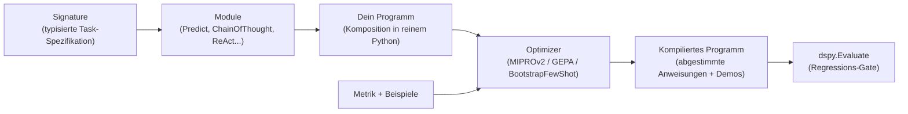
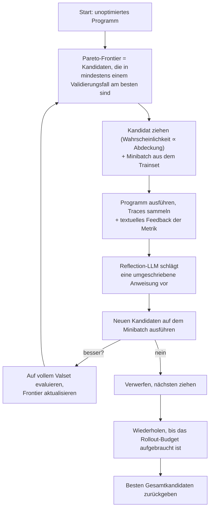

# DSPy für Backend-Engineers: Signatures, Optimizer und GEPA vs. MIPROv2

Wenn du einen langlebigen Spring-Boot-Service betreut hast, kennst du den Unterschied zwischen
Konfiguration und Code. Werte in der `application.yml` editierst du nicht von Hand auf
Produktionsrechnern, und Connection-Pool-Größen legst du nicht nach Bauchgefühl fest. Du
deklarierst sie, misst sie und änderst sie in einem Review-gesicherten, reproduzierbaren Prozess.

Leg diesen Maßstab jetzt an die LLM-Entwicklung an. Die meisten Teams „machen KI“ so, wie wir 2009
Ops gemacht haben: Jemand ändert in einem PR von Hand einen Prompt-String, schaut sich fünf Outputs
in einem Notebook an, deployt – und sechs Wochen später macht ein Modell-Upgrade den Prompt
unbemerkt kaputt.

**DSPy** ([dspy.ai](https://dspy.ai)) ist das Framework von Stanford NLP, das dazu sagt: Stopp.
Behandle den Prompt als **kompiliertes Artefakt**. Du schreibst den *Quellcode*, nämlich eine
typisierte Deklaration der Task, zusammengesetzt in gewöhnlichem Python, plus eine **Metrik**, die
Outputs bewertet. Eine Komponente des Frameworks, der **Optimizer**, erzeugt und optimiert dann die
eigentlichen Prompts automatisch – gegen deine Metrik, auf deinen Daten.

Dieser Artikel erklärt, wie das funktioniert, und widmet sich dann der Frage, die sich nach der
Einführung wirklich stellt: **Welchen Optimizer nimmt man?** Die beiden wichtigsten Strategien sind
heute **MIPROv2** (Bayes'sche Suche über Anweisungen und Few-Shot-Beispiele) und **GEPA**
(reflektierende Prompt-Evolution auf einer Pareto-Frontier, ICLR 2026 Oral). Sie suchen
unterschiedlich, kosten unterschiedlich viel und stellen unterschiedliche Anforderungen an deine
Metrik.

Alles stützt sich auf ein kleines, lauffähiges Beispiel, das ich für diesen Artikel gebaut habe: ein
Programm zur **Triage von Spring-Boot-Produktions-Incidents**, das Logzeilen und Stack Traces in
Root-Cause-Kategorien einordnet. Es ist die Domäne, in der sich dieser Blog meist bewegt, und klein
genug, dass ein vollständiger Optimierungslauf günstig bleibt.

Stack: **Python 3.11+, DSPy 3.5, ein beliebiger LLM-Provider**.

<div class="post-tldr" markdown="1">
<p class="post-tldr-title">TL;DR</p>

- **DSPy = Prompts als Build-Artefakte.** Du deklarierst eine `Signature` (typisierte Inputs/Outputs), setzt `Module` in Python zusammen, schreibst eine Metrik – und ein **Optimizer** kompiliert daraus abgestimmte Anweisungen plus Few-Shot-Beispiele. Ein Modellwechsel wird zur Neukompilierung statt zum Umschreiben von Prompts.
- Der Kernablauf ist überall gleich: **Programm + rund 30 gelabelte Beispiele + Metrik → `optimizer.compile(program, trainset=...)` → ein gespeichertes, diffbares Artefakt.** Keine Prompt-Strings im Quellcode.
- **MIPROv2** = ein Kandidatenraster vorschlagen (Anweisungen × Demos) und den Gewinner per **Bayes'scher Optimierung** auf Minibatch-Evaluierungen bestimmen. Guter Allrounder; für lange Läufe sind 200+ Beispiele sinnvoll; die Metrik ist ein einfacher Float.
- **GEPA** = **reflektierende Evolution**: Ein starkes LLM schreibt Anweisungen anhand von *textuellem Feedback* darüber um, warum Vorhersagen falsch waren, und eine **Pareto-Frontier** bewahrt Kandidaten, die in irgendeinem Einzelfall gewinnen. Schlug MIPROv2 über sechs Benchmark-Tasks um **mehr als 10 Punkte** bei vergleichbaren Kosten (ICLR 2026 Oral) und übertraf GRPO-Fine-Tuning mit bis zu **35-mal weniger Rollouts**.
- Entscheidungsregel: **Die Metrik kann Fehler in Worten erklären → GEPA. Die Metrik ist ein Black-Box-Skalar, oder du brauchst Demo-Auswahl → MIPROv2.** Beide lassen deinen Programmcode unangetastet.
</div>

---

## Was ist DSPy?

DSPy ist ein Open-Source-Python-Framework von Stanford NLP. Es ging aus der Forschung zu
Demonstrate-Search-Predict (Dezember 2022) hervor, und die aktuelle 3.x-Linie ist weit verbreitet:
mehrere Millionen PyPI-Downloads pro Monat und zum Zeitpunkt des Schreibens rund 40k GitHub-Sterne.
Der Leitspruch des Projekts bringt die Philosophie auf den Punkt: Sprachmodelle programmieren,
statt ihnen Prompts zu schreiben.

Die Prämisse: Ein Prompt ist kein Quellcode, sondern ein *Ergebnis*, das kompilierte Resultat dreier
Eingaben, die du wie Quellcode pflegen *kannst*:

1. **Was die Task ist**: eine typisierte Schnittstelle mit Inputs, Outputs und Constraints.
2. **Wie sich die Schritte zusammensetzen**: gewöhnlicher Python-Kontrollfluss.
3. **Was „korrekt“ heißt**: eine Metrikfunktion über gelabelte Beispiele.

Schreib Nr. 1 bis 3 von Hand und lass einen Algorithmus den Prompt erzeugen. Ändert sich das Modell,
schreibst du den Prompt nicht um, sondern **kompilierst neu**.

Wenn du je für dasselbe Feature parallel einen GPT-4-Prompt, einen Claude-Prompt und einen Prompt für
ein lokales Llama gepflegt hast, verstehst du, warum das wichtig ist. Es ist derselbe Impuls, der uns
von handgepflegter Server-Konfiguration zu deklarierter Infrastruktur gebracht hat.

## Wie DSPy funktioniert: Signatures, Modules, Optimizer

DSPy kennt genau drei Abstraktionen. Das ist das ganze Framework.



### Was ist eine DSPy-Signature?

Eine **Signature** ist eine deklarative Spezifikation des Input-/Output-Verhaltens einer Task. Stell
sie dir als Methodensignatur mit Semantik vor, nicht nur mit Typen. Feldnamen tragen Bedeutung; DSPy
macht im Hintergrund Prompts daraus.

```python
class IncidentTriage(dspy.Signature):
    """Classify a Spring Boot production incident by its root cause and severity,
    and propose a fix."""

    incident_report: str = dspy.InputField(
        desc="Log line, stack trace excerpt or error description"
    )
    root_cause: Literal[
        "config-misconfiguration",
        "dependency-conflict",
        "connection-pool-exhaustion",
        "serialization-error",
        "memory-pressure",
        "thread-starvation",
    ] = dspy.OutputField(desc="One of the fixed root-cause categories")
    severity: Literal["P1", "P2", "P3"] = dspy.OutputField(
        desc="P1 = service down / data risk, P2 = degraded, P3 = contained"
    )
    action: str = dspy.OutputField(desc="One-sentence remediation")
```

Beachte, was eine Signature dir bietet, ein Prompt-String aber nicht: **Struktur, die der Parser
durchsetzen kann**. `root_cause` ist ein `Literal`-Typ. Das Modell kann nicht mit
`Probably database stuff` antworten; es muss einen von sechs Werten liefern, sonst wiederholt DSPys
Adapter den Aufruf und wirft schließlich einen Fehler. Das ist dasselbe Prinzip, wie JSON auf ein
typisiertes DTO zu mappen, statt Strings von Hand zu parsen.

### Was ist ein DSPy-Module?

Ein **Module** ist eine wiederverwendbare Prompting-Strategie, die über jede Signature
verallgemeinert ist – die Idee von PyTorchs `nn.Module`, angewandt auf Prompts. Alle bauen auf
`dspy.Predict` auf; die bekanntesten:

| Module | Abstrahierte Strategie |
|---|---|
| `dspy.Predict(sig)` | Direkte Completion |
| `dspy.ChainOfThought(sig)` | Fügt vor der Antwort einen Reasoning-Schritt ein |
| `dspy.ReAct(sig, tools=[...])` | Schleife aus Reasoning und Tool-Nutzung für Agents |
| `dspy.ProgramOfThought(sig)` | Erzeugt Code und führt ihn aus, um zu antworten |
| `dspy.BestOfN(sig, N)` | Zieht N Kandidaten und behält den mit der besten Bewertung |

Dein Programm ist eine Unterklasse von `dspy.Module`, deren `forward()` Sub-Modules mit normalem
Python zusammensetzt: Bedingungen, Schleifen, eigene Klassen. Hier das *komplette* Modell unseres
Incident-Triage-Beispiels:

```python
class IncidentTriageProgram(dspy.Module):
    def __init__(self):
        super().__init__()
        self.triage = dspy.ChainOfThought(IncidentTriage)

    def forward(self, incident_report: str) -> dspy.Prediction:
        return self.triage(incident_report=incident_report)
```

Achte darauf, was in dieser Datei **nicht** steht: kein Prompt-Text, keine Few-Shot-Beispiele, kein
Modellname, keine Temperatur. All das gibt es durchaus, aber als *Parameter* – und genau das macht
es optimierbar. Der Aufruf des Programms liefert typisierte Felder (`root_cause`, `severity`,
`action`) plus ein `reasoning`-Feld, das `ChainOfThought` für den Denkschritt ergänzt.

### Was ist ein DSPy-Optimizer?

Ein **Optimizer** (früher *Teleprompter* genannt) ist ein Algorithmus, der die Parameter deines
Programms, also Anweisungen und/oder Few-Shot-Demos, so abstimmt, dass deine Metrik maximal wird.
Eine Few-Shot-Demo ist ein gelöstes Input→Output-Beispiel, das in den Prompt eingefügt wird; eine
Anweisung ist die Vorgabe auf Systemebene, die DSPy pro Module erzeugt.

`optimizer.compile(program, trainset=...)` ist buchstäblich ein Compiler-Schritt: Er lässt dein
Programm auf Daten laufen, misst, sucht und gibt ein **kompiliertes Programm** zurück, dessen
Predictors nun abgestimmte Anweisungen und Demos tragen. Speichern kannst du es mit
`program.save("optimized.json")` – ein diffbares, reviewbares Artefakt, so wie du auch ein
Migrationsskript reviewen würdest.

Die Auswertung ist ein einziger Aufruf:

```python
evaluate = dspy.Evaluate(
    devset=valset,
    metric=triage_metric,
    num_threads=4,
    display_table=3,
)
result = evaluate(program)
```

Die Größenempfehlung der DSPy-Doku: **rund 30 gelabelte Beispiele, damit sich ein Nutzen zeigt, rund
300 für Produktionsqualität**, aufgeteilt in etwa 20 % Training und 80 % Validierung, weil Optimizer
jeden Kandidaten gegen die Validierungsdaten bewerten. Das ist bewusst das *Gegenteil* der
Deep-Learning-Praxis: Du trainierst keine Gewichte, sondern durchsuchst einen viel kleineren Raum,
und das Validierungsset ist dein Kompass.

Noch etwas, das du dir einprägen solltest: **Deine Metrik ist der Vertrag.** Jeder Optimizer in
diesem Artikel ist nur so schlau wie die Funktion, die die Outputs bewertet. Für Klassifikation
genügt eine Exact-Match-Metrik. Für unscharfe Tasks liefert DSPy `dspy.evaluate.SemanticF1` mit
(selbst als kleines DSPy-Programm implementiert), und du kannst Metriken schreiben, die Teilpunkte
vergeben.

---

## Ein lauffähiges Beispiel: Spring-Boot-Incident-Triage

Genug Theorie. Das Begleit-Repo zu diesem Artikel setzt eine Task um, die jeder Backend-Engineer
kennt: On-Call-Triage. Gegeben eine Logzeile oder ein Stack-Trace-Auszug, bestimme die **Root Cause**
(sechs Kategorien) und die **Severity** (P1/P2/P3) und formuliere einen Fix in einem Satz.

Der Datensatz besteht aus 24 handgebauten, bewusst realistischen Incidents: Hikari-Pool-Timeouts,
ein `NoSuchMethodError` nach einem Jackson-Upgrade, eine `@Transactional`-Methode, die über einen
langsamen Remote-Aufruf hinweg eine Connection festhält, ein OOMKilled-Pod, dessen Heap in Ordnung
ist, dessen Metaspace aber nicht … 14 zum Training, 10 zur Validierung. Bewusst winzig: Laut
DSPy-Doku beginnt der Nutzen bei etwa 30 Beispielen, und so bleibt ein Lauf günstig.

Die Metrik gibt es in zwei Varianten, und diese Trennung ist der Schlüssel zur Frage GEPA vs.
MIPROv2 weiter unten:

```python
def triage_metric(example, pred, trace=None) -> float:
    """Plain scalar metric — what MIPROv2 and dspy.Evaluate consume."""
    root_ok = pred.root_cause == example.root_cause
    sev_ok = pred.severity == example.severity
    return (1.0 if root_ok else 0.0) + (0.25 if sev_ok else 0.0)


def triage_metric_with_feedback(example, pred, trace=None, pred_name=None, pred_trace=None):
    """GEPA metric: a score PLUS natural-language feedback about the miss."""
    problems = []
    if pred.root_cause == example.root_cause:
        root_score = 1.0
    else:
        root_score = 0.0
        problems.append(
            f"Wrong root cause: you said '{pred.root_cause}', the correct label is "
            f"'{example.root_cause}'."
        )
    # ... same for severity ...
    return dspy.Prediction(score=root_score + sev_score,
                           feedback=" ".join(problems) or "Correct root cause and severity.")
```

Gleiche Task, gleiche Bewertung: Die eine Version beantwortet *„wie viel?“*, die andere zusätzlich
*„warum falsch?“*. Genau dieser Unterschied trennt die beiden Optimizer unten.

## Die wichtigsten Optimierungsstrategien

DSPy bringt rund ein Dutzend Optimizer in vier Familien mit. Zwischen den letzten beiden wählst du
in der Praxis.

| Optimizer | Was er abstimmt | Suchstrategie | Benötigte Daten |
|---|---|---|---|
| `BootstrapFewShot` | Nur Demos | Teacher laufen lassen, Traces behalten, die die Metrik bestehen | ~10+ |
| `BootstrapFewShotWithRandomSearch` | Nur Demos | Bootstrapping + Random Search über Varianten | 50+ |
| `COPRO` | Nur Anweisungen | Hill-Climbing per Coordinate Ascent über Umformulierungen | beliebig |
| `MIPROv2` | Anweisungen **+ Demos** | Kandidatenraster vorschlagen, **Bayes'sche Optimierung** | 200+ für lange Läufe |
| `GEPA` | Anweisungen (und Code, via `dspy.Flex`) | **Reflektierende Evolution** auf einer Pareto-Frontier | eine Handvoll, wenn die Metrik Feedback liefert |

### MIPROv2: Bayes'sche Suche über Anweisungen und Demos

**MIPROv2** (Multiprompt Instruction PRoposal Optimizer v2) ist das Arbeitspferd von DSPy, seit
Langem die Standardantwort auf „optimier das einfach“. Es läuft in drei Stufen ab:

1. **Demos bootstrappen**: `num_candidates` Sets von Few-Shot-Beispielen erzeugen. Einige werden aus
   den Labels übernommen, andere *gebootstrappt*, indem dein eigenes Programm läuft und die Traces
   behalten werden, deren Outputs die Metrik bestehen.
2. **Anweisungen vorschlagen**: Ein `prompt_model` schreibt für jedes Module Kandidaten-Anweisungen,
   gestützt auf eine Zusammenfassung des Datensatzes, den Quellcode deines Programms, die
   gebootstrappten Demos und einen zufälligen Kreativitäts-Tipp.
3. **Bayes'sche Suche**: (Anweisung, Demo)-Kombinationen ziehen, jede auf einem Minibatch von 35
   Beispielen auswerten, ein Surrogatmodell aktualisieren und dort neu ziehen, wo es eine
   Verbesserung erwartet. Alle paar Schritte folgt eine volle Evaluierung auf dem Validierungsset.
   Nach `num_trials` gewinnt das beste Programm.

```python
optimizer = dspy.MIPROv2(
    metric=triage_metric,     # plain scalar is fine here
    auto="light",             # ~6 candidates; "medium"/"heavy" scale up
    num_threads=4,
)
optimized = optimizer.compile(
    program,
    trainset=trainset,
    valset=valset,
    max_bootstrapped_demos=2,
    max_labeled_demos=2,
)
optimized.save("optimized/miprov2_triage.json")
```

Das mentale Modell: ein **festes Kandidatenraster, das ein cleverer Sampler durchsucht**. Das hat
eine echte Konsequenz: MIPROv2 kann nur unter den Anweisungs-Kandidaten wählen, die sein Proposer
vorab erzeugt hat. Steckt in keinem davon die fachliche Einsicht, die deine Task braucht („gleiche
erst die Stack-Trace-Signatur ab, bevor du die Severity beurteilst“), kann die Bayes'sche Suche sie
nicht erfinden. Sie kann nur den am wenigsten schlechten Rasterpunkt auswählen.

### GEPA: Reflektierende Prompt-Evolution auf einer Pareto-Frontier

**GEPA** (Genetic-Pareto), [Agrawal et al., 2025](https://arxiv.org/abs/2507.19457), als **ICLR 2026
Oral** angenommen, geht genau diese Einschränkung an. Es ist eine evolutionäre Suche, bei der der
*Mutationsoperator ein LLM ist, das Feedback liest*:



Vier Ideen machen das wirksam:

- **Die Metrik liefert Feedback, nicht nur eine Zahl.** Deshalb hat unser Beispiel
  `triage_metric_with_feedback`, das `dspy.Prediction(score, feedback)` zurückgibt. Die DSPy-Doku
  ist da unmissverständlich: Wer GEPA nur einen nackten Float gibt, bekommt „eine deutlich
  schwächere Version seiner selbst“. Der Feedback-Text landet *wörtlich* im Prompt des
  Reflection-LM („du hast `thread-starvation` gesagt, das korrekte Label ist `memory-pressure`;
  OOMKilled am Container-Limit bei niedriger Heap-Auslastung bedeutet, dass der *Container* der
  Engpass ist“), sodass jede Mutation gezielt erfolgt statt zufällig.
- **Pareto-Auswahl statt Highlander-Prinzip.** MIPROv2 hält genau einen Amtsinhaber; Kandidaten,
  die insgesamt mittelmäßig, aber *auf einem bestimmten Teil der Daten am besten* sind (etwa bei
  Serialisierungsfehlern), werden trotzdem aussortiert. Die Frontier von GEPA hält jeden solchen
  Spezialisten am Leben und zieht aus ihnen. Frühe Spezialisten überleben, um sich später zu
  kombinieren – derselbe Grund, aus dem genetische Algorithmen diverse Populationen halten. Das
  Paper ermittelt das per Ablation: Auf Qwen3 8B schlug Pareto-Sampling die Strategie, immer den
  aktuell besten Kandidaten zu wählen, um etwa 6 Punkte im aggregierten Score.
- **Systemweiter Merge** (`use_merge=True`): Haben zwei Linien jeweils eine komplementäre Stärke
  entwickelt, versucht GEPA, deren beste Module zusammenzuführen – in GA-Terminologie ein
  Crossover-Operator.
- **Budget als ein einziger Regler**: genau eines von `auto` (`light`/`medium`/`heavy`),
  `max_full_evals` oder `max_metric_calls`. `light` bewertet rund sechs Kandidaten-Prompts; die
  tatsächliche Zahl der Metrik-Aufrufe wächst mit der Größe des Valsets und der Zahl der Predictors,
  prüfe sie also zuerst an einem kleinen Valset.

```python
optimizer = dspy.GEPA(
    metric=triage_metric_with_feedback,  # score + textual feedback
    reflection_lm=reflection_model(),    # a STRONG model, temperature 1.0
    auto="light",
    num_threads=4,
    track_stats=True,                    # fills detailed_results
    perfect_score=1.25,                  # this metric's max; the default is 1.0
)
optimized = optimizer.compile(program, trainset=trainset, valset=valset)
```

Zwei Hinweise für den Betrieb. Erstens lohnt es sich, beim **Reflection-LM** nicht zu sparen: Es
wird pro Lauf nur wenige Male aufgerufen, gib ihm also ein stärkeres Modell als dem Task-Modell;
die DSPy-Doku empfiehlt dort ein größeres Modell, wenn man ein kleineres optimiert. Zweitens setze
`track_stats=True`: Das Ergebnis enthält dann `detailed_results` mit **jedem Kandidaten, seiner
Abstammungslinie und den Validierungs-Scores pro Beispiel** – ein Audit-Trail dafür, wie sich der
Prompt entwickelt hat, den du als JSON exportieren und wie einen PR reviewen kannst.

Ein Stolperstein, in den ich selbst gelaufen bin: GEPA überspringt die Reflexion bei jedem Beispiel,
dessen Score `perfect_score` erreicht, und das **steht standardmäßig auf 1.0**. Unsere Metrik hat
ihr Maximum bei 1.25 (Root Cause 1.0 plus 0.25 für die Severity). Mit dem Standardwert zählte also
jedes Beispiel mit der richtigen Root Cause als perfekt, und GEPA hat sich die Severity-Fehler nie
angesehen. Es untersuchte ein oder zwei Kandidaten und gab das Originalprogramm zurück. Ist das
Maximum deiner Metrik nicht 1.0, setze `perfect_score`.

Was GEPA *verändert*, ist bewusst eng gefasst: nur die `signature.instructions` jedes Predictors.
Deine Modulstruktur, dein Code, deine Demos bleiben unberührt. Optimierte Anweisungen lassen sich
zudem erstaunlich gut auf andere Modelle übertragen: Das Paper berichtet, dass auf Qwen3-8B
entwickelte Prompts bei Wiederverwendung auf GPT-4.1 Mini um ~9 % zulegten.

## GEPA vs. MIPROv2: Welchen Optimizer solltest du nehmen?

Dasselbe Framework, dasselbe Programm, dieselbe Metrikfunktion – aber unterschiedliche
Suchparadigmen:

| Dimension | MIPROv2 | GEPA |
|---|---|---|
| Paradigma | **Bayes'sche Optimierung** über ein festes Kandidatenraster | **Reflektierende Evolution** über eine offene Kandidatenmenge |
| Was er abstimmt | Anweisungen **+ Few-Shot-Demos** gemeinsam | Nur Anweisungen (Code ebenfalls, via `dspy.Flex`) |
| Metrik-Vertrag | Reiner Skalar (Float/Bool) | `dspy.Prediction(score, feedback)` – Feedback pro Predictor |
| Gedächtnis der Suche | Ein einzelner bisher bester Amtsinhaber | **Pareto-Frontier** der Sieger je Instanz + Merge |
| Budget-Parameter | `auto` oder `num_candidates` + `num_trials` | genau einer: `auto` / `max_full_evals` / `max_metric_calls` |
| Typische Prompts | Länger (Few-Shot-Demos blähen sie auf) | Bis zu **9,2-mal kürzere** Anweisungen (Messung aus dem Paper) |
| Datenbedarf | Lange Läufe lohnen sich ab 200+ Beispielen | Eine Handvoll genügt, *wenn das Feedback aussagekräftig ist*; Valset klein halten |
| Zentrale Ergebnisse | Solider Standard; ReAct-Beispiel der Doku: 8 % → ~42 % (MIPROv2, `medium`) | **Mehr als 10 Punkte vor MIPROv2** über 6 Tasks (laut Abstract) |

Die Kostenzahlen des Papers sind interessanter als die Genauigkeitswerte. In den Experimenten mit
GPT-4.1 Mini beliefen sich die LM-Gesamtausgaben auf **86 $ für GEPA gegenüber 76 $ für MIPROv2** –
vergleichbar – bei etwa dem doppelten aggregierten Zugewinn (+12,2 Punkte gegenüber +5,6;
GEPA+Merge: +13,3). Gegenüber RL-Fine-Tuning (GRPO) erreichte GEPA dessen beste Validierungs-Scores
nach **243–1.179 Rollouts statt 24.000**, also bis zu 78-mal höherer Sample-Effizienz, und lag im
Schnitt 6 Punkte (maximal 20) über GRPO. Das sind die Benchmarks und Setups des Papers, nicht deine
Workload; es ist aber die Peer-Review-Fassung der Behauptung „günstiger als RL“, die man in den
sozialen Medien liest.

**Die Entscheidungsregel, die ich anwenden würde**, abgeleitet aus dem Aufbau der beiden:

- **Nimm GEPA, wenn deine Metrik Fehler in Worten erklären kann.** Klassifikation mit Begründungen,
  Extraktion, die gegen Schemas validiert wird, Agents, die anhand von Traces auf Schrittebene
  bewertet werden – überall dort, wo sich „warum war das falsch“ ausdrücken lässt. Dieses Feedback
  ist der Treibstoff; ohne es betreibst du Evolution mit einer blinden Fitnessfunktion.
- **Nimm MIPROv2, wenn deine Metrik eine Black Box ist oder Demos wichtiger sind als Anweisungen.**
  Underfittet dein Programm, weil ihm In-Context-Beispiele fehlen (und nicht, weil die Anweisungen
  falsch sind), ist die gemeinsame Suche über Anweisungen und Demos bei MIPROv2 der bessere Hebel.
  Es ist auch der sanftere Einstieg: kein zweites Modell zu konfigurieren, Skalar-Metriken
  willkommen.
- **Eine günstige erste Sonde in beiden Fällen**: `BootstrapFewShotWithRandomSearch` mit einer
  Skalar-Metrik kostet fast nichts und zeigt oft, ob die Lücke bei den *Demos* liegt (dann schließt
  es sie) oder bei den *Anweisungen* (dann nicht – das ist Terrain für MIPROv2/GEPA).

Und beides schließt sich nicht aus. DSPy 3.x enthält `BetterTogether`, das Prompt-Optimierung und
Gewichts-Optimierung (etwa GEPA, danach Fine-Tuning) auf demselben Programm verkettet:
Prompt-Evolution, um die Strategie zu finden, und RL, um sie in die Gewichte zu verdichten, wenn du
dir die Rollouts leisten kannst.

## Das Beispiel ausführen

Alles oben ist Code, den du in fünf Minuten ausführen kannst. Das Begleit-Repo:

```bash
git clone https://github.com/javaAndScriptDeveloper/dspy-article
cd dspy-article
uv sync                      # Python 3.11+, installs DSPy 3.5

# Offline sanity check — drives the whole pipeline against a DummyLM:
uv run python smoke_test.py  # no API key needed

# Real runs:
export GEMINI_API_KEY=...     # free key: aistudio.google.com/apikey
                              # or set DSPY_MODEL to any dspy.LM string
uv run python 01_baseline.py         # score the unoptimized program
uv run python 02_optimize_miprov2.py # Bayesian search → optimized/miprov2_triage.json
uv run python 03_optimize_gepa.py    # reflective evolution → optimized/gepa_triage.json
```

Standardwerte: Task-Modell `gemini/gemini-3.5-flash-lite`, Reflection-Modell für GEPA
`gemini/gemini-3.5-flash` (überschreibbar mit `DSPY_MODEL` / `DSPY_REFLECTION_MODEL`; jeder
`dspy.LM`-String funktioniert, auch `openai/gpt-4o-mini`). Ein Google-AI-Studio-Key ist kostenlos,
aber die Kontingente des Free Tiers sind klein und Google ändert sie; schau also in die Limits
deines Projekts, bevor der Optimizer loslegt: Er setzt Hunderte von Aufrufen ab, und der Code
wiederholt bei 429-Fehlern den Aufruf, statt abzubrechen. Der Datensatz hat 24 Beispiele, ein Lauf
ist also klein. Was dabei herauskam, als ich ihn ausgeführt habe, steht im nächsten Abschnitt.

Was du selbst ausprobieren solltest: Diffe nach jedem Lauf das gespeicherte JSON gegen das
Quellprogramm. `02_optimize_miprov2.py` hat Anweisungen geschrieben und Few-Shot-Demos eingefügt.
`03_optimize_gepa.py` hat die Anweisung umgeschrieben, und `optimized/gepa_results.json` enthält die
vollständige evolutionäre Abstammung: jeden Kandidaten, seine Eltern, die Scores pro Beispiel. Leg
die Datei neben deinen Programmquelltext, und die Aussage ergibt sich von selbst: **Der Prompt ist
Output, nicht Quellcode.**

## Was passierte, als ich es ausgeführt habe

Ich habe alle drei Skripte am 17. November 2026 im Free Tier von Google AI Studio ausgeführt:
`gemini-3.5-flash-lite` als Task-Modell, `gemini-3.5-flash` als Reflection-Modell von GEPA,
`auto="light"` für beide Optimizer, `num_threads=4`. Die Metrik ist die oben beschriebene mit 1.25
Punkten; die Scores unten sind Durchschnitte pro Incident über die 10 Validierungs-Incidents.

| Lauf | Score (max. 1.25) | Anmerkungen |
|---|---|---|
| Unoptimiertes Programm, 3 Läufe ohne Cache | 1.10 / 1.12 / 1.10 | 88–90 % des Maximums |
| MIPROv2, `light` | 1.12 | innerhalb des obigen Lauf-zu-Lauf-Rauschens |
| GEPA, `light`, Standard-`perfect_score` | 1.10 | 1–2 Kandidaten, nichts zu lernen (siehe oben) |
| GEPA, `light`, `perfect_score=1.25` | **1.175** (94 %) | 21 Kandidaten, 420 Metrik-Aufrufe, ~18 Min. Wanduhrzeit |

Lies das mit diesen Einschränkungen, denn die Zahlen sind klein, und ich möchte lieber, dass du ihnen
misstraust, als dass du sie zitierst:

- **Die Baseline lag schon nahe an der Obergrenze.** Das Modell hat bei allen 10
  Validierungs-Incidents die Root Cause richtig getroffen. Jeder verlorene Punkt ging auf die
  Severity: Es hat P1 vergeben, wo das Label P2 oder P3 sagt. Mehr Spielraum gab es nicht, das
  ganze Experiment dreht sich also um etwa 2 Severity-Labels von 10.
- **GEPA wählt seinen Sieger auf denselben 10 Beispielen, auf denen ich ihn ausweise**, 1.175 ist also
  optimistisch. Es gibt kein zurückgehaltenes Test-Set. Das ist eine Demo für die Verdrahtung, kein
  Benchmark.
- **Die 1.12 von MIPROv2 sind kein Sieg.** Das unoptimierte Programm schwankte über mehrere
  Wiederholungen zwischen 1.10 und 1.12.
- **DSPy cached LM-Antworten standardmäßig auf der Festplatte.** Meine ersten „drei identischen
  Baseline-Läufe“ waren drei Cache-Treffer und kein Beleg für Stabilität. Das Repo kennt jetzt
  `DSPY_CACHE=0`, um den Cache abzuschalten, wenn du echte Varianz sehen willst.

Das nützlichere Ergebnis kam aus dem Öffnen von `optimized/gepa_triage.json`, also dem oben
empfohlenen Schritt, das Artefakt zu diffen. Die entwickelte Anweisung liest sich wie ein
beschrifteter Spickzettel. Sie zitiert Trainings-Incidents fast wörtlich
(`HikariPool - Connection is not available`, `management.server.port in use`, nicht aufgelöste
`${...}`-Platzhalter) und ordnet jedem eine Severity zu. Außerdem nennt sie eine Root Cause,
`management-port-conflict`, die keine der sechs erlaubten Kategorien ist, und ihre Liste der Root
Causes erwähnt `thread-starvation` nicht mehr. Unser `Literal`-Typ würde das erfundene Label
ablehnen, und die Anweisung lenkt das Modell jetzt von einem echten Label weg.
Der Score ist besser geworden, und das Artefakt ist in einer Weise schlechter, die die Metrik nicht
sehen kann. Genau deshalb gehört das gespeicherte JSON ins Code-Review, und genau deshalb sind ein
zurückgehaltenes Test-Set und eine Metrik, die den Kategorienraum prüft, wichtiger als die Wahl des
Optimizers.

Ein Urteil im Duell GEPA gegen MIPROv2 habe ich aus diesem Lauf nicht abgeleitet, und ein Lauf auf 10
Beispielen kann das auch nicht. Belegt ist nur etwas Engeres: Prüfe bei einer Aufgabe, die das Modell
schon größtenteils löst, die Baseline, bevor du für Optimierung bezahlst, stelle sicher, dass der
Wertebereich deiner Metrik zu den Annahmen des Optimizers passt, und lies den entwickelten Prompt,
bevor du seinem Score traust.

## Wann solltest du DSPy nicht einsetzen?

Der ehrliche Abschnitt, denn jeder Framework-Pitch braucht einen.

- **Keine Metrik, kein DSPy.** Wenn du Outputs nicht bewerten kannst, auch nicht verrauscht, hat der
  Optimizer nichts, woran er sich hocharbeiten kann. Das Eval-Set und die Metrik zu bauen, ist die
  eigentliche Arbeit; DSPy automatisiert nur die Suche dagegen. (Teams, die diesen Schritt
  überspringen und Prompts von Hand tunen, suchen *nach Bauchgefühl* – mit schlechteren Daten.)
- **Ein stabiler Prompt für ein gelöstes Problem?** Dann lohnt sich der Abstraktions-Overhead nicht.
  DSPy zahlt sich aus, wenn Programme mehrstufig sind, Modelle wechseln oder Qualitätslücken echtes
  Geld kosten.
- **Unbegrenztes RL-Budget und trainierbare Gewichte?** Das GEPA-Paper ist da eindeutig:
  Prompt-Evolution gewinnt, wenn Rollouts teuer sind, Daten knapp oder die Gewichte hinter einer API
  eingefroren. Fine-Tuning im GRPO-Stil gewinnt weiterhin dort, wo Rollouts im Überfluss vorhanden
  sind. Andere Werkzeuge, andere Wirtschaftlichkeit.
- **Der Prompt gehört dir.** Das kompilierte Artefakt ist auf *deine Metrik* abgestimmt. Optimierst
  du gegen eine Proxy-Metrik, die nicht zur Produktion passt, lieferst du ein wunderbar optimiertes
  Programm für das falsche Ziel aus. Es gilt wie immer: Deine Eval-Suite *ist* deine Spezifikation.

---

Jeder Teil eines Backend-Stacks hat diese Behandlung schon bekommen: Konfiguration wurde zu Code,
Schemas wurden zu Migrationen, Infrastruktur wurde deklarativ. Der Prompt-String ist das letzte
Artefakt, das Leute noch um 2 Uhr nachts von Hand anpassen. DSPys Antwort ist dieselbe, die beim
Rest funktioniert hat: deklarieren, messen, versionieren. Die Optimizer sind der spannende Teil,
aber die Disziplin zahlt sich aus – der Prompt wird zu etwas, das die CI neu erzeugt, wenn sich
Modell, Daten oder Metrik ändern.

Wenn du die Optimizer noch tiefer verstehen willst, sind die Primärquellen hervorragend: das
[GEPA-Paper](https://arxiv.org/abs/2507.19457) (ICLR 2026 Oral), das
[MIPROv2-Paper](https://arxiv.org/abs/2406.11695) und der
[offizielle DSPy-Optimierungsleitfaden](https://dspy.ai/learn/optimization/overview/), der eine
[Schritt-für-Schritt-Auswahlhilfe für Optimizer](https://dspy.ai/diving-deeper/choosing-an-optimizer/)
enthält.

*Den Code zu diesem Artikel gibt es unter
**[github.com/javaAndScriptDeveloper/dspy-article](https://github.com/javaAndScriptDeveloper/dspy-article)**.
Die gesamte Pipeline lässt sich offline verifizieren – `uv sync && uv run python smoke_test.py`
führt eine vollständige GEPA-Optimierungsschleife ohne API-Key aus –, und die echten Läufe nutzen
einen kleinen Datensatz mit 24 Beispielen.*
