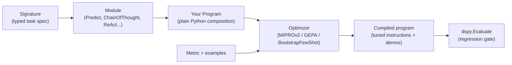
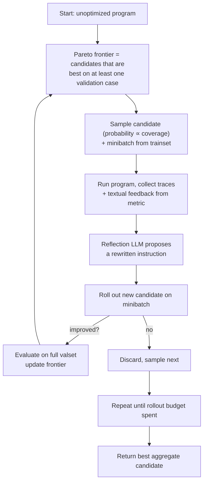

# DSPy für Backend-Engineers erklärt: Signatures, Optimizers und GEPA vs. MIPROv2

Wenn du einen langlebigen Spring-Boot-Service gewartet hast, kennst du den Unterschied zwischen
Konfiguration und Code bereits. Werte in `application.yml` editierst du nicht von Hand auf
Produktionsmaschinen, und Connection-Pool-Größen stimmst du nicht nach Bauchgefühl ab — du
deklarierst sie, misst sie und änderst sie über einen gereviewten, reproduzierbaren Prozess.

Lege diese Brille jetzt auf die LLM-Entwicklung. Die meisten Teams „machen KI“ so, wie wir 2009
Ops gemacht haben: Jemand editiert einen Prompt-String von Hand in einem PR, begutachtet fünf
Outputs in einem Notebook, shippt es — und sechs Wochen später bricht ein Modell-Upgrade es
stillschweigend.

**DSPy** ([dspy.ai](https://dspy.ai)) ist das Stanford-NLP-Framework, das sagt: Stopp. Behandle
den Prompt als **kompiliertes Artefakt**. Du schreibst den *Quellcode* — eine typisierte
Deklaration der Task, komponiert in gewöhnlichem Python — plus eine **Metrik**, die Outputs
benotet. Eine Framework-Komponente namens **Optimizer** generiert und justiert dann die
tatsächlichen Prompts automatisch — gegen deine Metrik, auf deinen Daten.

Dieser Artikel erklärt, wie das funktioniert, und geht dann tief in die Frage, der du nach der
Adoption tatsächlich begegnest: **welchen Optimizer man verwenden sollte**. Die beiden
Hauptstrategien heute sind **MIPROv2** (Bayesian Search über Instruktionen und Few-Shot-Beispiele)
und **GEPA** (reflektierende Prompt-Evolution auf einer Pareto-Frontier, ICLR 2026 Oral). Sie
suchen unterschiedlich, kosten unterschiedlich und verlangen unterschiedliche Dinge von deiner
Metrik.

Alles fußt auf einem kleinen, lauffähigen Beispiel, das ich für diesen Artikel gebaut habe: ein
**Spring-Boot-Production-Incident-Triage**-Programm, das Log-Zeilen und Stack Traces in
Root-Cause-Kategorien klassifiziert. Das ist die Domäne, in der sich dieser Blog üblicherweise
bewegt — und es ist klein genug, dass die Optimierung Cents kostet, nicht Dollar.

Stack: **Python, DSPy 3.5, ein beliebiger LLM-Provider**.

<div class="post-tldr" markdown="1">
<p class="post-tldr-title">TL;DR</p>

- **DSPy = Prompts als Build-Artefakte.** Du deklarierst eine `Signature` (typisierte Inputs/Outputs), komponierst `Module` in Python, schreibst eine Metrik — und ein **Optimizer** kompiliert das zu abgestimmten Instruktionen + Few-Shot-Beispielen. Modellwechsel werden zu Rekompilierungen, nicht zu Prompt-Rewrites.
- Der Kern-Loop ist überall derselbe: **Programm + rund 30 gelabelte Beispiele + Metrik → `optimizer.compile(program, trainset=...)` → ein gespeichertes, diffbares Artefakt.** Keine Prompt-Strings in deinem Quellcode.
- **MIPROv2** = ein Kandidatenraster vorschlagen (Instruktionen × Demos), den Gewinner mit **Bayesian Optimization** auf Minibatch-Evals wählen. Guter Allrounder; will 200+ Beispiele für lange Läufe; die Metrik ist ein schlichter Float.
- **GEPA** = **reflektierende Evolution**: Ein starkes LLM schreibt Instruktionen anhand von *textuellem Feedback* um, warum Vorhersagen falsch waren, und eine **Pareto-Frontier** bewahrt Kandidaten, die in einem einzelnen Fall gewinnen. Schlug MIPROv2 um **über 10 %** über sechs Benchmark-Tasks bei vergleichbaren Kosten (ICLR 2026 Oral) und erreicht RL-Fine-Tuning mit bis zu **35-fach weniger Rollouts**.
- Entscheidungsregel: **Metrik kann Fehler in Worten erklären → GEPA. Metrik ist eine Black-Box-Skalarzahl, oder du brauchst Demo-Selektion → MIPROv2.** Beide lassen deinen Programmcode unberührt.
</div>

---

## Was ist DSPy?

DSPy ist ein Open-Source-Python-Framework, ursprünglich von Stanford NLP gebaut (das Projekt wird
inzwischen unter Databricks entwickelt), erstmals im Dezember 2022 als
Demonstrate-Search-Predict-Compiler veröffentlicht. Die aktuelle Linie, DSPy 3.x, gehört zu den
am weitesten verbreiteten LLM-Frameworks — Millionen monatlicher Downloads und rund 40k
GitHub-Sterne — und der Slogan der Dokumentation bringt die Philosophie auf den Punkt:
**„Programmiere, statt zu prompten.“**

Die Prämisse: Ein Prompt ist kein Quellcode. Er ist ein *Output* — das kompilierte Ergebnis von
drei Inputs, die du wie Quellcode pflegen *kannst*:

1. **Was die Task ist** — ein typisiertes Interface: Inputs, Outputs, Constraints.
2. **Wie die Schritte komponieren** — gewöhnlicher Python-Kontrollfluss.
3. **Was „korrekt“ bedeutet** — eine Metrik-Funktion über gelabelte Beispiele.

Schreibe #1–#3 von Hand und lass einen Algorithmus den Prompt erzeugen. Ändert sich das Modell,
schreibst du den Prompt nicht um — du **rekompilierst**.

Wenn du jemals parallel einen GPT-4-Prompt, einen Claude-Prompt und einen lokalen Llama-Prompt für
dasselbe Feature gepflegt hast, verstehst du bereits, warum das zählt. Es ist derselbe Instinkt,
der uns von handeditierter Server-Konfiguration zu deklarierter Infrastruktur gebracht hat.

## Wie DSPy funktioniert: Signatures, Modules, Optimizers

DSPy hat exakt drei Abstraktionen zu lernen. Das ist das gesamte Framework.



### Was ist eine DSPy Signature?

Eine **Signature** ist eine deklarative Spezifikation des Input/Output-Verhaltens einer Task —
denk an eine Methodensignatur mit Semantik, nicht nur Typen. Feldnamen tragen Bedeutung; DSPy
macht im Hintergrund Prompts daraus.

```python
class IncidentTriage(dspy.Signature):
    """Classify a Spring Boot production incident by its root cause and severity,
    and propose a fix."""

    incident_report: str = dspy.InputField(
        desc="Log line, stack trace excerpt or error description"
    )
    root_cause: Literal[
        "config-misconfiguration",
        "dependency-conflict",
        "connection-pool-exhaustion",
        "serialization-error",
        "memory-pressure",
        "thread-starvation",
    ] = dspy.OutputField(desc="One of the fixed root-cause categories")
    severity: Literal["P1", "P2", "P3"] = dspy.OutputField(
        desc="P1 = service down / data risk, P2 = degraded, P3 = contained"
    )
    action: str = dspy.OutputField(desc="One-sentence remediation")
```

Beachte, was eine Signature dir gibt, was ein Prompt-String nicht kann: **Struktur, die der
Parser erzwingen kann**. `root_cause` ist ein `Literal`-Typ — das Modell kann nicht
`Probably database stuff` antworten; es muss einen von sechs Werten zurückgeben, sonst retryt
DSPys Adapter und wirft. Das ist dasselbe Muskelgedächtnis wie JSON auf ein typisiertes DTO zu
mappen, statt Strings von Hand zu parsen.

### Was ist ein DSPy Module?

Ein **Module** ist eine wiederverwendbare Prompting-Strategie, generalisiert über jede Signature —
die Idee von PyTorchs `nn.Module`, angewendet auf Prompts. Alle bauen auf `dspy.Predict` auf; die
bekannten:

| Module | Abstrahierte Strategie |
|---|---|
| `dspy.Predict(sig)` | Direkte Completion |
| `dspy.ChainOfThought(sig)` | Fügt vor der Antwort einen Reasoning-Schritt ein |
| `dspy.ReAct(sig, tools=[...])` | Reasoning- + Tool-Use-Loop für Agenten |
| `dspy.ProgramOfThought(sig)` | Generiert und führt Code, um zu antworten |
| `dspy.BestOfN(sig, N)` | Sampelt N Kandidaten, behält den besten |

Dein Programm ist eine Unterklasse von `dspy.Module`, deren `forward()` Sub-Modules mit normalem
Python komponiert — Conditionals, Loops, eigene Klassen. Hier das *gesamte* Modell unseres
Incident-Triage-Beispiels:

```python
class IncidentTriageProgram(dspy.Module):
    def __init__(self):
        super().__init__()
        self.triage = dspy.ChainOfThought(IncidentTriage)

    def forward(self, incident_report: str) -> dspy.Prediction:
        return self.triage(incident_report=incident_report)
```

Betrachte, was in dieser Datei **nicht** steht: kein Prompt-Text, keine Few-Shot-Beispiele, kein
Modellname, keine Temperatur. All das existiert — aber als *Parameter*, und genau das macht es
optimierbar. Der Programmaufruf liefert typisierte Felder (`root_cause`, `severity`, `action`)
plus ein `reasoning`-Feld, das `ChainOfThought` für den Denk-Schritt ergänzt.

### Was ist ein DSPy Optimizer?

Ein **Optimizer** (früher *Teleprompter* genannt) ist ein Algorithmus, der die Parameter deines
Programms abstimmt — die Instruktionen und/oder Few-Shot-Demos —, um deine Metrik zu maximieren.
Eine Few-Shot-Demo ist ein gelöstes Input→Output-Beispiel, das in den Prompt injiziert wird; eine
Instruktion ist die Direktive auf Systemebene, die DSPy pro Module generiert.

`optimizer.compile(program, trainset=...)` ist buchstäblich ein Compiler-Schritt: Er lässt dein
Programm auf Daten laufen, misst, sucht, und gibt ein **kompiliertes Programm** zurück, dessen
Predictors nun abgestimmte Instruktionen und Demos tragen. Speichern tust du es mit
`program.save("optimized.json")` — ein diffbares, reviewbares Artefakt, genauso wie du ein
Migrationsskript reviewen würdest.

Die Evaluationsseite ist ein Aufruf:

```python
evaluate = dspy.Evaluate(
    devset=valset,
    metric=triage_metric,
    num_threads=4,
    display_table=3,
)
result = evaluate(program)
```

Die Größenempfehlung der DSPy-Doku: **rund 30 gelabelte Beispiele für Mehrwert, rund 300 für
Produktionsqualität** — gesplittet in ~20 % Training / 80 % Validierung, weil Optimizer jeden
Kandidaten gegen die Validierung bewerten. Das ist bewusst das *Gegenteil* der Deep-Learning-Praxis:
Du fittest keine Gewichte, du durchsuchst einen viel kleineren Raum, und das Validierungsset ist
der Kompass.

Noch etwas, das sich zu verinnerlichen lohnt: **Deine Metrik ist der Contract**. Jeder Optimizer
in diesem Artikel ist nur so schlau wie die Funktion, die Outputs benotet. Für Klassifikation
reicht eine Exact-Match-Metrik. Für unscharfe Tasks bringt DSPy `SemanticF1` mit — selbst als
kleines DSPy-Programm implementiert —, und du kannst Assertion-Style-Metriken schreiben, die
Teilpunkte vergeben.

---

## Ein lauffähiges Beispiel: Spring Boot Incident Triage

Genug Theorie. Das Begleit-Repo zu diesem Artikel implementiert eine Task, die jeder
Backend-Engineer kennt: On-Call-Triage. Gegeben eine Log-Zeile oder ein Stack-Trace-Auszug,
klassifiziere die **Root Cause** (sechs Kategorien), die **Severity** (P1/P2/P3) und liefere
einen Ein-Satz-Fix.

Der Datensatz besteht aus 24 handgebauten, absichtlich realistischen Incidents — Hikari-Pool-Timeouts,
`NoSuchMethodError` nach einem Jackson-Upgrade, eine `@Transactional`-Methode, die eine Verbindung
über einen langsamen Remote-Aufruf hinweg hält, ein OOMKilled-Pod, dessen Heap okay ist, dessen
Metaspace aber nicht … 14 für Training, 10 für Validierung. Absichtlich winzig: DSPys Doku sagt,
Mehrwert beginnt bei etwa 30 Beispielen, und das hält den gesamten Lauf im Centbereich.

Die Metrik hat zwei Varianten — und diese Aufspaltung ist der Schlüssel zur GEPA-vs.-MIPROv2-Frage
später:

```python
def triage_metric(example, pred, trace=None) -> float:
    """Plain scalar metric — what MIPROv2 and dspy.Evaluate consume."""
    root_ok = pred.root_cause == example.root_cause
    sev_ok = pred.severity == example.severity
    return (1.0 if root_ok else 0.0) + (0.25 if sev_ok else 0.0)


def triage_metric_with_feedback(example, pred, trace=None, pred_name=None, pred_trace=None):
    """GEPA metric: a score PLUS natural-language feedback about the miss."""
    problems = []
    if pred.root_cause == example.root_cause:
        root_score = 1.0
    else:
        root_score = 0.0
        problems.append(
            f"Wrong root cause: you said '{pred.root_cause}', the correct label is "
            f"'{example.root_cause}'."
        )
    # ... same for severity ...
    return dspy.Prediction(score=root_score + sev_score,
                           feedback=" ".join(problems) or "Correct root cause and severity.")
```

Dieselbe Task, dieselbe Benotung — eine Version beantwortet *„wie viel?“*, die andere beantwortet
zusätzlich *„warum falsch?“*. Behalte das im Kopf; es wird gleich von großer Bedeutung sein.

## Die wichtigsten Optimierungsstrategien

DSPy bringt rund ein Dutzend Optimizer in vier Familien mit. Die beiden, zwischen denen du
tatsächlich wählst, sind die letzten beiden.

| Optimizer | Was er abstimmt | Suchstrategie | Datenbedarf |
|---|---|---|---|
| `BootstrapFewShot` | Nur Demos | Teacher laufen lassen, Traces behalten, die die Metrik bestehen | ~10+ |
| `BootstrapFewShotWithRandomSearch` | Nur Demos | Bootstrapping + Random Search über Varianten | 50+ |
| `COPRO` | Nur Instruktionen | Coordinate-Ascent-Hill-Climbing über Rewrites | beliebig |
| `MIPROv2` | Instruktionen **+ Demos** | Kandidatenraster vorschlagen, **Bayesian Optimization** | 200+ für lange Läufe |
| `GEPA` | Instruktionen (und Code, via `dspy.Flex`) | **Reflektierende Evolution** auf einer Pareto-Frontier | eine Handvoll, wenn die Metrik Feedback gibt |

### MIPROv2: Bayesian Search über Instruktionen und Demos

**MIPROv2** (Multiprompt Instruction PRoposal Optimizer v2) ist DSPys Arbeitstier — die seit
Langem übliche Antwort auf „optimier es einfach“. Es läuft in drei Stufen:

1. **Demos bootstrappen** — erzeuge `num_candidates` Sätze von Few-Shot-Beispielen: einige aus
   Labels kopiert, einige *gebootstrapped*, indem du dein eigenes Programm laufen lässt und Traces
   behältst, deren Outputs die Metrik bestehen.
2. **Instruktionen vorschlagen** — ein `prompt_model` schreibt Instruktions-Kandidaten für jedes
   Module, fundiert in einer Datensatz-Zusammenfassung, dem Quellcode deines Programms, den
   gebootstrapped Demos und einem zufälligen Kreativ-Tipp.
3. **Bayesian Search** — (Instruktion, Demo)-Kombinationen sampeln, jede auf einem Minibatch von
   35 Beispielen evaluieren, ein Surrogatmodell aktualisieren und dort nachsampeln, wo es
   Verbesserung vorhersagt. Volle Validierungs-Evals alle paar Schritte. Nach `num_trials` gewinnt
   das beste Programm.

```python
optimizer = dspy.MIPROv2(
    metric=triage_metric,     # plain scalar is fine here
    auto="light",             # ~6 candidates; "medium"/"heavy" scale up
    num_threads=4,
)
optimized = optimizer.compile(
    program,
    trainset=trainset,
    valset=valset,
    max_bootstrapped_demos=2,
    max_labeled_demos=2,
)
optimized.save("optimized/miprov2_triage.json")
```

Das mentale Modell: ein **festes Kandidatenraster, erkundet von einem schlauen Sampler**. Das hat
eine echte Konsequenz: MIPROv2 kann nur aus den Instruktions-Kandidaten wählen, die sein Proposer
vorab zu generieren wusste. Kodiert keiner von ihnen die Domänen-Einsicht, die deine Task brauchte
(„matche die Stack-Trace-Signatur, bevor du die Severity beurteilst“), kann Bayesian Search sie
nicht erfinden — er kann nur den am wenigsten schlechten Rasterpunkt wählen.

### GEPA: Reflektierende Prompt-Evolution auf einer Pareto-Frontier

**GEPA** (Genetic-Pareto) — [Agrawal et al., 2025](https://arxiv.org/abs/2507.19457), angenommen
als **ICLR 2026 Oral** — greift diese Einschränkung direkt an. Es ist eine evolutionäre Suche, bei
der der *Mutationsoperator ein LLM ist, das Feedback liest*:



Vier Ideen machen das wirksam:

- **Die Metrik gibt Feedback zurück, nicht nur eine Zahl.** Deshalb hat unser Beispiel
  `triage_metric_with_feedback`, das `dspy.Prediction(score, feedback)` zurückgibt. Die DSPy-Doku
  ist da deutlich: Gibt man GEPA einen nackten Float, bekommt man „eine viel schwächere Version
  seiner selbst“. Der Feedback-Text wandert *wortwörtlich* in den Prompt des Reflection-LM — „du
  sagtest `thread-starvation`, das korrekte Label ist `memory-pressure`; OOMKilled am
  Container-Limit mit niedriger Heap-Auslastung bedeutet, dass der *Container* der Flaschenhals
  ist“ —, sodass jede Mutation informiert ist, nicht zufällig.
- **Pareto-Selektion statt King of the Hill.** MIPROv2 hält einen einzigen Amtsinhaber; Kandidaten,
  die insgesamt mittelprächtig, aber *auf einem bestimmten Slice am besten* sind (etwa
  Serialisierungsfehler), fliegen trotzdem raus. Die GEPA-Frontier hält jeden solchen Spezialisten
  am Leben und sampelt aus ihnen. Frühe Spezialisten-Kandidaten überleben, um sich später zu
  rekombinieren — derselbe Grund, aus dem genetische Algorithmen diverse Populationen halten. Das
  Paper ablasiert das: Pareto-Sampling gegenüber gierigem „nimm immer den Besten“ bringt bis zu
  ~8 % aggregiert.
- **System-aware Merge** (`use_merge=True`): Haben zwei Linien jeweils eine komplementäre Stärke
  gelernt, versucht GEPA, deren beste Modules zu mergen — ein Crossover-Operator, in GA-Terminen.
- **Budget als ein einziger Knopf**: genau eine der Optionen `auto` (`light`/`medium`/`heavy`),
  `max_full_evals` oder `max_metric_calls`. Bei einem Zwei-Predictor-Programm über 100 Beispiele
  entspricht `light` ≈ 1.330 Metrik-Aufrufen.

```python
optimizer = dspy.GEPA(
    metric=triage_metric_with_feedback,  # score + textual feedback
    reflection_lm=reflection_model(),    # a STRONG model, temperature 1.0
    auto="light",
    num_threads=4,
    track_stats=True,                    # fills detailed_results
)
optimized = optimizer.compile(program, trainset=trainset, valset=valset)
```

Zwei operationale Anmerkungen aus der produktiven Nutzung. Erstens ist das **Reflection-LM der
teure Knopf** — es läuft seriell (eine Handvoll Aufrufe pro Lauf, ~12–36 bei mittlerem Budget),
gib ihm also ein stärkeres Modell als das Task-Modell; DSPys eigene Tutorials nutzen dort
Frontier-Modelle. Zweitens setze `track_stats=True`: Das Ergebnis trägt `detailed_results` mit
**jedem Kandidaten, seiner Eltern-Linie und Validierungs-Scores pro Beispiel** — ein Audit-Trail
der Prompt-Evolution, den du als JSON exportieren und wie einen PR reviewen kannst.

Was GEPA *ändert*, ist bewusst schmal: nur die `signature.instructions` jedes Predictors. Deine
Module-Komposition, dein Code, deine Demos — unberührt. Optimierte Instruktionen übertragen sich
zudem bemerkenswert gut modellübergreifend: Das Paper berichtet, dass auf Qwen3-8B evolvierte
Prompts bei Wiederverwendung auf GPT-4.1 Mini ~9 % zulegten.

## GEPA vs. MIPROv2: Welchen Optimizer solltest du verwenden?

Dasselbe Framework, dasselbe Programm, dieselbe Metrik-Funktion — unterschiedliche
Suchparadigmen. Hier der ehrliche Vergleich:

| Dimension | MIPROv2 | GEPA |
|---|---|---|
| Paradigma | **Bayesian Optimization** über ein festes Kandidatenraster | **Reflektierende Evolution** über eine offene Kandidatenmenge |
| Was er abstimmt | Instruktionen **+ Few-Shot-Demos** gemeinsam | Nur Instruktionen (auch Code, via `dspy.Flex`) |
| Metrik-Contract | Reiner Skalar (Float/Bool) | `dspy.Prediction(score, feedback)` — Feedback je Predictor |
| Erinnerung der Suche | Einziger best-bisher-Amtsinhaber | **Pareto-Frontier** der Sieger je Instanz + Merge |
| Budget-Knöpfe | `auto` oder `num_candidates` + `num_trials` | genau einer: `auto` / `max_full_evals` / `max_metric_calls` |
| Typische Prompts | Länger (Few-Shot-Demos blähen sie auf) | Bis zu **9,2-fach kürzere** Instruktionen (Paper-Messung) |
| Datenempfehlung | 200+ Beispiele glänzen bei langen Läufen | Eine Handvoll reicht, *wenn das Feedback reich ist*; Valset klein halten |
| Auffälligste Ergebnisse | Solider Default; ReAct 24 %→51 % im Doku-Beispiel | **+10 % gegenüber MIPROv2** über 6 Tasks; +12 % auf AIME 2025 |

Die Kostenzahlen des Papers sind interessanter als die Genauigkeitszahlen. In den
GPT-4.1-Mini-Experimenten belief sich die LM-Gesamtausgabe auf **86 $ für GEPA gegenüber 76 $ für
MIPROv2** — vergleichbar —, für ungefähr den doppelten Gesamtgewinn (+13,3 % gegenüber +5,6 %).
Gegen RL-Fine-Tuning (GRPO) erreichte GEPA dessen beste Validierungs-Scores nach **243–1.179
Rollouts gegenüber 24.000** — bis zu 78-fach bessere Sample-Effizienz —, und lag im Schnitt +6 %
(bis zu +20 %) über GRPO. Das ist die Peer-Review-Version des „10–80-fach günstiger als
RL“-Framings, das man in den sozialen Medien sieht.

**Meine Entscheidungsregel**, nachdem ich beide an derselben Task verdrahtet habe:

- **Wähle GEPA, wenn deine Metrik Fehltritte in Worten erklären kann.** Klassifikation mit
  Begründungen, Extraktion, die gegen Schemas validiert wird, Agenten, die an Step-Level-Traces
  beurteilt werden — überall dort, wo sich „warum war das falsch“ ausdrücken lässt. Dieses
  Feedback ist der Treibstoff; ohne es fährst du Evolution mit einer blinden Fitness-Funktion.
- **Wähle MIPROv2, wenn deine Metrik eine Black Box ist oder Demos mehr zählen als Instruktionen.**
  Underfittet dein Programm, weil ihm In-Context-Beispiele fehlen (nicht weil seine Instruktionen
  falsch sind), ist MIPROv2s gemeinsame Instruktionen+Demos-Suche der bessere Hebel. Sie ist auch
  die schonendere erste Sprosse: kein zweites Modell zu konfigurieren, Skalar-Metriken willkommen.
- **Günstigste erste Sonde, egal wohin**: `BootstrapFewShotWithRandomSearch` mit einer
  Skalar-Metrik kostet fast nichts und sagt dir oft, ob die Lücke *Demos* sind (sie schließt sie)
  oder *Instruktionen* (dann nicht — das ist MIPROv2/GEPA-Revier).

Und sie schließen sich nicht aus. DSPy 3.x bringt `BetterTogether` mit, das Prompt-Optimierung
und Gewichts-Optimierung (etwa GEPA, dann GRPO) am selben Programm verkettet — Prompt-Evolution,
um die Strategie zu finden, RL, um sie in Gewichte zu komprimieren, wenn du dir die Rollouts
leisten kannst.

## Das Beispiel ausführen

Alles oben ist Code, den du in fünf Minuten laufen lassen kannst. Das Begleit-Repo:

```bash
git clone https://github.com/javaAndScriptDeveloper/dspy-article
cd dspy-article
uv sync                      # Python 3.11+, installs DSPy 3.5

# Offline sanity check — drives the whole pipeline against a DummyLM:
uv run python smoke_test.py  # no API key needed

# Real runs:
export OPENAI_API_KEY=sk-...     # or set DSPY_MODEL to any dspy.LM string
uv run python 01_baseline.py         # score the unoptimized program
uv run python 02_optimize_miprov2.py # Bayesian search → optimized/miprov2_triage.json
uv run python 03_optimize_gepa.py    # reflective evolution → optimized/gepa_triage.json
```

Defaults: Task-Modell `openai/gpt-4o-mini`, GEPA-Reflection-Modell `openai/gpt-4o`
(überschreibbar mit `DSPY_MODEL` / `DSPY_REFLECTION_MODEL`). Bei 24 Beispielen landen beide
Optimierungsläufe im Centbereich.

Der Moment, der sich zu selbst machen lohnt: Diffe nach jedem Lauf das gespeicherte JSON gegen
das Quellprogramm. `02_optimize_miprov2.py` wird Instruktionen geschrieben und Few-Shot-Demos
injiziert haben. `03_optimize_gepa.py` wird die Instruktion umgeschrieben haben — und
`optimized/gepa_results.json` enthält die vollständige evolutionäre Linie: jeden Kandidaten,
seine Eltern, Scores pro Beispiel. Diese Datei ist die gesamte DSPy-These in einem Artefakt:
**Der Prompt ist Output, nicht Quelle.**

## Wann solltest du DSPy nicht einsetzen?

Ehrlichkeits-Abschnitt, denn jeder Framework-Pitch braucht einen.

- **Keine Metrik, kein DSPy.** Kannst du Outputs nicht bewerten — auch nicht mit Rauschen —, hat
  der Optimizer nichts zu erklimmen. Das Eval-Set und die Metrik zu bauen, ist die eigentliche
  Arbeit; DSPy automatisiert nur die Suche dagegen. (Teams, die diesen Schritt überspringen und
  Prompts von Hand tunen, machen die Suche *nach Bauchgefühl* — mit schlechteren Daten.)
- **Ein stabiler Prompt bei einem gelösten Problem?** Füge die Abstraktionssteuer nicht hinzu.
  DSPy zahlt sich aus, wenn Programme mehrstufig sind, Modelle wechseln oder Qualitätslücken
  echtes Geld kosten.
- **Unbegrenztes RL-Budget und trainierbare Gewichte?** Das GEPA-Paper ist explizit:
  Prompt-Evolution gewinnt, wenn Rollouts teuer, Daten knapp oder Gewichte API-gefroren sind.
  GRPO-Style-Fine-Tuning gewinnt weiterhin im Regime reichlicher Rollouts. Andere Werkzeuge,
  andere Ökonomie.
- **Du besitzt den Prompt.** Das kompilierte Artefakt ist auf *deine Metrik* abgestimmt —
  optimierst du gegen eine Proxy-Metrik, die nicht zur Produktion passt, shipst du ein wunderschön
  optimiertes Programm für das falsche Ziel. Dieselbe Regel wie immer: Deine Eval-Suite *ist*
  deine Spec.

---

Das mitzunehmende Muster ist jenes, das dieser Blog in anderen Domänen immer wieder umkreist:
Verlagerung von Laufzeit-Urteilen in deklarierte, messbare, versionierte Artefakte. Wir haben es
für Infrastruktur getan, dann für Schema-Migrationen; DSPy tut es für das letzte handeditierte
Artefakt im Stack, den Prompt-String. Die Optimizer sind der interessante Teil — aber der Lohn
ist die *Disziplin*. Der Prompt hört auf, das Ding zu sein, das jemand um 2 Uhr nachts anstutzt,
und wird das Ding, das CI neu erzeugt, wenn sich Modell, Daten oder Metrik ändern.

Willst du eine zweite, tiefere Runde zu den Optimizern, sind die Primärquellen exzellent: das
[GEPA-Paper](https://arxiv.org/abs/2507.19457) (ICLR 2026 Oral), das
[MIPROv2-Paper](https://arxiv.org/abs/2406.11695) und der
[offizielle DSPy-Optimierungs-Guide](https://dspy.ai/learn/optimization/overview/), der einen
[Schritt-für-Schritt-Optimizer-Wähler](https://dspy.ai/diving-deeper/choosing-an-optimizer/)
enthält.

*Der Code zu diesem Artikel ist verfügbar unter
**[github.com/javaAndScriptDeveloper/dspy-article](https://github.com/javaAndScriptDeveloper/dspy-article)**.
Die gesamte Pipeline verifiziert offline — `uv sync && uv run python smoke_test.py`
führt eine vollständige GEPA-Optimierungsschleife ohne API-Key aus —, und die echten Läufe kosten
Cents auf dem beiliegenden 24-Beispiele-Datensatz.*
