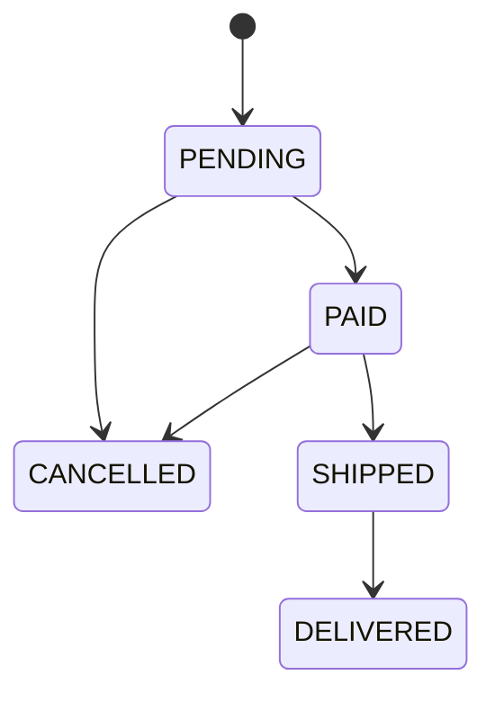

# Enums in der Datenbank speichern: @Enumerated, Postgres-Enum-Typen und Lookup-Tabellen

Fast jedes Domänenmodell hat ein Feld, das nur einen von einer Handvoll Werte annehmen kann. Eine
Bestellung ist `PENDING`, `PAID`, `SHIPPED`, `DELIVERED` oder `CANCELLED`. Eine Zahlung ist
autorisiert oder abgebucht. Ein Abo läuft auf einem von vier Plänen. In Java greifst du ohne
Nachdenken zu einem `enum`. Die interessante Frage ist, was an der Grenze passiert — **wie diese
endliche Menge von Werten tatsächlich in der Datenbank lebt**, und was jede Option dich sechs
Monate später kostet, wenn sich die Menge ändert.

Dieser Artikel geht jeden gängigen Weg durch, ein Enum mit Hibernate zu persistieren — in der
Reihenfolge, in der du ihnen tatsächlich begegnest: die beiden `@Enumerated`-Modi, einen echten
Postgres-`ENUM`-Typ, einen `AttributeConverter` und schließlich den Lookup-Table-Ansatz, bei dem
das Enum zur eigenen Tabelle wird. Ich entwickle ein einziges Beispiel — den Status einer
Bestellung — durchgehend weiter und ende mit der Entscheidung, die ich tatsächlich treffe.

Stack: **Java, Spring Boot, Hibernate, PostgreSQL**.

<div class="post-tldr" markdown="1">
<p class="post-tldr-title">TL;DR</p>

- `@Enumerated(ORDINAL)` speichert die **Position** des Enums — kompakt, aber das Einfügen eines Werts in der Mitte beschädigt stillschweigend jede nachfolgende Zeile. Wenn du es wirklich brauchst, **pinne die Ordinals mit einem Unit-Test fest**.
- `@Enumerated(STRING)` speichert den **Namen der Konstante** — selbsterklärend, debuggbar, immun gegen Umordnen. Das ist der vernünftige Default.
- Begnüge dich nicht mit einem nackten `varchar` — definiere einen echten **Postgres-`ENUM`-Typ**, damit die Datenbank selbst ungültige Werte ablehnt.
- Ein **`AttributeConverter`** persistiert einen stabilen Code, entkoppelt vom Java-Namen — **Umbenennungen hören auf, ein Datenbankproblem zu sein**.
- Eine **Lookup-Tabelle** lohnt sich nur, wenn die Werte editierbare Business-Daten tragen — nicht als Workaround für Umbenennungen.
</div>

---

## Das Szenario

Wir bauen eine Bestellverwaltung. Eine Bestellung durchläuft einen festen Lebenszyklus:



In Java ist das ein offensichtliches Enum:

```java
public enum OrderStatus {
    PENDING,
    PAID,
    SHIPPED,
    DELIVERED,
    CANCELLED
}
```

Die Order-Entity hat ein `status`-Feld. Die einzige Frage ist, wie Hibernate es auf eine Spalte
mappt — und diese eine Annotation-Entscheidung hat Konsequenzen, die den Code, den du heute
schreibst, überdauern.

---

## Teil 1 — `@Enumerated(ORDINAL)`: Als Int speichern

JPA-Standard für ein Enum ist `ORDINAL`. Jede Konstante wird als ihre Position in der Deklaration
gespeichert: `PENDING` → 0, `PAID` → 1, `SHIPPED` → 2 und so weiter.

```java
@Entity
@Table(name = "orders_ordinal")
public class OrderOrdinal {

    @Id
    @GeneratedValue(strategy = GenerationType.UUID)
    private UUID id;

    @Enumerated(EnumType.ORDINAL)   // this is also the default if you omit @Enumerated
    @Column(nullable = false)
    private OrderStatus status;
}
```

```sql
CREATE TABLE orders_ordinal (
    id     UUID     PRIMARY KEY DEFAULT gen_random_uuid(),
    status SMALLINT NOT NULL
);
```

Speicherst du eine Bestellung mit Status `PAID`, hält die Spalte `1`. Das ist kompakt, und auf
dem Papier ist es in Ordnung.

### ❌ Die Falle: Einen Wert in der Mitte einfügen

Das Ordinal wird nicht als Label gespeichert — es wird als *Position* gespeichert, und die
Position bestimmt sich aus der Reihenfolge im Quellcode. An dem Tag, an dem jemand einen
Pack-Schritt zwischen bezahlt und verschickt einfügt:

```java
public enum OrderStatus {
    PENDING,
    PAID,
    PACKED,      // <-- inserted here
    SHIPPED,
    DELIVERED,
    CANCELLED
}
```

… rutscht jede Konstante nach `PAID` um eins nach unten:

| Konstante | Ordinal vorher | Ordinal nachher |
|---|---|---|
| `PENDING`   | 0 | 0 |
| `PAID`      | 1 | 1 |
| `PACKED`    | — | **2** |
| `SHIPPED`   | 2 | **3** |
| `DELIVERED` | 3 | **4** |
| `CANCELLED` | 4 | **5** |

In der Datenbank hat sich nichts geändert. Jede bestehende `SHIPPED`-Bestellung hält weiterhin
die Integer `2` — aber `2` dekodiert jetzt als `PACKED`. Verschickte Bestellungen werden
stillschweigend zu gepackten. Aus zugestellt wird verschickt. Kein Fehler, keine fehlgeschlagene
Migration, keine Log-Zeile. Die Daten sind nicht gewandert; deine Interpretation von ihnen schon.
Draufkommst du, wenn ein Kunde fragt, warum seine zugestellte Bestellung gerade gepackt wird.

### Der Schutz: Ordinals festpinnen

Hast du einen Grund, bei `ORDINAL` zu bleiben — ein Legacy-Schema, eine wirklich heiße, riesige
Tabelle, bei der der Byte-Unterschied zählt —, dann mache das tragende Ordnen *explizit*, mit
einem Test, der failt, sobald jemand das Enum umordnet:

```java
class OrdinalPinTest {

    @Test
    void ordinalsAreFrozen() {
        // If this test fails, you reordered OrderStatus. Existing ORDINAL-mapped rows now mean
        // something different. Revert the reorder, or append the new value at the end.
        assertThat(OrderStatus.PENDING.ordinal()).isZero();
        assertThat(OrderStatus.PAID.ordinal()).isEqualTo(1);
        assertThat(OrderStatus.SHIPPED.ordinal()).isEqualTo(2);
        assertThat(OrderStatus.DELIVERED.ordinal()).isEqualTo(3);
        assertThat(OrderStatus.CANCELLED.ordinal()).isEqualTo(4);
        assertThat(OrderStatus.values()).hasSize(5);
    }
}
```

Das ist ein reiner Unit-Test — kein Spring Context, keine Datenbank. Er macht einen unsichtbaren
Datenkorruptions-Bug zu einem roten Build, in dem Moment, in dem jemand das Enum anfasst. Neue
Werte sind weiterhin erlaubt; sie müssen nur ans Ende, wo Anhängen sicher ist. Das ist die
gesamte Regel, von der `ORDINAL` stillschweigend abhängt — niedergeschrieben.

---

## Teil 2 — `@Enumerated(STRING)`: Als Varchar speichern

Der Fix für fast alle ist ein Wort:

```java
@Enumerated(EnumType.STRING)
@Column(nullable = false)
private OrderStatus status;
```

Jetzt speichert die Spalte den *Namen* der Konstante:

```sql
CREATE TABLE orders_string (
    id     UUID    PRIMARY KEY DEFAULT gen_random_uuid(),
    status VARCHAR NOT NULL
);
```

Eine `PAID`-Bestellung speichert den Literal-String `'PAID'`. Drei Dinge werden sofort besser:

- **Umordnen ist harmlos.** Der Wert ist sein eigener Name; Positionen spielen keine Rolle mehr.
  Füge `PACKED` hinzu, wo immer du willst.
- **Es ist debuggbar.** `SELECT * FROM orders_string WHERE status = 'PAID'` liest sich wie
  Englisch. Kein Decoder-Ring, kein mentaler Join gegen deinen Java-Quellcode.
- **Dumps und Logs sind selbsterklärend.** Eine Zeile in einem CSV-Export bedeutet für sich
  genommen etwas.

Ja, `'DELIVERED'` kostet mehr Bytes als `3`. Für die überwältigende Mehrheit der Tabellen ist
dieser Unterschied Rauschen — und einen Index kannst du immer ergänzen. Den Namen zu speichern
ist der richtige Default, und „kompakt“ ist fast nie „stillschweigend falsch“ wert.

### Die eine verbleibende Falle: Umbenennungen

`STRING` entfernt die Ordering-Falle, führt aber eine kleinere ein. Der gespeicherte Wert *ist*
der Java-Bezeichner — benennst du die Konstante um, verwaisen bestehende Zeilen:

```java
PENDING  →  AWAITING_PAYMENT
```

Jede alte `'PENDING'`-Zeile matcht keine Konstante mehr, und Hibernate wirft beim Zurücklesen eine Exception.
Die gespeicherten Daten und der Code sind stillschweigend auseinandergedriftet. Beheben lässt
sich das mit einer Datenmigration (`UPDATE … SET status = 'AWAITING_PAYMENT' WHERE status =
'PENDING'`) — und das ist eine völlig legitime Antwort. In Teil 4 sehen wir auch einen Weg,
Umbenennungen komplett zum Nichtereignis zu machen.

---

## Teil 3 — Guter Stil: Ein echter Postgres-Enum-Typ

Beide Optionen oben speichern in eine Spalte, die die Datenbank nicht wirklich versteht — ein
`smallint` oder ein `varchar`, das *zufällig* Enum-Werte hält. Postgres kann es besser. Es hat
erstklassige Enum-Typen:

```sql
CREATE TYPE order_status AS ENUM ('PENDING', 'PAID', 'SHIPPED', 'DELIVERED', 'CANCELLED');

CREATE TABLE orders_pgenum (
    id     UUID         PRIMARY KEY DEFAULT gen_random_uuid(),
    status order_status NOT NULL
);
```

Jetzt erzwingt die *Datenbank* die Domain. Ein `INSERT … VALUES ('SHPPED')` — ein Tippfehler,
eine schlechte Migration, ein wilder Skript — scheitert an der Quelle mit `invalid input value
for enum order_status`. Bei einem nackten `varchar` landet dieser Müll in der Tabelle, und du
entdeckst ihn später. Der Enum-Typ ist Dokumentation und Constraint in einem: Der Spaltentyp
listet buchstäblich seine legalen Werte auf.

Das Mappen in Hibernate ist dasselbe `@Enumerated(STRING)` wie zuvor — Hibernate bindet den
Konstantennamen als String, und Postgres speichert ihn im Enum:

```java
@Enumerated(EnumType.STRING)
@Column(nullable = false, columnDefinition = "order_status")
private OrderStatus status;
```

Es gibt genau ein Stück Verkabelung. Standardmäßig sendet der PostgreSQL-JDBC-Treiber einen
Java-`String` als Typ `varchar`, und Postgres castet nicht implizit `varchar` → `order_status`,
also bekämest du `column "status" is of type order_status but expression is of type character
varying`. Ergänze `stringtype=unspecified` an die JDBC-URL, und der Treiber sendet den Wert als
`unknown`, sodass Postgres ihn auf das Enum casten kann:

```yaml
spring:
  datasource:
    url: jdbc:postgresql://localhost:5434/mydatabase?stringtype=unspecified
```

(Hibernate 6 bietet außerdem `@JdbcTypeCode(SqlTypes.NAMED_ENUM)`, um einen benannten Enum-Typ
direkt anzusprechen; die Kombination `@Enumerated(STRING)` + `stringtype=unspecified` oben ist
die gängigste — und die, zu der ich greife.)

**Der eine Haken, den du kennen solltest:** `ALTER TYPE order_status ADD VALUE 'PACKED'` hängt
nur *an*. Du kannst einen Wert ergänzen (seit PostgreSQL 12 sogar vor/nach einem bestimmten),
aber bestehende Werte kannst du nicht löschen oder umordnen, ohne den Typ neu zu erzeugen. Das
klingt einschränkend, bis dir auffällt, dass es *dieselbe Regel* ist, die der Ordinal-Test
erzwungen hat — nie umordnen, nur ergänzen —, nur dass sie hier die Datenbank garantiert statt
eines Unit-Tests. Der Constraint ist das Feature.

---

## Teil 4 — `AttributeConverter`: Den Namen vom Wert entkoppeln

Die Umbenennungs-Falle aus Teil 2 existiert, weil wir den *gespeicherten Wert* und den
*Java-Bezeichner* denselben String sein ließen. Ein JPA-`AttributeConverter` bricht diese
Kopplung: Du persistierst einen stabilen Code, der mit dem Namen der Konstante nichts zu tun hat.

Gib jeder Konstante einen expliziten, permanenten Code:

```java
public enum OrderStatus {

    PENDING("PND"),
    PAID("PAID"),
    SHIPPED("SHP"),
    DELIVERED("DLV"),
    CANCELLED("CNC");

    private final String code;

    OrderStatus(String code) {
        this.code = code;
    }

    public String getCode() {
        return code;
    }

    public static OrderStatus fromCode(String code) {
        return Arrays.stream(values())
                .filter(s -> s.code.equals(code))
                .findFirst()
                .orElseThrow(() -> new IllegalArgumentException("Unknown OrderStatus code: " + code));
    }
}
```

Dann ein Converter, der Enum ↔ Code mappt:

```java
@Converter
public class OrderStatusConverter implements AttributeConverter<OrderStatus, String> {

    @Override
    public String convertToDatabaseColumn(OrderStatus status) {
        return status == null ? null : status.getCode();
    }

    @Override
    public OrderStatus convertToEntityAttribute(String code) {
        return code == null ? null : OrderStatus.fromCode(code);
    }
}
```

Und verdrahte es am Feld mit `@Convert` statt `@Enumerated`:

```java
@Convert(converter = OrderStatusConverter.class)
@Column(nullable = false)
private OrderStatus status;
```

Jetzt speichert die Datenbank `'PAID'` als *Code*, nicht als Bezeichner. Benenne die
Java-Konstante `PENDING` in `AWAITING_PAYMENT` um, und der gespeicherte Code `'PND'` ändert sich
nie — die Umbenennung ist ein reiner Refactor ohne jegliche Datenbank-Auswirkung. Du hast
entkoppelt, was die Datenbank weiß, von dem, wie du Dinge im Code nennst — genau die Eigenschaft,
derentwegen Menschen zu Lookup-Tabellen greifen. Behalte das für den nächsten Teil im Kopf.

---

## Teil 5 — Der Lookup-Table-Ansatz

Der letzte Ansatz behandelt den Status überhaupt nicht mehr als Enum. Stattdessen lebt die Menge
der Status in einer eigenen Tabelle, und Bestellungen referenzieren eine Zeile per Foreign Key:

```sql
CREATE TABLE order_statuses (
    id       INTEGER PRIMARY KEY,
    code     VARCHAR NOT NULL UNIQUE,
    label    VARCHAR NOT NULL,
    terminal BOOLEAN NOT NULL DEFAULT FALSE
);

INSERT INTO order_statuses (id, code, label, terminal) VALUES
    (1, 'PND',  'Pending',   FALSE),
    (2, 'PAID', 'Paid',      FALSE),
    (3, 'SHP',  'Shipped',   FALSE),
    (4, 'DLV',  'Delivered', TRUE),
    (5, 'CNC',  'Cancelled', TRUE);

CREATE TABLE orders_lookup (
    id        UUID    PRIMARY KEY DEFAULT gen_random_uuid(),
    status_id INTEGER NOT NULL REFERENCES order_statuses (id)
);
```

In JPA wird der Status zu einer Relationship, nicht zu einem aufgezählten Wert:

```java
@Entity
@Table(name = "orders_lookup")
public class OrderLookup {

    @Id
    @GeneratedValue(strategy = GenerationType.UUID)
    private UUID id;

    @ManyToOne(fetch = FetchType.EAGER, optional = false)
    @JoinColumn(name = "status_id", nullable = false)
    private OrderStatusDefinition status;
}
```

Um zu wissen, welchen Status eine Bestellung hat — ihr menschenlesbares Label, ob sie terminal
ist —, **joint** du:

```sql
SELECT o.id, s.code, s.label
FROM   orders_lookup o
JOIN   order_statuses s ON s.id = o.status_id
WHERE  o.id = ?;
```

### ✅ Wann sich das lohnt

Die Lookup-Tabelle kauft eine echte Sache ein: Die Menge der Werte samt der an jeden angehängten
Metadaten lebt in **Daten** statt in **Code**. Das ist dann wirklich wertvoll, wenn:

- **Jeder Wert editierbare Business-Daten trägt** — ein Anzeige-Label, eine Sortierreihenfolge,
  eine Farbe, ein Feature Flag, ein SLA. Der Status ist nicht nur eine Identität; er ist ein
  kleiner Datensatz.
- **Nicht-Entwickler die Werte verwalten**, sie pro Tenant konfiguriert werden oder sie sich zur
  Laufzeit ohne Deploy ändern.
- **Du echte Massenänderungen hast** — benenne ein Label, das über Millionen von Zeilen erscheint,
  um, indem du eine Zeile in `order_statuses` aktualisierst, nicht jede Bestellung.

Der letzte Punkt ist das stärkste Argument: Ändere eine Stelle, nicht alle. Ist dein „Enum“
tatsächlich ein gepflegter Katalog, ist das das richtige Modell.

---

## Meine Einschätzung

Für ein *schlichtes* Enum — eine feste Menge von Code-Level-States wie einen Bestell-Lebenszyklus
— nutze ich keine Lookup-Tabelle, und im Review würde ich dagegen halten.

Die übliche Begründung, die ich höre, ist: „Was ist, wenn wir einen Wert umbenennen müssen?“ Aber
wir haben gerade gesehen, dass sich das ohne Tabelle lösen lässt: Ein `AttributeConverter`
entkoppelt den gespeicherten Code vom Java-Namen, und ein sich änderndes Label ist eine
Einzeilen-Migration. Du brauchst keinen Foreign Key und keinen Join auf jeder Query, um eine
Umbenennung zu überleben.

Was die Lookup-Tabelle in dem Fall tatsächlich hinzufügt, sind permanente Kosten: Jeder
Lesevorgang joint entweder oder trägt eine zweite Query, der Status ist jetzt eine gemanagte
Relationship statt eines Werts, und ein zur Compile-Zeit erschöpfender `switch` über deine
States wird zu einer Laufzeit-Lookup, die ins Leere greifen kann. Du hast einen Wert, den dein
Compiler versteht, gegen eine Zeile getauscht, die er nicht versteht — um eine Flexibilität zu
kaufen, die ein fester Lebenszyklus nie nutzt.

Meine Regel dreht sich also darum, **was der Wert ist** — nicht um Umbenennungen:

- Ist der Wert **nur Identität** — es ist `SHIPPED`, Punkt —, lass es ein Enum. Mappe es mit
  `@Enumerated(STRING)`, stütze es mit einem Postgres-Enum-Typ, und greife zu einem
  `AttributeConverter`, wenn Umbenennungen kostenlos sein sollen.
- Ist der Wert **ein Datensatz** — er hat Felder, die von Menschen zur Laufzeit editiert werden
  —, dann war er nie wirklich ein Enum. Gib ihm eine Tabelle.

Umbenennen ist nicht der ausschlaggebende Faktor. Ausschlaggebend ist, ob das Ding eigene Daten
hat.

---

## Entscheidungsleitfaden

| Ansatz | Speichert | Verwenden, wenn | Hauptrisiko |
|---|---|---|---|
| `@Enumerated(ORDINAL)` | Position (`1`) | fast nie | Umordnen beschädigt stillschweigend Zeilen |
| `@Enumerated(STRING)` | Name der Konstante (`'PAID'`) | der vernünftige Default | Umbenennungen lassen Zeilen verwaisen |
| Postgres-`ENUM`-Typ | Name, von der DB validiert | die DB soll ungültige Werte ablehnen | `ADD VALUE` hängt nur an |
| `AttributeConverter` | stabiler Code (`'PAID'`) | Umbenennungen sollen kostenlos sein | eine kleine Klasse zu warten |
| Lookup-Tabelle | FK auf eine Zeile | Werte tragen editierbare Daten | ein Join bei jedem Lesevorgang |

Ein solider Default für die meisten Projekte: **`@Enumerated(STRING)` auf einem
Postgres-Enum-Typ**, mit dem Upgrade auf einen **`AttributeConverter`**, sobald du den
gespeicherten Wert vom Java-Namen isoliert haben willst.

---

## Code

Der Code zu diesem Artikel ist verfügbar unter
**[github.com/javaAndScriptDeveloper/enums-article](https://github.com/javaAndScriptDeveloper/enums-article)** —
dasselbe `OrderStatus`-Enum, persistiert auf alle fünf Arten, der Ordinal-Pinning-Test und ein
Round-Trip-Test pro Ansatz, der prüft, was jeder tatsächlich auf die Platte schreibt. Alles läuft
lokal mit Docker und einem einzigen `./gradlew test`.

---

## Abschließende Gedanken

Die Entscheidung, wie man ein Enum speichert, fühlt sich an wie eine Fünf-Sekunden-Entscheidung —
und genau deshalb lohnt es sich, dabei langsamer zu machen. Die Ordinal-Falle, die
Umbenennungs-Falle, der fehlende Database Constraint — keiner davon taucht an dem Tag auf, an dem
du die Annotation schreibst. Er taucht an dem Tag auf, an dem sich die Wertemenge ändert — was
sie immer tut, meist lange nachdem du den Trade-off vergessen hast, den du eingegangen bist.

Die gute Nachricht: Die Defaults sind einfach. Speichere den Namen, lass die Datenbank ihn
validieren, und entkoppel den Code vom Bezeichner, wenn du es brauchst. Hebe dir die
Lookup-Tabelle für die Fälle auf, die wirklich ein Katalog und kein Enum sind. Hast du das einmal
richtig, bleiben deine Status langweilig — das höchste Kompliment, das man einer Spalte machen
kann.

---

## Lass uns sprechen

Wenn du Enums anders speicherst — oder von einer dieser Fallen erwischt worden bist, auf eine Art,
die ich nicht abgedeckt habe —, würde ich davon gerne hören. Kontaktlinks findest du im Footer.
