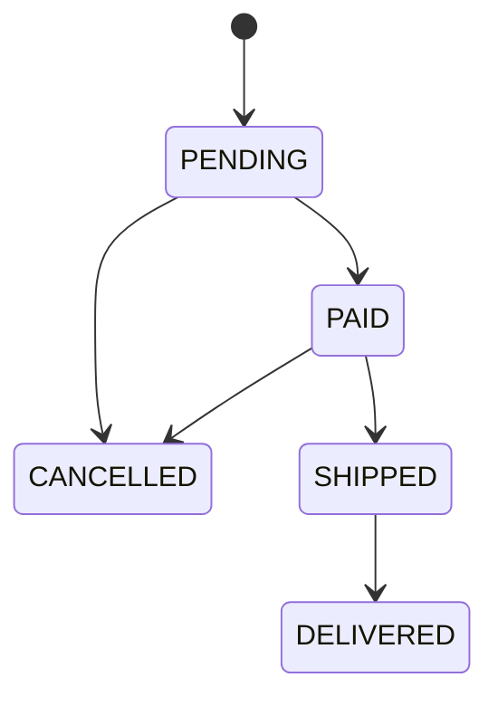

# Enums in der Datenbank speichern: @Enumerated, Postgres-Enum-Typen und Lookup-Tabellen

Fast jedes Domänenmodell hat ein Feld, das nur einen von einer Handvoll Werte annehmen kann. Eine
Bestellung ist `PENDING`, `PAID`, `SHIPPED`, `DELIVERED` oder `CANCELLED`. Eine Zahlung ist
autorisiert oder eingezogen. Ein Abo hat einen von vier Tarifen. In Java greifst du ohne
Nachdenken zu einem `enum`. Interessant ist, was an der Schnittstelle zur Datenbank passiert:
**Wie liegt diese endliche Menge von Werten dort tatsächlich vor**, und was kostet dich jede
Option sechs Monate später, wenn sich die Menge ändert?

Dieser Artikel geht jeden gängigen Weg durch, ein Enum mit Hibernate zu persistieren, und zwar in
der Reihenfolge, in der du ihnen in der Praxis begegnest: die beiden `@Enumerated`-Modi, einen echten
Postgres-`ENUM`-Typ, einen `AttributeConverter` und schließlich den Lookup-Tabellen-Ansatz, bei dem
das Enum zur eigenen Tabelle wird. Ich führe ein einziges Beispiel, den Status einer Bestellung,
durch alle Varianten und ende mit der Entscheidung, die ich tatsächlich treffe.

Stack: **Java, Spring Boot, Hibernate, PostgreSQL**.

<div class="post-tldr" markdown="1">
<p class="post-tldr-title">TL;DR</p>

- `@Enumerated(ORDINAL)` speichert die **Position** des Enums — kompakt, aber das Einfügen eines Werts in der Mitte beschädigt stillschweigend jede nachfolgende Zeile. Wenn du es wirklich brauchst, **schreibe die Ordinals mit einem Unit-Test fest**.
- `@Enumerated(STRING)` speichert den **Namen der Konstante** — selbsterklärend, debuggbar, unempfindlich gegen Umordnen. Das ist der vernünftige Standard.
- Gib dich nicht mit einem nackten `varchar` zufrieden – definiere einen echten **Postgres-`ENUM`-Typ**, damit die Datenbank selbst ungültige Werte ablehnt.
- Ein **`AttributeConverter`** persistiert einen stabilen Code, entkoppelt vom Java-Namen — **Umbenennungen sind kein Datenbankthema mehr**.
- Eine **Lookup-Tabelle** lohnt sich nur, wenn die Werte editierbare Business-Daten tragen — nicht als Umweg, um Umbenennungen zu überleben.
</div>

---

## Das Szenario

Wir bauen eine Bestellverwaltung. Eine Bestellung durchläuft einen festen Lebenszyklus:



In Java ist das ein offensichtliches Enum:

```java
public enum OrderStatus {
    PENDING,
    PAID,
    SHIPPED,
    DELIVERED,
    CANCELLED
}
```

Die Order-Entity hat ein `status`-Feld. Die einzige Frage ist, wie Hibernate es auf eine Spalte
mappt – und diese eine Entscheidung bei der Annotation hat Folgen, die den Code, den du heute
schreibst, überdauern.

---

## Teil 1 — `@Enumerated(ORDINAL)`: Als Int speichern

Der JPA-Standard für ein Enum ist `ORDINAL`. Jede Konstante wird als ihre Position in der Deklaration
gespeichert: `PENDING` → 0, `PAID` → 1, `SHIPPED` → 2 und so weiter.

```java
@Entity
@Table(name = "orders_ordinal")
public class OrderOrdinal {

    @Id
    @GeneratedValue(strategy = GenerationType.UUID)
    private UUID id;

    @Enumerated(EnumType.ORDINAL)   // this is also the default if you omit @Enumerated
    @Column(nullable = false)
    private OrderStatus status;
}
```

```sql
CREATE TABLE orders_ordinal (
    id     UUID     PRIMARY KEY DEFAULT gen_random_uuid(),
    status SMALLINT NOT NULL
);
```

Speicherst du eine Bestellung mit Status `PAID`, hält die Spalte `1`. Das ist kompakt und wirkt
auf dem Papier unproblematisch.

### ❌ Die Falle: Einen Wert in der Mitte einfügen

Das Ordinal wird nicht als Label gespeichert, sondern als *Position*, und die
Position ergibt sich aus der Reihenfolge im Quellcode. An dem Tag, an dem jemand einen
Pack-Schritt zwischen bezahlt und verschickt einfügt:

```java
public enum OrderStatus {
    PENDING,
    PAID,
    PACKED,      // <-- inserted here
    SHIPPED,
    DELIVERED,
    CANCELLED
}
```

… rutscht jede Konstante nach `PAID` um eine Position nach hinten:

| Konstante | Ordinal vorher | Ordinal nachher |
|---|---|---|
| `PENDING`   | 0 | 0 |
| `PAID`      | 1 | 1 |
| `PACKED`    | — | **2** |
| `SHIPPED`   | 2 | **3** |
| `DELIVERED` | 3 | **4** |
| `CANCELLED` | 4 | **5** |

In der Datenbank hat sich nichts geändert. Jede bestehende `SHIPPED`-Bestellung hält weiterhin
die Integer `2` — aber `2` dekodiert jetzt als `PACKED`. Verschickte Bestellungen werden
stillschweigend zu gepackten, aus zugestellten werden verschickte. Kein Fehler, keine
fehlgeschlagene Migration, keine Logzeile. Die Daten haben sich nicht verändert, nur ihre
Deutung. Auffallen wird es erst, wenn ein Kunde fragt, warum seine bereits zugestellte Bestellung
gerade gepackt wird.

### Der Schutz: Ordinals festpinnen

Hast du einen Grund, bei `ORDINAL` zu bleiben (ein Legacy-Schema, eine riesige, stark
beanspruchte Tabelle, bei der der Byte-Unterschied zählt), dann mache die tragende Reihenfolge
*explizit*, mit einem Test, der fehlschlägt, sobald jemand das Enum umordnet:

```java
class OrdinalPinTest {

    @Test
    void ordinalsAreFrozen() {
        // If this test fails, you reordered OrderStatus. Existing ORDINAL-mapped rows now mean
        // something different. Revert the reorder, or append the new value at the end.
        assertThat(OrderStatus.PENDING.ordinal()).isZero();
        assertThat(OrderStatus.PAID.ordinal()).isEqualTo(1);
        assertThat(OrderStatus.SHIPPED.ordinal()).isEqualTo(2);
        assertThat(OrderStatus.DELIVERED.ordinal()).isEqualTo(3);
        assertThat(OrderStatus.CANCELLED.ordinal()).isEqualTo(4);
        assertThat(OrderStatus.values()).hasSize(5);
    }
}
```

Das ist ein reiner Unit-Test, ohne Spring Context und ohne Datenbank. Er macht aus einem
unsichtbaren Datenkorruptions-Bug einen roten Build, sobald jemand das Enum anfasst. Neue
Werte sind weiterhin erlaubt; sie müssen nur ans Ende, wo Anhängen sicher ist. Das ist die
gesamte Regel, auf der `ORDINAL` stillschweigend beruht, schwarz auf weiß.

---

## Teil 2 — `@Enumerated(STRING)`: Als Varchar speichern

Die Lösung für fast alle Fälle besteht aus einem Wort:

```java
@Enumerated(EnumType.STRING)
@Column(nullable = false)
private OrderStatus status;
```

Jetzt speichert die Spalte den *Namen* der Konstante:

```sql
CREATE TABLE orders_string (
    id     UUID    PRIMARY KEY DEFAULT gen_random_uuid(),
    status VARCHAR NOT NULL
);
```

Eine `PAID`-Bestellung speichert den Literal-String `'PAID'`. Drei Dinge werden sofort besser:

- **Umordnen ist harmlos.** Der Wert ist sein eigener Name; Positionen spielen keine Rolle mehr.
  Füge `PACKED` ein, wo du willst.
- **Es ist debuggbar.** `SELECT * FROM orders_string WHERE status = 'PAID'` liest sich wie
  Klartext. Kein Entschlüsseln, kein gedanklicher Join gegen deinen Java-Quellcode.
- **Dumps und Logs sind selbsterklärend.** Eine Zeile in einem CSV-Export ist auch ohne
  Kontext verständlich.

Ja, `'DELIVERED'` kostet mehr Bytes als `3`. Für die allermeisten Tabellen ist
dieser Unterschied vernachlässigbar, und einen Index kannst du immer ergänzen. Den Namen zu speichern
ist der richtige Standard, und „kompakt“ ist fast nie den Preis von „stillschweigend falsch“ wert.

### Die eine verbleibende Falle: Umbenennungen

`STRING` beseitigt die Reihenfolge-Falle, führt aber eine kleinere ein. Der gespeicherte Wert *ist*
der Java-Bezeichner — benennst du die Konstante um, verwaisen bestehende Zeilen:

```java
PENDING  →  AWAITING_PAYMENT
```

Jede alte `'PENDING'`-Zeile passt auf keine Konstante mehr, und Hibernate wirft beim Lesen eine
Exception. Gespeicherte Daten und Code sind stillschweigend auseinandergedriftet. Beheben lässt
sich das mit einer Datenmigration (`UPDATE … SET status = 'AWAITING_PAYMENT' WHERE status =
'PENDING'`), und das ist eine völlig legitime Lösung. In Teil 4 sehen wir außerdem einen Weg,
Umbenennungen ganz zum Nicht-Ereignis zu machen.

---

## Teil 3 — Sauberer Stil: Ein echter Postgres-Enum-Typ

Beide Optionen oben schreiben in eine Spalte, die die Datenbank nicht wirklich versteht: ein
`smallint` oder ein `varchar`, das *zufällig* Enum-Werte enthält. Postgres kann es besser, denn es
kennt echte Enum-Typen:

```sql
CREATE TYPE order_status AS ENUM ('PENDING', 'PAID', 'SHIPPED', 'DELIVERED', 'CANCELLED');

CREATE TABLE orders_pgenum (
    id     UUID         PRIMARY KEY DEFAULT gen_random_uuid(),
    status order_status NOT NULL
);
```

Jetzt erzwingt die *Datenbank* die Wertemenge. Ein `INSERT … VALUES ('SHPPED')` – ein Tippfehler,
eine fehlerhafte Migration, ein wild geschriebenes Skript – scheitert direkt an der Quelle mit `invalid input value
for enum order_status`. Bei einem nackten `varchar` landet dieser Müll in der Tabelle, und du
entdeckst ihn erst später. Der Enum-Typ ist Dokumentation und Constraint in einem: Der Spaltentyp
listet seine zulässigen Werte wörtlich auf.

Das Mapping in Hibernate ist dasselbe `@Enumerated(STRING)` wie zuvor: Hibernate bindet den
Konstantennamen als String, und Postgres speichert ihn im Enum:

```java
@Enumerated(EnumType.STRING)
@Column(nullable = false, columnDefinition = "order_status")
private OrderStatus status;
```

Es gibt genau eine Stelle, die du noch konfigurieren musst. Standardmäßig sendet der
PostgreSQL-JDBC-Treiber einen Java-`String` als Typ `varchar`, und Postgres castet `varchar` nicht
implizit auf `order_status`, du bekämst also `column "status" is of type order_status but expression is of type character
varying`. Hänge `stringtype=unspecified` an die JDBC-URL, und der Treiber sendet den Wert als
`unknown`, sodass Postgres ihn auf das Enum casten kann:

```yaml
spring:
  datasource:
    url: jdbc:postgresql://localhost:5434/mydatabase?stringtype=unspecified
```

(Hibernate 6 bietet außerdem `@JdbcTypeCode(SqlTypes.NAMED_ENUM)`, um einen benannten Enum-Typ
direkt anzusprechen; die Kombination aus `@Enumerated(STRING)` und `stringtype=unspecified` oben
ist die gängigste, und ich greife zu ihr.)

**Der eine Haken, den du kennen solltest:** `ALTER TYPE order_status ADD VALUE 'PACKED'` fügt
nur etwas *hinzu*. Du kannst einen Wert ergänzen (seit PostgreSQL 12 sogar vor oder nach einem
bestimmten), aber bestehende Werte kannst du nicht löschen oder umordnen, ohne den Typ neu zu
erzeugen. Das klingt einschränkend, bis dir auffällt, dass es *dieselbe Regel* ist, die der
Ordinal-Test erzwungen hat (nie umordnen, nur ergänzen), nur dass hier die Datenbank sie
garantiert statt eines Unit-Tests. Die Einschränkung ist das Feature.

---

## Teil 4 — `AttributeConverter`: Name und gespeicherten Wert entkoppeln

Die Umbenennungs-Falle aus Teil 2 gibt es, weil *gespeicherter Wert* und *Java-Bezeichner*
derselbe String sind. Ein JPA-`AttributeConverter` löst diese Kopplung: Du persistierst einen
stabilen Code, der mit dem Namen der Konstante nichts zu tun hat.

Gib jeder Konstante einen expliziten, permanenten Code:

```java
public enum OrderStatus {

    PENDING("PND"),
    PAID("PAID"),
    SHIPPED("SHP"),
    DELIVERED("DLV"),
    CANCELLED("CNC");

    private final String code;

    OrderStatus(String code) {
        this.code = code;
    }

    public String getCode() {
        return code;
    }

    public static OrderStatus fromCode(String code) {
        return Arrays.stream(values())
                .filter(s -> s.code.equals(code))
                .findFirst()
                .orElseThrow(() -> new IllegalArgumentException("Unknown OrderStatus code: " + code));
    }
}
```

Dann ein Converter, der Enum ↔ Code mappt:

```java
@Converter
public class OrderStatusConverter implements AttributeConverter<OrderStatus, String> {

    @Override
    public String convertToDatabaseColumn(OrderStatus status) {
        return status == null ? null : status.getCode();
    }

    @Override
    public OrderStatus convertToEntityAttribute(String code) {
        return code == null ? null : OrderStatus.fromCode(code);
    }
}
```

Und binde ihn am Feld mit `@Convert` statt `@Enumerated` ein:

```java
@Convert(converter = OrderStatusConverter.class)
@Column(nullable = false)
private OrderStatus status;
```

Jetzt speichert die Datenbank einen *Code*, nicht den Bezeichner. Benenne die
Java-Konstante `PENDING` in `AWAITING_PAYMENT` um, und der gespeicherte Code `'PND'` ändert sich
nie. Die Umbenennung ist ein reiner Refactor ohne jede Auswirkung auf die Datenbank. Du hast
entkoppelt, was die Datenbank weiß, von dem, wie du Dinge im Code nennst – genau die Eigenschaft,
derentwegen viele zu Lookup-Tabellen greifen. Merk dir das für den nächsten Teil.

---

## Teil 5 — Der Lookup-Tabellen-Ansatz

Der letzte Ansatz behandelt den Status gar nicht mehr als Enum. Stattdessen liegt die Menge
der Status in einer eigenen Tabelle, und Bestellungen verweisen per Foreign Key auf eine Zeile:

```sql
CREATE TABLE order_statuses (
    id       INTEGER PRIMARY KEY,
    code     VARCHAR NOT NULL UNIQUE,
    label    VARCHAR NOT NULL,
    terminal BOOLEAN NOT NULL DEFAULT FALSE
);

INSERT INTO order_statuses (id, code, label, terminal) VALUES
    (1, 'PND',  'Pending',   FALSE),
    (2, 'PAID', 'Paid',      FALSE),
    (3, 'SHP',  'Shipped',   FALSE),
    (4, 'DLV',  'Delivered', TRUE),
    (5, 'CNC',  'Cancelled', TRUE);

CREATE TABLE orders_lookup (
    id        UUID    PRIMARY KEY DEFAULT gen_random_uuid(),
    status_id INTEGER NOT NULL REFERENCES order_statuses (id)
);
```

In JPA wird der Status zu einer Relation, nicht zu einem Enum-Wert:

```java
@Entity
@Table(name = "orders_lookup")
public class OrderLookup {

    @Id
    @GeneratedValue(strategy = GenerationType.UUID)
    private UUID id;

    @ManyToOne(fetch = FetchType.EAGER, optional = false)
    @JoinColumn(name = "status_id", nullable = false)
    private OrderStatusDefinition status;
}
```

Um zu wissen, welchen Status eine Bestellung hat (ihr lesbares Label, ob sie terminal
ist), musst du **joinen**:

```sql
SELECT o.id, s.code, s.label
FROM   orders_lookup o
JOIN   order_statuses s ON s.id = o.status_id
WHERE  o.id = ?;
```

### ✅ Wann sich das lohnt

Die Lookup-Tabelle bringt einen echten Vorteil: Die Menge der Werte samt der an jedem hängenden
Metadaten liegt in **Daten** statt in **Code**. Das ist dann wirklich wertvoll, wenn:

- **Jeder Wert editierbare Fachdaten trägt**: ein Anzeige-Label, eine Sortierreihenfolge,
  eine Farbe, ein Feature-Flag, ein SLA. Der Status ist nicht nur eine Identität, sondern ein
  kleiner Datensatz.
- **Nicht-Entwickler die Werte pflegen**, sie pro Tenant konfiguriert werden oder sich zur
  Laufzeit ohne Deployment ändern.
- **Du echte Massenänderungen hast**: Ein Label, das in Millionen von Zeilen erscheint, benennst
  du um, indem du eine Zeile in `order_statuses` aktualisierst statt jeder Bestellung.

Der letzte Punkt ist das stärkste Argument: Du änderst eine Stelle statt aller. Ist dein „Enum“
tatsächlich ein gepflegter Katalog, ist das das richtige Modell.

---

## Meine Einschätzung

Für ein *schlichtes* Enum, also eine feste Menge von Zuständen im Code wie einen
Bestell-Lebenszyklus, nutze ich keine Lookup-Tabelle, und im Review würde ich dagegen halten.

Die übliche Begründung, die ich höre, lautet: „Was ist, wenn wir einen Wert umbenennen müssen?“
Das lässt sich aber, wie wir gerade gesehen haben, auch ohne Tabelle lösen: Ein `AttributeConverter`
entkoppelt den gespeicherten Code vom Java-Namen, und ein geändertes Label ist eine
Migration mit einer einzigen Zeile. Du brauchst keinen Foreign Key und keinen Join in jeder Query, um eine
Umbenennung zu überstehen.

Was die Lookup-Tabelle in diesem Fall tatsächlich hinzufügt, sind dauerhafte Kosten: Jeder
Lesezugriff joint entweder oder braucht eine zweite Query, der Status ist jetzt eine verwaltete
Relation statt eines Werts, und ein `switch` über deine Zustände, den der Compiler auf
Vollständigkeit prüft, wird zu einem Lookup zur Laufzeit, der ins Leere laufen kann. Du hast einen
Wert, den dein Compiler versteht, gegen eine Zeile getauscht, die er nicht versteht, um eine
Flexibilität zu erkaufen, die ein fester Lebenszyklus nie nutzt.

Meine Regel hängt also davon ab, **was der Wert ist**, nicht von Umbenennungen:

- Ist der Wert **nur Identität** (es ist `SHIPPED`, Punkt), lass es ein Enum. Mappe es mit
  `@Enumerated(STRING)`, sichere es mit einem Postgres-Enum-Typ ab und greife zu einem
  `AttributeConverter`, wenn Umbenennungen nichts kosten sollen.
- Ist der Wert **ein Datensatz** (er hat Felder, die Menschen zur Laufzeit editieren), dann war er
  nie wirklich ein Enum. Gib ihm eine Tabelle.

Nicht das Umbenennen gibt den Ausschlag, sondern die Frage, ob das Ding eigene Daten hat.

---

## Entscheidungshilfe

| Ansatz | Speichert | Einsetzen, wenn | Hauptrisiko |
|---|---|---|---|
| `@Enumerated(ORDINAL)` | Position (`1`) | fast nie | Umordnen beschädigt stillschweigend Zeilen |
| `@Enumerated(STRING)` | Name der Konstante (`'PAID'`) | der vernünftige Standard | Umbenennungen lassen Zeilen verwaisen |
| Postgres-`ENUM`-Typ | Name, von der DB validiert | die DB soll ungültige Werte ablehnen | `ADD VALUE` kann nur anhängen |
| `AttributeConverter` | stabiler Code (`'PND'`) | Umbenennungen sollen nichts kosten | eine kleine Klasse, die gewartet werden muss |
| Lookup-Tabelle | FK auf eine Zeile | Werte tragen editierbare Daten | ein Join bei jedem Lesezugriff |

Ein solider Standard für die meisten Projekte: **`@Enumerated(STRING)` auf einem
Postgres-Enum-Typ**, mit dem Wechsel auf einen **`AttributeConverter`**, sobald du den
gespeicherten Wert vom Java-Namen entkoppeln willst.

---

## Code

Den Code zu diesem Artikel findest du unter
**[github.com/javaAndScriptDeveloper/enums-article](https://github.com/javaAndScriptDeveloper/enums-article)**:
dasselbe `OrderStatus`-Enum, auf alle fünf Arten persistiert, der Test, der die Ordinals festschreibt, und ein
Round-Trip-Test pro Ansatz, der prüft, was tatsächlich in die Datenbank geschrieben wird. Alles läuft
lokal mit Docker und einem einzigen `./gradlew test`.

---

## Abschließende Gedanken

Wie man ein Enum speichert, fühlt sich wie eine Entscheidung für fünf Sekunden an, und genau
deshalb lohnt es sich, hier langsamer zu machen. Die Ordinal-Falle, die
Umbenennungs-Falle, der fehlende Constraint in der Datenbank: Keine davon zeigt sich an dem Tag, an dem
du die Annotation schreibst. Sie zeigt sich an dem Tag, an dem sich die Wertemenge ändert, und das
geschieht immer, meist lange nachdem du vergessen hast, welchen Trade-off du eingegangen bist.

Die gute Nachricht: Die Standardwege sind einfach. Speichere den Namen, lass die Datenbank ihn
validieren und entkoppel den Code vom Bezeichner, wenn du es brauchst. Heb dir die
Lookup-Tabelle für die Fälle auf, die wirklich ein Katalog und kein Enum sind. Machst du das einmal
richtig, bleiben deine Status langweilig – das größte Kompliment, das man einer Spalte machen
kann.

---

## Lass uns sprechen

Wenn du Enums anders speicherst oder von einer dieser Fallen auf eine Weise erwischt wurdest, die
ich nicht behandelt habe, würde ich gerne davon hören. Kontaktlinks findest du im Footer.
