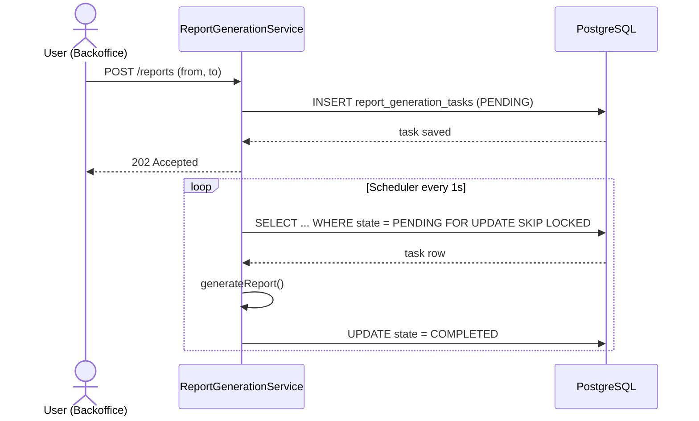
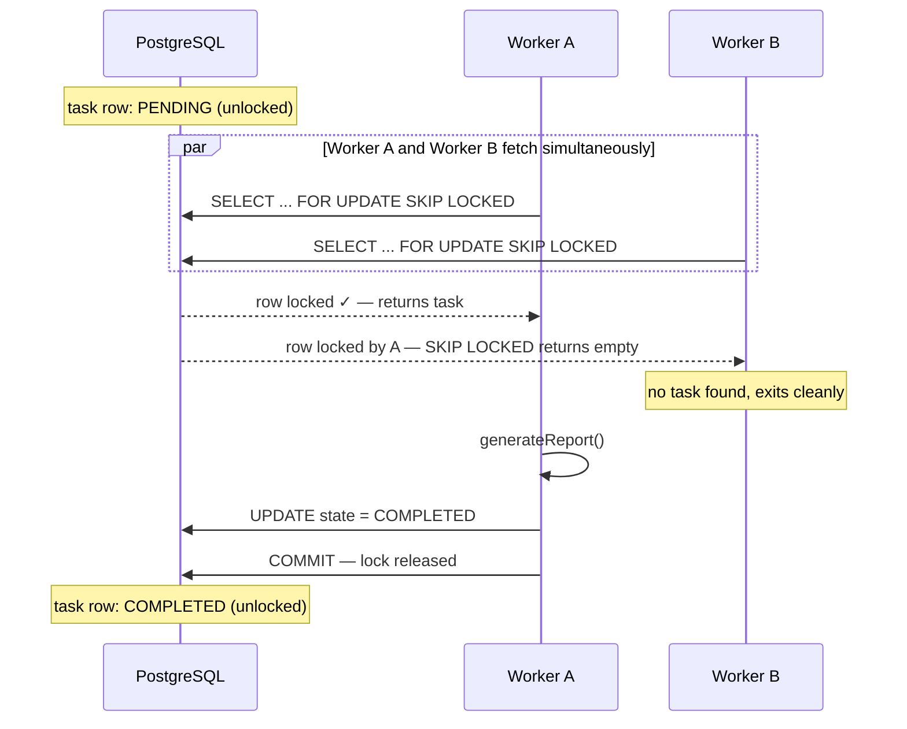
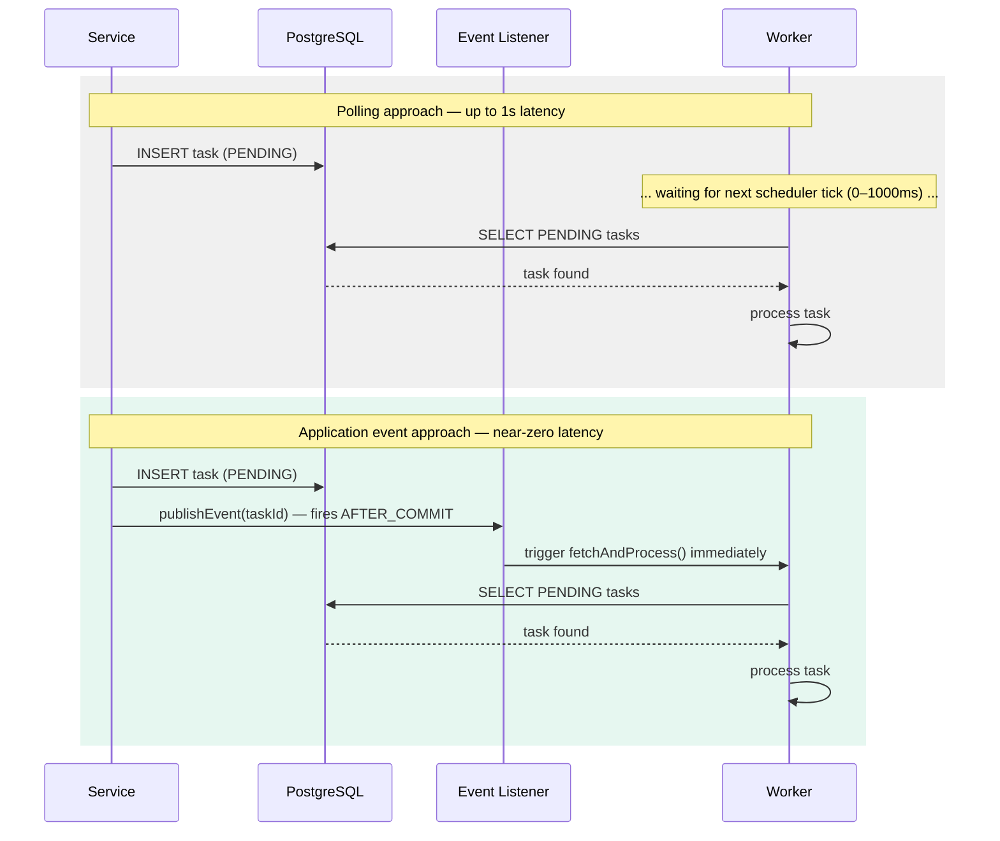
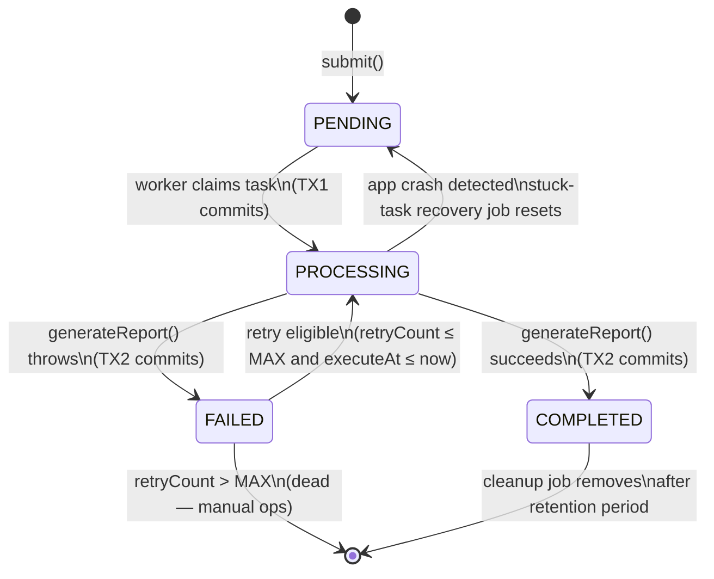
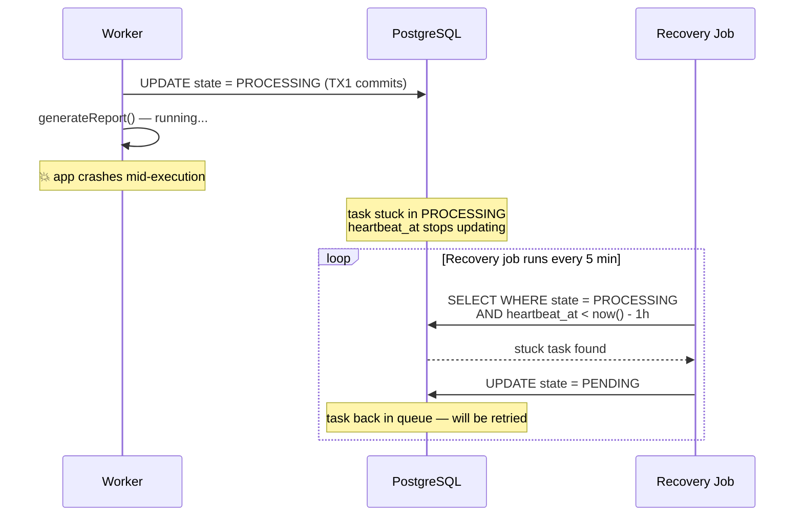
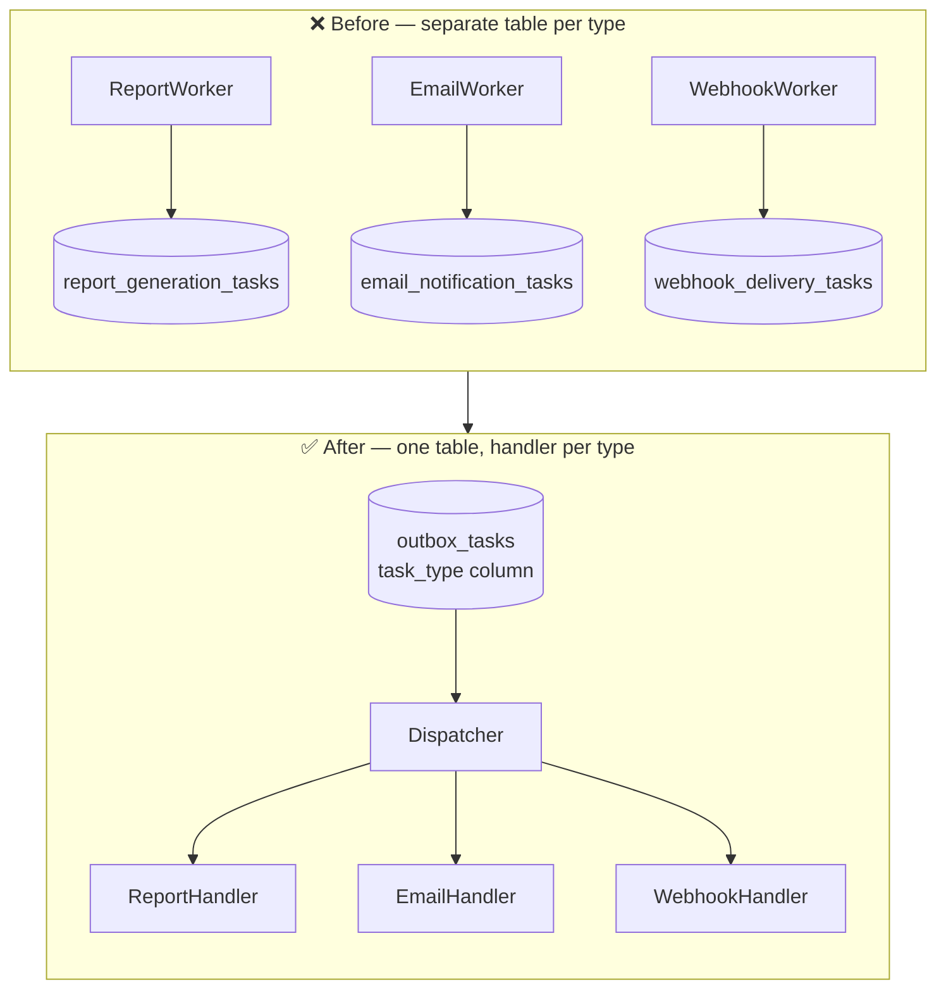

# Das Transactional Outbox Pattern: Von der einzelnen Task zur produktionsreifen Async-Engine

Es gibt eine Klasse von Bugs, die nie in deinen Unit-Tests auftaucht und selten in Staging.
Sie erscheint in Produktion, um 2 Uhr nachts, wenn deine Anwendung einen Datensatz in die
Datenbank schreibt und danach versucht, einen externen Service aufzurufen — und einer von
beiden scheitert. Die eine Seite hat committet. Die andere nicht. Niemand erfährt es, bis
sich ein Nutzer beschwert.

Das ist das **Dual-Write-Problem**, und das Transactional Outbox Pattern ist die Standardantwort
darauf. Die Idee ist einfach: Statt das externe System direkt aufzurufen, schreibst du eine Task
in dieselbe Datenbank-Transaktion wie deine Domain-Änderung. Ein Background Worker nimmt sie auf
und führt sie aus. Der Write ist atomar. Die Task kann nicht verloren gehen.

Weniger dokumentiert ist alles, was nach der Grundidee kommt — was passiert, wenn Tasks
fehlschlagen, wenn zwei Worker um dieselbe Zeile konkurrieren, wenn deine Anwendung mitten in
der Ausführung crasht, wenn zehn verschiedene Task-Typen in einer Tabelle leben, und wenn deine
Stakeholder wissen wollen, warum die Queue Depth letzten Dienstag um 3 Uhr nachts ausschlug.

Genau darum geht es in diesem Artikel.

Ich gehe ein einziges konkretes Szenario durch — einen **Report-Generation-Service** — und
entwickle es Schritt für Schritt von der rudimentärsten Outbox zu etwas, dem ich mich in
Produktion anvertrauen würde. Jeder Code-Schnipsel stammt aus einem echten, lauffähigen Repo,
die am Ende verlinkt ist.

Stack: **Java, Spring Boot, PostgreSQL**.

<div class="post-tldr" markdown="1">
<p class="post-tldr-title">TL;DR</p>

- Das **Transactional Outbox Pattern** löst das Dual-Write-Problem, indem es eine Task-Zeile in die **dieselbe DB-Transaktion** wie deine Domain-Änderung schreibt und sie anschließend von einem Background Worker ausführen lässt.
- Poll die Outbox-Tabelle mit `SELECT ... FOR UPDATE SKIP LOCKED`, damit mehrere Worker parallel laufen können, ohne doppelt zu verarbeiten.
- Produktionsreife braucht mehr als die Grundidee: eine **State Machine**, **Retries mit Backoff**, **Heartbeats/Leases**, um gecrashte Worker zu erkennen, **Ordering-Garantien** und **Monitoring** der Queue Depth.
- Du brauchst kein Kafka — **PostgreSQL allein** reicht für zuverlässige Async-Ausführung.
</div>

---

## Das Szenario



Wir bauen eine CRM-Anwendung. Nutzer können über ein Backoffice-UI monatliche Analytics-Reports
anfordern. Die Erzeugung eines Reports bedeutet, Dutzende Millionen Zeilen zu aggregieren — das
kann Minuten dauern. Natürlich können wir das nicht synchron in einem HTTP-Request erledigen.

Der Nutzer klickt auf einen Button. Das Backend nimmt den Request an, speichert ihn und antwortet
sofort. Ein Background Worker nimmt die Task auf, führt die Generierung aus und aktualisiert den
Status, wenn sie fertig ist.

Das ist der einfachste Fall, in dem eine Outbox Sinn ergibt: Arbeit, die ihrer Natur nach wirklich
async ist und bei der der Nutzer ohnehin mit Warten rechnet.

---

## Teil 1 — Die einfache Outbox

### Was jede Outbox braucht

Im Kern braucht jede Outbox-Tabelle drei Dinge:

- **State** — wo befindet sich diese Task in ihrem Lebenszyklus?
- **Payload** — was genau muss ausgeführt werden?
- **Timestamps** — wann wurde sie erstellt, wann hat sich zuletzt etwas geändert?

```sql
CREATE TYPE task_state AS ENUM ('PENDING', 'COMPLETED');

CREATE TABLE report_generation_tasks (
                                       id         UUID       PRIMARY KEY DEFAULT gen_random_uuid(),
                                       state      task_state NOT NULL    DEFAULT 'PENDING',
                                       payload    JSONB      NOT NULL,
                                       created_at TIMESTAMP  NOT NULL    DEFAULT now(),
                                       updated_at TIMESTAMP  NOT NULL    DEFAULT now()
);
```

Der Payload für unseren Use Case ist ein Zeitraum:

```java
@Value
@Builder
@Jacksonized
public class ReportGenerationPayload {
  Instant from;
  Instant to;
}
```

Die JPA-Entity:

```java
@Entity
@Table(name = "report_generation_tasks")
@Data
@Builder
@NoArgsConstructor
@AllArgsConstructor
public class ReportGenerationEntity {

    @Id
    @GeneratedValue(strategy = GenerationType.UUID)
    @Column(updatable = false, nullable = false)
    private UUID id;

    @Enumerated(EnumType.STRING)
    @Column(nullable = false, columnDefinition = "task_state")
    private TaskState state;

    @JdbcTypeCode(SqlTypes.JSON)
    @Column(nullable = false, updatable = false, columnDefinition = "jsonb")
    private ReportGenerationPayload payload;

    @CreationTimestamp
    @Column(nullable = false, updatable = false)
    private Instant createdAt;

    @UpdateTimestamp
    @Column(nullable = false)
    private Instant updatedAt;
}
```

Eine Task einreichen:

```java
@Service
@RequiredArgsConstructor
public class ReportGenerationService {

    private final ReportGenerationRepository repository;

    public void submit(ReportGenerationCommand command) {
        repository.save(ReportGenerationEntity.builder()
                .state(TaskState.PENDING)
                .payload(ReportGenerationPayload.builder()
                        .from(command.getFrom())
                        .to(command.getTo())
                        .build())
                .build());
    }
}
```

### Der Worker

Ein Scheduled Job pollt nach Pending-Tasks und führt sie aus:

```java
@Component
@RequiredArgsConstructor
public class ReportGenerationScheduledJob {

    private final ReportGenerationTaskService taskService;

    @Scheduled(fixedDelay = 1000)
    public void run() {
        taskService.fetchAndProcess();
    }
}
```

```java
@Service
@RequiredArgsConstructor
public class ReportGenerationTaskService {

    private final ReportGenerationRepository repository;

    public void fetchAndProcess() {
        repository.findFirstByStateOrderByCreatedAt(TaskState.PENDING)
                .ifPresent(task -> {
                    generateReport(task);
                    task.setState(TaskState.COMPLETED);
                    repository.save(task);
                });
    }

    private void generateReport(ReportGenerationEntity task) {
        // actual report generation logic
    }
}
```

```java
public interface ReportGenerationRepository extends JpaRepository<ReportGenerationEntity, UUID> {
    Optional<ReportGenerationEntity> findFirstByStateOrderByCreatedAt(TaskState state);
}
```

Das funktioniert in einer Single-Instance-Anwendung ohne Ausfälle. In der realen Welt hat es zwei
Probleme: Zwei Worker können dieselbe Task gleichzeitig beanspruchen, und Tasks können fehlschlagen,
ohne dass es einen Recovery-Pfad gibt. Beheben wir beides.

---

## Teil 2 — Concurrency: Zwei Worker, eine Task

Wenn zwei Scheduler-Threads — oder zwei App-Instanzen — die Fetch-Query im selben Moment ausführen,
können beide dieselbe `PENDING`-Zeile lesen, und beide versuchen, sie auszuführen. Das Ergebnis ist
im besten Fall doppelte Arbeit, im schlechtesten korrupter State.

Die Lösung ist ein Database Lock, der zum Fetch-Zeitpunkt gesetzt wird. PostgreSQLs
`SELECT ... FOR UPDATE SKIP LOCKED` ist genau für diesen Use Case gebaut: Es sperrt die Zeile für
die aktuelle Transaktion und überspringt alle Zeilen, die bereits von einer anderen Transaktion
gesperrt sind, statt zu warten.

```java
public interface ReportGenerationRepository extends JpaRepository<ReportGenerationEntity, UUID> {

    @Lock(LockModeType.PESSIMISTIC_WRITE)
    @QueryHint(name = AvailableSettings.JAKARTA_LOCK_TIMEOUT, value = "-2") // -2 = SKIP_LOCKED
    Optional<ReportGenerationEntity> findFirstByStateOrderByCreatedAt(TaskState state);
}
```

Der `SKIP_LOCKED`-Hint-Wert `-2` ist das, was Hibernate in die `SKIP LOCKED`-Klausel übersetzt.
Da es dafür keine erstklassige Annotation gibt, lohnt es sich, das in eine wiederverwendbare
Annotation auszulagern, damit die magische Zahl nicht über alle deine Repositories verstreut:

```java
@Retention(RetentionPolicy.RUNTIME)
@Target({ElementType.METHOD, ElementType.ANNOTATION_TYPE})
@QueryHints(@QueryHint(
    name = AvailableSettings.JAKARTA_LOCK_TIMEOUT,
    value = Timeouts.SKIP_LOCKED_MILLI + ""
))
public @interface SkipLocked {}
```

Deutlich sauberer. Jetzt liest sich das Repository wie Absicht, nicht wie Klempnerarbeit:

```java
@SkipLocked
@Lock(LockModeType.PESSIMISTIC_WRITE)
Optional<ReportGenerationEntity> findFirstByStateOrderByCreatedAt(TaskState state);
```

Du *kannst* den Lock während der Verarbeitung halten, indem du den gesamten
Fetch-Execute-Update-Zyklus in eine einzige Transaktion packst — aber im Allgemeinen solltest du
das nicht tun:

```java
// Technically works, but do not use this pattern for outbox processing.
@Transactional
public void fetchAndProcess() {
    repository.findFirstByStateOrderByCreatedAt(TaskState.PENDING)
            .ifPresent(task -> {
                generateReport(task);
                task.setState(TaskState.COMPLETED);
                repository.save(task);
            });
}
```



Auch wenn `generateReport()` klein genug ist, dass es technisch funktioniert: Eine Outbox-Aktion
unter einer offenen Transaktion auszuführen, ist ein Antipattern. Die Transaktionsdauer sollte
nicht von der Ausführungsdauer der Outbox abhängen: Die Aktion kann mit der Zeit langsamer werden,
auf I/O blockieren oder einen Downstream-Service aufrufen — und hält dann eine Datenbankverbindung
und einen Row Lock für unvorhersehbare Zeit fest.

Stattdessen beanspruche die Zeile in einer kurzen Transaktion, indem du sie auf `PROCESSING`
setzt, committe und gebe den Lock frei — und führe erst dann die Outbox-Aktion aus. `COMPLETED`
oder `FAILED` schreibst du danach in einer weiteren kurzen Transaktion. Der nächste Abschnitt
implementiert diesen State-Übergang samt Recovery-Pfad.

---

## Teil 2.5 — Latenz mit Application Events reduzieren

Der pollende Scheduler hat eine inhärente Latenz-Untergrenze. Läuft dein Job jede Sekunde, bleibt
eine Task, die bei `t=0ms` eingereicht wurde, bis zum nächsten Tick `PENDING` — bis zu 1000 ms
später. Für die meisten Async-Workloads ist das akzeptabel. Für Fälle, in denen du eine nahezu
sofortige Aufnahme willst — eine transaktionale E-Mail senden, einen Webhook auslösen — ist es
das nicht.

Das Pattern ist von Celery geliehen: Speichere die Outbox-Entity in der Datenbank und publiziere
dann sofort ein Spring-`ApplicationEvent` mit der ID der neuen Task. Ein Listener nimmt es auf und
stößt die Verarbeitung umgehend an, ohne auf den nächsten Scheduler-Tick zu warten.



Der Scheduler läuft weiter als Safety Net — er fängt alles auf, was der Event Listener verpasst
hat (App-Neustart, Listener-Exception, verlorenes Event). Aber der Happy Path umgeht die
Polling-Verzögerung komplett.

### Implementierung

Publiziere das Event innerhalb der Service-Methode, nach dem Speichern:

```java
@Service
@RequiredArgsConstructor
public class ReportGenerationService {

    private final ReportGenerationRepository repository;
    private final ApplicationEventPublisher eventPublisher;

    @Transactional
    public void submit(ReportGenerationCommand command) {
        var entity = repository.save(ReportGenerationEntity.builder()
                .state(TaskState.PENDING)
                .payload(ReportGenerationPayload.builder()
                        .from(command.getFrom())
                        .to(command.getTo())
                        .build())
                .build());

        eventPublisher.publishEvent(new ReportGenerationTaskSubmittedEvent(entity.getId()));
    }
}
```

```java
public record ReportGenerationTaskSubmittedEvent(UUID taskId) {}
```

Der Listener reagiert und stößt die Verarbeitung sofort an:

```java
@Component
@RequiredArgsConstructor
public class ReportGenerationTaskEventListener {

    private final ReportGenerationTaskService taskService;

    @TransactionalEventListener(phase = TransactionPhase.AFTER_COMMIT)
    public void onTaskSubmitted(ReportGenerationTaskSubmittedEvent event) {
        taskService.fetchAndProcess();
    }
}
```

### Der klassische Fehler

Der häufigste Fehler hier ist, `@EventListener` statt
`@TransactionalEventListener(phase = TransactionPhase.AFTER_COMMIT)` zu verwenden.

`@EventListener` feuert in dem Moment, in dem `publishEvent()` aufgerufen wird — also **innerhalb
der offenen Transaktion**, bevor das `INSERT` gecommt ist. Der Listener ruft `fetchAndProcess()`
auf, das die Datenbank per ID nach der Task abfragt. Die Zeile existiert noch nicht. Die Task wird
stillschweigend übersprungen, das Event ist verloren, und du fragst dich, warum die Verarbeitung
nie startet — obwohl der Scheduler sie Sekunden später doch noch aufgreift und in den Logs alles
unauffällig aussieht.

```java
// ❌ fires inside the transaction — entity not visible to other connections yet
@EventListener
public void onTaskSubmitted(ReportGenerationTaskSubmittedEvent event) {
    taskService.fetchAndProcess();
}

// ✅ fires after COMMIT — entity is visible, fetch succeeds
@TransactionalEventListener(phase = TransactionPhase.AFTER_COMMIT)
public void onTaskSubmitted(ReportGenerationTaskSubmittedEvent event) {
    taskService.fetchAndProcess();
}
```

`AFTER_COMMIT` garantiert, dass der Listener erst läuft, nachdem die Transaktion, die das Event
publiziert hat, vollständig gecommt ist. Zu diesem Zeitpunkt ist die Zeile für alle Verbindungen
sichtbar, und der Fetch wird sie finden.

Der Scheduler bleibt unverändert — er dient als Recovery-Mechanismus für alle Tasks, die der
Event Listener verpasst hat. Die beiden Ansätze ergänzen sich: Events für Latenz, Polling für
Zuverlässigkeit.

---

## Teil 3 — Fehler, Retries und der PROCESSING-State



Outbox-Aktionen sollten nicht unter einer offenen Datenbank-Transaktion laufen. Der
Locked-Transaction-Ansatz hält einen Database Lock über die gesamte Dauer von `generateReport()`.
Bei einem Report, der zwei Minuten dauert, sind das zwei Minuten gesperrte Zeile — eine gebundene
Verbindung, andere DB-Operationen, die potenziell dahinter warten. Mit `SKIP LOCKED` blockieren
sich Worker zwar nicht gegenseitig am Lock, aber langlebige Transaktionen setzen den Connection
Pool trotzdem unter Druck und machen der Datenbank unter Last zu schaffen. Eine sehr kleine Aktion
mag technisch ohne sichtbare Probleme durchlaufen, aber die Kopplung von Transaktionsdauer an die
Ausführungsdauer der Outbox bleibt ein Antipattern.

Die Lösung: das Beanspruchen einer Task von ihrer Ausführung trennen. Setze die Task in einer
kurzen Transaktion auf `PROCESSING`, gib den Lock frei und erledige die eigentliche Arbeit
außerhalb jeder Transaktion. So wird die DB nur kurz am Anfang und kurz am Ende berührt — der
teure Teil passiert dazwischen, ohne etwas zu halten.

Zuerst erweitern wir das Enum:

```sql
ALTER TYPE task_state ADD VALUE 'PROCESSING';
ALTER TYPE task_state ADD VALUE 'FAILED';

ALTER TABLE report_generation_tasks
    ADD COLUMN retry_count  INTEGER NOT NULL DEFAULT 0,
    ADD COLUMN error_message VARCHAR;
```

`retry_count` zählt, wie oft die Ausführung versucht wurde. Die Retries begrenzen wir auf 10 —
darüber hinaus ist etwas wirklich kaputt und braucht manuelles Eingreifen. Das Alerting dazu
verdrahten wir später. `error_message` speichert die letzte Exception, damit du weißt, *warum*
eine Task festhängt, ohne dich durch Logs zu wühlen.

Das Java-Enum wächst mit:

```java
public enum TaskState {
    PENDING,
    PROCESSING,
    COMPLETED,
    FAILED
}
```

Der Service führt jetzt zwei getrennte kurze Transaktionen aus, mit der eigentlichen Arbeit
dazwischen:

```java
@RequiredArgsConstructor
public class ReportGenerationTaskService {

    private final ReportGenerationRepository repository;
    private final TransactionTemplate transactionTemplate;

    private static final int MAX_RETRY_COUNT = 10;

    public void fetchAndProcess() {
        transactionTemplate
                .execute(status ->
                        repository.findFirstEligibleTask(
                                List.of(TaskState.PENDING, TaskState.FAILED),
                                MAX_RETRY_COUNT
                        ).map(this::markProcessing))
                .ifPresentOrElse(
                        task -> {
                            try {
                                generateReport(task);
                                markCompleted(task);
                            } catch (Exception e) {
                                markFailed(task, e);
                                log.error("Task {} failed on attempt {}", task.getId(), task.getRetryCount(), e);
                            }
                        },
                        () -> log.debug("No eligible tasks to process")
                );
    }

    private ReportGenerationEntity markProcessing(ReportGenerationEntity task) {
        task.setState(TaskState.PROCESSING);
        return repository.save(task);
    }

    private void markCompleted(ReportGenerationEntity task) {
        task.setState(TaskState.COMPLETED);
        repository.save(task);
    }

    private void markFailed(ReportGenerationEntity task, Exception e) {
        task.setState(TaskState.FAILED);
        task.setRetryCount(task.getRetryCount() + 1);
        task.setErrorMessage(e.getMessage()); // don't skip this — it's the only trace of what went wrong without digging through logs
        repository.save(task);
    }
}
```

Die Query holt sowohl `PENDING`- als auch `FAILED`-Tasks — eine fehlgeschlagene Task mit
`retryCount < 10` ist genauso kandidierend wie eine frische. Sobald der Retry Count das Limit
erreicht, wird die Task nicht mehr geholt und liegt als dauerhafter `FAILED`-Datensatz, bis sich
jemand sie ansieht. Das ist Absicht — jenseits von 10 Versuchen ist etwas wirklich kaputt und
braucht Augen darauf, nicht einen weiteren Retry.

```java
@SkipLocked
@Lock(LockModeType.PESSIMISTIC_WRITE)
@Query("""
    SELECT t FROM ReportGenerationEntity t
    WHERE t.state IN :states
      AND t.retryCount <= :maxRetryCount
    ORDER BY t.createdAt ASC
    LIMIT 1
    """)
Optional<ReportGenerationEntity> findFirstEligibleTask(
    @Param("states") List<TaskState> states,
    @Param("maxRetryCount") Integer maxRetryCount
);
```

Aber Moment — soll eine gerade fehlgeschlagene Task wirklich schon im aller nächsten
Scheduler-Tick, also Sekunden später, wieder aufgenommen werden? Ist das Downstream-System down,
machst du es schlimmer, wenn du es jede Sekunde bombardierst. Darum geht es im nächsten Abschnitt.

## Teil 4 — Exponentielles Backoff

Ohne Verzögerung zwischen den Retries landet eine fehlgeschlagene Task schon im nächsten
Scheduler-Tick wieder in der Queue — meist Sekunden später. Ist das Downstream-System down,
bombardierst du es mit voller Polling-Rate. Das ist schlecht für das Downstream-System und
schlecht für deine DB.

Die Lösung ist eine `execute_at`-Spalte: Die Task ist nicht kandidierend, solange dieser Timestamp
nicht in der Vergangenheit liegt. Frische Tasks bekommen `execute_at = now()`, damit sie sofort
aufgenommen werden. Fehlgeschlagene Tasks bekommen `execute_at = now() + delay`, wobei das Delay
mit jedem Retry wächst.

```sql
ALTER TABLE report_generation_tasks
    ADD COLUMN execute_at TIMESTAMP NOT NULL DEFAULT NOW();
```

Der Delay-Plan treibt alles an — `MAX_RETRY_COUNT` wird daraus abgeleitet, nicht separat
deklariert. So können die beiden nie auseinanderdriften:

```java
private static final Map<Integer, Duration> RETRY_DELAYS = Map.of(
    0, Duration.ofMinutes(1),
    1, Duration.ofMinutes(5),
    2, Duration.ofMinutes(15),
    3, Duration.ofMinutes(30),
    4, Duration.ofHours(1),
    5, Duration.ofHours(2),
    6, Duration.ofHours(4),
    7, Duration.ofHours(8),
    8, Duration.ofHours(12),
    9, Duration.ofDays(1)
);

private static final int MAX_RETRY_COUNT = RETRY_DELAYS.size();
```

Fügst du einen neuen Eintrag zu `RETRY_DELAYS` hinzu, aktualisiert sich das Retry-Limit
automatisch. Keine magische Zahl, die du sonstwo synchron halten musst.

In `markFailed()` erfasse den *aktuellen* Retry Count, bevor du inkrementierst — er wählt das
Delay für den *nächsten* Versuch:

```java
private void markFailed(ReportGenerationEntity task, Exception e) {
    int currentRetry = task.getRetryCount();
    task.setState(TaskState.FAILED);
    task.setRetryCount(currentRetry + 1);
    task.setErrorMessage(e.getMessage());
    task.setExecuteAt(Instant.now().plus(
            RETRY_DELAYS.getOrDefault(currentRetry, RETRY_DELAYS.get(RETRY_DELAYS.size() - 1))));
    repository.save(task);
}
```

Der Scheduler läuft weiter mit derselben Rate. Er überspringt nur Tasks, deren Fenster noch nicht
offen ist. Fehlgeschlagene Tasks warten ruhig, bis sie dran sind, und kehren dann ganz natürlich
zurück.

---

## Teil 5 — Hängende Tasks und Heartbeats



Beim Zwei-Transaktionen-Ansatz überlege dir, was passiert, wenn die App crasht, nachdem sie eine
Task auf `PROCESSING` gesetzt hat, aber bevor sie sie auf `COMPLETED` oder `FAILED` setzt. Die DB
zeigt `PROCESSING`. Niemand verarbeitet sie. Sie bleibt für immer dort liegen.

Der naive Fix ist ein Recovery-Job, der Tasks findet, die zu lange in `PROCESSING` hängen, und
sie auf `PENDING` zurücksetzt:

```java
@Transactional
public void recoverStuckTasks() {
    repository.findFirstByStateAndUpdatedAtLessThan(
                    TaskState.PROCESSING,
                    Instant.now().minus(1, ChronoUnit.HOURS))
            .ifPresent(task -> {
                log.warn("Resetting stuck task {} to PENDING", task.getId());
                task.setState(TaskState.PENDING);
                repository.save(task);
            });
}
```

Das funktioniert in den meisten Fällen. Das Problem: `updated_at` ändert sich, wann immer sich
*irgendetwas* an der Zeile ändert — auch unverbundene State-Übergänge. Eine Task, die seit 55
Minuten legitim verarbeitet wird, sieht aus `updated_at`-Sicht identisch aus wie eine gecrashte
Task.

Die sauberere Lösung ist ein **Heartbeat**: eine dedizierte Spalte, die periodisch aktualisiert
wird — *aber nur, während die Task aktiv verarbeitet wird*. Der Recovery-Job prüft jetzt diese
Spalte, nicht `updated_at`. Eine Task, die in der letzten Stunde keinen Heartbeat geschickt hat,
hängt wirklich fest.

```sql
ALTER TABLE report_generation_tasks ADD COLUMN heartbeat_at TIMESTAMP;
```

Der Heartbeat läuft in seinem eigenen Thread, innerhalb seiner eigenen Transaktionen, unabhängig
von der Verarbeitungslogik. Die sauberste Implementierung ist ein `try-with-resources` — er
startet, wenn die Verarbeitung startet, und stoppt auf jedem Exit-Pfad:

```java
public abstract class Heartbeat implements AutoCloseable {

    private final ScheduledExecutorService executor;

    protected Heartbeat(Runnable heartbeatFn) {
        executor = Executors.newSingleThreadScheduledExecutor();
        executor.scheduleAtFixedRate(heartbeatFn, 0, 10, TimeUnit.SECONDS);
    }

    @Override
    public void close() {
        executor.shutdownNow();
    }
}
```

```java
public class ReportGenerationTaskHeartbeat extends Heartbeat {

    ReportGenerationTaskHeartbeat(UUID taskId, ReportGenerationRepository repository) {
        super(() -> repository.updateHeartbeatAt(taskId, Instant.now()));
    }
}
```

Die Repository-Methode bringt ihr eigenes `@Transactional` mit — der Aufruf muss nicht manuell
umwickelt werden:

```java
@Modifying
@Transactional
@Query("UPDATE ReportGenerationTaskEntity t SET t.heartbeatAt = :now WHERE t.id = :id")
void updateHeartbeatAt(@Param("id") UUID id, @Param("now") Instant now);
```

Verdrahte ihn über eine Factory, damit der Service sauber bleibt:

```java
@Component
@RequiredArgsConstructor
public class ReportGenerationTaskHeartbeatFactory {

    private final ReportGenerationRepository repository;

    public Heartbeat start(UUID taskId) {
        return new ReportGenerationTaskHeartbeat(taskId, repository);
    }
}
```

Der Verarbeitungsblock sieht jetzt so aus:

```java
public void fetchAndProcess() {
    transactionTemplate
            .execute(status -> repository.findFirstEligibleTask(
                    List.of(TaskState.PENDING, TaskState.FAILED),
                    MAX_RETRY_COUNT
            ).map(this::markProcessing))
            .ifPresentOrElse(
                    task -> {
                        try (var heartbeat = heartbeatFactory.start(task.getId())) {
                            try {
                                generateReport(task);
                                markCompleted(task);
                            } catch (Exception e) {
                                markFailed(task, e);
                                log.error("Task {} failed", task.getId(), e);
                            }
                        }
                    },
                    () -> log.debug("No eligible tasks to process")
            );
}
```

Der Recovery-Job nutzt `heartbeat_at` statt `updated_at`:

```java
@Modifying
@Transactional
@Query("UPDATE ReportGenerationEntity t SET t.heartbeatAt = :now WHERE t.id = :id")
void updateHeartbeatAt(@Param("id") UUID id, @Param("now") Instant now);

Optional<ReportGenerationEntity> findFirstByStateAndHeartbeatAtLessThan(
        TaskState state, Instant threshold);
```

`updated_at` spiegelt, wann sich der Task-State zuletzt geändert hat. `heartbeat_at` spiegelt, ob
die Task gerade lebt. Getrennt gehalten kannst du beide Fragen eindeutig beantworten.

---

## Teil 6 — Multi-Type-Outbox



Sechs Monate später erledigt dein Service mehr als nur Report-Generierung. Du brauchst
E-Mail-Benachrichtigungen. Dann Datenexporte. Dann Webhook-Auslieferungen.

Du hast zwei Optionen: eine eigene Tabelle pro Task-Typ oder eine gemeinsame Tabelle mit einem
`task_type`-Diskriminator. Die gemeinsame Tabelle gewinnt, wenn es viele Task-Typen gibt und du
sie von einer Stelle aus verarbeitest. Die Infrastruktur — Retries, Heartbeats, Backoff,
Monitoring — bleibt an einem Ort. Einen neuen Task-Typ hinzuzufügen heißt, einen neuen Handler
hinzuzufügen.

Die Trade-offs, die man vorab kennen sollte:

- Ein sich schlecht benimmender neuer Task-Typ kann alle anderen Typen verlangsamen — ein
  schlechter Handler, der Retries verbrennt, erzeugt Backpressure über die ganze Tabelle.
- Ordering-Garantien werden schwieriger — dazu später mehr.

### Das Schema

```sql
CREATE TYPE outbox_task_type AS ENUM ('REPORT_GENERATION', 'EMAIL_NOTIFICATION');

CREATE TABLE outbox_tasks (
    id            UUID             PRIMARY KEY DEFAULT gen_random_uuid(),
    task_type     outbox_task_type NOT NULL,
    state         task_state       NOT NULL    DEFAULT 'PENDING',
    payload       JSONB            NOT NULL,
    retry_count   INTEGER          NOT NULL    DEFAULT 0,
    error_message VARCHAR,
    execute_at    TIMESTAMPTZ      NOT NULL    DEFAULT NOW(),
    heartbeat_at  TIMESTAMPTZ,
    created_at    TIMESTAMPTZ      NOT NULL    DEFAULT now(),
    updated_at    TIMESTAMPTZ      NOT NULL    DEFAULT now()
);
```

### Das Handler-Interface

Der zentrale Erweiterungspunkt — eine Implementierung pro Task-Typ:

```java
public interface OutboxTaskHandler<P> {
    OutboxTaskType getType();
    Class<P> payloadClass();
    void handle(UUID taskId, P payload) throws Exception;
}
```

`taskId` wird an jeden Handler durchgereicht. Warum, siehst du im Abschnitt über Idempotenz.

Ein konkreter Handler:

```java
@Component
public class EmailNotificationHandler implements OutboxTaskHandler<EmailNotificationPayload> {

    @Override
    public OutboxTaskType getType() {
        return OutboxTaskType.EMAIL_NOTIFICATION;
    }

    @Override
    public Class<EmailNotificationPayload> payloadClass() {
        return EmailNotificationPayload.class;
    }

    @Override
    public void handle(UUID taskId, EmailNotificationPayload payload) throws Exception {
        log.info("Sending email to {} — task {}", payload.getRecipient(), taskId);
        // call email provider
    }
}
```

### Der Dispatcher

Der Service sammelt beim Start alle Handler-Beans ein, baut eine Lookup-Map und route't jede Task
anhand von `taskType`:

```java
@Service
@RequiredArgsConstructor
public class OutboxTaskService {

    private final OutboxTaskRepository repository;
    private final ObjectMapper objectMapper;
    private final List<OutboxTaskHandler<?>> handlerList;

    private Map<OutboxTaskType, OutboxTaskHandler<?>> handlers;

    @PostConstruct
    void init() {
        handlers = handlerList.stream()
                .collect(Collectors.toMap(OutboxTaskHandler::getType, Function.identity()));
    }

    @SuppressWarnings("unchecked")
    private void dispatch(OutboxTaskEntity task) throws Exception {
        var handler = (OutboxTaskHandler<Object>) handlers.get(task.getTaskType());
        if (handler == null) {
            throw new IllegalStateException(
                    "No handler registered for task type: " + task.getTaskType());
        }
        var payload = objectMapper.readValue(task.getPayload(), handler.payloadClass());
        handler.handle(task.getId(), payload);
    }
}
```

Einen neuen Task-Typ registrieren heißt: Enum-Wert ergänzen, Handler-Bean hinzufügen, fertig.
Der Dispatcher, der Scheduler, die Retry-Logik — nichts davon ändert sich.

---

## Teil 7 — Ordering

Wenn dein Use Case die Verarbeitungsreihenfolge nicht interessiert — Fire-and-Forget-Benachrichtigungen,
unabhängige Background-Jobs — überspringe diesen Abschnitt. Aber selbst dann ist es das ehrlichere
Verhalten, früher eingefügte Tasks zuerst zu holen: Zuerst eingereichte Tasks warten länger, und
sie in Einreichungsreihenfolge zu verarbeiten, ist das, was Nutzer zu Recht erwarten würden.

Ohne explizites `ORDER BY` garantiert PostgreSQL **nichts** über die Reihenfolge der
zurückgegebenen Zeilen. Sortiere deine Fetch-Query immer mit `created_at ASC`:

```java
@Query("""
    SELECT t FROM OutboxTaskEntity t
    WHERE t.state IN :states
      AND t.retryCount <= :maxRetryCount
      AND t.executeAt <= :now
    ORDER BY t.createdAt ASC
    LIMIT 1
    """)
Optional<OutboxTaskEntity> findFirstEligibleTask(...);
```

Untermauere das mit einem partiellen Index:

```sql
CREATE INDEX idx_outbox_fetch
    ON outbox_tasks (created_at ASC)
    WHERE state IN ('PENDING', 'FAILED');
```

### Die Clock-Skew-Falle

Sei zuerst ehrlich, ob das für deinen Use Case überhaupt relevant ist. Sind deine Tasks
unabhängig — Report-Generierung, E-Mail-Versand, Webhook-Auslieferung —, spielt die
Verarbeitungsreihenfolge meist überhaupt keine Rolle. Dass Task A vor Task B fertig wird, ist in
Ordnung, egal welche zuerst eingereicht wurde. Dann ist dieser ganze Abschnitt nicht dein
Problem.

Brauchst du echtes FIFO — Tasks für dieselbe Entity, die in Einreichungsreihenfolge verarbeitet
werden müssen —, lies weiter.

Das Problem: `created_at` wird anwendungsseitig erzeugt. Jede App-Instanz hat ihre eigene
Systemuhr. Läuft Instanz A 200 ms vor Instanz B, bekommt eine von B bei `t=100ms` eingereichte
Task ein `created_at`, das früher liegt als das einer von A bei `t=50ms` eingereichten Task —
obwohl die Task von A zuerst eingefügt wurde. Die Fetch-Query sortiert nach `created_at` und
nimmt die Task von B zuerst. Die Einreichungsreihenfolge ist invertiert.

NTP hält Uhren nah beieinander, aber nicht perfekt synchron. Unter normalen Bedingungen liegt die
Abweichung im Millisekundenbereich. Unter Last, bei VM-Migrationen oder nach einem
Container-Restart kann sie größer sein.

Die Lösung: den Ordering-Wert datenbankseitig erzeugen — entweder PostgreSQL `created_at` via
`DEFAULT now()` zuweisen lassen, statt es der Anwendung zu überlassen, oder eine
datenbankseitige Sequence verwenden, die garantiert monoton wächst, egal welche Instanz die Zeile
eingefügt hat. Hier der Sequence-Ansatz:

```sql
ALTER TABLE outbox_tasks ADD COLUMN seq BIGSERIAL;
```

```java
@Column(insertable = false, updatable = false)
private Long seq;
```

Sortiere nach `seq ASC`. Der Wert wird von einer einzigen autoritativen Quelle vergeben — der
Datenbank — und spiegelt damit die echte Einfügereihenfolge, egal welche Instanz die Task
eingereicht hat oder was deren Uhr sagte.

Behalte `created_at` für Observability. Nutze `seq` fürs Ordering.

Wenn striktes FIFO in deinem System zählt — vergiss das nicht.

---

## Teil 8 — Indizes, die die Tabelle bei Skalierung schnell halten

Deine Outbox-Tabelle wird jede Sekunde gepollt, oft mehrfach pro Sekunde. Jede Zeile darin ist
entweder aktive Arbeit (`PENDING`, `FAILED`, `PROCESSING`) oder historischer Ballast
(`COMPLETED`). Ohne die richtigen Indizes scannt jeder Poll die gesamte Tabelle, um die Handvoll
kandidierender Zeilen zu finden.

Das richtige Werkzeug ist ein **partieller Index** — einer, der nur Zeilen enthält, die ein
Prädikat erfüllen. Geht eine Task auf `COMPLETED` über, fällt sie automatisch aus dem partiellen
Index heraus. Der Index bleibt für immer klein, egal wie viele Tasks die Tabelle je verarbeitet
hat.

### Der Fetch-Index — der Hot Path

Index für die Fetch-Query:

```sql
CREATE INDEX idx_outbox_fetch
    ON outbox_tasks (created_at ASC)
    WHERE state IN ('PENDING', 'FAILED');
```

Zum Testen: 50.000 Zeilen eingefügt, davon nur 7 im Zustand `PENDING`, Hibernate-SQL-Debug-Logging
aktiviert, um die exakt generierte Query in der Konsole zu bekommen, und `EXPLAIN ANALYZE` über
dieses SQL laufen lassen:

```
Limit  (cost=0.14..27.50 rows=1 width=102) (actual time=0.082..0.084 rows=1 loops=1)
  ->  LockRows  (actual time=0.081..0.082 rows=1 loops=1)
        ->  Index Scan using idx_outbox_fetch on outbox_tasks
              (actual time=0.030..0.030 rows=1 loops=1)
Planning Time: 1.230 ms
Execution Time: 0.139 ms
```

0,03 ms, um die älteste kandidierende Task zu finden. Die 49.993 `COMPLETED`-Zeilen wurden nie
gelesen. Sieht für mich gut aus.

Zwei weitere Indizes für die anderen beiden Background-Operationen:

Für den Recovery-Job:

```sql
CREATE INDEX idx_outbox_stuck
    ON outbox_tasks (heartbeat_at ASC, created_at ASC)
    WHERE state = 'PROCESSING';
```

Für den Cleanup-Job:

```sql
CREATE INDEX idx_outbox_cleanup
    ON outbox_tasks (updated_at ASC)
    WHERE state = 'COMPLETED';
```

---

## Teil 9 — Cleanup

Deine Outbox ist eine operationale Tabelle. Jede Fetch-Query scannt sie. Alte Zeilen sind totes
Gewicht.

Die Regel: Lösche nur **`COMPLETED`**-Tasks. `FAILED`-Tasks sind dein Audit-Trail. Lass sie in
Ruhe. Behandle sie manuell oder über einen separaten Ops-Prozess, wenn nötig.

```java
@Modifying
@Transactional
@Query("""
    DELETE FROM OutboxTaskEntity t
    WHERE t.state IN :states
      AND t.updatedAt < :before
    """)
int deleteByStateInAndUpdatedAtBefore(
    @Param("states") List<TaskState> states,
    @Param("before") Instant before
);
```

```java
private static final int CLEANUP_RETENTION_DAYS = 30;

@Transactional
public void cleanup() {
    var cutoff = Instant.now().minus(CLEANUP_RETENTION_DAYS, ChronoUnit.DAYS);
    int deleted = repository.deleteByStateInAndUpdatedAtBefore(
            List.of(TaskState.COMPLETED), cutoff);
    log.info("Cleanup: removed {} completed tasks older than {} days", deleted, CLEANUP_RETENTION_DAYS);
}
```

Wie lange aufbewahren? Ich habe alles gesehen, von 1 Tag bis 3 Monaten. Im Zweifel — länger
aufbewahren. Die Kosten alter Zeilen sind eine etwas größere Tabelle. Die Kosten zu frühen
Löschens: Deine Debugging-History ist genau an dem Tag verloren, an dem du sie am dringendsten
brauchst.

---

## Teil 10 — Idempotenz: Retries sicher machen

Nichts in dieser Architektur garantiert Exactly-once-Ausführung. Der Task-Lauf und das
State-Update auf `COMPLETED` sind zwei getrennte Operationen. Crasht die App nach der Ausführung,
aber bevor das State-Update committet, wird die Task wiederholt. Sie läuft erneut mit denselben
Inputs.

Das ist **At-least-once**-Auslieferung — die einzige verfügbare Garantie hier. Die Frage ist, ob
eine doppelte Ausführung Schaden anrichtet.

Ist deine Task von Natur aus idempotent (denselben Report zweimal erzeugen ergibt denselben
Report), bist du fertig. Hat sie Side Effects (sendet eine E-Mail, belastet eine Karte), ist ein
Duplikat ein Problem.

Der Fix: die eigene `id` der Outbox-Task als Idempotency Key im Handler verwenden. Die Task-ID
ist über Retries hinweg stabil — sie ändert sich für dieselbe Zeile nie. Der Handler prüft, ob
für diese ID bereits Arbeit verzeichnet ist. Falls ja, ist es ein No-op.

In unserem Fall endet die Report-Generierung mit dem Einfügen einer Zeile in `generated_reports`
— das ist der Nachweis erledigter Arbeit. Wir ergänzen einen `UNIQUE`-Constraint auf
`idempotency_key`, sodass selbst wenn zwei Instanzen rennen, nur ein INSERT gewinnt. Der andere
bekommt eine Constraint Violation und behandelt sie als erfolgreichen No-op:

```sql
CREATE TABLE generated_reports (
    id               UUID        PRIMARY KEY DEFAULT gen_random_uuid(),
    idempotency_key  UUID        NOT NULL,
    report_path      VARCHAR     NOT NULL,
    created_at       TIMESTAMPTZ NOT NULL    DEFAULT now(),

    CONSTRAINT uq_generated_reports_idempotency_key UNIQUE (idempotency_key)
);
```

```java
@Component
@RequiredArgsConstructor
public class ReportGenerationHandler implements OutboxTaskHandler<ReportGenerationPayload> {

    private final GeneratedReportRepository reports;

    @Override
    public void handle(UUID taskId, ReportGenerationPayload payload) {
        if (reports.existsByIdempotencyKey(taskId)) {
            log.info("Report already generated for task {} — skipping", taskId);
            return;
        }

        var reportPath = runReportGeneration(payload);

        reports.save(GeneratedReport.builder()
                .idempotencyKey(taskId)
                .reportPath(reportPath)
                .build());
    }
}
```

Ruft deine Task statt in die DB zu schreiben eine externe API auf, prüfe, ob diese API Idempotency
Keys unterstützt — die meisten Payment-Prozessoren und transaktionalen E-Mail-Provider tun das.
Übergib die Outbox-Task-ID als Idempotency Key in der Form, die die API verlangt (Header,
Body-Feld, Query-Parameter). Der entfernte Service übernimmt die Deduplizierung auf seiner Seite.

---

## Teil 11 — Monitoring

Die Outbox läuft still im Hintergrund. Funktioniert sie, merkt es niemand. Bricht sie, merkt es
ebenfalls niemand — zumindest nicht sofort. Hängende Tasks stauen sich auf. Downstream-Services
empfangen keine Events mehr. Bis jemand in die Logs schaut, sind zwei Stunden vergangen.

Drei Signale decken den Fehlerraum vollständig ab, nach dem Google-SRE-Modell:

- **Latenz** — wie lange dauert jede Task von der Aufnahme bis zum Abschluss? Ein Spike hier
  bedeutet: Der Handler ist langsam oder die DB steht unter Druck.
- **Durchsatz** — wie viele Tasks pro Zeiteinheit werden fertig? Fällt er auf null, läuft der
  Scheduler nicht oder es werden keine Tasks beansprucht.
- **Fehlerrate** — welcher Anteil der Versuche endet mit einem Fehler? Über ~5 % bedeutet: Eine
  Downstream-Dependency ist degradiert und der Retry-Backlog wächst.


### Instrumentierung

Ergänze in `build.gradle.kts`:

```kotlin
implementation("org.springframework.boot:spring-boot-starter-actuator")
implementation("io.micrometer:micrometer-registry-prometheus")
```

Registriere den `@Timed`-AOP-Aspect einmalig:

```java
@Bean
public TimedAspect timedAspect(MeterRegistry registry) {
    return new TimedAspect(registry);
}
```

Halte Metric-Namen als Konstanten und inkrementiere aus einer dedizierten Komponente — nicht
verstreut über Service-Methoden:

```java
@Component
@RequiredArgsConstructor
public class OutboxMetrics {

  private static final String TASK_PROCESSED = "outbox.task.processed";
  private static final String OUTCOME_TAG    = "outcome";
  private static final String COMPLETED      = "completed";
  private static final String FAILED         = "failed";

  private final MeterRegistry meterRegistry;
  private final ReportGenerationRepository repository;

  public void recordCompleted() {
    meterRegistry.counter(TASK_PROCESSED, OUTCOME_TAG, COMPLETED).increment();
  }

  public void recordFailed() {
    meterRegistry.counter(TASK_PROCESSED, OUTCOME_TAG, FAILED).increment();
  }

  @PostConstruct
  void registerGauge() {
    Gauge.builder("outbox.tasks.pending", repository,
                    repo -> repo.countByStateIn(List.of(TaskState.PENDING, TaskState.FAILED)))
            .description("Tasks waiting to be processed")
            .register(meterRegistry);
  }
}
```

Der Service ruft dann nur `metrics.recordCompleted()` und `metrics.recordFailed()` auf — keine
rohen Strings in der Business-Logik.

Nach dem Start liefert `curl localhost:8080/actuator/prometheus | grep outbox`:

```
outbox_task_duration_seconds{quantile="0.5"}  0.062
outbox_task_duration_seconds{quantile="0.95"} 0.145
outbox_task_duration_seconds{quantile="0.99"} 0.312
outbox_task_processed_total{outcome="completed"} 40.0
outbox_task_processed_total{outcome="failed"}    2.0
outbox_tasks_pending 0.0
```

### Alerts

Dashboards sind für Menschen, die auf Bildschirme schauen. Alerts sind für Menschen, die schlafen.

| Alert | Löst aus, wenn | Dauer | Bedeutung |
|---|---|---|---|
| `OutboxQueueBacklog` | pending > 50 | 5m | Die Verarbeitung kommt beim Ingest nicht hinterher |
| `OutboxHighErrorRate` | error rate > 5% | 2m | Handler oder Downstream degradiert |
| `OutboxSlowProcessing` | p99 latency > 30s | 5m | DB-Konkurrenz oder langsamer externer Aufruf |
| `OutboxStuckTasks` | pending > 0 and zero completions in 10m | 10m | Scheduler gecrasht oder alle Worker hängen |

Passe die Schwellenwerte an deine eigene Last an. Eine Queue Depth von 50 kann für einen
High-Throughput-Service normal sein. Bei einem internen Tool mit wenig Aufkommen sind schon
5 Tasks, die 5 Minuten liegen, einen Blick wert. Die Signal-Logik bleibt dieselbe; nur die Zahlen
ändern sich.

---

## Produktions-Checkliste

Bevor du irgendeine Outbox in Produktion bringst:

```
☐ Indizes sind effizient — partielle Indizes auf PENDING/FAILED und PROCESSING-States
☐ EXPLAIN ANALYZE bestätigt die Indexnutzung der Fetch-Query
☐ Ordering ist kein Problem — ORDER BY seq oder created_at, durch Index gestützt
☐ Cleanup-Job für verarbeitete Daten läuft, COMPLETED-Zeilen nach Retention-Zeitraum entfernt
☐ Idempotenz in Handlern mit Side Effects behandelt
☐ Exponentielles Backoff verdrahtet — oder bestätigt, dass dieser Use Case es nicht braucht
☐ Metriken vorhanden — Queue Depth, Durchsatz, Fehlerrate, Latenz
☐ Alerts konfiguriert — Backlog, Fehlerrate, Latenz, hängende Tasks
```

---

## Das Ökosystem — Du musst das nicht immer selbst bauen

Alles, was in diesem Artikel beschrieben wird, kannst du selbst bauen — und es hat echten Wert,
das zumindest einmal getan zu haben. Du verstehst die Failure Modes, die Index-Entscheidungen,
die Ordering-Fallen, weil du sie entworfen hast. Dieses Wissen verschwindet nicht, wenn du zu
einer Bibliothek wechselst.

Aber in Produktion musst du das oft nicht selbst warten.

---

**[db-scheduler](https://github.com/kagkarlsson/db-scheduler)** — Gustav Karlssons persistenter,
cluster-fähiger Scheduler für Java. Das ist die Bibliothek, zu der ich immer wieder zurückkehre,
und diejenige, deren Interna dem am nächsten kommen, was wir in diesem Artikel gebaut haben. Sie
nutzt eine einzige Datenbank-Tabelle, Pessimistic Locking mit `SKIP LOCKED`, Heartbeats zur
Erkennung hängender Tasks und ein sauberes Task/Handler-Interface. Wenn ich selbst gerollte
Outboxes entwerfe, nutze ich db-scheduler als Referenz-Implementierung — die Interfaces, die
Patterns, das Failure Handling sind allesamt solide. Startest du ein neues Projekt und willst
eine praxiserprobte Grundlage, statt alles selbst zu bauen: Fang hier an. Die Abstraktionen sind
dünn genug, dass du alles aus diesem Artikel im Quellcode wiedererkennst.

---

**[Celery](https://docs.celeryq.dev/)** — der De-facto-Standard für Async-Task-Ausführung im
Python-Ökosystem. Celery unterstützt PostgreSQL als Result Backend und Redis oder RabbitMQ als
Broker. Das `AFTER_COMMIT`-Pattern aus Teil 2.5 gilt auch hier — pushe zu Celery erst, nachdem
die Transaktion gecommt hat, nicht innerhalb dieser.

---

**[Quartz Scheduler](https://www.quartz-scheduler.org/)** — die seit Langem etablierte
Java-Scheduling-Bibliothek mit JDBC-basierter Job-Persistenz. Allgemeiner als eine Outbox, mit
Cron-Ausdrücken, Triggern und Job Stores. Der operationale Overhead ist höher als bei
db-scheduler, und die API ist an modernen Maßstäben gemessen wortreich — aber sie ist bei
Skalierung bewährt und bietet erstklassige Spring-Integration via `spring-boot-starter-quartz`.

---

## Abschließende Gedanken

Das meiste in diesem Artikel ist kein cleveres Engineering — es ist angelaufenes Narbengewebe.
Der `PROCESSING`-State existiert, weil irgendwann eine App gecrasht ist. Der Heartbeat existiert,
weil `updated_at` gelogen hat. Der partielle Index existiert, weil ein Full Table Scan in
Polling-Frequenz still und leise wächst, bis er es nicht mehr tut. Der `AFTER_COMMIT`-Listener
existiert, weil jemand ein Event innerhalb einer Transaktion publiziert hat und stundenlang
debuggt hat, warum er nie feuerte.

Jedes Einzelteil ist für sich unspektakulär. Zusammen machen sie den Unterschied zwischen einer
Outbox, die in der Entwicklung funktioniert, und einer, der du dich um 3 Uhr nachts anvertrauen
kannst.

---

## Code

Der Code zu diesem Artikel ist verfügbar unter **[github.com/javaAndScriptDeveloper/outboxes-article](https://github.com/javaAndScriptDeveloper/outboxes-article)**. Alles läuft lokal mit einem einzigen Kommando.

---

## Lass uns sprechen

Wenn du auf etwas gestoßen bist, das ich übersehen habe, oder eines dieser Probleme in deinen
eigenen Systemen anders gelöst hast — ich würde es wirklich gerne hören. Kontaktlinks findest du
im Footer.
