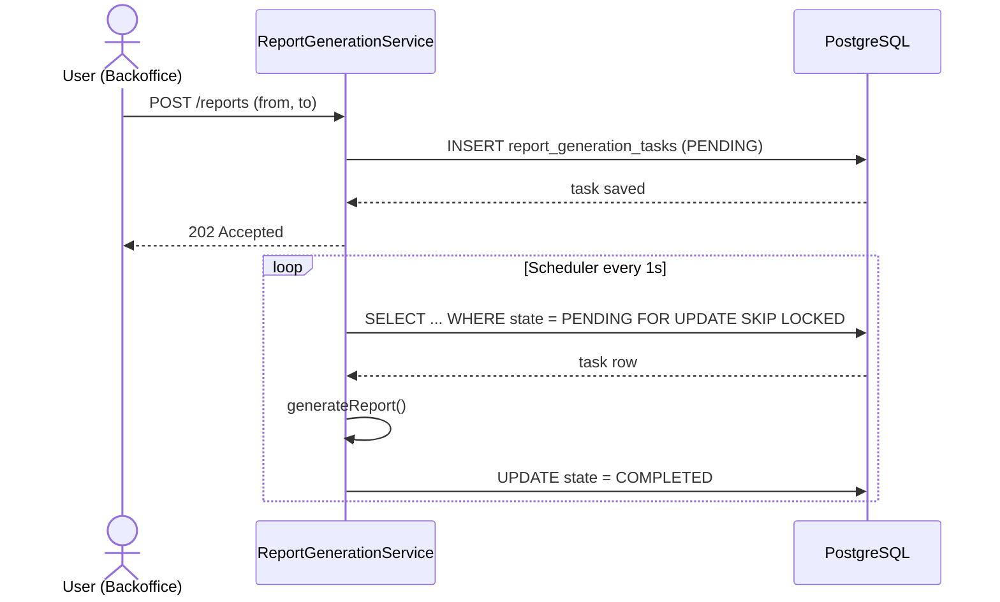
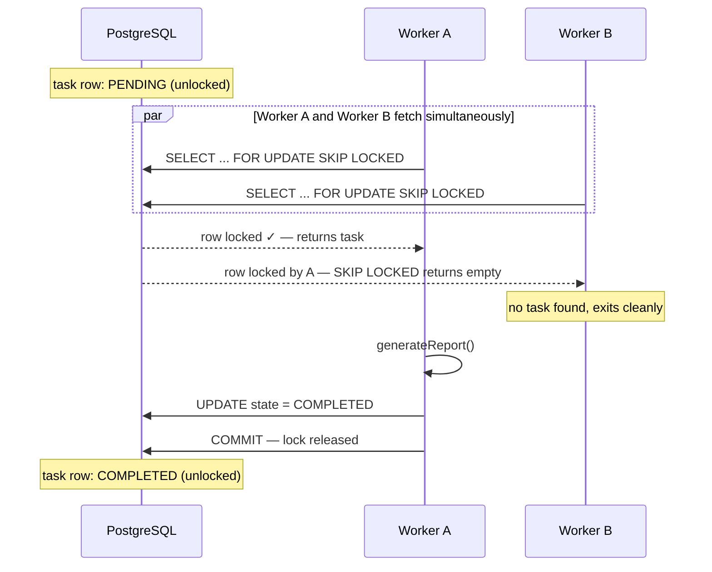
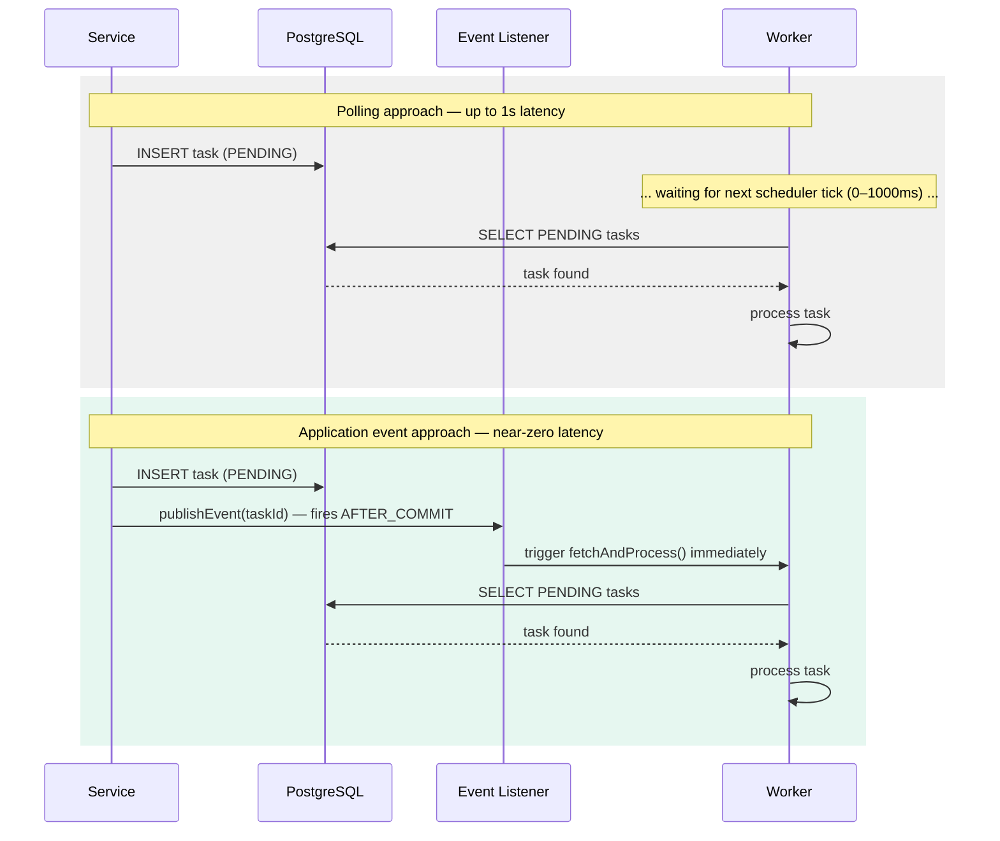
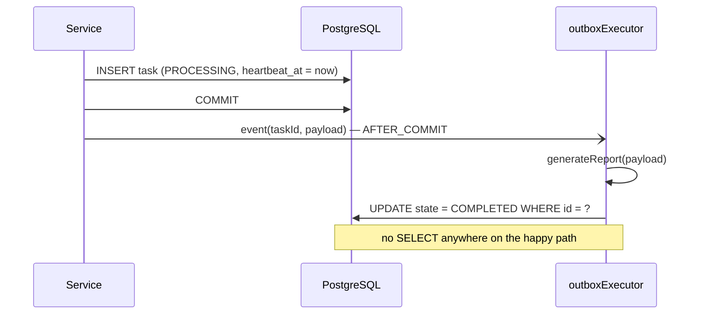
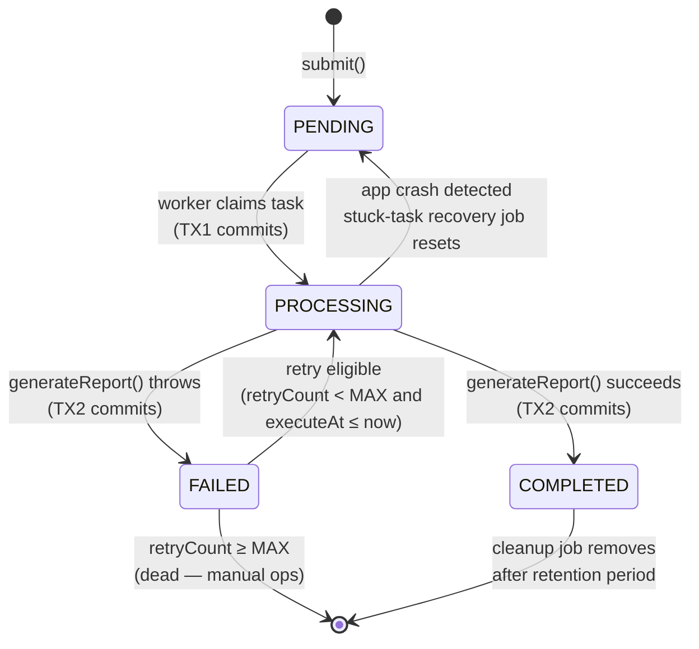
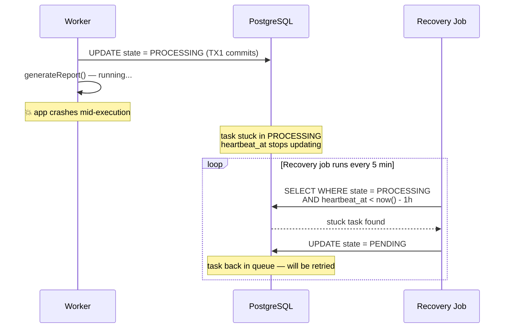
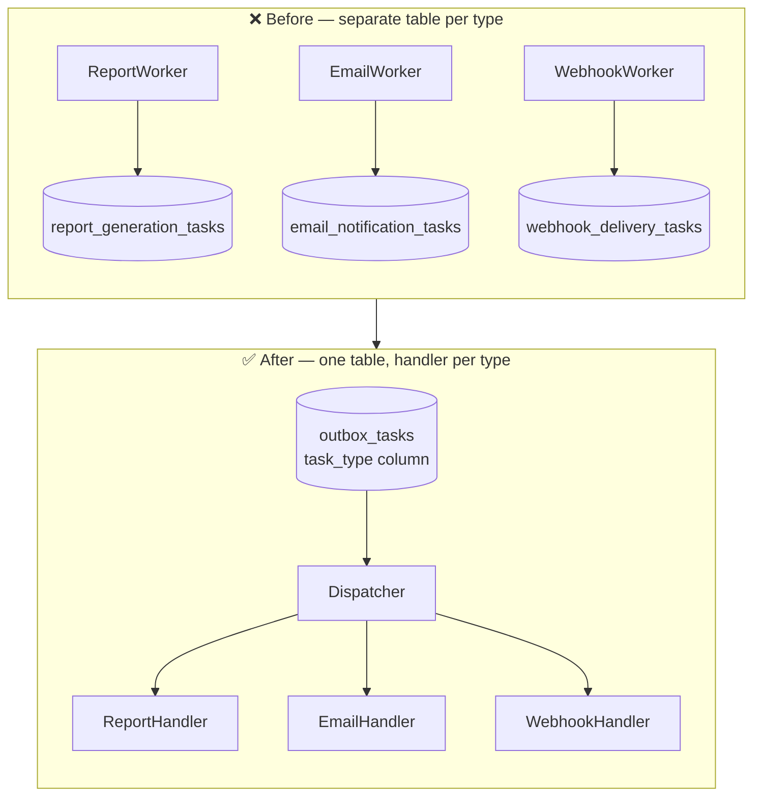
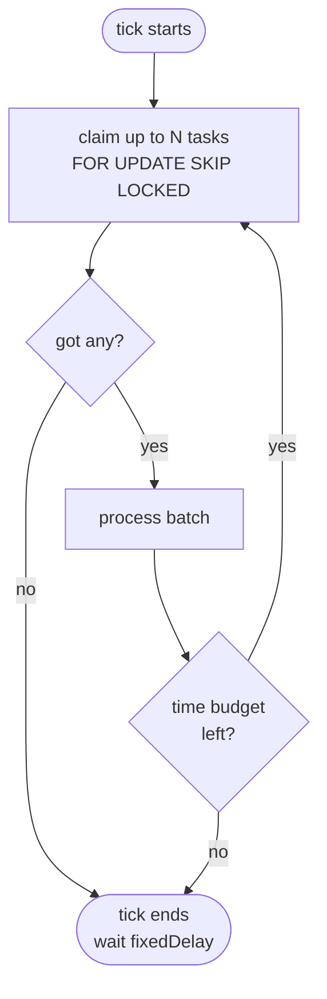

# Das Transactional Outbox Pattern: Von der einzelnen Task zur produktionsreifen Async-Engine

Es gibt eine Klasse von Bugs, die nie in deinen Unit-Tests auftaucht und selten in Staging.
Sie erscheint in Produktion, um 2 Uhr nachts, wenn deine Anwendung einen Datensatz in die
Datenbank schreibt und danach versucht, einen externen Service aufzurufen — und einer von
beiden scheitert. Die eine Seite hat committet. Die andere nicht. Niemand erfährt es, bis
sich ein Nutzer beschwert.

Das ist das **Dual-Write-Problem**, und das Transactional Outbox Pattern ist die Standardantwort
darauf. Die Idee ist einfach: Statt das externe System direkt aufzurufen, schreibst du eine Task
in dieselbe Datenbank-Transaktion wie deine Domain-Änderung. Ein Background Worker nimmt sie auf
und führt sie aus. Der Write ist atomar. Die Task kann nicht verloren gehen.

Weniger dokumentiert ist alles, was nach der Grundidee kommt — was passiert, wenn Tasks
fehlschlagen, wenn zwei Worker um dieselbe Zeile konkurrieren, wenn deine Anwendung mitten in
der Ausführung crasht, wenn zehn verschiedene Task-Typen in einer Tabelle leben, und wenn deine
Stakeholder wissen wollen, warum die Queue Depth letzten Dienstag um 3 Uhr nachts ausschlug.

Genau darum geht es in diesem Artikel.

Ich gehe ein einziges konkretes Szenario durch — einen **Report-Generation-Service** — und
entwickle es Schritt für Schritt von der rudimentärsten Outbox zu etwas, dem ich mich in
Produktion anvertrauen würde. Jeder Code-Schnipsel stammt aus einem echten, lauffähigen Repo,
das am Ende verlinkt ist.

Stack: **Java, Spring Boot, PostgreSQL**.

<div class="post-tldr" markdown="1">
<p class="post-tldr-title">TL;DR</p>

- Das **Transactional Outbox Pattern** löst das Dual-Write-Problem, indem es eine Task-Zeile in die **dieselbe DB-Transaktion** wie deine Domain-Änderung schreibt und sie anschließend von einem Background Worker ausführen lässt.
- Polle die Outbox-Tabelle mit `SELECT ... FOR UPDATE SKIP LOCKED`, damit mehrere Worker parallel laufen können, ohne doppelt zu verarbeiten.
- **Niemals** innerhalb einer DB-Transaktion an Kafka senden oder einen anderen Service aufrufen: Die Transaktionsdauer darf nie von einer externen Ressource abhängen.
- Produktionsreife braucht mehr als die Grundidee: eine **State Machine**, **Retries mit Backoff und Jitter**, **Heartbeats/Leases**, um gecrashte Worker zu erkennen, **Ordering-Garantien**, eine bewusst gewählte **Fetch-Strategie**, **Cleanup in Batches** und **Monitoring** der Queue Depth.
- Für niedrige Latenz weckst du die Worker mit einem `AFTER_COMMIT`-Event auf einem **eigenen Thread-Pool** — oder gehst auf **Zero-Select** und schickst den Payload direkt im Event mit; dafür gibst du die Kontrolle über die Last zugunsten der Geschwindigkeit auf.
- Du brauchst kein Kafka — **PostgreSQL allein** reicht für zuverlässige Async-Ausführung.
</div>

---

## Das Szenario



Wir bauen eine CRM-Anwendung. Nutzer können über ein Backoffice-UI monatliche Analytics-Reports
anfordern. Die Erzeugung eines Reports bedeutet, Dutzende Millionen Zeilen zu aggregieren — das
kann Minuten dauern. Natürlich können wir das nicht synchron in einem HTTP-Request erledigen.

Der Nutzer klickt auf einen Button. Das Backend nimmt den Request an, speichert ihn und antwortet
sofort. Ein Background Worker nimmt die Task auf, führt die Generierung aus und aktualisiert den
Status, wenn sie fertig ist.

Das ist der einfachste Fall, in dem eine Outbox Sinn ergibt: Arbeit, die ihrer Natur nach wirklich
async ist und bei der der Nutzer ohnehin mit Warten rechnet.

---

## Teil 1 — Die einfache Outbox

### Was jede Outbox braucht

Im Kern braucht jede Outbox-Tabelle drei Dinge:

- **State** — wo befindet sich diese Task in ihrem Lebenszyklus?
- **Payload** — was genau muss ausgeführt werden?
- **Timestamps** — wann wurde sie erstellt, wann hat sich zuletzt etwas geändert?

```sql
CREATE TYPE task_state AS ENUM ('PENDING', 'COMPLETED');

CREATE TABLE report_generation_tasks (
                                       id         UUID       PRIMARY KEY DEFAULT gen_random_uuid(),
                                       state      task_state NOT NULL    DEFAULT 'PENDING',
                                       payload    JSONB      NOT NULL,
                                       created_at TIMESTAMP  NOT NULL    DEFAULT now(),
                                       updated_at TIMESTAMP  NOT NULL    DEFAULT now()
);
```

Der Payload für unseren Use Case ist ein Zeitraum:

```java
@Value
@Builder
@Jacksonized
public class ReportGenerationPayload {
  Instant from;
  Instant to;
}
```

Die JPA-Entity:

```java
@Entity
@Table(name = "report_generation_tasks")
@Data
@Builder
@NoArgsConstructor
@AllArgsConstructor
public class ReportGenerationEntity {

    @Id
    @GeneratedValue(strategy = GenerationType.UUID)
    @Column(updatable = false, nullable = false)
    private UUID id;

    @Enumerated(EnumType.STRING)
    @Column(nullable = false, columnDefinition = "task_state")
    private TaskState state;

    @JdbcTypeCode(SqlTypes.JSON)
    @Column(nullable = false, updatable = false, columnDefinition = "jsonb")
    private ReportGenerationPayload payload;

    @CreationTimestamp
    @Column(nullable = false, updatable = false)
    private Instant createdAt;

    @UpdateTimestamp
    @Column(nullable = false)
    private Instant updatedAt;
}
```

Eine Task einreichen:

```java
@Service
@RequiredArgsConstructor
public class ReportGenerationService {

    private final ReportGenerationRepository repository;

    public void submit(ReportGenerationCommand command) {
        repository.save(ReportGenerationEntity.builder()
                .state(TaskState.PENDING)
                .payload(ReportGenerationPayload.builder()
                        .from(command.getFrom())
                        .to(command.getTo())
                        .build())
                .build());
    }
}
```

### Der Worker

Ein Scheduled Job pollt nach Pending-Tasks und führt sie aus:

```java
@Component
@RequiredArgsConstructor
public class ReportGenerationScheduledJob {

    private final ReportGenerationTaskService taskService;

    @Scheduled(fixedDelay = 1000)
    public void run() {
        taskService.fetchAndProcess();
    }
}
```

```java
@Service
@RequiredArgsConstructor
public class ReportGenerationTaskService {

    private final ReportGenerationRepository repository;

    public void fetchAndProcess() {
        repository.findFirstByStateOrderByCreatedAt(TaskState.PENDING)
                .ifPresent(task -> {
                    generateReport(task);
                    task.setState(TaskState.COMPLETED);
                    repository.save(task);
                });
    }

    private void generateReport(ReportGenerationEntity task) {
        // actual report generation logic
    }
}
```

```java
public interface ReportGenerationRepository extends JpaRepository<ReportGenerationEntity, UUID> {
    Optional<ReportGenerationEntity> findFirstByStateOrderByCreatedAt(TaskState state);
}
```

Das funktioniert in einer Single-Instance-Anwendung ohne Ausfälle. In der realen Welt hat es zwei
Probleme: Zwei Worker können dieselbe Task gleichzeitig beanspruchen, und Tasks können fehlschlagen,
ohne dass es einen Recovery-Pfad gibt. Beheben wir beides.

---

## Teil 2 — Concurrency: Zwei Worker, eine Task

Wenn zwei Scheduler-Threads — oder zwei App-Instanzen — die Fetch-Query im selben Moment ausführen,
können beide dieselbe `PENDING`-Zeile lesen, und beide versuchen, sie auszuführen. Das Ergebnis ist
im besten Fall doppelte Arbeit, im schlechtesten korrupter State.

Die Lösung ist ein Database Lock, der zum Fetch-Zeitpunkt gesetzt wird. PostgreSQLs
`SELECT ... FOR UPDATE SKIP LOCKED` ist genau für diesen Use Case gebaut: Es sperrt die Zeile für
die aktuelle Transaktion und überspringt alle Zeilen, die bereits von einer anderen Transaktion
gesperrt sind, statt zu warten.

```java
public interface ReportGenerationRepository extends JpaRepository<ReportGenerationEntity, UUID> {

    @Lock(LockModeType.PESSIMISTIC_WRITE)
    @QueryHint(name = AvailableSettings.JAKARTA_LOCK_TIMEOUT, value = "-2") // -2 = SKIP_LOCKED
    Optional<ReportGenerationEntity> findFirstByStateOrderByCreatedAt(TaskState state);
}
```

Der `SKIP_LOCKED`-Hint-Wert `-2` ist das, was Hibernate in die `SKIP LOCKED`-Klausel übersetzt.
Da es dafür keine erstklassige Annotation gibt, lohnt es sich, das in eine wiederverwendbare
Annotation auszulagern, damit die magische Zahl nicht über alle deine Repositories verstreut:

```java
@Retention(RetentionPolicy.RUNTIME)
@Target({ElementType.METHOD, ElementType.ANNOTATION_TYPE})
@QueryHints(@QueryHint(
    name = AvailableSettings.JAKARTA_LOCK_TIMEOUT,
    value = Timeouts.SKIP_LOCKED_MILLI + ""
))
public @interface SkipLocked {}
```

Deutlich sauberer. Jetzt zeigt das Repository seine Absicht, statt wie Klempnerarbeit auszusehen:

```java
@SkipLocked
@Lock(LockModeType.PESSIMISTIC_WRITE)
Optional<ReportGenerationEntity> findFirstByStateOrderByCreatedAt(TaskState state);
```

Du *kannst* den Lock während der Verarbeitung halten, indem du den gesamten
Fetch-Execute-Update-Zyklus in eine einzige Transaktion packst — aber im Allgemeinen solltest du
das nicht tun:

```java
// Technically works, but do not use this pattern for outbox processing.
@Transactional
public void fetchAndProcess() {
    repository.findFirstByStateOrderByCreatedAt(TaskState.PENDING)
            .ifPresent(task -> {
                generateReport(task);
                task.setState(TaskState.COMPLETED);
                repository.save(task);
            });
}
```



Auch wenn `generateReport()` klein genug ist, dass es technisch funktioniert: Eine Outbox-Aktion
unter einer offenen Transaktion auszuführen, ist ein Antipattern. Die Transaktionsdauer sollte
nicht von der Ausführungsdauer der Outbox abhängen: Die Aktion kann mit der Zeit langsamer werden,
auf I/O blockieren oder einen Downstream-Service aufrufen — und hält dann eine Datenbankverbindung
und einen Row Lock für unvorhersehbare Zeit fest.

Stattdessen beanspruche die Zeile in einer kurzen Transaktion, indem du sie auf `PROCESSING`
setzt, committe und gebe den Lock frei — und führe erst dann die Outbox-Aktion aus. `COMPLETED`
oder `FAILED` schreibst du danach in einer weiteren kurzen Transaktion. Der nächste Abschnitt
implementiert diesen State-Übergang samt Recovery-Pfad.

### Innerhalb einer Transaktion nie mit der Außenwelt reden

Dieselbe Regel gilt weit über den Outbox-Worker hinaus, und sie ist der häufigste Weg, auf dem
ich Outbox-naher Code einen Service habe lahmlegen sehen. Es sieht harmlos aus:

```java
// ❌ Kafka send (or an HTTP call, or an S3 upload) inside an open DB transaction
@Transactional
public void approveOrder(UUID orderId) {
    var order = orderRepository.findById(orderId).orElseThrow();
    order.setStatus(OrderStatus.APPROVED);

    kafkaTemplate.send("order-approved", orderId.toString(), toEvent(order)).get(); // blocks
    billingClient.notifyApproved(orderId);                                         // blocks
}
```

An einem guten Tag bestätigt Kafka in 5 ms und der Billing-Service antwortet in 30 ms — niemand
merkt etwas. An einem schlechten Tag rebalanciert der Broker oder der Billing-Service ist
degradiert, und jeder Aufruf dauert 30 Sekunden, bis er in den Timeout läuft. Jetzt ist **jede**
laufende Transaktion 30 Sekunden lang offen:

- Jede hält eine Verbindung aus dem Pool — bei 20 Verbindungen und 30-Sekunden-Aufrufen kann dein
  ganzer Service 20 Bestellungen pro 30 Sekunden freigeben, und alles andere (auch gesunde
  Lese-Endpoints) stellt sich am Pool an und läuft in Timeouts;
- sobald sie geschrieben hat (mit JPA womöglich erst beim Flush am Commit, oft aber früher), hält
  sie Row Locks — alles, was dieselben Bestellungen anfasst, wartet dahinter;
- eine lange Transaktion, die etwas geschrieben hat, hält den Vacuum-Horizont von Postgres zurück
  — tote Zeilen in der gesamten Datenbank können erst aufgeräumt werden, wenn sie endet. Bloat
  wächst also überall, nicht nur in dieser Tabelle.

Eine Degradation in einer Dependency, die dir nicht gehört, ist gerade zu einem Ausfall in einer
Datenbank geworden, die dir gehört. **Die Dauer einer Datenbank-Transaktion darf nie von einer
externen Ressource abhängen.** Eine Transaktion sollte immer nur auf die Datenbank selbst warten.

Außerdem ist es immer noch ein Dual Write. Gelingt der Kafka-Send und scheitert danach der Commit
(Constraint Violation, Serialization Failure, der Pod wird gekillt), haben Consumer bereits ein
`order-approved`-Event für eine Bestellung gesehen, die nie freigegeben wurde. Den Send *hinter*
den Commit zu verschieben, dreht nur den Failure Mode um: committet, aber das Event ist verloren.
Genau dieses Problem löst die Outbox — schreib die Absicht in der Transaktion in die Outbox und
lass danach einen Worker mit Kafka sprechen.

Zwei Schutzmaßnahmen lohnen sich auch dann, wenn der Code korrekt ist — denn wer ihn als Nächstes
anfasst, kennt die Regel vielleicht nicht:

```java
@Transactional(timeout = 5) // seconds
public void approveOrder(UUID orderId) { ... }
```

Springs `timeout` unterbricht keinen Aufruf, der bereits blockiert — es ist eine Deadline, die von
der nachfolgenden Datenbankarbeit geprüft wird. Jedes Statement nach Ablauf der Deadline
(einschließlich des Flush beim Commit) scheitert mit einer Timeout-Exception, und die Transaktion
rollt zurück. Betrachte es als Stolperdraht, der aus „langsam und still" ein „scheitert laut in
Tests und Logs" macht — nicht als Heilmittel.

```sql
-- server-side safety net: kill sessions that sit idle inside an open transaction
ALTER DATABASE app SET idle_in_transaction_session_timeout = '30s';
```

`idle_in_transaction_session_timeout` ist aus Sicht von Postgres genau die Situation von oben: Die
Session hat eine Transaktion geöffnet und ist dann verstummt, während die Anwendung auf etwas
anderes gewartet hat.

---

## Teil 2.5 — Latenz mit Application Events reduzieren

Der pollende Scheduler hat eine inhärente Latenz-Untergrenze. Läuft dein Job jede Sekunde, bleibt
eine Task, die bei `t=0ms` eingereicht wurde, bis zum nächsten Tick `PENDING` — bis zu 1000 ms
später. Für die meisten Async-Workloads ist das akzeptabel. Für Fälle, in denen du eine nahezu
sofortige Aufnahme willst — eine transaktionale E-Mail senden, einen Webhook auslösen — ist es
das nicht.

Das Pattern ist von Celery geliehen: Speichere die Outbox-Entity in der Datenbank und publiziere
dann sofort ein Spring-`ApplicationEvent` mit der ID der neuen Task. Ein Listener nimmt es auf und
stößt die Verarbeitung umgehend an, ohne auf den nächsten Scheduler-Tick zu warten.



Der Scheduler läuft weiter als Safety Net — er fängt alles auf, was der Event Listener verpasst
hat (App-Neustart, Listener-Exception, verlorenes Event). Aber der Happy Path umgeht die
Polling-Verzögerung komplett.

### Implementierung

Publiziere das Event innerhalb der Service-Methode, nach dem Speichern:

```java
@Service
@RequiredArgsConstructor
public class ReportGenerationService {

    private final ReportGenerationRepository repository;
    private final ApplicationEventPublisher eventPublisher;

    @Transactional
    public void submit(ReportGenerationCommand command) {
        var entity = repository.save(ReportGenerationEntity.builder()
                .state(TaskState.PENDING)
                .payload(ReportGenerationPayload.builder()
                        .from(command.getFrom())
                        .to(command.getTo())
                        .build())
                .build());

        eventPublisher.publishEvent(new ReportGenerationTaskSubmittedEvent(entity.getId()));
    }
}
```

```java
public record ReportGenerationTaskSubmittedEvent(UUID taskId) {}
```

Der Listener reagiert nach dem Commit, **auf seinem eigenen Thread-Pool**:

```java
@Component
@RequiredArgsConstructor
public class ReportGenerationTaskEventListener {

    private final ReportGenerationTaskService taskService;

    @Async("outboxExecutor")
    @TransactionalEventListener(phase = TransactionPhase.AFTER_COMMIT)
    public void onTaskSubmitted(ReportGenerationTaskSubmittedEvent event) {
        taskService.fetchAndProcess();
    }
}
```

Beachte, dass der Listener `event.taskId()` nicht weiterreicht. Das ist Absicht: Das Event ist nur
ein **Weck-Signal**, und `fetchAndProcess()` beansprucht Arbeit genau so wie der Poller — die
älteste ausführbare Task, mit `SKIP LOCKED`. Die Task, die das Event ausgelöst hat, ist also nicht
unbedingt die, die läuft, aber Ordering und Beanspruchen bleiben an einer Stelle. Willst du lieber
*genau diese* Task sofort ausführen, gib die ID weiter und beanspruche sie direkt:

```java
taskService.process(event.taskId()); // WHERE id = :id AND state = 'PENDING' FOR UPDATE SKIP LOCKED
```

Das liefert dem Einreichenden die niedrigste Latenz — um den Preis, dass neue Tasks ältere
`PENDING`-Tasks überholen. Für unabhängige Arbeit ist das in Ordnung, falsch dagegen, wenn du dich
auf FIFO verlässt (Teil 7). Die Zero-Select-Outbox am Ende dieses Teils denkt die Idee zu Ende und
übergibt gleich den ganzen Payload.

`@Async` ist keine Dekoration. Ein `AFTER_COMMIT`-Listener ohne `@Async` läuft **synchron auf dem
Thread, der committet hat** — dem HTTP-Request-Thread. Das „202 Accepted" für den Nutzer wartet
jetzt, bis der ganze Report erzeugt ist. Schlimmer noch: Zu diesem Zeitpunkt sind die Ressourcen
der committeten Transaktion noch an den Thread gebunden. Springs eigene Dokumentation warnt, dass
Datenzugriffe aus einem After-Commit-Callback noch an der beendeten Transaktion „teilnehmen", und
nichts wird sie committen, sofern der Code nicht explizit `REQUIRES_NEW` anfordert. Den Listener
auf einen separaten Thread zu verlegen, behebt beides auf einmal.

### Ein eigener Thread-Pool, nicht der Default

`@Async` ohne Namen nutzt Spring Boots gemeinsamen `applicationTaskExecutor` — geteilt mit jeder
anderen `@Async`-Methode der Anwendung und standardmäßig mit einer praktisch unbegrenzten Queue.
Eine Event-Flut würde still zu einem In-Memory-Backlog, der beim nächsten Neustart verschwindet.
Gib der Outbox einen eigenen, begrenzten Pool:

```java
@Configuration
@EnableAsync
public class OutboxExecutorConfig {

    @Bean("outboxExecutor")
    public ThreadPoolTaskExecutor outboxExecutor() {
        var executor = new ThreadPoolTaskExecutor();
        executor.setCorePoolSize(4);
        executor.setMaxPoolSize(4);
        executor.setQueueCapacity(200);                 // bounded: overflow is rejected, not buffered forever
        executor.setThreadNamePrefix("outbox-");        // readable thread dumps and logs
        executor.setRejectedExecutionHandler(new ThreadPoolExecutor.DiscardPolicy());
        executor.setWaitForTasksToCompleteOnShutdown(true);
        executor.setAwaitTerminationSeconds(15);
        return executor;
    }
}
```

Ein Spring-Boot-Detail, das du kennen solltest, bevor du das kopierst: Boot konfiguriert seinen
`applicationTaskExecutor` nur dann automatisch, wenn du **keine** eigene `Executor`-Bean deklariert
hast. Deklarierst du `outboxExecutor`, verschwindet der Default — und jedes *unbenannte* `@Async`
an anderer Stelle der Anwendung landet still auf einem anderen Executor (womöglich auf diesem, mit
seiner Discard-Policy). Ab Boot 3.5 setzt du `spring.task.execution.mode=force`, um den
automatisch konfigurierten zu behalten; in älteren Versionen deklarierst du explizit eine
`applicationTaskExecutor`-Bean neben dieser.

Beim Überlauf zu verwerfen ist hier sicher, *weil die Zeile in der Datenbank liegt*: Das Event ist
nur eine Latenz-Optimierung, und der Poller greift alles auf, was der Event-Pfad fallen gelassen
hat. Nutze für diesen Pool niemals `CallerRunsPolicy` — der „Caller" ist genau der Request-Thread,
den du entlasten wolltest.

### Der klassische Fehler

Der häufigste Fehler ist, `@EventListener` statt
`@TransactionalEventListener(phase = TransactionPhase.AFTER_COMMIT)` zu verwenden. Was dann schiefgeht,
hängt davon ab, ob der Listener asynchron ist:

- **Ein einfacher `@EventListener`** feuert in dem Moment, in dem `publishEvent()` aufgerufen wird
  — synchron, auf demselben Thread, **innerhalb der noch offenen Transaktion**. `fetchAndProcess()`
  tritt dieser Transaktion bei, sieht die noch nicht committete Zeile also *sehr wohl* — und
  beansprucht und führt die Task direkt dort aus. Der Report wird innerhalb der Submit-Transaktion
  erzeugt (genau das Antipattern aus Teil 2), der Request hängt, bis er fertig ist, und rollt die
  Submit-Transaktion danach zurück, hast du eine Task ausgeführt, die offiziell nie existiert hat.
- **`@Async` + `@EventListener`** läuft auf einem anderen Thread mit einer anderen Verbindung, vor
  dem Commit. Die Zeile ist noch nicht sichtbar, der Fetch findet nichts, und das Event verpufft
  stillschweigend. Der Scheduler greift die Task eine Sekunde später auf, die Logs sehen also
  unauffällig aus — du hast nur unbemerkt den Latenzvorteil verloren.

```java
// ❌ fires inside the open transaction (or before it commits, if @Async)
@EventListener
public void onTaskSubmitted(ReportGenerationTaskSubmittedEvent event) {
    taskService.fetchAndProcess();
}

// ✅ fires after COMMIT, on the outbox pool — the row is visible and the caller is free
@Async("outboxExecutor")
@TransactionalEventListener(phase = TransactionPhase.AFTER_COMMIT)
public void onTaskSubmitted(ReportGenerationTaskSubmittedEvent event) {
    taskService.fetchAndProcess();
}
```

Der Scheduler bleibt unverändert — er dient als Recovery-Mechanismus für alle Tasks, die der
Event Listener verpasst hat. Die beiden Ansätze ergänzen sich: Events für Latenz, Polling für
Zuverlässigkeit.

### Noch einen Schritt weiter: die Zero-Select-Outbox

Das Event oben kostet immer noch einen Roundtrip. Es sagt nur „da ist etwas Neues", also muss der
Worker per `SELECT` herausfinden, was — und mit `ORDER BY created_at` nimmt er womöglich nicht
einmal die Task, die ihn geweckt hat. Wenn Latenz wirklich zählt, lass das Lesen ganz weg: **Pack
alles, was zur Ausführung der Task nötig ist, ins Event**, führe sie direkt aus dem Speicher aus
und schreib nur das Ergebnis zurück.



Das nutzt den `PROCESSING`-State und den Heartbeat aus Teil 3 und 5. Die Zeile wird bereits als
`PROCESSING` eingefügt, mit einem frischen `heartbeat_at`, das als Lease dient. Genau dieses Detail
hält das Ganze korrekt: Würde die Zeile als `PENDING` eingefügt, könnte der Poller sie
beanspruchen, während der Event-Pfad sie bereits ausführt — und die Task liefe zweimal.

```java
public record ReportRequestedEvent(UUID taskId, Instant leasedAt, ReportGenerationPayload payload) {}

@Transactional
public void submit(ReportGenerationCommand command) {
    var payload = ReportGenerationPayload.builder()
            .from(command.getFrom())
            .to(command.getTo())
            .build();
    var leasedAt = Instant.now().truncatedTo(ChronoUnit.MICROS); // Postgres stores microseconds
    var entity = repository.save(ReportGenerationEntity.builder()
            .state(TaskState.PROCESSING)
            .heartbeatAt(leasedAt)        // lease: the poller leaves this row alone
            .payload(payload)
            .build());
    eventPublisher.publishEvent(new ReportRequestedEvent(entity.getId(), leasedAt, payload));
}
```

```java
@Async("outboxExecutor")
@TransactionalEventListener(phase = TransactionPhase.AFTER_COMMIT)
public void onReportRequested(ReportRequestedEvent event) {
    // UPDATE ... SET heartbeat_at = now()
    //  WHERE id = :id AND state = 'PROCESSING' AND heartbeat_at = :leasedAt
    if (repository.renewLease(event.taskId(), event.leasedAt()) == 0) {
        return; // the event waited too long: recovery already handed the task to the poller
    }
    try (var heartbeat = heartbeatFactory.start(event.taskId())) {
        generateReport(event.payload());
        repository.markCompleted(event.taskId());              // UPDATE ... WHERE id = :id
    } catch (Exception e) {
        repository.markFailed(event.taskId(), e.getMessage()); // the poller retries it later
    }
}
```

Die `renewLease`-Prüfung am Anfang ist wichtiger, als sie aussieht. Die Lease wird beim Insert
gesetzt, der Heartbeat startet aber erst, wenn ein Thread das Event aufnimmt. Liegt das Event
länger in der Executor-Queue als der Recovery-Schwellenwert, setzt der Recovery-Job die Zeile auf
`PENDING` zurück, ein Poller beansprucht sie — und das wartende Event würde sie dann ein zweites
Mal ausführen. Das bedingte Update macht aus diesem Race einen No-op: Wer die ursprüngliche Lease
nicht mehr besitzt, zieht sich zurück.

Jeder Failure Mode landet wieder im klassischen Pfad. Wirft der Listener, ist die Task `FAILED`,
und der Poller wiederholt sie mit Backoff. Stirbt die App mitten in der Ausführung, stoppt der
Heartbeat, und der Recovery-Job für hängende Tasks setzt sie zurück. Lehnt der Pool das Event ab,
bleibt die Zeile `PROCESSING` mit einer Lease, die nie erneuert wird, und wartet auf die Recovery
— dank der Lease-Prüfung ist ein kurzer Recovery-Schwellenwert für diese Zeilen unbedenklich. (Sie
bei Ablehnung direkt auf `PENDING` zurückzusetzen, bräuchte die Task-ID, die ein
`@Async`-Rejection-Handler nicht bekommt; reich die Arbeit selbst beim Executor ein und fang
`TaskRejectedException`, wenn du das willst.)

**Der Trade-off: Wer steuert die Arbeitsmenge?** Eine pollende Outbox *zieht* (Pull). Sie
entscheidet, wie viele Tasks sie nimmt und wie schnell — ihre Last ist also by Design begrenzt,
egal was upstream passiert. Eine Zero-Select-Outbox wird *beschickt* (Push): Arbeit kommt in dem
Tempo an, in dem Requests ankommen. Eine Traffic-Spitze wird zur Ausführungsspitze, und die
einzigen Bremsen sind Pool-Größe und Queue-Kapazität — sind die voll, lehnst du ab und fällst
ohnehin aufs Polling zurück. Nutze Zero-Select für latenzkritische Arbeit mit moderatem Volumen
und einem begrenzten Pool; behalte den Poller für alles andere und immer als Safety Net.

**Den letzten Write herausquetschen.** Für maximalen Durchsatz kannst du noch einen Schritt weiter
gehen und nicht mehr jeden Abschluss einzeln schreiben: Sammle die IDs abgeschlossener Tasks im
Speicher und flushe sie alle paar hundert Millisekunden als ein einziges `UPDATE`.

```java
@Component
@RequiredArgsConstructor
public class CompletionBuffer {

    private final ConcurrentLinkedQueue<UUID> completed = new ConcurrentLinkedQueue<>();
    private final ReportGenerationRepository repository;

    public void add(UUID taskId) {
        completed.add(taskId);
    }

    @Scheduled(fixedDelay = 200)
    @PreDestroy                                   // flush what we can on a graceful shutdown
    public void flush() {
        var ids = new ArrayList<UUID>();
        for (UUID id; ids.size() < 1_000 && (id = completed.poll()) != null; ) {
            ids.add(id);
        }
        if (!ids.isEmpty()) {
            repository.markCompleted(ids);        // UPDATE ... SET state = 'COMPLETED' WHERE id IN (:ids)
        }
    }
}
```

Der Flush beim Shutdown ist Best Effort — alles, was danach noch im Buffer liegt oder nach der
Zerstörung der Bean hinzukommt, wird später einfach erneut ausgeführt. Sei dir genau im Klaren,
was das kostet. Ein Crash verliert den Buffer — nicht die Tasks, sondern den *Nachweis, dass sie
fertig sind*. Diese Zeilen bleiben `PROCESSING`, die Recovery setzt sie zurück, und sie laufen
**noch einmal**. Das ist nur akzeptabel, wenn jeder Handler idempotent ist (Teil 10). Fehler
schreibst du sofort, statt sie zu puffern: Sie sind selten, und ihre Fehlermeldung ist das Einzige,
was du später nicht rekonstruieren kannst.

---

## Teil 3 — Fehler, Retries und der PROCESSING-State



Outbox-Aktionen sollten nicht unter einer offenen Datenbank-Transaktion laufen. Der
Locked-Transaction-Ansatz hält einen Database Lock über die gesamte Dauer von `generateReport()`.
Bei einem Report, der zwei Minuten dauert, sind das zwei Minuten gesperrte Zeile — eine gebundene
Verbindung, andere DB-Operationen, die potenziell dahinter warten. Mit `SKIP LOCKED` blockieren
sich Worker zwar nicht gegenseitig am Lock, aber langlebige Transaktionen setzen den Connection
Pool trotzdem unter Druck und machen der Datenbank unter Last zu schaffen. Eine sehr kleine Aktion
mag technisch ohne sichtbare Probleme durchlaufen, aber die Kopplung von Transaktionsdauer an die
Ausführungsdauer der Outbox bleibt ein Antipattern.

Die Lösung: das Beanspruchen einer Task von ihrer Ausführung trennen. Setze die Task in einer
kurzen Transaktion auf `PROCESSING`, gib den Lock frei und erledige die eigentliche Arbeit
außerhalb jeder Transaktion. So wird die DB nur kurz am Anfang und kurz am Ende berührt — der
teure Teil passiert dazwischen, ohne etwas zu halten.

Zuerst erweitern wir das Enum:

```sql
ALTER TYPE task_state ADD VALUE 'PROCESSING';
ALTER TYPE task_state ADD VALUE 'FAILED';

ALTER TABLE report_generation_tasks
    ADD COLUMN retry_count  INTEGER NOT NULL DEFAULT 0,
    ADD COLUMN error_message VARCHAR;
```

`retry_count` zählt, wie oft die Ausführung versucht wurde. Die Retries begrenzen wir auf 10 —
darüber hinaus ist etwas wirklich kaputt und braucht manuelles Eingreifen. Das Alerting dazu
verdrahten wir später. `error_message` speichert die letzte Exception, damit du weißt, *warum*
eine Task festhängt, ohne dich durch Logs zu wühlen.

Das Java-Enum wächst mit:

```java
public enum TaskState {
    PENDING,
    PROCESSING,
    COMPLETED,
    FAILED
}
```

Der Service führt jetzt zwei getrennte kurze Transaktionen aus, mit der eigentlichen Arbeit
dazwischen:

```java
@RequiredArgsConstructor
public class ReportGenerationTaskService {

    private final ReportGenerationRepository repository;
    private final TransactionTemplate transactionTemplate;

    private static final int MAX_RETRY_COUNT = 10;

    public void fetchAndProcess() {
        transactionTemplate
                .execute(status ->
                        repository.findFirstEligibleTask(
                                List.of(TaskState.PENDING, TaskState.FAILED),
                                MAX_RETRY_COUNT
                        ).map(this::markProcessing))
                .ifPresentOrElse(
                        task -> {
                            try {
                                generateReport(task);
                                markCompleted(task);
                            } catch (Exception e) {
                                markFailed(task, e);
                                log.error("Task {} failed on attempt {}", task.getId(), task.getRetryCount(), e);
                            }
                        },
                        () -> log.debug("No eligible tasks to process")
                );
    }

    private ReportGenerationEntity markProcessing(ReportGenerationEntity task) {
        task.setState(TaskState.PROCESSING);
        return repository.save(task);
    }

    private void markCompleted(ReportGenerationEntity task) {
        task.setState(TaskState.COMPLETED);
        repository.save(task);
    }

    private void markFailed(ReportGenerationEntity task, Exception e) {
        task.setState(TaskState.FAILED);
        task.setRetryCount(task.getRetryCount() + 1);
        task.setErrorMessage(e.getMessage()); // don't skip this — it's the only trace of what went wrong without digging through logs
        repository.save(task);
    }
}
```

Die Query holt sowohl `PENDING`- als auch `FAILED`-Tasks — eine fehlgeschlagene Task mit
`retryCount < 10` ist genauso ein Kandidat für die Ausführung wie eine frische. Sobald der Retry
Count das Limit erreicht, wird die Task nicht mehr geholt und liegt als dauerhafter
`FAILED`-Datensatz, bis sich jemand sie ansieht. Das ist Absicht: Nach 10 Versuchen ist etwas
wirklich kaputt, und dann braucht es einen Blick von jemandem, keinen weiteren Retry.

```java
@SkipLocked
@Lock(LockModeType.PESSIMISTIC_WRITE)
@Query("""
    SELECT t FROM ReportGenerationEntity t
    WHERE t.state IN :states
      AND t.retryCount < :maxRetryCount
    ORDER BY t.createdAt ASC
    LIMIT 1
    """)
Optional<ReportGenerationEntity> findFirstEligibleTask(
    @Param("states") List<TaskState> states,
    @Param("maxRetryCount") Integer maxRetryCount
);
```

Aber Moment — soll eine gerade fehlgeschlagene Task wirklich schon im allernächsten
Scheduler-Tick, also Sekunden später, wieder aufgenommen werden? Ist das Downstream-System down,
machst du es schlimmer, wenn du es jede Sekunde bombardierst. Darum geht es im nächsten Abschnitt.

## Teil 4 — Exponentielles Backoff

Ohne Verzögerung zwischen den Retries landet eine fehlgeschlagene Task schon im nächsten
Scheduler-Tick wieder in der Queue — meist Sekunden später. Ist das Downstream-System down,
bombardierst du es mit voller Polling-Rate. Das ist schlecht für das Downstream-System und
schlecht für deine DB.

Die Lösung ist eine `execute_at`-Spalte: Die Task wird nicht abgeholt, solange dieser Timestamp
nicht in der Vergangenheit liegt. Frische Tasks bekommen `execute_at = now()`, damit sie sofort
aufgenommen werden. Fehlgeschlagene Tasks bekommen `execute_at = now() + delay`, wobei das Delay
mit jedem Retry wächst.

```sql
ALTER TABLE report_generation_tasks
    ADD COLUMN execute_at TIMESTAMP NOT NULL DEFAULT NOW();
```

Der Delay-Plan treibt alles an — `MAX_RETRY_COUNT` wird daraus abgeleitet, nicht separat
deklariert. So können die beiden nie auseinanderdriften:

```java
private static final Map<Integer, Duration> RETRY_DELAYS = Map.of(
    0, Duration.ofMinutes(1),
    1, Duration.ofMinutes(5),
    2, Duration.ofMinutes(15),
    3, Duration.ofMinutes(30),
    4, Duration.ofHours(1),
    5, Duration.ofHours(2),
    6, Duration.ofHours(4),
    7, Duration.ofHours(8),
    8, Duration.ofHours(12),
    9, Duration.ofDays(1)
);

private static final int MAX_RETRY_COUNT = RETRY_DELAYS.size();
```

Fügst du einen neuen Eintrag zu `RETRY_DELAYS` hinzu, aktualisiert sich das Retry-Limit
automatisch. Keine magische Zahl, die du sonstwo synchron halten musst.

In `markFailed()` erfasse den *aktuellen* Retry Count, bevor du inkrementierst — er wählt das
Delay für den *nächsten* Versuch:

```java
private void markFailed(ReportGenerationEntity task, Exception e) {
    int currentRetry = task.getRetryCount();
    task.setState(TaskState.FAILED);
    task.setRetryCount(currentRetry + 1);
    task.setErrorMessage(e.getMessage());
    task.setExecuteAt(Instant.now().plus(
            RETRY_DELAYS.getOrDefault(currentRetry, RETRY_DELAYS.get(RETRY_DELAYS.size() - 1))));
    repository.save(task);
}
```

Die Fetch-Query bekommt eine zusätzliche Bedingung — `AND t.executeAt <= :now` —, und der
Scheduler läuft weiter mit derselben Rate. Er überspringt nur Tasks, deren Fenster noch nicht
offen ist. Fehlgeschlagene Tasks warten ruhig, bis sie dran sind, und kehren dann ganz natürlich
zurück.

### Jitter: Die Last glätten, bevor sie dich trifft

Ein fester Backoff-Plan hat eine unangenehme Eigenschaft: Tasks, die zusammen gescheitert sind,
werden auch zusammen wiederholt. War der E-Mail-Provider zwei Minuten lang down, bekommen die
3.000 Tasks, die in diesem Fenster gescheitert sind, alle `execute_at = failed_at + 1 minute` — und
treffen den Provider in dem Moment, in dem er zurück ist, als eine einzige synchronisierte Welle.
Bring Zufall in jedes Delay, damit sich die Welle verteilt:

```java
private static Instant nextAttempt(Duration baseDelay) {
    long jitterMillis = ThreadLocalRandom.current().nextLong(baseDelay.toMillis() / 2 + 1);
    return Instant.now().plus(baseDelay).plusMillis(jitterMillis); // base + up to 50%
}
```

Dieselbe Idee gilt auch auf dem Weg **hinein**. Architektonisch will eine Async-Engine eine
flache, gleichmäßige Last — keine großen, plötzlichen Spitzen. Ein nächtlicher Import, der 200.000
Tasks in einer Transaktion einreicht, macht sie alle in derselben Millisekunde ausführbar: Jeder
Worker auf jedem Pod ist ausgelastet, das Downstream-System bekommt den vollen Burst ab, und deine
Latenz-Dashboards leuchten auf — für Arbeit, auf die niemand gewartet hat. Ist eine Task nicht
dringend, gib ihr schon beim Einreichen ein `execute_at` mit Jitter:

```java
// bulk / non-urgent submission: spread over the next 10 minutes instead of "all now"
entity.setExecuteAt(Instant.now().plusMillis(
        ThreadLocalRandom.current().nextLong(Duration.ofMinutes(10).toMillis())));
```

Die Gesamtmenge an Arbeit bleibt gleich; sie wird nur über die Zeit verteilt. Nutzerseitige Tasks
behalten `execute_at = now()`; Batch-Arbeit bekommt ein Jitter-Fenster, das so groß ist, wie sie
es sich leisten kann zu warten.

---

## Teil 5 — Hängende Tasks und Heartbeats



Beim Zwei-Transaktionen-Ansatz überlege dir, was passiert, wenn die App crasht, nachdem sie eine
Task auf `PROCESSING` gesetzt hat, aber bevor sie sie auf `COMPLETED` oder `FAILED` setzt. Die DB
zeigt `PROCESSING`. Niemand verarbeitet sie. Sie bleibt für immer dort liegen.

Der naive Fix ist ein Recovery-Job, der Tasks findet, die zu lange in `PROCESSING` hängen, und
sie auf `PENDING` zurücksetzt:

```java
@Transactional
public void recoverStuckTasks() {
    repository.findFirstByStateAndUpdatedAtLessThan(
                    TaskState.PROCESSING,
                    Instant.now().minus(1, ChronoUnit.HOURS))
            .ifPresent(task -> {
                log.warn("Resetting stuck task {} to PENDING", task.getId());
                task.setState(TaskState.PENDING);
                repository.save(task);
            });
}
```

Das funktioniert in den meisten Fällen. Das Problem: `updated_at` ändert sich, wann immer sich
*irgendetwas* an der Zeile ändert — auch unverbundene State-Übergänge. Eine Task, die seit 55
Minuten legitim verarbeitet wird, sieht aus `updated_at`-Sicht identisch aus wie eine gecrashte
Task.

Die sauberere Lösung ist ein **Heartbeat**: eine dedizierte Spalte, die periodisch aktualisiert
wird — *aber nur, während die Task aktiv verarbeitet wird*. Der Recovery-Job prüft jetzt diese
Spalte, nicht `updated_at`. Eine Task, die in der letzten Stunde keinen Heartbeat geschickt hat,
hängt wirklich fest.

```sql
ALTER TABLE report_generation_tasks ADD COLUMN heartbeat_at TIMESTAMP;
```

Der Heartbeat läuft in seinem eigenen Thread, innerhalb seiner eigenen Transaktionen, unabhängig
von der Verarbeitungslogik. Die sauberste Implementierung ist ein `try-with-resources` — er
startet, wenn die Verarbeitung startet, und stoppt auf jedem Exit-Pfad:

```java
public abstract class Heartbeat implements AutoCloseable {

    private final ScheduledExecutorService executor;

    protected Heartbeat(Runnable heartbeatFn) {
        executor = Executors.newSingleThreadScheduledExecutor();
        executor.scheduleAtFixedRate(heartbeatFn, 0, 10, TimeUnit.SECONDS);
    }

    @Override
    public void close() {
        executor.shutdownNow();
    }
}
```

```java
public class ReportGenerationTaskHeartbeat extends Heartbeat {

    ReportGenerationTaskHeartbeat(UUID taskId, ReportGenerationRepository repository) {
        super(() -> repository.updateHeartbeatAt(taskId, Instant.now()));
    }
}
```

Die Repository-Methode bringt ihr eigenes `@Transactional` mit — der Aufruf muss nicht manuell
umwickelt werden:

```java
@Modifying
@Transactional
@Query("UPDATE ReportGenerationEntity t SET t.heartbeatAt = :now WHERE t.id = :id")
void updateHeartbeatAt(@Param("id") UUID id, @Param("now") Instant now);
```

Verdrahte ihn über eine Factory, damit der Service sauber bleibt:

```java
@Component
@RequiredArgsConstructor
public class ReportGenerationTaskHeartbeatFactory {

    private final ReportGenerationRepository repository;

    public Heartbeat start(UUID taskId) {
        return new ReportGenerationTaskHeartbeat(taskId, repository);
    }
}
```

Der Verarbeitungsblock sieht jetzt so aus:

```java
public void fetchAndProcess() {
    transactionTemplate
            .execute(status -> repository.findFirstEligibleTask(
                    List.of(TaskState.PENDING, TaskState.FAILED),
                    MAX_RETRY_COUNT
            ).map(this::markProcessing))
            .ifPresentOrElse(
                    task -> {
                        try (var heartbeat = heartbeatFactory.start(task.getId())) {
                            try {
                                generateReport(task);
                                markCompleted(task);
                            } catch (Exception e) {
                                markFailed(task, e);
                                log.error("Task {} failed", task.getId(), e);
                            }
                        }
                    },
                    () -> log.debug("No eligible tasks to process")
            );
}
```

Der Recovery-Job nutzt `heartbeat_at` statt `updated_at`:

```java
@Modifying
@Transactional
@Query("UPDATE ReportGenerationEntity t SET t.heartbeatAt = :now WHERE t.id = :id")
void updateHeartbeatAt(@Param("id") UUID id, @Param("now") Instant now);

@SkipLocked
@Lock(LockModeType.PESSIMISTIC_WRITE)   // two recovery runs never reset the same task
Optional<ReportGenerationEntity> findFirstByStateAndHeartbeatAtLessThanOrderByCreatedAt(
        TaskState state, Instant heartbeatAt);
```

`updated_at` spiegelt, wann sich der Task-State zuletzt geändert hat. `heartbeat_at` spiegelt, ob
die Task gerade lebt. Getrennt gehalten kannst du beide Fragen eindeutig beantworten.

---

## Teil 6 — Multi-Type-Outbox



Sechs Monate später erledigt dein Service mehr als nur Report-Generierung. Du brauchst
E-Mail-Benachrichtigungen. Dann Datenexporte. Dann Webhook-Auslieferungen.

Du hast zwei Optionen: eine eigene Tabelle pro Task-Typ oder eine gemeinsame Tabelle mit einem
`task_type`-Diskriminator. Die gemeinsame Tabelle gewinnt, wenn es viele Task-Typen gibt und du
sie von einer Stelle aus verarbeitest. Die Infrastruktur — Retries, Heartbeats, Backoff,
Monitoring — bleibt an einem Ort. Einen neuen Task-Typ hinzuzufügen heißt, einen neuen Handler
hinzuzufügen.

Die Trade-offs, die man vorab kennen sollte:

- Ein neuer Task-Typ mit Fehlverhalten kann alle anderen Typen verlangsamen — ein
  schlechter Handler, der Retries verbrennt, erzeugt Backpressure über die ganze Tabelle.
- Ordering-Garantien werden schwieriger — dazu später mehr.

### Das Schema

```sql
CREATE TYPE outbox_task_type AS ENUM ('REPORT_GENERATION', 'EMAIL_NOTIFICATION');

CREATE TABLE outbox_tasks (
    id            UUID             PRIMARY KEY DEFAULT gen_random_uuid(),
    task_type     outbox_task_type NOT NULL,
    state         task_state       NOT NULL    DEFAULT 'PENDING',
    payload       JSONB            NOT NULL,
    retry_count   INTEGER          NOT NULL    DEFAULT 0,
    error_message VARCHAR,
    execute_at    TIMESTAMPTZ      NOT NULL    DEFAULT NOW(),
    heartbeat_at  TIMESTAMPTZ,
    created_at    TIMESTAMPTZ      NOT NULL    DEFAULT now(),
    updated_at    TIMESTAMPTZ      NOT NULL    DEFAULT now()
);
```

### Das Handler-Interface

Der zentrale Erweiterungspunkt — eine Implementierung pro Task-Typ:

```java
public interface OutboxTaskHandler<P> {
    OutboxTaskType getType();
    Class<P> payloadClass();
    void handle(UUID taskId, P payload) throws Exception;
}
```

`taskId` wird an jeden Handler durchgereicht. Warum, siehst du im Abschnitt über Idempotenz.

Ein konkreter Handler:

```java
@Component
public class EmailNotificationHandler implements OutboxTaskHandler<EmailNotificationPayload> {

    @Override
    public OutboxTaskType getType() {
        return OutboxTaskType.EMAIL_NOTIFICATION;
    }

    @Override
    public Class<EmailNotificationPayload> payloadClass() {
        return EmailNotificationPayload.class;
    }

    @Override
    public void handle(UUID taskId, EmailNotificationPayload payload) throws Exception {
        log.info("Sending email to {} — task {}", payload.getRecipient(), taskId);
        // call email provider
    }
}
```

### Der Dispatcher

Der Service sammelt beim Start alle Handler-Beans ein, baut eine Lookup-Map und routet jede Task
anhand von `taskType`:

```java
@Service
@RequiredArgsConstructor
public class OutboxTaskService {

    private final OutboxTaskRepository repository;
    private final ObjectMapper objectMapper;
    private final List<OutboxTaskHandler<?>> handlerList;

    private Map<OutboxTaskType, OutboxTaskHandler<?>> handlers;

    @PostConstruct
    void init() {
        handlers = handlerList.stream()
                .collect(Collectors.toMap(OutboxTaskHandler::getType, Function.identity()));
    }

    @SuppressWarnings("unchecked")
    private void dispatch(OutboxTaskEntity task) throws Exception {
        var handler = (OutboxTaskHandler<Object>) handlers.get(task.getTaskType());
        if (handler == null) {
            throw new IllegalStateException(
                    "No handler registered for task type: " + task.getTaskType());
        }
        var payload = objectMapper.readValue(task.getPayload(), handler.payloadClass());
        handler.handle(task.getId(), payload);
    }
}
```

Einen neuen Task-Typ registrieren heißt: Enum-Wert ergänzen, Handler-Bean hinzufügen, fertig.
Der Dispatcher, der Scheduler, die Retry-Logik — nichts davon ändert sich.

---

## Teil 7 — Ordering

Wenn dein Use Case die Verarbeitungsreihenfolge nicht interessiert — Fire-and-Forget-Benachrichtigungen,
unabhängige Background-Jobs — überspringe diesen Abschnitt. Aber selbst dann ist es das ehrlichere
Verhalten, früher eingefügte Tasks zuerst zu holen: Zuerst eingereichte Tasks warten länger, und
sie in Einreichungsreihenfolge zu verarbeiten, ist das, was Nutzer zu Recht erwarten würden.

Ohne explizites `ORDER BY` garantiert PostgreSQL **nichts** über die Reihenfolge der
zurückgegebenen Zeilen. Sortiere deine Fetch-Query immer mit `created_at ASC`:

```java
@Query("""
    SELECT t FROM OutboxTaskEntity t
    WHERE t.state IN :states
      AND t.retryCount < :maxRetryCount
      AND t.executeAt <= :now
    ORDER BY t.createdAt ASC
    LIMIT 1
    """)
Optional<OutboxTaskEntity> findFirstEligibleTask(...);
```

Untermauere das mit einem partiellen Index:

```sql
CREATE INDEX idx_outbox_fetch
    ON outbox_tasks (created_at ASC)
    WHERE state IN ('PENDING', 'FAILED');
```

### Die Clock-Skew-Falle

Sei zuerst ehrlich, ob das für deinen Use Case überhaupt relevant ist. Sind deine Tasks
unabhängig — Report-Generierung, E-Mail-Versand, Webhook-Auslieferung —, spielt die
Verarbeitungsreihenfolge meist überhaupt keine Rolle. Dass Task A vor Task B fertig wird, ist in
Ordnung, egal welche zuerst eingereicht wurde. Dann ist dieser ganze Abschnitt nicht dein
Problem.

Brauchst du echtes FIFO — Tasks für dieselbe Entity, die in Einreichungsreihenfolge verarbeitet
werden müssen —, lies weiter.

Das Problem: `created_at` wird anwendungsseitig erzeugt. Jede App-Instanz hat ihre eigene
Systemuhr. Läuft Instanz A 200 ms vor Instanz B, bekommt eine von B bei `t=100ms` eingereichte
Task ein `created_at`, das früher liegt als das einer von A bei `t=50ms` eingereichten Task —
obwohl die Task von A zuerst eingefügt wurde. Die Fetch-Query sortiert nach `created_at` und
nimmt die Task von B zuerst. Die Einreichungsreihenfolge ist invertiert.

NTP hält Uhren nah beieinander, aber nicht perfekt synchron. Unter normalen Bedingungen liegt die
Abweichung im Millisekundenbereich. Unter Last, bei VM-Migrationen oder nach einem
Container-Restart kann sie größer sein.

Die Lösung: den Ordering-Wert datenbankseitig erzeugen — entweder PostgreSQL `created_at` via
`DEFAULT now()` zuweisen lassen, statt es der Anwendung zu überlassen, oder eine
datenbankseitige Sequence verwenden, die garantiert monoton wächst, egal welche Instanz die Zeile
eingefügt hat. Hier der Sequence-Ansatz:

```sql
ALTER TABLE outbox_tasks ADD COLUMN seq BIGSERIAL;
```

```java
@Column(insertable = false, updatable = false)
private Long seq;
```

Sortiere nach `seq ASC`. Der Wert wird von einer einzigen autoritativen Quelle vergeben — der
Datenbank — und spiegelt damit die echte Einfügereihenfolge, egal welche Instanz die Task
eingereicht hat oder was deren Uhr sagte.

Behalte `created_at` für Observability. Nutze `seq` fürs Ordering.

Ein Vorbehalt, der jene beißt, die sich zu sehr darauf verlassen: Ein Sequence-Wert wird beim
`INSERT` vergeben, nicht beim `COMMIT`. Transaktion A kann `seq = 100` nehmen, Transaktion B nimmt
`seq = 101` und committet zuerst — einen Moment lang sieht der Worker 101, aber nicht 100. `seq`
gibt dir eine stabile, uhrunabhängige Reihenfolge; es garantiert für sich allein aber nicht „101
wird nie vor 100 verarbeitet". Ist das für eine Entity eine harte Anforderung, verarbeite deren
Tasks einzeln nacheinander (überspringe zum Beispiel eine Task, solange eine ältere Task für
denselben Key noch `PENDING` oder `PROCESSING` ist).

Wenn striktes FIFO in deinem System zählt — vergiss das nicht.

---

## Teil 7.5 — Fetch-Strategien: Wann pollen und wie viel nehmen

Bisher war der Worker ein `@Scheduled(fixedDelay = 1000)`, der pro Tick eine Task nimmt. Für eine
Demo reicht das, in Produktion willst du es fast nie. Zwei Entscheidungen zählen: **was einen Lauf
auslöst** und **wie viel Arbeit ein Lauf nimmt**.

### Was einen Lauf auslöst

| Trigger | Spring | Verhalten | Gut für |
|---|---|---|---|
| Fixed Delay | `@Scheduled(fixedDelay = 1000)` | der nächste Lauf startet N ms *nachdem der vorherige fertig ist* | die meisten Outboxes — by Design lastbewusst |
| Fixed Rate | `@Scheduled(fixedRate = 1000)` | Läufe werden alle N ms *eingeplant*, egal wie lange sie dauern | Jobs mit konstanten Kosten (Metriken, Heartbeats) |
| Cron | `@Scheduled(cron = "0 */5 * * * *")` | feste Uhrzeiten | Cleanup, Reports, alles, was an „nächtlich" hängt |
| Schwellenwert | eigener Trigger | Lauf, wenn der Backlog ≥ N Zeilen ist oder die älteste Task älter als T | Downstreams, die Batches bevorzugen (Bulk-APIs) |

Die Wahl ist nicht kosmetisch. Mit `fixedRate` folgt auf einen Lauf, der länger als die Periode
dauert, **sofort** der nächste — ein langsamer Downstream macht aus einem 1-Sekunden-Poller eine
enge Schleife, die nie pausiert. Mit `fixedDelay` schiebt ein langsamer Lauf den nächsten einfach
nach hinten — der Worker wird von selbst langsamer, wenn das System kämpft.

### Können sich zwei Läufe überlappen?

Innerhalb **einer** Spring-Instanz mit dem Default-Scheduler läuft dieselbe `@Scheduled`-Methode
nicht parallel zu sich selbst — selbst mit `fixedRate` wartet ein verspäteter Lauf, bis der
vorherige fertig ist. (Hast du Virtual Threads eingeschaltet, nutzt Boot einen anderen Scheduler;
prüf diese Annahme dann gegen dessen Dokumentation.) An dieser Beruhigung hören viele auf — und
das ist die falsche Stelle zum Aufhören. Läufe *überlappen sich* sehr wohl, wenn:

- du **mehr als einen Pod** betreibst — also bei jedem Produktions-Deployment; N Pods sind N
  parallele Worker;
- die geplante Methode `@Async` ist oder Arbeit an einen Executor übergibt und sofort zurückkehrt.

Überlappung ist für jeden Job in Ordnung, der **die Zeilen sperrt, an denen er arbeitet** — und
mit etwas Sorgfalt kann das jeder Outbox-Job:

- **Fetch-and-Process** — genau dafür ist `SKIP LOCKED` da; überlappende Worker teilen sich die
  Arbeit einfach, auf Kosten einiger zusätzlicher Queries.
- **Cleanup** — zwei Cleanup-Läufe, die denselben Bereich löschen, sind in Ordnung, wenn das
  Batch-Delete eine native Query ist, deren inneres `SELECT` `FOR UPDATE SKIP LOCKED` verwendet
  (Teil 9): Jeder Lauf nimmt Zeilen, die der andere nicht gesperrt hat, und keiner wartet.
- **Recovery hängender Tasks** — zwei Recovery-Läufe könnten dieselbe Task zurücksetzen, also
  muss auch die Recovery-Query einen Row Lock nehmen (`FOR UPDATE SKIP LOCKED`, Teil 5). Dann
  bekommt nur ein Lauf jede hängende Zeile.

Für einen Job, der sich wirklich nicht zeilensicher machen lässt — etwa „die tägliche
Zusammenfassungs-E-Mail senden" —, lass ihn nur auf einer Instanz laufen. Das übliche Werkzeug
dafür ist **[ShedLock](https://github.com/lukas-krecan/ShedLock)**: eine kleine Bibliothek, die
dafür sorgt, dass ein geplanter Task auf höchstens einem Knoten gleichzeitig läuft. Vor einem Lauf
nimmt sie einen benannten Lock in einem gemeinsamen Store (eine Tabelle in deiner eigenen
Datenbank reicht völlig), und andere Knoten überspringen den Lauf, solange der Lock gehalten wird.
`lockAtMostFor` gibt den Lock auch dann frei, wenn der haltende Knoten stirbt.

```java
@Scheduled(cron = "0 0 8 * * *")
@SchedulerLock(name = "daily-summary", lockAtMostFor = "30m")
public void sendDailySummary() { ... }
```

### Wie viel ein Lauf nimmt: die Drain-Schleife

Eine Task pro Tick deckelt den Durchsatz auf eine Task pro Sekunde und Pod, egal wie viel
Kapazität du hast. Einen Batch zu nehmen ist besser; noch besser ist ein Lauf, der **so lange
weiter holt, bis die Queue leer ist**, und erst dann seinen Tick beendet:



Ist die Queue leer, kostet ein Tick eine einzige günstige, indexgestützte Query. Baut sich ein
Backlog auf, hört der Worker auf, zwischen Batches zu warten, und läuft mit voller Geschwindigkeit,
bis er aufgeholt hat. Das Zeitbudget ist wichtig: Ohne es endet ein Tick unter anhaltendem Backlog
nie — Graceful Shutdown wird langsam, und jeder andere Job, der sich den Scheduler-Thread teilt,
verhungert.

Und meistens *gibt* es nur einen: Spring Boots Scheduler hat **standardmäßig einen einzigen
Thread**. Der Poller, der Recovery-Job für hängende Tasks, das stündliche Cleanup und jeder
Flush-Job stellen sich hintereinander an — ein 20-minütiger Cleanup-Lauf bedeutet also 20 Minuten
ohne Polling auf diesem Pod. Gib dem Scheduler genug Threads für deine Jobs oder leg lange Jobs
auf einen eigenen Scheduler:

```yaml
spring:
  task:
    scheduling:
      pool:
        size: 4
```

```java
@Scheduled(fixedDelay = 1000)
public void run() {
    var deadline = Instant.now().plus(Duration.ofSeconds(30));
    List<OutboxTaskEntity> batch;
    do {
        batch = repository.claimBatch(BATCH_SIZE, MAX_RETRY_COUNT);
        batch.forEach(this::processClaimedTask);
    } while (!batch.isEmpty() && Instant.now().isBefore(deadline));
}
```

Beanspruche den Batch in einem einzigen Statement — auswählen, sperren und auf `PROCESSING` setzen
in einem Roundtrip:

```java
// no @Modifying: UPDATE ... RETURNING is read back like a SELECT
@Transactional
@Query(nativeQuery = true, value = """
    UPDATE outbox_tasks
       SET state = 'PROCESSING', heartbeat_at = now(), updated_at = now()
     WHERE id IN (
           SELECT id FROM outbox_tasks
            WHERE state IN ('PENDING', 'FAILED')
              AND retry_count < :maxRetryCount
              AND execute_at <= now()
            ORDER BY seq
            LIMIT :batchSize
              FOR UPDATE SKIP LOCKED)
    RETURNING *
    """)
List<OutboxTaskEntity> claimBatch(@Param("batchSize") int batchSize,
                                  @Param("maxRetryCount") int maxRetryCount);
```

Dimensioniere den Batch so, dass ein Batch deutlich innerhalb des Heartbeat-Fensters fertig wird,
und denk daran, dass `UPDATE ... RETURNING` nicht garantiert, dass die zurückgegebenen Zeilen in
`seq`-Reihenfolge kommen — sortiere die Liste im Speicher, wenn die Reihenfolge zählt.

---

## Teil 8 — Indizes, die die Tabelle bei Skalierung schnell halten

Deine Outbox-Tabelle wird jede Sekunde gepollt, oft mehrfach pro Sekunde. Jede Zeile darin ist
entweder aktive Arbeit (`PENDING`, `FAILED`, `PROCESSING`) oder historischer Ballast
(`COMPLETED`). Ohne die richtigen Indizes scannt jeder Poll die gesamte Tabelle, um die Handvoll
relevanter Zeilen zu finden.

Das richtige Werkzeug ist ein **partieller Index** — einer, der nur Zeilen enthält, die ein
Prädikat erfüllen. Geht eine Task auf `COMPLETED` über, fällt sie automatisch aus dem partiellen
Index heraus. Der Index bleibt für immer klein, egal wie viele Tasks die Tabelle je verarbeitet
hat.

### Der Fetch-Index — der Hot Path

Index für die Fetch-Query:

```sql
CREATE INDEX idx_outbox_fetch
    ON outbox_tasks (seq ASC)
    WHERE state IN ('PENDING', 'FAILED');
```

Zum Testen: 50.000 Zeilen eingefügt, davon nur 7 im Zustand `PENDING`, Hibernate-SQL-Debug-Logging
aktiviert, um die exakt generierte Query in der Konsole zu bekommen, und `EXPLAIN ANALYZE` über
dieses SQL laufen lassen:

```
Limit  (cost=0.14..27.50 rows=1 width=102) (actual time=0.082..0.084 rows=1 loops=1)
  ->  LockRows  (actual time=0.081..0.082 rows=1 loops=1)
        ->  Index Scan using idx_outbox_fetch on outbox_tasks
              (actual time=0.030..0.030 rows=1 loops=1)
Planning Time: 1.230 ms
Execution Time: 0.139 ms
```

0,03 ms, um die älteste ausführbare Task zu finden. Die 49.993 `COMPLETED`-Zeilen wurden nie
gelesen. Sieht für mich gut aus.

Zwei weitere Indizes für die anderen beiden Background-Operationen:

Für den Recovery-Job:

```sql
CREATE INDEX idx_outbox_stuck
    ON outbox_tasks (heartbeat_at ASC, created_at ASC)
    WHERE state = 'PROCESSING';
```

Für den Cleanup-Job:

```sql
CREATE INDEX idx_outbox_cleanup
    ON outbox_tasks (updated_at ASC)
    WHERE state = 'COMPLETED';
```

---

## Teil 9 — Cleanup

Deine Outbox ist eine operationale Tabelle. Jede Fetch-Query scannt sie. Alte Zeilen sind totes
Gewicht.

Die Regel: Lösche nur **`COMPLETED`**-Tasks. `FAILED`-Tasks sind dein Audit-Trail. Lass sie in
Ruhe. Behandle sie manuell oder über einen separaten Ops-Prozess, wenn nötig.

Die naheliegende Implementierung ist ein einziges `DELETE` für alles, was älter als das
Retention-Fenster ist:

```java
// ❌ fine on day one, dangerous on the day the job was broken for a week
@Modifying
@Transactional
@Query("""
    DELETE FROM OutboxTaskEntity t
    WHERE t.state IN :states
      AND t.updatedAt < :before
    """)
int deleteByStateInAndUpdatedAtBefore(
    @Param("states") List<TaskState> states,
    @Param("before") Instant before
);
```

In PostgreSQL ist das Löschen sehr vieler Zeilen in **einer Transaktion** auf eine Weise teuer, die
sich nicht in der Query-Zeit zeigt:

- **WAL-Wachstum.** Jede gelöschte Zeile wird ins Write-Ahead-Log geschrieben (oft mit
  Full-Page-Images). Zehn Millionen gelöschte Zeilen bedeuten Gigabytes an WAL innerhalb von
  Minuten: erzwungene Checkpoints, Plattendruck auf dem Primary, Archivierung und Replicas, die
  beim Aufholen zurückfallen, und Logical-Replication-Consumer, die an der Dekodierung einer
  einzigen riesigen Transaktion hängen.
- **Lange Locks und ein alter Snapshot.** Eine riesige Transaktion hält Row Locks auf allem, was
  sie angefasst hat, und hindert Autovacuum daran, irgendetwas aufzuräumen, das neuer als ihr
  Snapshot ist — in der gesamten Datenbank, solange sie läuft.
- **Alles oder nichts.** Scheitert sie nach 20 Minuten, wird alles zurückgerollt, und der nächste
  Lauf beginnt bei null mit einem noch größeren Berg.

Lösche in **kleinen Portionen, in einer Schleife, jede Portion in ihrer eigenen kurzen
Transaktion**. Ich arbeite meist mit etwa 100k Zeilen pro Transaktion; stimm das so ab, dass ein
Batch auf deiner Hardware ein, zwei Sekunden dauert. Batching macht das gesamte WAL nicht kleiner —
es werden so oder so dieselben Zeilen gelöscht —, es verteilt es nur über die Zeit. So halten
Checkpoints, Archivierung und Replicas mit, Locks sind kurz, und ein Fehler kostet nur den
aktuellen Batch.

```java
@Modifying
@Transactional
@Query(nativeQuery = true, value = """
    DELETE FROM outbox_tasks
     WHERE id IN (
           SELECT id FROM outbox_tasks
            WHERE state = 'COMPLETED'
              AND updated_at < :before
            LIMIT :batchSize
              FOR UPDATE SKIP LOCKED)       -- overlapping cleanup runs split the work
    """)
int deleteCompletedBatch(@Param("before") Instant before, @Param("batchSize") int batchSize);
```

```java
private static final int CLEANUP_RETENTION_DAYS = 30;
private static final int CLEANUP_BATCH_SIZE = 100_000;

@Scheduled(cron = "0 0 * * * *")
public void cleanup() {                       // deliberately NOT @Transactional
    var cutoff = Instant.now().minus(CLEANUP_RETENTION_DAYS, ChronoUnit.DAYS);
    var deadline = Instant.now().plus(Duration.ofMinutes(40)); // never run into the next hourly run
    int total = 0;
    int deleted;
    do {
        deleted = repository.deleteCompletedBatch(cutoff, CLEANUP_BATCH_SIZE); // own transaction
        total += deleted;
    } while (deleted == CLEANUP_BATCH_SIZE && Instant.now().isBefore(deadline));
    log.info("Cleanup: removed {} completed tasks older than {} days", total, CLEANUP_RETENTION_DAYS);
}
```

Die äußere Methode darf **nicht** `@Transactional` sein — sonst tritt jeder Batch einer großen
Transaktion bei, und du bist wieder bei einem einzigen riesigen Delete, nur mit Extraschritten. Der
partielle Index `idx_outbox_cleanup` aus Teil 8 hält das innere `SELECT` jedes Batches günstig.

Eine Outbox ist außerdem eine der Tabellen mit der höchsten Änderungsrate, die du je betreiben
wirst: Jede Zeile wird eingefügt, zwei- oder dreimal aktualisiert und gelöscht. Jeder dieser
Schritte hinterlässt ein totes Tupel für Autovacuum. Die Defaults (Vacuum, wenn ~20 % der Tabelle
tot sind) sind auf Tabellen abgestimmt, die überwiegend wachsen — bei einer viel genutzten Outbox
lassen sie zwischen den Läufen Bloat entstehen. Stell Autovacuum für genau diese eine Tabelle
aggressiver ein — Postgres erlaubt es, die Autovacuum-Einstellungen pro Tabelle mit
`ALTER TABLE ... SET (...)` zu überschreiben, sodass der Rest der Datenbank seine Defaults behält.

Wie lange aufbewahren? Ich habe alles gesehen, vom Löschen einer Task direkt nach ihrer
Verarbeitung bis zum Aufbewahren für einen Monat danach. Im Zweifel — länger aufbewahren. Die
Kosten alter Zeilen sind eine etwas größere Tabelle. Die Kosten zu frühen Löschens: Deine
Debugging-History ist genau an dem Tag verloren, an dem du sie am dringendsten brauchst.

---

## Teil 10 — Idempotenz: Retries sicher machen

Nichts in dieser Architektur garantiert Exactly-once-Ausführung. Der Task-Lauf und das
State-Update auf `COMPLETED` sind zwei getrennte Operationen. Crasht die App nach der Ausführung,
aber bevor das State-Update committet, wird die Task wiederholt. Sie läuft erneut mit denselben
Inputs.

Das ist **At-least-once**-Auslieferung — die einzige verfügbare Garantie hier. Die Frage ist, ob
eine doppelte Ausführung Schaden anrichtet.

Ist deine Task von Natur aus idempotent (denselben Report zweimal erzeugen ergibt denselben
Report), bist du fertig. Hat sie Side Effects (sendet eine E-Mail, belastet eine Karte), ist ein
Duplikat ein Problem.

Der Fix: die eigene `id` der Outbox-Task als Idempotency Key im Handler verwenden. Die Task-ID
ist über Retries hinweg stabil — sie ändert sich für dieselbe Zeile nie. Der Handler prüft, ob
für diese ID bereits Arbeit verzeichnet ist. Falls ja, ist es ein No-op.

In unserem Fall endet die Report-Generierung mit dem Einfügen einer Zeile in `generated_reports`
— das ist der Nachweis erledigter Arbeit. Wir ergänzen einen `UNIQUE`-Constraint auf
`idempotency_key`, sodass selbst wenn zwei Instanzen rennen, nur ein INSERT gewinnt. Der andere
bekommt eine Constraint Violation und behandelt sie als erfolgreichen No-op:

```sql
CREATE TABLE generated_reports (
    id               UUID        PRIMARY KEY DEFAULT gen_random_uuid(),
    idempotency_key  UUID        NOT NULL,
    report_path      VARCHAR     NOT NULL,
    created_at       TIMESTAMPTZ NOT NULL    DEFAULT now(),

    CONSTRAINT uq_generated_reports_idempotency_key UNIQUE (idempotency_key)
);
```

```java
@Component
@RequiredArgsConstructor
public class ReportGenerationHandler implements OutboxTaskHandler<ReportGenerationPayload> {

    private final GeneratedReportRepository reports;

    @Override
    public void handle(UUID taskId, ReportGenerationPayload payload) {
        if (reports.existsByIdempotencyKey(taskId)) {
            log.info("Report already generated for task {} — skipping", taskId);
            return;
        }

        var reportPath = runReportGeneration(payload);

        try {
            reports.saveAndFlush(GeneratedReport.builder()
                    .idempotencyKey(taskId)
                    .reportPath(reportPath)
                    .build());
        } catch (DataIntegrityViolationException e) { // saveAndFlush: surface it here, not at commit
            log.info("Task {} was completed concurrently — treating as done", taskId);
        }
    }
}
```

Ruft deine Task statt in die DB zu schreiben eine externe API auf, prüfe, ob diese API Idempotency
Keys unterstützt — die meisten Payment-Prozessoren und transaktionalen E-Mail-Provider tun das.
Übergib die Outbox-Task-ID als Idempotency Key in der Form, die die API verlangt (Header,
Body-Feld, Query-Parameter). Der entfernte Service übernimmt die Deduplizierung auf seiner Seite.

---

## Teil 11 — Monitoring

Die Outbox läuft still im Hintergrund. Funktioniert sie, merkt es niemand. Bricht sie, merkt es
ebenfalls niemand — zumindest nicht sofort. Hängende Tasks stauen sich auf. Downstream-Services
empfangen keine Events mehr. Bis jemand in die Logs schaut, sind zwei Stunden vergangen.

Die vier Golden Signals aus dem Google-SRE-Buch lassen sich fast eins zu eins auf eine Outbox
übertragen:

- **Latenz** — wie lange dauert jede Task von der Aufnahme bis zum Abschluss? Ein Spike hier bedeutet: Der Handler ist langsam oder die DB steht unter Druck.
- **Durchsatz** — wie viele Tasks pro Zeiteinheit werden fertig? Fällt er auf null, läuft der Scheduler nicht oder es werden keine Tasks beansprucht.
- **Fehlerrate** — welcher Anteil der Versuche endet mit einem Fehler? Über ~5 % bedeutet: Eine Downstream-Dependency ist degradiert und der Retry-Backlog wächst.
- **Sättigung** — wie viel Arbeit wartet? Die Queue Depth und, noch nützlicher, **das Alter der ältesten ausführbaren Task**: Ein Backlog von 10.000, der 3 Sekunden alt ist, ist gesund; ein Backlog von 3, der 40 Minuten alt ist, nicht.


### Instrumentierung

Ergänze in `build.gradle.kts`:

```kotlin
implementation("org.springframework.boot:spring-boot-starter-actuator")
implementation("io.micrometer:micrometer-registry-prometheus")
```

Registriere den `@Timed`-AOP-Aspect einmalig:

```java
@Bean
public TimedAspect timedAspect(MeterRegistry registry) {
    return new TimedAspect(registry);
}
```

Halte Metric-Namen als Konstanten und inkrementiere aus einer dedizierten Komponente — nicht
verstreut über Service-Methoden:

```java
@Component
@RequiredArgsConstructor
public class OutboxMetrics {

  private static final String TASK_PROCESSED = "outbox.task.processed";
  private static final String OUTCOME_TAG    = "outcome";
  private static final String COMPLETED      = "completed";
  private static final String FAILED         = "failed";

  private final MeterRegistry meterRegistry;
  private final ReportGenerationRepository repository;

  public void recordCompleted() {
    meterRegistry.counter(TASK_PROCESSED, OUTCOME_TAG, COMPLETED).increment();
  }

  public void recordFailed() {
    meterRegistry.counter(TASK_PROCESSED, OUTCOME_TAG, FAILED).increment();
  }

  @PostConstruct
  void registerGauge() {
    Gauge.builder("outbox.tasks.pending", repository,
                    repo -> repo.countByStateIn(List.of(TaskState.PENDING, TaskState.FAILED)))
            .description("Tasks waiting to be processed")
            .register(meterRegistry);
  }
}
```

Der Service ruft dann nur `metrics.recordCompleted()` und `metrics.recordFailed()` auf — keine
rohen Strings in der Business-Logik.

Eine Falle in diesem Gauge: `FAILED`-Zeilen, die ihre Retries aufgebraucht haben, werden nie
gelöscht (sie sind der Audit-Trail). Zählst du alle `FAILED`-Zeilen, wächst „pending" also ewig,
und der Backlog-Alert feuert irgendwann dauerhaft. Zähl nur Zeilen, die noch laufen können
(`retry_count < max`), und exponiere die ausgeschöpften als eigenes `outbox.tasks.dead`-Gauge —
dieser Wert sollte null sein, und wann immer er es nicht ist, sollte jemand hinschauen.

Nach dem Start liefert `curl localhost:8080/actuator/prometheus | grep outbox`:

```
outbox_task_duration_seconds{quantile="0.5"}  0.062
outbox_task_duration_seconds{quantile="0.95"} 0.145
outbox_task_duration_seconds{quantile="0.99"} 0.312
outbox_task_processed_total{outcome="completed"} 40.0
outbox_task_processed_total{outcome="failed"}    2.0
outbox_tasks_pending 0.0
```

### Alerts

Dashboards sind für Menschen, die auf Bildschirme schauen. Alerts sind für Menschen, die schlafen.

| Alert | Löst aus, wenn | Dauer | Bedeutung |
|---|---|---|---|
| `OutboxQueueBacklog` | pending > 50 | 5m | Die Verarbeitung kommt beim Ingest nicht hinterher |
| `OutboxHighErrorRate` | error rate > 5% | 2m | Handler oder Downstream degradiert |
| `OutboxSlowProcessing` | p99 latency > 30s | 5m | DB-Konkurrenz oder langsamer externer Aufruf |
| `OutboxStuckTasks` | pending > 0 and zero completions in 10m | 10m | Scheduler gecrasht oder alle Worker hängen |

Passe die Schwellenwerte an deine eigene Last an. Eine Queue Depth von 50 kann für einen
High-Throughput-Service normal sein. Bei einem internen Tool mit wenig Aufkommen sind schon
5 Tasks, die 5 Minuten liegen, einen Blick wert. Die Signal-Logik bleibt dieselbe; nur die Zahlen
ändern sich.

---

## Teil 12 — Damit leben: Deploys und Payload-Änderungen

Zwei Dinge passieren jeder Outbox in ihrem ersten Monat in Produktion, und keines davon zeigt sich
in einer Demo.

### Graceful Shutdown

Jedes Deploy killt Pods, die gerade mitten in der Ausführung von Tasks stecken. Ohne Vorkehrungen
bleibt jede dieser Tasks `PROCESSING`, bis der Recovery-Job für hängende Tasks sie bemerkt — mit
dem Schwellenwert aus Teil 5 nach einer Stunde — und läuft dann von vorn. In einem Team, das zehnmal
am Tag deployt, ist das ein stetiges Rinnsal aus stundenlangen Verzögerungen und doppelten
Ausführungen.

Die Shutdown-Sequenz, die du willst:

1. **Keine neue Arbeit mehr annehmen.** Stopp den Scheduler und hindere den Event-Executor daran, Tasks anzunehmen.
2. **Laufende Tasks fertig werden lassen**, bis zu einer Deadline, die in Kubernetes'
   `terminationGracePeriodSeconds` passt (standardmäßig 30 s — erhöhe sie, wenn deine Tasks länger brauchen).
3. **Zurückgeben, was nicht fertig wurde.** Alles, was zur Deadline noch läuft: zurück auf
   `PENDING` setzen (ein `UPDATE` per ID), damit ein anderer Pod es in einer Sekunde aufgreift statt in einer Stunde.

Spring Boot liefert das meiste davon per Konfiguration:

```yaml
# Kubernetes: terminationGracePeriodSeconds: 60
server:
  shutdown: graceful
spring:
  lifecycle:
    timeout-per-shutdown-phase: 15s
  task:
    scheduling:
      shutdown:
        await-termination: true
        await-termination-period: 15s
```

…plus `setWaitForTasksToCompleteOnShutdown(true)` und ein 15-sekündiges Await auf dem
`outboxExecutor` aus Teil 2.5. Diese Wartezeiten laufen weitgehend nacheinander, nicht parallel —
**addiere sie also**: 15 + 15 + 15 = 45 Sekunden müssen in die Grace Period passen, sonst wird der
Pod mitten im Shutdown gekillt und hinterlässt genau die `PROCESSING`-Zeilen, die du vermeiden
wolltest. Die Drain-Schleife aus Teil 7.5 sollte außerdem zwischen den Batches ein
„Shutting down"-Flag prüfen, damit ein Pod mit Backlog aufhört, neue Batches zu beanspruchen,
sobald er gestoppt werden soll.

### Payload-Versionierung

Payloads liegen Minuten, Stunden oder — bei einer `FAILED`-Task, die auf ihren Retry wartet — Tage
in der Tabelle. Das heißt: **Der Code, der einen Payload liest, ist oft neuer als der Code, der ihn
geschrieben hat.** Benenne ein Feld in `ReportGenerationPayload` um, deploye — und jede Task, die
von der vorherigen Version eingereicht wurde, lässt sich nicht mehr deserialisieren.

Wo es scheitert, ist entscheidend. Ist der Payload als typisierte JSON-Spalte gemappt
(`@JdbcTypeCode(SqlTypes.JSON)` aus Teil 1), deserialisiert Hibernate ihn **beim Laden der Entity —
innerhalb der Claim-Query**. Die Claim-Transaktion rollt zurück, `retry_count` steigt nie, und
dieselbe Poison-Zeile scheitert bei jedem Tick erneut. Mit `LIMIT 1` — oder in jedem Batch, der sie
enthält — legt sie die Outbox für alle lahm. Der Multi-Type-Dispatcher aus Teil 6 ist sicherer: Er
speichert den Payload als rohes JSON und deserialisiert ihn im Handler-Pfad, sodass ein kaputter
Payload zu einer ganz normalen `FAILED`-Task wird.

Behandle den Payload als Vertrag mit deinem früheren Ich:

- Mach Änderungen additiv: Füge neue Felder als optional hinzu, und benenne oder entferne ein Feld
  erst, wenn keine Zeile in der alten Form mehr `PENDING` oder `FAILED` sein kann.
- Mach den Leser tolerant — `@JsonIgnoreProperties(ignoreUnknown = true)` auf der Payload-Klasse —,
  damit auch ein Rollback noch Zeilen lesen kann, die die neuere Version geschrieben hat. (Es reicht
  nicht, `spring.jackson.deserialization.fail-on-unknown-properties` zu setzen: Hibernates
  JSON-Mapping nutzt seinen eigenen Mapper, solange du nicht `hibernate.type.json_format_mapper`
  konfigurierst.)
- Für eine echte Breaking Change füge eine `payload_version`-Spalte (oder einen neuen Task-Typ)
  hinzu und behalte den alten Handler, bis die alten Zeilen verschwunden sind.

```sql
ALTER TABLE outbox_tasks ADD COLUMN payload_version SMALLINT NOT NULL DEFAULT 1;
```

<div class="post-sticky" markdown="1">
<p class="post-sticky-title">📌 Aus der Praxis: Avro-Payloads</p>

In einem Projekt waren unsere Outbox-Payloads Avro, und fehlgeschlagene landeten in einer
Dead-Letter-Tabelle. Sie als rohe Bytes zusammen mit ihrem Writer-Schema abzulegen, war eine
Entscheidung, die in Eile und unter Druck getroffen wurde — aber sie hat funktioniert, und wir
haben sie später tatsächlich erneut abgespielt. Trotzdem würde ich es nicht wieder so machen:
schlichtes JSON mit additiven Änderungen ist weit einfacher.
</div>

---

## Produktions-Checkliste

Bevor du irgendeine Outbox in Produktion bringst:

```
☐ Keine Kafka-Sends, HTTP-Aufrufe oder sonstige externe I/O innerhalb einer DB-Transaktion
☐ Transaction-Timeout + idle_in_transaction_session_timeout als Schutz gesetzt
☐ Fetch-Trigger bewusst gewählt — standardmäßig fixedDelay; jeder Job sperrt die Zeilen, die er anfasst (SKIP LOCKED)
☐ Batch-Claiming / Drain-Schleife mit Zeitbudget, nicht eine Task pro Tick
☐ Indizes sind effizient — partielle Indizes auf PENDING/FAILED und PROCESSING-States
☐ EXPLAIN ANALYZE bestätigt die Indexnutzung der Fetch-Query
☐ Ordering ist kein Problem — ORDER BY seq oder created_at, durch Index gestützt
☐ Event Listener sind AFTER_COMMIT und @Async auf einem eigenen, begrenzten Executor
☐ Exponentielles Backoff mit Jitter verdrahtet — oder bestätigt, dass dieser Use Case es nicht braucht
☐ Bulk-Einreichungen über ein execute_at mit Jitter verteilt
☐ Cleanup löscht COMPLETED-Zeilen in Batches, jeden in seiner eigenen Transaktion
☐ Autovacuum für die Outbox-Tabelle abgestimmt
☐ Idempotenz in Handlern mit Side Effects behandelt
☐ Graceful Shutdown gibt unfertige Tasks zurück, statt sie in PROCESSING liegen zu lassen
☐ Payload-Änderungen sind abwärtskompatibel (oder versioniert)
☐ Metriken vorhanden — Queue Depth, Durchsatz, Fehlerrate, Latenz
☐ Alerts konfiguriert — Backlog, Fehlerrate, Latenz, hängende Tasks
```

---

## Das Ökosystem — Du musst das nicht immer selbst bauen

Alles, was in diesem Artikel beschrieben wird, kannst du selbst bauen — und es hat echten Wert,
das zumindest einmal getan zu haben. Du verstehst die Failure Modes, die Index-Entscheidungen,
die Ordering-Fallen, weil du sie entworfen hast. Dieses Wissen verschwindet nicht, wenn du zu
einer Bibliothek wechselst.

Aber in Produktion musst du das oft nicht selbst warten.

---

**[db-scheduler](https://github.com/kagkarlsson/db-scheduler)** — Gustav Karlssons persistenter,
cluster-fähiger Scheduler für Java. Das ist die Bibliothek, zu der ich immer wieder zurückkehre,
und diejenige, deren Interna dem am nächsten kommen, was wir in diesem Artikel gebaut haben. Sie
nutzt eine einzige Datenbank-Tabelle, Pessimistic Locking mit `SKIP LOCKED`, Heartbeats zur
Erkennung hängender Tasks und ein sauberes Task/Handler-Interface. Wenn ich selbst gerollte
Outboxes entwerfe, nutze ich db-scheduler als Referenz-Implementierung — die Interfaces, die
Patterns, das Failure Handling sind allesamt solide. Startest du ein neues Projekt und willst
eine praxiserprobte Grundlage, statt alles selbst zu bauen: Fang hier an. Die Abstraktionen sind
dünn genug, dass du alles aus diesem Artikel im Quellcode wiedererkennst.

---

**[JobRunr](https://www.jobrunr.io/)** — Background Jobs für Java mit sehr wenig Zeremonie: Du
reihst ein Lambda ein (`BackgroundJob.enqueue(() -> reportService.generate(from, to))`), und
JobRunr serialisiert den Aufruf, speichert ihn in deiner Datenbank und führt ihn auf einer
beliebigen Instanz aus — mit Retries und Backoff, wiederkehrenden (Cron-)Jobs und einem
Web-Dashboard out of the box. Es spielt in derselben Kategorie wie db-scheduler, mit einer
freundlicheren API und mehr eingebautem Tooling; manche Features (Job-Batches, Priority Queues,
Rate Limiting) gibt es nur in der kostenpflichtigen Pro-Edition. Eines solltest du prüfen, bevor du
es als *Outbox* nutzt: Die Garantie, auf der dieser Artikel aufbaut, ist, dass der Job in
**derselben Transaktion** gespeichert wird wie deine Business-Änderung. Prüfe, wie sich deine
JobRunr-Version und dein Storage-Provider innerhalb deiner `@Transactional`-Methode verhalten,
bevor du dich dafür darauf verlässt.

---

**[Celery](https://docs.celeryq.dev/)** — der De-facto-Standard für Async-Task-Ausführung im
Python-Ökosystem. Celery unterstützt PostgreSQL als Result Backend und Redis oder RabbitMQ als
Broker. Das `AFTER_COMMIT`-Pattern aus Teil 2.5 gilt auch hier — pushe zu Celery erst, nachdem
die Transaktion committet hat, nicht innerhalb dieser.

---

**[Debezium](https://debezium.io/documentation/reference/stable/transformations/outbox-event-router.html)**
— eine andere Antwort auf dasselbe Problem, die man kennen sollte, wenn die Outbox nur dazu da ist,
Events nach Kafka zu publizieren. Statt eines Workers, der die Tabelle pollt, liest Debezium das
Write-Ahead-Log der Datenbank (Change Data Capture) und publiziert jede eingefügte Outbox-Zeile
nach Kafka; sein Outbox Event Router macht aus der Zeile eine Nachricht mit dem richtigen Key. Es gibt keine Polling-Latenz und keine Polling-Last auf der Tabelle. Der Preis
ist der Betrieb von Kafka Connect und eines Replication Slots — und ein Slot, der nicht mehr
konsumiert wird, lässt Postgres das WAL für immer behalten, braucht also ein eigenes Monitoring.
Außerdem deckt es nur „ein Event publizieren" ab: Für „einen Report erzeugen" oder „diese API mit
Retries aufrufen" brauchst du weiterhin die Task-Execution-Engine, die dieser Artikel baut.

---

**[Quartz Scheduler](https://www.quartz-scheduler.org/)** — die seit Langem etablierte
Java-Scheduling-Bibliothek mit JDBC-basierter Job-Persistenz. Allgemeiner als eine Outbox, mit
Cron-Ausdrücken, Triggern und Job Stores. Der Betriebsaufwand ist höher als bei
db-scheduler, und die API ist an modernen Maßstäben gemessen wortreich — aber sie ist bei
Skalierung bewährt und bietet erstklassige Spring-Integration via `spring-boot-starter-quartz`.

---

**[Spring Batch](https://spring.io/projects/spring-batch)** — wird oft im selben Atemzug genannt,
löst aber ein anderes Problem. Alles oben (db-scheduler, JobRunr, Quartz, die Outbox aus diesem
Artikel) führt **viele kleine, unabhängige Tasks** aus: eine E-Mail, einen Webhook, eine
Report-Anfrage. Spring Batch führt **einen großen Job über einen großen Datenbestand** aus:
Millionen Zeilen lesen, in Chunks verarbeiten, die Ergebnisse schreiben, nach jedem Chunk
committen und — wenn es bei Zeile 3.200.000 scheitert — ab dem letzten committeten Chunk neu
starten statt bei null. Sein Job Repository protokolliert genau zu diesem Zweck jeden Lauf und
jeden Step. Es reiht keine Arbeit ein und reagiert nicht auf Events; irgendetwas muss den Job
starten. Die beiden lassen sich gut kombinieren: In unserem Szenario kann die Outbox-Task „starte
den monatlichen Report-Job" sein, und der Job selbst ein Spring-Batch-Job.

---

## Abschließende Gedanken

Das meiste in diesem Artikel ist kein cleveres Engineering — es ist angesammeltes Narbengewebe.
Der `PROCESSING`-State existiert, weil irgendwann eine App gecrasht ist. Der Heartbeat existiert,
weil `updated_at` gelogen hat. Der partielle Index existiert, weil ein Full Table Scan in
Polling-Frequenz still und leise wächst, bis er es nicht mehr tut. Der `AFTER_COMMIT`-Listener
existiert, weil jemand ein Event innerhalb einer Transaktion publiziert hat und stundenlang
debuggt hat, warum er nie feuerte.

Jedes Einzelteil ist für sich unspektakulär. Zusammen machen sie den Unterschied zwischen einer
Outbox, die in der Entwicklung funktioniert, und einer, der du dich um 3 Uhr nachts anvertrauen
kannst.

---

## Code

Der Code zu diesem Artikel ist verfügbar unter **[github.com/javaAndScriptDeveloper/outboxes-article](https://github.com/javaAndScriptDeveloper/outboxes-article)**. Alles läuft lokal mit einem einzigen Kommando.

---

## Lass uns sprechen

Wenn du auf etwas gestoßen bist, das ich übersehen habe, oder eines dieser Probleme in deinen
eigenen Systemen anders gelöst hast — ich würde es wirklich gerne hören. Kontaktlinks findest du
im Footer.
