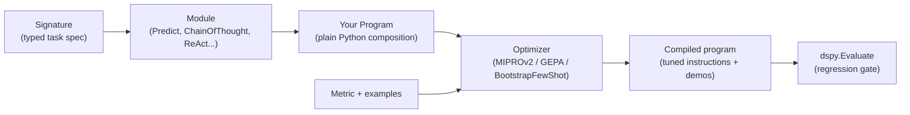
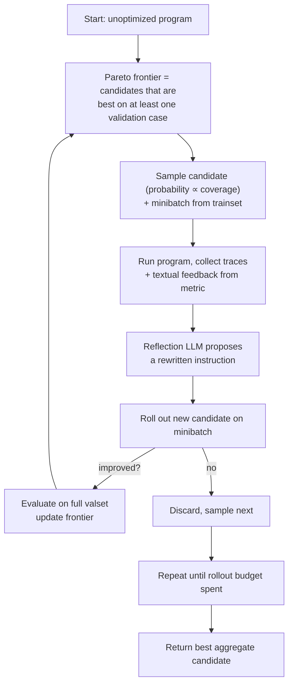

# DSPy, Explained for Backend Engineers: Signatures, Optimizers, and GEPA vs MIPROv2

If you have maintained a long-lived Spring Boot service, you already know the
difference between configuration and code. You don't hand-edit values in
`application.yml` on production boxes, and you don't tune connection-pool sizes
by vibes — you declare them, you measure them, and you change them through a
reviewed, reproducible process.

Now apply that lens to LLM development. Most teams "do AI" the way we did ops
in 2009: someone hand-edits a prompt string in a PR, eyeballs five outputs in a
notebook, ships it, and six weeks later a model upgrade silently breaks it.

**DSPy** ([dspy.ai](https://dspy.ai)) is the Stanford NLP framework that says:
stop. Treat the prompt as a **compiled artifact**. You write the *source code* —
a typed declaration of the task, composed in ordinary Python — plus a **metric**
that grades outputs. A framework component called an **optimizer** then
generates and tunes the actual prompts automatically, against your metric, on
your data.

This article explains how that works, then goes deep on the question you'll
actually face once you adopt it: **which optimizer to use**. The two main
strategies today are **MIPROv2** (Bayesian search over instructions and
few-shot examples) and **GEPA** (reflective prompt evolution on a Pareto
frontier, ICLR 2026 Oral). They search differently, cost differently, and want
different things from your metric.

Everything is grounded in a small runnable example I built for this article:
a **Spring Boot production-incident triage** program that classifies log lines
and stack traces into root-cause categories. It's the domain this blog usually
lives in — and it's small enough that optimizing it costs cents, not dollars.

Stack: **Python, DSPy 3.5, any LLM provider**.

<div class="post-tldr" markdown="1">
<p class="post-tldr-title">TL;DR</p>

- **DSPy = prompts as build artifacts.** You declare a `Signature` (typed inputs/outputs), compose `Module`s in Python, write a metric — and an **optimizer** compiles it into tuned instructions + few-shot examples. Model changes become recompiles, not prompt rewrites.
- The core loop is the same everywhere: **program + 30ish labeled examples + metric → `optimizer.compile(program, trainset=...)` → a saved, diffable artifact.** No prompt strings in your source.
- **MIPROv2** = propose a candidate grid (instructions × demos), pick the winner with **Bayesian optimization** on minibatch evals. Great all-rounder; wants 200+ examples for long runs; metric is a plain float.
- **GEPA** = **reflective evolution**: a strong LLM rewrites instructions using *textual feedback* about why predictions were wrong, and a **Pareto frontier** preserves candidates that win on any single case. Beat MIPROv2 by **over 10%** across six benchmark tasks at comparable cost (ICLR 2026 Oral), and matches RL fine-tuning with up to **35x fewer rollouts**.
- Decision rule: **metric can explain mistakes in words → GEPA. Metric is a black-box scalar, or you need demo selection → MIPROv2.** Both leave your program code untouched.
</div>

---

## What Is DSPy?

DSPy is an open-source Python framework, originally built by Stanford NLP
(the project is now developed under Databricks), first released as the
Demonstrate-Search-Predict compiler in December 2022. The current line,
DSPy 3.x, is one of the most widely adopted LLM frameworks — millions of
monthly downloads and roughly 40k GitHub stars — and its documentation tagline
captures the philosophy in five words: **"Program, don't prompt."**

The premise: a prompt is not source code. It is an *output* — the compiled
result of three inputs you *can* maintain like source code:

1. **What the task is** — a typed interface: inputs, outputs, constraints.
2. **How the steps compose** — ordinary Python control flow.
3. **What "correct" means** — a metric function over labeled examples.

Hand-write #1–#3, and let an algorithm produce the prompt. When the model
changes, you don't rewrite the prompt — you **recompile**.

If you've ever dual-maintained a GPT-4 prompt and a Claude prompt and a local
Llama prompt for the same feature, you already understand why this matters. It
is the same instinct that took us from hand-edited server config to declared
infrastructure.

## How DSPy Works: Signatures, Modules, Optimizers

DSPy has exactly three abstractions to learn. This is the whole framework.



### What Is a DSPy Signature?

A **signature** is a declarative specification of a task's input/output
behavior — think of it as a method signature with semantics, not just types.
Field names carry meaning; DSPy turns them into prompts behind the scenes.

```python
class IncidentTriage(dspy.Signature):
    """Classify a Spring Boot production incident by its root cause and severity,
    and propose a fix."""

    incident_report: str = dspy.InputField(
        desc="Log line, stack trace excerpt or error description"
    )
    root_cause: Literal[
        "config-misconfiguration",
        "dependency-conflict",
        "connection-pool-exhaustion",
        "serialization-error",
        "memory-pressure",
        "thread-starvation",
    ] = dspy.OutputField(desc="One of the fixed root-cause categories")
    severity: Literal["P1", "P2", "P3"] = dspy.OutputField(
        desc="P1 = service down / data risk, P2 = degraded, P3 = contained"
    )
    action: str = dspy.OutputField(desc="One-sentence remediation")
```

Note what a signature gives you that a prompt string doesn't: **structure the
parser can enforce**. `root_cause` is a `Literal` type — the model cannot
answer `Probably database stuff`; it must return one of six values or DSPy's
adapter retries and raises. This is the same muscle memory as mapping JSON to
a typed DTO instead of parsing strings by hand.

### What Is a DSPy Module?

A **module** is a reusable prompting strategy generalized over any signature —
PyTorch's `nn.Module` idea, applied to prompts. All of them are built on
`dspy.Predict`; the well-known ones:

| Module | Strategy it abstracts |
|---|---|
| `dspy.Predict(sig)` | Direct completion |
| `dspy.ChainOfThought(sig)` | Adds a reasoning step before the answer |
| `dspy.ReAct(sig, tools=[...])` | Reasoning + tool-use loop for agents |
| `dspy.ProgramOfThought(sig)` | Generates and runs code to answer |
| `dspy.BestOfN(sig, N)` | Samples N candidates, keeps the best-scoring |

Your program is a subclass of `dspy.Module` whose `forward()` composes
sub-modules with plain Python — conditionals, loops, your own classes. Here is
the *entire* model of our incident triage example:

```python
class IncidentTriageProgram(dspy.Module):
    def __init__(self):
        super().__init__()
        self.triage = dspy.ChainOfThought(IncidentTriage)

    def forward(self, incident_report: str) -> dspy.Prediction:
        return self.triage(incident_report=incident_report)
```

Look at what is **not** in this file: no prompt text, no few-shot examples,
no model name, no temperature. Those exist — but as *parameters*, which is
exactly what makes them optimizable. Calling the program returns typed fields
(`root_cause`, `severity`, `action`) plus a `reasoning` field that
`ChainOfThought` adds for the thinking step.

### What Is a DSPy Optimizer?

An **optimizer** (formerly called a *teleprompter*) is an algorithm that tunes
the parameters of your program — the instructions and/or few-shot demos — to
maximize your metric. A few-shot demo is a solved input→output example injected
into the prompt; an instruction is the system-level directive DSPy generates
per module.

`optimizer.compile(program, trainset=...)` is literally a compiler step: it
runs your program on data, measures, searches, and returns a **compiled
program** whose predictors now carry tuned instructions and demos. You save it
with `program.save("optimized.json")` — a diffable, reviewable artifact, the
same way you'd review a migration script.

The evaluation side is one call:

```python
evaluate = dspy.Evaluate(
    devset=valset,
    metric=triage_metric,
    num_threads=4,
    display_table=3,
)
result = evaluate(program)
```

The DSPy docs' sizing guidance: **~30 labeled examples to get value, ~300 for
production quality** — split ~20% train / 80% validation, because optimizers
score every candidate against validation. That is deliberately the *opposite*
of deep-learning practice: you're not fitting weights, you're searching a much
smaller space, and the validation set is the compass.

One more thing worth internalizing: **your metric is the contract**. Every
optimizer in this article is only as smart as the function grading outputs.
For classification, an exact-match metric is fine. For fuzzy tasks, DSPy ships
`SemanticF1` — itself implemented as a small DSPy program — plus you can write
assertion-style metrics that return partial credit.

---

## A Working Example: Spring Boot Incident Triage

Enough theory. The companion repo for this article implements a task every
backend engineer recognizes: on-call triage. Given a log line or stack-trace
excerpt, classify the **root cause** (six categories), the **severity**
(P1/P2/P3), and produce a one-sentence fix.

The dataset is 24 hand-crafted, deliberately realistic incidents — Hikari pool
timeouts, `NoSuchMethodError` after a Jackson upgrade, a `@Transactional`
method holding a connection across a slow remote call, an OOMKilled pod whose
heap is fine but whose metaspace isn't... 14 for training, 10 for validation.
Tiny on purpose: DSPy's docs say value starts around 30 examples, and this
keeps the whole run in the cents range.

The metric has two variants — and this split is the key to the GEPA vs
MIPROv2 question later:

```python
def triage_metric(example, pred, trace=None) -> float:
    """Plain scalar metric — what MIPROv2 and dspy.Evaluate consume."""
    root_ok = pred.root_cause == example.root_cause
    sev_ok = pred.severity == example.severity
    return (1.0 if root_ok else 0.0) + (0.25 if sev_ok else 0.0)


def triage_metric_with_feedback(example, pred, trace=None, pred_name=None, pred_trace=None):
    """GEPA metric: a score PLUS natural-language feedback about the miss."""
    problems = []
    if pred.root_cause == example.root_cause:
        root_score = 1.0
    else:
        root_score = 0.0
        problems.append(
            f"Wrong root cause: you said '{pred.root_cause}', the correct label is "
            f"'{example.root_cause}'."
        )
    # ... same for severity ...
    return dspy.Prediction(score=root_score + sev_score,
                           feedback=" ".join(problems) or "Correct root cause and severity.")
```

Same task, same grading — one version answers *"how much?"*, the other also
answers *"why wrong?"*. That split is the difference between the two optimizers below.

## The Main Optimization Strategies

DSPy ships about a dozen optimizers in four families. The two you'll actually
choose between are the last two.

| Optimizer | What it tunes | Search strategy | Data it wants |
|---|---|---|---|
| `BootstrapFewShot` | Demos only | Run teacher, keep traces that pass the metric | ~10+ |
| `BootstrapFewShotWithRandomSearch` | Demos only | Bootstrapping + random search over variants | 50+ |
| `COPRO` | Instructions only | Coordinate-ascent hill-climbing on rewrites | any |
| `MIPROv2` | Instructions **+ demos** | Propose candidate grid, **Bayesian optimization** | 200+ for long runs |
| `GEPA` | Instructions (and code, via `dspy.Flex`) | **Reflective evolution** on a Pareto frontier | a handful, if metric gives feedback |

### MIPROv2: Bayesian Search Over Instructions and Demos

**MIPROv2** (Multiprompt Instruction PRoposal Optimizer v2) is DSPy's workhorse
— the long-standing default answer to "just optimize it". It runs in three
stages:

1. **Bootstrap demos** — create `num_candidates` sets of few-shot examples:
   some copied from labels, some *bootstrapped* by running your own program
   and keeping traces whose outputs pass the metric.
2. **Propose instructions** — a `prompt_model` writes instruction candidates
   for every module, grounded in a dataset summary, your program's source
   code, the bootstrapped demos, and a random creativity tip.
3. **Bayesian search** — sample (instruction, demo) combinations, evaluate
   each on a minibatch of 35 examples, update a surrogate model, and re-sample
   where it predicts improvement. Full validation evals every few steps. After
   `num_trials`, the best program wins.

```python
optimizer = dspy.MIPROv2(
    metric=triage_metric,     # plain scalar is fine here
    auto="light",             # ~6 candidates; "medium"/"heavy" scale up
    num_threads=4,
)
optimized = optimizer.compile(
    program,
    trainset=trainset,
    valset=valset,
    max_bootstrapped_demos=2,
    max_labeled_demos=2,
)
optimized.save("optimized/miprov2_triage.json")
```

The mental model is a **fixed candidate grid explored by a smart sampler**.
That has a real consequence: MIPROv2 can only pick from the instruction
candidates its proposer thought to generate up front. If none of them encode
the domain insight your task needed ("match the stack-trace signature before
judging severity"), Bayesian search cannot invent it — it can only pick the
least-bad grid point.

### GEPA: Reflective Prompt Evolution on a Pareto Frontier

**GEPA** (Genetic-Pareto) — [Agrawal et al., 2025](https://arxiv.org/abs/2507.19457),
accepted as an **ICLR 2026 Oral** — attacks that limitation directly. It is an
evolutionary search where the *mutation operator is an LLM that reads feedback*:



Four ideas make this work:

- **The metric returns feedback, not just a number.** That's why our example
  has `triage_metric_with_feedback` returning
  `dspy.Prediction(score, feedback)`. The DSPy docs are blunt about it: give
  GEPA a bare float and you get "a much weaker version of itself". The
  feedback text goes *verbatim* into the reflection LM's prompt — "you said
  `thread-starvation`, the correct label is `memory-pressure`; OOMKilled at
  the container limit with low heap use means the *container* is the
  constraint" — so each mutation is informed, not random.
- **Pareto selection instead of king-of-the-hill.** MIPROv2 keeps one
  incumbent; candidates that are mediocre overall but *best on a specific
  slice* (say, serialization errors) get eliminated anyway. GEPA's frontier
  keeps every such specialist alive and samples from them. Early-specialist
  candidates survive to recombine later — the same reason genetic algorithms
  keep diverse populations. The paper ablates this: Pareto sampling over
  greedy "always pick the best" is worth up to ~8% aggregate.
- **System-aware merge** (`use_merge=True`): when two lineages each learned a
  complementary strength, GEPA tries merging their best modules — a crossover
  operator, in GA terms.
- **Budget as one knob**: exactly one of `auto` (`light`/`medium`/`heavy`),
  `max_full_evals`, or `max_metric_calls`. On a two-predictor program over 100
  examples, `light` ≈ 1,330 metric calls.

```python
optimizer = dspy.GEPA(
    metric=triage_metric_with_feedback,  # score + textual feedback
    reflection_lm=reflection_model(),    # a STRONG model, temperature 1.0
    auto="light",
    num_threads=4,
    track_stats=True,                    # fills detailed_results
)
optimized = optimizer.compile(program, trainset=trainset, valset=valset)
```

Two operational notes from production use. First, the **reflection LM is the
expensive knob** — it runs serially (a handful of calls per run, ~12–36 on a
medium budget), so give it a stronger model than the task model; DSPy's own
tutorials use frontier models there. Second, set `track_stats=True`: the
result carries `detailed_results` with **every candidate, its parent
lineage, and per-example validation scores** — an audit trail of how the
prompt evolved, which you can export to JSON and review like a PR.

What GEPA *changes* is deliberately narrow: only each predictor's
`signature.instructions`. Your module composition, your code, your demos —
untouched. Optimized instructions also transfer across models remarkably well:
the paper reports prompts evolved on Qwen3-8B gained ~9% when reused on
GPT-4.1 Mini.

## GEPA vs MIPROv2: Which Optimizer Should You Use?

Same framework, same program, same metric function — different search
paradigms:

| Dimension | MIPROv2 | GEPA |
|---|---|---|
| Paradigm | **Bayesian optimization** over a fixed candidate grid | **Reflective evolution** over an open-ended candidate set |
| What it tunes | Instructions **+ few-shot demos** jointly | Instructions only (code too, via `dspy.Flex`) |
| Metric contract | Plain scalar (float/bool) | `dspy.Prediction(score, feedback)` — per-predictor feedback |
| Memory of search | Single best-so-far incumbent | **Pareto frontier** of per-instance winners + merge |
| Budget knobs | `auto` or `num_candidates` + `num_trials` | exactly one: `auto` / `max_full_evals` / `max_metric_calls` |
| Typical prompts | Longer (few-shot demos inflate them) | Up to **9.2x shorter** instructions (paper measurement) |
| Data guidance | 200+ examples for long runs shine | A handful works *if feedback is rich*; keep valset small |
| Headline results | Solid default; ReAct 24%→51% in docs' example | **+10% over MIPROv2** across 6 tasks; +12% on AIME 2025 |

The paper's cost numbers are more interesting than the accuracy ones. On
GPT-4.1 Mini experiments, total LM spend was **$86 for GEPA vs $76 for
MIPROv2** — comparable — for roughly double the aggregate gain (+13.3% vs
+5.6%). Against RL fine-tuning (GRPO), GEPA matched its best validation scores
after **243–1,179 rollouts vs 24,000** — up to 78x better sample efficiency —
while averaging +6% (up to +20%) over GRPO. That's the peer-reviewed version
of the "10–80x cheaper than RL" framing you'll see on social media.

**My decision rule**, after wiring both up on the same task:

- **Choose GEPA when your metric can explain misses in words.** Classification
  with reasons, extraction validated against schemas, agents judged by
  step-level traces — anywhere "why was this wrong" is expressible. That
  feedback is the fuel; without it you're running evolution with a blind
  fitness function.
- **Choose MIPROv2 when your metric is a black box, or demos matter more than
  instructions.** If your program underfits because it lacks in-context
  examples (not because its instructions are wrong), MIPROv2's joint
  instruction+demo search is the better lever. It's also the gentler first
  rung: no second model to configure, scalar metrics welcome.
- **Cheap first probe either way**: `BootstrapFewShotWithRandomSearch` with a
  scalar metric costs almost nothing and often tells you whether the gap is
  *demos* (it closes it) or *instructions* (it won't — that's MIPROv2/GEPA
  territory).

And they're not mutually exclusive. DSPy 3.x ships `BetterTogether`, which
chains prompt optimization and weight optimization (e.g. GEPA then GRPO) on
the same program — prompt evolution to find the strategy, RL to compress it
into weights when you can afford the rollouts.

## Running the Example

Everything above is code you can run in five minutes. The companion repo:

```bash
git clone https://github.com/javaAndScriptDeveloper/dspy-article
cd dspy-article
uv sync                      # Python 3.11+, installs DSPy 3.5

# Offline sanity check — drives the whole pipeline against a DummyLM:
uv run python smoke_test.py  # no API key needed

# Real runs:
export OPENAI_API_KEY=sk-...     # or set DSPY_MODEL to any dspy.LM string
uv run python 01_baseline.py         # score the unoptimized program
uv run python 02_optimize_miprov2.py # Bayesian search → optimized/miprov2_triage.json
uv run python 03_optimize_gepa.py    # reflective evolution → optimized/gepa_triage.json
```

Defaults: task model `openai/gpt-4o-mini`, GEPA reflection model
`openai/gpt-4o` (override with `DSPY_MODEL` / `DSPY_REFLECTION_MODEL`). On 24
examples both optimization runs land in the cents range.

The moment worth doing yourself: after each run, diff the saved JSON against
the source program. `02_optimize_miprov2.py` will have written instructions
and injected few-shot demos. `03_optimize_gepa.py` will have rewritten the
instruction — and `optimized/gepa_results.json` holds the full evolutionary
lineage: every candidate, its parents, per-example scores. Open it next to your program
source and the point makes itself: **the prompt is output, not source.**

## When Should You Not Use DSPy?

Honesty section, because every framework pitch needs one.

- **No metric, no DSPy.** If you can't grade outputs — even noisily — the
  optimizer has nothing to climb. Building the eval set and metric is the real
  work; DSPy just automates the search against it. (Teams that skip this step
  and hand-tune prompts are doing the search *by vibes*, with worse data.)
- **One stable prompt on a solved problem?** Don't add the abstraction tax.
  DSPy pays off when programs are multi-step, models churn, or quality gaps
  are costing real money.
- **Unlimited RL budget and trainable weights?** The GEPA paper is explicit:
  prompt evolution wins when rollouts are expensive, data is limited, or
  weights are API-frozen. GRPO-style fine-tuning still wins the
  abundant-rollouts regime. Different tools, different economics.
- **You own the prompt.** The compiled artifact is tuned to *your metric* —
  optimize against a proxy metric that doesn't match production, and you will
  ship a beautifully optimized program for the wrong objective. Same rule as
  ever: your eval suite *is* your spec.

---

Every part of a backend stack got this treatment already: config became code,
schema became migrations, infrastructure became declarative. The prompt string
is the last artifact people still hand-edit at 2am. DSPy's answer is the same
one that worked for the rest: declare it, measure it, version it. The
optimizers are the interesting part, but the discipline is what pays off — the
prompt becomes the thing CI regenerates when the model, the data, or the
metric changes.

If you want a second, deeper pass on the optimizers, the primary sources are
excellent: the [GEPA paper](https://arxiv.org/abs/2507.19457) (ICLR 2026
Oral), the [MIPROv2 paper](https://arxiv.org/abs/2406.11695), and the
[official DSPy optimization guide](https://dspy.ai/learn/optimization/overview/),
which includes a [step-by-step optimizer chooser](https://dspy.ai/diving-deeper/choosing-an-optimizer/).

*Code from this article is available at
**[github.com/javaAndScriptDeveloper/dspy-article](https://github.com/javaAndScriptDeveloper/dspy-article)**.
The whole pipeline verifies offline — `uv sync && uv run python smoke_test.py`
runs a full GEPA optimization loop with no API key — and the real runs cost
cents on the bundled 24-example dataset.*
