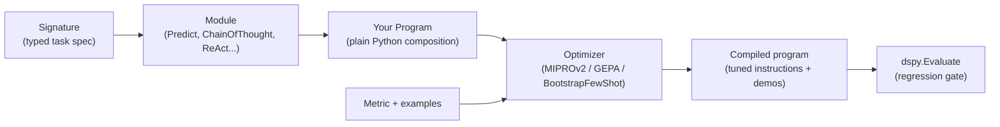
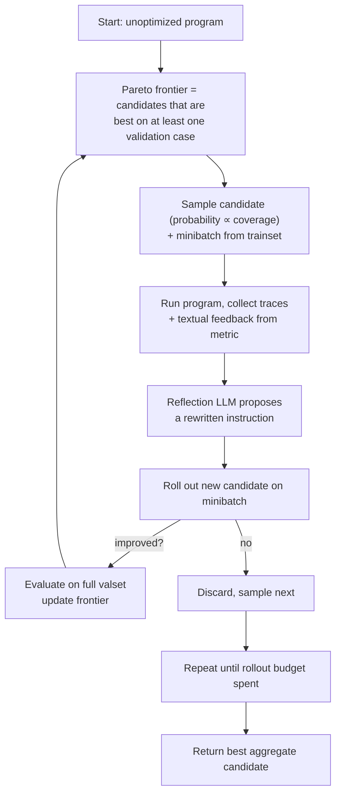

# DSPy explicado para ingenieros backend: Signatures, Optimizers y GEPA vs MIPROv2

Si has mantenido un servicio de Spring Boot de larga vida, ya conoces la diferencia entre
configuración y código. No editas a mano los valores de `application.yml` en las máquinas de
producción, y no ajustas los tamaños del pool de conexiones a puro feeling — los declaras, los
mides y los cambias mediante un proceso revisado y reproducible.

Ahora aplica ese lente al desarrollo con LLMs. La mayoría de los equipos "hacen IA" como hacíamos
ops en 2009: alguien edita a mano una cadena de prompt en un PR, mira cinco salidas en un
notebook, lo publica, y seis semanas después una actualización del modelo lo rompe silenciosamente.

**DSPy** ([dspy.ai](https://dspy.ai)) es el framework de Stanford NLP que dice: alto. Trata el
prompt como un **artefacto compilado**. Tú escribes el *código fuente* — una declaración tipada
de la tarea, compuesta en Python ordinario — más una **métrica** que califica las salidas. Un
componente del framework llamado **optimizer** genera y afina los prompts reales automáticamente,
contra tu métrica, con tus datos.

Este artículo explica cómo funciona eso, y luego profundiza en la pregunta que realmente
enfrentarás al adoptarlo: **qué optimizer usar**. Las dos estrategias principales hoy son
**MIPROv2** (búsqueda bayesiana sobre instrucciones y ejemplos few-shot) y **GEPA** (evolución
reflectiva de prompts sobre una frontera de Pareto, ICLR 2026 Oral). Buscan distinto, cuestan
distinto y le piden cosas distintas a tu métrica.

Todo se apoya en un pequeño ejemplo ejecutable que construí para este artículo: un programa de
**triaje de incidentes de producción de Spring Boot** que clasifica líneas de log y stack traces
en categorías de causa raíz. Es el dominio donde este blog suele vivir — y es lo bastante pequeño
para que optimizarlo cueste centavos, no dólares.

Stack: **Python, DSPy 3.5, cualquier proveedor de LLM**.

<div class="post-tldr" markdown="1">
<p class="post-tldr-title">TL;DR</p>

- **DSPy = prompts como artefactos de build.** Declaras una `Signature` (entradas/salidas tipadas), compones `Module`s en Python, escribes una métrica — y un **optimizer** lo compila en instrucciones afinadas + ejemplos few-shot. Los cambios de modelo se vuelven recompilaciones, no reescrituras de prompts.
- El ciclo central es el mismo en todos lados: **programa + unos 30 ejemplos etiquetados + métrica → `optimizer.compile(program, trainset=...)` → un artefacto guardado y diffable.** Sin cadenas de prompt en tu código fuente.
- **MIPROv2** = propone una grilla de candidatos (instrucciones × demos) y elige al ganador con **optimización bayesiana** sobre evaluaciones en minibatch. Gran todoterreno; pide 200+ ejemplos para corridas largas; la métrica es un float simple.
- **GEPA** = **evolución reflectiva**: un LLM potente reescribe instrucciones usando *retroalimentación textual* sobre por qué las predicciones fueron incorrectas, y una **frontera de Pareto** preserva a los candidatos que ganan en cualquier caso individual. Le ganó a MIPROv2 por **más de 10%** en seis tareas de benchmark a costo comparable (ICLR 2026 Oral), e iguala el fine-tuning con RL con hasta **35x menos rollouts**.
- Regla de decisión: **si la métrica puede explicar los errores con palabras → GEPA. Si la métrica es un escalar de caja negra, o necesitas selección de demos → MIPROv2.** Ambos dejan tu código del programa intacto.
</div>

---

## ¿Qué es DSPy?

DSPy es un framework de Python de código abierto, creado originalmente por Stanford NLP (el
proyecto hoy se desarrolla bajo Databricks), publicado por primera vez como el compilador
Demonstrate-Search-Predict en diciembre de 2022. La línea actual, DSPy 3.x, es uno de los
frameworks de LLM más adoptados — millones de descargas mensuales y alrededor de 40k estrellas en
GitHub — y el lema de su documentación captura la filosofía en pocas palabras: **"Programa, no
prompt."**

La premisa: un prompt no es código fuente. Es una *salida* — el resultado compilado de tres
entradas que *sí* puedes mantener como código fuente:

1. **Qué es la tarea** — una interfaz tipada: entradas, salidas, restricciones.
2. **Cómo se componen los pasos** — flujo de control de Python ordinario.
3. **Qué significa "correcto"** — una función de métrica sobre ejemplos etiquetados.

Escribe a mano #1–#3, y deja que un algoritmo produzca el prompt. Cuando el modelo cambia, no
reescribes el prompt — **recompilas**.

Si alguna vez has mantenido en paralelo un prompt de GPT-4, un prompt de Claude y un prompt de
Llama local para la misma feature, ya entiendes por qué esto importa. Es el mismo instinto que nos
llevó de la configuración de servidores editada a mano a la infraestructura declarada.

## Cómo funciona DSPy: Signatures, Modules, Optimizers

DSPy tiene exactamente tres abstracciones que aprender. Este es el framework completo.



### ¿Qué es una Signature de DSPy?

Una **signature** es una especificación declarativa del comportamiento de entrada/salida de una
tarea — piénsalo como una firma de método con semántica, no solo tipos. Los nombres de los campos
cargan significado; DSPy los convierte en prompts detrás de escena.

```python
class IncidentTriage(dspy.Signature):
    """Classify a Spring Boot production incident by its root cause and severity,
    and propose a fix."""

    incident_report: str = dspy.InputField(
        desc="Log line, stack trace excerpt or error description"
    )
    root_cause: Literal[
        "config-misconfiguration",
        "dependency-conflict",
        "connection-pool-exhaustion",
        "serialization-error",
        "memory-pressure",
        "thread-starvation",
    ] = dspy.OutputField(desc="One of the fixed root-cause categories")
    severity: Literal["P1", "P2", "P3"] = dspy.OutputField(
        desc="P1 = service down / data risk, P2 = degraded, P3 = contained"
    )
    action: str = dspy.OutputField(desc="One-sentence remediation")
```

Nota lo que una signature te da que una cadena de prompt no: **estructura que el parser puede
hacer cumplir**. `root_cause` es un tipo `Literal` — el modelo no puede responder `Probably
database stuff`; debe devolver uno de seis valores o el adaptador de DSPy reintenta y lanza una
excepción. Es el mismo músculo que mapear JSON a un DTO tipado en lugar de parsear strings a mano.

### ¿Qué es un Module de DSPy?

Un **module** es una estrategia de prompting reutilizable generalizada sobre cualquier signature —
la idea del `nn.Module` de PyTorch aplicada a prompts. Todos están construidos sobre
`dspy.Predict`; los más conocidos:

| Module | Estrategia que abstrae |
|---|---|
| `dspy.Predict(sig)` | Finalización directa |
| `dspy.ChainOfThought(sig)` | Agrega un paso de razonamiento antes de la respuesta |
| `dspy.ReAct(sig, tools=[...])` | Bucle de razonamiento + uso de herramientas para agentes |
| `dspy.ProgramOfThought(sig)` | Genera y ejecuta código para responder |
| `dspy.BestOfN(sig, N)` | Muestrea N candidatos y conserva el de mejor puntaje |

Tu programa es una subclase de `dspy.Module` cuyo `forward()` compone submódulos con Python
normal — condicionales, bucles, tus propias clases. Este es el modelo *entero* de nuestro ejemplo
de triaje de incidentes:

```python
class IncidentTriageProgram(dspy.Module):
    def __init__(self):
        super().__init__()
        self.triage = dspy.ChainOfThought(IncidentTriage)

    def forward(self, incident_report: str) -> dspy.Prediction:
        return self.triage(incident_report=incident_report)
```

Fíjate en lo que **no** está en este archivo: sin texto de prompt, sin ejemplos few-shot, sin
nombre de modelo, sin temperatura. Existen — pero como *parámetros*, que es exactamente lo que los
hace optimizables. Llamar al programa retorna campos tipados (`root_cause`, `severity`, `action`)
más un campo `reasoning` que `ChainOfThought` agrega para el paso de pensamiento.

### ¿Qué es un Optimizer de DSPy?

Un **optimizer** (antes llamado *teleprompter*) es un algoritmo que afina los parámetros de tu
programa — las instrucciones y/o demos few-shot — para maximizar tu métrica. Una demo few-shot es
un ejemplo entrada→salida resuelto que se inyecta en el prompt; una instrucción es la directiva a
nivel de sistema que DSPy genera por módulo.

`optimizer.compile(program, trainset=...)` es literalmente un paso de compilación: ejecuta tu
programa con datos, mide, busca y retorna un **programa compilado** cuyos predictores ahora llevan
instrucciones y demos afinadas. Lo guardas con `program.save("optimized.json")` — un artefacto
diffable y revisable, de la misma manera en que revisarías un script de migración.

El lado de la evaluación es una sola llamada:

```python
evaluate = dspy.Evaluate(
    devset=valset,
    metric=triage_metric,
    num_threads=4,
    display_table=3,
)
result = evaluate(program)
```

La guía de dimensionamiento de la documentación de DSPy: **~30 ejemplos etiquetados para ver
valor, ~300 para calidad de producción** — reparte ~20% entrenamiento / 80% validación, porque los
optimizers puntúan cada candidato contra la validación. Es deliberadamente lo *contrario* a la
práctica de deep learning: no estás ajustando pesos, estás buscando en un espacio mucho más
pequeño, y el conjunto de validación es la brújula.

Una cosa más que vale la pena interiorizar: **tu métrica es el contrato**. Cada optimizer en este
artículo es tan inteligente como la función que califica las salidas. Para clasificación, una
métrica de coincidencia exacta está bien. Para tareas difusas, DSPy trae `SemanticF1` — él mismo
implementado como un pequeño programa DSPy — y además puedes escribir métricas estilo aserción
que devuelven crédito parcial.

---

## Un ejemplo funcional: triaje de incidentes de Spring Boot

Suficiente teoría. El repositorio acompañante de este artículo implementa una tarea que todo
ingeniero backend reconoce: el triaje de guardia. Dada una línea de log o un fragmento de stack
trace, clasificar la **causa raíz** (seis categorías), la **severidad** (P1/P2/P3) y producir una
solución de una frase.

El dataset son 24 incidentes hechos a mano, deliberadamente realistas — timeouts del pool de
Hikari, `NoSuchMethodError` tras una actualización de Jackson, un método `@Transactional`
sosteniendo una conexión a través de una llamada remota lenta, un pod OOMKilled cuyo heap está
bien pero cuyo metaspace no... 14 para entrenamiento, 10 para validación. Pequeño a propósito: la
documentación de DSPy dice que el valor empieza alrededor de 30 ejemplos, y esto mantiene toda la
corrida en el rango de centavos.

La métrica tiene dos variantes — y esta división es la clave de la pregunta GEPA vs MIPROv2 de más
adelante:

```python
def triage_metric(example, pred, trace=None) -> float:
    """Plain scalar metric — what MIPROv2 and dspy.Evaluate consume."""
    root_ok = pred.root_cause == example.root_cause
    sev_ok = pred.severity == example.severity
    return (1.0 if root_ok else 0.0) + (0.25 if sev_ok else 0.0)


def triage_metric_with_feedback(example, pred, trace=None, pred_name=None, pred_trace=None):
    """GEPA metric: a score PLUS natural-language feedback about the miss."""
    problems = []
    if pred.root_cause == example.root_cause:
        root_score = 1.0
    else:
        root_score = 0.0
        problems.append(
            f"Wrong root cause: you said '{pred.root_cause}', the correct label is "
            f"'{example.root_cause}'."
        )
    # ... same for severity ...
    return dspy.Prediction(score=root_score + sev_score,
                           feedback=" ".join(problems) or "Correct root cause and severity.")
```

Misma tarea, mismo calificador — una versión responde *"¿cuánto?"*, la otra también responde
*"¿por qué falló?"*. Guarda esa idea; está a punto de importar mucho.

## Las principales estrategias de optimización

DSPy trae alrededor de una docena de optimizers en cuatro familias. Los dos entre los que
realmente vas a elegir son los últimos dos.

| Optimizer | Qué afina | Estrategia de búsqueda | Datos que quiere |
|---|---|---|---|
| `BootstrapFewShot` | Solo demos | Ejecuta el teacher, conserva las trazas que pasan la métrica | ~10+ |
| `BootstrapFewShotWithRandomSearch` | Solo demos | Bootstrapping + búsqueda aleatoria sobre variantes | 50+ |
| `COPRO` | Solo instrucciones | Hill-climbing por coordinate-ascent sobre reescrituras | cualquiera |
| `MIPROv2` | Instrucciones **+ demos** | Propone grilla de candidatos, **optimización bayesiana** | 200+ para corridas largas |
| `GEPA` | Instrucciones (y código, vía `dspy.Flex`) | **Evolución reflectiva** sobre una frontera de Pareto | un puñado, si la métrica da retroalimentación |

### MIPROv2: búsqueda bayesiana sobre instrucciones y demos

**MIPROv2** (Multiprompt Instruction PRoposal Optimizer v2) es el caballo de batalla de DSPy — la
respuesta por defecto de siempre a "solo optimízalo". Funciona en tres etapas:

1. **Bootstrap de demos** — crea `num_candidates` conjuntos de ejemplos few-shot: algunos copiados
   de las etiquetas, otros *bootstrapped* ejecutando tu propio programa y conservando las trazas
   cuyas salidas pasan la métrica.
2. **Proponer instrucciones** — un `prompt_model` escribe candidatos de instrucciones para cada
   módulo, anclados en un resumen del dataset, el código fuente de tu programa, las demos
   bootstrapped y un consejo aleatorio de creatividad.
3. **Búsqueda bayesiana** — muestrea combinaciones (instrucción, demo), evalúa cada una en un
   minibatch de 35 ejemplos, actualiza un modelo sustituto y re-muestrea donde predice mejora.
   Evaluaciones de validación completas cada pocos pasos. Tras `num_trials`, gana el mejor
   programa.

```python
optimizer = dspy.MIPROv2(
    metric=triage_metric,     # plain scalar is fine here
    auto="light",             # ~6 candidates; "medium"/"heavy" scale up
    num_threads=4,
)
optimized = optimizer.compile(
    program,
    trainset=trainset,
    valset=valset,
    max_bootstrapped_demos=2,
    max_labeled_demos=2,
)
optimized.save("optimized/miprov2_triage.json")
```

El modelo mental es una **grilla fija de candidatos explorada por un muestreador inteligente**.
Eso tiene una consecuencia real: MIPROv2 solo puede elegir entre los candidatos de instrucción que
su proponente pensó en generar de antemano. Si ninguno codifica el conocimiento del dominio que tu
tarea necesitaba ("empareja la firma del stack trace antes de juzgar la severidad"), la búsqueda
bayesiana no puede inventarlo — solo puede elegir el punto menos malo de la grilla.

### GEPA: evolución reflectiva de prompts sobre una frontera de Pareto

**GEPA** (Genetic-Pareto) — [Agrawal et al., 2025](https://arxiv.org/abs/2507.19457), aceptado
como un **ICLR 2026 Oral** — ataca esa limitación directamente. Es una búsqueda evolutiva donde el
*operador de mutación es un LLM que lee retroalimentación*:



Cuatro ideas hacen que esto funcione:

- **La métrica devuelve retroalimentación, no solo un número.** Por eso nuestro ejemplo tiene
  `triage_metric_with_feedback` retornando `dspy.Prediction(score, feedback)`. La documentación de
  DSPy es tajante al respecto: dale a GEPA un float pelado y obtienes "una versión mucho más débil
  de sí mismo". El texto de retroalimentación entra *textual* al prompt del LM de reflexión —
  "dijiste `thread-starvation`, la etiqueta correcta es `memory-pressure`; OOMKilled en el límite
  del contenedor con bajo uso de heap significa que el *contenedor* es la restricción" — así cada
  mutación está informada, no es aleatoria.
- **Selección de Pareto en lugar de king-of-the-hill.** MIPROv2 mantiene un solo incumbente; los
  candidatos mediocres en general pero *mejores en un segmento específico* (digamos, errores de
  serialización) igual se eliminan. La frontera de GEPA mantiene vivo a cada especialista de este
  tipo y muestrea de ellos. Los candidatos especialistas tempranos sobreviven para recombinarse
  después — la misma razón por la que los algoritmos genéticos mantienen poblaciones diversas. El
  paper hace ablation de esto: el muestreo de Pareto sobre el "elige siempre al mejor" codicioso
  vale hasta ~8% en agregado.
- **Merge consciente del sistema** (`use_merge=True`): cuando dos linajes aprendieron cada uno una
  fortaleza complementaria, GEPA intenta fusionar sus mejores módulos — un operador de cruce, en
  términos de algoritmos genéticos.
- **El presupuesto como una sola perilla**: exactamente una de `auto`
  (`light`/`medium`/`heavy`), `max_full_evals` o `max_metric_calls`. En un programa de dos
  predictores sobre 100 ejemplos, `light` ≈ 1,330 llamadas a la métrica.

```python
optimizer = dspy.GEPA(
    metric=triage_metric_with_feedback,  # score + textual feedback
    reflection_lm=reflection_model(),    # a STRONG model, temperature 1.0
    auto="light",
    num_threads=4,
    track_stats=True,                    # fills detailed_results
)
optimized = optimizer.compile(program, trainset=trainset, valset=valset)
```

Dos notas operativas del uso en producción. Primero, el **LM de reflexión es la perilla cara** —
corre en serie (un puñado de llamadas por corrida, ~12–36 con presupuesto medium), así que dale un
modelo más fuerte que el modelo de la tarea; los propios tutoriales de DSPy usan modelos frontier
allí. Segundo, configura `track_stats=True`: el resultado trae `detailed_results` con **cada
candidato, su linaje de padres y puntajes de validación por ejemplo** — un rastro de auditoría de
cómo evolucionó el prompt, que puedes exportar a JSON y revisar como un PR.

Lo que GEPA *cambia* es deliberadamente estrecho: solo el `signature.instructions` de cada
predictor. Tu composición de módulos, tu código, tus demos — intactos. Las instrucciones
optimizadas también transfieren entre modelos notablemente bien: el paper reporta que prompts
evolucionados en Qwen3-8B ganaron ~9% al reutilizarse en GPT-4.1 Mini.

## GEPA vs MIPROv2: ¿cuál optimizer deberías usar?

Mismo framework, mismo programa, misma función de métrica — paradigmas de búsqueda distintos.
Aquí está la comparación honesta:

| Dimensión | MIPROv2 | GEPA |
|---|---|---|
| Paradigma | **Optimización bayesiana** sobre una grilla fija de candidatos | **Evolución reflectiva** sobre un conjunto abierto de candidatos |
| Qué afina | Instrucciones **+ demos few-shot** conjuntamente | Solo instrucciones (también código, vía `dspy.Flex`) |
| Contrato de la métrica | Escalar simple (float/bool) | `dspy.Prediction(score, feedback)` — retroalimentación por predictor |
| Memoria de la búsqueda | Un único incumbente con el mejor hasta ahora | **Frontera de Pareto** de ganadores por instancia + merge |
| Perillas de presupuesto | `auto` o `num_candidates` + `num_trials` | exactamente una: `auto` / `max_full_evals` / `max_metric_calls` |
| Prompts típicos | Más largos (las demos few-shot los hinchan) | Instrucciones hasta **9.2x más cortas** (medición del paper) |
| Guía de datos | 200+ ejemplos hacen brillar las corridas largas | Un puñado funciona *si la retroalimentación es rica*; mantén el valset pequeño |
| Resultados estelares | Defecto sólido; ReAct 24%→51% en el ejemplo de la documentación | **+10% sobre MIPROv2** en 6 tareas; +12% en AIME 2025 |

Los números de costo del paper son más interesantes que los de precisión. En los experimentos con
GPT-4.1 Mini, el gasto total de LM fue **$86 para GEPA vs $76 para MIPROv2** — comparable — por
aproximadamente el doble de ganancia agregada (+13.3% vs +5.6%). Contra el fine-tuning con RL
(GRPO), GEPA igualó sus mejores puntajes de validación tras **243–1,179 rollouts vs 24,000** —
hasta 78x mejor eficiencia de muestra — mientras promediaba +6% (hasta +20%) sobre GRPO. Esa es la
versión revisada por pares del framing de "10–80x más barato que RL" que verás en redes sociales.

**Mi regla de decisión**, después de conectar ambos en la misma tarea:

- **Elige GEPA cuando tu métrica puede explicar los errores con palabras.** Clasificación con
  razones, extracción validada contra esquemas, agentes juzgados por trazas a nivel de paso —
  donde "por qué fue incorrecto" es expresable. Esa retroalimentación es el combustible; sin ella
  estás corriendo evolución con una función de fitness ciega.
- **Elige MIPROv2 cuando tu métrica es una caja negra, o las demos importan más que las
  instrucciones.** Si tu programa hace underfit porque le faltan ejemplos in-context (no porque
  sus instrucciones estén mal), la búsqueda conjunta instrucción+demo de MIPROv2 es la mejor
  palanca. También es el primer peldaño más suave: sin segundo modelo que configurar, métricas
  escalares bienvenidas.
- **Sonda inicial barata en cualquier caso**: `BootstrapFewShotWithRandomSearch` con una métrica
  escalar cuesta casi nada y a menudo te dice si la brecha es de *demos* (la cierra) o de
  *instrucciones* (no lo hará — ese es territorio de MIPROv2/GEPA).

Y no son mutuamente excluyentes. DSPy 3.x trae `BetterTogether`, que encadena optimización de
prompts y optimización de pesos (por ejemplo, GEPA y luego GRPO) sobre el mismo programa —
evolución de prompts para encontrar la estrategia, RL para comprimirla en pesos cuando puedas
permitirte los rollouts.

## Ejecutando el ejemplo

Todo lo anterior es código que puedes correr en cinco minutos. El repositorio acompañante:

```bash
git clone https://github.com/javaAndScriptDeveloper/dspy-article
cd dspy-article
uv sync                      # Python 3.11+, installs DSPy 3.5

# Offline sanity check — drives the whole pipeline against a DummyLM:
uv run python smoke_test.py  # no API key needed

# Real runs:
export OPENAI_API_KEY=sk-...     # or set DSPY_MODEL to any dspy.LM string
uv run python 01_baseline.py         # score the unoptimized program
uv run python 02_optimize_miprov2.py # Bayesian search → optimized/miprov2_triage.json
uv run python 03_optimize_gepa.py    # reflective evolution → optimized/gepa_triage.json
```

Valores por defecto: modelo de tarea `openai/gpt-4o-mini`, modelo de reflexión de GEPA
`openai/gpt-4o` (sobrescríbelos con `DSPY_MODEL` / `DSPY_REFLECTION_MODEL`). Con 24 ejemplos ambas
corridas de optimización quedan en el rango de centavos.

El momento que vale la pena hacer tú mismo: después de cada corrida, hazle diff al JSON guardado
contra el programa fuente. `02_optimize_miprov2.py` habrá escrito instrucciones e inyectado demos
few-shot. `03_optimize_gepa.py` habrá reescrito la instrucción — y `optimized/gepa_results.json`
contiene el linaje evolutivo completo: cada candidato, sus padres, puntajes por ejemplo. Ese
archivo es toda la tesis de DSPy en un solo artefacto: **el prompt es salida, no fuente.**

## ¿Cuándo no deberías usar DSPy?

Sección de honestidad, porque todo pitch de framework necesita una.

- **Sin métrica, no hay DSPy.** Si no puedes calificar las salidas — ni siquiera con ruido — el
  optimizer no tiene nada que escalar. Construir el conjunto de evaluación y la métrica es el
  trabajo real; DSPy solo automatiza la búsqueda contra él. (Los equipos que se saltan este paso
  y tunean prompts a mano están haciendo la búsqueda *a puro feeling*, con datos peores.)
- **¿Un único prompt estable en un problema resuelto?** No agregues el impuesto de abstracción.
  DSPy rinde cuando los programas son de múltiples pasos, los modelos cambian seguido, o las
  brechas de calidad están costando dinero real.
- **¿Presupuesto ilimitado de RL y pesos entrenables?** El paper de GEPA es explícito: la
  evolución de prompts gana cuando los rollouts son caros, los datos son limitados o los pesos
  están congelados por la API. El fine-tuning estilo GRPO sigue ganando el régimen de rollouts
  abundantes. Herramientas distintas, economías distintas.
- **El prompt es tuyo.** El artefacto compilado está afinado a *tu métrica* — optimiza contra una
  métrica proxy que no refleja producción y publicarás un programa bellamente optimizado para el
  objetivo equivocado. La regla de siempre: tu suite de evaluación *es* tu especificación.

---

El patrón para llevarte es el que este blog sigue rondando en otros dominios: mover el juicio de
tiempo de ejecución hacia artefactos declarados, medibles y versionados. Lo hicimos para
infraestructura, luego para migraciones de esquema; DSPy lo hace para el último artefacto editado
a mano del stack, la cadena de prompt. Los optimizers son la parte interesante — pero la
*disciplina* es la recompensa. El prompt deja de ser la cosa que alguien ajusta a las 2 de la
mañana y se vuelve la cosa que CI regenera cuando cambian el modelo, los datos o la métrica.

Si quieres una segunda pasada, más profunda, sobre los optimizers, las fuentes primarias son
excelentes: el [paper de GEPA](https://arxiv.org/abs/2507.19457) (ICLR 2026 Oral), el
[paper de MIPROv2](https://arxiv.org/abs/2406.11695) y la
[guía oficial de optimización de DSPy](https://dspy.ai/learn/optimization/overview/),
que incluye un
[selector de optimizer paso a paso](https://dspy.ai/diving-deeper/choosing-an-optimizer/).

*El código de este artículo está disponible en
**[github.com/javaAndScriptDeveloper/dspy-article](https://github.com/javaAndScriptDeveloper/dspy-article)**.
Toda la tubería se verifica offline — `uv sync && uv run python smoke_test.py` corre un ciclo
completo de optimización GEPA sin clave de API — y las corridas reales cuestan centavos con el
dataset de 24 ejemplos incluido.*
