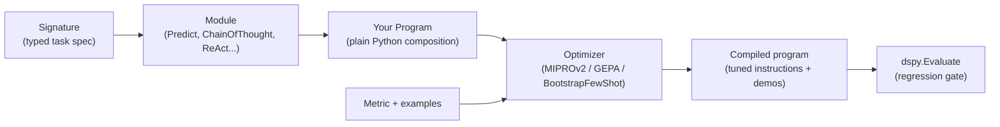
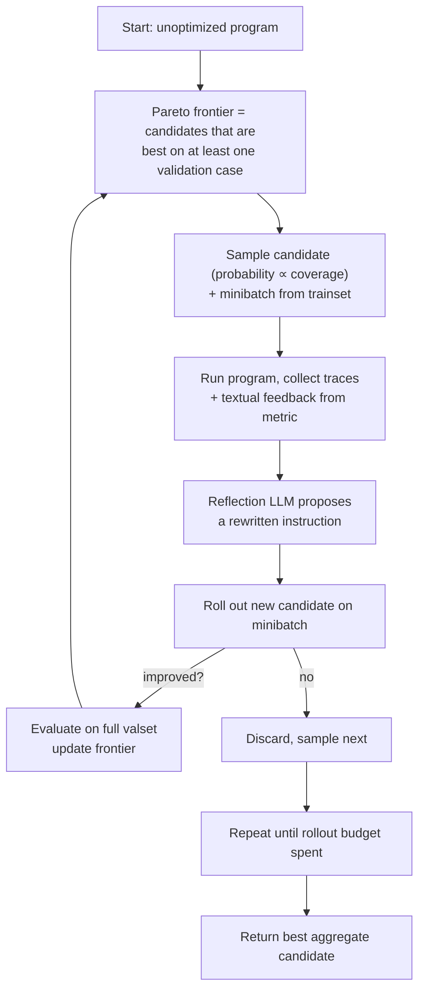

# DSPy para ingenieros backend: signatures, optimizers y GEPA vs MIPROv2

Si has mantenido un servicio de Spring Boot de larga vida, ya conoces la diferencia entre
configuración y código. No editas a mano los valores de `application.yml` en los servidores de
producción, y no ajustas el tamaño del pool de conexiones a ojo: lo declaras, lo mides y lo
cambias mediante un proceso revisado y reproducible.

Ahora aplica esa lente al desarrollo con LLMs. La mayoría de los equipos "hacen IA" como hacíamos
operaciones en 2009: alguien edita a mano una cadena de prompt en un PR, mira cinco salidas en un
notebook, lo despliega, y seis semanas después una actualización del modelo lo rompe sin hacer
ruido.

**DSPy** ([dspy.ai](https://dspy.ai)) es el framework de Stanford NLP que dice: basta. Trata el
prompt como un **artefacto compilado**. Tú escribes el *código fuente*: una declaración tipada de
la tarea, compuesta en Python corriente, más una **métrica** que puntúa las salidas. Un componente
del framework, el **optimizer**, genera y ajusta los prompts reales de forma automática, contra tu
métrica y con tus datos.

Este artículo explica cómo funciona, y luego se centra en la pregunta que de verdad te vas a hacer
al adoptarlo: **qué optimizer usar**. Hoy las dos estrategias principales son **MIPROv2**
(búsqueda bayesiana sobre instrucciones y ejemplos few-shot) y **GEPA** (evolución reflexiva de
prompts sobre una frontera de Pareto, ICLR 2026 Oral). Buscan de forma distinta, cuestan distinto
y esperan cosas distintas de tu métrica.

Todo se apoya en un pequeño ejemplo ejecutable que construí para este artículo: un programa de
**triaje de incidentes de producción en Spring Boot** que clasifica líneas de log y stack traces
por categoría de causa raíz. Es el territorio habitual de este blog, y es lo bastante pequeño como
para que una ejecución completa de optimización salga barata.

Stack: **Python 3.11+, DSPy 3.5, cualquier proveedor de LLM**.

<div class="post-tldr" markdown="1">
<p class="post-tldr-title">TL;DR</p>

- **DSPy = prompts como artefactos de build.** Declaras una `Signature` (entradas y salidas tipadas), compones `Module`s en Python, escribes una métrica, y un **optimizer** lo compila en instrucciones ajustadas + ejemplos few-shot. Los cambios de modelo pasan a ser recompilaciones, no reescrituras de prompts.
- El ciclo central es el mismo en todos los casos: **programa + unos 30 ejemplos etiquetados + métrica → `optimizer.compile(program, trainset=...)` → un artefacto guardado y comparable con diff.** Sin cadenas de prompt en tu código fuente.
- **MIPROv2** = propone una cuadrícula de candidatos (instrucciones × demos) y elige al ganador con **optimización bayesiana** sobre evaluaciones en minibatch. Muy buen todoterreno; para corridas largas pide más de 200 ejemplos; la métrica es un simple float.
- **GEPA** = **evolución reflexiva**: un LLM potente reescribe las instrucciones a partir de *feedback textual* sobre por qué fallaron las predicciones, y una **frontera de Pareto** conserva a los candidatos que ganan en algún caso concreto. Superó a MIPROv2 en **más de 10 puntos** en seis tareas de benchmark con un coste comparable (ICLR 2026 Oral), y superó al fine-tuning con GRPO usando hasta **35 veces menos rollouts**.
- Regla de decisión: **si la métrica puede explicar los errores con palabras, GEPA. Si la métrica es un escalar de caja negra, o necesitas seleccionar demos, MIPROv2.** Ninguno toca el código de tu programa.
</div>

---

## ¿Qué es DSPy?

DSPy es un framework de Python de código abierto de Stanford NLP. Nació de la investigación sobre
Demonstrate-Search-Predict (diciembre de 2022), y la línea 3.x actual está muy extendida: varios
millones de descargas mensuales en PyPI y unas 40 000 estrellas en GitHub en el momento de
escribir esto. El propio lema del proyecto resume la filosofía: programar, no promptear, modelos
de lenguaje.

La premisa: un prompt no es código fuente. Es una *salida*, el resultado compilado de tres
entradas que *sí* puedes mantener como código fuente:

1. **Qué es la tarea**: una interfaz tipada con entradas, salidas y restricciones.
2. **Cómo se componen los pasos**: flujo de control normal de Python.
3. **Qué significa "correcto"**: una función de métrica sobre ejemplos etiquetados.

Escribe a mano los puntos 1 a 3 y deja que un algoritmo produzca el prompt. Cuando el modelo
cambia, no reescribes el prompt: **recompilas**.

Si alguna vez has mantenido en paralelo un prompt para GPT-4, otro para Claude y otro para un
Llama local, todos para la misma funcionalidad, ya entiendes por qué esto importa. Es el mismo
instinto que nos llevó de la configuración de servidores editada a mano a la infraestructura
declarativa.

## Cómo funciona DSPy: signatures, modules y optimizers

DSPy tiene exactamente tres abstracciones que aprender. Ese es todo el framework.



### ¿Qué es una signature de DSPy?

Una **signature** es una especificación declarativa del comportamiento de entrada y salida de una
tarea; piensa en ella como la firma de un método, pero con semántica y no solo tipos. Los nombres
de los campos tienen significado, y DSPy los convierte en prompts por debajo.

```python
class IncidentTriage(dspy.Signature):
    """Classify a Spring Boot production incident by its root cause and severity,
    and propose a fix."""

    incident_report: str = dspy.InputField(
        desc="Log line, stack trace excerpt or error description"
    )
    root_cause: Literal[
        "config-misconfiguration",
        "dependency-conflict",
        "connection-pool-exhaustion",
        "serialization-error",
        "memory-pressure",
        "thread-starvation",
    ] = dspy.OutputField(desc="One of the fixed root-cause categories")
    severity: Literal["P1", "P2", "P3"] = dspy.OutputField(
        desc="P1 = service down / data risk, P2 = degraded, P3 = contained"
    )
    action: str = dspy.OutputField(desc="One-sentence remediation")
```

Observa lo que te da una signature y una cadena de prompt no: **estructura que el parser puede
hacer cumplir**. `root_cause` es un tipo `Literal`: el modelo no puede responder `Probably
database stuff`, tiene que devolver uno de los seis valores, o el adaptador de DSPy reintenta y
lanza una excepción. Es el mismo reflejo que mapear JSON a un DTO tipado en lugar de parsear
strings a mano.

### ¿Qué es un module de DSPy?

Un **module** es una estrategia de prompting reutilizable, generalizada para cualquier signature:
la idea de `nn.Module` de PyTorch aplicada a los prompts. Todos están construidos sobre
`dspy.Predict`; los más conocidos:

| Module | Estrategia que abstrae |
|---|---|
| `dspy.Predict(sig)` | Completado directo |
| `dspy.ChainOfThought(sig)` | Añade un paso de razonamiento antes de la respuesta |
| `dspy.ReAct(sig, tools=[...])` | Bucle de razonamiento y uso de herramientas para agentes |
| `dspy.ProgramOfThought(sig)` | Genera y ejecuta código para responder |
| `dspy.BestOfN(sig, N)` | Muestrea N candidatos y se queda con el de mejor puntuación |

Tu programa es una subclase de `dspy.Module` cuyo `forward()` compone submódulos con Python
normal: condicionales, bucles, tus propias clases. Este es el modelo *completo* de nuestro ejemplo
de triaje de incidentes:

```python
class IncidentTriageProgram(dspy.Module):
    def __init__(self):
        super().__init__()
        self.triage = dspy.ChainOfThought(IncidentTriage)

    def forward(self, incident_report: str) -> dspy.Prediction:
        return self.triage(incident_report=incident_report)
```

Fíjate en lo que **no** hay en este archivo: ni texto de prompt, ni ejemplos few-shot, ni nombre
de modelo, ni temperatura. Existen, pero como *parámetros*, y eso es justo lo que los hace
optimizables. Al llamar al programa obtienes campos tipados (`root_cause`, `severity`, `action`)
más un campo `reasoning` que `ChainOfThought` añade para el paso de razonamiento.

### ¿Qué es un optimizer de DSPy?

Un **optimizer** (antes llamado *teleprompter*) es un algoritmo que ajusta los parámetros de tu
programa, es decir, las instrucciones y/o las demos few-shot, para maximizar tu métrica. Una demo
few-shot es un ejemplo resuelto de entrada→salida que se inyecta en el prompt; una instrucción es
la directiva a nivel de sistema que DSPy genera para cada módulo.

`optimizer.compile(program, trainset=...)` es, literalmente, un paso de compilación: ejecuta tu
programa con datos, mide, busca y devuelve un **programa compilado** cuyos predictores ya llevan
instrucciones y demos ajustadas. Lo guardas con `program.save("optimized.json")`: un artefacto
revisable y comparable con diff, igual que revisarías un script de migración.

El lado de la evaluación es una sola llamada:

```python
evaluate = dspy.Evaluate(
    devset=valset,
    metric=triage_metric,
    num_threads=4,
    display_table=3,
)
result = evaluate(program)
```

La guía de tamaño de la documentación de DSPy: **unos 30 ejemplos etiquetados para ver valor,
unos 300 para calidad de producción**, repartidos aproximadamente 20 % entrenamiento y 80 %
validación, porque los optimizers puntúan cada candidato contra la validación. Es a propósito lo
*contrario* de la práctica habitual en deep learning: no estás ajustando pesos, estás buscando en
un espacio mucho más pequeño, y el conjunto de validación es la brújula.

Una cosa más que conviene interiorizar: **tu métrica es el contrato**. Todos los optimizers de
este artículo son tan listos como la función que puntúa las salidas. Para clasificación, una
métrica de coincidencia exacta basta. Para tareas difusas, DSPy incluye `dspy.evaluate.SemanticF1`
(implementado, a su vez, como un pequeño programa DSPy), y además puedes escribir métricas que
devuelvan crédito parcial.

---

## Un ejemplo práctico: triaje de incidentes en Spring Boot

Basta de teoría. El repositorio complementario de este artículo implementa una tarea que todo
ingeniero backend reconoce: el triaje de guardia. Dada una línea de log o un fragmento de stack
trace, hay que clasificar la **causa raíz** (seis categorías) y la **severidad** (P1/P2/P3), y
producir una solución en una frase.

El dataset son 24 incidentes elaborados a mano y deliberadamente realistas: timeouts del pool de
Hikari, un `NoSuchMethodError` tras actualizar Jackson, un método `@Transactional` que retiene una
conexión durante una llamada remota lenta, un pod OOMKilled cuyo heap está bien pero cuyo
metaspace no... 14 para entrenamiento y 10 para validación. Es pequeño a propósito: la
documentación de DSPy dice que el valor empieza hacia los 30 ejemplos, y así cada ejecución sale
barata.

La métrica tiene dos variantes, y esta división es la clave de la pregunta GEPA vs MIPROv2 que
viene más adelante:

```python
def triage_metric(example, pred, trace=None) -> float:
    """Plain scalar metric — what MIPROv2 and dspy.Evaluate consume."""
    root_ok = pred.root_cause == example.root_cause
    sev_ok = pred.severity == example.severity
    return (1.0 if root_ok else 0.0) + (0.25 if sev_ok else 0.0)


def triage_metric_with_feedback(example, pred, trace=None, pred_name=None, pred_trace=None):
    """GEPA metric: a score PLUS natural-language feedback about the miss."""
    problems = []
    if pred.root_cause == example.root_cause:
        root_score = 1.0
    else:
        root_score = 0.0
        problems.append(
            f"Wrong root cause: you said '{pred.root_cause}', the correct label is "
            f"'{example.root_cause}'."
        )
    # ... same for severity ...
    return dspy.Prediction(score=root_score + sev_score,
                           feedback=" ".join(problems) or "Correct root cause and severity.")
```

Misma tarea, misma puntuación: una versión responde *"¿cuánto?"* y la otra responde también
*"¿por qué falló?"*. Esa diferencia es la que separa a los dos optimizers que vienen a
continuación.

## Las principales estrategias de optimización

DSPy incluye alrededor de una docena de optimizers en cuatro familias. Entre los dos últimos es
entre los que de verdad vas a elegir.

| Optimizer | Qué ajusta | Estrategia de búsqueda | Datos que necesita |
|---|---|---|---|
| `BootstrapFewShot` | Solo demos | Ejecuta el teacher y conserva las trazas que pasan la métrica | ~10+ |
| `BootstrapFewShotWithRandomSearch` | Solo demos | Bootstrapping + búsqueda aleatoria entre variantes | 50+ |
| `COPRO` | Solo instrucciones | Hill climbing por ascenso coordinado sobre reescrituras | cualquiera |
| `MIPROv2` | Instrucciones **+ demos** | Propone una cuadrícula de candidatos, **optimización bayesiana** | 200+ para corridas largas |
| `GEPA` | Instrucciones (y código, vía `dspy.Flex`) | **Evolución reflexiva** sobre una frontera de Pareto | un puñado, si la métrica da feedback |

### MIPROv2: búsqueda bayesiana sobre instrucciones y demos

**MIPROv2** (Multiprompt Instruction PRoposal Optimizer v2) es el caballo de batalla de DSPy, la
respuesta de siempre a "simplemente optimízalo". Funciona en tres etapas:

1. **Bootstrap de demos**: crea `num_candidates` conjuntos de ejemplos few-shot, unos copiados de
   las etiquetas y otros *bootstrapped*, ejecutando tu propio programa y conservando las trazas
   cuyas salidas pasan la métrica.
2. **Propuesta de instrucciones**: un `prompt_model` escribe instrucciones candidatas para cada
   módulo, a partir de un resumen del dataset, el código fuente de tu programa, las demos
   bootstrapped y una pista de creatividad aleatoria.
3. **Búsqueda bayesiana**: muestrea combinaciones (instrucción, demo), evalúa cada una en un
   minibatch de 35 ejemplos, actualiza un modelo sustituto y vuelve a muestrear donde este predice
   mejora. Cada pocos pasos hace evaluaciones completas sobre validación. Tras `num_trials`, gana
   el mejor programa.

```python
optimizer = dspy.MIPROv2(
    metric=triage_metric,     # plain scalar is fine here
    auto="light",             # ~6 candidates; "medium"/"heavy" scale up
    num_threads=4,
)
optimized = optimizer.compile(
    program,
    trainset=trainset,
    valset=valset,
    max_bootstrapped_demos=2,
    max_labeled_demos=2,
)
optimized.save("optimized/miprov2_triage.json")
```

El modelo mental es una **cuadrícula fija de candidatos explorada por un muestreador inteligente**.
Eso tiene una consecuencia real: MIPROv2 solo puede elegir entre las instrucciones candidatas que
su proponente se le ocurrió generar de antemano. Si ninguna recoge el conocimiento de dominio que
tu tarea necesitaba ("identifica la firma del stack trace antes de juzgar la severidad"), la
búsqueda bayesiana no puede inventarlo; solo puede escoger el punto menos malo de la cuadrícula.

### GEPA: evolución reflexiva de prompts sobre una frontera de Pareto

**GEPA** (Genetic-Pareto), de [Agrawal et al., 2025](https://arxiv.org/abs/2507.19457) y aceptado
como **ICLR 2026 Oral**, ataca esa limitación de frente. Es una búsqueda evolutiva en la que el
*operador de mutación es un LLM que lee feedback*:



Cuatro ideas hacen que funcione:

- **La métrica devuelve feedback, no solo un número.** Por eso nuestro ejemplo tiene
  `triage_metric_with_feedback`, que devuelve `dspy.Prediction(score, feedback)`. La documentación
  de DSPy es tajante: si le das a GEPA un float a secas, obtienes "una versión mucho más débil de
  sí mismo". El texto de feedback entra *literalmente* en el prompt del LM de reflexión ("dijiste
  `thread-starvation`, la etiqueta correcta es `memory-pressure`; un OOMKilled en el límite del
  contenedor con poco uso de heap significa que la restricción es el *contenedor*"), de modo que
  cada mutación está informada y no es aleatoria.
- **Selección de Pareto en lugar de "el ganador se lo queda todo".** MIPROv2 mantiene un único
  incumbente; los candidatos mediocres en general pero *los mejores en un segmento concreto* (por
  ejemplo, errores de serialización) se eliminan igualmente. La frontera de GEPA mantiene vivo a
  cada uno de esos especialistas y muestrea de entre ellos. Los candidatos especialistas tempranos
  sobreviven para recombinarse más tarde, por la misma razón por la que los algoritmos genéticos
  mantienen poblaciones diversas. El paper lo analiza con una ablation: en Qwen3 8B, el muestreo
  de Pareto superó en unos 6 puntos de puntuación agregada a seleccionar siempre el mejor
  candidato actual.
- **Merge consciente del sistema** (`use_merge=True`): cuando dos linajes han aprendido cada uno
  una fortaleza complementaria, GEPA intenta fusionar sus mejores módulos; en términos de
  algoritmos genéticos, un operador de cruce.
- **El presupuesto en un solo parámetro**: exactamente uno de `auto` (`light`/`medium`/`heavy`),
  `max_full_evals` o `max_metric_calls`. `light` evalúa unos seis prompts candidatos; el número
  real de llamadas a la métrica crece con el tamaño de tu valset y el número de predictores, así
  que compruébalo primero con un valset pequeño.

```python
optimizer = dspy.GEPA(
    metric=triage_metric_with_feedback,  # score + textual feedback
    reflection_lm=reflection_model(),    # a STRONG model, temperature 1.0
    auto="light",
    num_threads=4,
    track_stats=True,                    # fills detailed_results
    perfect_score=1.25,                  # this metric's max; the default is 1.0
)
optimized = optimizer.compile(program, trainset=trainset, valset=valset)
```

Dos notas operativas. Primero, el **LM de reflexión es donde conviene gastar**: se llama solo unas
pocas veces por corrida, así que dale un modelo más potente que el de la tarea; la documentación
de DSPy recomienda usar un modelo mayor ahí cuando se optimiza uno más pequeño. Segundo, activa
`track_stats=True`: el resultado incluye `detailed_results` con **cada candidato, su linaje de
padres y las puntuaciones de validación por ejemplo**, un rastro de auditoría de cómo evolucionó
el prompt que puedes exportar a JSON y revisar como un PR.

Un problema con el que me topé de verdad: GEPA se salta la reflexión en cualquier ejemplo cuya
puntuación alcance `perfect_score`, que **por defecto es 1.0**. Nuestra métrica llega como máximo
a 1.25 (1.0 por la causa raíz más 0.25 por la severidad), así que con el valor por defecto todo
ejemplo con la causa raíz correcta contaba como perfecto y GEPA nunca miraba los fallos de
severidad. Exploró uno o dos candidatos y devolvió el programa original. Si el máximo de tu
métrica no es 1.0, configura `perfect_score`.

Lo que GEPA *cambia* es deliberadamente poco: solo el `signature.instructions` de cada predictor.
Tu composición de módulos, tu código y tus demos quedan intactos. Las instrucciones optimizadas
también se transfieren notablemente bien entre modelos: el paper reporta que prompts evolucionados
en Qwen3-8B mejoraron un 9 % aproximadamente al reutilizarlos en GPT-4.1 Mini.

## GEPA vs MIPROv2: ¿qué optimizer deberías usar?

Mismo framework, mismo programa, misma función de métrica; paradigmas de búsqueda distintos:

| Dimensión | MIPROv2 | GEPA |
|---|---|---|
| Paradigma | **Optimización bayesiana** sobre una cuadrícula fija de candidatos | **Evolución reflexiva** sobre un conjunto abierto de candidatos |
| Qué ajusta | Instrucciones **+ demos few-shot** conjuntamente | Solo instrucciones (también código, vía `dspy.Flex`) |
| Contrato de la métrica | Escalar simple (float/bool) | `dspy.Prediction(score, feedback)`, con feedback por predictor |
| Memoria de la búsqueda | Un único incumbente, el mejor hasta el momento | **Frontera de Pareto** de ganadores por instancia + merge |
| Parámetros de presupuesto | `auto` o `num_candidates` + `num_trials` | exactamente uno: `auto` / `max_full_evals` / `max_metric_calls` |
| Prompts típicos | Más largos (las demos few-shot los inflan) | Instrucciones hasta **9,2 veces más cortas** (medición del paper) |
| Guía de datos | Con 200+ ejemplos las corridas largas rinden mejor | Un puñado basta *si el feedback es rico*; mantén el valset pequeño |
| Resultados destacados | Opción por defecto sólida; ejemplo de ReAct de la documentación: 8 % → ~42 % (MIPROv2, `medium`) | **Más de 10 puntos sobre MIPROv2** en 6 tareas (según el abstract) |

Las cifras de coste del paper son más interesantes que las de precisión. En los experimentos con
GPT-4.1 Mini, el gasto total en LM fue de **86 USD para GEPA frente a 76 USD para MIPROv2**
(comparable) a cambio de aproximadamente el doble de mejora agregada (+12,2 puntos frente a +5,6;
GEPA+Merge: +13,3). Frente al fine-tuning con RL (GRPO), GEPA igualó sus mejores puntuaciones de
validación con **243–1179 rollouts frente a 24 000**, hasta 78 veces mejor eficiencia de muestras,
y superó a GRPO en 6 puntos de media (hasta 20). Son los benchmarks y las configuraciones del
propio paper, no tu carga de trabajo, pero es la versión revisada por pares de la afirmación de
que "es más barato que RL" que verás en redes sociales.

**La regla de decisión que yo usaría**, según cómo están construidos:

- **Elige GEPA cuando tu métrica pueda explicar los fallos con palabras.** Clasificación con
  motivos, extracción validada contra esquemas, agentes evaluados con trazas a nivel de paso: en
  cualquier caso en que el "por qué falló" se pueda expresar. Ese feedback es el combustible; sin
  él estás ejecutando evolución con una función de fitness ciega.
- **Elige MIPROv2 cuando tu métrica sea una caja negra, o las demos importen más que las
  instrucciones.** Si tu programa se queda corto porque le faltan ejemplos in-context (y no porque
  sus instrucciones estén mal), la búsqueda conjunta de instrucciones y demos de MIPROv2 es la
  mejor palanca. Además es el primer escalón más suave: no hay un segundo modelo que configurar y
  admite métricas escalares.
- **Un primer sondeo barato en cualquier caso**: `BootstrapFewShotWithRandomSearch` con una métrica
  escalar cuesta casi nada y a menudo te dice si la brecha es de *demos* (la cierra) o de
  *instrucciones* (no lo hará; ahí entran MIPROv2 y GEPA).

Y no son mutuamente excluyentes. DSPy 3.x incluye `BetterTogether`, que encadena optimización de
prompts y de pesos (por ejemplo, GEPA y después fine-tuning) sobre el mismo programa: evolución de
prompts para encontrar la estrategia y RL para comprimirla en los pesos cuando puedas permitirte
los rollouts.

## Ejecutar el ejemplo

Todo lo anterior es código que puedes ejecutar en cinco minutos. El repositorio complementario:

```bash
git clone https://github.com/javaAndScriptDeveloper/dspy-article
cd dspy-article
uv sync                      # Python 3.11+, installs DSPy 3.5

# Offline sanity check — drives the whole pipeline against a DummyLM:
uv run python smoke_test.py  # no API key needed

# Real runs:
export GEMINI_API_KEY=...     # free key: aistudio.google.com/apikey
                              # or set DSPY_MODEL to any dspy.LM string
uv run python 01_baseline.py         # score the unoptimized program
uv run python 02_optimize_miprov2.py # Bayesian search → optimized/miprov2_triage.json
uv run python 03_optimize_gepa.py    # reflective evolution → optimized/gepa_triage.json
```

Valores por defecto: modelo de tarea `gemini/gemini-3.5-flash-lite` y modelo de reflexión de GEPA
`gemini/gemini-3.5-flash` (puedes sustituirlos con `DSPY_MODEL` /
`DSPY_REFLECTION_MODEL`; sirve cualquier cadena de `dspy.LM`, incluido `openai/gpt-4o-mini`). Una
clave de Google AI Studio es gratuita, pero las cuotas del plan gratuito son pequeñas y Google las
cambia, así que revisa los límites de tu proyecto antes de lanzar los optimizers: hacen cientos de
llamadas, y el código reintenta ante los 429 en lugar de fallar. El dataset tiene 24 ejemplos, así
que cada ejecución es pequeña. Lo que produjo cuando la ejecuté está en la siguiente sección.

Lo que merece la pena hacer por tu cuenta: tras cada ejecución, compara con diff el JSON guardado
con el programa fuente. `02_optimize_miprov2.py` habrá escrito instrucciones e inyectado demos
few-shot. `03_optimize_gepa.py` habrá reescrito la instrucción, y `optimized/gepa_results.json`
contiene el linaje evolutivo completo: cada candidato, sus padres y las puntuaciones por ejemplo.
Ábrelo junto al código fuente de tu programa y la conclusión se cae por su propio peso: **el
prompt es salida, no fuente.**

## Qué pasó cuando lo ejecuté

Ejecuté los tres scripts el 17 de noviembre de 2026 en el plan gratuito de Google AI Studio:
`gemini-3.5-flash-lite` como modelo de tarea, `gemini-3.5-flash` como modelo de reflexión de GEPA,
`auto="light"` en ambos optimizers y `num_threads=4`. La métrica es la de 1.25 puntos de arriba;
las puntuaciones de abajo son promedios por incidente sobre los 10 incidentes de validación.

| Ejecución | Puntuación (máx. 1.25) | Notas |
|---|---|---|
| Programa sin optimizar, 3 ejecuciones sin caché | 1.10 / 1.12 / 1.10 | 88–90 % del máximo |
| MIPROv2, `light` | 1.12 | dentro del ruido entre ejecuciones de arriba |
| GEPA, `light`, `perfect_score` por defecto | 1.10 | 1–2 candidatos, nada de lo que aprender (ver arriba) |
| GEPA, `light`, `perfect_score=1.25` | **1.175** (94 %) | 21 candidatos, 420 llamadas a la métrica, ~18 min de reloj |

Lee esto con estas salvedades, porque los números son pequeños y prefiero que desconfíes de ellos
a que los cites:

- **La baseline ya estaba cerca del techo.** El modelo acertó la causa raíz en los 10 incidentes de
  validación. Cada punto que perdió fue de severidad: marcó P1 donde la etiqueta dice P2 o P3. Ese
  es todo el margen que había, así que el experimento entero va de unas 2 etiquetas de severidad
  sobre 10.
- **GEPA elige a su ganador con los mismos 10 ejemplos con los que reporto su resultado**, así que
  1.175 es optimista. No hay un conjunto de test aparte. Es una demo de cableado, no un benchmark.
- **El 1.12 de MIPROv2 no es una victoria.** El programa sin optimizar se movió entre 1.10 y 1.12
  entre repeticiones.
- **DSPy cachea en disco las respuestas del LM por defecto.** Mis primeras "tres ejecuciones
  idénticas de la baseline" fueron tres aciertos de caché, no una prueba de estabilidad. El
  repositorio ahora acepta `DSPY_CACHE=0` para desactivarla cuando quieras varianza real.

El resultado más útil vino de abrir `optimized/gepa_triage.json`, que es el paso de comparar el
artefacto con diff recomendado arriba. La instrucción evolucionada se lee como una chuleta con
etiquetas. Cita casi literalmente incidentes de entrenamiento (`HikariPool - Connection is not
available`, `management.server.port in use`, placeholders `${...}` sin resolver) y asigna a cada
uno una severidad. También enumera una causa raíz, `management-port-conflict`, que no es una de las
seis categorías permitidas, y su lista de causas raíz ya no menciona `thread-starvation`. Nuestro
tipo `Literal` rechazaría la etiqueta inventada, y la instrucción ahora aleja al modelo de una
real. La puntuación mejoró y el artefacto empeoró en formas que la métrica no ve. Por eso mismo el
JSON guardado debe pasar por code review, y por eso un conjunto de test aparte y una métrica que
compruebe el conjunto de categorías importan más que el optimizer que elijas.

No saqué un veredicto GEPA vs MIPROv2 de esta ejecución, y una sola ejecución con 10 ejemplos no
puede darlo. Lo que sí respalda es más modesto: en una tarea que el modelo ya resuelve casi por
completo, revisa la baseline antes de pagar por optimizar, asegúrate de que el rango de tu métrica
encaja con lo que asume el optimizer y lee el prompt evolucionado antes de fiarte de su
puntuación.

## ¿Cuándo no deberías usar DSPy?

Sección de sinceridad, porque toda presentación de un framework necesita una.

- **Sin métrica, no hay DSPy.** Si no puedes puntuar las salidas, ni siquiera con ruido, el
  optimizer no tiene nada que escalar. Construir el conjunto de evaluación y la métrica es el
  trabajo de verdad; DSPy solo automatiza la búsqueda contra ellos. (Los equipos que se saltan este
  paso y ajustan prompts a mano hacen la búsqueda *a ojo*, y con peores datos.)
- **¿Un único prompt estable en un problema resuelto?** No añadas el sobrecoste de la abstracción.
  DSPy compensa cuando los programas tienen varios pasos, los modelos cambian a menudo o las
  carencias de calidad cuestan dinero de verdad.
- **¿Presupuesto ilimitado de RL y pesos entrenables?** El paper de GEPA es explícito: la
  evolución de prompts gana cuando los rollouts son caros, los datos son limitados o los pesos
  están congelados por la API. El fine-tuning al estilo GRPO sigue ganando cuando hay rollouts de
  sobra. Herramientas distintas, economías distintas.
- **El prompt es tuyo.** El artefacto compilado está ajustado a *tu métrica*: si optimizas contra
  una métrica proxy que no refleja producción, acabarás desplegando un programa magníficamente
  optimizado para el objetivo equivocado. La regla de siempre: tu suite de evaluación *es* tu
  especificación.

---

A todas las partes de un stack backend les ha tocado ya este tratamiento: la configuración pasó a
ser código, el esquema pasó a ser migraciones, la infraestructura pasó a ser declarativa. La cadena
de prompt es el último artefacto que la gente sigue editando a mano a las 2 de la madrugada. La
respuesta de DSPy es la misma que funcionó con el resto: declararlo, medirlo, versionarlo. Los
optimizers son la parte interesante, pero lo que da fruto es la disciplina: el prompt se convierte
en lo que CI regenera cuando cambian el modelo, los datos o la métrica.

Si quieres una segunda pasada, más profunda, sobre los optimizers, las fuentes primarias son
excelentes: el [paper de GEPA](https://arxiv.org/abs/2507.19457) (ICLR 2026 Oral), el
[paper de MIPROv2](https://arxiv.org/abs/2406.11695) y la
[guía oficial de optimización de DSPy](https://dspy.ai/learn/optimization/overview/),
que incluye un [selector de optimizer paso a paso](https://dspy.ai/diving-deeper/choosing-an-optimizer/).

*El código de este artículo está disponible en
**[github.com/javaAndScriptDeveloper/dspy-article](https://github.com/javaAndScriptDeveloper/dspy-article)**.
Toda la tubería se verifica sin conexión: `uv sync && uv run python smoke_test.py` ejecuta un ciclo
completo de optimización con GEPA sin clave de API, y las ejecuciones reales usan un dataset
pequeño de 24 ejemplos.*
