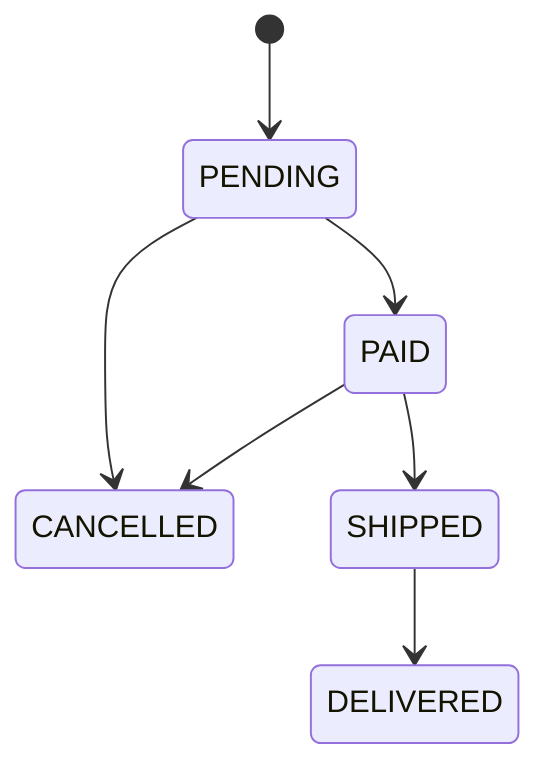

# Guardar enums en la base de datos: @Enumerated, tipos ENUM de Postgres y tablas de lookup

Casi todo modelo de dominio tiene un campo que solo puede contener uno de un puñado de valores.
Una orden está `PENDING`, `PAID`, `SHIPPED`, `DELIVERED` o `CANCELLED`. Un pago está autorizado o
capturado. Una suscripción está en uno de cuatro planes. En Java recurres a un `enum` sin
pensarlo. La pregunta interesante es qué pasa en la frontera — **cómo ese conjunto finito de
valores vive realmente en la base de datos**, y qué te cuesta cada opción seis meses después,
cuando el conjunto cambia.

Este artículo recorre todas las formas comunes de persistir un enum con Hibernate, en el orden en
que realmente las encontrarías: los dos modos de `@Enumerated`, un tipo `ENUM` real de Postgres,
un `AttributeConverter`, y finalmente el enfoque de tabla de lookup, donde el enum se convierte en
su propia tabla. Evolucionaré un solo ejemplo — el estado de una orden — a lo largo de todo el
camino, y terminaré con la opción que realmente tomo.

Stack: **Java, Spring Boot, Hibernate, PostgreSQL**.

<div class="post-tldr" markdown="1">
<p class="post-tldr-title">TL;DR</p>

- `@Enumerated(ORDINAL)` guarda la **posición** del enum — compacto, pero insertar un valor en el medio corrompe silenciosamente todas las filas posteriores. Si debes usarlo, **fija los ordinales con una prueba unitaria**.
- `@Enumerated(STRING)` guarda el **nombre de la constante** — autodescriptivo, depurable, inmune a reordenamientos. Es el valor por defecto sensato.
- No te conformes con un `varchar` pelado — define un **tipo `ENUM` real de Postgres** para que la propia base de datos rechace los valores inválidos.
- Un **`AttributeConverter`** persiste un código estable desacoplado del nombre Java, así que **los renombrados dejan de ser un problema de base de datos**.
- Una **tabla de lookup** vale la pena solo cuando los valores llevan datos de negocio editables — no como un workaround para renombrados.
</div>

---

## El escenario

Estamos construyendo la gestión de órdenes. Una orden avanza por un ciclo de vida fijo:



En Java eso es un enum evidente:

```java
public enum OrderStatus {
    PENDING,
    PAID,
    SHIPPED,
    DELIVERED,
    CANCELLED
}
```

La entidad de la orden tiene un campo `status`. La única pregunta es cómo lo mapea Hibernate a una
columna — y esa única decisión de anotación tiene consecuencias que sobreviven al código que
escribes hoy.

---

## Parte 1 — `@Enumerated(ORDINAL)`: guardar como entero

El valor por defecto de JPA para un enum es `ORDINAL`. Cada constante se guarda como su posición
en la declaración: `PENDING` → 0, `PAID` → 1, `SHIPPED` → 2, y así sucesivamente.

```java
@Entity
@Table(name = "orders_ordinal")
public class OrderOrdinal {

    @Id
    @GeneratedValue(strategy = GenerationType.UUID)
    private UUID id;

    @Enumerated(EnumType.ORDINAL)   // this is also the default if you omit @Enumerated
    @Column(nullable = false)
    private OrderStatus status;
}
```

```sql
CREATE TABLE orders_ordinal (
    id     UUID     PRIMARY KEY DEFAULT gen_random_uuid(),
    status SMALLINT NOT NULL
);
```

Guarda una orden con estado `PAID` y la columna contiene `1`. Es compacto y, sobre el papel, está
bien.

### ❌ La trampa: insertar un valor en el medio

El ordinal no se guarda como una etiqueta — se guarda como una *posición*, y la posición está
definida por el orden del código fuente. El día que alguien agrega un paso de empaque entre pagado
y enviado:

```java
public enum OrderStatus {
    PENDING,
    PAID,
    PACKED,      // <-- inserted here
    SHIPPED,
    DELIVERED,
    CANCELLED
}
```

…cada constante después de `PAID` se desplaza uno:

| Constante | Ordinal antes | Ordinal después |
|---|---|---|
| `PENDING`   | 0 | 0 |
| `PAID`      | 1 | 1 |
| `PACKED`    | — | **2** |
| `SHIPPED`   | 2 | **3** |
| `DELIVERED` | 3 | **4** |
| `CANCELLED` | 4 | **5** |

Nada cambió en la base de datos. Cada orden `SHIPPED` existente sigue conteniendo el entero `2` —
pero `2` ahora decodifica a `PACKED`. Las órdenes enviadas se convierten silenciosamente en
empacadas. Las entregadas se vuelven enviadas. No hay error, ni migración fallida, ni línea de
log. Los datos no se movieron; tu interpretación de ellos sí. Te enteras cuando un cliente
pregunta por qué su orden entregada dice que se está empacando.

### La protección: fija los ordinales

Si tienes una razón para mantener `ORDINAL` — un esquema legacy, una tabla genuinamente caliente
y enorme donde la diferencia de bytes importa — entonces haz que el ordenamiento soporte carga
*explícitamente*, con una prueba que falle en el instante en que alguien reordene el enum:

```java
class OrdinalPinTest {

    @Test
    void ordinalsAreFrozen() {
        // If this test fails, you reordered OrderStatus. Existing ORDINAL-mapped rows now mean
        // something different. Revert the reorder, or append the new value at the end.
        assertThat(OrderStatus.PENDING.ordinal()).isZero();
        assertThat(OrderStatus.PAID.ordinal()).isEqualTo(1);
        assertThat(OrderStatus.SHIPPED.ordinal()).isEqualTo(2);
        assertThat(OrderStatus.DELIVERED.ordinal()).isEqualTo(3);
        assertThat(OrderStatus.CANCELLED.ordinal()).isEqualTo(4);
        assertThat(OrderStatus.values()).hasSize(5);
    }
}
```

Es una prueba unitaria pura — sin contexto de Spring, sin base de datos. Convierte un bug
invisible de corrupción de datos en un build rojo en el instante en que alguien toca el enum. Los
valores nuevos siguen permitidos; solo tienen que ir al final, donde agregar es seguro. Esa es
toda la regla de la que `ORDINAL` depende silenciosamente, puesta por escrito.

---

## Parte 2 — `@Enumerated(STRING)`: guardar como varchar

La solución para casi todos es una palabra:

```java
@Enumerated(EnumType.STRING)
@Column(nullable = false)
private OrderStatus status;
```

Ahora la columna guarda el *nombre* de la constante:

```sql
CREATE TABLE orders_string (
    id     UUID    PRIMARY KEY DEFAULT gen_random_uuid(),
    status VARCHAR NOT NULL
);
```

Una orden `PAID` guarda la cadena literal `'PAID'`. Tres cosas mejoran de inmediato:

- **Reordenar es inofensivo.** El valor es su propio nombre; las posiciones ya no importan. Agrega
  `PACKED` donde quieras.
- **Es depurable.** `SELECT * FROM orders_string WHERE status = 'PAID'` se lee solo. Sin anillo
  decodificador, sin estar uniendo mentalmente contra tu código fuente Java.
- **Los dumps y los logs se autodescriben.** Una fila en una exportación CSV significa algo por sí
  sola.

Sí, `'DELIVERED'` cuesta más bytes que `3`. Para la abrumadora mayoría de las tablas esa
diferencia es ruido — y siempre puedes agregar un índice. Guardar el nombre es el defecto
correcto, y "compacto" casi nunca vale "silenciosamente incorrecto".

### La única trampa restante: los renombrados

`STRING` elimina la trampa del orden pero introduce una más pequeña. El valor guardado *es* el
identificador Java, así que renombrar la constante deja huérfanas las filas existentes:

```java
PENDING  →  AWAITING_PAYMENT
```

Cada fila `'PENDING'` vieja ya no coincide con ninguna constante, y Hibernate lanza una excepción
al leerla. Los datos guardados y el código se han separado silenciosamente. Puedes arreglarlo con
una migración de datos (`UPDATE … SET status = 'AWAITING_PAYMENT' WHERE status = 'PENDING'`) — y
esa es una respuesta perfectamente válida. También veremos una manera de que los renombrados dejen
de ser un evento por completo en la Parte 4.

---

## Parte 3 — Buen estilo: un tipo ENUM real de Postgres

Ambas opciones anteriores guardan en una columna que la base de datos realmente no entiende — un
`smallint` o un `varchar` que *resulta* contener valores de enum. Postgres puede hacerlo mejor.
Tiene tipos enum de primera clase:

```sql
CREATE TYPE order_status AS ENUM ('PENDING', 'PAID', 'SHIPPED', 'DELIVERED', 'CANCELLED');

CREATE TABLE orders_pgenum (
    id     UUID         PRIMARY KEY DEFAULT gen_random_uuid(),
    status order_status NOT NULL
);
```

Ahora la *base de datos* hace cumplir el dominio. Un `INSERT … VALUES ('SHPPED')` — un typo, una
migración mala, un script descontrolado — falla en el origen con `invalid input value for enum
order_status`. Con un `varchar` pelado, esa basura aterriza en la tabla y la descubres después.
El tipo enum es documentación y restricción en uno: el tipo de la columna literalmente lista sus
valores legales.

Mapearlo en Hibernate es el mismo `@Enumerated(STRING)` de antes — Hibernate vincula el nombre de
la constante como string y Postgres lo guarda en el enum:

```java
@Enumerated(EnumType.STRING)
@Column(nullable = false, columnDefinition = "order_status")
private OrderStatus status;
```

Hay exactamente una pieza de fontanería. Por defecto el driver JDBC de PostgreSQL envía un
`String` de Java como tipo `varchar`, y Postgres no hará un cast implícito de `varchar` →
`order_status`, así que obtendrías `column "status" is of type order_status but expression is of
type character varying`. Agrega `stringtype=unspecified` a la URL JDBC y el driver envía el valor
como `unknown`, permitiendo que Postgres lo convierta al enum:

```yaml
spring:
  datasource:
    url: jdbc:postgresql://localhost:5434/mydatabase?stringtype=unspecified
```

(Hibernate 6 también ofrece `@JdbcTypeCode(SqlTypes.NAMED_ENUM)` para apuntar directamente a un
tipo enum con nombre; la combinación de `@Enumerated(STRING)` + `stringtype=unspecified` de arriba
es la más común y la que yo uso.)

**La única advertencia que debes conocer:** `ALTER TYPE order_status ADD VALUE 'PACKED'` solo
*agrega al final*. Puedes agregar un valor (y desde PostgreSQL 12, incluso antes/después de uno
específico), pero no puedes borrar ni reordenar valores existentes sin recrear el tipo. Suena
limitante hasta que te das cuenta de que es la *misma regla* que aplicaba la prueba del ordinal —
nunca reordenar, solo agregar — excepto que aquí la garantiza la base de datos en lugar de una
prueba unitaria. La restricción es la característica.

---

## Parte 4 — `AttributeConverter`: desacoplar el nombre del valor

La trampa del renombrado de la Parte 2 existe porque dejamos que el *valor guardado* y el
*identificador Java* fueran el mismo string. Un `AttributeConverter` de JPA rompe ese
acoplamiento: persistes un código estable que no tiene nada que ver con el nombre de la constante.

Dale a cada constante un código explícito y permanente:

```java
public enum OrderStatus {

    PENDING("PND"),
    PAID("PAID"),
    SHIPPED("SHP"),
    DELIVERED("DLV"),
    CANCELLED("CNC");

    private final String code;

    OrderStatus(String code) {
        this.code = code;
    }

    public String getCode() {
        return code;
    }

    public static OrderStatus fromCode(String code) {
        return Arrays.stream(values())
                .filter(s -> s.code.equals(code))
                .findFirst()
                .orElseThrow(() -> new IllegalArgumentException("Unknown OrderStatus code: " + code));
    }
}
```

Luego un converter que mapea enum ↔ código:

```java
@Converter
public class OrderStatusConverter implements AttributeConverter<OrderStatus, String> {

    @Override
    public String convertToDatabaseColumn(OrderStatus status) {
        return status == null ? null : status.getCode();
    }

    @Override
    public OrderStatus convertToEntityAttribute(String code) {
        return code == null ? null : OrderStatus.fromCode(code);
    }
}
```

Y conéctalo en el campo con `@Convert` en lugar de `@Enumerated`:

```java
@Convert(converter = OrderStatusConverter.class)
@Column(nullable = false)
private OrderStatus status;
```

Ahora la base de datos guarda `'PAID'` como *código*, no como identificador. Renombra la constante
Java `PENDING` a `AWAITING_PAYMENT` y el código guardado `'PND'` nunca cambia — el renombrado es
un refactor puro con impacto cero en la base de datos. Has desacoplado lo que la base de datos
sabe de cómo llamas a las cosas en el código, que es exactamente la propiedad que la gente busca
conseguir con tablas de lookup. Ten esto en mente para la siguiente parte.

---

## Parte 5 — El enfoque de tabla de lookup

El último enfoque deja de tratar el estado como un enum por completo. En su lugar, el conjunto de
estados vive en su propia tabla, y las órdenes referencian una fila por clave foránea:

```sql
CREATE TABLE order_statuses (
    id       INTEGER PRIMARY KEY,
    code     VARCHAR NOT NULL UNIQUE,
    label    VARCHAR NOT NULL,
    terminal BOOLEAN NOT NULL DEFAULT FALSE
);

INSERT INTO order_statuses (id, code, label, terminal) VALUES
    (1, 'PND',  'Pending',   FALSE),
    (2, 'PAID', 'Paid',      FALSE),
    (3, 'SHP',  'Shipped',   FALSE),
    (4, 'DLV',  'Delivered', TRUE),
    (5, 'CNC',  'Cancelled', TRUE);

CREATE TABLE orders_lookup (
    id        UUID    PRIMARY KEY DEFAULT gen_random_uuid(),
    status_id INTEGER NOT NULL REFERENCES order_statuses (id)
);
```

En JPA el estado se convierte en una relación, no en un valor enumerado:

```java
@Entity
@Table(name = "orders_lookup")
public class OrderLookup {

    @Id
    @GeneratedValue(strategy = GenerationType.UUID)
    private UUID id;

    @ManyToOne(fetch = FetchType.EAGER, optional = false)
    @JoinColumn(name = "status_id", nullable = false)
    private OrderStatusDefinition status;
}
```

Para saber qué estado tiene una orden — su etiqueta legible por humanos, si es terminal — haces un
**join**:

```sql
SELECT o.id, s.code, s.label
FROM   orders_lookup o
JOIN   order_statuses s ON s.id = o.status_id
WHERE  o.id = ?;
```

### ✅ Cuándo esto se gana su lugar

La tabla de lookup compra una cosa real: el conjunto de valores, y los metadatos adjuntos a cada
uno, viven en **datos** en lugar de en **código**. Eso es genuinamente valioso cuando:

- **Cada valor lleva datos de negocio editables** — una etiqueta visible, un orden de
  clasificación, un color, un feature flag, un SLA. El estado no es solo una identidad; es un
  pequeño registro.
- **Personas no desarrolladoras gestionan los valores**, o se configuran por tenant, o cambian en
  tiempo de ejecución sin un deploy.
- **Tienes cambios masivos genuinos** — renombras una etiqueta que aparece en millones de filas
  actualizando una fila en `order_statuses`, no cada orden.

Ese último punto es el argumento más fuerte: cambiar en un lugar, no en todos. Si tu "enum" es
realmente un catálogo mantenido, este es el modelo correcto.

---

## Mi opinión

Para un enum *simple* — un conjunto fijo de estados a nivel de código como el ciclo de vida de una
orden — no uso una tabla de lookup, y lo rebatiría en una revisión de código.

La justificación habitual que escucho es "¿y si necesitamos renombrar un valor?". Pero acabamos de
ver que eso se resuelve sin una tabla: un `AttributeConverter` desacopla el código guardado del
nombre Java, y una etiqueta que cambia es una migración de una línea. No necesitas una clave
foránea y un join en cada consulta para sobrevivir a un renombrado.

Lo que la tabla de lookup realmente agrega, para ese caso, es un costo permanente: cada lectura
hace un join o lleva una segunda consulta, el estado es ahora una relación gestionada en lugar de
un valor, y un `switch` exhaustivo en tiempo de compilación sobre tus estados se convierte en una
búsqueda en tiempo de ejecución que puede fallar. Has cambiado un valor que tu compilador entiende
por una fila que tu compilador no entiende, para comprar una flexibilidad que un ciclo de vida
fijo nunca usa.

Así que mi regla va sobre **qué es el valor**, no sobre renombrados:

- Si el valor es **solo identidad** — es `SHIPPED`, punto — déjalo ser un enum. Mapea con
  `@Enumerated(STRING)`, respáldalo con un tipo enum de Postgres, y recurre a un
  `AttributeConverter` cuando quieras que los renombrados sean gratis.
- Si el valor es **un registro** — tiene campos que se editan, por personas, en tiempo de
  ejecución — entonces nunca fue realmente un enum. Dale una tabla.

Renombrar no es el factor decisivo. El factor decisivo es si la cosa tiene datos propios.

---

## Guía de decisión

| Enfoque | Guarda | Úsalo cuando | Riesgo principal |
|---|---|---|---|
| `@Enumerated(ORDINAL)` | posición (`1`) | casi nunca | reordenar corrompe filas silenciosamente |
| `@Enumerated(STRING)` | nombre de constante (`'PAID'`) | el defecto sensato | los renombrados dejan filas huérfanas |
| tipo `ENUM` de Postgres | nombre, validado por la BD | quieres que la BD rechace valores incorrectos | `ADD VALUE` solo agrega al final |
| `AttributeConverter` | código estable (`'PAID'`) | quieres renombrados gratis | una clase pequeña que mantener |
| tabla de lookup | FK a una fila | los valores llevan datos editables | un join en cada lectura |

Un defecto sólido para la mayoría de los proyectos: **`@Enumerated(STRING)` sobre un tipo enum de
Postgres**, subiendo a un **`AttributeConverter`** en el momento en que quieras el valor guardado
aislado del nombre Java.

---

## Código

El código de este artículo está disponible en
**[github.com/javaAndScriptDeveloper/enums-article](https://github.com/javaAndScriptDeveloper/enums-article)** —
el mismo enum `OrderStatus` persistido de las cinco maneras, la prueba de fijación de ordinales y
una prueba de ida y vuelta por enfoque que verifica qué escribe realmente cada uno a disco. Todo
corre localmente con Docker y un solo `./gradlew test`.

---

## Reflexiones finales

Elegir cómo guardar un enum parece una decisión de cinco segundos, y por eso mismo vale la pena ir
despacio. La trampa del ordinal, la trampa del renombrado, la restricción de base de datos
faltante — ninguna aparece el día que escribes la anotación. Aparecen el día que el conjunto de
valores cambia, lo cual siempre sucede, normalmente mucho después de que olvidaste el trade-off
que hiciste.

La buena noticia es que los defectos son fáciles: guarda el nombre, deja que la base de datos lo
valide, y desacopla el código del identificador cuando lo necesites. Reserva la tabla de lookup
para los casos que genuinamente son un catálogo y no un enum. Hazlo bien una vez y tus estados se
mantienen aburridos — que es el mayor cumplido que puedes darle a una columna.

---

## Hablemos

Si guardas los enums de otra manera — o alguna de estas trampas te quemó de una forma que no
cubrí — me gustaría saberlo. Los enlaces de contacto están en el pie de página.
