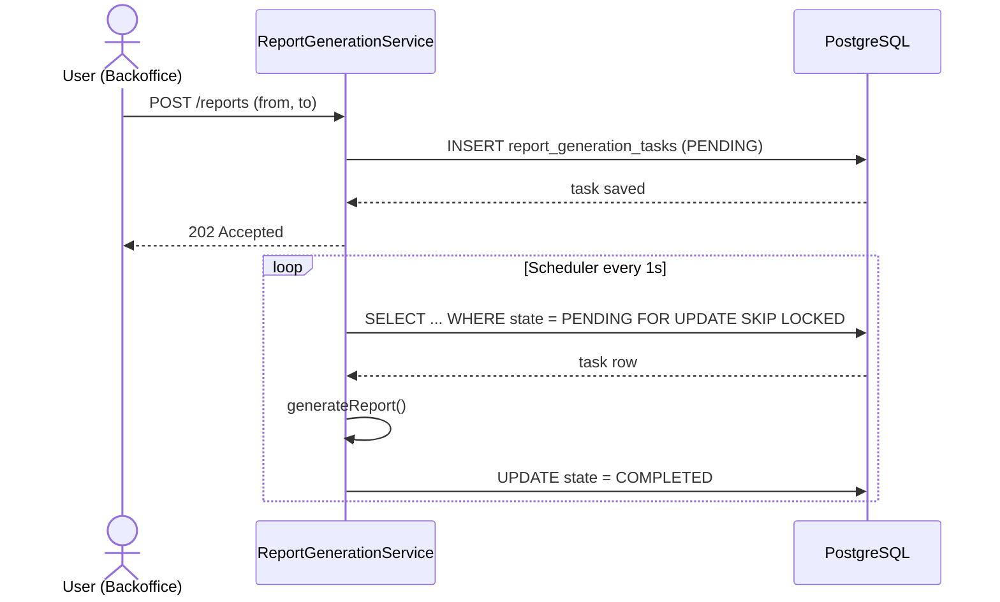
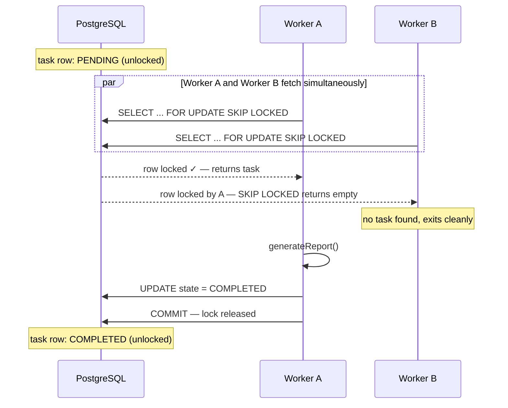
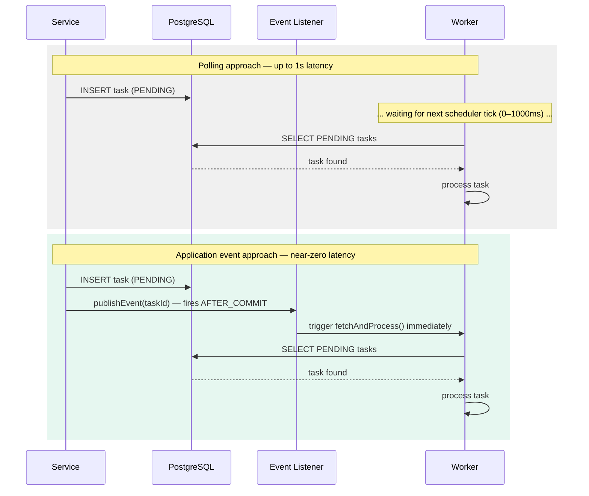
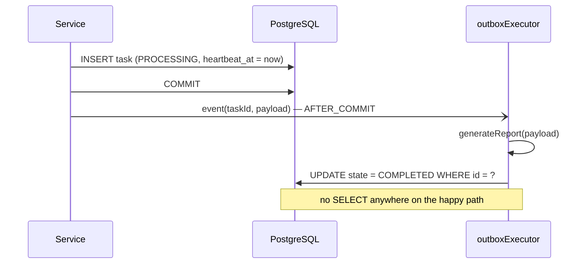
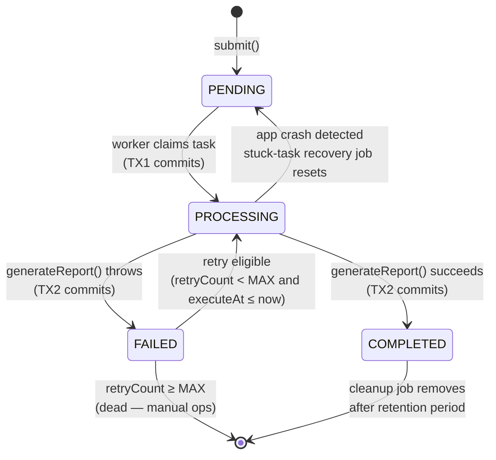
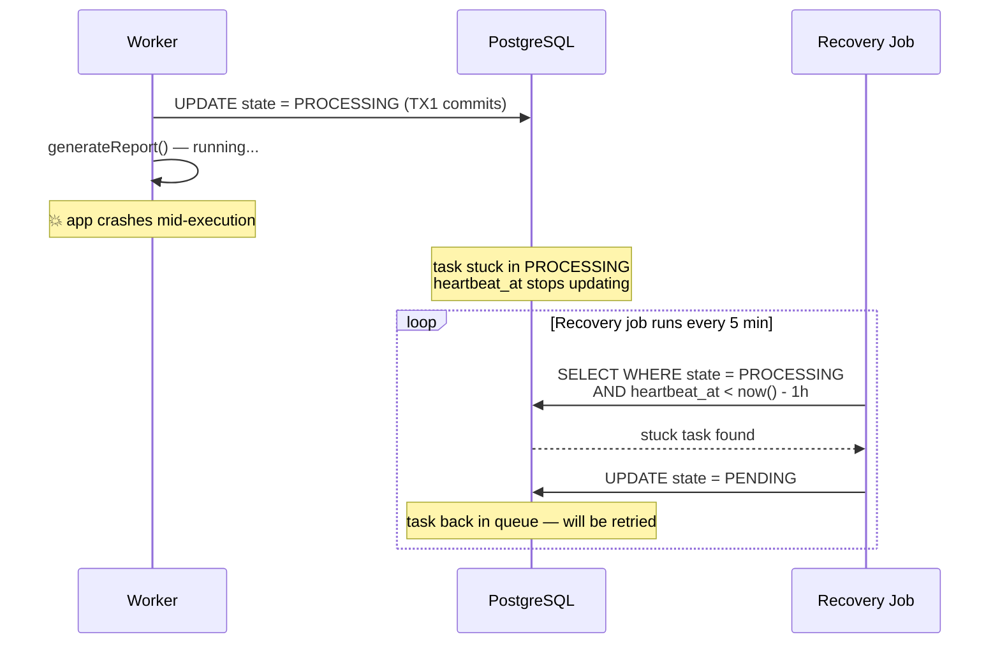
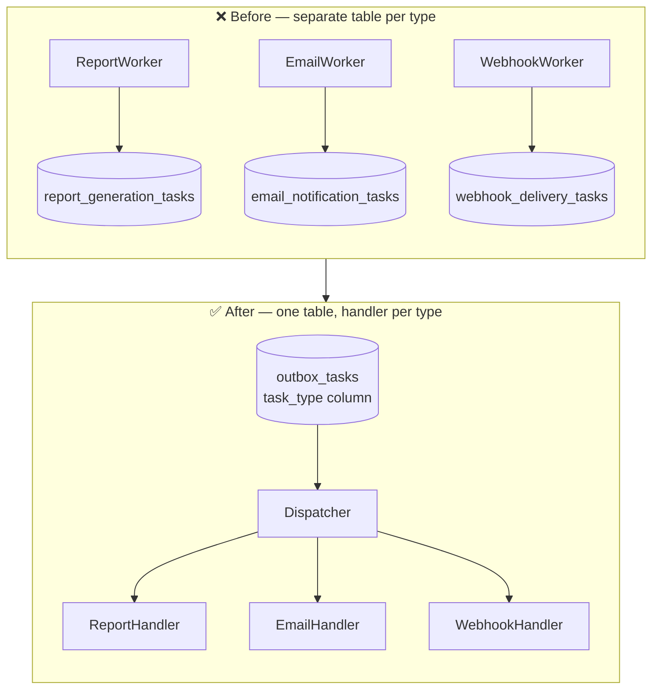
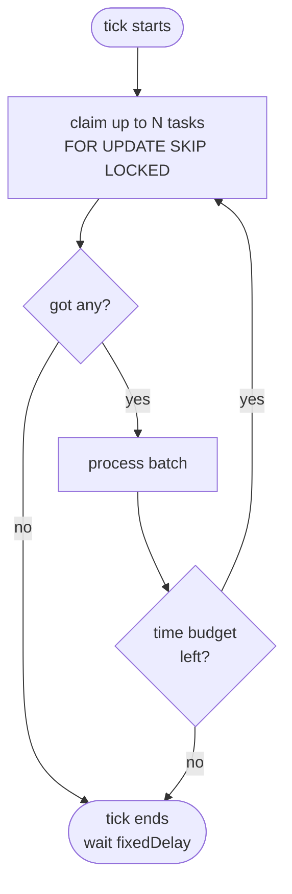

# El patrón Transactional Outbox: de una sola tarea a un motor asíncrono listo para producción

Hay una clase de bugs que nunca aparece en tus pruebas unitarias y rara vez se ve en staging.
Aparece en producción, a las 2 de la mañana, cuando tu aplicación guarda un registro en la base
de datos y luego intenta llamar a un servicio externo — y uno de los dos falla. Un lado hizo
commit. El otro no. Nadie se entera hasta que un usuario se queja.

Este es el **problema de doble escritura**, y el patrón Transactional Outbox es la respuesta
estándar. La idea es simple: en lugar de llamar al sistema externo directamente, escribe una tarea
en la misma transacción de base de datos que tu cambio de dominio. Un worker en segundo plano la
recoge y la ejecuta. La escritura es atómica. La tarea no se puede perder.

Lo que está menos documentado es todo lo que viene después de la idea básica — qué pasa cuando
las tareas fallan, cuando dos workers compiten por la misma fila, cuando tu aplicación se cae a
mitad de la ejecución, cuando tienes diez tipos de tareas distintos viviendo en una sola tabla, y
cuando tus stakeholders preguntan por qué la profundidad de la cola se disparó a las 3 de la
mañana del martes pasado.

De eso trata este artículo.

Trabajaré con un solo escenario concreto — un **servicio de generación de reportes** — y lo
evolucionaré paso a paso desde el outbox más simple posible hasta algo que me sentiría cómodo
corriendo en producción. Cada fragmento de código proviene de un repositorio real y funcional
enlazado al final.

Stack: **Java, Spring Boot, PostgreSQL**.

<div class="post-tldr" markdown="1">
<p class="post-tldr-title">TL;DR</p>

- El **patrón Transactional Outbox** resuelve el problema de doble escritura escribiendo la fila de la tarea en la **misma transacción de BD** que tu cambio de dominio y ejecutándola luego desde un worker en segundo plano.
- Consulta la tabla outbox con `SELECT ... FOR UPDATE SKIP LOCKED` para que varios workers puedan correr concurrentemente sin procesar nada dos veces.
- **Nunca** envíes a Kafka ni llames a otro servicio dentro de una transacción de BD: la duración de la transacción jamás debe depender de un recurso externo.
- Nivel producción exige más que la idea básica: una **máquina de estados**, **reintentos con backoff y jitter**, **heartbeats/leases** para recuperar workers caídos, garantías de **orden**, una **estrategia de fetch** deliberada, **limpieza por lotes** y **monitoreo** de la profundidad de la cola.
- Para baja latencia, despierta a los workers con un evento `AFTER_COMMIT` en un **pool de hilos dedicado** — o ve a **zero-select** y manda el payload dentro del evento, cambiando control sobre la carga por velocidad.
- No necesitas Kafka — **PostgreSQL solo** es suficiente para una ejecución asíncrona confiable.
</div>

---

## El escenario



Estamos construyendo un CRM. Los usuarios pueden solicitar reportes analíticos mensuales desde
una interfaz de backoffice. Generar un reporte significa agregar decenas de millones de filas —
puede tardar minutos. Obviamente no podemos hacer esto de forma síncrona en una petición HTTP.

El usuario hace clic en un botón. El backend acepta la solicitud, la guarda y responde de
inmediato. Un worker en segundo plano recoge la tarea, ejecuta la generación y actualiza el
estado al terminar.

Este es el caso más simple donde un outbox tiene sentido: trabajo genuinamente asíncrono por
naturaleza, donde el usuario ya espera tener que esperar.

---

## Parte 1 — El outbox básico

### Lo que todo outbox necesita

En esencia, cualquier tabla outbox necesita tres cosas:

- **Estado** — ¿en qué punto de su ciclo de vida está esta tarea?
- **Payload** — ¿qué hay que ejecutar exactamente?
- **Timestamps** — ¿cuándo se creó y cuándo cambió por última vez?

```sql
CREATE TYPE task_state AS ENUM ('PENDING', 'COMPLETED');

CREATE TABLE report_generation_tasks (
                                       id         UUID       PRIMARY KEY DEFAULT gen_random_uuid(),
                                       state      task_state NOT NULL    DEFAULT 'PENDING',
                                       payload    JSONB      NOT NULL,
                                       created_at TIMESTAMP  NOT NULL    DEFAULT now(),
                                       updated_at TIMESTAMP  NOT NULL    DEFAULT now()
);
```

El payload para nuestro caso de uso es un rango de fechas:

```java
@Value
@Builder
@Jacksonized
public class ReportGenerationPayload {
  Instant from;
  Instant to;
}
```

La entidad JPA:

```java
@Entity
@Table(name = "report_generation_tasks")
@Data
@Builder
@NoArgsConstructor
@AllArgsConstructor
public class ReportGenerationEntity {

    @Id
    @GeneratedValue(strategy = GenerationType.UUID)
    @Column(updatable = false, nullable = false)
    private UUID id;

    @Enumerated(EnumType.STRING)
    @Column(nullable = false, columnDefinition = "task_state")
    private TaskState state;

    @JdbcTypeCode(SqlTypes.JSON)
    @Column(nullable = false, updatable = false, columnDefinition = "jsonb")
    private ReportGenerationPayload payload;

    @CreationTimestamp
    @Column(nullable = false, updatable = false)
    private Instant createdAt;

    @UpdateTimestamp
    @Column(nullable = false)
    private Instant updatedAt;
}
```

Enviar una tarea:

```java
@Service
@RequiredArgsConstructor
public class ReportGenerationService {

    private final ReportGenerationRepository repository;

    public void submit(ReportGenerationCommand command) {
        repository.save(ReportGenerationEntity.builder()
                .state(TaskState.PENDING)
                .payload(ReportGenerationPayload.builder()
                        .from(command.getFrom())
                        .to(command.getTo())
                        .build())
                .build());
    }
}
```

### El worker

Un job programado consulta las tareas pendientes y las ejecuta:

```java
@Component
@RequiredArgsConstructor
public class ReportGenerationScheduledJob {

    private final ReportGenerationTaskService taskService;

    @Scheduled(fixedDelay = 1000)
    public void run() {
        taskService.fetchAndProcess();
    }
}
```

```java
@Service
@RequiredArgsConstructor
public class ReportGenerationTaskService {

    private final ReportGenerationRepository repository;

    public void fetchAndProcess() {
        repository.findFirstByStateOrderByCreatedAt(TaskState.PENDING)
                .ifPresent(task -> {
                    generateReport(task);
                    task.setState(TaskState.COMPLETED);
                    repository.save(task);
                });
    }

    private void generateReport(ReportGenerationEntity task) {
        // actual report generation logic
    }
}
```

```java
public interface ReportGenerationRepository extends JpaRepository<ReportGenerationEntity, UUID> {
    Optional<ReportGenerationEntity> findFirstByStateOrderByCreatedAt(TaskState state);
}
```

Esto funciona en una aplicación de una sola instancia y sin fallas. En el mundo real tiene dos
problemas: dos workers pueden reclamar la misma tarea simultáneamente, y las tareas pueden fallar
sin ninguna ruta de recuperación. Arreglemos ambas cosas.

---

## Parte 2 — Concurrencia: dos workers, una tarea

Cuando dos hilos del scheduler — o dos instancias de la aplicación — ejecutan la consulta de
fetch en el mismo momento, ambos pueden leer la misma fila `PENDING` y ambos intentarán
ejecutarla. El resultado es, en el mejor de los casos, trabajo duplicado; en el peor, estado
corrupto.

La solución es un lock de base de datos tomado al momento del fetch. El `SELECT ... FOR UPDATE
SKIP LOCKED` de PostgreSQL está pensado justo para este caso de uso: bloquea la fila
para la transacción actual y salta cualquier fila ya bloqueada por otra transacción, en lugar de
esperar.

```java
public interface ReportGenerationRepository extends JpaRepository<ReportGenerationEntity, UUID> {

    @Lock(LockModeType.PESSIMISTIC_WRITE)
    @QueryHint(name = AvailableSettings.JAKARTA_LOCK_TIMEOUT, value = "-2") // -2 = SKIP_LOCKED
    Optional<ReportGenerationEntity> findFirstByStateOrderByCreatedAt(TaskState state);
}
```

El valor `-2` del hint `SKIP_LOCKED` es lo que Hibernate traduce a la cláusula `SKIP LOCKED`.
Como no existe una anotación de primera clase para esto, vale la pena extraerlo a una anotación
reutilizable para no dispersar el número mágico entre tus repositorios:

```java
@Retention(RetentionPolicy.RUNTIME)
@Target({ElementType.METHOD, ElementType.ANNOTATION_TYPE})
@QueryHints(@QueryHint(
    name = AvailableSettings.JAKARTA_LOCK_TIMEOUT,
    value = Timeouts.SKIP_LOCKED_MILLI + ""
))
public @interface SkipLocked {}
```

Mucho más limpio. Ahora el repositorio expresa la intención, no los detalles de implementación:

```java
@SkipLocked
@Lock(LockModeType.PESSIMISTIC_WRITE)
Optional<ReportGenerationEntity> findFirstByStateOrderByCreatedAt(TaskState state);
```

*Puedes* conservar el lock durante el procesamiento envolviendo todo el ciclo
fetch-ejecutar-actualizar en una sola transacción, pero en general no deberías:

```java
// Technically works, but do not use this pattern for outbox processing.
@Transactional
public void fetchAndProcess() {
    repository.findFirstByStateOrderByCreatedAt(TaskState.PENDING)
            .ifPresent(task -> {
                generateReport(task);
                task.setState(TaskState.COMPLETED);
                repository.save(task);
            });
}
```



Aunque `generateReport()` sea lo suficientemente pequeño para que esto funcione técnicamente,
ejecutar una acción de outbox dentro de una transacción abierta es un antipatrón. La duración de
la transacción no debe depender de la duración de la ejecución del outbox: la acción puede
volverse más lenta con el tiempo, bloquearse en I/O o llamar a un servicio downstream, dejando
una conexión de base de datos y un lock de fila retenidos por un periodo impredecible.

En su lugar, reclama la fila en una transacción corta moviéndola a `PROCESSING`, haz commit y
libera el lock, y solo entonces ejecuta la acción del outbox. Registra `COMPLETED` o `FAILED` en
otra transacción corta después. La siguiente sección implementa esa transición de estado y su
ruta de recuperación.

### Nunca hables con el mundo exterior dentro de una transacción

La misma regla aplica mucho más allá del worker del outbox, y es la forma más común que he visto
de que el código alrededor de un outbox tumbe un servicio. Parece inofensivo:

```java
// ❌ Kafka send (or an HTTP call, or an S3 upload) inside an open DB transaction
@Transactional
public void approveOrder(UUID orderId) {
    var order = orderRepository.findById(orderId).orElseThrow();
    order.setStatus(OrderStatus.APPROVED);

    kafkaTemplate.send("order-approved", orderId.toString(), toEvent(order)).get(); // blocks
    billingClient.notifyApproved(orderId);                                         // blocks
}
```

En un buen día Kafka confirma en 5ms y el servicio de facturación responde en 30ms, así que nadie
se da cuenta. En un mal día el broker está haciendo un rebalanceo o el servicio de facturación
está degradado, y cada llamada tarda 30 segundos antes de dar timeout. Ahora **cada** transacción
en curso permanece abierta 30 segundos:

- cada una ocupa una conexión del pool — con 20 conexiones y llamadas de 30 segundos, todo tu
  servicio puede aprobar 20 pedidos cada 30 segundos, y todo lo demás (incluidos los endpoints de
  lectura sanos) hace cola por el pool y empieza a dar timeout;
- en cuanto ha escrito algo (con JPA puede ser solo en el flush del commit, pero a menudo antes),
  retiene locks de fila — todo lo que toque esos mismos pedidos espera detrás;
- una transacción larga que ha escrito algo frena el horizonte de vacuum de Postgres — las filas
  muertas de toda la base de datos no se pueden limpiar hasta que termine, así que el bloat crece
  en todas partes, no solo en esta tabla.

Una degradación en una dependencia que no controlas se acaba de convertir en una caída de una base
de datos que sí controlas. **La duración de una transacción de base de datos nunca debe depender de
un recurso externo.** La transacción solo debería esperar a la propia base de datos.

Además, sigue siendo una doble escritura. Si el envío a Kafka tiene éxito y luego el commit falla
(violación de una restricción, fallo de serialización, el pod muere), los consumidores ya han visto
un evento `order-approved` de un pedido que nunca se aprobó. Mover el envío *después* del commit
solo invierte el modo de fallo: commit hecho, pero el evento se pierde. Justo para esto existe el
outbox: escribe la intención en el outbox dentro de la transacción y deja que un worker hable con
Kafka después.

Vale la pena añadir dos salvaguardas incluso cuando el código es correcto, porque la próxima
persona que lo toque quizá no conozca la regla:

```java
@Transactional(timeout = 5) // seconds
public void approveOrder(UUID orderId) { ... }
```

El `timeout` de Spring no interrumpe una llamada que ya está bloqueada — es un plazo que comprueba
el trabajo de base de datos que viene después. Cualquier sentencia emitida tras el plazo (incluido
el flush del commit) falla con una excepción de timeout y la transacción hace rollback. Tómalo como
un cable trampa que convierte "lento y silencioso" en "falla ruidosamente en tests y logs", no como
una cura.

```sql
-- server-side safety net: kill sessions that sit idle inside an open transaction
ALTER DATABASE app SET idle_in_transaction_session_timeout = '30s';
```

`idle_in_transaction_session_timeout` es exactamente la situación anterior vista desde Postgres:
la sesión abrió una transacción y luego se quedó callada mientras la aplicación esperaba otra
cosa.

---

## Parte 2.5 — Reducir la latencia con eventos de aplicación

El scheduler por polling tiene un piso de latencia inherente. Si tu job se dispara cada segundo,
una tarea enviada en `t=0ms` permanece `PENDING` hasta el siguiente tick — hasta 1000ms después.
Para la mayoría de las cargas asíncronas eso es aceptable. Para los casos donde quieres una
captura casi inmediata — enviar un correo transaccional, disparar un webhook — no lo es.

El patrón, tomado prestado de Celery: guarda la entidad del outbox en la base de datos y luego
publica de inmediato un `ApplicationEvent` de Spring que lleva el ID de la nueva tarea. Un
listener lo recoge y despacha el procesamiento enseguida, sin esperar el siguiente tick del
scheduler.



El scheduler sigue corriendo como red de seguridad — atrapa todo lo que el listener de eventos
haya perdido (reinicio de la app, excepción del listener, evento perdido). Pero el camino feliz
evita por completo el retardo del polling.

### Implementación

Publica el evento dentro del método del servicio, después de guardar:

```java
@Service
@RequiredArgsConstructor
public class ReportGenerationService {

    private final ReportGenerationRepository repository;
    private final ApplicationEventPublisher eventPublisher;

    @Transactional
    public void submit(ReportGenerationCommand command) {
        var entity = repository.save(ReportGenerationEntity.builder()
                .state(TaskState.PENDING)
                .payload(ReportGenerationPayload.builder()
                        .from(command.getFrom())
                        .to(command.getTo())
                        .build())
                .build());

        eventPublisher.publishEvent(new ReportGenerationTaskSubmittedEvent(entity.getId()));
    }
}
```

```java
public record ReportGenerationTaskSubmittedEvent(UUID taskId) {}
```

El listener reacciona después del commit, **en su propio pool de hilos**:

```java
@Component
@RequiredArgsConstructor
public class ReportGenerationTaskEventListener {

    private final ReportGenerationTaskService taskService;

    @Async("outboxExecutor")
    @TransactionalEventListener(phase = TransactionPhase.AFTER_COMMIT)
    public void onTaskSubmitted(ReportGenerationTaskSubmittedEvent event) {
        taskService.fetchAndProcess();
    }
}
```

Fíjate en que el listener no pasa `event.taskId()` a nadie. Es deliberado: el evento es solo una
**señal para despertar**, y `fetchAndProcess()` reclama trabajo exactamente igual que el poller —
la tarea elegible más antigua, con `SKIP LOCKED`. Puede que la tarea que disparó el evento no sea
la que se ejecute, pero el orden y el reclamo quedan en un solo lugar. Si prefieres ejecutar *esa*
tarea ahora mismo, pasa el id y reclámala directamente:

```java
taskService.process(event.taskId()); // WHERE id = :id AND state = 'PENDING' FOR UPDATE SKIP LOCKED
```

Eso le da a quien envía la menor latencia posible, a cambio de dejar que las tareas nuevas
adelanten a tareas `PENDING` más antiguas — está bien para trabajo independiente, y está mal si
dependes de FIFO (Parte 7). El outbox zero-select del final de esta parte lleva la idea hasta el
final y pasa el payload completo.

`@Async` no es decoración. Un listener `AFTER_COMMIT` sin él se ejecuta **de forma síncrona en el
hilo que hizo el commit** — el hilo de la petición HTTP. El "202 Accepted" del usuario ahora espera
a que se genere el reporte entero. Peor aún, en ese momento los recursos de la transacción ya
confirmada siguen ligados al hilo: la propia documentación de Spring advierte que el acceso a datos
desde un callback after-commit sigue "participando" en la transacción terminada, y nada le hará
commit salvo que el código pida explícitamente `REQUIRES_NEW`. Mover el listener a otro hilo
resuelve ambas cosas a la vez.

### Un pool de hilos dedicado, no el de por defecto

`@Async` sin nombre usa el `applicationTaskExecutor` compartido de Spring Boot — compartido con
cualquier otro método `@Async` de la aplicación, y con una cola en la práctica ilimitada por
defecto. Una avalancha de eventos se convertiría silenciosamente en un backlog en memoria que
desaparece en el siguiente reinicio. Dale al outbox su propio pool acotado:

```java
@Configuration
@EnableAsync
public class OutboxExecutorConfig {

    @Bean("outboxExecutor")
    public ThreadPoolTaskExecutor outboxExecutor() {
        var executor = new ThreadPoolTaskExecutor();
        executor.setCorePoolSize(4);
        executor.setMaxPoolSize(4);
        executor.setQueueCapacity(200);                 // bounded: overflow is rejected, not buffered forever
        executor.setThreadNamePrefix("outbox-");        // readable thread dumps and logs
        executor.setRejectedExecutionHandler(new ThreadPoolExecutor.DiscardPolicy());
        executor.setWaitForTasksToCompleteOnShutdown(true);
        executor.setAwaitTerminationSeconds(15);
        return executor;
    }
}
```

Un detalle de Spring Boot que conviene saber antes de copiar esto: Boot solo autoconfigura su
`applicationTaskExecutor` cuando **no** has declarado tú un bean `Executor`. Declara
`outboxExecutor` y el de por defecto desaparece — cualquier `@Async` *sin nombre* en el resto de la
aplicación acaba silenciosamente en otro executor (posiblemente este, con su política de descarte).
En Boot 3.5+, pon `spring.task.execution.mode=force` para conservar el autoconfigurado; en
versiones anteriores, declara explícitamente un bean `applicationTaskExecutor` junto a este.

Descartar cuando hay desbordamiento es seguro aquí *porque la fila está en la base de datos*: el
evento es solo una optimización de latencia, y el poller recoge todo lo que la ruta de eventos haya
descartado. Nunca uses `CallerRunsPolicy` en este pool — el "caller" es el hilo de la petición que
intentabas liberar.

### El error clásico

El error más común es usar `@EventListener` en lugar de
`@TransactionalEventListener(phase = TransactionPhase.AFTER_COMMIT)`. Lo que sale mal depende de
si el listener es asíncrono:

- **`@EventListener` a secas** se dispara en el momento en que se llama a `publishEvent()` — de
  forma síncrona, en el mismo hilo, **dentro de la transacción todavía abierta**.
  `fetchAndProcess()` se une a esa transacción, así que *sí* ve la fila sin confirmar — y reclama
  y ejecuta la tarea ahí mismo. El reporte se genera dentro de la transacción de envío (justo el
  antipatrón de la Parte 2), la petición se queda colgada hasta que termina, y si la transacción de
  envío hace rollback después, has ejecutado una tarea que oficialmente nunca existió.
- **`@Async` + `@EventListener`** se ejecuta en otro hilo con otra conexión, antes del commit. La
  fila todavía no es visible, el fetch no encuentra nada y el evento se desperdicia en silencio. El
  scheduler recoge la tarea un segundo después, así que los logs se ven bien — simplemente has
  perdido la ventaja de latencia sin darte cuenta.

```java
// ❌ fires inside the open transaction (or before it commits, if @Async)
@EventListener
public void onTaskSubmitted(ReportGenerationTaskSubmittedEvent event) {
    taskService.fetchAndProcess();
}

// ✅ fires after COMMIT, on the outbox pool — the row is visible and the caller is free
@Async("outboxExecutor")
@TransactionalEventListener(phase = TransactionPhase.AFTER_COMMIT)
public void onTaskSubmitted(ReportGenerationTaskSubmittedEvent event) {
    taskService.fetchAndProcess();
}
```

El scheduler permanece intacto — actúa como el mecanismo de recuperación para cualquier tarea que
el listener de eventos haya perdido. Los dos enfoques se complementan: eventos para la latencia,
polling para la confiabilidad.

### Un paso más: el outbox zero-select

El evento anterior todavía cuesta un viaje de ida y vuelta. Solo dice "ha llegado algo nuevo", así
que el worker tiene que hacer un `SELECT` para averiguar qué — y con `ORDER BY created_at` puede que
ni siquiera elija la tarea que lo disparó. Cuando la latencia importa de verdad, sáltate la lectura
por completo: **mete en el evento todo lo necesario para ejecutar la tarea**, ejecútala
directamente desde memoria y escribe de vuelta solo el resultado.



Esto usa el estado `PROCESSING` y el heartbeat de las Partes 3 y 5. La fila se inserta ya como
`PROCESSING`, con un `heartbeat_at` reciente que actúa como lease. Ese detalle es lo que la
mantiene correcta: si la fila se insertara como `PENDING`, el poller podría reclamarla mientras la
ruta de eventos ya la está ejecutando, y la tarea correría dos veces.

```java
public record ReportRequestedEvent(UUID taskId, Instant leasedAt, ReportGenerationPayload payload) {}

@Transactional
public void submit(ReportGenerationCommand command) {
    var payload = ReportGenerationPayload.builder()
            .from(command.getFrom())
            .to(command.getTo())
            .build();
    var leasedAt = Instant.now().truncatedTo(ChronoUnit.MICROS); // Postgres stores microseconds
    var entity = repository.save(ReportGenerationEntity.builder()
            .state(TaskState.PROCESSING)
            .heartbeatAt(leasedAt)        // lease: the poller leaves this row alone
            .payload(payload)
            .build());
    eventPublisher.publishEvent(new ReportRequestedEvent(entity.getId(), leasedAt, payload));
}
```

```java
@Async("outboxExecutor")
@TransactionalEventListener(phase = TransactionPhase.AFTER_COMMIT)
public void onReportRequested(ReportRequestedEvent event) {
    // UPDATE ... SET heartbeat_at = now()
    //  WHERE id = :id AND state = 'PROCESSING' AND heartbeat_at = :leasedAt
    if (repository.renewLease(event.taskId(), event.leasedAt()) == 0) {
        return; // the event waited too long: recovery already handed the task to the poller
    }
    try (var heartbeat = heartbeatFactory.start(event.taskId())) {
        generateReport(event.payload());
        repository.markCompleted(event.taskId());              // UPDATE ... WHERE id = :id
    } catch (Exception e) {
        repository.markFailed(event.taskId(), e.getMessage()); // the poller retries it later
    }
}
```

La comprobación `renewLease` del principio importa más de lo que parece. El lease se fija en el
insert, pero el heartbeat solo arranca cuando un hilo recoge el evento. Si el evento se queda en la
cola del executor más tiempo que el umbral de recuperación, el job de recuperación devuelve la fila
a `PENDING`, un poller la reclama — y entonces el evento encolado la ejecutaría una segunda vez. El
update condicional convierte esa carrera en un no-op: quien ya no posee el lease original se
retira.

Todos los modos de fallo desembocan de nuevo en la ruta clásica. Si el listener lanza una
excepción, la tarea queda `FAILED` y el poller la reintenta con backoff. Si la app muere a mitad de
la ejecución, el heartbeat se detiene y el job de recuperación de tareas atascadas la resetea. Si
el pool rechaza el evento, la fila se queda en `PROCESSING` con un lease que nunca se renueva y
espera a la recuperación — gracias a la comprobación del lease, un umbral de recuperación corto
para estas filas es seguro. (Devolverla directamente a `PENDING` al rechazarla requiere el id de la
tarea, que un rejection handler de `@Async` no recibe; si lo quieres, envía tú mismo al executor y
captura `TaskRejectedException`.)

**El trade-off: quién controla la cantidad de trabajo.** Un outbox por polling *tira* (pull).
Decide cuántas tareas toma y a qué ritmo, así que su carga está acotada por diseño pase lo que pase
aguas arriba. Un outbox zero-select es *empujado* (push): el trabajo llega al ritmo al que llegan
las peticiones. Un pico de tráfico se convierte en un pico de ejecución, y los únicos frenos son el
tamaño del pool y la capacidad de la cola — cuando se llenan, estás rechazando y cayendo al polling
de todos modos. Usa zero-select para trabajo sensible a la latencia y de volumen moderado con un
pool acotado; mantén el poller para todo lo demás, y siempre como red de seguridad.

**Exprimir la última escritura.** Para el máximo throughput puedes ir un paso más allá y dejar de
escribir cada finalización por separado: acumula en memoria los ids completados y vuélcalos como un
único `UPDATE` cada pocos cientos de milisegundos.

```java
@Component
@RequiredArgsConstructor
public class CompletionBuffer {

    private final ConcurrentLinkedQueue<UUID> completed = new ConcurrentLinkedQueue<>();
    private final ReportGenerationRepository repository;

    public void add(UUID taskId) {
        completed.add(taskId);
    }

    @Scheduled(fixedDelay = 200)
    @PreDestroy                                   // flush what we can on a graceful shutdown
    public void flush() {
        var ids = new ArrayList<UUID>();
        for (UUID id; ids.size() < 1_000 && (id = completed.poll()) != null; ) {
            ids.add(id);
        }
        if (!ids.isEmpty()) {
            repository.markCompleted(ids);        // UPDATE ... SET state = 'COMPLETED' WHERE id IN (:ids)
        }
    }
}
```

El flush al apagar es best effort — lo que siga en el buffer después de él, o se añada después de
que el bean se destruya, simplemente se vuelve a ejecutar más tarde. Ten claro lo que esto cuesta.
Una caída pierde el buffer — no las tareas, sino el *registro de que terminaron*. Esas filas se
quedan en `PROCESSING`, la recuperación las resetea y se ejecutan **otra vez**. Eso solo es
aceptable cuando todos los handlers son idempotentes (Parte 10). Escribe los fallos de inmediato en
lugar de acumularlos: son raros, y su mensaje de error es lo único que no puedes reconstruir
después.

---

## Parte 3 — Fallas, reintentos y el estado PROCESSING



Las acciones del outbox no deberían ejecutarse dentro de una transacción de base de datos
abierta. El enfoque de transacción con lock mantiene un lock de base de datos durante toda la
duración de `generateReport()`. Para un reporte que tarda dos minutos, son dos minutos de una
fila bloqueada — una conexión ocupada, otras operaciones de BD potencialmente encoladas detrás.
Con `SKIP LOCKED` los workers no se bloquean entre sí por el lock, pero las transacciones largas
igual presionan el pool de conexiones y degradan el rendimiento de la base de datos bajo carga. Una
acción muy pequeña puede técnicamente completarse sin causar problemas visibles, pero acoplar la
duración de la transacción a la duración de la ejecución del outbox sigue siendo un antipatrón.

La solución es separar el reclamo de la tarea de su ejecución. Cambia la tarea a `PROCESSING` en
una transacción corta, libera el lock, y luego haz el trabajo real fuera de cualquier transacción.
Así la BD solo se toca brevemente al inicio y brevemente al final — la parte costosa ocurre en
medio sin retener nada.

Primero, extiende el enum:

```sql
ALTER TYPE task_state ADD VALUE 'PROCESSING';
ALTER TYPE task_state ADD VALUE 'FAILED';

ALTER TABLE report_generation_tasks
    ADD COLUMN retry_count  INTEGER NOT NULL DEFAULT 0,
    ADD COLUMN error_message VARCHAR;
```

`retry_count` registra cuántas veces se intentó la ejecución. Limitamos los reintentos a 10 —
más allá de eso, algo está genuinamente roto y necesita intervención manual. Más adelante
conectaremos alertas alrededor de esto. `error_message` guarda la última excepción para que
sepas *por qué* una tarea está atascada sin tener que rastrear los logs.

El enum de Java crece con él:

```java
public enum TaskState {
    PENDING,
    PROCESSING,
    COMPLETED,
    FAILED
}
```

El servicio ahora ejecuta dos transacciones cortas separadas con el trabajo real en medio:

```java
@RequiredArgsConstructor
public class ReportGenerationTaskService {

    private final ReportGenerationRepository repository;
    private final TransactionTemplate transactionTemplate;

    private static final int MAX_RETRY_COUNT = 10;

    public void fetchAndProcess() {
        transactionTemplate
                .execute(status ->
                        repository.findFirstEligibleTask(
                                List.of(TaskState.PENDING, TaskState.FAILED),
                                MAX_RETRY_COUNT
                        ).map(this::markProcessing))
                .ifPresentOrElse(
                        task -> {
                            try {
                                generateReport(task);
                                markCompleted(task);
                            } catch (Exception e) {
                                markFailed(task, e);
                                log.error("Task {} failed on attempt {}", task.getId(), task.getRetryCount(), e);
                            }
                        },
                        () -> log.debug("No eligible tasks to process")
                );
    }

    private ReportGenerationEntity markProcessing(ReportGenerationEntity task) {
        task.setState(TaskState.PROCESSING);
        return repository.save(task);
    }

    private void markCompleted(ReportGenerationEntity task) {
        task.setState(TaskState.COMPLETED);
        repository.save(task);
    }

    private void markFailed(ReportGenerationEntity task, Exception e) {
        task.setState(TaskState.FAILED);
        task.setRetryCount(task.getRetryCount() + 1);
        task.setErrorMessage(e.getMessage()); // don't skip this — it's the only trace of what went wrong without digging through logs
        repository.save(task);
    }
}
```

La consulta trae tanto tareas `PENDING` como `FAILED` — una tarea fallida con `retryCount < 10`
es tan elegible como una nueva. Cuando el contador de reintentos alcanza el tope, la tarea deja
de obtenerse y queda como un registro `FAILED` permanente hasta que alguien la revise. Eso es
intencional — más allá de 10 intentos algo está genuinamente roto y necesita ojos sobre ello, no
otro reintento.

```java
@SkipLocked
@Lock(LockModeType.PESSIMISTIC_WRITE)
@Query("""
    SELECT t FROM ReportGenerationEntity t
    WHERE t.state IN :states
      AND t.retryCount < :maxRetryCount
    ORDER BY t.createdAt ASC
    LIMIT 1
    """)
Optional<ReportGenerationEntity> findFirstEligibleTask(
    @Param("states") List<TaskState> states,
    @Param("maxRetryCount") Integer maxRetryCount
);
```

Pero espera — ¿debería una tarea recién fallida recogerse de nuevo en el siguiente tick del
scheduler, segundos después? Si el sistema downstream está caído, saturarlo cada segundo
empeora las cosas. De eso trata la siguiente sección.

## Parte 4 — Backoff exponencial

Sin un retardo entre reintentos, una tarea fallida reingresa a la cola en el siguiente tick del
scheduler — usualmente segundos después. Si el sistema downstream está caído, lo estás
saturando a toda la tasa de polling. Eso es malo para el sistema downstream y malo para tu BD.

La solución es una columna `execute_at`: la tarea no es elegible hasta que este timestamp esté
en el pasado. Las tareas nuevas reciben `execute_at = now()` para que se recojan de inmediato.
Las tareas fallidas reciben `execute_at = now() + delay`, donde el delay crece con cada reintento.

```sql
ALTER TABLE report_generation_tasks
    ADD COLUMN execute_at TIMESTAMP NOT NULL DEFAULT NOW();
```

El calendario de delays lo dirige todo — `MAX_RETRY_COUNT` se deriva de él, no se declara por
separado. Así los dos nunca pueden desincronizarse:

```java
private static final Map<Integer, Duration> RETRY_DELAYS = Map.of(
    0, Duration.ofMinutes(1),
    1, Duration.ofMinutes(5),
    2, Duration.ofMinutes(15),
    3, Duration.ofMinutes(30),
    4, Duration.ofHours(1),
    5, Duration.ofHours(2),
    6, Duration.ofHours(4),
    7, Duration.ofHours(8),
    8, Duration.ofHours(12),
    9, Duration.ofDays(1)
);

private static final int MAX_RETRY_COUNT = RETRY_DELAYS.size();
```

Agrega una nueva entrada a `RETRY_DELAYS` y el tope de reintentos se actualiza automáticamente.
No hay número mágico que mantener sincronizado en otro lado.

En `markFailed()`, captura el contador de reintentos *actual* antes de incrementarlo — ese
selecciona el delay para el *siguiente* intento:

```java
private void markFailed(ReportGenerationEntity task, Exception e) {
    int currentRetry = task.getRetryCount();
    task.setState(TaskState.FAILED);
    task.setRetryCount(currentRetry + 1);
    task.setErrorMessage(e.getMessage());
    task.setExecuteAt(Instant.now().plus(
            RETRY_DELAYS.getOrDefault(currentRetry, RETRY_DELAYS.get(RETRY_DELAYS.size() - 1))));
    repository.save(task);
}
```

La consulta de fetch gana una condición — `AND t.executeAt <= :now` — y el scheduler sigue
corriendo a la misma tasa. Simplemente salta las tareas cuya ventana aún no se abre. Las tareas
fallidas esperan en silencio hasta que les llega su momento, y entonces reingresan naturalmente.

### Jitter: aplana la carga antes de que te golpee

Un calendario de backoff fijo tiene una propiedad desagradable: las tareas que fallaron juntas se
reintentan juntas. Si el proveedor de correo estuvo caído dos minutos, las 3000 tareas que fallaron
en esa ventana reciben todas `execute_at = failed_at + 1 minute` — y vuelven a golpear al
proveedor como una sola ola sincronizada en el momento en que se recupera. Añade aleatoriedad a
cada delay para que la ola se reparta:

```java
private static Instant nextAttempt(Duration baseDelay) {
    long jitterMillis = ThreadLocalRandom.current().nextLong(baseDelay.toMillis() / 2 + 1);
    return Instant.now().plus(baseDelay).plusMillis(jitterMillis); // base + up to 50%
}
```

La misma idea aplica a la **entrada**. A nivel de arquitectura, un motor asíncrono quiere una carga
plana y constante — no picos grandes y repentinos. Una importación nocturna que envía 200 000
tareas en una sola transacción las vuelve todas elegibles en el mismo milisegundo; todos los
workers de todos los pods se saturan, el sistema downstream recibe la ráfaga completa y tus
dashboards de latencia se encienden por un trabajo que nadie estaba esperando. Cuando una tarea no
es urgente, dale un `execute_at` con jitter en el momento del envío:

```java
// bulk / non-urgent submission: spread over the next 10 minutes instead of "all now"
entity.setExecuteAt(Instant.now().plusMillis(
        ThreadLocalRandom.current().nextLong(Duration.ofMinutes(10).toMillis())));
```

La cantidad total de trabajo no cambia; solo se reparte en el tiempo. Las tareas de cara al
usuario mantienen `execute_at = now()`; el trabajo batch recibe una ventana de jitter acorde a lo
que puede permitirse esperar.

---

## Parte 5 — Tareas atascadas y heartbeats



Con el enfoque de dos transacciones, considera qué pasa si la app se cae después de marcar una
tarea `PROCESSING` pero antes de marcarla `COMPLETED` o `FAILED`. La BD muestra `PROCESSING`.
Nadie la está procesando. Se queda ahí para siempre.

La solución ingenua es un job de recuperación que encuentra tareas atascadas en `PROCESSING` por
demasiado tiempo y las resetea a `PENDING`:

```java
@Transactional
public void recoverStuckTasks() {
    repository.findFirstByStateAndUpdatedAtLessThan(
                    TaskState.PROCESSING,
                    Instant.now().minus(1, ChronoUnit.HOURS))
            .ifPresent(task -> {
                log.warn("Resetting stuck task {} to PENDING", task.getId());
                task.setState(TaskState.PENDING);
                repository.save(task);
            });
}
```

Esto funciona para la mayoría de los casos. El problema: `updated_at` cambia cada vez que
*cualquier cosa* cambia en la fila — incluyendo transiciones de estado no relacionadas. Una tarea
procesándose legítimamente por 55 minutos se ve idéntica a una tarea caída desde la perspectiva
de `updated_at`.

La solución más limpia es un **heartbeat**: una columna dedicada que se actualiza periódicamente
*solo mientras la tarea está siendo procesada activamente*. El job de recuperación ahora revisa
esta columna, no `updated_at`. Una tarea que no ha emitido heartbeat en la última hora está
genuinamente atascada.

```sql
ALTER TABLE report_generation_tasks ADD COLUMN heartbeat_at TIMESTAMP;
```

El heartbeat corre en su propio hilo, dentro de sus propias transacciones, independiente de la
lógica de procesamiento. La implementación más limpia es un `try-with-resources` — arranca cuando
comienza el procesamiento y se detiene en cualquier ruta de salida:

```java
public abstract class Heartbeat implements AutoCloseable {

    private final ScheduledExecutorService executor;

    protected Heartbeat(Runnable heartbeatFn) {
        executor = Executors.newSingleThreadScheduledExecutor();
        executor.scheduleAtFixedRate(heartbeatFn, 0, 10, TimeUnit.SECONDS);
    }

    @Override
    public void close() {
        executor.shutdownNow();
    }
}
```

```java
public class ReportGenerationTaskHeartbeat extends Heartbeat {

    ReportGenerationTaskHeartbeat(UUID taskId, ReportGenerationRepository repository) {
        super(() -> repository.updateHeartbeatAt(taskId, Instant.now()));
    }
}
```

El método del repositorio lleva su propio `@Transactional` — no hace falta envolver la llamada
manualmente:

```java
@Modifying
@Transactional
@Query("UPDATE ReportGenerationEntity t SET t.heartbeatAt = :now WHERE t.id = :id")
void updateHeartbeatAt(@Param("id") UUID id, @Param("now") Instant now);
```

Conéctalo mediante una factory para que el servicio se mantenga limpio:

```java
@Component
@RequiredArgsConstructor
public class ReportGenerationTaskHeartbeatFactory {

    private final ReportGenerationRepository repository;

    public Heartbeat start(UUID taskId) {
        return new ReportGenerationTaskHeartbeat(taskId, repository);
    }
}
```

El bloque de procesamiento ahora se ve así:

```java
public void fetchAndProcess() {
    transactionTemplate
            .execute(status -> repository.findFirstEligibleTask(
                    List.of(TaskState.PENDING, TaskState.FAILED),
                    MAX_RETRY_COUNT
            ).map(this::markProcessing))
            .ifPresentOrElse(
                    task -> {
                        try (var heartbeat = heartbeatFactory.start(task.getId())) {
                            try {
                                generateReport(task);
                                markCompleted(task);
                            } catch (Exception e) {
                                markFailed(task, e);
                                log.error("Task {} failed", task.getId(), e);
                            }
                        }
                    },
                    () -> log.debug("No eligible tasks to process")
            );
}
```

El job de recuperación usa `heartbeat_at` en lugar de `updated_at`:

```java
@Modifying
@Transactional
@Query("UPDATE ReportGenerationEntity t SET t.heartbeatAt = :now WHERE t.id = :id")
void updateHeartbeatAt(@Param("id") UUID id, @Param("now") Instant now);

@SkipLocked
@Lock(LockModeType.PESSIMISTIC_WRITE)   // two recovery runs never reset the same task
Optional<ReportGenerationEntity> findFirstByStateAndHeartbeatAtLessThanOrderByCreatedAt(
        TaskState state, Instant heartbeatAt);
```

`updated_at` refleja cuándo cambió por última vez el estado de la tarea. `heartbeat_at` refleja
si la tarea está viva ahora mismo. Mantenerlos separados significa que puedes responder ambas
preguntas sin ambigüedad.

---

## Parte 6 — Outbox de múltiples tipos



Seis meses después, tu servicio maneja más que generación de reportes. Necesitas notificaciones
por correo. Luego exportaciones de datos. Luego entregas de webhooks.

Tienes dos opciones: una tabla separada por tipo de tarea, o una tabla compartida con un
discriminador `task_type`. La tabla compartida gana cuando los tipos de tarea son numerosos y te
sientes cómodo procesándolos desde un solo lugar. La infraestructura — reintentos, heartbeats,
backoff, monitoreo — queda en un solo lugar. Agregar un nuevo tipo de tarea es solo agregar un
nuevo handler.

Los trade-offs que vale la pena conocer de antemano:

- Un nuevo tipo de tarea que se comporta mal puede ralentizar todos los demás — un handler
  defectuoso que quema reintentos crea backpressure sobre toda la tabla.
- Las garantías de orden se vuelven más difíciles — más sobre esto abajo.

### El esquema

```sql
CREATE TYPE outbox_task_type AS ENUM ('REPORT_GENERATION', 'EMAIL_NOTIFICATION');

CREATE TABLE outbox_tasks (
    id            UUID             PRIMARY KEY DEFAULT gen_random_uuid(),
    task_type     outbox_task_type NOT NULL,
    state         task_state       NOT NULL    DEFAULT 'PENDING',
    payload       JSONB            NOT NULL,
    retry_count   INTEGER          NOT NULL    DEFAULT 0,
    error_message VARCHAR,
    execute_at    TIMESTAMPTZ      NOT NULL    DEFAULT NOW(),
    heartbeat_at  TIMESTAMPTZ,
    created_at    TIMESTAMPTZ      NOT NULL    DEFAULT now(),
    updated_at    TIMESTAMPTZ      NOT NULL    DEFAULT now()
);
```

### La interfaz de handler

El punto clave de extensibilidad — una implementación por tipo de tarea:

```java
public interface OutboxTaskHandler<P> {
    OutboxTaskType getType();
    Class<P> payloadClass();
    void handle(UUID taskId, P payload) throws Exception;
}
```

`taskId` se pasa a cada handler. Verás por qué en la sección de idempotencia.

Un handler concreto:

```java
@Component
public class EmailNotificationHandler implements OutboxTaskHandler<EmailNotificationPayload> {

    @Override
    public OutboxTaskType getType() {
        return OutboxTaskType.EMAIL_NOTIFICATION;
    }

    @Override
    public Class<EmailNotificationPayload> payloadClass() {
        return EmailNotificationPayload.class;
    }

    @Override
    public void handle(UUID taskId, EmailNotificationPayload payload) throws Exception {
        log.info("Sending email to {} — task {}", payload.getRecipient(), taskId);
        // call email provider
    }
}
```

### El dispatcher

El servicio recoge todos los beans handler al arrancar, construye un mapa de búsqueda y enruta
cada tarea por su `taskType`:

```java
@Service
@RequiredArgsConstructor
public class OutboxTaskService {

    private final OutboxTaskRepository repository;
    private final ObjectMapper objectMapper;
    private final List<OutboxTaskHandler<?>> handlerList;

    private Map<OutboxTaskType, OutboxTaskHandler<?>> handlers;

    @PostConstruct
    void init() {
        handlers = handlerList.stream()
                .collect(Collectors.toMap(OutboxTaskHandler::getType, Function.identity()));
    }

    @SuppressWarnings("unchecked")
    private void dispatch(OutboxTaskEntity task) throws Exception {
        var handler = (OutboxTaskHandler<Object>) handlers.get(task.getTaskType());
        if (handler == null) {
            throw new IllegalStateException(
                    "No handler registered for task type: " + task.getTaskType());
        }
        var payload = objectMapper.readValue(task.getPayload(), handler.payloadClass());
        handler.handle(task.getId(), payload);
    }
}
```

Registrar un nuevo tipo de tarea es: agregar el valor al enum, agregar el bean handler, listo.
El dispatcher, el scheduler, la lógica de reintentos — nada de eso cambia.

---

## Parte 7 — Orden

Si tu caso de uso no se preocupa por el orden de procesamiento — notificaciones
fire-and-forget, jobs en segundo plano independientes — salta esta sección. Pero aun así,
obtener primero las tareas insertadas antes es el comportamiento más honesto: las tareas enviadas
primero han esperado más tiempo, y procesarlas en orden de envío es lo que los usuarios
razonablemente esperarían.

Sin un `ORDER BY` explícito, PostgreSQL **no garantiza nada** sobre el orden de retorno de las
filas. Ordena siempre por `created_at ASC` en tu consulta de fetch:

```java
@Query("""
    SELECT t FROM OutboxTaskEntity t
    WHERE t.state IN :states
      AND t.retryCount < :maxRetryCount
      AND t.executeAt <= :now
    ORDER BY t.createdAt ASC
    LIMIT 1
    """)
Optional<OutboxTaskEntity> findFirstEligibleTask(...);
```

Apóyalo con un índice parcial:

```sql
CREATE INDEX idx_outbox_fetch
    ON outbox_tasks (created_at ASC)
    WHERE state IN ('PENDING', 'FAILED');
```

### La trampa del desfase de reloj

Primero, sé honesto sobre si esto importa para tu caso de uso. Si tus tareas son independientes —
generación de reportes, envío de correos, entrega de webhooks — el orden de procesamiento
generalmente no importa en absoluto. Que la tarea A termine antes que la B está bien sin importar
cuál se envió primero. En ese caso, toda esta sección no es tu problema.

Si de verdad necesitas FIFO — tareas de la misma entidad que deben procesarse en orden de envío —
sigue leyendo.

El problema es que `created_at` se genera del lado de la aplicación. Cada instancia tiene su
propio reloj de sistema. Si la instancia A está 200ms adelante de la instancia B, una tarea
enviada por B en `t=100ms` recibe un `created_at` anterior al de una tarea enviada por A en
`t=50ms` — aunque la tarea de A se insertó primero. La consulta de fetch ordena por `created_at`
y recoge primero la tarea de B. El orden de envío queda invertido.

NTP mantiene los relojes cercanos pero no perfectamente sincronizados. En condiciones normales el
desfase es de milisegundos. Bajo carga, durante migraciones de VM, o tras un reinicio de
contenedor, puede ser mayor.

La solución es generar el valor de ordenamiento del lado de la base de datos — o dejas que
PostgreSQL asigne `created_at` vía `DEFAULT now()` en lugar de que la aplicación lo fije, o usas
una secuencia respaldada por la base de datos, que garantiza un incremento monótono sin importar
qué instancia insertó la fila. Aquí está el enfoque con secuencia:

```sql
ALTER TABLE outbox_tasks ADD COLUMN seq BIGSERIAL;
```

```java
@Column(insertable = false, updatable = false)
private Long seq;
```

Ordena por `seq ASC`. El valor lo asigna una única fuente autoritativa — la base de datos — así
que refleja el orden real de inserción sin importar qué instancia envió la tarea o qué decía el
reloj de esa instancia.

Conserva `created_at` para observabilidad. Usa `seq` para el orden.

Una advertencia que muerde a quienes se apoyan demasiado en esto: el valor de una secuencia se
asigna en el `INSERT`, no en el `COMMIT`. La transacción A puede tomar `seq = 100`, la transacción
B toma `seq = 101` y hace commit primero — durante un instante el worker ve la 101 pero no la 100.
`seq` te da un orden estable e independiente del reloj; por sí solo no te da "nunca procesar la 101
antes que la 100". Si eso es un requisito estricto para una entidad, procesa las tareas de esa
entidad de una en una (por ejemplo, salta una tarea mientras haya una tarea más antigua de la misma
clave todavía en `PENDING` o `PROCESSING`).

Si el FIFO estricto importa en tu sistema, no lo pases por alto.

---

## Parte 7.5 — Estrategias de fetch: cuándo consultar y cuánto tomar

Hasta ahora el worker ha sido un `@Scheduled(fixedDelay = 1000)` que toma una tarea por tick. Eso
está bien para una demo y casi nunca es lo que quieres en producción. Importan dos decisiones:
**qué dispara una ejecución** y **cuánto trabajo toma una ejecución**.

### Qué dispara una ejecución

| Disparador | Spring | Comportamiento | Bueno para |
|---|---|---|---|
| Fixed delay | `@Scheduled(fixedDelay = 1000)` | la siguiente ejecución empieza N ms *después de que termine la anterior* | la mayoría de los outboxes — consciente de la carga por diseño |
| Fixed rate | `@Scheduled(fixedRate = 1000)` | las ejecuciones se *programan* cada N ms, sin importar cuánto tarden | jobs de coste constante (métricas, heartbeats) |
| Cron | `@Scheduled(cron = "0 */5 * * * *")` | horas de reloj | limpieza, reportes, todo lo ligado a "cada noche" |
| Umbral | tu propio disparador | se ejecuta cuando el backlog ≥ N filas o la tarea más antigua supera T | sistemas downstream que prefieren lotes (APIs bulk) |

Elegir entre ellos no es cosmético. Con `fixedRate`, una ejecución que tarda más que el periodo va
seguida **inmediatamente** de la siguiente, así que un downstream lento convierte un poller de 1
segundo en un bucle apretado que nunca descansa. Con `fixedDelay`, una ejecución lenta simplemente
retrasa la siguiente — el worker se frena de forma natural cuando el sistema está en apuros.

### ¿Pueden solaparse dos ejecuciones?

Dentro de **una** instancia de Spring, con el scheduler por defecto, el mismo método `@Scheduled`
no se ejecuta concurrentemente consigo mismo — incluso con `fixedRate`, una ejecución atrasada
espera a que termine la anterior. (Si has activado los virtual threads, Boot usa otro scheduler;
vuelve a comprobar esta suposición contra su documentación.) Mucha gente se queda tranquila ahí, y
es el lugar equivocado para detenerse. Las ejecuciones *sí* se solapan cuando:

- ejecutas **más de un pod** — que es cualquier despliegue de producción; N pods son N workers
  concurrentes;
- el método programado es `@Async`, o pasa el trabajo a un executor y retorna de inmediato.

El solapamiento no es problema para ningún job que **bloquee las filas con las que trabaja**, y con
un poco de cuidado todos los jobs del outbox pueden hacerlo:

- **Fetch-and-process** — para eso está `SKIP LOCKED`; los workers que se solapan simplemente se
  reparten el trabajo, a costa de algunas consultas extra.
- **Limpieza** — dos ejecuciones de limpieza borrando el mismo rango no son problema cuando el
  borrado por lotes es una consulta nativa cuyo `SELECT` interno usa `FOR UPDATE SKIP LOCKED`
  (Parte 9): cada ejecución toma filas que la otra no ha bloqueado, y ninguna espera.
- **Recuperación de tareas atascadas** — dos ejecuciones de recuperación podrían resetear la misma
  tarea, así que la consulta de recuperación también debe tomar un lock de fila (`FOR UPDATE SKIP
  LOCKED`, Parte 5). Así solo una ejecución se queda con cada fila atascada.

Para un job que de verdad no puede hacerse seguro a nivel de fila — por ejemplo, "enviar el correo
de resumen diario" — ejecútalo en una sola instancia. La herramienta habitual es
**[ShedLock](https://github.com/lukas-krecan/ShedLock)**: una pequeña librería que garantiza que una
tarea programada se ejecute como mucho en un nodo a la vez. Antes de cada ejecución toma un lock con
nombre en un almacén compartido (una tabla en tu propia base de datos sirve perfectamente), y los
demás nodos se saltan esa ejecución mientras el lock esté tomado. `lockAtMostFor` libera el lock
aunque el nodo que lo tiene muera.

```java
@Scheduled(cron = "0 0 8 * * *")
@SchedulerLock(name = "daily-summary", lockAtMostFor = "30m")
public void sendDailySummary() { ... }
```

### Cuánto toma una ejecución: el bucle de drenaje

Tomar una tarea por tick limita el throughput a una tarea por segundo por pod, sin importar cuánta
capacidad tengas. Tomar un lote es mejor; mejor aún es una ejecución que **sigue haciendo fetch
hasta vaciar la cola**, y solo entonces termina su tick:



Cuando la cola está vacía, un tick cuesta una consulta indexada barata. Cuando se acumula un
backlog, el worker deja de esperar entre lotes y corre a toda velocidad hasta ponerse al día. El
presupuesto de tiempo importa: sin él, un tick bajo un backlog sostenido nunca termina, lo que hace
lento el apagado ordenado y deja sin turno a cualquier otro job que comparta el hilo del scheduler.

Y normalmente *hay* solo uno: el scheduler de Spring Boot tiene **un único hilo por defecto**. El
poller, el job de recuperación de tareas atascadas, la limpieza horaria y cualquier job de flush
hacen cola unos detrás de otros, así que una limpieza de 20 minutos significa 20 minutos sin polling
en ese pod. Dale al scheduler suficientes hilos para los jobs que tienes, o pon los jobs largos en
su propio scheduler:

```yaml
spring:
  task:
    scheduling:
      pool:
        size: 4
```

```java
@Scheduled(fixedDelay = 1000)
public void run() {
    var deadline = Instant.now().plus(Duration.ofSeconds(30));
    List<OutboxTaskEntity> batch;
    do {
        batch = repository.claimBatch(BATCH_SIZE, MAX_RETRY_COUNT);
        batch.forEach(this::processClaimedTask);
    } while (!batch.isEmpty() && Instant.now().isBefore(deadline));
}
```

Reclama el lote en una sola sentencia — seleccionar, bloquear y marcar `PROCESSING` en un único
viaje de ida y vuelta:

```java
// no @Modifying: UPDATE ... RETURNING is read back like a SELECT
@Transactional
@Query(nativeQuery = true, value = """
    UPDATE outbox_tasks
       SET state = 'PROCESSING', heartbeat_at = now(), updated_at = now()
     WHERE id IN (
           SELECT id FROM outbox_tasks
            WHERE state IN ('PENDING', 'FAILED')
              AND retry_count < :maxRetryCount
              AND execute_at <= now()
            ORDER BY seq
            LIMIT :batchSize
              FOR UPDATE SKIP LOCKED)
    RETURNING *
    """)
List<OutboxTaskEntity> claimBatch(@Param("batchSize") int batchSize,
                                  @Param("maxRetryCount") int maxRetryCount);
```

Dimensiona el lote para que uno termine con holgura dentro de la ventana del heartbeat, y recuerda
que `UPDATE ... RETURNING` no garantiza que las filas devueltas vengan en orden de `seq` — ordena la
lista en memoria si el orden importa.

---

## Parte 8 — Índices que mantienen la tabla rápida a escala

Tu tabla outbox se consulta cada segundo, a menudo varias veces por segundo. Cada fila en ella
es o bien trabajo activo (`PENDING`, `FAILED`, `PROCESSING`) o ruido histórico (`COMPLETED`). Sin los
índices correctos, cada consulta recorre la tabla entera para encontrar el puñado de filas
elegibles.

La herramienta correcta es un **índice parcial** — uno que solo incluye las filas que cumplen un
predicado. Cuando una tarea pasa a `COMPLETED`, sale automáticamente del índice parcial. El índice
se mantiene pequeño para siempre, sin importar cuántas tareas haya procesado la tabla.

### El índice de fetch — el hot path

Índice para la consulta de fetch:

```sql
CREATE INDEX idx_outbox_fetch
    ON outbox_tasks (seq ASC)
    WHERE state IN ('PENDING', 'FAILED');
```

Para probarlo: inserté 50 000 filas con solo 7 en estado `PENDING`, activé el logging SQL en modo
debug de Hibernate para obtener la consulta exacta generada en la consola, y ejecuté
`EXPLAIN ANALYZE` sobre ese SQL:

```
Limit  (cost=0.14..27.50 rows=1 width=102) (actual time=0.082..0.084 rows=1 loops=1)
  ->  LockRows  (actual time=0.081..0.082 rows=1 loops=1)
        ->  Index Scan using idx_outbox_fetch on outbox_tasks
              (actual time=0.030..0.030 rows=1 loops=1)
Planning Time: 1.230 ms
Execution Time: 0.139 ms
```

0.03ms para encontrar la tarea elegible más antigua. Las 49 993 filas `COMPLETED` nunca se
leyeron. A mí me convence.

Dos índices más para las otras dos operaciones en segundo plano:

Para el job de recuperación:

```sql
CREATE INDEX idx_outbox_stuck
    ON outbox_tasks (heartbeat_at ASC, created_at ASC)
    WHERE state = 'PROCESSING';
```

Para el job de limpieza:

```sql
CREATE INDEX idx_outbox_cleanup
    ON outbox_tasks (updated_at ASC)
    WHERE state = 'COMPLETED';
```

---

## Parte 9 — Limpieza

Tu outbox es una tabla operativa. Cada consulta de fetch la recorre. Las filas viejas son peso
muerto.

La regla: borra solo las tareas **`COMPLETED`**. Las tareas `FAILED` son tu rastro de auditoría.
No las toques. Gestiónalas manualmente o mediante un proceso de ops separado cuando haga falta.

La implementación obvia es un único `DELETE` para todo lo que sea más antiguo que la ventana de
retención:

```java
// ❌ fine on day one, dangerous on the day the job was broken for a week
@Modifying
@Transactional
@Query("""
    DELETE FROM OutboxTaskEntity t
    WHERE t.state IN :states
      AND t.updatedAt < :before
    """)
int deleteByStateInAndUpdatedAtBefore(
    @Param("states") List<TaskState> states,
    @Param("before") Instant before
);
```

En PostgreSQL, borrar una gran cantidad de filas en **una sola transacción** es caro de formas que
no se ven en el tiempo de la consulta:

- **Crecimiento del WAL.** Cada fila borrada se escribe en el write-ahead log (a menudo con
  imágenes de página completa). Diez millones de filas borradas significan gigabytes de WAL en
  cuestión de minutos: checkpoints forzados, presión de disco en el primario, el archivado y las
  réplicas quedándose atrás mientras se ponen al día, y los consumidores de replicación lógica
  atascados decodificando una transacción enorme.
- **Locks largos y un snapshot viejo.** Una transacción enorme retiene locks de fila sobre todo lo
  que tocó, e impide que autovacuum limpie nada más nuevo que su snapshot — en toda la base de
  datos, mientras dure.
- **Todo o nada.** Si falla a los 20 minutos, todo hace rollback y la siguiente ejecución empieza
  de cero con una pila todavía mayor.

Borra en **porciones pequeñas, en un bucle, cada porción en su propia transacción corta**. Yo suelo
trabajar con unas 100 000 filas por transacción; ajústalo para que un lote tarde uno o dos segundos
en tu hardware. Borrar por lotes no reduce el WAL total — se borran las mismas filas de un modo u
otro — sino que lo reparte, de modo que los checkpoints, el archivado y las réplicas siguen el
ritmo, los locks son cortos y un fallo solo pierde el lote actual.

```java
@Modifying
@Transactional
@Query(nativeQuery = true, value = """
    DELETE FROM outbox_tasks
     WHERE id IN (
           SELECT id FROM outbox_tasks
            WHERE state = 'COMPLETED'
              AND updated_at < :before
            LIMIT :batchSize
              FOR UPDATE SKIP LOCKED)       -- overlapping cleanup runs split the work
    """)
int deleteCompletedBatch(@Param("before") Instant before, @Param("batchSize") int batchSize);
```

```java
private static final int CLEANUP_RETENTION_DAYS = 30;
private static final int CLEANUP_BATCH_SIZE = 100_000;

@Scheduled(cron = "0 0 * * * *")
public void cleanup() {                       // deliberately NOT @Transactional
    var cutoff = Instant.now().minus(CLEANUP_RETENTION_DAYS, ChronoUnit.DAYS);
    var deadline = Instant.now().plus(Duration.ofMinutes(40)); // never run into the next hourly run
    int total = 0;
    int deleted;
    do {
        deleted = repository.deleteCompletedBatch(cutoff, CLEANUP_BATCH_SIZE); // own transaction
        total += deleted;
    } while (deleted == CLEANUP_BATCH_SIZE && Instant.now().isBefore(deadline));
    log.info("Cleanup: removed {} completed tasks older than {} days", total, CLEANUP_RETENTION_DAYS);
}
```

El método exterior **no** debe ser `@Transactional` — si no, cada lote se une a una gran
transacción y vuelves a tener un único borrado enorme con pasos extra. El índice parcial
`idx_outbox_cleanup` de la Parte 8 mantiene barato el `SELECT` interno de cada lote.

Un outbox es además una de las tablas con más rotación que vas a tener nunca: cada fila se inserta,
se actualiza dos o tres veces y se borra. Cada una de esas operaciones deja una tupla muerta para
autovacuum. Los valores por defecto (vacuum cuando ~20% de la tabla está muerta) están pensados
para tablas que sobre todo crecen, así que en un outbox con mucho tráfico dejan que el bloat se
acumule entre ejecuciones. Haz autovacuum más agresivo solo para esta tabla — Postgres te permite
sobrescribir la configuración de autovacuum por tabla con `ALTER TABLE ... SET (...)`, así que el
resto de la base de datos conserva sus valores por defecto.

Cuánto tiempo retener: he visto de todo, desde borrar una tarea en cuanto se procesa hasta
conservarla un mes después. Si no estás seguro — retén más tiempo.
El costo de retener filas viejas es una tabla ligeramente más grande. El costo de borrarlas
demasiado pronto es perder tu historial de depuración el día que más lo necesitas.

---

## Parte 10 — Idempotencia: hacer seguros los reintentos

Nada en esta arquitectura garantiza una ejecución exactamente una vez. La ejecución de la tarea y
la actualización de estado a `COMPLETED` son dos operaciones separadas. Si la app se cae después
de ejecutar pero antes de que la actualización de estado haga commit, la tarea se reintentará. Se
ejecutará de nuevo con las mismas entradas.

Esto es entrega **at-least-once** — es la única garantía disponible aquí. La pregunta es si una
ejecución duplicada causa daño.

Si tu tarea es inherentemente idempotente (generar el mismo reporte dos veces produce el mismo
reporte), ya terminaste. Si tiene efectos secundarios (envía un correo, cobra una tarjeta), un
duplicado es un problema.

La solución: usa el `id` de la propia tarea del outbox como clave de idempotencia dentro del
handler. El ID de la tarea es estable entre reintentos — nunca cambia para la misma fila. El
handler verifica si el trabajo para este ID ya fue registrado. Si sí, es un no-op.

En nuestro caso, la generación del reporte termina insertando una fila en `generated_reports` —
ese es el registro del trabajo hecho. Agregamos una restricción `UNIQUE` sobre `idempotency_key`
para que, aun si dos instancias compiten, solo un INSERT gane. La otra recibe una violación de
restricción y la trata como un no-op exitoso:

```sql
CREATE TABLE generated_reports (
    id               UUID        PRIMARY KEY DEFAULT gen_random_uuid(),
    idempotency_key  UUID        NOT NULL,
    report_path      VARCHAR     NOT NULL,
    created_at       TIMESTAMPTZ NOT NULL    DEFAULT now(),

    CONSTRAINT uq_generated_reports_idempotency_key UNIQUE (idempotency_key)
);
```

```java
@Component
@RequiredArgsConstructor
public class ReportGenerationHandler implements OutboxTaskHandler<ReportGenerationPayload> {

    private final GeneratedReportRepository reports;

    @Override
    public void handle(UUID taskId, ReportGenerationPayload payload) {
        if (reports.existsByIdempotencyKey(taskId)) {
            log.info("Report already generated for task {} — skipping", taskId);
            return;
        }

        var reportPath = runReportGeneration(payload);

        try {
            reports.saveAndFlush(GeneratedReport.builder()
                    .idempotencyKey(taskId)
                    .reportPath(reportPath)
                    .build());
        } catch (DataIntegrityViolationException e) { // saveAndFlush: surface it here, not at commit
            log.info("Task {} was completed concurrently — treating as done", taskId);
        }
    }
}
```

Si tu tarea llama a una API externa en lugar de escribir en la BD, verifica si esa API soporta
claves de idempotencia — la mayoría de los procesadores de pagos y proveedores de correo
transaccional lo hacen. Pasa el ID de la tarea del outbox como clave de idempotencia en la forma
que la API requiera (header, campo del body, query param). El servicio remoto se encarga de la
deduplicación de su lado.

---

## Parte 11 — Monitoreo

El outbox corre en silencio en segundo plano. Cuando funciona, nadie se entera. Cuando se rompe,
tampoco se entera nadie — al menos no de inmediato. Las tareas atascadas se acumulan. Los
servicios downstream dejan de recibir eventos. Cuando alguien mira los logs, ya pasaron dos horas.

Las cuatro señales doradas del libro de SRE de Google encajan en un outbox casi una a una:

- **Latencia** — ¿cuánto tarda cada tarea desde que se recoge hasta que se completa? Un pico aquí significa que el handler es lento o la BD está bajo presión.
- **Throughput** — ¿cuántas tareas por unidad de tiempo terminan? Que caiga a cero significa que el scheduler no está corriendo o que no se están reclamando tareas.
- **Tasa de error** — ¿qué fracción de los intentos termina en falla? Por encima de ~5% significa que una dependencia downstream está degradada y el rezago de reintentos crece.
- **Saturación** — ¿cuánto trabajo está esperando? La profundidad de la cola y, todavía más útil, **la antigüedad de la tarea elegible más vieja**: un backlog de 10 000 con 3 segundos de antigüedad está sano; un backlog de 3 con 40 minutos de antigüedad, no.


### Instrumentación

Agrega a `build.gradle.kts`:

```kotlin
implementation("org.springframework.boot:spring-boot-starter-actuator")
implementation("io.micrometer:micrometer-registry-prometheus")
```

Registra el aspecto AOP `@Timed` una sola vez:

```java
@Bean
public TimedAspect timedAspect(MeterRegistry registry) {
    return new TimedAspect(registry);
}
```

Mantén los nombres de las métricas como constantes e incrementa desde un componente dedicado —
no dispersos entre los métodos del servicio:

```java
@Component
@RequiredArgsConstructor
public class OutboxMetrics {

  private static final String TASK_PROCESSED = "outbox.task.processed";
  private static final String OUTCOME_TAG    = "outcome";
  private static final String COMPLETED      = "completed";
  private static final String FAILED         = "failed";

  private final MeterRegistry meterRegistry;
  private final ReportGenerationRepository repository;

  public void recordCompleted() {
    meterRegistry.counter(TASK_PROCESSED, OUTCOME_TAG, COMPLETED).increment();
  }

  public void recordFailed() {
    meterRegistry.counter(TASK_PROCESSED, OUTCOME_TAG, FAILED).increment();
  }

  @PostConstruct
  void registerGauge() {
    Gauge.builder("outbox.tasks.pending", repository,
                    repo -> repo.countByStateIn(List.of(TaskState.PENDING, TaskState.FAILED)))
            .description("Tasks waiting to be processed")
            .register(meterRegistry);
  }
}
```

El servicio luego solo llama a `metrics.recordCompleted()` y `metrics.recordFailed()` — sin
strings crudos en la lógica de negocio.

Hay una trampa en ese gauge: las filas `FAILED` que ya agotaron sus reintentos nunca se borran (son
el rastro de auditoría), así que contar todas las filas `FAILED` hace que "pending" crezca para
siempre y que la alerta de backlog acabe disparándose de forma permanente. Cuenta solo las filas
que todavía pueden ejecutarse (`retry_count < max`) y expón las agotadas en su propio gauge
`outbox.tasks.dead` — ese número debería ser cero, y alguien debería mirar cada vez que no lo sea.

Después del arranque, `curl localhost:8080/actuator/prometheus | grep outbox` te da:

```
outbox_task_duration_seconds{quantile="0.5"}  0.062
outbox_task_duration_seconds{quantile="0.95"} 0.145
outbox_task_duration_seconds{quantile="0.99"} 0.312
outbox_task_processed_total{outcome="completed"} 40.0
outbox_task_processed_total{outcome="failed"}    2.0
outbox_tasks_pending 0.0
```

### Alertas

Los dashboards son para humanos mirando pantallas. Las alertas son para humanos que están
dormidos.

| Alerta | Se dispara cuando | Durante | Significado |
|---|---|---|---|
| `OutboxQueueBacklog` | pending > 50 | 5m | El procesamiento no alcanza al ingest |
| `OutboxHighErrorRate` | error rate > 5% | 2m | Handler o dependencia downstream degradada |
| `OutboxSlowProcessing` | p99 latency > 30s | 5m | Contención en la BD o llamada externa lenta |
| `OutboxStuckTasks` | pending > 0 y cero completados en 10m | 10m | Scheduler caído o todos los workers atascados |

Ajusta los umbrales a tu propia carga. Una profundidad de cola de 50 puede ser normal para un
servicio de alto throughput. Para una herramienta interna de bajo volumen, incluso 5 tareas
esperando 5 minutos ameritan una revisión. La lógica de las señales es la misma; solo cambian los
números.

---

## Parte 12 — Convivir con él: despliegues y cambios de payload

A todo outbox le pasan dos cosas en su primer mes en producción, y ninguna aparece en una demo.

### Apagado ordenado

Cada despliegue mata pods que están a mitad de ejecutar tareas. Sin cuidado, cada una de esas
tareas se queda en `PROCESSING` hasta que el job de recuperación de tareas atascadas se da cuenta —
una hora, con el umbral de la Parte 5 — y entonces vuelve a ejecutarse desde el principio. En un
equipo que despliega diez veces al día, eso es un goteo constante de retrasos de una hora y
ejecuciones duplicadas.

La secuencia de apagado que quieres:

1. **Deja de aceptar trabajo nuevo.** Detén el scheduler y que el executor de eventos deje de
   aceptar tareas.
2. **Deja que terminen las tareas en curso**, hasta un plazo que quepa dentro del
   `terminationGracePeriodSeconds` de Kubernetes (30s por defecto — súbelo si tus tareas necesitan
   más).
3. **Devuelve lo que no terminó.** Todo lo que siga ejecutándose al llegar el plazo: vuelve a
   ponerlo en `PENDING` (un `UPDATE` por id), para que otro pod lo recoja en un segundo y no en una
   hora.

Spring Boot te da la mayor parte de esto con configuración:

```yaml
# Kubernetes: terminationGracePeriodSeconds: 60
server:
  shutdown: graceful
spring:
  lifecycle:
    timeout-per-shutdown-phase: 15s
  task:
    scheduling:
      shutdown:
        await-termination: true
        await-termination-period: 15s
```

…más `setWaitForTasksToCompleteOnShutdown(true)` y una espera de 15 segundos en el
`outboxExecutor` de la Parte 2.5. Estas esperas se ejecutan en gran medida una detrás de otra, no
en paralelo, así que **súmalas**: 15 + 15 + 15 = 45 segundos tienen que caber dentro del grace
period, o el pod muere a mitad del apagado y deja exactamente las filas `PROCESSING` que intentabas
evitar. El bucle de drenaje de la Parte 7.5 también debería comprobar una bandera de "apagándose"
entre lotes, para que un pod con backlog deje de reclamar lotes nuevos en cuanto se le pide que se
detenga.

### Versionado del payload

Los payloads viven en la tabla minutos, horas o — en el caso de una tarea `FAILED` esperando un
reintento — días. Eso significa que **el código que lee un payload suele ser más nuevo que el código
que lo escribió**. Renombra un campo en `ReportGenerationPayload`, despliega, y todas las tareas
enviadas por la versión anterior fallan al deserializarse.

Dónde falla importa. Con el payload mapeado como columna JSON tipada (`@JdbcTypeCode(SqlTypes.JSON)`
de la Parte 1), Hibernate lo deserializa **al cargar la entidad — dentro de la consulta de
reclamo**. La transacción de reclamo hace rollback, `retry_count` nunca aumenta, y la misma fila
envenenada vuelve a fallar en cada tick. Con `LIMIT 1`, o en cada lote que la contenga, bloquea el
outbox para todos. El dispatcher multitipo de la Parte 6 es más seguro: guarda el payload como JSON
crudo y lo deserializa en la ruta del handler, así que un payload malo se convierte en una tarea
`FAILED` corriente.

Trata el payload como un contrato con tu yo del pasado:

- Haz cambios aditivos: añade los campos nuevos como opcionales, y no renombres ni elimines un
  campo hasta que ninguna fila con la forma antigua pueda seguir en `PENDING` o `FAILED`.
- Haz tolerante al lector — `@JsonIgnoreProperties(ignoreUnknown = true)` en la clase del payload —
  para que un rollback todavía pueda leer filas escritas por la versión más nueva. (Configurar
  `spring.jackson.deserialization.fail-on-unknown-properties` no basta: el mapeo JSON de Hibernate
  usa su propio mapper a menos que configures `hibernate.type.json_format_mapper`.)
- Para un cambio realmente incompatible, añade una columna `payload_version` (o un nuevo tipo de
  tarea) y conserva el handler antiguo hasta que desaparezcan las filas antiguas.

```sql
ALTER TABLE outbox_tasks ADD COLUMN payload_version SMALLINT NOT NULL DEFAULT 1;
```

<div class="post-sticky" markdown="1">
<p class="post-sticky-title">📌 De la experiencia: payloads en Avro</p>

En un proyecto, los payloads de nuestro outbox eran Avro, y los fallidos iban a una tabla de
dead-letter. Guardarlos como bytes crudos junto con su writer schema fue una decisión tomada con
prisa, bajo presión — pero funcionó, y más adelante sí los reprocesamos. Aun así, no lo volvería a
hacer: JSON plano con cambios aditivos es mucho más simple.
</div>

---

## Checklist de producción

Antes de llevar cualquier outbox a producción:

```
☐ Nada de envíos a Kafka, llamadas HTTP ni otra I/O externa dentro de una transacción de BD
☐ Timeout de transacción + idle_in_transaction_session_timeout configurados como salvaguardas
☐ Disparador de fetch elegido a conciencia: fixedDelay por defecto; cada job bloquea las filas que toca (SKIP LOCKED)
☐ Reclamo por lotes / bucle de drenaje con presupuesto de tiempo, no una tarea por tick
☐ Los índices son eficientes: índices parciales sobre los estados PENDING/FAILED y PROCESSING
☐ EXPLAIN ANALYZE confirma el uso del índice en la consulta de fetch
☐ El orden no es un problema: ORDER BY seq o created_at, respaldado por un índice
☐ Los listeners de eventos son AFTER_COMMIT y @Async sobre un executor dedicado y acotado
☐ Backoff exponencial con jitter implementado, o confirmado como innecesario para este caso de uso
☐ Envíos masivos repartidos con un execute_at con jitter
☐ La limpieza borra las filas COMPLETED por lotes, cada uno en su propia transacción
☐ Autovacuum ajustado para la tabla outbox
☐ Idempotencia resuelta dentro de los handlers con efectos secundarios
☐ El apagado ordenado devuelve las tareas sin terminar en lugar de dejarlas en PROCESSING
☐ Los cambios de payload son retrocompatibles (o versionados)
☐ Métricas en su sitio: profundidad de la cola, throughput, tasa de error, latencia
☐ Alertas configuradas: backlog, tasa de error, latencia, tareas atascadas
```

---

## El ecosistema — no siempre tienes que construirlo tú

Todo lo descrito en este artículo es algo que puedes construir tú mismo — y hay un valor real en
hacerlo al menos una vez. Entiendes los modos de falla, las decisiones de índices, las trampas de
ordenamiento, porque diseñaste alrededor de ellas. Ese conocimiento no desaparece cuando cambias
a una librería.

Pero en producción, a menudo no necesitas mantener esto tú mismo.

---

**[db-scheduler](https://github.com/kagkarlsson/db-scheduler)** — el scheduler persistente y apto
para clústeres de Gustav Karlsson para Java. Es la librería a la que siempre vuelvo, y cuyas
interioridades son las que más se parecen a lo que construimos en este artículo. Usa una sola
tabla de base de datos, locking pesimista con `SKIP LOCKED`, heartbeats para detectar tareas
atascadas y una interfaz limpia de tarea/handler. Cuando diseño outboxes propios, uso
db-scheduler como implementación de referencia — las interfaces, los patrones y el manejo de
fallas son todos sólidos. Si estás empezando un proyecto nuevo y quieres una base probada en
batalla en lugar de construir la tuya, empieza aquí. Las abstracciones son lo suficientemente
delgadas como para que reconozcas todo lo de este artículo en el código fuente.

---

**[JobRunr](https://www.jobrunr.io/)** — jobs en segundo plano para Java, con muy poca ceremonia:
encolas una lambda (`BackgroundJob.enqueue(() -> reportService.generate(from, to))`), y JobRunr
serializa la llamada, la guarda en tu base de datos y la ejecuta en cualquier instancia con
reintentos y backoff, jobs recurrentes (cron) y un dashboard web de serie. Está en la misma
categoría que db-scheduler, con una API más amable y más herramientas integradas; algunas funciones
(lotes de jobs, colas con prioridad, rate limiting) están en la edición Pro de pago. Una cosa que
comprobar antes de usarlo como *outbox*: la garantía sobre la que se construye este artículo es que
el job se guarda en la **misma transacción** que tu cambio de negocio. Verifica cómo se comportan tu
versión de JobRunr y tu storage provider dentro de tu método `@Transactional` antes de confiar en
ello para eso.

---

**[Celery](https://docs.celeryq.dev/)** — el estándar de facto para ejecución asíncrona de tareas
en el ecosistema Python. Celery soporta PostgreSQL como result backend y Redis o RabbitMQ como
broker. El patrón `AFTER_COMMIT` de la Parte 2.5 aplica aquí también — envía a Celery solo
después de que la transacción haga commit, no dentro de ella.

---

**[Debezium](https://debezium.io/documentation/reference/stable/transformations/outbox-event-router.html)**
— una respuesta distinta al mismo problema, que conviene conocer cuando el outbox existe solo para
publicar eventos en Kafka. En lugar de un worker que consulta la tabla, Debezium lee el write-ahead
log de la base de datos (change data capture) y publica en Kafka cada fila insertada en el outbox;
su outbox event router convierte la fila en un mensaje con la clave adecuada. No hay latencia de
polling ni carga de polling sobre la tabla. El precio es operar Kafka Connect y un replication slot
— y un slot que deja de consumirse hace que Postgres retenga WAL para siempre, así que necesita su
propio monitoreo. Además solo cubre "publicar un evento": para "generar un reporte" o "llamar a
esta API con reintentos", sigues queriendo el motor de ejecución de tareas que construye este
artículo.

---

**[Quartz Scheduler](https://www.quartz-scheduler.org/)** — la librería de scheduling de Java de
larga trayectoria con persistencia de jobs respaldada por JDBC. Más general que un outbox, con
expresiones cron, triggers y job stores. La sobrecarga operativa es mayor que la de db-scheduler
y la API es verbosa para los estándares modernos, pero está probada a escala con integración de
primera clase con Spring vía `spring-boot-starter-quartz`.

---

**[Spring Batch](https://spring.io/projects/spring-batch)** — se menciona a menudo en la misma
frase, pero resuelve un problema distinto. Todo lo anterior (db-scheduler, JobRunr, Quartz, el
outbox de este artículo) ejecuta **muchas tareas pequeñas e independientes**: un correo, un webhook,
una solicitud de reporte. Spring Batch ejecuta **un job grande sobre un conjunto de datos enorme**:
lee millones de filas, las procesa en chunks, escribe los resultados, hace commit después de cada
chunk y — si falla en la fila 3 200 000 — se reanuda desde el último chunk confirmado en lugar de
desde cero. Su job repository registra cada ejecución y cada step justo para eso. No encola trabajo
ni reacciona a eventos; algo tiene que arrancar el job. Los dos combinan bien: en nuestro escenario,
la tarea del outbox puede ser "arrancar el job del reporte mensual", y el job en sí puede ser un job
de Spring Batch.

---

## Reflexiones finales

La mayor parte de lo que hay en este artículo no es ingeniería brillante — es tejido cicatricial
acumulado. El estado `PROCESSING` existe porque la app de alguien se cayó. El heartbeat existe
porque `updated_at` mintió. El índice parcial existe porque un full table scan a frecuencia de
polling se acumula silenciosamente hasta que deja de hacerlo. El listener `AFTER_COMMIT` existe
porque alguien publicó un evento dentro de una transacción y pasó horas depurando por qué nunca
se disparaba.

Cada pieza es aburrida por sí sola. Juntas marcan la diferencia entre un outbox que funciona en
desarrollo y uno en el que puedes confiar a las 3 de la mañana.

---

## Código

El código de este artículo está disponible en
**[github.com/javaAndScriptDeveloper/outboxes-article](https://github.com/javaAndScriptDeveloper/outboxes-article)**.
Todo corre localmente con un solo comando.

---

## Hablemos

Si te topaste con algo que se me escapó, o resolviste alguno de estos problemas de forma distinta
en tus propios sistemas — me encantaría saberlo. Los enlaces de contacto están en el pie de
página.
