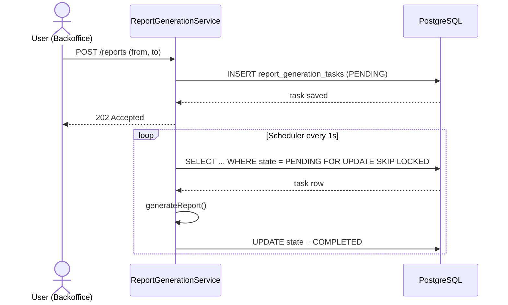
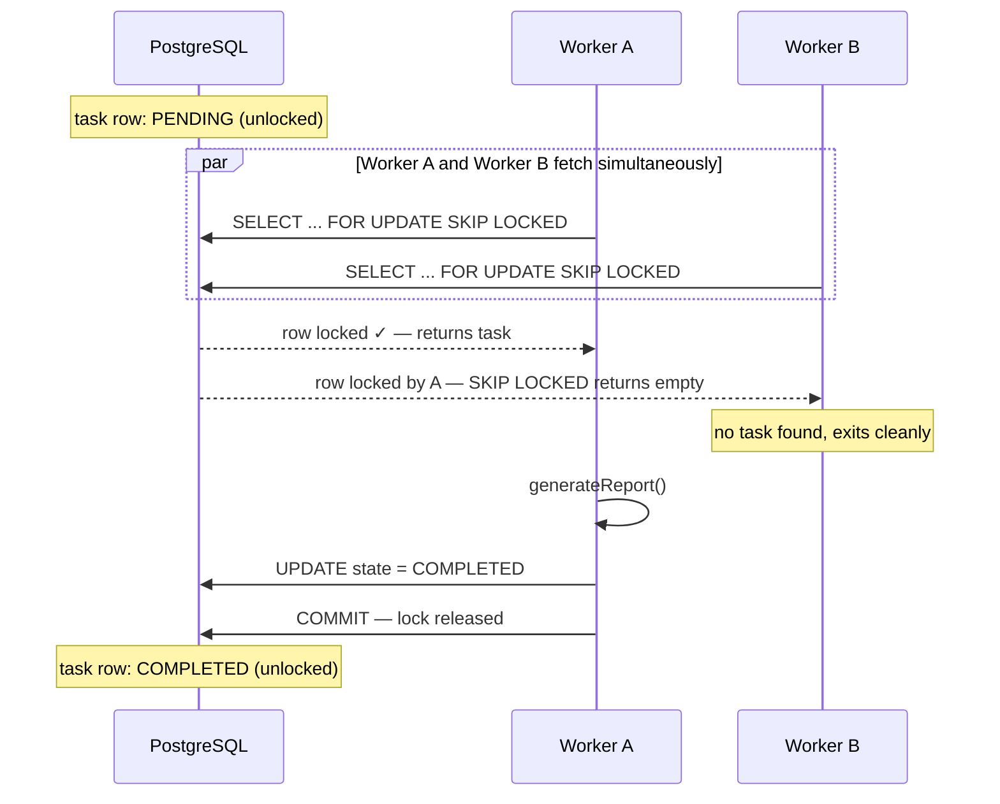
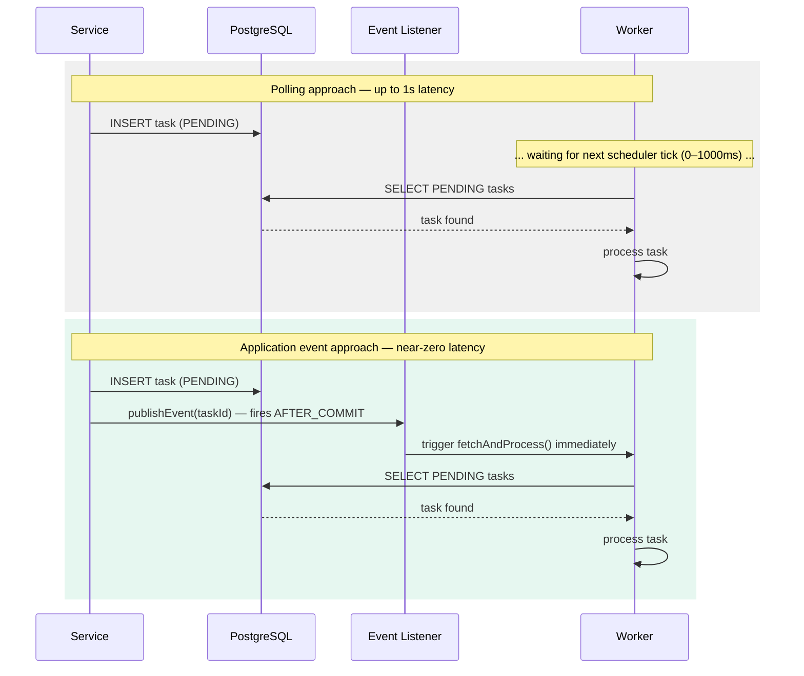
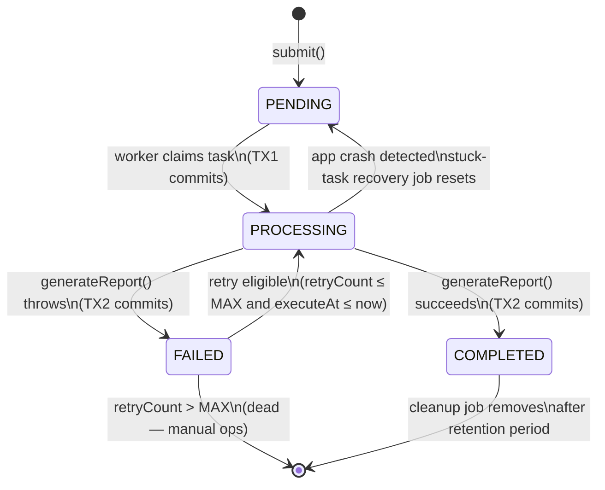
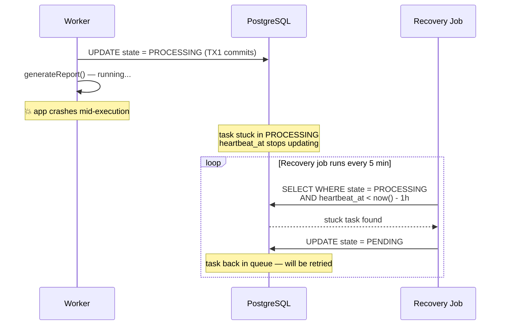
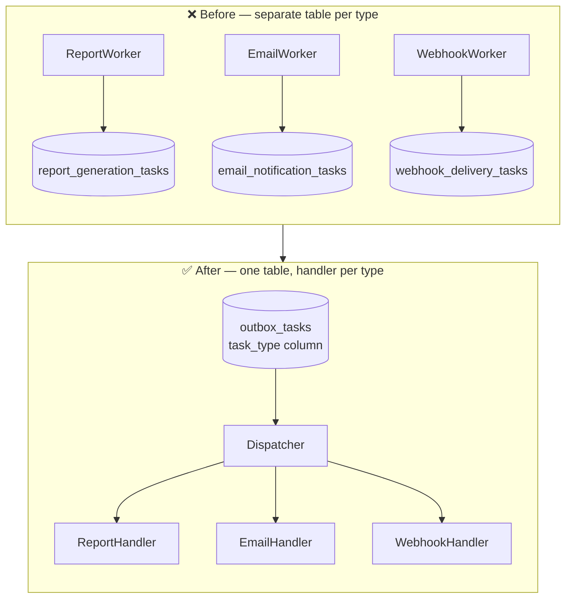

# El patrón Transactional Outbox: de una sola tarea a un motor asíncrono listo para producción

Hay una clase de bugs que nunca aparece en tus pruebas unitarias y rara vez se ve en staging.
Aparece en producción, a las 2 de la mañana, cuando tu aplicación guarda un registro en la base
de datos y luego intenta llamar a un servicio externo — y uno de los dos falla. Un lado hizo
commit. El otro no. Nadie se entera hasta que un usuario se queja.

Este es el **problema de doble escritura**, y el patrón Transactional Outbox es la respuesta
estándar. La idea es simple: en lugar de llamar al sistema externo directamente, escribe una tarea
en la misma transacción de base de datos que tu cambio de dominio. Un worker en segundo plano la
recoge y la ejecuta. La escritura es atómica. La tarea no se puede perder.

Lo que está menos documentado es todo lo que viene después de la idea básica — qué pasa cuando
las tareas fallan, cuando dos workers compiten por la misma fila, cuando tu aplicación se cae a
mitad de la ejecución, cuando tienes diez tipos de tareas distintos viviendo en una sola tabla, y
cuando tus stakeholders preguntan por qué la profundidad de la cola se disparó a las 3 de la
mañana del martes pasado.

De eso trata este artículo.

Trabajaré con un solo escenario concreto — un **servicio de generación de reportes** — y lo
evolucionaré paso a paso desde el outbox más simple posible hasta algo que me sentiría cómodo
corriendo en producción. Cada fragmento de código proviene de un repositorio real y funcional
enlazado al final.

Stack: **Java, Spring Boot, PostgreSQL**.

<div class="post-tldr" markdown="1">
<p class="post-tldr-title">TL;DR</p>

- El **patrón Transactional Outbox** resuelve el problema de doble escritura escribiendo la fila de la tarea en la **misma transacción de BD** que tu cambio de dominio y ejecutándola luego desde un worker en segundo plano.
- Consulta la tabla outbox con `SELECT ... FOR UPDATE SKIP LOCKED` para que varios workers puedan correr concurrentemente sin procesar nada dos veces.
- Nivel producción exige más que la idea básica: una **máquina de estados**, **reintentos con backoff**, **heartbeats/leases** para recuperar workers caídos, garantías de **orden** y **monitoreo** de la profundidad de la cola.
- No necesitas Kafka — **PostgreSQL solo** es suficiente para una ejecución asíncrona confiable.
</div>

---

## El escenario



Estamos construyendo un CRM. Los usuarios pueden solicitar reportes analíticos mensuales desde
una interfaz de backoffice. Generar un reporte significa agregar decenas de millones de filas —
puede tardar minutos. Obviamente no podemos hacer esto de forma síncrona en una petición HTTP.

El usuario hace clic en un botón. El backend acepta la solicitud, la guarda y responde de
inmediato. Un worker en segundo plano recoge la tarea, ejecuta la generación y actualiza el
estado al terminar.

Este es el caso más simple donde un outbox tiene sentido: trabajo genuinamente asíncrono por
naturaleza, donde el usuario ya espera tener que esperar.

---

## Parte 1 — El outbox básico

### Lo que todo outbox necesita

En esencia, cualquier tabla outbox necesita tres cosas:

- **Estado** — en qué punto de su ciclo de vida está esta tarea?
- **Payload** — qué hay que ejecutar exactamente?
- **Timestamps** — cuándo se creó y cuándo cambió por última vez?

```sql
CREATE TYPE task_state AS ENUM ('PENDING', 'COMPLETED');

CREATE TABLE report_generation_tasks (
                                       id         UUID       PRIMARY KEY DEFAULT gen_random_uuid(),
                                       state      task_state NOT NULL    DEFAULT 'PENDING',
                                       payload    JSONB      NOT NULL,
                                       created_at TIMESTAMP  NOT NULL    DEFAULT now(),
                                       updated_at TIMESTAMP  NOT NULL    DEFAULT now()
);
```

El payload para nuestro caso de uso es un rango de fechas:

```java
@Value
@Builder
@Jacksonized
public class ReportGenerationPayload {
  Instant from;
  Instant to;
}
```

La entidad JPA:

```java
@Entity
@Table(name = "report_generation_tasks")
@Data
@Builder
@NoArgsConstructor
@AllArgsConstructor
public class ReportGenerationEntity {

    @Id
    @GeneratedValue(strategy = GenerationType.UUID)
    @Column(updatable = false, nullable = false)
    private UUID id;

    @Enumerated(EnumType.STRING)
    @Column(nullable = false, columnDefinition = "task_state")
    private TaskState state;

    @JdbcTypeCode(SqlTypes.JSON)
    @Column(nullable = false, updatable = false, columnDefinition = "jsonb")
    private ReportGenerationPayload payload;

    @CreationTimestamp
    @Column(nullable = false, updatable = false)
    private Instant createdAt;

    @UpdateTimestamp
    @Column(nullable = false)
    private Instant updatedAt;
}
```

Enviar una tarea:

```java
@Service
@RequiredArgsConstructor
public class ReportGenerationService {

    private final ReportGenerationRepository repository;

    public void submit(ReportGenerationCommand command) {
        repository.save(ReportGenerationEntity.builder()
                .state(TaskState.PENDING)
                .payload(ReportGenerationPayload.builder()
                        .from(command.getFrom())
                        .to(command.getTo())
                        .build())
                .build());
    }
}
```

### El worker

Un job programado consulta las tareas pendientes y las ejecuta:

```java
@Component
@RequiredArgsConstructor
public class ReportGenerationScheduledJob {

    private final ReportGenerationTaskService taskService;

    @Scheduled(fixedDelay = 1000)
    public void run() {
        taskService.fetchAndProcess();
    }
}
```

```java
@Service
@RequiredArgsConstructor
public class ReportGenerationTaskService {

    private final ReportGenerationRepository repository;

    public void fetchAndProcess() {
        repository.findFirstByStateOrderByCreatedAt(TaskState.PENDING)
                .ifPresent(task -> {
                    generateReport(task);
                    task.setState(TaskState.COMPLETED);
                    repository.save(task);
                });
    }

    private void generateReport(ReportGenerationEntity task) {
        // actual report generation logic
    }
}
```

```java
public interface ReportGenerationRepository extends JpaRepository<ReportGenerationEntity, UUID> {
    Optional<ReportGenerationEntity> findFirstByStateOrderByCreatedAt(TaskState state);
}
```

Esto funciona en una aplicación de una sola instancia y sin fallas. En el mundo real tiene dos
problemas: dos workers pueden reclamar la misma tarea simultáneamente, y las tareas pueden fallar
sin ninguna ruta de recuperación. Arreglemos ambas cosas.

---

## Parte 2 — Concurrencia: dos workers, una tarea

Cuando dos hilos del scheduler — o dos instancias de la aplicación — ejecutan la consulta de
fetch en el mismo momento, ambos pueden leer la misma fila `PENDING` y ambos intentarán
ejecutarla. El resultado es, en el mejor de los casos, trabajo duplicado; en el peor, estado
corrupto.

La solución es un lock de base de datos tomado al momento del fetch. El `SELECT ... FOR UPDATE
SKIP LOCKED` de PostgreSQL está construido a medida justo para este caso de uso: bloquea la fila
para la transacción actual y salta cualquier fila ya bloqueada por otra transacción, en lugar de
esperar.

```java
public interface ReportGenerationRepository extends JpaRepository<ReportGenerationEntity, UUID> {

    @Lock(LockModeType.PESSIMISTIC_WRITE)
    @QueryHint(name = AvailableSettings.JAKARTA_LOCK_TIMEOUT, value = "-2") // -2 = SKIP_LOCKED
    Optional<ReportGenerationEntity> findFirstByStateOrderByCreatedAt(TaskState state);
}
```

El valor `-2` del hint `SKIP_LOCKED` es lo que Hibernate traduce a la cláusula `SKIP LOCKED`.
Como no existe una anotación de primera clase para esto, vale la pena extraerlo a una anotación
reutilizable para no dispersar el número mágico entre tus repositorios:

```java
@Retention(RetentionPolicy.RUNTIME)
@Target({ElementType.METHOD, ElementType.ANNOTATION_TYPE})
@QueryHints(@QueryHint(
    name = AvailableSettings.JAKARTA_LOCK_TIMEOUT,
    value = Timeouts.SKIP_LOCKED_MILLI + ""
))
public @interface SkipLocked {}
```

Mucho más limpio. Ahora el repositorio expresa la intención, no la plomería:

```java
@SkipLocked
@Lock(LockModeType.PESSIMISTIC_WRITE)
Optional<ReportGenerationEntity> findFirstByStateOrderByCreatedAt(TaskState state);
```

*Puedes* conservar el lock durante el procesamiento envolviendo todo el ciclo
fetch-ejecutar-actualizar en una sola transacción, pero en general no deberías:

```java
// Technically works, but do not use this pattern for outbox processing.
@Transactional
public void fetchAndProcess() {
    repository.findFirstByStateOrderByCreatedAt(TaskState.PENDING)
            .ifPresent(task -> {
                generateReport(task);
                task.setState(TaskState.COMPLETED);
                repository.save(task);
            });
}
```



Aunque `generateReport()` sea lo suficientemente pequeño para que esto funcione técnicamente,
ejecutar una acción de outbox dentro de una transacción abierta es un antipatrón. La duración de
la transacción no debe depender de la duración de la ejecución del outbox: la acción puede
volverse más lenta con el tiempo, bloquearse en I/O o llamar a un servicio downstream, dejando
una conexión de base de datos y un lock de fila retenidos por un periodo impredecible.

En su lugar, reclama la fila en una transacción corta moviéndola a `PROCESSING`, haz commit y
libera el lock, y solo entonces ejecuta la acción del outbox. Registra `COMPLETED` o `FAILED` en
otra transacción corta después. La siguiente sección implementa esa transición de estado y su
ruta de recuperación.

---

## Parte 2.5 — Reducir la latencia con eventos de aplicación

El scheduler por polling tiene un piso de latencia inherente. Si tu job se dispara cada segundo,
una tarea enviada en `t=0ms` permanece `PENDING` hasta el siguiente tick — hasta 1000ms después.
Para la mayoría de las cargas asíncronas eso es aceptable. Para los casos donde quieres una
captura casi inmediata — enviar un correo transaccional, disparar un webhook — no lo es.

El patrón, tomado prestado de Celery: guarda la entidad del outbox en la base de datos y luego
publica de inmediato un `ApplicationEvent` de Spring que lleva el ID de la nueva tarea. Un
listener lo recoge y despacha el procesamiento enseguida, sin esperar el siguiente tick del
scheduler.



El scheduler sigue corriendo como red de seguridad — atrapa todo lo que el listener de eventos
haya perdido (reinicio de la app, excepción del listener, evento perdido). Pero el camino feliz
evita por completo el retardo del polling.

### Implementación

Publica el evento dentro del método del servicio, después de guardar:

```java
@Service
@RequiredArgsConstructor
public class ReportGenerationService {

    private final ReportGenerationRepository repository;
    private final ApplicationEventPublisher eventPublisher;

    @Transactional
    public void submit(ReportGenerationCommand command) {
        var entity = repository.save(ReportGenerationEntity.builder()
                .state(TaskState.PENDING)
                .payload(ReportGenerationPayload.builder()
                        .from(command.getFrom())
                        .to(command.getTo())
                        .build())
                .build());

        eventPublisher.publishEvent(new ReportGenerationTaskSubmittedEvent(entity.getId()));
    }
}
```

```java
public record ReportGenerationTaskSubmittedEvent(UUID taskId) {}
```

El listener reacciona y dispara el procesamiento de inmediato:

```java
@Component
@RequiredArgsConstructor
public class ReportGenerationTaskEventListener {

    private final ReportGenerationTaskService taskService;

    @TransactionalEventListener(phase = TransactionPhase.AFTER_COMMIT)
    public void onTaskSubmitted(ReportGenerationTaskSubmittedEvent event) {
        taskService.fetchAndProcess();
    }
}
```

### El error clásico

El error más común aquí es usar `@EventListener` en lugar de
`@TransactionalEventListener(phase = TransactionPhase.AFTER_COMMIT)`.

`@EventListener` se dispara en el momento en que se llama a `publishEvent()` — que está
**dentro de la transacción abierta**, antes de que el `INSERT` haya hecho commit. El listener
llama a `fetchAndProcess()`, que consulta la base de datos por la tarea mediante su ID. La fila
aún no existe. La tarea se salta en silencio, el evento se pierde, y te quedas preguntándote por
qué el procesamiento nunca comenzó — aunque el scheduler eventualmente la recoge segundos más
tarde y todo se ve bien en los logs.

```java
// ❌ fires inside the transaction — entity not visible to other connections yet
@EventListener
public void onTaskSubmitted(ReportGenerationTaskSubmittedEvent event) {
    taskService.fetchAndProcess();
}

// ✅ fires after COMMIT — entity is visible, fetch succeeds
@TransactionalEventListener(phase = TransactionPhase.AFTER_COMMIT)
public void onTaskSubmitted(ReportGenerationTaskSubmittedEvent event) {
    taskService.fetchAndProcess();
}
```

`AFTER_COMMIT` garantiza que el listener se ejecuta solo después de que la transacción que
publicó el evento haya hecho commit por completo. Para ese momento la fila es visible para todas
las conexiones y el fetch la encontrará.

El scheduler permanece intacto — actúa como el mecanismo de recuperación para cualquier tarea que
el listener de eventos haya perdido. Los dos enfoques se complementan: eventos para la latencia,
polling para la confiabilidad.

---

## Parte 3 — Fallas, reintentos y el estado PROCESSING



Las acciones del outbox no deberían ejecutarse dentro de una transacción de base de datos
abierta. El enfoque de transacción con lock mantiene un lock de base de datos durante toda la
duración de `generateReport()`. Para un reporte que tarda dos minutos, son dos minutos de una
fila bloqueada — una conexión ocupada, otras operaciones de BD potencialmente encoladas detrás.
Con `SKIP LOCKED` los workers no se bloquean entre sí por el lock, pero las transacciones largas
igual presionan el pool de conexiones y ponen la base de datos de mal humor bajo carga. Una
acción muy pequeña puede técnicamente completarse sin causar problemas visibles, pero acoplar la
duración de la transacción a la duración de la ejecución del outbox sigue siendo un antipatrón.

La solución es separar el reclamo de la tarea de su ejecución. Cambia la tarea a `PROCESSING` en
una transacción corta, libera el lock, y luego haz el trabajo real fuera de cualquier transacción.
Así la BD solo se toca brevemente al inicio y brevemente al final — la parte costosa ocurre en
medio sin retener nada.

Primero, extiende el enum:

```sql
ALTER TYPE task_state ADD VALUE 'PROCESSING';
ALTER TYPE task_state ADD VALUE 'FAILED';

ALTER TABLE report_generation_tasks
    ADD COLUMN retry_count  INTEGER NOT NULL DEFAULT 0,
    ADD COLUMN error_message VARCHAR;
```

`retry_count` registra cuántas veces se intentó la ejecución. Limitamos los reintentos a 10 —
más allá de eso, algo está genuinamente roto y necesita intervención manual. Más adelante
conectaremos alertas alrededor de esto. `error_message` guarda la última excepción para que
sepas *por qué* una tarea está atascada sin tener que excavar en los logs.

El enum de Java crece con él:

```java
public enum TaskState {
    PENDING,
    PROCESSING,
    COMPLETED,
    FAILED
}
```

El servicio ahora ejecuta dos transacciones cortas separadas con el trabajo real en medio:

```java
@RequiredArgsConstructor
public class ReportGenerationTaskService {

    private final ReportGenerationRepository repository;
    private final TransactionTemplate transactionTemplate;

    private static final int MAX_RETRY_COUNT = 10;

    public void fetchAndProcess() {
        transactionTemplate
                .execute(status ->
                        repository.findFirstEligibleTask(
                                List.of(TaskState.PENDING, TaskState.FAILED),
                                MAX_RETRY_COUNT
                        ).map(this::markProcessing))
                .ifPresentOrElse(
                        task -> {
                            try {
                                generateReport(task);
                                markCompleted(task);
                            } catch (Exception e) {
                                markFailed(task, e);
                                log.error("Task {} failed on attempt {}", task.getId(), task.getRetryCount(), e);
                            }
                        },
                        () -> log.debug("No eligible tasks to process")
                );
    }

    private ReportGenerationEntity markProcessing(ReportGenerationEntity task) {
        task.setState(TaskState.PROCESSING);
        return repository.save(task);
    }

    private void markCompleted(ReportGenerationEntity task) {
        task.setState(TaskState.COMPLETED);
        repository.save(task);
    }

    private void markFailed(ReportGenerationEntity task, Exception e) {
        task.setState(TaskState.FAILED);
        task.setRetryCount(task.getRetryCount() + 1);
        task.setErrorMessage(e.getMessage()); // don't skip this — it's the only trace of what went wrong without digging through logs
        repository.save(task);
    }
}
```

La consulta trae tanto tareas `PENDING` como `FAILED` — una tarea fallida con `retryCount < 10`
es tan elegible como una nueva. Cuando el contador de reintentos alcanza el tope, la tarea deja
de obtenerse y queda como un registro `FAILED` permanente hasta que alguien la revise. Eso es
intencional — más allá de 10 intentos algo está genuinamente roto y necesita ojos sobre ello, no
otro reintento.

```java
@SkipLocked
@Lock(LockModeType.PESSIMISTIC_WRITE)
@Query("""
    SELECT t FROM ReportGenerationEntity t
    WHERE t.state IN :states
      AND t.retryCount <= :maxRetryCount
    ORDER BY t.createdAt ASC
    LIMIT 1
    """)
Optional<ReportGenerationEntity> findFirstEligibleTask(
    @Param("states") List<TaskState> states,
    @Param("maxRetryCount") Integer maxRetryCount
);
```

Pero espera — ¿debería una tarea recién fallida recogerse de nuevo en el siguiente tick del
scheduler, segundos después? Si el sistema downstream está caído, martillarlo cada segundo
empeora las cosas. De eso trata la siguiente sección.

## Parte 4 — Backoff exponencial

Sin un retardo entre reintentos, una tarea fallida reingresa a la cola en el siguiente tick del
scheduler — usualmente segundos después. Si el sistema downstream está caído, lo estás
martillando a toda la tasa de polling. Eso es malo para el sistema downstream y malo para tu BD.

La solución es una columna `execute_at`: la tarea no es elegible hasta que este timestamp esté
en el pasado. Las tareas nuevas reciben `execute_at = now()` para que se recojan de inmediato.
Las tareas fallidas reciben `execute_at = now() + delay`, donde el delay crece con cada reintento.

```sql
ALTER TABLE report_generation_tasks
    ADD COLUMN execute_at TIMESTAMP NOT NULL DEFAULT NOW();
```

El calendario de delays lo dirige todo — `MAX_RETRY_COUNT` se deriva de él, no se declara por
separado. Así los dos nunca pueden desincronizarse:

```java
private static final Map<Integer, Duration> RETRY_DELAYS = Map.of(
    0, Duration.ofMinutes(1),
    1, Duration.ofMinutes(5),
    2, Duration.ofMinutes(15),
    3, Duration.ofMinutes(30),
    4, Duration.ofHours(1),
    5, Duration.ofHours(2),
    6, Duration.ofHours(4),
    7, Duration.ofHours(8),
    8, Duration.ofHours(12),
    9, Duration.ofDays(1)
);

private static final int MAX_RETRY_COUNT = RETRY_DELAYS.size();
```

Agrega una nueva entrada a `RETRY_DELAYS` y el tope de reintentos se actualiza automáticamente.
No hay número mágico que mantener sincronizado en otro lado.

En `markFailed()`, captura el contador de reintentos *actual* antes de incrementarlo — ese
selecciona el delay para el *siguiente* intento:

```java
private void markFailed(ReportGenerationEntity task, Exception e) {
    int currentRetry = task.getRetryCount();
    task.setState(TaskState.FAILED);
    task.setRetryCount(currentRetry + 1);
    task.setErrorMessage(e.getMessage());
    task.setExecuteAt(Instant.now().plus(
            RETRY_DELAYS.getOrDefault(currentRetry, RETRY_DELAYS.get(RETRY_DELAYS.size() - 1))));
    repository.save(task);
}
```

El scheduler sigue corriendo a la misma tasa. Simplemente salta las tareas cuya ventana aún no se
abre. Las tareas fallidas esperan en silencio hasta que les llega su momento, y entonces
reingresan naturalmente.

---

## Parte 5 — Tareas atascadas y heartbeats



Con el enfoque de dos transacciones, considera qué pasa si la app se cae después de marcar una
tarea `PROCESSING` pero antes de marcarla `COMPLETED` o `FAILED`. La BD muestra `PROCESSING`.
Nadie la está procesando. Se queda ahí para siempre.

La solución ingenua es un job de recuperación que encuentra tareas atascadas en `PROCESSING` por
demasiado tiempo y las resetea a `PENDING`:

```java
@Transactional
public void recoverStuckTasks() {
    repository.findFirstByStateAndUpdatedAtLessThan(
                    TaskState.PROCESSING,
                    Instant.now().minus(1, ChronoUnit.HOURS))
            .ifPresent(task -> {
                log.warn("Resetting stuck task {} to PENDING", task.getId());
                task.setState(TaskState.PENDING);
                repository.save(task);
            });
}
```

Esto funciona para la mayoría de los casos. El problema: `updated_at` cambia cada vez que
*cualquier cosa* cambia en la fila — incluyendo transiciones de estado no relacionadas. Una tarea
procesándose legítimamente por 55 minutos se ve idéntica a una tarea caída desde la perspectiva
de `updated_at`.

La solución más limpia es un **heartbeat**: una columna dedicada que se actualiza periódicamente
*solo mientras la tarea está siendo procesada activamente*. El job de recuperación ahora revisa
esta columna, no `updated_at`. Una tarea que no ha emitido heartbeat en la última hora está
genuinamente atascada.

```sql
ALTER TABLE report_generation_tasks ADD COLUMN heartbeat_at TIMESTAMP;
```

El heartbeat corre en su propio hilo, dentro de sus propias transacciones, independiente de la
lógica de procesamiento. La implementación más limpia es un `try-with-resources` — arranca cuando
comienza el procesamiento y se detiene en cualquier ruta de salida:

```java
public abstract class Heartbeat implements AutoCloseable {

    private final ScheduledExecutorService executor;

    protected Heartbeat(Runnable heartbeatFn) {
        executor = Executors.newSingleThreadScheduledExecutor();
        executor.scheduleAtFixedRate(heartbeatFn, 0, 10, TimeUnit.SECONDS);
    }

    @Override
    public void close() {
        executor.shutdownNow();
    }
}
```

```java
public class ReportGenerationTaskHeartbeat extends Heartbeat {

    ReportGenerationTaskHeartbeat(UUID taskId, ReportGenerationRepository repository) {
        super(() -> repository.updateHeartbeatAt(taskId, Instant.now()));
    }
}
```

El método del repositorio lleva su propio `@Transactional` — no hace falta envolver la llamada
manualmente:

```java
@Modifying
@Transactional
@Query("UPDATE ReportGenerationTaskEntity t SET t.heartbeatAt = :now WHERE t.id = :id")
void updateHeartbeatAt(@Param("id") UUID id, @Param("now") Instant now);
```

Conéctalo mediante una factory para que el servicio se mantenga limpio:

```java
@Component
@RequiredArgsConstructor
public class ReportGenerationTaskHeartbeatFactory {

    private final ReportGenerationRepository repository;

    public Heartbeat start(UUID taskId) {
        return new ReportGenerationTaskHeartbeat(taskId, repository);
    }
}
```

El bloque de procesamiento ahora se ve así:

```java
public void fetchAndProcess() {
    transactionTemplate
            .execute(status -> repository.findFirstEligibleTask(
                    List.of(TaskState.PENDING, TaskState.FAILED),
                    MAX_RETRY_COUNT
            ).map(this::markProcessing))
            .ifPresentOrElse(
                    task -> {
                        try (var heartbeat = heartbeatFactory.start(task.getId())) {
                            try {
                                generateReport(task);
                                markCompleted(task);
                            } catch (Exception e) {
                                markFailed(task, e);
                                log.error("Task {} failed", task.getId(), e);
                            }
                        }
                    },
                    () -> log.debug("No eligible tasks to process")
            );
}
```

El job de recuperación usa `heartbeat_at` en lugar de `updated_at`:

```java
@Modifying
@Transactional
@Query("UPDATE ReportGenerationEntity t SET t.heartbeatAt = :now WHERE t.id = :id")
void updateHeartbeatAt(@Param("id") UUID id, @Param("now") Instant now);

Optional<ReportGenerationEntity> findFirstByStateAndHeartbeatAtLessThan(
        TaskState state, Instant threshold);
```

`updated_at` refleja cuándo cambió por última vez el estado de la tarea. `heartbeat_at` refleja
si la tarea está viva ahora mismo. Mantenerlos separados significa que puedes responder ambas
preguntas sin ambigüedad.

---

## Parte 6 — Outbox de múltiples tipos



Seis meses después, tu servicio maneja más que generación de reportes. Necesitas notificaciones
por correo. Luego exportaciones de datos. Luego entregas de webhooks.

Tienes dos opciones: una tabla separada por tipo de tarea, o una tabla compartida con un
discriminador `task_type`. La tabla compartida gana cuando los tipos de tarea son numerosos y te
sientes cómodo procesándolos desde un solo lugar. La infraestructura — reintentos, heartbeats,
backoff, monitoreo — queda en un solo lugar. Agregar un nuevo tipo de tarea es solo agregar un
nuevo handler.

Los trade-offs que vale la pena conocer de antemano:

- Un nuevo tipo de tarea que se comporta mal puede ralentizar todos los demás — un handler
  defectuoso que quema reintentos crea backpressure sobre toda la tabla.
- Las garantías de orden se vuelven más difíciles — más sobre esto abajo.

### El esquema

```sql
CREATE TYPE outbox_task_type AS ENUM ('REPORT_GENERATION', 'EMAIL_NOTIFICATION');

CREATE TABLE outbox_tasks (
    id            UUID             PRIMARY KEY DEFAULT gen_random_uuid(),
    task_type     outbox_task_type NOT NULL,
    state         task_state       NOT NULL    DEFAULT 'PENDING',
    payload       JSONB            NOT NULL,
    retry_count   INTEGER          NOT NULL    DEFAULT 0,
    error_message VARCHAR,
    execute_at    TIMESTAMPTZ      NOT NULL    DEFAULT NOW(),
    heartbeat_at  TIMESTAMPTZ,
    created_at    TIMESTAMPTZ      NOT NULL    DEFAULT now(),
    updated_at    TIMESTAMPTZ      NOT NULL    DEFAULT now()
);
```

### La interfaz de handler

El punto clave de extensibilidad — una implementación por tipo de tarea:

```java
public interface OutboxTaskHandler<P> {
    OutboxTaskType getType();
    Class<P> payloadClass();
    void handle(UUID taskId, P payload) throws Exception;
}
```

`taskId` se pasa a cada handler. Verás por qué en la sección de idempotencia.

Un handler concreto:

```java
@Component
public class EmailNotificationHandler implements OutboxTaskHandler<EmailNotificationPayload> {

    @Override
    public OutboxTaskType getType() {
        return OutboxTaskType.EMAIL_NOTIFICATION;
    }

    @Override
    public Class<EmailNotificationPayload> payloadClass() {
        return EmailNotificationPayload.class;
    }

    @Override
    public void handle(UUID taskId, EmailNotificationPayload payload) throws Exception {
        log.info("Sending email to {} — task {}", payload.getRecipient(), taskId);
        // call email provider
    }
}
```

### El dispatcher

El servicio recoge todos los beans handler al arrancar, construye un mapa de búsqueda y enruta
cada tarea por su `taskType`:

```java
@Service
@RequiredArgsConstructor
public class OutboxTaskService {

    private final OutboxTaskRepository repository;
    private final ObjectMapper objectMapper;
    private final List<OutboxTaskHandler<?>> handlerList;

    private Map<OutboxTaskType, OutboxTaskHandler<?>> handlers;

    @PostConstruct
    void init() {
        handlers = handlerList.stream()
                .collect(Collectors.toMap(OutboxTaskHandler::getType, Function.identity()));
    }

    @SuppressWarnings("unchecked")
    private void dispatch(OutboxTaskEntity task) throws Exception {
        var handler = (OutboxTaskHandler<Object>) handlers.get(task.getTaskType());
        if (handler == null) {
            throw new IllegalStateException(
                    "No handler registered for task type: " + task.getTaskType());
        }
        var payload = objectMapper.readValue(task.getPayload(), handler.payloadClass());
        handler.handle(task.getId(), payload);
    }
}
```

Registrar un nuevo tipo de tarea es: agregar el valor al enum, agregar el bean handler, listo.
El dispatcher, el scheduler, la lógica de reintentos — nada de eso cambia.

---

## Parte 7 — Orden

Si tu caso de uso no se preocupa por el orden de procesamiento — notificaciones
fire-and-forget, jobs en segundo plano independientes — salta esta sección. Pero aun así,
obtener primero las tareas insertadas antes es el comportamiento más honesto: las tareas enviadas
primero han esperado más tiempo, y procesarlas en orden de envío es lo que los usuarios
razonablemente esperarían.

Sin un `ORDER BY` explícito, PostgreSQL **no garantiza nada** sobre el orden de retorno de las
filas. Ordena siempre por `created_at ASC` en tu consulta de fetch:

```java
@Query("""
    SELECT t FROM OutboxTaskEntity t
    WHERE t.state IN :states
      AND t.retryCount <= :maxRetryCount
      AND t.executeAt <= :now
    ORDER BY t.createdAt ASC
    LIMIT 1
    """)
Optional<OutboxTaskEntity> findFirstEligibleTask(...);
```

Apóyalo con un índice parcial:

```sql
CREATE INDEX idx_outbox_fetch
    ON outbox_tasks (created_at ASC)
    WHERE state IN ('PENDING', 'FAILED');
```

### La trampa del desfase de reloj

Primero, sé honesto sobre si esto importa para tu caso de uso. Si tus tareas son independientes —
generación de reportes, envío de correos, entrega de webhooks — el orden de procesamiento
generalmente no importa en absoluto. Que la tarea A termine antes que la B está bien sin importar
cuál se envió primero. En ese caso, toda esta sección no es tu problema.

Si de verdad necesitas FIFO — tareas de la misma entidad que deben procesarse en orden de envío —
sigue leyendo.

El problema es que `created_at` se genera del lado de la aplicación. Cada instancia tiene su
propio reloj de sistema. Si la instancia A está 200ms adelante de la instancia B, una tarea
enviada por B en `t=100ms` recibe un `created_at` anterior al de una tarea enviada por A en
`t=50ms` — aunque la tarea de A se insertó primero. La consulta de fetch ordena por `created_at`
y recoge primero la tarea de B. El orden de envío queda invertido.

NTP mantiene los relojes cercanos pero no perfectamente sincronizados. En condiciones normales el
desfase es de milisegundos. Bajo carga, durante migraciones de VM, o tras un reinicio de
contenedor, puede ser mayor.

La solución es generar el valor de ordenamiento del lado de la base de datos — o dejas que
PostgreSQL asigne `created_at` vía `DEFAULT now()` en lugar de que la aplicación lo fije, o usas
una secuencia respaldada por la base de datos, que garantiza un incremento monótono sin importar
qué instancia insertó la fila. Aquí está el enfoque con secuencia:

```sql
ALTER TABLE outbox_tasks ADD COLUMN seq BIGSERIAL;
```

```java
@Column(insertable = false, updatable = false)
private Long seq;
```

Ordena por `seq ASC`. El valor lo asigna una única fuente autoritativa — la base de datos — así
que refleja el orden real de inserción sin importar qué instancia envió la tarea o qué decía el
reloj de esa instancia.

Conserva `created_at` para observabilidad. Usa `seq` para el orden.

Si el FIFO estricto importa en tu sistema — no olvides esto.

---

## Parte 8 — Índices que mantienen la tabla rápida a escala

Tu tabla outbox se consulta cada segundo, a menudo varias veces por segundo. Cada fila en ella
es o bien trabajo activo (`PENDING`, `FAILED`, `PROCESSING`) o ruido histórico (`COMPLETED`). Sin los
índices correctos, cada consulta recorre la tabla entera para encontrar el puñado de filas
elegibles.

La herramienta correcta es un **índice parcial** — uno que solo incluye las filas que cumplen un
predicado. Cuando una tarea pasa a `COMPLETED`, sale automáticamente del índice parcial. El índice
se mantiene pequeño para siempre, sin importar cuántas tareas haya procesado la tabla.

### El índice de fetch — el hot path

Índice para la consulta de fetch:

```sql
CREATE INDEX idx_outbox_fetch
    ON outbox_tasks (created_at ASC)
    WHERE state IN ('PENDING', 'FAILED');
```

Para probarlo: inserté 50,000 filas con solo 7 en estado `PENDING`, activé el logging SQL en modo
debug de Hibernate para obtener la consulta exacta generada en la consola, y ejecuté
`EXPLAIN ANALYZE` sobre ese SQL:

```
Limit  (cost=0.14..27.50 rows=1 width=102) (actual time=0.082..0.084 rows=1 loops=1)
  ->  LockRows  (actual time=0.081..0.082 rows=1 loops=1)
        ->  Index Scan using idx_outbox_fetch on outbox_tasks
              (actual time=0.030..0.030 rows=1 loops=1)
Planning Time: 1.230 ms
Execution Time: 0.139 ms
```

0.03ms para encontrar la tarea elegible más antigua. Las 49,993 filas `COMPLETED` nunca se
leyeron. A mí me convence.

Dos índices más para las otras dos operaciones en segundo plano:

Para el job de recuperación:

```sql
CREATE INDEX idx_outbox_stuck
    ON outbox_tasks (heartbeat_at ASC, created_at ASC)
    WHERE state = 'PROCESSING';
```

Para el job de limpieza:

```sql
CREATE INDEX idx_outbox_cleanup
    ON outbox_tasks (updated_at ASC)
    WHERE state = 'COMPLETED';
```

---

## Parte 9 — Limpieza

Tu outbox es una tabla operativa. Cada consulta de fetch la recorre. Las filas viejas son peso
muerto.

La regla: borra solo las tareas **`COMPLETED`**. Las tareas `FAILED` son tu rastro de auditoría.
No las toques. Géstionalas manualmente o mediante un proceso de ops separado cuando haga falta.

```java
@Modifying
@Transactional
@Query("""
    DELETE FROM OutboxTaskEntity t
    WHERE t.state IN :states
      AND t.updatedAt < :before
    """)
int deleteByStateInAndUpdatedAtBefore(
    @Param("states") List<TaskState> states,
    @Param("before") Instant before
);
```

```java
private static final int CLEANUP_RETENTION_DAYS = 30;

@Transactional
public void cleanup() {
    var cutoff = Instant.now().minus(CLEANUP_RETENTION_DAYS, ChronoUnit.DAYS);
    int deleted = repository.deleteByStateInAndUpdatedAtBefore(
            List.of(TaskState.COMPLETED), cutoff);
    log.info("Cleanup: removed {} completed tasks older than {} days", deleted, CLEANUP_RETENTION_DAYS);
}
```

Cuánto tiempo retener: he visto desde 1 día hasta 3 meses. Si no estás seguro — retén más tiempo.
El costo de retener filas viejas es una tabla ligeramente más grande. El costo de borrarlas
demasiado pronto es perder tu historial de depuración el día que más lo necesitas.

---

## Parte 10 — Idempotencia: hacer seguros los reintentos

Nada en esta arquitectura garantiza una ejecución exactamente una vez. La ejecución de la tarea y
la actualización de estado a `COMPLETED` son dos operaciones separadas. Si la app se cae después
de ejecutar pero antes de que la actualización de estado haga commit, la tarea se reintentará. Se
ejecutará de nuevo con las mismas entradas.

Esto es entrega **at-least-once** — es la única garantía disponible aquí. La pregunta es si una
ejecución duplicada causa daño.

Si tu tarea es inherentemente idempotente (generar el mismo reporte dos veces produce el mismo
reporte), ya terminaste. Si tiene efectos secundarios (envía un correo, cobra una tarjeta), un
duplicado es un problema.

La solución: usa el `id` de la propia tarea del outbox como clave de idempotencia dentro del
handler. El ID de la tarea es estable entre reintentos — nunca cambia para la misma fila. El
handler verifica si el trabajo para este ID ya fue registrado. Si sí, es un no-op.

En nuestro caso, la generación del reporte termina insertando una fila en `generated_reports` —
ese es el registro del trabajo hecho. Agregamos una restricción `UNIQUE` sobre `idempotency_key`
para que, aun si dos instancias compiten, solo un INSERT gane. La otra recibe una violación de
restricción y la trata como un no-op exitoso:

```sql
CREATE TABLE generated_reports (
    id               UUID        PRIMARY KEY DEFAULT gen_random_uuid(),
    idempotency_key  UUID        NOT NULL,
    report_path      VARCHAR     NOT NULL,
    created_at       TIMESTAMPTZ NOT NULL    DEFAULT now(),

    CONSTRAINT uq_generated_reports_idempotency_key UNIQUE (idempotency_key)
);
```

```java
@Component
@RequiredArgsConstructor
public class ReportGenerationHandler implements OutboxTaskHandler<ReportGenerationPayload> {

    private final GeneratedReportRepository reports;

    @Override
    public void handle(UUID taskId, ReportGenerationPayload payload) {
        if (reports.existsByIdempotencyKey(taskId)) {
            log.info("Report already generated for task {} — skipping", taskId);
            return;
        }

        var reportPath = runReportGeneration(payload);

        reports.save(GeneratedReport.builder()
                .idempotencyKey(taskId)
                .reportPath(reportPath)
                .build());
    }
}
```

Si tu tarea llama a una API externa en lugar de escribir en la BD, verifica si esa API soporta
claves de idempotencia — la mayoría de los procesadores de pagos y proveedores de correo
transaccional lo hacen. Pasa el ID de la tarea del outbox como clave de idempotencia en la forma
que la API requiera (header, campo del body, query param). El servicio remoto se encarga de la
deduplicación de su lado.

---

## Parte 11 — Monitoreo

El outbox corre en silencio en segundo plano. Cuando funciona, nadie se entera. Cuando se rompe,
tampoco se entera nadie — al menos no de inmediato. Las tareas atascadas se acumulan. Los
servicios downstream dejan de recibir eventos. Cuando alguien mira los logs, ya pasaron dos horas.

Tres señales cubren por completo el espacio de fallas, según el modelo de Google SRE:

- **Latencia** — cuánto tarda cada tarea desde que se recoge hasta que se completa? Un pico aquí significa que el handler es lento o la BD está bajo presión.
- **Throughput** — cuántas tareas por unidad de tiempo terminan? Que caiga a cero significa que el scheduler no está corriendo o que no se están reclamando tareas.
- **Tasa de error** — qué fracción de los intentos termina en falla? Por encima de ~5% significa que una dependencia downstream está degradada y el rezago de reintentos crece.


### Instrumentación

Agrega a `build.gradle.kts`:

```kotlin
implementation("org.springframework.boot:spring-boot-starter-actuator")
implementation("io.micrometer:micrometer-registry-prometheus")
```

Registra el aspecto AOP `@Timed` una sola vez:

```java
@Bean
public TimedAspect timedAspect(MeterRegistry registry) {
    return new TimedAspect(registry);
}
```

Mantén los nombres de las métricas como constantes e incrementa desde un componente dedicado —
no dispersos entre los métodos del servicio:

```java
@Component
@RequiredArgsConstructor
public class OutboxMetrics {

  private static final String TASK_PROCESSED = "outbox.task.processed";
  private static final String OUTCOME_TAG    = "outcome";
  private static final String COMPLETED      = "completed";
  private static final String FAILED         = "failed";

  private final MeterRegistry meterRegistry;
  private final ReportGenerationRepository repository;

  public void recordCompleted() {
    meterRegistry.counter(TASK_PROCESSED, OUTCOME_TAG, COMPLETED).increment();
  }

  public void recordFailed() {
    meterRegistry.counter(TASK_PROCESSED, OUTCOME_TAG, FAILED).increment();
  }

  @PostConstruct
  void registerGauge() {
    Gauge.builder("outbox.tasks.pending", repository,
                    repo -> repo.countByStateIn(List.of(TaskState.PENDING, TaskState.FAILED)))
            .description("Tasks waiting to be processed")
            .register(meterRegistry);
  }
}
```

El servicio luego solo llama a `metrics.recordCompleted()` y `metrics.recordFailed()` — sin
strings crudos en la lógica de negocio.

Después del arranque, `curl localhost:8080/actuator/prometheus | grep outbox` te da:

```
outbox_task_duration_seconds{quantile="0.5"}  0.062
outbox_task_duration_seconds{quantile="0.95"} 0.145
outbox_task_duration_seconds{quantile="0.99"} 0.312
outbox_task_processed_total{outcome="completed"} 40.0
outbox_task_processed_total{outcome="failed"}    2.0
outbox_tasks_pending 0.0
```

### Alertas

Los dashboards son para humanos mirando pantallas. Las alertas son para humanos que están
dormidos.

| Alerta | Se dispara cuando | Durante | Significado |
|---|---|---|---|
| `OutboxQueueBacklog` | pending > 50 | 5m | El procesamiento no alcanza al ingest |
| `OutboxHighErrorRate` | error rate > 5% | 2m | Handler o dependencia downstream degradada |
| `OutboxSlowProcessing` | p99 latency > 30s | 5m | Contención en la BD o llamada externa lenta |
| `OutboxStuckTasks` | pending > 0 y cero completados en 10m | 10m | Scheduler caído o todos los workers atascados |

Ajusta los umbrales a tu propia carga. Una profundidad de cola de 50 puede ser normal para un
servicio de alto throughput. Para una herramienta interna de bajo volumen, incluso 5 tareas
esperando 5 minutos ameritan una revisión. La lógica de las señales es la misma; solo cambian los
números.

---

## Checklist de producción

Antes de llevar cualquier outbox a producción:

```
☐ Indexes are efficient — partial indexes on PENDING/FAILED and PROCESSING states
☐ EXPLAIN ANALYZE confirms index usage on the fetch query
☐ Ordering is not a problem — ORDER BY seq or created_at, backed by index
☐ Processed data cleanup job running, COMPLETED rows removed after retention period
☐ Idempotency handled inside handlers with side effects
☐ Exponential backoff wired — or confirmed not needed for this use case
☐ Metrics in place — queue depth, throughput, error rate, latency
☐ Alerts configured — backlog, error rate, latency, stuck tasks
```

---

## El ecosistema — no siempre tienes que construirlo tú

Todo lo descrito en este artículo es algo que puedes construir tú mismo — y hay un valor real en
hacerlo al menos una vez. Entiendes los modos de falla, las decisiones de índices, las trampas de
ordenamiento, porque diseñaste alrededor de ellas. Ese conocimiento no desaparece cuando cambias
a una librería.

Pero en producción, a menudo no necesitas mantener esto tú mismo.

---

**[db-scheduler](https://github.com/kagkarlsson/db-scheduler)** — el scheduler persistente y apto
para clústeres de Gustav Karlsson para Java. Es la librería a la que siempre vuelvo, y cuyas
interioridades son las que más se parecen a lo que construimos en este artículo. Usa una sola
tabla de base de datos, locking pesimista con `SKIP LOCKED`, heartbeats para detectar tareas
atascadas y una interfaz limpia de tarea/handler. Cuando diseño outboxes propios, uso
db-scheduler como implementación de referencia — las interfaces, los patrones y el manejo de
fallas son todos sólidos. Si estás empezando un proyecto nuevo y quieres una base probada en
batalla en lugar de construir la tuya, empieza aquí. Las abstracciones son lo suficientemente
delgadas como para que reconozcas todo lo de este artículo en el código fuente.

---

**[Celery](https://docs.celeryq.dev/)** — el estándar de facto para ejecución asíncrona de tareas
en el ecosistema Python. Celery soporta PostgreSQL como result backend y Redis o RabbitMQ como
broker. El patrón `AFTER_COMMIT` de la Parte 2.5 aplica aquí también — envía a Celery solo
después de que la transacción haga commit, no dentro de ella.

---

**[Quartz Scheduler](https://www.quartz-scheduler.org/)** — la librería de scheduling de Java de
larga trayectoria con persistencia de jobs respaldada por JDBC. Más general que un outbox, con
expresiones cron, triggers y job stores. La sobrecarga operativa es mayor que la de db-scheduler
y la API es verbosa para los estándares modernos, pero está probada a escala con integración de
primera clase con Spring vía `spring-boot-starter-quartz`.

---

## Reflexiones finales

La mayor parte de lo que hay en este artículo no es ingeniería brillante — es tejido cicatricial
acumulado. El estado `PROCESSING` existe porque la app de alguien se cayó. El heartbeat existe
porque `updated_at` mintió. El índice parcial existe porque un full table scan a frecuencia de
polling se acumula silenciosamente hasta que deja de hacerlo. El listener `AFTER_COMMIT` existe
porque alguien publicó un evento dentro de una transacción y pasó horas depurando por qué nunca
se disparaba.

Cada pieza es aburrida por sí sola. Juntas marcan la diferencia entre un outbox que funciona en
desarrollo y uno en el que puedes confiar a las 3 de la mañana.

---

## Código

El código de este artículo está disponible en
**[github.com/javaAndScriptDeveloper/outboxes-article](https://github.com/javaAndScriptDeveloper/outboxes-article)**.
Todo corre localmente con un solo comando.

---

## Hablemos

Si te topaste con algo que se me escapó, o resolviste alguno de estos problemas de forma distinta
en tus propios sistemas — me encantaría saberlo. Los enlaces de contacto están en el pie de
página.
