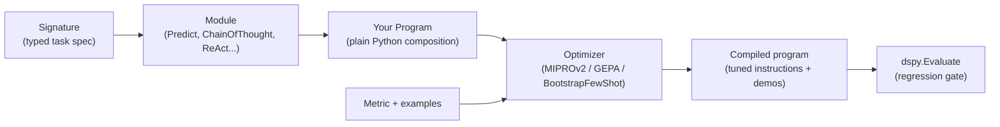
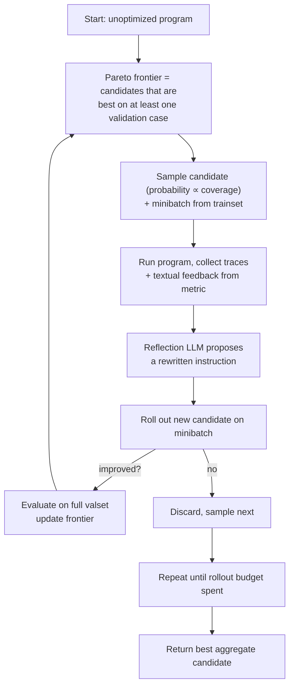

# DSPy expliqué aux ingénieurs backend : signatures, optimiseurs, et GEPA vs MIPROv2

Si vous avez maintenu un service Spring Boot appelé à durer, vous connaissez déjà la
différence entre configuration et code. Vous n'éditez pas à la main les valeurs de
`application.yml` sur les machines de production, et vous n'ajustez pas la taille des
pools de connexions au doigt mouillé — vous les déclarez, vous les mesurez, et vous les
modifiez via un processus revu et reproductible.

Appliquez maintenant cette lentille au développement LLM. La plupart des équipes « font
de l'IA » comme on faisait de l'ops en 2009 : quelqu'un édite à la main une chaîne de
prompt dans une PR, jauge cinq sorties dans un notebook, livre, et six semaines plus tard
une montée de version du modèle casse le tout silencieusement.

**DSPy** ([dspy.ai](https://dspy.ai)) est le framework de Stanford NLP qui dit :
stop. Traitez le prompt comme un **artefact compilé**. Vous écrivez le *code source* —
une déclaration typée de la tâche, composée en Python ordinaire — plus une **métrique**
qui note les sorties. Un composant du framework appelé **optimiseur** génère et ajuste
alors les prompts réels automatiquement, selon votre métrique, sur vos données.

Cet article explique comment cela fonctionne, puis approfondit la question à laquelle vous
serez réellement confronté une fois adopté : **quel optimiseur utiliser**. Les deux
principales stratégies aujourd'hui sont **MIPROv2** (recherche bayésienne sur les
instructions et les exemples few-shot) et **GEPA** (évolution réflexive des prompts sur
un front de Pareto, ICLR 2026 Oral). Elles cherchent différemment, coûtent différemment,
et attendent des choses différentes de votre métrique.

Tout est ancré dans un petit exemple exécutable que j'ai construit pour cet article :
un programme de **triage d'incidents de production Spring Boot** qui classe des lignes de
log et des stack traces en catégories de cause racine. C'est le domaine où ce blog vit
habituellement — et c'est assez petit pour que l'optimisation coûte des centimes,
pas des dollars.

Stack : **Python, DSPy 3.5, n'importe quel fournisseur de LLM**.

<div class="post-tldr" markdown="1">
<p class="post-tldr-title">TL;DR</p>

- **DSPy = les prompts comme artefacts de build.** Vous déclarez une `Signature` (entrées/sorties typées), composez des `Module`s en Python, écrivez une métrique — et un **optimiseur** compile le tout en instructions ajustées + exemples few-shot. Les changements de modèle deviennent des recompilations, pas des réécritures de prompts.
- La boucle centrale est partout la même : **programme + une trentaine d'exemples étiquetés + métrique → `optimizer.compile(program, trainset=...)` → un artefact sauvegardé et diffable.** Aucune chaîne de prompt dans votre source.
- **MIPROv2** = propose une grille de candidats (instructions × démos), choisit le gagnant par **optimisation bayésienne** sur des évals en minibatch. Excellent polyvalent ; veut 200+ exemples pour les longues exécutions ; métrique = simple float.
- **GEPA** = **évolution réflexive** : un LLM puissant réécrit les instructions en s'appuyant sur du *feedback textuel* expliquant pourquoi les prédictions étaient fausses, et un **front de Pareto** conserve les candidats qui gagnent sur n'importe quel cas isolé. A battu MIPROv2 de **plus de 10 %** sur six tâches de benchmark à coût comparable (ICLR 2026 Oral), et égale le fine-tuning RL avec jusqu'à **35x moins de rollouts**.
- Règle de décision : **la métrique peut expliquer les erreurs en mots → GEPA. La métrique est un scalaire boîte noire, ou vous avez besoin de sélection de démos → MIPROv2.** Les deux laissent votre code de programme intact.
</div>

---

## Qu'est-ce que DSPy ?

DSPy est un framework Python open source, initialement construit par Stanford NLP
(le projet est désormais développé sous Databricks), publié pour la première fois comme
compilateur Demonstrate-Search-Predict en décembre 2022. La ligne actuelle,
DSPy 3.x, est l'un des frameworks LLM les plus adoptés — des millions de
téléchargements mensuels et environ 40k étoiles GitHub — et le slogan de sa documentation
résume la philosophie en cinq mots : **« Program, don't prompt. »**
(programmez, ne promptez pas).

Le postulat : un prompt n'est pas du code source. C'est un *résultat* — le produit
compilé de trois entrées que vous *pouvez* maintenir comme du code source :

1. **Ce qu'est la tâche** — une interface typée : entrées, sorties, contraintes.
2. **Comment les étapes se composent** — du flux de contrôle Python ordinaire.
3. **Ce que « correct » signifie** — une fonction de métrique sur des exemples étiquetés.

Écrivez à la main #1–#3, et laissez un algorithme produire le prompt. Quand le modèle
change, vous ne réécrivez pas le prompt — vous **recompilez**.

Si vous avez déjà maintenu en parallèle un prompt GPT-4, un prompt Claude et un prompt
Llama local pour la même fonctionnalité, vous comprenez déjà pourquoi cela compte. C'est
le même instinct qui nous a menés de la config serveur éditée à la main à l'infrastructure
déclarée.

## Comment fonctionne DSPy : signatures, modules, optimiseurs

DSPy a exactement trois abstractions à apprendre. C'est tout le framework.



### Qu'est-ce qu'une signature DSPy ?

Une **signature** est une spécification déclarative du comportement entrée/sortie d'une
tâche — pensez à une signature de méthode avec de la sémantique, pas seulement des types.
Les noms de champs portent du sens ; DSPy les transforme en prompts en coulisses.

```python
class IncidentTriage(dspy.Signature):
    """Classify a Spring Boot production incident by its root cause and severity,
    and propose a fix."""

    incident_report: str = dspy.InputField(
        desc="Log line, stack trace excerpt or error description"
    )
    root_cause: Literal[
        "config-misconfiguration",
        "dependency-conflict",
        "connection-pool-exhaustion",
        "serialization-error",
        "memory-pressure",
        "thread-starvation",
    ] = dspy.OutputField(desc="One of the fixed root-cause categories")
    severity: Literal["P1", "P2", "P3"] = dspy.OutputField(
        desc="P1 = service down / data risk, P2 = degraded, P3 = contained"
    )
    action: str = dspy.OutputField(desc="One-sentence remediation")
```

Notez ce qu'une signature vous donne qu'une chaîne de prompt ne donne pas : **de la
structure que le parser peut imposer**. `root_cause` est un type `Literal` — le modèle ne
peut pas répondre `Probably database stuff` ; il doit renvoyer l'une des six valeurs,
sinon l'adaptateur de DSPy retente et lève une exception. C'est la même mémoire musculaire
que de mapper du JSON vers un DTO typé au lieu d'analyser des chaînes à la main.

### Qu'est-ce qu'un module DSPy ?

Un **module** est une stratégie de prompting réutilisable généralisée à n'importe quelle
signature — l'idée du `nn.Module` de PyTorch, appliquée aux prompts. Tous sont construits
sur `dspy.Predict` ; les plus connus :

| Module | Stratégie qu'il abstrait |
|---|---|
| `dspy.Predict(sig)` | Complétion directe |
| `dspy.ChainOfThought(sig)` | Ajoute une étape de raisonnement avant la réponse |
| `dspy.ReAct(sig, tools=[...])` | Boucle raisonnement + usage d'outils pour les agents |
| `dspy.ProgramOfThought(sig)` | Génère et exécute du code pour répondre |
| `dspy.BestOfN(sig, N)` | Échantillonne N candidats, garde le mieux noté |

Votre programme est une sous-classe de `dspy.Module` dont le `forward()` compose
des sous-modules en Python ordinaire — conditionnels, boucles, vos propres classes. Voici
le modèle *entier* de notre exemple de triage d'incidents :

```python
class IncidentTriageProgram(dspy.Module):
    def __init__(self):
        super().__init__()
        self.triage = dspy.ChainOfThought(IncidentTriage)

    def forward(self, incident_report: str) -> dspy.Prediction:
        return self.triage(incident_report=incident_report)
```

Regardez ce qui **ne figure pas** dans ce fichier : pas de texte de prompt, pas d'exemples
few-shot, pas de nom de modèle, pas de température. Tout cela existe — mais comme
*paramètres*, et c'est exactement ce qui les rend optimisables. Appeler le programme
renvoie des champs typés (`root_cause`, `severity`, `action`) plus un champ `reasoning`
que `ChainOfThought` ajoute pour l'étape de réflexion.

### Qu'est-ce qu'un optimiseur DSPy ?

Un **optimiseur** (anciennement appelé *teleprompter*) est un algorithme qui ajuste les
paramètres de votre programme — les instructions et/ou les démos few-shot — pour
maximiser votre métrique. Une démo few-shot est un exemple entrée→sortie résolu injecté
dans le prompt ; une instruction est la directive de niveau système que DSPy génère par
module.

`optimizer.compile(program, trainset=...)` est littéralement une étape de compilation :
il exécute votre programme sur des données, mesure, cherche, et renvoie un **programme
compilé** dont les prédicteurs portent désormais des instructions et des démos ajustées.
Vous le sauvegardez avec `program.save("optimized.json")` — un artefact diffable et
revoyable, de la même façon que vous reliriez un script de migration.

Le côté évaluation tient en un appel :

```python
evaluate = dspy.Evaluate(
    devset=valset,
    metric=triage_metric,
    num_threads=4,
    display_table=3,
)
result = evaluate(program)
```

Les recommandations de dimensionnement de la doc DSPy : **~30 exemples étiquetés pour
voir de la valeur, ~300 pour une qualité de production** — répartis ~20 % train / 80 %
validation, car les optimiseurs notent chaque candidat sur la validation. C'est
délibérément l'*opposé* de la pratique du deep learning : vous n'ajustez pas des poids,
vous cherchez dans un espace bien plus petit, et le jeu de validation est la boussole.

Une dernière chose à intégrer : **votre métrique est le contrat**. Chaque optimiseur de
cet article vaut ce que vaut la fonction qui note les sorties. Pour de la classification,
une métrique d'égalité exacte convient. Pour des tâches floues, DSPy fournit
`SemanticF1` — lui-même implémenté comme un petit programme DSPy — et vous pouvez écrire
des métriques de type assertion qui renvoient un crédit partiel.

---

## Un exemple concret : triage d'incidents Spring Boot

Assez de théorie. Le dépôt compagnon de cet article implémente une tâche que tout
ingénieur backend reconnaît : le triage d'astreinte. Étant donné une ligne de log ou un
extrait de stack trace, classer la **cause racine** (six catégories), la **sévérité**
(P1/P2/P3), et produire un correctif en une phrase.

Le jeu de données compte 24 incidents fabriqués à la main, délibérément réalistes —
timeouts de pool Hikari, `NoSuchMethodError` après une montée de version de Jackson, une
méthode `@Transactional` retenant une connexion durant un appel distant lent, un pod
OOMKilled dont le heap va bien mais pas le metaspace… 14 pour l'entraînement, 10 pour la
validation. Volontairement minuscule : la doc de DSPy dit que la valeur commence autour de
30 exemples, et cela maintient toute l'exécution dans la gamme du centime.

La métrique a deux variantes — et cette scission est la clé de la question GEPA vs
MIPROv2 plus loin :

```python
def triage_metric(example, pred, trace=None) -> float:
    """Plain scalar metric — what MIPROv2 and dspy.Evaluate consume."""
    root_ok = pred.root_cause == example.root_cause
    sev_ok = pred.severity == example.severity
    return (1.0 if root_ok else 0.0) + (0.25 if sev_ok else 0.0)


def triage_metric_with_feedback(example, pred, trace=None, pred_name=None, pred_trace=None):
    """GEPA metric: a score PLUS natural-language feedback about the miss."""
    problems = []
    if pred.root_cause == example.root_cause:
        root_score = 1.0
    else:
        root_score = 0.0
        problems.append(
            f"Wrong root cause: you said '{pred.root_cause}', the correct label is "
            f"'{example.root_cause}'."
        )
    # ... same for severity ...
    return dspy.Prediction(score=root_score + sev_score,
                           feedback=" ".join(problems) or "Correct root cause and severity.")
```

Même tâche, même notation — une version répond à *« combien ? »*, l'autre répond aussi à
*« pourquoi c'est faux ? »*. Gardez cela en tête ; c'est sur le point de compter
énormément.

## Les principales stratégies d'optimisation

DSPy livre environ une douzaine d'optimiseurs en quatre familles. Les deux entre lesquels
vous choisirez réellement sont les deux derniers.

| Optimiseur | Ce qu'il ajuste | Stratégie de recherche | Données requises |
|---|---|---|---|
| `BootstrapFewShot` | Démos seulement | Exécute le teacher, garde les traces qui passent la métrique | ~10+ |
| `BootstrapFewShotWithRandomSearch` | Démos seulement | Bootstrapping + recherche aléatoire sur des variantes | 50+ |
| `COPRO` | Instructions seulement | Hill-climbing par montée de coordonnées sur des réécritures | quelconque |
| `MIPROv2` | Instructions **+ démos** | Propose une grille de candidats, **optimisation bayésienne** | 200+ pour les longues exécutions |
| `GEPA` | Instructions (et code, via `dspy.Flex`) | **Évolution réflexive** sur un front de Pareto | une poignée, si la métrique donne du feedback |

### MIPROv2 : recherche bayésienne sur les instructions et les démos

**MIPROv2** (Multiprompt Instruction PRoposal Optimizer v2) est le cheval de trait de
DSPy — la réponse par défaut de longue date à « optimise, tout simplement ». Il s'exécute
en trois étapes :

1. **Bootstrap des démos** — crée `num_candidates` ensembles d'exemples few-shot :
   certains copiés des étiquettes, certains *bootstrappés* en exécutant votre propre
   programme et en gardant les traces dont les sorties passent la métrique.
2. **Propose des instructions** — un `prompt_model` écrit des instructions candidates
   pour chaque module, ancrées dans un résumé du jeu de données, le code source de votre
   programme, les démos bootstrappées et un conseil de créativité aléatoire.
3. **Recherche bayésienne** — échantillonne des combinaisons (instruction, démo), évalue
   chacune sur un minibatch de 35 exemples, met à jour un modèle de substitution, et
   ré-échantillonne là où il prédit une amélioration. Évals de validation complètes toutes
   les quelques étapes. Après `num_trials`, le meilleur programme gagne.

```python
optimizer = dspy.MIPROv2(
    metric=triage_metric,     # plain scalar is fine here
    auto="light",             # ~6 candidates; "medium"/"heavy" scale up
    num_threads=4,
)
optimized = optimizer.compile(
    program,
    trainset=trainset,
    valset=valset,
    max_bootstrapped_demos=2,
    max_labeled_demos=2,
)
optimized.save("optimized/miprov2_triage.json")
```

Le modèle mental est une **grille de candidats figée explorée par un échantillonneur
intelligent**. Cela a une conséquence réelle : MIPROv2 ne peut choisir que parmi les
instructions candidates que son proposeur a pensé à générer en amont. Si aucune d'elles
n'encode l'intuition métier dont votre tâche avait besoin (« reconnaître la signature de
la stack trace avant de juger la sévérité »), la recherche bayésienne ne peut pas
l'inventer — elle ne peut que choisir le point de grille le moins mauvais.

### GEPA : évolution réflexive des prompts sur un front de Pareto

**GEPA** (Genetic-Pareto) — [Agrawal et al., 2025](https://arxiv.org/abs/2507.19457),
accepté comme **ICLR 2026 Oral** — attaque directement cette limite. C'est une
recherche évolutive où l'*opérateur de mutation est un LLM qui lit du feedback* :



Quatre idées font que cela fonctionne :

- **La métrique renvoie du feedback, pas juste un nombre.** C'est pourquoi notre exemple
  a `triage_metric_with_feedback` qui renvoie
  `dspy.Prediction(score, feedback)`. La doc DSPy est franche là-dessus : donnez
  à GEPA un simple float et vous obtenez « une version bien plus faible d'elle-même ». Le
  texte de feedback va *verbatim* dans le prompt du LM de réflexion — « vous avez
  dit `thread-starvation`, le bon libellé est `memory-pressure` ; un OOMKilled à
  la limite du conteneur avec une faible utilisation du heap signifie que c'est le
  *conteneur* qui est la contrainte » — ainsi chaque mutation est informée, pas aléatoire.
- **Sélection Pareto au lieu du roi de la colline.** MIPROv2 garde un seul tenant ;
  les candidats médiocres globalement mais *meilleurs sur une tranche précise* (disons,
  les erreurs de sérialisation) sont quand même éliminés. Le front de GEPA maintient
  chaque spécialiste de ce genre en vie et échantillonne parmi eux. Les candidats
  spécialistes précoces survivent pour se recombiner plus tard — la même raison pour
  laquelle les algorithmes génétiques gardent des populations diverses. L'article évalue
  ce choix par ablation : l'échantillonnage Pareto face au glouton « toujours prendre le
  meilleur » vaut jusqu'à ~8 % en agrégé.
- **Fusion consciente du système** (`use_merge=True`) : quand deux lignées ont chacune
  appris une force complémentaire, GEPA tente de fusionner leurs meilleurs modules — un
  opérateur de croisement, en termes d'algorithmes génétiques.
- **Le budget comme unique bouton** : exactement un parmi `auto`
  (`light`/`medium`/`heavy`), `max_full_evals` ou `max_metric_calls`. Sur un programme à
  deux prédicteurs sur 100 exemples, `light` ≈ 1 330 appels de métrique.

```python
optimizer = dspy.GEPA(
    metric=triage_metric_with_feedback,  # score + textual feedback
    reflection_lm=reflection_model(),    # a STRONG model, temperature 1.0
    auto="light",
    num_threads=4,
    track_stats=True,                    # fills detailed_results
)
optimized = optimizer.compile(program, trainset=trainset, valset=valset)
```

Deux notes opérationnelles issues de l'usage en production. D'abord, le **LM de réflexion
est le bouton coûteux** — il tourne en série (une poignée d'appels par exécution,
~12–36 sur un budget moyen), donc donnez-lui un modèle plus puissant que le modèle de la
tâche ; les tutoriels de DSPy lui-même y utilisent des modèles de frontière. Ensuite,
réglez `track_stats=True` : le résultat embarque `detailed_results` avec **chaque
candidat, sa lignée parentale et les scores de validation par exemple** — une piste
d'audit de l'évolution du prompt, que vous pouvez exporter en JSON et relire comme une
PR.

Ce que GEPA *modifie* est délibérément étroit : uniquement les
`signature.instructions` de chaque prédicteur. Votre composition de modules, votre code,
vos démos — intacts. Les instructions optimisées se transfèrent aussi remarquablement
bien entre modèles : l'article rapporte que des prompts évolués sur Qwen3-8B ont gagné
~9 % en étant réutilisés sur GPT-4.1 Mini.

## GEPA vs MIPROv2 : quel optimiseur utiliser ?

Même framework, même programme, même fonction de métrique — paradigmes de recherche
différents. Voici la comparaison honnête :

| Dimension | MIPROv2 | GEPA |
|---|---|---|
| Paradigme | **Optimisation bayésienne** sur une grille de candidats figée | **Évolution réflexive** sur un ensemble de candidats ouvert |
| Ce qu'il ajuste | Instructions **+ démos few-shot** conjointement | Instructions seulement (code aussi, via `dspy.Flex`) |
| Contrat de métrique | Scalaire simple (float/bool) | `dspy.Prediction(score, feedback)` — feedback par prédicteur |
| Mémoire de la recherche | Un seul tenant, meilleur jusque-là | **Front de Pareto** des gagnants par instance + fusion |
| Boutons de budget | `auto` ou `num_candidates` + `num_trials` | exactement un : `auto` / `max_full_evals` / `max_metric_calls` |
| Prompts typiques | Plus longs (les démos few-shot les gonflent) | Instructions jusqu'à **9,2x plus courtes** (mesure de l'article) |
| Conseils sur les données | 200+ exemples font briller les longues exécutions | Une poignée suffit *si le feedback est riche* ; gardez un valset petit |
| Résultats phares | Défaut solide ; ReAct 24 %→51 % dans l'exemple de la doc | **+10 % sur MIPROv2** sur 6 tâches ; +12 % sur AIME 2025 |

Les chiffres de coût de l'article sont plus intéressants que ceux d'exactitude. Sur
les expériences GPT-4.1 Mini, la dépense LM totale était de **86 $ pour GEPA contre 76 $
pour MIPROv2** — comparable — pour environ le double du gain agrégé (+13,3 % vs
+5,6 %). Face au fine-tuning RL (GRPO), GEPA a égalisé ses meilleurs scores de validation
après **243–1 179 rollouts contre 24 000** — jusqu'à 78x mieux en efficacité
d'échantillonnage — tout en faisant en moyenne +6 % (jusqu'à +20 %) de mieux que GRPO.
C'est la version évaluée par les pairs du « 10–80x moins cher que le RL » que vous
verrez sur les réseaux sociaux.

**Ma règle de décision**, après avoir câblé les deux sur la même tâche :

- **Choisissez GEPA quand votre métrique peut expliquer les erreurs en mots.** Classification
  avec raisons, extraction validée contre des schémas, agents jugés par
  des traces au niveau des étapes — partout où « pourquoi c'était faux » est exprimable.
  Ce feedback est le carburant ; sans lui, vous faites de l'évolution avec une fonction
  d'aptitude aveugle.
- **Choisissez MIPROv2 quand votre métrique est une boîte noire, ou quand les démos
  comptent plus que les instructions.** Si votre programme sous-apprend parce qu'il manque
  d'exemples en contexte (pas parce que ses instructions sont fausses), la recherche
  conjointe instruction+démo de MIPROv2 est le meilleur levier. C'est aussi le premier
  barreau le plus doux : pas de second modèle à configurer, métriques scalaires
  bienvenues.
- **Sonde initiale pas chère dans tous les cas** : `BootstrapFewShotWithRandomSearch` avec
  une métrique scalaire ne coûte presque rien et vous dit souvent si l'écart vient des
  *démos* (elle le comble) ou des *instructions* (elle ne le comblera pas — c'est le
  territoire de MIPROv2/GEPA).

Et elles ne s'excluent pas mutuellement. DSPy 3.x livre `BetterTogether`, qui
enchaîne optimisation de prompts et optimisation de poids (par ex. GEPA puis GRPO) sur
le même programme — évolution de prompts pour trouver la stratégie, RL pour la compresser
dans les poids quand vous pouvez vous permettre les rollouts.

## Exécuter l'exemple

Tout ce qui précède est du code que vous pouvez exécuter en cinq minutes. Le dépôt
compagnon :

```bash
git clone https://github.com/javaAndScriptDeveloper/dspy-article
cd dspy-article
uv sync                      # Python 3.11+, installs DSPy 3.5

# Offline sanity check — drives the whole pipeline against a DummyLM:
uv run python smoke_test.py  # no API key needed

# Real runs:
export OPENAI_API_KEY=sk-...     # or set DSPY_MODEL to any dspy.LM string
uv run python 01_baseline.py         # score the unoptimized program
uv run python 02_optimize_miprov2.py # Bayesian search → optimized/miprov2_triage.json
uv run python 03_optimize_gepa.py    # reflective evolution → optimized/gepa_triage.json
```

Par défaut : modèle de tâche `openai/gpt-4o-mini`, modèle de réflexion GEPA
`openai/gpt-4o` (surchargé avec `DSPY_MODEL` / `DSPY_REFLECTION_MODEL`). Sur 24
exemples, les deux exécutions d'optimisation restent dans la gamme du centime.

Le moment qui vaut la peine d'être vécu soi-même : après chaque exécution, faites un diff
du JSON sauvegardé contre le programme source. `02_optimize_miprov2.py` aura écrit des
instructions et injecté des démos few-shot. `03_optimize_gepa.py` aura réécrit
l'instruction — et `optimized/gepa_results.json` contient la lignée évolutive
complète : chaque candidat, ses parents, les scores par exemple. Ce fichier est
toute la thèse de DSPy en un seul artefact : **le prompt est un résultat, pas du
source.**

## Quand ne pas utiliser DSPy ?

Section honnêteté, parce que chaque discours de framework en a besoin d'une.

- **Pas de métrique, pas de DSPy.** Si vous ne pouvez pas noter les sorties — même
  bruitées — l'optimiseur n'a rien à gravir. Construire le jeu d'éval et la métrique est
  le vrai travail ; DSPy automatise juste la recherche dessus. (Les équipes qui sautent
  cette étape et ajustent les prompts à la main font la recherche *au doigt mouillé*,
  avec de moins bonnes données.)
- **Un prompt stable sur un problème résolu ?** N'ajoutez pas la taxe d'abstraction.
  DSPy rapporte quand les programmes sont multi-étapes, que les modèles changent souvent,
  ou que les écarts de qualité coûtent de l'argent réel.
- **Budget RL illimité et poids entraînables ?** L'article GEPA est explicite :
  l'évolution de prompts gagne quand les rollouts sont coûteux, que les données sont
  limitées, ou que les poids sont gelés côté API. Le fine-tuning à la GRPO gagne toujours
  dans le régime à rollouts abondants. Des outils différents, une économie différente.
- **C'est vous qui possédez le prompt.** L'artefact compilé est ajusté à *votre
  métrique* — optimisez contre une métrique proxy qui ne correspond pas à la production,
  et vous livrerez un programme magnifiquement optimisé pour le mauvais objectif. Même
  règle que toujours : votre suite d'évals *est* votre spécification.

---

Le pattern à retenir est celui que ce blog retrouve sans cesse dans d'autres domaines : déplacer le
jugement d'exécution vers des artefacts déclarés, mesurables et versionnés.
Nous l'avons fait pour l'infrastructure, puis pour les migrations de schéma ; DSPy le fait pour
le dernier artefact édité à la main de la pile, la chaîne de prompt. Les optimiseurs sont
la partie intéressante — mais c'est la *discipline* qui paie. Le prompt cesse
d'être la chose que quelqu'un bidouille à 2 h du matin et devient la chose que la CI
régénère quand le modèle, les données ou la métrique changent.

Si vous voulez une seconde passe, plus profonde, sur les optimiseurs, les sources
primaires sont excellentes : l'[article GEPA](https://arxiv.org/abs/2507.19457) (ICLR 2026
Oral), l'[article MIPROv2](https://arxiv.org/abs/2406.11695), et le
[guide officiel d'optimisation DSPy](https://dspy.ai/learn/optimization/overview/),
qui inclut un [choisisseur d'optimiseur pas à pas](https://dspy.ai/diving-deeper/choosing-an-optimizer/).

*Le code de cet article est disponible sur
**[github.com/javaAndScriptDeveloper/dspy-article](https://github.com/javaAndScriptDeveloper/dspy-article)**.
Toute la chaîne se vérifie hors ligne — `uv sync && uv run python smoke_test.py`
exécute une boucle d'optimisation GEPA complète sans clé d'API — et les exécutions réelles
coûtent des centimes sur le jeu de données de 24 exemples fourni.*
