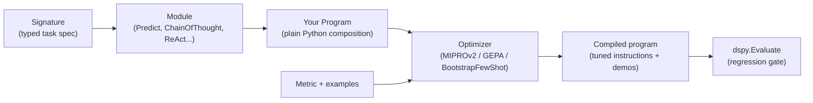
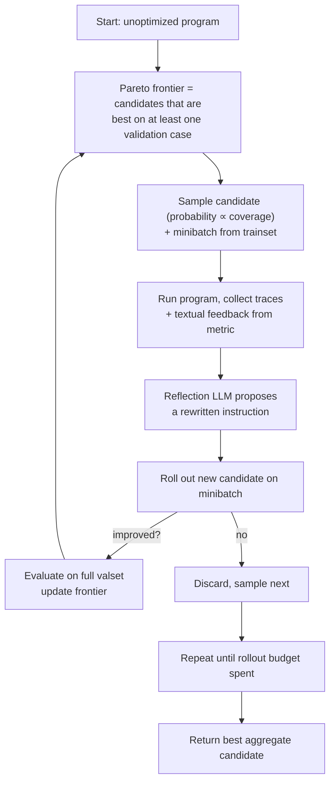

# DSPy expliqué aux ingénieurs backend : signatures, optimiseurs, et GEPA vs MIPROv2

Si vous avez maintenu un service Spring Boot de longue durée, vous connaissez déjà la
différence entre configuration et code. Vous n'éditez pas à la main les valeurs de
`application.yml` sur les machines de production, et vous ne réglez pas la taille des
pools de connexions au feeling : vous les déclarez, vous les mesurez, et vous les
modifiez par un processus relu et reproductible.

Appliquez maintenant ce regard au développement LLM. La plupart des équipes « font de
l'IA » comme on faisait de l'ops en 2009 : quelqu'un retouche à la main une chaîne de
prompt dans une PR, jette un œil à cinq sorties dans un notebook, livre, et six semaines
plus tard une montée de version du modèle casse tout en silence.

**DSPy** ([dspy.ai](https://dspy.ai)) est le framework de Stanford NLP qui dit : stop.
Traitez le prompt comme un **artefact compilé**. Vous écrivez le *code source* (une
déclaration typée de la tâche, composée en Python ordinaire) plus une **métrique** qui
évalue les sorties. Un composant du framework appelé **optimiseur** génère et ajuste
ensuite automatiquement les prompts réels, selon votre métrique et sur vos données.

Cet article explique comment cela fonctionne, puis creuse la question qui se posera
vraiment une fois DSPy adopté : **quel optimiseur choisir**. Les deux grandes stratégies
actuelles sont **MIPROv2** (recherche bayésienne sur les instructions et les exemples
few-shot) et **GEPA** (évolution réflexive des prompts sur un front de Pareto, ICLR 2026
Oral). Elles ne cherchent pas de la même façon, ne coûtent pas la même chose et n'attendent
pas la même chose de votre métrique.

Tout repose sur un petit exemple exécutable que j'ai construit pour cet article : un
programme de **triage d'incidents de production Spring Boot** qui classe des lignes de
log et des stack traces par catégorie de cause racine. C'est le terrain habituel de ce
blog, et c'est assez petit pour qu'une optimisation complète reste peu coûteuse.

Stack : **Python 3.11+, DSPy 3.5, n'importe quel fournisseur de LLM**.

<div class="post-tldr" markdown="1">
<p class="post-tldr-title">TL;DR</p>

- **DSPy = les prompts comme artefacts de build.** Vous déclarez une `Signature` (entrées/sorties typées), vous composez des `Module`s en Python, vous écrivez une métrique, et un **optimiseur** compile le tout en instructions ajustées + exemples few-shot. Changer de modèle devient une recompilation, pas une réécriture de prompts.
- La boucle centrale est partout la même : **programme + une trentaine d'exemples étiquetés + métrique → `optimizer.compile(program, trainset=...)` → un artefact sauvegardé et diffable.** Aucune chaîne de prompt dans votre code source.
- **MIPROv2** = propose une grille de candidats (instructions × démos) et retient le gagnant par **optimisation bayésienne** sur des évaluations en minibatch. Bon généraliste ; veut 200+ exemples pour les longues exécutions ; la métrique est un simple float.
- **GEPA** = **évolution réflexive** : un LLM puissant réécrit les instructions à partir d'un *feedback textuel* expliquant pourquoi les prédictions étaient fausses, et un **front de Pareto** conserve les candidats qui gagnent sur au moins un cas. Il devance MIPROv2 de **plus de 10 points** sur six tâches de benchmark à coût comparable (ICLR 2026 Oral), et fait mieux que le fine-tuning GRPO avec jusqu'à **35x moins de rollouts**.
- Règle de décision : **la métrique sait expliquer les erreurs en mots → GEPA. La métrique est un scalaire en boîte noire, ou vous avez besoin de sélection de démos → MIPROv2.** Dans les deux cas, le code de votre programme reste intact.
</div>

---

## Qu'est-ce que DSPy ?

DSPy est un framework Python open source de Stanford NLP. Il est né des travaux de
recherche Demonstrate-Search-Predict (décembre 2022), et la ligne 3.x actuelle est très
utilisée : plusieurs millions de téléchargements PyPI par mois et environ 40k étoiles
GitHub à l'heure où j'écris. Le slogan du projet résume sa philosophie : programmer les
modèles de langage plutôt que leur écrire des prompts.

Le postulat : un prompt n'est pas du code source. C'est un *résultat*, le produit compilé
de trois entrées que vous *pouvez* maintenir comme du code source :

1. **Ce qu'est la tâche** : une interface typée (entrées, sorties, contraintes).
2. **Comment les étapes s'enchaînent** : du flux de contrôle Python ordinaire.
3. **Ce que « correct » veut dire** : une fonction de métrique sur des exemples étiquetés.

Écrivez à la main les points 1 à 3, et laissez un algorithme produire le prompt. Quand le
modèle change, vous ne réécrivez pas le prompt : vous **recompilez**.

Si vous avez déjà maintenu en parallèle un prompt GPT-4, un prompt Claude et un prompt
Llama local pour la même fonctionnalité, vous comprenez déjà pourquoi c'est important.
C'est le même réflexe qui nous a fait passer de la config serveur éditée à la main à
l'infrastructure déclarative.

## Comment fonctionne DSPy : signatures, modules, optimiseurs

DSPy repose sur exactement trois abstractions. C'est tout le framework.



### Qu'est-ce qu'une signature DSPy ?

Une **signature** est une spécification déclarative du comportement entrée/sortie d'une
tâche : pensez à une signature de méthode dotée de sémantique, pas seulement de types.
Les noms de champs portent du sens ; DSPy les transforme en prompts en coulisses.

```python
class IncidentTriage(dspy.Signature):
    """Classify a Spring Boot production incident by its root cause and severity,
    and propose a fix."""

    incident_report: str = dspy.InputField(
        desc="Log line, stack trace excerpt or error description"
    )
    root_cause: Literal[
        "config-misconfiguration",
        "dependency-conflict",
        "connection-pool-exhaustion",
        "serialization-error",
        "memory-pressure",
        "thread-starvation",
    ] = dspy.OutputField(desc="One of the fixed root-cause categories")
    severity: Literal["P1", "P2", "P3"] = dspy.OutputField(
        desc="P1 = service down / data risk, P2 = degraded, P3 = contained"
    )
    action: str = dspy.OutputField(desc="One-sentence remediation")
```

Une signature apporte ce qu'une chaîne de prompt n'apporte pas : **une structure que le
parser peut imposer**. `root_cause` est un type `Literal` : le modèle ne peut pas répondre
`Probably database stuff` ; il doit renvoyer l'une des six valeurs, sinon l'adaptateur de
DSPy réessaie puis lève une exception. C'est le même réflexe que de mapper du JSON vers un
DTO typé plutôt que de parser des chaînes à la main.

### Qu'est-ce qu'un module DSPy ?

Un **module** est une stratégie de prompting réutilisable, généralisée à n'importe quelle
signature : l'idée du `nn.Module` de PyTorch, appliquée aux prompts. Tous sont construits
sur `dspy.Predict` ; les plus connus :

| Module | Stratégie qu'il abstrait |
|---|---|
| `dspy.Predict(sig)` | Complétion directe |
| `dspy.ChainOfThought(sig)` | Ajoute une étape de raisonnement avant la réponse |
| `dspy.ReAct(sig, tools=[...])` | Boucle raisonnement + appels d'outils pour les agents |
| `dspy.ProgramOfThought(sig)` | Génère et exécute du code pour répondre |
| `dspy.BestOfN(sig, N)` | Échantillonne N candidats et garde le mieux noté |

Votre programme est une sous-classe de `dspy.Module` dont le `forward()` compose des
sous-modules en Python ordinaire : conditions, boucles, vos propres classes. Voici le
modèle *complet* de notre exemple de triage d'incidents :

```python
class IncidentTriageProgram(dspy.Module):
    def __init__(self):
        super().__init__()
        self.triage = dspy.ChainOfThought(IncidentTriage)

    def forward(self, incident_report: str) -> dspy.Prediction:
        return self.triage(incident_report=incident_report)
```

Regardez ce qui **n'est pas** dans ce fichier : ni texte de prompt, ni exemples few-shot,
ni nom de modèle, ni température. Tout cela existe, mais sous forme de *paramètres*, et
c'est exactement ce qui les rend optimisables. L'appel du programme renvoie des champs
typés (`root_cause`, `severity`, `action`) plus un champ `reasoning` que `ChainOfThought`
ajoute pour l'étape de raisonnement.

### Qu'est-ce qu'un optimiseur DSPy ?

Un **optimiseur** (autrefois appelé *teleprompter*) est un algorithme qui ajuste les
paramètres de votre programme, c'est-à-dire les instructions et/ou les démos few-shot,
pour maximiser votre métrique. Une démo few-shot est un exemple résolu entrée→sortie
injecté dans le prompt ; une instruction est la directive de niveau système que DSPy
génère pour chaque module.

`optimizer.compile(program, trainset=...)` est littéralement une étape de compilation : il
exécute votre programme sur les données, mesure, cherche, et renvoie un **programme
compilé** dont les prédicteurs portent désormais des instructions et des démos ajustées.
Vous le sauvegardez avec `program.save("optimized.json")` : un artefact diffable et relisible,
comme vous relisez un script de migration.

Côté évaluation, tout tient en un appel :

```python
evaluate = dspy.Evaluate(
    devset=valset,
    metric=triage_metric,
    num_threads=4,
    display_table=3,
)
result = evaluate(program)
```

Les recommandations de dimensionnement de la doc DSPy : **environ 30 exemples étiquetés
pour commencer à voir un gain, environ 300 pour une qualité de production**, répartis à
~20 % pour l'entraînement et ~80 % pour la validation, car les optimiseurs évaluent chaque
candidat sur la validation. C'est volontairement l'*inverse* de la pratique en deep
learning : vous n'ajustez pas des poids, vous explorez un espace bien plus petit, et le
jeu de validation sert de boussole.

Une dernière chose à bien intégrer : **votre métrique est le contrat**. Chaque optimiseur
présenté ici ne vaut que ce que vaut la fonction qui évalue les sorties. Pour de la
classification, une métrique d'égalité exacte suffit. Pour des tâches plus floues, DSPy
fournit `dspy.evaluate.SemanticF1` (lui-même implémenté comme un petit programme DSPy), et
vous pouvez écrire des métriques qui renvoient un crédit partiel.

---

## Un exemple concret : triage d'incidents Spring Boot

Assez de théorie. Le dépôt compagnon de cet article implémente une tâche que tout
ingénieur backend connaît : le triage en astreinte. À partir d'une ligne de log ou d'un
extrait de stack trace, il faut classer la **cause racine** (six catégories) et la
**sévérité** (P1/P2/P3), et produire un correctif en une phrase.

Le jeu de données compte 24 incidents fabriqués à la main, volontairement réalistes :
timeouts du pool Hikari, `NoSuchMethodError` après une montée de version de Jackson,
méthode `@Transactional` qui garde une connexion pendant un appel distant lent, pod
OOMKilled dont le heap va bien mais pas le metaspace… 14 pour l'entraînement, 10 pour la
validation. C'est minuscule exprès : la doc de DSPy situe le début des gains autour de 30
exemples, et cela garde chaque exécution peu coûteuse.

La métrique existe en deux variantes, et cette séparation est la clé de la question GEPA
vs MIPROv2 plus loin :

```python
def triage_metric(example, pred, trace=None) -> float:
    """Plain scalar metric — what MIPROv2 and dspy.Evaluate consume."""
    root_ok = pred.root_cause == example.root_cause
    sev_ok = pred.severity == example.severity
    return (1.0 if root_ok else 0.0) + (0.25 if sev_ok else 0.0)


def triage_metric_with_feedback(example, pred, trace=None, pred_name=None, pred_trace=None):
    """GEPA metric: a score PLUS natural-language feedback about the miss."""
    problems = []
    if pred.root_cause == example.root_cause:
        root_score = 1.0
    else:
        root_score = 0.0
        problems.append(
            f"Wrong root cause: you said '{pred.root_cause}', the correct label is "
            f"'{example.root_cause}'."
        )
    # ... same for severity ...
    return dspy.Prediction(score=root_score + sev_score,
                           feedback=" ".join(problems) or "Correct root cause and severity.")
```

Même tâche, même notation : une version répond à *« combien ? »*, l'autre répond aussi à
*« pourquoi c'est faux ? »*. Cette différence sépare les deux optimiseurs ci-dessous.

## Les principales stratégies d'optimisation

DSPy fournit environ une douzaine d'optimiseurs répartis en quatre familles. Ceux entre
lesquels vous aurez réellement à choisir sont les deux derniers.

| Optimiseur | Ce qu'il ajuste | Stratégie de recherche | Données nécessaires |
|---|---|---|---|
| `BootstrapFewShot` | Démos seulement | Exécute le teacher, garde les traces qui passent la métrique | ~10+ |
| `BootstrapFewShotWithRandomSearch` | Démos seulement | Bootstrapping + recherche aléatoire sur des variantes | 50+ |
| `COPRO` | Instructions seulement | Hill-climbing par montée de coordonnées sur des réécritures | indifférent |
| `MIPROv2` | Instructions **+ démos** | Propose une grille de candidats, **optimisation bayésienne** | 200+ pour les longues exécutions |
| `GEPA` | Instructions (et code, via `dspy.Flex`) | **Évolution réflexive** sur un front de Pareto | une poignée, si la métrique donne du feedback |

### MIPROv2 : recherche bayésienne sur les instructions et les démos

**MIPROv2** (Multiprompt Instruction PRoposal Optimizer v2) est le cheval de trait de
DSPy, la réponse par défaut de longue date à « optimise-moi ça ». Il s'exécute en trois
étapes :

1. **Bootstrap des démos** : crée `num_candidates` jeux d'exemples few-shot, certains
   recopiés depuis les étiquettes, d'autres *bootstrappés* en exécutant votre propre
   programme et en gardant les traces dont les sorties passent la métrique.
2. **Proposition d'instructions** : un `prompt_model` écrit des instructions candidates
   pour chaque module, en s'appuyant sur un résumé du jeu de données, le code source de
   votre programme, les démos bootstrappées et une « astuce de créativité » tirée au hasard.
3. **Recherche bayésienne** : échantillonne des combinaisons (instruction, démo), évalue
   chacune sur un minibatch de 35 exemples, met à jour un modèle de substitution et
   ré-échantillonne là où il prédit une amélioration. Une évaluation complète sur la
   validation a lieu toutes les quelques étapes. Après `num_trials`, le meilleur programme
   l'emporte.

```python
optimizer = dspy.MIPROv2(
    metric=triage_metric,     # plain scalar is fine here
    auto="light",             # ~6 candidates; "medium"/"heavy" scale up
    num_threads=4,
)
optimized = optimizer.compile(
    program,
    trainset=trainset,
    valset=valset,
    max_bootstrapped_demos=2,
    max_labeled_demos=2,
)
optimized.save("optimized/miprov2_triage.json")
```

Le modèle mental est celui d'une **grille de candidats figée, explorée par un échantillonneur
malin**. Cela a une vraie conséquence : MIPROv2 ne peut choisir que parmi les instructions
candidates que son proposeur a pensé à générer au départ. Si aucune n'encode l'intuition
métier dont votre tâche avait besoin (« reconnaître la signature de la stack trace avant
d'évaluer la sévérité »), la recherche bayésienne ne peut pas l'inventer : elle ne peut
que retenir le moins mauvais point de la grille.

### GEPA : évolution réflexive des prompts sur un front de Pareto

**GEPA** (Genetic-Pareto), décrit dans [Agrawal et al., 2025](https://arxiv.org/abs/2507.19457)
et accepté comme **ICLR 2026 Oral**, s'attaque directement à cette limite. C'est une
recherche évolutionnaire dont l'*opérateur de mutation est un LLM qui lit du feedback* :



Quatre idées font que cela marche :

- **La métrique renvoie du feedback, pas seulement un nombre.** C'est pourquoi notre
  exemple a un `triage_metric_with_feedback` qui renvoie `dspy.Prediction(score, feedback)`.
  La doc DSPy est sans détour : donnez un simple float à GEPA et vous obtenez « une version
  bien plus faible de lui-même ». Le texte du feedback est injecté *tel quel* dans le prompt
  du LM de réflexion (« vous avez répondu `thread-starvation`, le bon libellé est
  `memory-pressure` ; un OOMKilled à la limite du conteneur avec un heap peu utilisé
  signifie que c'est le *conteneur* qui est la contrainte »), si bien que chaque mutation
  est informée, pas aléatoire.
- **Sélection de Pareto plutôt que roi de la colline.** MIPROv2 ne garde qu'un seul
  titulaire ; les candidats médiocres dans l'ensemble mais *meilleurs sur une tranche
  précise* (disons, les erreurs de sérialisation) sont éliminés quand même. Le front de
  GEPA garde en vie chacun de ces spécialistes et tire parmi eux. Les spécialistes précoces
  survivent pour se recombiner plus tard, pour la même raison que les algorithmes génétiques
  entretiennent des populations diversifiées. L'article en fait une ablation : sur
  Qwen3 8B, l'échantillonnage de Pareto devance d'environ 6 points de score agrégé la
  sélection systématique du meilleur candidat courant.
- **Fusion consciente du système** (`use_merge=True`) : quand deux lignées ont chacune
  appris une force complémentaire, GEPA tente de fusionner leurs meilleurs modules, soit un
  opérateur de croisement dans le vocabulaire des algorithmes génétiques.
- **Un seul bouton de budget** : exactement un parmi `auto` (`light`/`medium`/`heavy`),
  `max_full_evals` ou `max_metric_calls`. `light` évalue environ six prompts candidats ;
  le nombre réel d'appels à la métrique croît avec la taille du valset et le nombre de
  prédicteurs, donc vérifiez-le d'abord sur un petit valset.

```python
optimizer = dspy.GEPA(
    metric=triage_metric_with_feedback,  # score + textual feedback
    reflection_lm=reflection_model(),    # a STRONG model, temperature 1.0
    auto="light",
    num_threads=4,
    track_stats=True,                    # fills detailed_results
)
optimized = optimizer.compile(program, trainset=trainset, valset=valset)
```

Deux remarques opérationnelles. D'abord, **c'est sur le LM de réflexion qu'il faut
dépenser** : il n'est appelé que quelques fois par exécution, donc donnez-lui un modèle plus
puissant que celui de la tâche ; la doc de DSPy recommande un modèle plus grand à cet
endroit quand on optimise un modèle plus petit. Ensuite, activez `track_stats=True` : le
résultat embarque `detailed_results`, avec **chaque candidat, sa lignée parentale et les
scores de validation par exemple**. C'est une piste d'audit de l'évolution du prompt, que
vous pouvez exporter en JSON et relire comme une PR.

Ce que GEPA *modifie* est volontairement étroit : uniquement les `signature.instructions`
de chaque prédicteur. La composition de vos modules, votre code, vos démos restent
intacts. Les instructions optimisées se transfèrent par ailleurs remarquablement bien d'un
modèle à l'autre : l'article rapporte que des prompts évolués sur Qwen3-8B ont gagné ~9 %
une fois réutilisés sur GPT-4.1 Mini.

## GEPA vs MIPROv2 : quel optimiseur choisir ?

Même framework, même programme, même fonction de métrique, mais des paradigmes de
recherche différents :

| Dimension | MIPROv2 | GEPA |
|---|---|---|
| Paradigme | **Optimisation bayésienne** sur une grille de candidats figée | **Évolution réflexive** sur un ensemble de candidats ouvert |
| Ce qu'il ajuste | Instructions **+ démos few-shot** conjointement | Instructions seulement (le code aussi, via `dspy.Flex`) |
| Contrat de métrique | Scalaire simple (float/bool) | `dspy.Prediction(score, feedback)` : feedback par prédicteur |
| Mémoire de la recherche | Un seul titulaire, le meilleur jusque-là | **Front de Pareto** des gagnants par instance + fusion |
| Boutons de budget | `auto` ou `num_candidates` + `num_trials` | exactement un : `auto` / `max_full_evals` / `max_metric_calls` |
| Prompts typiques | Plus longs (les démos few-shot les gonflent) | Instructions jusqu'à **9,2x plus courtes** (mesure de l'article) |
| Données conseillées | 200+ exemples : c'est là que les longues exécutions brillent | Une poignée suffit *si le feedback est riche* ; gardez un valset petit |
| Résultats phares | Défaut solide ; exemple ReAct de la doc : 8 % → ~42 % (MIPROv2, `medium`) | **10+ points de mieux que MIPROv2** sur 6 tâches (d'après l'abstract) |

Les chiffres de coût de l'article sont plus parlants que ceux de précision. Dans les
expériences avec GPT-4.1 Mini, la dépense LM totale était de **86 $ pour GEPA contre 76 $
pour MIPROv2**, soit un coût comparable, pour environ le double de gain agrégé (+12,2
points contre +5,6 ; GEPA+Merge : +13,3). Face au fine-tuning par RL (GRPO), GEPA a égalé
ses meilleurs scores de validation après **243 à 1 179 rollouts contre 24 000** (jusqu'à 78x
plus efficace en échantillons), tout en dépassant GRPO de 6 points en moyenne (jusqu'à 20).
Ce sont les benchmarks et les configurations de l'article, pas votre charge de travail,
mais c'est la version relue par des pairs de l'argument « moins cher que le RL » que vous
croiserez sur les réseaux sociaux.

**La règle de décision que j'appliquerais**, d'après la façon dont les deux sont construits :

- **Choisissez GEPA quand votre métrique sait expliquer les erreurs en mots.**
  Classification avec justifications, extraction validée par des schémas, agents jugés sur
  des traces étape par étape : partout où « pourquoi c'était faux » peut s'exprimer. Ce
  feedback est le carburant ; sans lui, vous faites de l'évolution avec une fonction
  d'aptitude aveugle.
- **Choisissez MIPROv2 quand votre métrique est une boîte noire, ou quand les démos
  comptent plus que les instructions.** Si votre programme sous-apprend parce qu'il manque
  d'exemples en contexte (et non parce que ses instructions sont fausses), la recherche
  conjointe instruction + démo de MIPROv2 est le meilleur levier. C'est aussi la première
  marche la plus douce : pas de second modèle à configurer, les métriques scalaires sont
  les bienvenues.
- **Dans tous les cas, une première sonde peu coûteuse** : `BootstrapFewShotWithRandomSearch`
  avec une métrique scalaire ne coûte presque rien et vous dit souvent si l'écart vient des
  *démos* (il le comble) ou des *instructions* (il ne le comblera pas : c'est le terrain
  de MIPROv2/GEPA).

Et les deux ne s'excluent pas. DSPy 3.x fournit `BetterTogether`, qui enchaîne optimisation
de prompts et optimisation des poids (par exemple GEPA, puis fine-tuning) sur le même
programme : l'évolution de prompts pour trouver la stratégie, le RL pour la compresser dans
les poids quand vous avez le budget de rollouts.

## Exécuter l'exemple

Tout ce qui précède est du code que vous pouvez exécuter en cinq minutes. Le dépôt
compagnon :

```bash
git clone https://github.com/javaAndScriptDeveloper/dspy-article
cd dspy-article
uv sync                      # Python 3.11+, installs DSPy 3.5

# Offline sanity check — drives the whole pipeline against a DummyLM:
uv run python smoke_test.py  # no API key needed

# Real runs:
export OPENAI_API_KEY=sk-...     # or set DSPY_MODEL to any dspy.LM string
uv run python 01_baseline.py         # score the unoptimized program
uv run python 02_optimize_miprov2.py # Bayesian search → optimized/miprov2_triage.json
uv run python 03_optimize_gepa.py    # reflective evolution → optimized/gepa_triage.json
```

Par défaut : modèle de tâche `openai/gpt-4o-mini`, modèle de réflexion GEPA
`openai/gpt-4o` (à surcharger avec `DSPY_MODEL` / `DSPY_REFLECTION_MODEL`). Le jeu de
données compte 24 exemples, donc une exécution reste modeste ; consultez la page
d'utilisation de votre fournisseur pour le coût réel. Je n'affiche volontairement aucun
chiffre de précision ici : 10 exemples de validation, c'est une démo de câblage, pas un
benchmark. Lancez les trois scripts et comparez les scores sur votre propre modèle avant
de croire un optimiseur.

Le moment qui vaut le coup d'être vécu : après chaque exécution, faites un diff du JSON
sauvegardé avec le programme source. `02_optimize_miprov2.py` aura écrit des instructions
et injecté des démos few-shot. `03_optimize_gepa.py` aura réécrit l'instruction, et
`optimized/gepa_results.json` contient toute la lignée évolutive : chaque candidat, ses
parents, les scores par exemple. Ouvrez-le à côté du code source de votre programme et
l'idée s'impose d'elle-même : **le prompt est un résultat, pas du code source.**

## Quand ne pas utiliser DSPy ?

Section franchise, parce que tout discours sur un framework en a besoin d'une.

- **Pas de métrique, pas de DSPy.** Si vous ne pouvez pas évaluer les sorties, même de
  façon bruitée, l'optimiseur n'a rien à gravir. Construire le jeu d'évaluation et la
  métrique est le vrai travail ; DSPy ne fait qu'automatiser la recherche. (Les équipes qui
  sautent cette étape et ajustent les prompts à la main font la recherche *au feeling*,
  avec de moins bonnes données.)
- **Un seul prompt stable sur un problème résolu ?** N'ajoutez pas cette couche
  d'abstraction. DSPy devient rentable quand les programmes comportent plusieurs étapes,
  que les modèles changent souvent, ou que les écarts de qualité coûtent de l'argent.
- **Budget RL illimité et poids entraînables ?** L'article GEPA est explicite : l'évolution
  de prompts l'emporte quand les rollouts sont coûteux, les données limitées ou les poids
  figés derrière une API. Le fine-tuning de type GRPO reste gagnant quand les rollouts sont
  abondants. Des outils différents, une économie différente.
- **Le prompt reste votre responsabilité.** L'artefact compilé est ajusté à *votre
  métrique* : optimisez contre une métrique proxy qui ne reflète pas la production, et vous
  livrerez un programme superbement optimisé pour le mauvais objectif. Même règle qu'à
  l'accoutumée : votre suite d'évaluation *est* votre spécification.

---

Toutes les couches d'une stack backend ont déjà eu droit à ce traitement : la config est
devenue du code, le schéma des migrations, l'infrastructure du déclaratif. La chaîne de
prompt est le dernier artefact que l'on édite encore à la main à 2 h du matin. La réponse
de DSPy est celle qui a fonctionné pour le reste : la déclarer, la mesurer, la versionner.
Les optimiseurs sont la partie intéressante, mais c'est la discipline qui paie : le prompt
devient ce que la CI régénère quand le modèle, les données ou la métrique changent.

Si vous voulez approfondir les optimiseurs, les sources primaires sont excellentes :
l'[article GEPA](https://arxiv.org/abs/2507.19457) (ICLR 2026 Oral), l'[article
MIPROv2](https://arxiv.org/abs/2406.11695) et le [guide officiel d'optimisation de
DSPy](https://dspy.ai/learn/optimization/overview/), qui inclut un [sélecteur d'optimiseur
pas à pas](https://dspy.ai/diving-deeper/choosing-an-optimizer/).

*Le code de cet article est disponible sur
**[github.com/javaAndScriptDeveloper/dspy-article](https://github.com/javaAndScriptDeveloper/dspy-article)**.
Toute la chaîne se vérifie hors ligne : `uv sync && uv run python smoke_test.py`
exécute une boucle d'optimisation GEPA complète sans clé d'API, et les exécutions réelles
utilisent un petit jeu de données de 24 exemples.*
