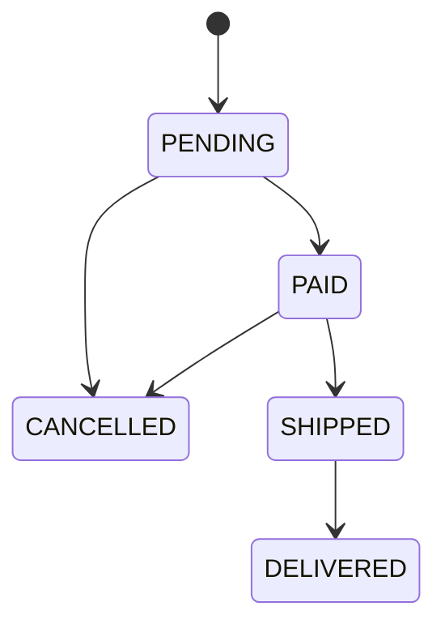

# Stocker des enums en base de données : @Enumerated, types enum Postgres et tables de référence

Presque tous les modèles du domaine ont un champ qui ne peut contenir qu'une poignée de valeurs. Une commande est
`PENDING`, `PAID`, `SHIPPED`, `DELIVERED` ou `CANCELLED`. Un paiement est autorisé ou capturé. Un
abonnement est sur l'un des quatre plans. En Java, vous sortez un `enum` sans y penser. La
question intéressante est ce qui se passe à la frontière — **comment cet ensemble fini de valeurs vit réellement
en base de données**, et ce que chaque option vous coûte six mois plus tard, quand l'ensemble change.

Cet article passe en revue toutes les façons courantes de persister un enum avec Hibernate, dans l'ordre où vous
les rencontreriez réellement : les deux modes de `@Enumerated`, un vrai type `ENUM` Postgres, un
`AttributeConverter`, et enfin l'approche par table de référence où l'enum devient sa propre table.
Je vais faire évoluer un seul exemple — le statut d'une commande — du début à la fin, et terminer avec le choix
que je fais réellement.

Stack : **Java, Spring Boot, Hibernate, PostgreSQL**.

<div class="post-tldr" markdown="1">
<p class="post-tldr-title">TL;DR</p>

- `@Enumerated(ORDINAL)` stocke la **position** de l'enum — compact, mais insérer une valeur au milieu corrompt silencieusement toutes les lignes suivantes. Si vous devez l'utiliser, **figez les ordinaux avec un test unitaire**.
- `@Enumerated(STRING)` stocke le **nom de la constante** — auto-descriptif, débogable, immunisé contre le réordonnancement. C'est le défaut sain.
- Ne vous contentez pas d'un simple `varchar` — définissez un vrai **type `ENUM` Postgres** pour que la base elle-même rejette les valeurs invalides.
- Un **`AttributeConverter`** persiste un code stable découplé du nom Java, si bien que **les renommages cessent d'être un problème de base de données**.
- Une **table de référence** ne vaut le coup que lorsque les valeurs portent des données métier modifiables — pas comme contournement des renommages.
</div>

---

## Le scénario

Nous construisons la gestion des commandes. Une commande traverse un cycle de vie figé :



En Java, c'est un enum évident :

```java
public enum OrderStatus {
    PENDING,
    PAID,
    SHIPPED,
    DELIVERED,
    CANCELLED
}
```

L'entité commande a un champ `status`. La seule question est de savoir comment Hibernate le mappe à une colonne —
et ce seul choix d'annotation a des conséquences qui survivront au code que vous écrivez aujourd'hui.

---

## Partie 1 — `@Enumerated(ORDINAL)` : stocker en entier

Le défaut de JPA pour un enum est `ORDINAL`. Chaque constante est stockée comme sa position dans la
déclaration : `PENDING` → 0, `PAID` → 1, `SHIPPED` → 2, et ainsi de suite.

```java
@Entity
@Table(name = "orders_ordinal")
public class OrderOrdinal {

    @Id
    @GeneratedValue(strategy = GenerationType.UUID)
    private UUID id;

    @Enumerated(EnumType.ORDINAL)   // this is also the default if you omit @Enumerated
    @Column(nullable = false)
    private OrderStatus status;
}
```

```sql
CREATE TABLE orders_ordinal (
    id     UUID     PRIMARY KEY DEFAULT gen_random_uuid(),
    status SMALLINT NOT NULL
);
```

Enregistrez une commande avec le statut `PAID` et la colonne contient `1`. C'est compact, et sur le papier
c'est très bien.

### ❌ Le piège : insérer une valeur au milieu

L'ordinal n'est pas stocké comme un libellé — il est stocké comme une *position*, et la position est définie par
l'ordre du code source. Le jour où quelqu'un ajoute une étape d'emballage entre paid et shipped :

```java
public enum OrderStatus {
    PENDING,
    PAID,
    PACKED,      // <-- inserted here
    SHIPPED,
    DELIVERED,
    CANCELLED
}
```

…toute constante après `PAID` se décale d'un cran :

| Constante | Ordinal avant | Ordinal après |
|---|---|---|
| `PENDING`   | 0 | 0 |
| `PAID`      | 1 | 1 |
| `PACKED`    | — | **2** |
| `SHIPPED`   | 2 | **3** |
| `DELIVERED` | 3 | **4** |
| `CANCELLED` | 4 | **5** |

Rien n'a changé dans la base de données. Chaque commande `SHIPPED` existante contient toujours l'entier `2` —
mais `2` se décode désormais en `PACKED`. Les commandes expédiées deviennent silencieusement emballées. Les
livrées deviennent expédiées. Aucune erreur, aucune migration en échec, aucune ligne de log. Les données n'ont
pas bougé ; c'est votre interprétation qui a bougé. Vous le découvrez quand un client demande pourquoi sa
commande livrée est en cours d'emballage.

### Le garde-fou : figer les ordinaux

Si vous avez une bonne raison de garder `ORDINAL` — un schéma legacy, une table réellement très sollicitée et
énorme où la différence d'octets compte — alors rendez l'ordre porteur de sens *explicitement*, avec un test qui
échoue dès que quelqu'un réordonne l'enum :

```java
class OrdinalPinTest {

    @Test
    void ordinalsAreFrozen() {
        // If this test fails, you reordered OrderStatus. Existing ORDINAL-mapped rows now mean
        // something different. Revert the reorder, or append the new value at the end.
        assertThat(OrderStatus.PENDING.ordinal()).isZero();
        assertThat(OrderStatus.PAID.ordinal()).isEqualTo(1);
        assertThat(OrderStatus.SHIPPED.ordinal()).isEqualTo(2);
        assertThat(OrderStatus.DELIVERED.ordinal()).isEqualTo(3);
        assertThat(OrderStatus.CANCELLED.ordinal()).isEqualTo(4);
        assertThat(OrderStatus.values()).hasSize(5);
    }
}
```

C'est un test unitaire pur — pas de contexte Spring, pas de base de données. Il transforme un bug invisible de
corruption de données en build rouge dès que quelqu'un touche à l'enum. Les nouvelles valeurs restent
autorisées ; elles doivent simplement aller à la fin, où l'ajout est sans danger. C'est toute la règle dont
`ORDINAL` dépend silencieusement, mise par écrit.

---

## Partie 2 — `@Enumerated(STRING)` : stocker en varchar

La solution pour presque tout le monde tient en un mot :

```java
@Enumerated(EnumType.STRING)
@Column(nullable = false)
private OrderStatus status;
```

Désormais, la colonne stocke le *nom* de la constante :

```sql
CREATE TABLE orders_string (
    id     UUID    PRIMARY KEY DEFAULT gen_random_uuid(),
    status VARCHAR NOT NULL
);
```

Une commande `PAID` stocke littéralement la chaîne `'PAID'`. Trois choses s'améliorent immédiatement :

- **Le réordonnancement est inoffensif.** La valeur est son propre nom ; les positions n'ont plus d'importance.
  Ajoutez `PACKED` où vous voulez.
- **C'est débogable.** `SELECT * FROM orders_string WHERE status = 'PAID'` se lit comme un livre ouvert. Pas
  de bague décodeuse, pas de jointure mentale avec votre source Java.
- **Les dumps et les logs sont auto-descriptifs.** Une ligne dans un export CSV signifie quelque chose par
  elle-même.

Oui, `'DELIVERED'` coûte plus d'octets que `3`. Pour l'écrasante majorité des tables cette différence est du
bruit — et vous pouvez toujours ajouter un index. Stocker le nom est le bon défaut, et « compact » ne vaut
presque jamais « silencieusement faux ».

### Le piège restant : les renommages

`STRING` supprime le piège de l'ordre mais en introduit un plus petit. La valeur stockée *est* l'identifiant
Java, donc renommer la constante laisse les lignes existantes orphelines :

```java
PENDING  →  AWAITING_PAYMENT
```

Chaque ancienne ligne `'PENDING'` ne correspond plus à aucune constante, et Hibernate lève une exception quand
il la relit. Les données stockées et le code ont silencieusement divergé. Vous pouvez corriger cela avec une
migration de données (`UPDATE … SET status = 'AWAITING_PAYMENT' WHERE status = 'PENDING'`) — et c'est une
réponse parfaitement acceptable. Nous verrons aussi, en partie 4, une façon de faire des renommages un
non-événement complet.

---

## Partie 3 — Le bon goût : un vrai type enum Postgres

Les deux options ci-dessus stockent dans une colonne que la base ne comprend pas vraiment — un `smallint` ou un
`varchar` qui *se trouve* contenir des valeurs d'enum. Postgres peut faire mieux. Il a des types enum de
premier ordre :

```sql
CREATE TYPE order_status AS ENUM ('PENDING', 'PAID', 'SHIPPED', 'DELIVERED', 'CANCELLED');

CREATE TABLE orders_pgenum (
    id     UUID         PRIMARY KEY DEFAULT gen_random_uuid(),
    status order_status NOT NULL
);
```

Désormais, c'est la *base de données* qui fait respecter le domaine. Un `INSERT … VALUES ('SHPPED')` — une faute
de frappe, une migration ratée, un script malveillant — échoue à la source avec `invalid input value for enum
order_status`. Avec un simple `varchar`, ces ordures atterrissent dans la table et vous les découvrez plus
tard. Le type enum est documentation et contrainte en un : le type de la colonne liste littéralement ses
valeurs légales.

Le mapping dans Hibernate est le même `@Enumerated(STRING)` qu'avant — Hibernate lie le nom de la constante
comme une chaîne et Postgres le stocke dans l'enum :

```java
@Enumerated(EnumType.STRING)
@Column(nullable = false, columnDefinition = "order_status")
private OrderStatus status;
```

Il y a exactement une pièce de plomberie. Par défaut, le driver JDBC PostgreSQL envoie une `String` Java comme
type `varchar`, et Postgres ne caste pas implicitement `varchar` → `order_status`, donc vous obtenez
`column "status" is of type order_status but expression is of type character varying`. Ajoutez
`stringtype=unspecified` à l'URL JDBC et le driver envoie la valeur comme `unknown`, permettant à Postgres de
la caster vers l'enum :

```yaml
spring:
  datasource:
    url: jdbc:postgresql://localhost:5434/mydatabase?stringtype=unspecified
```

(Hibernate 6 propose aussi `@JdbcTypeCode(SqlTypes.NAMED_ENUM)` pour cibler directement un type enum nommé ;
la combinaison `@Enumerated(STRING)` + `stringtype=unspecified` ci-dessus est la plus courante et celle que
j'utilise.)

**La seule limite à connaître :** `ALTER TYPE order_status ADD VALUE 'PACKED'` ne fait qu'*ajouter à la fin*.
Vous pouvez ajouter une valeur (et depuis PostgreSQL 12, même avant/après une valeur précise), mais vous ne
pouvez ni supprimer ni réordonner les valeurs existantes sans recréer le type. Cela semble limitant jusqu'à ce
que vous réalisiez que c'est la *même règle* que celle imposée par le test des ordinaux — ne jamais réordonner,
seulement ajouter — sauf qu'ici c'est la base de données qui la garantit, pas un test unitaire. La contrainte
est la fonctionnalité.

---

## Partie 4 — `AttributeConverter` : découpler le nom de la valeur

Le piège du renommage de la partie 2 existe parce que nous avons laissé la *valeur stockée* et l'*identifiant
Java* être la même chaîne. Un `AttributeConverter` JPA rompt ce couplage : vous persistez un code stable qui
n'a rien à voir avec le nom de la constante.

Donnez à chaque constante un code explicite et permanent :

```java
public enum OrderStatus {

    PENDING("PND"),
    PAID("PAID"),
    SHIPPED("SHP"),
    DELIVERED("DLV"),
    CANCELLED("CNC");

    private final String code;

    OrderStatus(String code) {
        this.code = code;
    }

    public String getCode() {
        return code;
    }

    public static OrderStatus fromCode(String code) {
        return Arrays.stream(values())
                .filter(s -> s.code.equals(code))
                .findFirst()
                .orElseThrow(() -> new IllegalArgumentException("Unknown OrderStatus code: " + code));
    }
}
```

Puis un convertisseur qui mappe enum ↔ code :

```java
@Converter
public class OrderStatusConverter implements AttributeConverter<OrderStatus, String> {

    @Override
    public String convertToDatabaseColumn(OrderStatus status) {
        return status == null ? null : status.getCode();
    }

    @Override
    public OrderStatus convertToEntityAttribute(String code) {
        return code == null ? null : OrderStatus.fromCode(code);
    }
}
```

Et branchez-le sur le champ avec `@Convert` au lieu de `@Enumerated` :

```java
@Convert(converter = OrderStatusConverter.class)
@Column(nullable = false)
private OrderStatus status;
```

Désormais, la base stocke `'PAID'` comme un *code*, pas comme l'identifiant. Renommez la constante Java
`PENDING` en `AWAITING_PAYMENT` et le code stocké `'PND'` ne change jamais — le renommage est un refactoring
pur sans aucun impact sur la base. Vous avez découplé ce que la base sait de la façon dont vous nommez les
choses dans le code, ce qui est exactement la propriété pour laquelle on se tourne vers les tables de
référence. Gardez cela à l'esprit pour la partie suivante.

---

## Partie 5 — L'approche par table de référence

La dernière approche cesse complètement de traiter le statut comme un enum. À la place, l'ensemble des statuts
vit dans sa propre table, et les commandes référencent une ligne par clé étrangère :

```sql
CREATE TABLE order_statuses (
    id       INTEGER PRIMARY KEY,
    code     VARCHAR NOT NULL UNIQUE,
    label    VARCHAR NOT NULL,
    terminal BOOLEAN NOT NULL DEFAULT FALSE
);

INSERT INTO order_statuses (id, code, label, terminal) VALUES
    (1, 'PND',  'Pending',   FALSE),
    (2, 'PAID', 'Paid',      FALSE),
    (3, 'SHP',  'Shipped',   FALSE),
    (4, 'DLV',  'Delivered', TRUE),
    (5, 'CNC',  'Cancelled', TRUE);

CREATE TABLE orders_lookup (
    id        UUID    PRIMARY KEY DEFAULT gen_random_uuid(),
    status_id INTEGER NOT NULL REFERENCES order_statuses (id)
);
```

En JPA, le statut devient une relation, pas une valeur énumérée :

```java
@Entity
@Table(name = "orders_lookup")
public class OrderLookup {

    @Id
    @GeneratedValue(strategy = GenerationType.UUID)
    private UUID id;

    @ManyToOne(fetch = FetchType.EAGER, optional = false)
    @JoinColumn(name = "status_id", nullable = false)
    private OrderStatusDefinition status;
}
```

Pour connaître le statut d'une commande — son libellé lisible par un humain, s'il est terminal — vous faites
une **jointure** :

```sql
SELECT o.id, s.code, s.label
FROM   orders_lookup o
JOIN   order_statuses s ON s.id = o.status_id
WHERE  o.id = ?;
```

### ✅ Quand cela vaut la peine

La table de référence achète une vraie chose : l'ensemble des valeurs, et les métadonnées attachées à chacune,
vivent dans des **données** au lieu de vivre dans le **code**. C'est réellement précieux quand :

- **Chaque valeur porte des données métier modifiables** — un libellé affiché, un ordre de tri, une couleur, un
  feature flag, un SLA. Le statut n'est pas qu'une identité ; c'est un petit enregistrement.
- **Des non-développeurs gèrent les valeurs**, ou elles sont configurées par tenant, ou elles changent à
  l'exécution sans déploiement.
- **Vous avez de véritables changements de masse** — renommer un libellé présent sur des millions de lignes en
  mettant à jour une seule ligne de `order_statuses`, pas chaque commande.

Ce dernier point est l'argument le plus fort : changer à un seul endroit, pas partout. Si votre « enum » est en
réalité un catalogue maintenu, c'est le bon modèle.

---

## Mon avis

Pour un enum *simple* — un ensemble figé d'états au niveau du code comme un cycle de vie de commande — je
n'utilise pas de table de référence, et je m'y opposerais en revue de code.

La justification habituelle que j'entends est « et si on devait renommer une valeur ? ». Mais nous venons de
voir que cela se résout sans table : un `AttributeConverter` découple le code stocké du nom Java, et un libellé
qui change est une migration d'une ligne. Vous n'avez pas besoin d'une clé étrangère et d'une jointure sur
chaque requête pour survivre à un renommage.

Ce que la table de référence ajoute réellement, dans ce cas, c'est un coût permanent : chaque lecture joint ou
embarque une seconde requête, le statut devient une relation gérée au lieu d'une valeur, et un `switch`
exhaustif à la compilation sur vos états devient une recherche à l'exécution qui peut échouer. Vous avez échangé
une valeur que votre compilateur comprend contre une ligne qu'il ne comprend pas, pour acheter une flexibilité
qu'un cycle de vie figé n'utilisera jamais.

Ma règle porte donc sur **ce qu'est la valeur**, pas sur les renommages :

- Si la valeur est **une identité seulement** — c'est `SHIPPED`, point — gardez-la en enum. Mappez-la avec
  `@Enumerated(STRING)`, adossez-la à un type enum Postgres, et sortez un `AttributeConverter` quand vous voulez
  des renommages gratuits.
- Si la valeur est **un enregistrement** — elle a des champs édités, par des humains, à l'exécution — alors ce
  n'a jamais vraiment été un enum. Donnez-lui une table.

Le renommage n'est pas le facteur décisif. Le facteur décisif, c'est de savoir si la chose a des données qui
lui sont propres.

---

## Guide de décision

| Approche | Stocke | À utiliser quand | Risque principal |
|---|---|---|---|
| `@Enumerated(ORDINAL)` | position (`1`) | presque jamais | un réordonnancement corrompt silencieusement les lignes |
| `@Enumerated(STRING)` | nom de la constante (`'PAID'`) | le défaut sain | les renommages laissent des lignes orphelines |
| type `ENUM` Postgres | nom, validé par la base | vous voulez que la base rejette les mauvaises valeurs | `ADD VALUE` n'ajoute qu'à la fin |
| `AttributeConverter` | code stable (`'PAID'`) | vous voulez des renommages gratuits | une petite classe à maintenir |
| table de référence | FK vers une ligne | les valeurs portent des données modifiables | une jointure à chaque lecture |

Un défaut solide pour la plupart des projets : **`@Enumerated(STRING)` sur un type enum Postgres**, en passant
à un **`AttributeConverter`** dès que vous voulez isoler la valeur stockée du nom Java.

---

## Code

Le code de cet article est disponible sur
**[github.com/javaAndScriptDeveloper/enums-article](https://github.com/javaAndScriptDeveloper/enums-article)** —
le même enum `OrderStatus` persisté des cinq façons, le test de figeage des ordinaux, et un test aller-retour
par approche qui vérifie ce que chacune écrit réellement sur disque. Tout tourne localement avec
Docker et un simple `./gradlew test`.

---

## Pour conclure

Choisir comment stocker un enum ressemble à une décision de cinq secondes, et c'est exactement pourquoi cela
vaut la peine de ralentir. Le piège de l'ordinal, le piège du renommage, la contrainte de base manquante — aucun
ne se manifeste le jour où vous écrivez l'annotation. Ils se manifestent le jour où l'ensemble des valeurs
change, ce qui arrive toujours, généralement bien après que vous avez oublié le compromis que vous aviez fait.

La bonne nouvelle, c'est que les défauts sont simples : stockez le nom, laissez la base le valider, et découplez
le code de l'identifiant quand c'est nécessaire. Réservez la table de référence aux cas qui sont réellement un
catalogue et pas un enum. Faites cela correctement une fois et vos statuts restent ennuyeux — ce qui est le
plus beau compliment que l'on puisse faire à une colonne.

---

## Discutons-en

Si vous stockez les enums autrement — ou si l'un de ces pièges vous a brûlé d'une façon que je n'ai pas
couverte — j'aimerais le savoir. Les liens de contact sont dans le pied de page.
