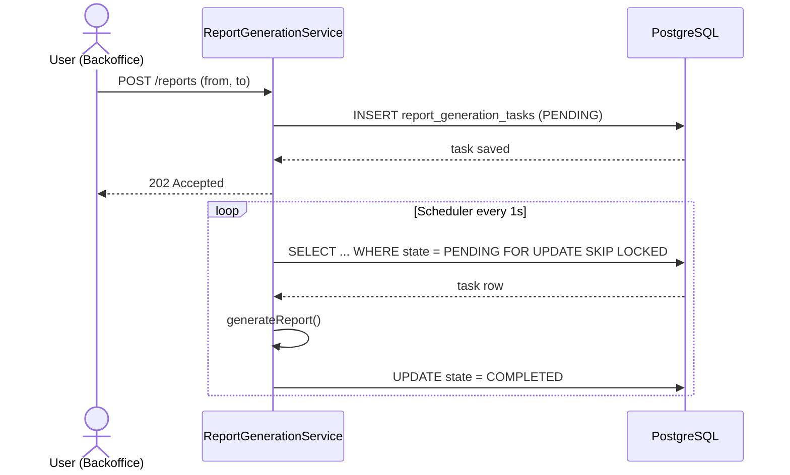
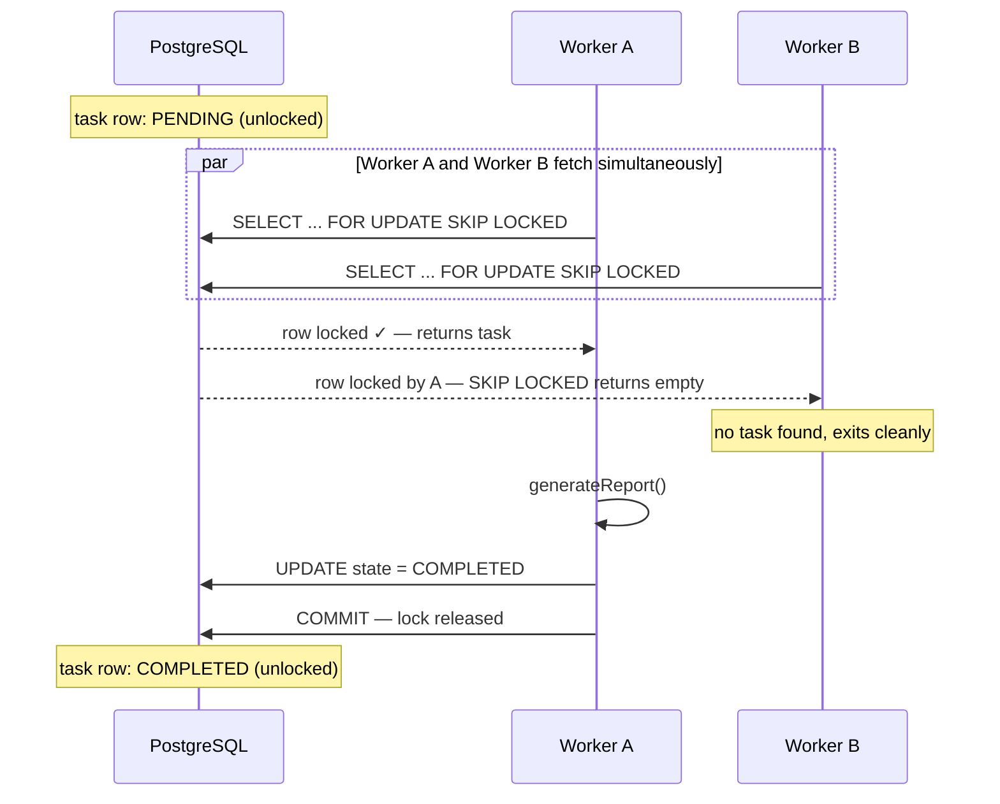
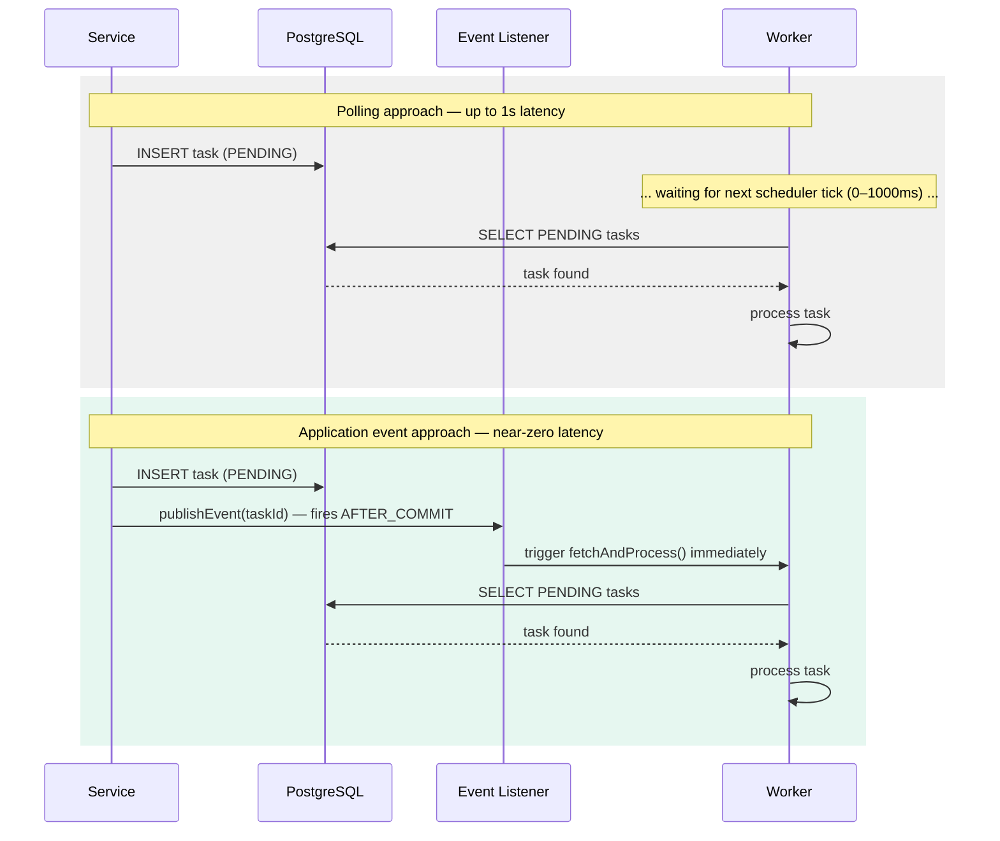
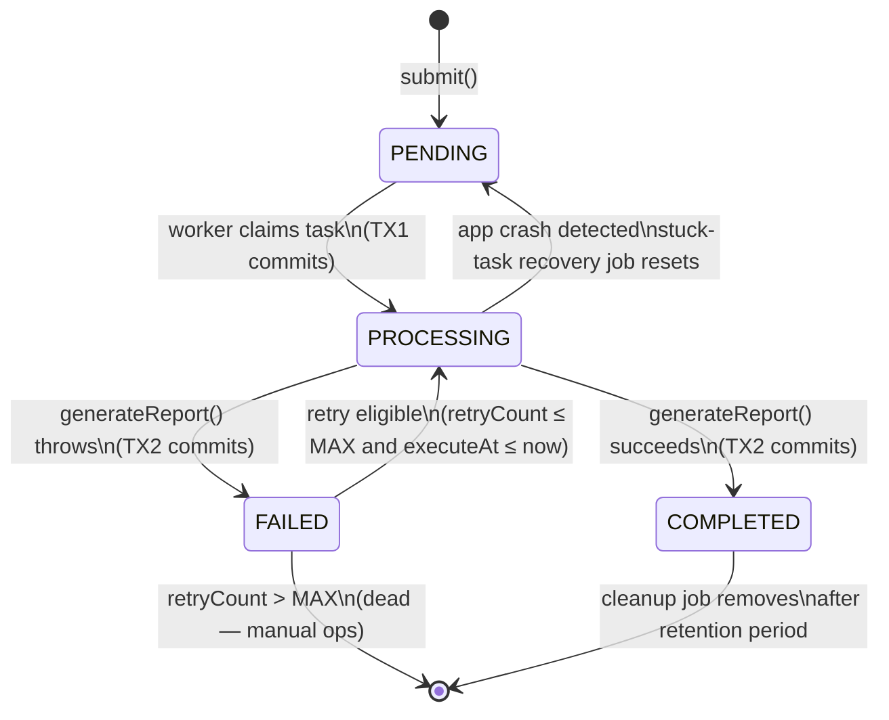
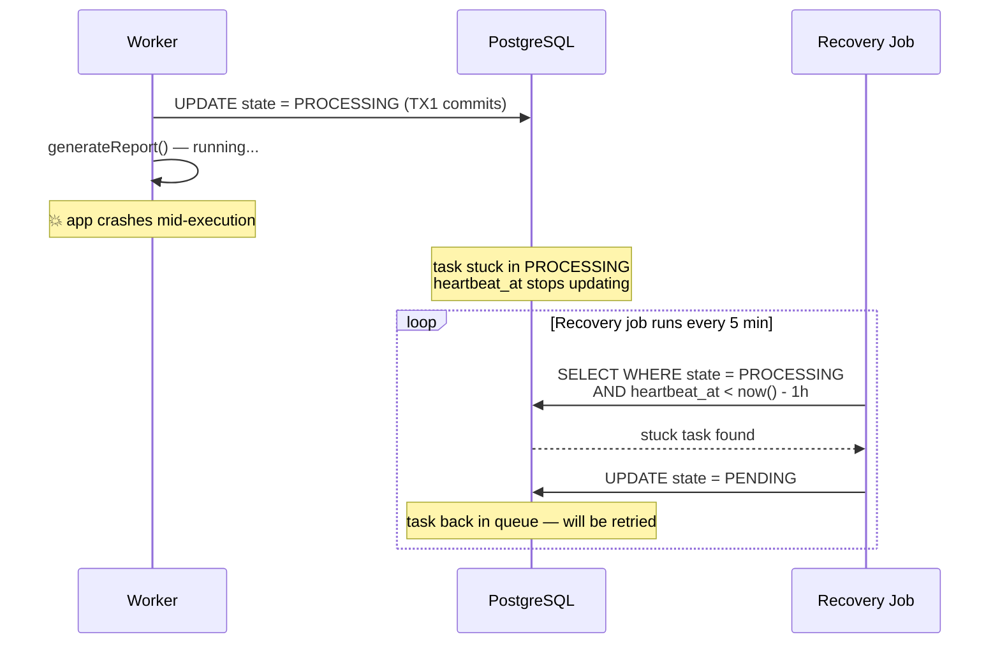
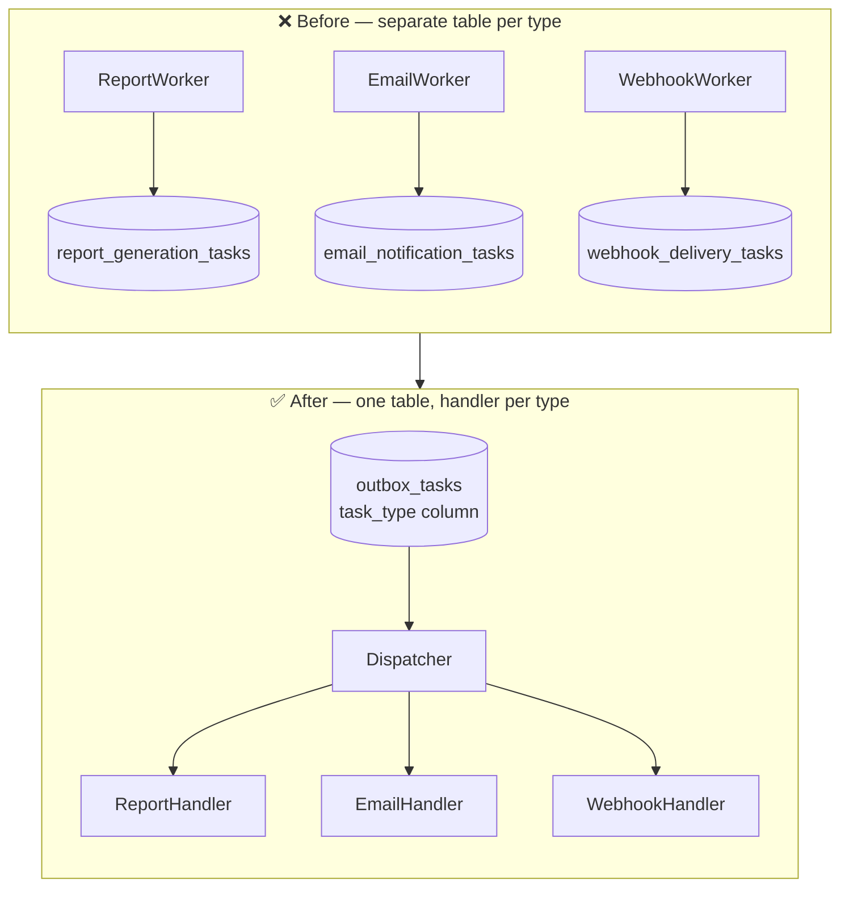

# Le pattern Transactional Outbox : d'une simple tâche à un moteur asynchrone prêt pour la production

Il existe une catégorie de bugs qui n'apparaît jamais dans vos tests unitaires et qui se montre rarement en staging.
Elle apparaît en production, à 2 h du matin, quand votre application enregistre une donnée en base, puis tente d'appeler
un service externe — et l'un des deux échoue. Un côté a commité. L'autre non. Personne
ne le sait tant qu'un utilisateur ne se plaint pas.

C'est le **problème du dual-write** (double écriture), et le Transactional Outbox Pattern est la réponse standard
à ce problème. L'idée est simple : au lieu d'appeler directement le système externe, écrivez une tâche dans la
même transaction de base de données que la modification de votre domaine. Un worker en arrière-plan la récupère et l'exécute.
L'écriture est atomique. La tâche ne peut pas être perdue.

Ce qui est moins documenté, c'est tout ce qui vient après l'idée de base — ce qui se passe quand des tâches
échouent, quand deux workers se disputent la même ligne, quand votre application plante en pleine exécution, quand
dix types de tâches différents cohabitent dans une même table, et quand vos parties prenantes demandent pourquoi la
profondeur de la file a grimpé en flèche à 3 h du matin mardi dernier.

C'est ce que couvre cet article.

Je vais dérouler un scénario concret unique — un **service de génération de rapports** — et l'évolutionner
pas à pas, de l'outbox la plus simple possible à quelque chose que je serais prêt à faire tourner en
production. Chaque extrait de code provient d'un dépôt réel et fonctionnel, lié à la fin de l'article.

Stack : **Java, Spring Boot, PostgreSQL**.

<div class="post-tldr" markdown="1">
<p class="post-tldr-title">TL;DR</p>

- Le **Transactional Outbox Pattern** résout le problème du dual-write en écrivant une ligne de tâche dans la **même transaction en base** que la modification de votre domaine, puis en l'exécutant depuis un worker en arrière-plan.
- Interrogez la table outbox avec `SELECT ... FOR UPDATE SKIP LOCKED` pour que plusieurs workers puissent tourner simultanément sans traiter deux fois la même tâche.
- Le niveau production exige plus que l'idée de base : une **machine à états**, des **retries avec backoff**, des **heartbeats/baux** pour récupérer les workers plantés, des garanties d'**ordre** et une **supervision** de la profondeur de la file.
- Vous n'avez pas besoin de Kafka — **PostgreSQL seul** suffit pour une exécution asynchrone fiable.
</div>

---

## Le scénario



Nous construisons un CRM. Les utilisateurs peuvent demander des rapports d'analyse mensuels depuis une interface
backoffice. Générer un rapport signifie agréger des dizaines de millions de lignes — cela peut prendre plusieurs
minutes. Évidemment, impossible de faire cela de manière synchrone dans une requête HTTP.

L'utilisateur clique sur un bouton. Le backend accepte la requête, l'enregistre et répond immédiatement.
Un worker en arrière-plan récupère la tâche, exécute la génération et met à jour le statut une fois terminé.

C'est le cas le plus simple où une outbox a du sens : du travail réellement asynchrone par nature,
où l'utilisateur s'attend déjà à attendre.

---

## Partie 1 — L'outbox de base

### Ce dont toute outbox a besoin

À la base, toute table outbox a besoin de trois choses :

- **État** — où se trouve la tâche dans son cycle de vie ?
- **Payload** — qu'est-ce qui doit exactement être exécuté ?
- **Horodatages** — quand a-t-elle été créée, quand a-t-elle changé pour la dernière fois ?

```sql
CREATE TYPE task_state AS ENUM ('PENDING', 'COMPLETED');

CREATE TABLE report_generation_tasks (
                                       id         UUID       PRIMARY KEY DEFAULT gen_random_uuid(),
                                       state      task_state NOT NULL    DEFAULT 'PENDING',
                                       payload    JSONB      NOT NULL,
                                       created_at TIMESTAMP  NOT NULL    DEFAULT now(),
                                       updated_at TIMESTAMP  NOT NULL    DEFAULT now()
);
```

Le payload pour notre cas d'usage est une plage de dates :

```java
@Value
@Builder
@Jacksonized
public class ReportGenerationPayload {
  Instant from;
  Instant to;
}
```

L'entité JPA :

```java
@Entity
@Table(name = "report_generation_tasks")
@Data
@Builder
@NoArgsConstructor
@AllArgsConstructor
public class ReportGenerationEntity {

    @Id
    @GeneratedValue(strategy = GenerationType.UUID)
    @Column(updatable = false, nullable = false)
    private UUID id;

    @Enumerated(EnumType.STRING)
    @Column(nullable = false, columnDefinition = "task_state")
    private TaskState state;

    @JdbcTypeCode(SqlTypes.JSON)
    @Column(nullable = false, updatable = false, columnDefinition = "jsonb")
    private ReportGenerationPayload payload;

    @CreationTimestamp
    @Column(nullable = false, updatable = false)
    private Instant createdAt;

    @UpdateTimestamp
    @Column(nullable = false)
    private Instant updatedAt;
}
```

Soumettre une tâche :

```java
@Service
@RequiredArgsConstructor
public class ReportGenerationService {

    private final ReportGenerationRepository repository;

    public void submit(ReportGenerationCommand command) {
        repository.save(ReportGenerationEntity.builder()
                .state(TaskState.PENDING)
                .payload(ReportGenerationPayload.builder()
                        .from(command.getFrom())
                        .to(command.getTo())
                        .build())
                .build());
    }
}
```

### Le worker

Un job planifié interroge les tâches en attente et les exécute :

```java
@Component
@RequiredArgsConstructor
public class ReportGenerationScheduledJob {

    private final ReportGenerationTaskService taskService;

    @Scheduled(fixedDelay = 1000)
    public void run() {
        taskService.fetchAndProcess();
    }
}
```

```java
@Service
@RequiredArgsConstructor
public class ReportGenerationTaskService {

    private final ReportGenerationRepository repository;

    public void fetchAndProcess() {
        repository.findFirstByStateOrderByCreatedAt(TaskState.PENDING)
                .ifPresent(task -> {
                    generateReport(task);
                    task.setState(TaskState.COMPLETED);
                    repository.save(task);
                });
    }

    private void generateReport(ReportGenerationEntity task) {
        // actual report generation logic
    }
}
```

```java
public interface ReportGenerationRepository extends JpaRepository<ReportGenerationEntity, UUID> {
    Optional<ReportGenerationEntity> findFirstByStateOrderByCreatedAt(TaskState state);
}
```

Cela fonctionne dans une application mono-instance sans pannes. Dans le monde réel, cela pose deux problèmes :
deux workers peuvent revendiquer la même tâche simultanément, et les tâches peuvent échouer sans aucun chemin
de reprise. Corrigeons les deux.

---

## Partie 2 — Concurrence : deux workers, une tâche

Quand deux threads du planificateur — ou deux instances de l'application — exécutent la requête de récupération
au même moment, les deux peuvent lire la même ligne `PENDING` et les deux tenteront de l'exécuter. Le résultat est,
au mieux, un travail dupliqué ; au pire, un état corrompu.

La correction, c'est un verrou en base posé au moment de la récupération. Le `SELECT ... FOR UPDATE SKIP LOCKED`
de PostgreSQL est conçu précisément pour ce cas d'usage : il verrouille la ligne pour la transaction courante
et saute les lignes déjà verrouillées par une autre transaction, au lieu d'attendre.

```java
public interface ReportGenerationRepository extends JpaRepository<ReportGenerationEntity, UUID> {

    @Lock(LockModeType.PESSIMISTIC_WRITE)
    @QueryHint(name = AvailableSettings.JAKARTA_LOCK_TIMEOUT, value = "-2") // -2 = SKIP_LOCKED
    Optional<ReportGenerationEntity> findFirstByStateOrderByCreatedAt(TaskState state);
}
```

La valeur `-2` du hint `SKIP_LOCKED` est ce que Hibernate traduit en clause `SKIP LOCKED`.
Comme il n'existe pas d'annotation de premier ordre pour cela, cela vaut la peine de l'extraire dans une
annotation réutilisable, afin de ne pas disperser ce nombre magique dans vos dépôts :

```java
@Retention(RetentionPolicy.RUNTIME)
@Target({ElementType.METHOD, ElementType.ANNOTATION_TYPE})
@QueryHints(@QueryHint(
    name = AvailableSettings.JAKARTA_LOCK_TIMEOUT,
    value = Timeouts.SKIP_LOCKED_MILLI + ""
))
public @interface SkipLocked {}
```

Beaucoup plus propre. Désormais, le dépôt se lit comme une intention, pas comme de la plomberie :

```java
@SkipLocked
@Lock(LockModeType.PESSIMISTIC_WRITE)
Optional<ReportGenerationEntity> findFirstByStateOrderByCreatedAt(TaskState state);
```

Vous *pouvez* conserver le verrou pendant le traitement en enveloppant tout le cycle
récupération-exécution-mise à jour dans une seule transaction, mais en général vous ne devriez pas :

```java
// Technically works, but do not use this pattern for outbox processing.
@Transactional
public void fetchAndProcess() {
    repository.findFirstByStateOrderByCreatedAt(TaskState.PENDING)
            .ifPresent(task -> {
                generateReport(task);
                task.setState(TaskState.COMPLETED);
                repository.save(task);
            });
}
```



Même si `generateReport()` est assez court pour que cela fonctionne techniquement, exécuter une action d'outbox
sous une transaction ouverte est un antipattern. La durée de la transaction ne doit pas dépendre de la durée
d'exécution de l'outbox : l'action peut devenir plus lente avec le temps, se bloquer sur des I/O ou appeler un
service aval, laissant une connexion en base et un verrou de ligne occupés pendant une durée imprévisible.

À la place, revendiquez la ligne dans une courte transaction en la faisant passer à `PROCESSING`, commitez et
libérez le verrou, puis seulement exécutez l'action d'outbox. Enregistrez `COMPLETED` ou `FAILED` ensuite, dans
une autre courte transaction. La section suivante implémente cette transition d'état et son chemin de reprise.

---

## Partie 2.5 — Réduire la latence avec les événements applicatifs

Le planificateur par polling a un plancher de latence inhérent. Si votre job se déclenche chaque seconde, une tâche
soumise à `t=0ms` reste `PENDING` jusqu'au tick suivant — jusqu'à 1000 ms plus tard. Pour la plupart des charges
de travail asynchrones, c'est acceptable. Pour les cas où vous voulez une prise en charge quasi immédiate — envoi
d'un e-mail transactionnel, déclenchement d'un webhook — ce ne l'est pas.

Le pattern, emprunté à Celery : enregistrer l'entité d'outbox en base, puis publier immédiatement un
`ApplicationEvent` Spring portant l'ID de la nouvelle tâche. Un listener la récupère et déclenche le traitement
aussitôt, sans attendre le prochain tick du planificateur.



Le planificateur continue de tourner comme filet de sécurité — il rattrape tout ce que le listener d'événements
a manqué (redémarrage de l'application, exception du listener, événement perdu). Mais le chemin nominal contourne
entièrement le délai de polling.

### Implémentation

Publiez l'événement dans la méthode du service, après l'enregistrement :

```java
@Service
@RequiredArgsConstructor
public class ReportGenerationService {

    private final ReportGenerationRepository repository;
    private final ApplicationEventPublisher eventPublisher;

    @Transactional
    public void submit(ReportGenerationCommand command) {
        var entity = repository.save(ReportGenerationEntity.builder()
                .state(TaskState.PENDING)
                .payload(ReportGenerationPayload.builder()
                        .from(command.getFrom())
                        .to(command.getTo())
                        .build())
                .build());

        eventPublisher.publishEvent(new ReportGenerationTaskSubmittedEvent(entity.getId()));
    }
}
```

```java
public record ReportGenerationTaskSubmittedEvent(UUID taskId) {}
```

Le listener réagit et déclenche le traitement immédiatement :

```java
@Component
@RequiredArgsConstructor
public class ReportGenerationTaskEventListener {

    private final ReportGenerationTaskService taskService;

    @TransactionalEventListener(phase = TransactionPhase.AFTER_COMMIT)
    public void onTaskSubmitted(ReportGenerationTaskSubmittedEvent event) {
        taskService.fetchAndProcess();
    }
}
```

### L'erreur classique

L'erreur la plus courante ici est d'utiliser `@EventListener` au lieu de
`@TransactionalEventListener(phase = TransactionPhase.AFTER_COMMIT)`.

`@EventListener` se déclenche au moment où `publishEvent()` est appelé — c'est-à-dire **à l'intérieur de la
transaction ouverte**, avant que le `INSERT` ait été commité. Le listener appelle `fetchAndProcess()`,
qui interroge la base pour trouver la tâche par son ID. La ligne n'existe pas encore. La tâche est silencieusement
ignorée, l'événement est perdu, et vous vous demandez pourquoi le traitement n'a jamais démarré — alors même que
le planificateur finit par la récupérer quelques secondes plus tard et que tout semble normal dans les logs.

```java
// ❌ fires inside the transaction — entity not visible to other connections yet
@EventListener
public void onTaskSubmitted(ReportGenerationTaskSubmittedEvent event) {
    taskService.fetchAndProcess();
}

// ✅ fires after COMMIT — entity is visible, fetch succeeds
@TransactionalEventListener(phase = TransactionPhase.AFTER_COMMIT)
public void onTaskSubmitted(ReportGenerationTaskSubmittedEvent event) {
    taskService.fetchAndProcess();
}
```

`AFTER_COMMIT` garantit que le listener ne s'exécute qu'après que la transaction ayant publié l'événement
a été entièrement commitée. À ce stade, la ligne est visible pour toutes les connexions et la récupération la
trouvera.

Le planificateur reste inchangé — il sert de mécanisme de reprise pour toute tâche que le listener d'événements
aurait manquée. Les deux approches se complètent : les événements pour la latence, le polling pour la fiabilité.

---

## Partie 3 — Échecs, retries et l'état PROCESSING



Les actions d'outbox ne devraient pas s'exécuter sous une transaction de base ouverte. L'approche par transaction
verrouillée maintient un verrou en base pendant toute la
durée de `generateReport()`. Pour un rapport qui prend deux minutes, ce sont deux minutes de
ligne verrouillée — une connexion mobilisée, d'autres opérations en base potentiellement en file d'attente
derrière. Avec `SKIP LOCKED`, les workers ne se bloquent pas mutuellement sur le verrou, mais les transactions
longues exercent quand même une pression sur le pool de connexions et mettent la base de mauvaise humeur sous
charge. Une action très courte peut techniquement se terminer sans causer de trouble visible, mais coupler la
durée de la transaction à la durée d'exécution de l'outbox reste un antipattern.

La correction consiste à séparer la revendication d'une tâche de son exécution. Faites passer la tâche à
`PROCESSING` dans une courte transaction, libérez le verrou, puis faites le vrai travail en dehors de toute
transaction. Ainsi, la base n'est sollicitée que brièvement au début et brièvement à la fin — la partie coûteuse
se déroule entre les deux sans rien retenir.

D'abord, étendez l'enum :

```sql
ALTER TYPE task_state ADD VALUE 'PROCESSING';
ALTER TYPE task_state ADD VALUE 'FAILED';

ALTER TABLE report_generation_tasks
    ADD COLUMN retry_count  INTEGER NOT NULL DEFAULT 0,
    ADD COLUMN error_message VARCHAR;
```

`retry_count` trace combien de fois l'exécution a été tentée. Nous plafonnons les retries à 10 — au-delà,
quelque chose est réellement cassé et nécessite une intervention manuelle. Nous brancherons l'alerting autour
de cela plus loin. `error_message` stocke la dernière exception pour que vous sachiez *pourquoi* une tâche est
bloquée sans devoir fouiller les logs.

L'enum Java grandit avec elle :

```java
public enum TaskState {
    PENDING,
    PROCESSING,
    COMPLETED,
    FAILED
}
```

Le service exécute désormais deux courtes transactions distinctes avec le vrai travail entre les deux :

```java
@RequiredArgsConstructor
public class ReportGenerationTaskService {

    private final ReportGenerationRepository repository;
    private final TransactionTemplate transactionTemplate;

    private static final int MAX_RETRY_COUNT = 10;

    public void fetchAndProcess() {
        transactionTemplate
                .execute(status ->
                        repository.findFirstEligibleTask(
                                List.of(TaskState.PENDING, TaskState.FAILED),
                                MAX_RETRY_COUNT
                        ).map(this::markProcessing))
                .ifPresentOrElse(
                        task -> {
                            try {
                                generateReport(task);
                                markCompleted(task);
                            } catch (Exception e) {
                                markFailed(task, e);
                                log.error("Task {} failed on attempt {}", task.getId(), task.getRetryCount(), e);
                            }
                        },
                        () -> log.debug("No eligible tasks to process")
                );
    }

    private ReportGenerationEntity markProcessing(ReportGenerationEntity task) {
        task.setState(TaskState.PROCESSING);
        return repository.save(task);
    }

    private void markCompleted(ReportGenerationEntity task) {
        task.setState(TaskState.COMPLETED);
        repository.save(task);
    }

    private void markFailed(ReportGenerationEntity task, Exception e) {
        task.setState(TaskState.FAILED);
        task.setRetryCount(task.getRetryCount() + 1);
        task.setErrorMessage(e.getMessage()); // don't skip this — it's the only trace of what went wrong without digging through logs
        repository.save(task);
    }
}
```

La requête récupère à la fois les tâches `PENDING` et `FAILED` — une tâche échouée avec `retryCount < 10` est
tout aussi éligible qu'une tâche neuve. Une fois le compteur de retries au plafond, la tâche n'est plus récupérée
et reste en enregistrement `FAILED` permanent jusqu'à ce que quelqu'un la regarde. C'est volontaire — au-delà de
10 tentatives, quelque chose est réellement cassé et a besoin qu'on y pose les yeux, pas d'un retry de plus.

```java
@SkipLocked
@Lock(LockModeType.PESSIMISTIC_WRITE)
@Query("""
    SELECT t FROM ReportGenerationEntity t
    WHERE t.state IN :states
      AND t.retryCount <= :maxRetryCount
    ORDER BY t.createdAt ASC
    LIMIT 1
    """)
Optional<ReportGenerationEntity> findFirstEligibleTask(
    @Param("states") List<TaskState> states,
    @Param("maxRetryCount") Integer maxRetryCount
);
```

Mais attendez — une tâche qui vient d'échouer devrait-elle vraiment être reprise au tout prochain tick du
planificateur, quelques secondes plus tard ? Si le système aval est en panne, le marteler chaque seconde aggrave
les choses. C'est ce que couvre la section suivante.

## Partie 4 — Le backoff exponentiel

Sans délai entre les retries, une tâche échouée réintègre la file au tout prochain tick du planificateur —
généralement quelques secondes plus tard. Si le système aval est en panne, vous le martelez à plein régime de
polling. C'est mauvais pour le système aval et mauvais pour votre base.

La correction, c'est une colonne `execute_at` : la tâche n'est pas éligible tant que cet horodatage n'est pas
dans le passé. Les tâches neuves reçoivent `execute_at = now()` pour être prises en charge immédiatement. Les
tâches échouées reçoivent `execute_at = now() + délai`, où le délai croît à chaque retry.

```sql
ALTER TABLE report_generation_tasks
    ADD COLUMN execute_at TIMESTAMP NOT NULL DEFAULT NOW();
```

Le calendrier des délais pilote tout — `MAX_RETRY_COUNT` en est dérivé, pas déclaré séparément. Ainsi, les deux
ne peuvent jamais se désynchroniser :

```java
private static final Map<Integer, Duration> RETRY_DELAYS = Map.of(
    0, Duration.ofMinutes(1),
    1, Duration.ofMinutes(5),
    2, Duration.ofMinutes(15),
    3, Duration.ofMinutes(30),
    4, Duration.ofHours(1),
    5, Duration.ofHours(2),
    6, Duration.ofHours(4),
    7, Duration.ofHours(8),
    8, Duration.ofHours(12),
    9, Duration.ofDays(1)
);

private static final int MAX_RETRY_COUNT = RETRY_DELAYS.size();
```

Ajoutez une entrée à `RETRY_DELAYS` et le plafond de retries se met à jour automatiquement. Plus aucun nombre
magique à synchroniser ailleurs.

Dans `markFailed()`, capturez le compteur de retries *actuel* avant l'incrément — c'est lui qui sélectionne le
délai de la *prochaine* tentative :

```java
private void markFailed(ReportGenerationEntity task, Exception e) {
    int currentRetry = task.getRetryCount();
    task.setState(TaskState.FAILED);
    task.setRetryCount(currentRetry + 1);
    task.setErrorMessage(e.getMessage());
    task.setExecuteAt(Instant.now().plus(
            RETRY_DELAYS.getOrDefault(currentRetry, RETRY_DELAYS.get(RETRY_DELAYS.size() - 1))));
    repository.save(task);
}
```

Le planificateur continue de tourner au même rythme. Il saute simplement les tâches dont la fenêtre n'est pas
encore ouverte. Les tâches échouées attendent tranquillement leur tour, puis réintègrent la file naturellement.

---

## Partie 5 — Tâches bloquées et heartbeats



Avec l'approche à deux transactions, considérez ce qui se passe si l'application plante après avoir marqué une
tâche `PROCESSING` mais avant de la marquer `COMPLETED` ou `FAILED`. La base affiche `PROCESSING`. Personne ne
la traite. Elle y reste pour toujours.

La correction naïve est un job de reprise qui trouve les tâches bloquées en `PROCESSING` depuis trop longtemps
et les réinitialise à `PENDING` :

```java
@Transactional
public void recoverStuckTasks() {
    repository.findFirstByStateAndUpdatedAtLessThan(
                    TaskState.PROCESSING,
                    Instant.now().minus(1, ChronoUnit.HOURS))
            .ifPresent(task -> {
                log.warn("Resetting stuck task {} to PENDING", task.getId());
                task.setState(TaskState.PENDING);
                repository.save(task);
            });
}
```

Cela fonctionne dans la plupart des cas. Le problème : `updated_at` change dès que *n'importe quoi* change sur
la ligne — y compris des transitions d'état sans rapport. Une tâche légitimement en traitement depuis 55 minutes
est indiscernable d'une tâche plantée, du point de vue de `updated_at`.

La solution plus propre est un **heartbeat** : une colonne dédiée mise à jour périodiquement *uniquement tant
que la tâche est activement traitée*. Le job de reprise vérifie désormais cette colonne, pas `updated_at`.
Une tâche sans heartbeat depuis la dernière heure est réellement bloquée.

```sql
ALTER TABLE report_generation_tasks ADD COLUMN heartbeat_at TIMESTAMP;
```

Le heartbeat tourne sur son propre thread, dans ses propres transactions, indépendamment de la logique de
traitement. L'implémentation la plus propre est un `try-with-resources` — il démarre quand le traitement démarre
et s'arrête sur tout chemin de sortie :

```java
public abstract class Heartbeat implements AutoCloseable {

    private final ScheduledExecutorService executor;

    protected Heartbeat(Runnable heartbeatFn) {
        executor = Executors.newSingleThreadScheduledExecutor();
        executor.scheduleAtFixedRate(heartbeatFn, 0, 10, TimeUnit.SECONDS);
    }

    @Override
    public void close() {
        executor.shutdownNow();
    }
}
```

```java
public class ReportGenerationTaskHeartbeat extends Heartbeat {

    ReportGenerationTaskHeartbeat(UUID taskId, ReportGenerationRepository repository) {
        super(() -> repository.updateHeartbeatAt(taskId, Instant.now()));
    }
}
```

La méthode du dépôt porte son propre `@Transactional` — pas besoin d'envelopper l'appel manuellement :

```java
@Modifying
@Transactional
@Query("UPDATE ReportGenerationTaskEntity t SET t.heartbeatAt = :now WHERE t.id = :id")
void updateHeartbeatAt(@Param("id") UUID id, @Param("now") Instant now);
```

Branchez-le via une factory pour que le service reste propre :

```java
@Component
@RequiredArgsConstructor
public class ReportGenerationTaskHeartbeatFactory {

    private final ReportGenerationRepository repository;

    public Heartbeat start(UUID taskId) {
        return new ReportGenerationTaskHeartbeat(taskId, repository);
    }
}
```

Le bloc de traitement ressemble désormais à ceci :

```java
public void fetchAndProcess() {
    transactionTemplate
            .execute(status -> repository.findFirstEligibleTask(
                    List.of(TaskState.PENDING, TaskState.FAILED),
                    MAX_RETRY_COUNT
            ).map(this::markProcessing))
            .ifPresentOrElse(
                    task -> {
                        try (var heartbeat = heartbeatFactory.start(task.getId())) {
                            try {
                                generateReport(task);
                                markCompleted(task);
                            } catch (Exception e) {
                                markFailed(task, e);
                                log.error("Task {} failed", task.getId(), e);
                            }
                        }
                    },
                    () -> log.debug("No eligible tasks to process")
            );
}
```

Le job de reprise utilise `heartbeat_at` au lieu de `updated_at` :

```java
@Modifying
@Transactional
@Query("UPDATE ReportGenerationEntity t SET t.heartbeatAt = :now WHERE t.id = :id")
void updateHeartbeatAt(@Param("id") UUID id, @Param("now") Instant now);

Optional<ReportGenerationEntity> findFirstByStateAndHeartbeatAtLessThan(
        TaskState state, Instant threshold);
```

`updated_at` reflète le moment du dernier changement d'état de la tâche. `heartbeat_at` reflète le fait que la
tâche est vivante en ce moment. Les garder séparés permet de répondre aux deux questions sans ambiguïté.

---

## Partie 6 — L'outbox multi-types



Six mois plus tard, votre service gère plus que la génération de rapports. Vous avez besoin de notifications par
e-mail. Puis d'exports de données. Puis de livraisons de webhooks.

Vous avez deux options : une table séparée par type de tâche, ou une table partagée avec un discriminateur
`task_type`. La table partagée gagne quand les types de tâches sont nombreux et que vous êtes à l'aise pour les
traiter depuis un seul endroit. L'infrastructure — retries, heartbeats, backoff, supervision — reste au même
endroit. Ajouter un nouveau type de tâche revient à ajouter un nouveau handler.

Les compromis à connaître à l'avance :

- Un nouveau type de tâche qui se comporte mal peut ralentir tous les autres — un mauvais handler qui brûle des
  retries crée une contre-pression sur toute la table.
- Les garanties d'ordre deviennent plus difficiles — plus de détails ci-dessous.

### Le schéma

```sql
CREATE TYPE outbox_task_type AS ENUM ('REPORT_GENERATION', 'EMAIL_NOTIFICATION');

CREATE TABLE outbox_tasks (
    id            UUID             PRIMARY KEY DEFAULT gen_random_uuid(),
    task_type     outbox_task_type NOT NULL,
    state         task_state       NOT NULL    DEFAULT 'PENDING',
    payload       JSONB            NOT NULL,
    retry_count   INTEGER          NOT NULL    DEFAULT 0,
    error_message VARCHAR,
    execute_at    TIMESTAMPTZ      NOT NULL    DEFAULT NOW(),
    heartbeat_at  TIMESTAMPTZ,
    created_at    TIMESTAMPTZ      NOT NULL    DEFAULT now(),
    updated_at    TIMESTAMPTZ      NOT NULL    DEFAULT now()
);
```

### L'interface handler

Le point d'extension clé — une implémentation par type de tâche :

```java
public interface OutboxTaskHandler<P> {
    OutboxTaskType getType();
    Class<P> payloadClass();
    void handle(UUID taskId, P payload) throws Exception;
}
```

`taskId` est passé à chaque handler. Vous verrez pourquoi dans la section sur l'idempotence.

Un handler concret :

```java
@Component
public class EmailNotificationHandler implements OutboxTaskHandler<EmailNotificationPayload> {

    @Override
    public OutboxTaskType getType() {
        return OutboxTaskType.EMAIL_NOTIFICATION;
    }

    @Override
    public Class<EmailNotificationPayload> payloadClass() {
        return EmailNotificationPayload.class;
    }

    @Override
    public void handle(UUID taskId, EmailNotificationPayload payload) throws Exception {
        log.info("Sending email to {} — task {}", payload.getRecipient(), taskId);
        // call email provider
    }
}
```

### Le dispatcher

Le service collecte tous les beans handler au démarrage, construit une map de correspondance et route chaque
tâche selon son `taskType` :

```java
@Service
@RequiredArgsConstructor
public class OutboxTaskService {

    private final OutboxTaskRepository repository;
    private final ObjectMapper objectMapper;
    private final List<OutboxTaskHandler<?>> handlerList;

    private Map<OutboxTaskType, OutboxTaskHandler<?>> handlers;

    @PostConstruct
    void init() {
        handlers = handlerList.stream()
                .collect(Collectors.toMap(OutboxTaskHandler::getType, Function.identity()));
    }

    @SuppressWarnings("unchecked")
    private void dispatch(OutboxTaskEntity task) throws Exception {
        var handler = (OutboxTaskHandler<Object>) handlers.get(task.getTaskType());
        if (handler == null) {
            throw new IllegalStateException(
                    "No handler registered for task type: " + task.getTaskType());
        }
        var payload = objectMapper.readValue(task.getPayload(), handler.payloadClass());
        handler.handle(task.getId(), payload);
    }
}
```

Enregistrer un nouveau type de tâche : ajouter une valeur d'enum, ajouter un bean handler, c'est tout.
Le dispatcher, le planificateur, la logique de retry — rien ne change.

---

## Partie 7 — L'ordre

Si votre cas d'usage se fiche de l'ordre de traitement — notifications fire-and-forget, jobs en arrière-plan
indépendants — passez votre chemin. Mais même dans ce cas, récupérer d'abord les tâches insérées le plus tôt est
le comportement le plus honnête : les tâches soumises en premier attendent depuis plus longtemps, et les traiter
dans l'ordre de soumission est ce que les utilisateurs sont en droit d'attendre.

Sans `ORDER BY` explicite, PostgreSQL ne donne **aucune garantie** sur l'ordre de retour des lignes. Triez
toujours par `created_at ASC` dans votre requête de récupération :

```java
@Query("""
    SELECT t FROM OutboxTaskEntity t
    WHERE t.state IN :states
      AND t.retryCount <= :maxRetryCount
      AND t.executeAt <= :now
    ORDER BY t.createdAt ASC
    LIMIT 1
    """)
Optional<OutboxTaskEntity> findFirstEligibleTask(...);
```

Appuyez cela sur un index partiel :

```sql
CREATE INDEX idx_outbox_fetch
    ON outbox_tasks (created_at ASC)
    WHERE state IN ('PENDING', 'FAILED');
```

### Le piège de la dérive d'horloge

D'abord, soyez honnête quant à savoir si cela compte pour votre cas d'usage. Si vos tâches sont indépendantes —
génération de rapports, envoi d'e-mails, livraison de webhooks — l'ordre de traitement n'a généralement aucune
importance. Que la tâche A se termine avant la tâche B, peu importe laquelle a été soumise en premier, c'est très
bien. Dans ce cas, toute cette section n'est pas votre problème.

Si vous avez réellement besoin de FIFO — des tâches pour une même entité devant être traitées dans l'ordre de
soumission — alors lisez la suite.

Le problème, c'est que `created_at` est généré côté application. Chaque instance possède sa propre horloge
système. Si l'instance A a 200 ms d'avance sur l'instance B, une tâche soumise par B à `t=100ms` reçoit un
`created_at` antérieur à celui d'une tâche soumise par A à `t=50ms` — alors même que la tâche de A a été insérée
en premier. La requête de récupération trie par `created_at` et prend la tâche de B en premier. L'ordre de
soumission est inversé.

NTP garde les horloges proches mais pas parfaitement synchronisées. En conditions normales, la dérive se compte
en millisecondes. Sous charge, pendant des migrations de VM, ou après un redémarrage de conteneur, elle peut
être supérieure.

La correction consiste à générer la valeur d'ordre côté base de données — soit laisser PostgreSQL assigner
`created_at` via `DEFAULT now()` plutôt que de laisser l'application le définir, soit utiliser une séquence
adossée à la base, garantie monotone croissante quelle que soit l'instance qui insère la ligne. Voici l'approche
par séquence :

```sql
ALTER TABLE outbox_tasks ADD COLUMN seq BIGSERIAL;
```

```java
@Column(insertable = false, updatable = false)
private Long seq;
```

Triez par `seq ASC`. La valeur est assignée par une source unique et faisant autorité — la base de données —
elle reflète donc le vrai ordre d'insertion, quelle que soit l'instance ayant soumis la tâche ou ce que disait
l'horloge de cette instance.

Gardez `created_at` pour l'observabilité. Utilisez `seq` pour l'ordre.

Si le FIFO strict compte dans votre système — n'oubliez pas ceci.

---

## Partie 8 — Les index qui gardent la table rapide à l'échelle

Votre table outbox est interrogée chaque seconde, souvent plusieurs fois par seconde. Chaque ligne qu'elle
contient est soit du travail actif (`PENDING`, `FAILED`, `PROCESSING`), soit du bruit historique (`COMPLETED`).
Sans les bons index, chaque interrogation scanne la table entière pour trouver la poignée de lignes éligibles.

L'outil approprié est un **index partiel** — un index qui n'inclut que les lignes correspondant à un prédicat.
Quand une tâche passe à `COMPLETED`, elle sort automatiquement de l'index partiel. L'index reste petit pour
toujours, peu importe le nombre de tâches que la table a traitées depuis le début.

### L'index de récupération — le chemin chaud

Un index pour la requête de récupération :

```sql
CREATE INDEX idx_outbox_fetch
    ON outbox_tasks (created_at ASC)
    WHERE state IN ('PENDING', 'FAILED');
```

Pour le tester : insertion de 50 000 lignes dont seulement 7 en état `PENDING`, activation des logs SQL debug
d'Hibernate pour obtenir la requête générée exacte dans la console, puis `EXPLAIN ANALYZE` sur ce SQL :

```
Limit  (cost=0.14..27.50 rows=1 width=102) (actual time=0.082..0.084 rows=1 loops=1)
  ->  LockRows  (actual time=0.081..0.082 rows=1 loops=1)
        ->  Index Scan using idx_outbox_fetch on outbox_tasks
              (actual time=0.030..0.030 rows=1 loops=1)
Planning Time: 1.230 ms
Execution Time: 0.139 ms
```

0,03 ms pour trouver la plus ancienne tâche éligible. Les 49 993 lignes `COMPLETED` n'ont jamais été lues.
Ça me convient.

Deux index de plus pour les deux autres opérations en arrière-plan :

Pour le job de reprise :

```sql
CREATE INDEX idx_outbox_stuck
    ON outbox_tasks (heartbeat_at ASC, created_at ASC)
    WHERE state = 'PROCESSING';
```

Pour le job de nettoyage :

```sql
CREATE INDEX idx_outbox_cleanup
    ON outbox_tasks (updated_at ASC)
    WHERE state = 'COMPLETED';
```

---

## Partie 9 — Le nettoyage

Votre outbox est une table opérationnelle. Chaque requête de récupération la scanne. Les vieilles lignes sont
du poids mort.

La règle : ne supprimez que les tâches **`COMPLETED`**. Les tâches `FAILED` sont votre piste d'audit. Ne les
touchez pas. Traitez-les manuellement ou via un processus d'exploitation séparé quand c'est nécessaire.

```java
@Modifying
@Transactional
@Query("""
    DELETE FROM OutboxTaskEntity t
    WHERE t.state IN :states
      AND t.updatedAt < :before
    """)
int deleteByStateInAndUpdatedAtBefore(
    @Param("states") List<TaskState> states,
    @Param("before") Instant before
);
```

```java
private static final int CLEANUP_RETENTION_DAYS = 30;

@Transactional
public void cleanup() {
    var cutoff = Instant.now().minus(CLEANUP_RETENTION_DAYS, ChronoUnit.DAYS);
    int deleted = repository.deleteByStateInAndUpdatedAtBefore(
            List.of(TaskState.COMPLETED), cutoff);
    log.info("Cleanup: removed {} completed tasks older than {} days", deleted, CLEANUP_RETENTION_DAYS);
}
```

Combien de temps conserver : j'ai vu de tout, de 1 jour à 3 mois. En cas de doute — conservez plus longtemps.
Le coût de la rétention des vieilles lignes est une table légèrement plus grosse. Le coût d'une suppression trop
précoce, c'est de perdre votre historique de débogage le jour où vous en avez le plus besoin.

---

## Partie 10 — L'idempotence : rendre les retries sans danger

Rien dans cette architecture ne garantit une exécution exactly-once. L'exécution de la tâche et la mise à jour
d'état vers `COMPLETED` sont deux opérations distinctes. Si l'application plante après l'exécution mais avant
que la mise à jour d'état soit commitée, la tâche sera retentée. Elle s'exécutera à nouveau avec les mêmes
entrées.

C'est une livraison **at-least-once** — c'est la seule garantie disponible ici. La question est de savoir si
une exécution dupliquée cause du tort.

Si votre tâche est intrinsèquement idempotente (générer deux fois le même rapport produit le même rapport),
vous avez terminé. Si elle a des effets de bord (envoie un e-mail, débite une carte), un doublon est un problème.

La correction : utiliser l'`id` propre à la tâche d'outbox comme clé d'idempotence dans le handler. L'ID de
tâche est stable entre les retries — il ne change jamais pour une même ligne. Le handler vérifie si un travail
pour cet ID a déjà été enregistré. Si oui, c'est un no-op.

Dans notre cas, la génération de rapport se termine par l'insertion d'une ligne dans `generated_reports` —
c'est la trace du travail effectué. Nous ajoutons une contrainte `UNIQUE` sur `idempotency_key` pour que, même
si deux instances font la course, un seul INSERT gagne. L'autre reçoit une violation de contrainte et la traite
comme un no-op réussi :

```sql
CREATE TABLE generated_reports (
    id               UUID        PRIMARY KEY DEFAULT gen_random_uuid(),
    idempotency_key  UUID        NOT NULL,
    report_path      VARCHAR     NOT NULL,
    created_at       TIMESTAMPTZ NOT NULL    DEFAULT now(),

    CONSTRAINT uq_generated_reports_idempotency_key UNIQUE (idempotency_key)
);
```

```java
@Component
@RequiredArgsConstructor
public class ReportGenerationHandler implements OutboxTaskHandler<ReportGenerationPayload> {

    private final GeneratedReportRepository reports;

    @Override
    public void handle(UUID taskId, ReportGenerationPayload payload) {
        if (reports.existsByIdempotencyKey(taskId)) {
            log.info("Report already generated for task {} — skipping", taskId);
            return;
        }

        var reportPath = runReportGeneration(payload);

        reports.save(GeneratedReport.builder()
                .idempotencyKey(taskId)
                .reportPath(reportPath)
                .build());
    }
}
```

Si votre tâche appelle une API externe au lieu d'écrire en base, vérifiez si cette API supporte les clés
d'idempotence — la plupart des processeurs de paiement et des fournisseurs d'e-mails transactionnels le font.
Passez l'ID de la tâche d'outbox comme clé d'idempotence sous la forme exigée par l'API (en-tête, champ du corps,
paramètre de requête). Le service distant gère la déduplication de son côté.

---

## Partie 11 — La supervision

L'outbox tourne silencieusement en arrière-plan. Quand tout fonctionne, personne ne le remarque. Quand elle
casse, personne ne le remarque non plus — du moins pas immédiatement. Les tâches bloquées s'accumulent. Les
services aval cessent de recevoir les événements. Quand quelqu'un finit par regarder les logs, cela fait deux
heures.

Trois signaux couvrent complètement l'espace des pannes, selon le modèle SRE de Google :

- **Latence** — combien de temps chaque tâche prend-elle de la prise en charge à la complétion ? Un pic ici signifie un handler lent ou une base sous pression.
- **Débit** — combien de tâches se terminent par unité de temps ? Une chute à zéro signifie que le planificateur ne tourne plus ou qu'aucune tâche n'est prise en charge.
- **Taux d'erreur** — quelle proportion des tentatives se termine en échec ? Au-dessus de ~5 %, une dépendance aval est dégradée et le stock de retries grossit.


### L'instrumentation

Ajoutez à `build.gradle.kts` :

```kotlin
implementation("org.springframework.boot:spring-boot-starter-actuator")
implementation("io.micrometer:micrometer-registry-prometheus")
```

Enregistrez une seule fois l'aspect AOP `@Timed` :

```java
@Bean
public TimedAspect timedAspect(MeterRegistry registry) {
    return new TimedAspect(registry);
}
```

Gardez les noms de métriques en constantes et incrémentez depuis un composant dédié — pas dispersés dans les
méthodes de service :

```java
@Component
@RequiredArgsConstructor
public class OutboxMetrics {

  private static final String TASK_PROCESSED = "outbox.task.processed";
  private static final String OUTCOME_TAG    = "outcome";
  private static final String COMPLETED      = "completed";
  private static final String FAILED         = "failed";

  private final MeterRegistry meterRegistry;
  private final ReportGenerationRepository repository;

  public void recordCompleted() {
    meterRegistry.counter(TASK_PROCESSED, OUTCOME_TAG, COMPLETED).increment();
  }

  public void recordFailed() {
    meterRegistry.counter(TASK_PROCESSED, OUTCOME_TAG, FAILED).increment();
  }

  @PostConstruct
  void registerGauge() {
    Gauge.builder("outbox.tasks.pending", repository,
                    repo -> repo.countByStateIn(List.of(TaskState.PENDING, TaskState.FAILED)))
            .description("Tasks waiting to be processed")
            .register(meterRegistry);
  }
}
```

Le service se contente alors d'appeler `metrics.recordCompleted()` et `metrics.recordFailed()` — aucune chaîne
brute dans la logique métier.

Après le démarrage, `curl localhost:8080/actuator/prometheus | grep outbox` vous donne :

```
outbox_task_duration_seconds{quantile="0.5"}  0.062
outbox_task_duration_seconds{quantile="0.95"} 0.145
outbox_task_duration_seconds{quantile="0.99"} 0.312
outbox_task_processed_total{outcome="completed"} 40.0
outbox_task_processed_total{outcome="failed"}    2.0
outbox_tasks_pending 0.0
```

### Les alertes

Les tableaux de bord sont pour les humains qui regardent des écrans. Les alertes sont pour les humains qui
dorment.

| Alerte | Se déclenche quand | Pendant | Signification |
|---|---|---|---|
| `OutboxQueueBacklog` | pending > 50 | 5 min | Le traitement ne suit pas l'ingestion |
| `OutboxHighErrorRate` | taux d'erreur > 5 % | 2 min | Handler ou aval dégradé |
| `OutboxSlowProcessing` | latence p99 > 30 s | 5 min | Contention en base ou appel externe lent |
| `OutboxStuckTasks` | pending > 0 et zéro complétion en 10 min | 10 min | Planificateur planté ou tous les workers bloqués |

Ajustez les seuils à votre propre charge. Une profondeur de file de 50 peut être normale pour un service à haut
débit. Pour un outil interne à faible volume, même 5 tâches qui traînent 5 minutes méritent un coup d'œil.
La logique des signaux est la même ; seuls les chiffres changent.

---

## Checklist de production

Avant de mettre une outbox en production :

```
☐ Les index sont efficaces — index partiels sur les états PENDING/FAILED et PROCESSING
☐ EXPLAIN ANALYZE confirme l'utilisation de l'index sur la requête de récupération
☐ L'ordre n'est pas un problème — ORDER BY seq ou created_at, adossé à un index
☐ Job de nettoyage des données traitées en cours d'exécution, lignes COMPLETED supprimées après la période de rétention
☐ Idempotence gérée dans les handlers avec effets de bord
☐ Backoff exponentiel câblé — ou confirmé comme non nécessaire pour ce cas d'usage
☐ Métriques en place — profondeur de file, débit, taux d'erreur, latence
☐ Alertes configurées — backlog, taux d'erreur, latence, tâches bloquées
```

---

## L'écosystème — vous n'avez pas toujours à construire cela vous-même

Tout ce qui est décrit dans cet article est quelque chose que vous pouvez construire vous-même — et il y a une
vraie valeur à le faire au moins une fois. Vous comprenez les modes de panne, les choix d'index, les pièges
d'ordre, parce que vous avez conçu autour. Ce savoir ne disparaît pas quand vous passez à une bibliothèque.

Mais en production, vous n'avez souvent pas besoin de maintenir cela vous-même.

---

**[db-scheduler](https://github.com/kagkarlsson/db-scheduler)** — le planificateur persistant et compatible
cluster de Gustav Karlsson pour Java. C'est la bibliothèque vers laquelle je reviens sans cesse et celle dont les
internes ressemblent le plus à ce que nous avons construit dans cet article. Il utilise une seule table en base,
du verrouillage pessimiste avec `SKIP LOCKED`, des heartbeats pour détecter les tâches bloquées, et une interface
tâche/handler propre. Quand je conçois des outboxes maison, j'utilise db-scheduler comme implémentation de
référence — les interfaces, les patterns, la gestion des pannes sont tous sains. Si vous démarrez un nouveau
projet et voulez une fondation éprouvée plutôt que de rouler la vôtre, commencez ici. Les abstractions sont assez
fines pour que vous reconnaissiez tout ce que cet article décrit dans le code source.

---

**[Celery](https://docs.celeryq.dev/)** — le standard de facto de l'exécution de tâches asynchrones dans
l'écosystème Python. Celery supporte PostgreSQL comme result backend et Redis ou RabbitMQ comme broker.
Le pattern `AFTER_COMMIT` de la partie 2.5 s'applique ici aussi — poussez vers Celery seulement après le commit
de la transaction, pas à l'intérieur.

---

**[Quartz Scheduler](https://www.quartz-scheduler.org/)** — la bibliothèque d'ordonnancement Java historique
avec persistance des jobs via JDBC. Plus générale qu'une outbox, avec expressions cron, triggers et job stores.
Son coût opérationnel est plus élevé que db-scheduler et son API est verbeuse selon les standards modernes, mais
elle a fait ses preuves à grande échelle avec une intégration Spring de premier ordre via
`spring-boot-starter-quartz`.

---

## Pour conclure

La plupart de ce qui figure dans cet article n'est pas de l'ingénierie brillante — c'est du tissu cicatriciel
accumulé. L'état `PROCESSING` existe parce que l'application de quelqu'un a planté. Le heartbeat existe parce que
`updated_at` a menti. L'index partiel existe parce qu'un full table scan à la fréquence du polling s'accumule
discrètement jusqu'à ne plus passer. Le listener `AFTER_COMMIT` existe parce que quelqu'un a publié un événement
à l'intérieur d'une transaction et a passé des heures à déboguer pourquoi il ne se déclenchait jamais.

Chaque pièce est ennuyeuse prise isolément. Ensemble, elles font la différence entre une outbox qui fonctionne
en développement et une à laquelle vous pouvez faire confiance à 3 h du matin.

---

## Code

Le code de cet article est disponible sur **[github.com/javaAndScriptDeveloper/outboxes-article](https://github.com/javaAndScriptDeveloper/outboxes-article)**. Tout tourne localement avec une seule commande.

---

## Discutons-en

Si vous rencontrez quelque chose que j'ai manqué, ou si vous avez résolu l'un de ces problèmes différemment dans
vos propres systèmes — j'aimerais sincèrement le savoir. Les liens de contact sont dans le pied de page.
