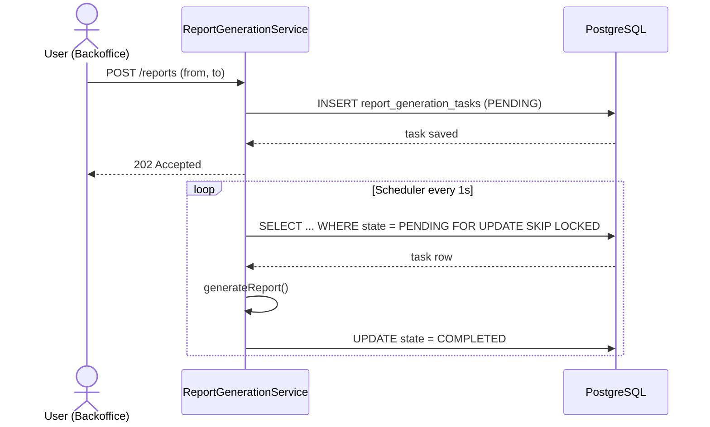
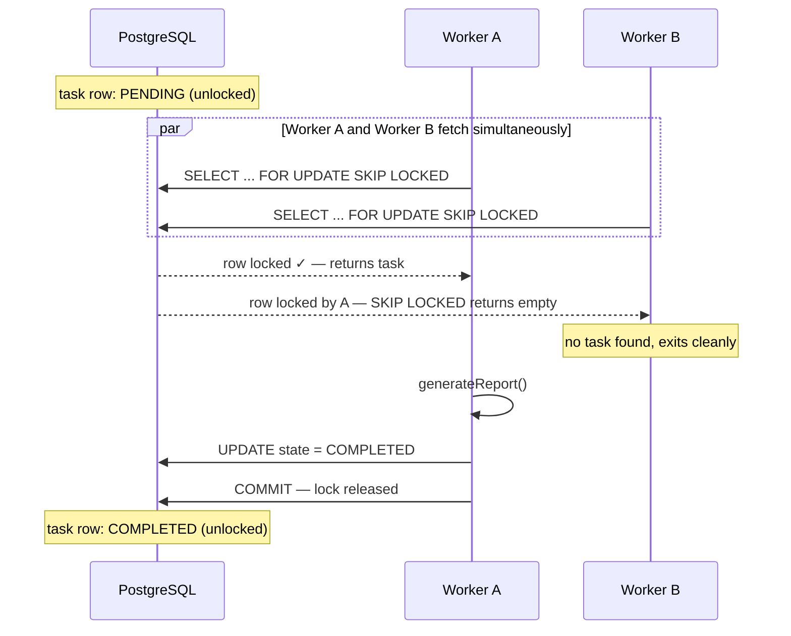
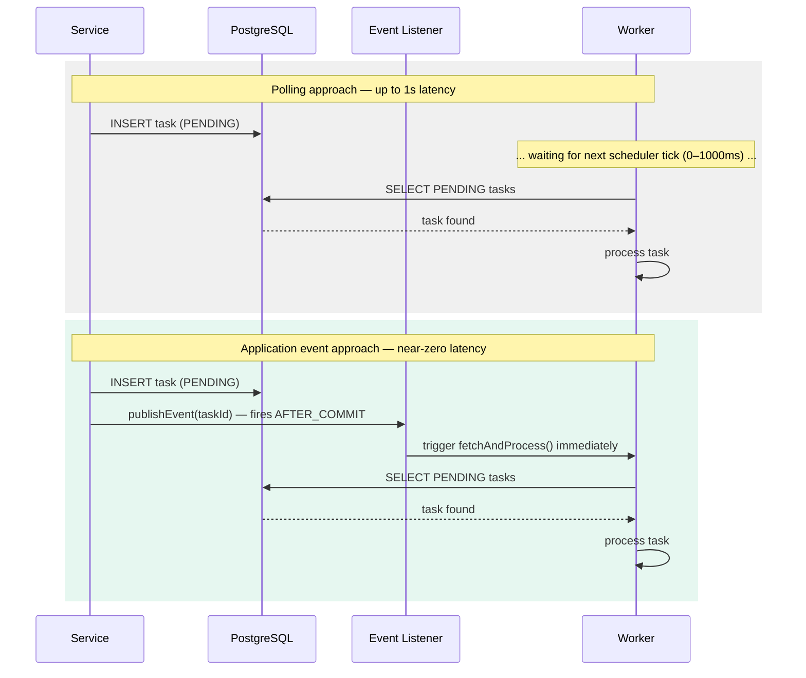
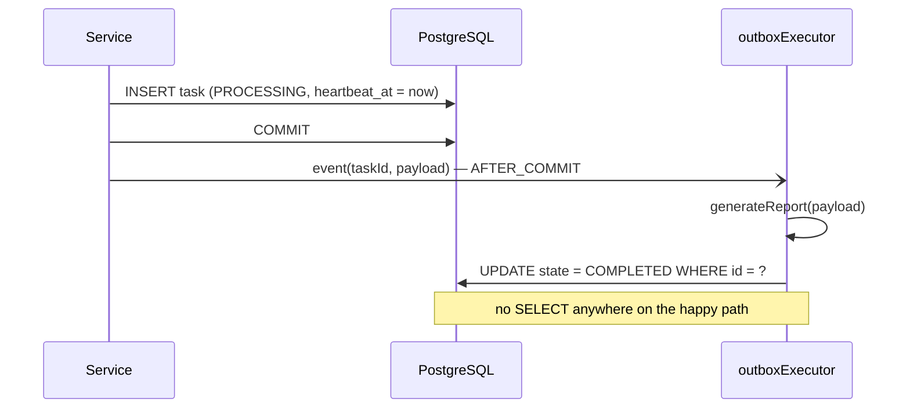
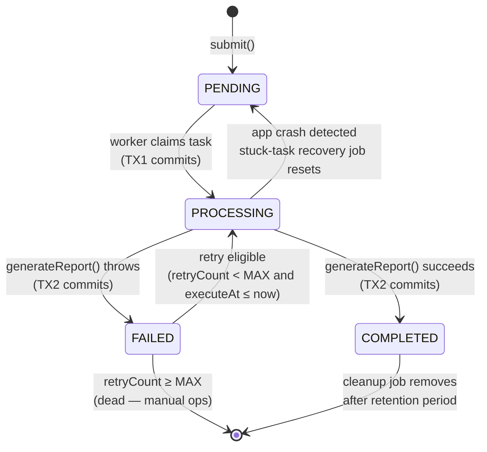
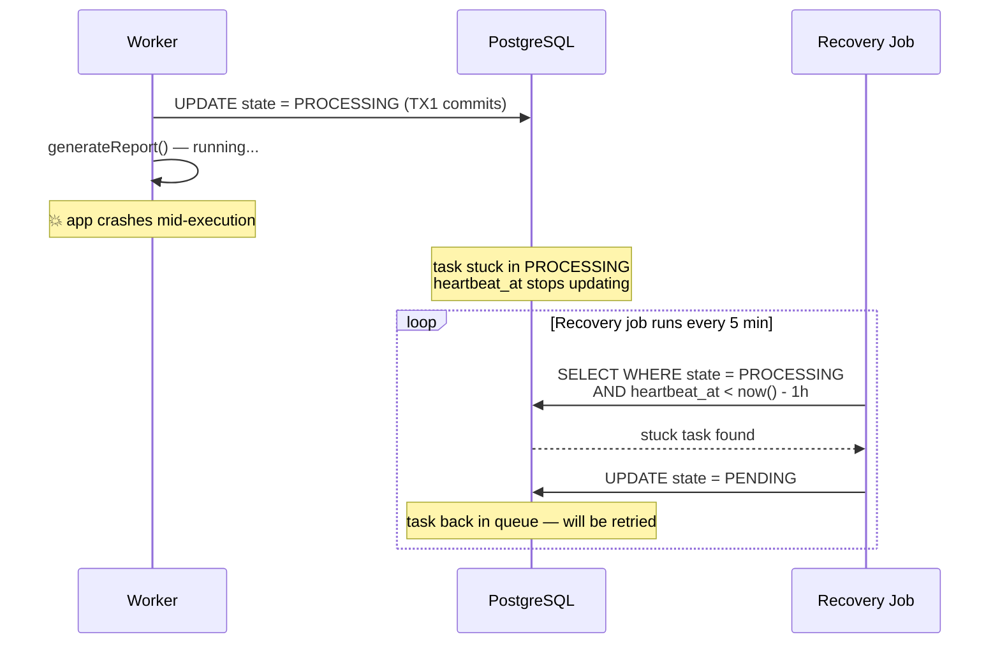
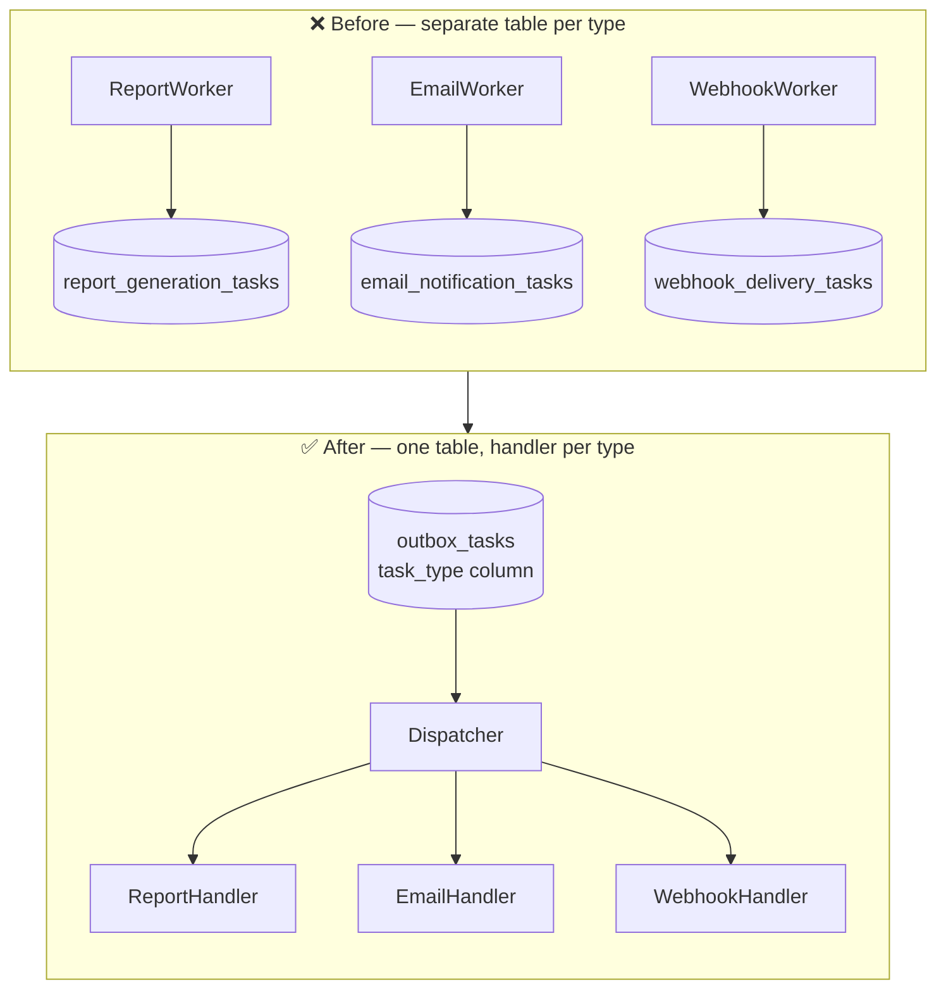
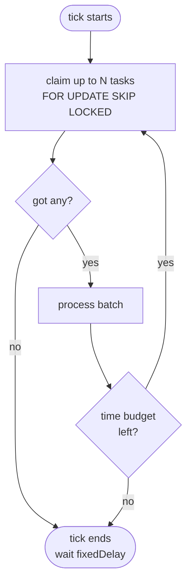

# Le pattern Transactional Outbox : d'une simple tâche à un moteur asynchrone prêt pour la production

Il existe une catégorie de bugs qui n'apparaît jamais dans vos tests unitaires et qui se montre rarement en staging.
Elle apparaît en production, à 2 h du matin, quand votre application enregistre une donnée en base, puis tente d'appeler
un service externe — et l'un des deux échoue. Un côté a commité. L'autre non. Personne
ne le sait tant qu'un utilisateur ne se plaint pas.

C'est le **problème du dual-write** (double écriture), et le Transactional Outbox Pattern est la réponse standard
à ce problème. L'idée est simple : au lieu d'appeler directement le système externe, écrivez une tâche dans la
même transaction de base de données que la modification de votre domaine. Un worker en arrière-plan la récupère et l'exécute.
L'écriture est atomique. La tâche ne peut pas être perdue.

Ce qui est moins documenté, c'est tout ce qui vient après l'idée de base — ce qui se passe quand des tâches
échouent, quand deux workers se disputent la même ligne, quand votre application plante en pleine exécution, quand
dix types de tâches différents cohabitent dans une même table, et quand vos parties prenantes demandent pourquoi la
profondeur de la file a grimpé en flèche à 3 h du matin mardi dernier.

C'est ce que couvre cet article.

Je vais dérouler un scénario concret unique — un **service de génération de rapports** — et le faire évoluer
pas à pas, de l'outbox la plus simple possible à quelque chose que je serais prêt à faire tourner en
production. Chaque extrait de code provient d'un dépôt réel et fonctionnel, lié à la fin de l'article.

Stack : **Java, Spring Boot, PostgreSQL**.

<div class="post-tldr" markdown="1">
<p class="post-tldr-title">TL;DR</p>

- Le **Transactional Outbox Pattern** résout le problème du dual-write en écrivant une ligne de tâche dans la **même transaction en base** que la modification de votre domaine, puis en l'exécutant depuis un worker en arrière-plan.
- Interrogez la table outbox avec `SELECT ... FOR UPDATE SKIP LOCKED` pour que plusieurs workers puissent tourner simultanément sans traiter deux fois la même tâche.
- **N'envoyez jamais** de message à Kafka et n'appelez jamais un autre service à l'intérieur d'une transaction en base : la durée d'une transaction ne doit jamais dépendre d'une ressource externe.
- Le niveau production exige plus que l'idée de base : une **machine à états**, des **retries avec backoff et jitter**, des **heartbeats/baux** pour récupérer les workers plantés, des garanties d'**ordre**, une **stratégie de récupération** réfléchie, un **nettoyage par lots** et une **supervision** de la profondeur de la file.
- Pour une faible latence, réveillez les workers avec un événement `AFTER_COMMIT` sur un **pool de threads dédié** — ou passez au **zero-select** en transportant le payload dans l'événement, au prix d'un moindre contrôle sur la charge.
- Vous n'avez pas besoin de Kafka — **PostgreSQL seul** suffit pour une exécution asynchrone fiable.
</div>

---

## Le scénario



Nous construisons un CRM. Les utilisateurs peuvent demander des rapports d'analyse mensuels depuis une interface
backoffice. Générer un rapport signifie agréger des dizaines de millions de lignes — cela peut prendre plusieurs
minutes. Évidemment, impossible de faire cela de manière synchrone dans une requête HTTP.

L'utilisateur clique sur un bouton. Le backend accepte la requête, l'enregistre et répond immédiatement.
Un worker en arrière-plan récupère la tâche, exécute la génération et met à jour le statut une fois terminé.

C'est le cas le plus simple où une outbox a du sens : du travail réellement asynchrone par nature,
où l'utilisateur s'attend déjà à attendre.

---

## Partie 1 — L'outbox de base

### Ce dont toute outbox a besoin

À la base, toute table outbox a besoin de trois choses :

- **État** — où se trouve la tâche dans son cycle de vie ?
- **Payload** — qu'est-ce qui doit exactement être exécuté ?
- **Horodatages** — quand a-t-elle été créée, quand a-t-elle changé pour la dernière fois ?

```sql
CREATE TYPE task_state AS ENUM ('PENDING', 'COMPLETED');

CREATE TABLE report_generation_tasks (
                                       id         UUID       PRIMARY KEY DEFAULT gen_random_uuid(),
                                       state      task_state NOT NULL    DEFAULT 'PENDING',
                                       payload    JSONB      NOT NULL,
                                       created_at TIMESTAMP  NOT NULL    DEFAULT now(),
                                       updated_at TIMESTAMP  NOT NULL    DEFAULT now()
);
```

Le payload pour notre cas d'usage est une plage de dates :

```java
@Value
@Builder
@Jacksonized
public class ReportGenerationPayload {
  Instant from;
  Instant to;
}
```

L'entité JPA :

```java
@Entity
@Table(name = "report_generation_tasks")
@Data
@Builder
@NoArgsConstructor
@AllArgsConstructor
public class ReportGenerationEntity {

    @Id
    @GeneratedValue(strategy = GenerationType.UUID)
    @Column(updatable = false, nullable = false)
    private UUID id;

    @Enumerated(EnumType.STRING)
    @Column(nullable = false, columnDefinition = "task_state")
    private TaskState state;

    @JdbcTypeCode(SqlTypes.JSON)
    @Column(nullable = false, updatable = false, columnDefinition = "jsonb")
    private ReportGenerationPayload payload;

    @CreationTimestamp
    @Column(nullable = false, updatable = false)
    private Instant createdAt;

    @UpdateTimestamp
    @Column(nullable = false)
    private Instant updatedAt;
}
```

Soumettre une tâche :

```java
@Service
@RequiredArgsConstructor
public class ReportGenerationService {

    private final ReportGenerationRepository repository;

    public void submit(ReportGenerationCommand command) {
        repository.save(ReportGenerationEntity.builder()
                .state(TaskState.PENDING)
                .payload(ReportGenerationPayload.builder()
                        .from(command.getFrom())
                        .to(command.getTo())
                        .build())
                .build());
    }
}
```

### Le worker

Un job planifié interroge les tâches en attente et les exécute :

```java
@Component
@RequiredArgsConstructor
public class ReportGenerationScheduledJob {

    private final ReportGenerationTaskService taskService;

    @Scheduled(fixedDelay = 1000)
    public void run() {
        taskService.fetchAndProcess();
    }
}
```

```java
@Service
@RequiredArgsConstructor
public class ReportGenerationTaskService {

    private final ReportGenerationRepository repository;

    public void fetchAndProcess() {
        repository.findFirstByStateOrderByCreatedAt(TaskState.PENDING)
                .ifPresent(task -> {
                    generateReport(task);
                    task.setState(TaskState.COMPLETED);
                    repository.save(task);
                });
    }

    private void generateReport(ReportGenerationEntity task) {
        // actual report generation logic
    }
}
```

```java
public interface ReportGenerationRepository extends JpaRepository<ReportGenerationEntity, UUID> {
    Optional<ReportGenerationEntity> findFirstByStateOrderByCreatedAt(TaskState state);
}
```

Cela fonctionne dans une application mono-instance sans pannes. Dans le monde réel, cela pose deux problèmes :
deux workers peuvent revendiquer la même tâche simultanément, et les tâches peuvent échouer sans aucun chemin
de reprise. Corrigeons les deux.

---

## Partie 2 — Concurrence : deux workers, une tâche

Quand deux threads du planificateur — ou deux instances de l'application — exécutent la requête de récupération
au même moment, les deux peuvent lire la même ligne `PENDING` et les deux tenteront de l'exécuter. Le résultat est,
au mieux, un travail dupliqué ; au pire, un état corrompu.

La correction, c'est un verrou en base posé au moment de la récupération. Le `SELECT ... FOR UPDATE SKIP LOCKED`
de PostgreSQL est conçu précisément pour ce cas d'usage : il verrouille la ligne pour la transaction courante
et saute les lignes déjà verrouillées par une autre transaction, au lieu d'attendre.

```java
public interface ReportGenerationRepository extends JpaRepository<ReportGenerationEntity, UUID> {

    @Lock(LockModeType.PESSIMISTIC_WRITE)
    @QueryHint(name = AvailableSettings.JAKARTA_LOCK_TIMEOUT, value = "-2") // -2 = SKIP_LOCKED
    Optional<ReportGenerationEntity> findFirstByStateOrderByCreatedAt(TaskState state);
}
```

La valeur `-2` du hint `SKIP_LOCKED` est ce que Hibernate traduit en clause `SKIP LOCKED`.
Comme il n'existe pas d'annotation de premier ordre pour cela, cela vaut la peine de l'extraire dans une
annotation réutilisable, afin de ne pas disperser ce nombre magique dans vos dépôts :

```java
@Retention(RetentionPolicy.RUNTIME)
@Target({ElementType.METHOD, ElementType.ANNOTATION_TYPE})
@QueryHints(@QueryHint(
    name = AvailableSettings.JAKARTA_LOCK_TIMEOUT,
    value = Timeouts.SKIP_LOCKED_MILLI + ""
))
public @interface SkipLocked {}
```

Beaucoup plus propre. Désormais, le dépôt se lit comme une intention, pas comme de la plomberie :

```java
@SkipLocked
@Lock(LockModeType.PESSIMISTIC_WRITE)
Optional<ReportGenerationEntity> findFirstByStateOrderByCreatedAt(TaskState state);
```

Vous *pouvez* conserver le verrou pendant le traitement en enveloppant tout le cycle
récupération-exécution-mise à jour dans une seule transaction, mais en général vous ne devriez pas :

```java
// Technically works, but do not use this pattern for outbox processing.
@Transactional
public void fetchAndProcess() {
    repository.findFirstByStateOrderByCreatedAt(TaskState.PENDING)
            .ifPresent(task -> {
                generateReport(task);
                task.setState(TaskState.COMPLETED);
                repository.save(task);
            });
}
```



Même si `generateReport()` est assez court pour que cela fonctionne techniquement, exécuter une action d'outbox
sous une transaction ouverte est un antipattern. La durée de la transaction ne doit pas dépendre de la durée
d'exécution de l'outbox : l'action peut devenir plus lente avec le temps, se bloquer sur des I/O ou appeler un
service aval, laissant une connexion en base et un verrou de ligne occupés pendant une durée imprévisible.

À la place, revendiquez la ligne dans une courte transaction en la faisant passer à `PROCESSING`, commitez et
libérez le verrou, puis seulement exécutez l'action d'outbox. Enregistrez `COMPLETED` ou `FAILED` ensuite, dans
une autre courte transaction. La section suivante implémente cette transition d'état et son chemin de reprise.

### Ne jamais parler au monde extérieur à l'intérieur d'une transaction

La même règle s'applique bien au-delà du worker d'outbox, et c'est la façon la plus fréquente dont j'ai vu du
code gravitant autour d'une outbox faire tomber un service. Le code a l'air inoffensif :

```java
// ❌ Kafka send (or an HTTP call, or an S3 upload) inside an open DB transaction
@Transactional
public void approveOrder(UUID orderId) {
    var order = orderRepository.findById(orderId).orElseThrow();
    order.setStatus(OrderStatus.APPROVED);

    kafkaTemplate.send("order-approved", orderId.toString(), toEvent(order)).get(); // blocks
    billingClient.notifyApproved(orderId);                                         // blocks
}
```

Les bons jours, Kafka acquitte en 5 ms et le service de facturation répond en 30 ms : personne ne remarque rien.
Les mauvais jours, le broker est en plein rebalancing ou le service de facturation est dégradé, et chaque appel
prend 30 secondes avant d'expirer. Désormais, **chaque** transaction en cours reste ouverte 30 secondes :

- chacune monopolise une connexion du pool — avec 20 connexions et des appels de 30 secondes, tout votre service
  peut approuver 20 commandes toutes les 30 secondes, et tout le reste (y compris des endpoints de lecture en
  parfaite santé) fait la queue pour obtenir une connexion et commence à partir en timeout ;
- dès qu'elle a écrit (avec JPA, ce n'est parfois qu'au flush du commit, mais souvent plus tôt), elle détient des
  verrous de ligne — tout ce qui touche aux mêmes commandes attend derrière ;
- une transaction longue qui a écrit quelque chose retient l'horizon de vacuum de Postgres — les lignes mortes de
  toute la base ne peuvent pas être nettoyées tant qu'elle n'est pas terminée, et le bloat s'accumule partout,
  pas seulement dans cette table.

Une dégradation dans une dépendance qui ne vous appartient pas vient de devenir une panne dans une base de données
qui, elle, vous appartient. **La durée d'une transaction en base ne doit jamais dépendre d'une ressource externe.**
Une transaction ne devrait jamais attendre autre chose que la base elle-même.

C'est aussi, toujours, un dual-write. Si l'envoi Kafka réussit et que le commit échoue ensuite (violation de
contrainte, échec de sérialisation, pod tué), les consommateurs ont déjà vu un événement `order-approved` pour une
commande qui n'a jamais été approuvée. Déplacer l'envoi *après* le commit ne fait qu'inverser le mode de panne :
commité, mais l'événement est perdu. C'est exactement le problème que l'outbox existe pour résoudre — écrivez
l'intention dans l'outbox au sein de la transaction, et laissez un worker parler à Kafka ensuite.

Deux garde-fous valent la peine d'être ajoutés même quand le code est correct, parce que la prochaine personne
qui y touchera ne connaîtra peut-être pas la règle :

```java
@Transactional(timeout = 5) // seconds
public void approveOrder(UUID orderId) { ... }
```

Le `timeout` de Spring n'interrompt pas un appel déjà bloqué — c'est une échéance vérifiée par le travail en base
qui suit. Toute requête émise après l'échéance (y compris le flush au commit) échoue avec une exception de timeout
et la transaction est annulée. Voyez-le comme un fil de détente qui transforme « lent et silencieux » en « échoue
bruyamment dans les tests et les logs », pas comme un remède.

```sql
-- server-side safety net: kill sessions that sit idle inside an open transaction
ALTER DATABASE app SET idle_in_transaction_session_timeout = '30s';
```

`idle_in_transaction_session_timeout`, c'est exactement la situation ci-dessus vue par Postgres : la session a
ouvert une transaction, puis s'est tue pendant que l'application attendait autre chose.

---

## Partie 2.5 — Réduire la latence avec les événements applicatifs

Le planificateur par polling a un plancher de latence inhérent. Si votre job se déclenche chaque seconde, une tâche
soumise à `t=0ms` reste `PENDING` jusqu'au tick suivant — jusqu'à 1000 ms plus tard. Pour la plupart des charges
de travail asynchrones, c'est acceptable. Pour les cas où vous voulez une prise en charge quasi immédiate — envoi
d'un e-mail transactionnel, déclenchement d'un webhook — ce ne l'est pas.

Le pattern, emprunté à Celery : enregistrer l'entité d'outbox en base, puis publier immédiatement un
`ApplicationEvent` Spring portant l'ID de la nouvelle tâche. Un listener la récupère et déclenche le traitement
aussitôt, sans attendre le prochain tick du planificateur.



Le planificateur continue de tourner comme filet de sécurité — il rattrape tout ce que le listener d'événements
a manqué (redémarrage de l'application, exception du listener, événement perdu). Mais le chemin nominal contourne
entièrement le délai de polling.

### Implémentation

Publiez l'événement dans la méthode du service, après l'enregistrement :

```java
@Service
@RequiredArgsConstructor
public class ReportGenerationService {

    private final ReportGenerationRepository repository;
    private final ApplicationEventPublisher eventPublisher;

    @Transactional
    public void submit(ReportGenerationCommand command) {
        var entity = repository.save(ReportGenerationEntity.builder()
                .state(TaskState.PENDING)
                .payload(ReportGenerationPayload.builder()
                        .from(command.getFrom())
                        .to(command.getTo())
                        .build())
                .build());

        eventPublisher.publishEvent(new ReportGenerationTaskSubmittedEvent(entity.getId()));
    }
}
```

```java
public record ReportGenerationTaskSubmittedEvent(UUID taskId) {}
```

Le listener réagit après le commit, **sur son propre pool de threads** :

```java
@Component
@RequiredArgsConstructor
public class ReportGenerationTaskEventListener {

    private final ReportGenerationTaskService taskService;

    @Async("outboxExecutor")
    @TransactionalEventListener(phase = TransactionPhase.AFTER_COMMIT)
    public void onTaskSubmitted(ReportGenerationTaskSubmittedEvent event) {
        taskService.fetchAndProcess();
    }
}
```

Remarquez que le listener ne transmet pas `event.taskId()`. C'est voulu : l'événement n'est qu'un **signal de
réveil**, et `fetchAndProcess()` revendique le travail exactement comme le fait le poller — la plus ancienne tâche
éligible, avec `SKIP LOCKED`. La tâche qui a déclenché l'événement n'est peut-être pas celle qui s'exécute, mais
l'ordre et la revendication restent centralisés en un seul endroit. Si vous préférez exécuter *cette* tâche-là tout
de suite, passez l'id et revendiquez-la directement :

```java
taskService.process(event.taskId()); // WHERE id = :id AND state = 'PENDING' FOR UPDATE SKIP LOCKED
```

Le soumetteur obtient ainsi la latence la plus faible, au prix de laisser les nouvelles tâches doubler des tâches
`PENDING` plus anciennes — sans conséquence pour du travail indépendant, mais faux si vous comptez sur le FIFO
(partie 7). L'outbox zero-select, à la fin de cette partie, pousse l'idée jusqu'au bout et transmet le payload
entier.

`@Async` n'est pas décoratif. Un listener `AFTER_COMMIT` sans lui s'exécute **de façon synchrone sur le thread qui
a commité** — le thread de la requête HTTP. Le « 202 Accepted » de l'utilisateur attend désormais que le rapport
entier soit généré. Pire : à ce stade, les ressources de la transaction commitée sont encore liées au thread. La
documentation de Spring elle-même prévient que l'accès aux données depuis un callback after-commit « participe »
encore à la transaction terminée, et que rien ne le commitera à moins que le code ne demande explicitement
`REQUIRES_NEW`. Déplacer le listener sur un thread séparé règle les deux problèmes d'un coup.

### Un pool de threads dédié, pas celui par défaut

`@Async` sans nom utilise l'`applicationTaskExecutor` partagé de Spring Boot — partagé avec toutes les autres
méthodes `@Async` de l'application, et doté par défaut d'une file pratiquement illimitée. Un afflux d'événements se
transformerait silencieusement en backlog en mémoire qui disparaît au prochain redémarrage. Donnez à l'outbox son
propre pool borné :

```java
@Configuration
@EnableAsync
public class OutboxExecutorConfig {

    @Bean("outboxExecutor")
    public ThreadPoolTaskExecutor outboxExecutor() {
        var executor = new ThreadPoolTaskExecutor();
        executor.setCorePoolSize(4);
        executor.setMaxPoolSize(4);
        executor.setQueueCapacity(200);                 // bounded: overflow is rejected, not buffered forever
        executor.setThreadNamePrefix("outbox-");        // readable thread dumps and logs
        executor.setRejectedExecutionHandler(new ThreadPoolExecutor.DiscardPolicy());
        executor.setWaitForTasksToCompleteOnShutdown(true);
        executor.setAwaitTerminationSeconds(15);
        return executor;
    }
}
```

Un détail de Spring Boot à connaître avant de copier ceci : Boot n'auto-configure son `applicationTaskExecutor` que
si vous n'avez **pas** déclaré vous-même de bean `Executor`. Déclarez `outboxExecutor` et celui par défaut
disparaît — chaque `@Async` *sans nom* ailleurs dans l'application atterrit discrètement sur un autre executor
(peut-être celui-ci, avec sa politique de rejet silencieux). Sur Boot 3.5+, positionnez
`spring.task.execution.mode=force` pour conserver celui auto-configuré ; sur les versions plus anciennes, déclarez
explicitement un bean `applicationTaskExecutor` à côté de celui-ci.

Abandonner en cas de débordement est sans danger ici *parce que la ligne est en base* : l'événement n'est qu'une
optimisation de latence, et le poller récupère tout ce que le chemin événementiel a laissé tomber. N'utilisez
jamais `CallerRunsPolicy` pour ce pool — le « caller », c'est justement le thread de requête que vous cherchiez à
libérer.

### L'erreur classique

L'erreur la plus courante est d'utiliser `@EventListener` au lieu de
`@TransactionalEventListener(phase = TransactionPhase.AFTER_COMMIT)`. Ce qui tourne mal dépend du caractère
asynchrone ou non du listener :

- **Un simple `@EventListener`** se déclenche au moment où `publishEvent()` est appelé — de façon synchrone, sur le
  même thread, **à l'intérieur de la transaction encore ouverte**. `fetchAndProcess()` rejoint cette transaction :
  il *voit* donc la ligne non commitée — et il revendique et exécute la tâche sur-le-champ. Le rapport est généré
  à l'intérieur de la transaction de soumission (exactement l'antipattern de la partie 2), la requête reste
  suspendue jusqu'à la fin, et si la transaction de soumission est ensuite annulée, vous avez exécuté une tâche qui
  officiellement n'a jamais existé.
- **`@Async` + `@EventListener`** s'exécute sur un autre thread, avec une autre connexion, avant le commit. La ligne
  n'est pas encore visible, la récupération ne trouve rien, et l'événement est gaspillé en silence. Le planificateur
  prend la tâche une seconde plus tard, donc les logs ont l'air normaux — vous avez simplement perdu le bénéfice de
  latence sans vous en rendre compte.

```java
// ❌ fires inside the open transaction (or before it commits, if @Async)
@EventListener
public void onTaskSubmitted(ReportGenerationTaskSubmittedEvent event) {
    taskService.fetchAndProcess();
}

// ✅ fires after COMMIT, on the outbox pool — the row is visible and the caller is free
@Async("outboxExecutor")
@TransactionalEventListener(phase = TransactionPhase.AFTER_COMMIT)
public void onTaskSubmitted(ReportGenerationTaskSubmittedEvent event) {
    taskService.fetchAndProcess();
}
```

Le planificateur reste inchangé — il sert de mécanisme de reprise pour toute tâche que le listener d'événements
aurait manquée. Les deux approches se complètent : les événements pour la latence, le polling pour la fiabilité.

### Aller plus loin : l'outbox zero-select

L'événement ci-dessus coûte encore un aller-retour. Il dit seulement « quelque chose de nouveau est arrivé », donc
le worker doit faire un `SELECT` pour savoir quoi — et avec `ORDER BY created_at`, il ne prendra peut-être même pas
la tâche qui l'a déclenché. Quand la latence compte vraiment, supprimez complètement la lecture : **mettez dans
l'événement tout ce qu'il faut pour exécuter la tâche**, exécutez-la directement depuis la mémoire, et n'écrivez en
retour que le résultat.



Cela s'appuie sur l'état `PROCESSING` et le heartbeat des parties 3 et 5. La ligne est insérée directement en
`PROCESSING`, avec un `heartbeat_at` tout frais qui joue le rôle de bail. C'est ce détail qui garantit la
correction : si la ligne était insérée en `PENDING`, le poller pourrait la revendiquer alors que le chemin
événementiel l'exécute déjà, et la tâche s'exécuterait deux fois.

```java
public record ReportRequestedEvent(UUID taskId, Instant leasedAt, ReportGenerationPayload payload) {}

@Transactional
public void submit(ReportGenerationCommand command) {
    var payload = ReportGenerationPayload.builder()
            .from(command.getFrom())
            .to(command.getTo())
            .build();
    var leasedAt = Instant.now().truncatedTo(ChronoUnit.MICROS); // Postgres stores microseconds
    var entity = repository.save(ReportGenerationEntity.builder()
            .state(TaskState.PROCESSING)
            .heartbeatAt(leasedAt)        // lease: the poller leaves this row alone
            .payload(payload)
            .build());
    eventPublisher.publishEvent(new ReportRequestedEvent(entity.getId(), leasedAt, payload));
}
```

```java
@Async("outboxExecutor")
@TransactionalEventListener(phase = TransactionPhase.AFTER_COMMIT)
public void onReportRequested(ReportRequestedEvent event) {
    // UPDATE ... SET heartbeat_at = now()
    //  WHERE id = :id AND state = 'PROCESSING' AND heartbeat_at = :leasedAt
    if (repository.renewLease(event.taskId(), event.leasedAt()) == 0) {
        return; // the event waited too long: recovery already handed the task to the poller
    }
    try (var heartbeat = heartbeatFactory.start(event.taskId())) {
        generateReport(event.payload());
        repository.markCompleted(event.taskId());              // UPDATE ... WHERE id = :id
    } catch (Exception e) {
        repository.markFailed(event.taskId(), e.getMessage()); // the poller retries it later
    }
}
```

La vérification `renewLease` au début compte plus qu'il n'y paraît. Le bail est posé à l'insertion, mais le
heartbeat ne démarre que lorsqu'un thread prend l'événement en charge. Si l'événement reste dans la file de
l'executor plus longtemps que le seuil de reprise, le job de reprise remet la ligne en `PENDING`, un poller la
revendique — et l'événement en attente l'exécuterait alors une seconde fois. La mise à jour conditionnelle
transforme cette course en no-op : celui qui ne détient plus le bail d'origine se retire.

Chaque mode de panne retombe sur le chemin classique. Si le listener lève une exception, la tâche passe en `FAILED`
et le poller la retente avec backoff. Si l'application meurt en pleine exécution, le heartbeat s'arrête et le job
de reprise des tâches bloquées la réinitialise. Si le pool rejette l'événement, la ligne reste en `PROCESSING` avec
un bail jamais renouvelé, et attend la reprise — grâce à la vérification du bail, un seuil de reprise court pour
ces lignes est sans danger. (La renvoyer directement en `PENDING` au moment du rejet nécessite l'id de la tâche,
qu'un rejection handler `@Async` ne reçoit pas ; si c'est ce que vous voulez, soumettez vous-même à l'executor et
interceptez `TaskRejectedException`.)

**Le compromis : qui contrôle la quantité de travail.** Une outbox par polling *tire* le travail. Elle décide
combien de tâches prendre et à quel rythme, si bien que sa charge est bornée par conception, quoi qu'il arrive en
amont. Une outbox zero-select reçoit le travail *poussé* : il arrive au rythme des requêtes. Un pic de trafic
devient un pic d'exécution, et les seuls freins sont la taille du pool et la capacité de la file — une fois
pleines, vous rejetez et retombez de toute façon sur le polling. Utilisez le zero-select pour du travail sensible à
la latence, à volume modéré, avec un pool borné ; gardez le poller pour tout le reste, et toujours comme filet de
sécurité.

**Grappiller la dernière écriture.** Pour un débit maximal, vous pouvez aller encore plus loin et cesser d'écrire
chaque complétion individuellement : collectez les ids terminés en mémoire et vidangez-les en un seul `UPDATE`
toutes les quelques centaines de millisecondes.

```java
@Component
@RequiredArgsConstructor
public class CompletionBuffer {

    private final ConcurrentLinkedQueue<UUID> completed = new ConcurrentLinkedQueue<>();
    private final ReportGenerationRepository repository;

    public void add(UUID taskId) {
        completed.add(taskId);
    }

    @Scheduled(fixedDelay = 200)
    @PreDestroy                                   // flush what we can on a graceful shutdown
    public void flush() {
        var ids = new ArrayList<UUID>();
        for (UUID id; ids.size() < 1_000 && (id = completed.poll()) != null; ) {
            ids.add(id);
        }
        if (!ids.isEmpty()) {
            repository.markCompleted(ids);        // UPDATE ... SET state = 'COMPLETED' WHERE id IN (:ids)
        }
    }
}
```

La vidange à l'arrêt se fait au mieux — tout ce qui reste dans le buffer après elle, ou qui y est ajouté après la
destruction du bean, sera simplement réexécuté plus tard. Soyez précis sur ce que cela coûte. Un crash perd le
buffer — pas les tâches, mais la *trace de leur achèvement*. Ces lignes restent en `PROCESSING`, la reprise les
réinitialise, et elles s'exécutent **à nouveau**. Ce n'est acceptable que si chaque handler est idempotent
(partie 10). Écrivez les échecs immédiatement plutôt que de les mettre en buffer : ils sont rares, et leur message
d'erreur est la seule chose que vous ne pourrez pas reconstituer plus tard.

---

## Partie 3 — Échecs, retries et l'état PROCESSING



Les actions d'outbox ne devraient pas s'exécuter sous une transaction de base ouverte. L'approche par transaction
verrouillée maintient un verrou en base pendant toute la
durée de `generateReport()`. Pour un rapport qui prend deux minutes, ce sont deux minutes de
ligne verrouillée — une connexion mobilisée, d'autres opérations en base potentiellement en file d'attente
derrière. Avec `SKIP LOCKED`, les workers ne se bloquent pas mutuellement sur le verrou, mais les transactions
longues exercent quand même une pression sur le pool de connexions et mettent la base en difficulté sous
charge. Une action très courte peut techniquement se terminer sans causer de trouble visible, mais coupler la
durée de la transaction à la durée d'exécution de l'outbox reste un antipattern.

La correction consiste à séparer la revendication d'une tâche de son exécution. Faites passer la tâche à
`PROCESSING` dans une courte transaction, libérez le verrou, puis faites le vrai travail en dehors de toute
transaction. Ainsi, la base n'est sollicitée que brièvement au début et brièvement à la fin — la partie coûteuse
se déroule entre les deux sans rien retenir.

D'abord, étendez l'enum :

```sql
ALTER TYPE task_state ADD VALUE 'PROCESSING';
ALTER TYPE task_state ADD VALUE 'FAILED';

ALTER TABLE report_generation_tasks
    ADD COLUMN retry_count  INTEGER NOT NULL DEFAULT 0,
    ADD COLUMN error_message VARCHAR;
```

`retry_count` trace combien de fois l'exécution a été tentée. Nous plafonnons les retries à 10 — au-delà,
quelque chose est réellement cassé et nécessite une intervention manuelle. Nous brancherons l'alerting autour
de cela plus loin. `error_message` stocke la dernière exception pour que vous sachiez *pourquoi* une tâche est
bloquée sans devoir fouiller les logs.

L'enum Java grandit avec elle :

```java
public enum TaskState {
    PENDING,
    PROCESSING,
    COMPLETED,
    FAILED
}
```

Le service exécute désormais deux courtes transactions distinctes avec le vrai travail entre les deux :

```java
@RequiredArgsConstructor
public class ReportGenerationTaskService {

    private final ReportGenerationRepository repository;
    private final TransactionTemplate transactionTemplate;

    private static final int MAX_RETRY_COUNT = 10;

    public void fetchAndProcess() {
        transactionTemplate
                .execute(status ->
                        repository.findFirstEligibleTask(
                                List.of(TaskState.PENDING, TaskState.FAILED),
                                MAX_RETRY_COUNT
                        ).map(this::markProcessing))
                .ifPresentOrElse(
                        task -> {
                            try {
                                generateReport(task);
                                markCompleted(task);
                            } catch (Exception e) {
                                markFailed(task, e);
                                log.error("Task {} failed on attempt {}", task.getId(), task.getRetryCount(), e);
                            }
                        },
                        () -> log.debug("No eligible tasks to process")
                );
    }

    private ReportGenerationEntity markProcessing(ReportGenerationEntity task) {
        task.setState(TaskState.PROCESSING);
        return repository.save(task);
    }

    private void markCompleted(ReportGenerationEntity task) {
        task.setState(TaskState.COMPLETED);
        repository.save(task);
    }

    private void markFailed(ReportGenerationEntity task, Exception e) {
        task.setState(TaskState.FAILED);
        task.setRetryCount(task.getRetryCount() + 1);
        task.setErrorMessage(e.getMessage()); // don't skip this — it's the only trace of what went wrong without digging through logs
        repository.save(task);
    }
}
```

La requête récupère à la fois les tâches `PENDING` et `FAILED` — une tâche échouée avec `retryCount < 10` est
tout aussi éligible qu'une tâche neuve. Une fois le compteur de retries au plafond, la tâche n'est plus récupérée
et reste comme enregistrement `FAILED` permanent jusqu'à ce que quelqu'un la regarde. C'est volontaire — au-delà de
10 tentatives, quelque chose est réellement cassé et a besoin qu'on y pose les yeux, pas d'un retry de plus.

```java
@SkipLocked
@Lock(LockModeType.PESSIMISTIC_WRITE)
@Query("""
    SELECT t FROM ReportGenerationEntity t
    WHERE t.state IN :states
      AND t.retryCount < :maxRetryCount
    ORDER BY t.createdAt ASC
    LIMIT 1
    """)
Optional<ReportGenerationEntity> findFirstEligibleTask(
    @Param("states") List<TaskState> states,
    @Param("maxRetryCount") Integer maxRetryCount
);
```

Mais attendez — une tâche qui vient d'échouer devrait-elle vraiment être reprise au tout prochain tick du
planificateur, quelques secondes plus tard ? Si le système aval est en panne, le marteler chaque seconde aggrave
les choses. C'est ce que couvre la section suivante.

## Partie 4 — Le backoff exponentiel

Sans délai entre les retries, une tâche échouée réintègre la file au tout prochain tick du planificateur —
généralement quelques secondes plus tard. Si le système aval est en panne, vous le martelez à plein régime de
polling. C'est mauvais pour le système aval et mauvais pour votre base.

La correction, c'est une colonne `execute_at` : la tâche n'est pas éligible tant que cet horodatage n'est pas
dans le passé. Les tâches neuves reçoivent `execute_at = now()` pour être prises en charge immédiatement. Les
tâches échouées reçoivent `execute_at = now() + délai`, où le délai croît à chaque retry.

```sql
ALTER TABLE report_generation_tasks
    ADD COLUMN execute_at TIMESTAMP NOT NULL DEFAULT NOW();
```

Le calendrier des délais pilote tout — `MAX_RETRY_COUNT` en est dérivé, pas déclaré séparément. Ainsi, les deux
ne peuvent jamais se désynchroniser :

```java
private static final Map<Integer, Duration> RETRY_DELAYS = Map.of(
    0, Duration.ofMinutes(1),
    1, Duration.ofMinutes(5),
    2, Duration.ofMinutes(15),
    3, Duration.ofMinutes(30),
    4, Duration.ofHours(1),
    5, Duration.ofHours(2),
    6, Duration.ofHours(4),
    7, Duration.ofHours(8),
    8, Duration.ofHours(12),
    9, Duration.ofDays(1)
);

private static final int MAX_RETRY_COUNT = RETRY_DELAYS.size();
```

Ajoutez une entrée à `RETRY_DELAYS` et le plafond de retries se met à jour automatiquement. Plus aucun nombre
magique à synchroniser ailleurs.

Dans `markFailed()`, capturez le compteur de retries *actuel* avant l'incrément — c'est lui qui sélectionne le
délai de la *prochaine* tentative :

```java
private void markFailed(ReportGenerationEntity task, Exception e) {
    int currentRetry = task.getRetryCount();
    task.setState(TaskState.FAILED);
    task.setRetryCount(currentRetry + 1);
    task.setErrorMessage(e.getMessage());
    task.setExecuteAt(Instant.now().plus(
            RETRY_DELAYS.getOrDefault(currentRetry, RETRY_DELAYS.get(RETRY_DELAYS.size() - 1))));
    repository.save(task);
}
```

La requête de récupération gagne une condition — `AND t.executeAt <= :now` — et le planificateur continue de
tourner au même rythme. Il saute simplement les tâches dont la fenêtre n'est pas encore ouverte. Les tâches
échouées attendent tranquillement leur tour, puis réintègrent la file naturellement.

### Le jitter : aplatir la charge avant qu'elle ne vous frappe

Un calendrier de backoff fixe a une propriété fâcheuse : les tâches qui ont échoué ensemble réessaient ensemble. Si
le fournisseur d'e-mails a été indisponible deux minutes, les 3 000 tâches échouées pendant cette fenêtre reçoivent
toutes `execute_at = failed_at + 1 minute` — et frappent à nouveau le fournisseur en une seule vague synchronisée
dès qu'il revient. Ajoutez de l'aléa à chaque délai pour étaler la vague :

```java
private static Instant nextAttempt(Duration baseDelay) {
    long jitterMillis = ThreadLocalRandom.current().nextLong(baseDelay.toMillis() / 2 + 1);
    return Instant.now().plus(baseDelay).plusMillis(jitterMillis); // base + up to 50%
}
```

La même idée s'applique à l'**entrée**. Du point de vue de l'architecture, un moteur asynchrone veut une charge
plate et régulière — pas de gros pics soudains. Un import nocturne qui soumet 200 000 tâches dans une seule
transaction les rend toutes éligibles à la même milliseconde ; chaque worker de chaque pod sature, le système aval
encaisse toute la rafale, et vos tableaux de bord de latence s'allument pour du travail que personne n'attendait.
Quand une tâche n'est pas urgente, donnez-lui un `execute_at` avec jitter dès la soumission :

```java
// bulk / non-urgent submission: spread over the next 10 minutes instead of "all now"
entity.setExecuteAt(Instant.now().plusMillis(
        ThreadLocalRandom.current().nextLong(Duration.ofMinutes(10).toMillis())));
```

La quantité totale de travail est inchangée ; elle est simplement étalée dans le temps. Les tâches visibles par
l'utilisateur gardent `execute_at = now()` ; le travail par lots reçoit une fenêtre de jitter dimensionnée selon le
temps qu'il peut se permettre d'attendre.

---

## Partie 5 — Tâches bloquées et heartbeats



Avec l'approche à deux transactions, considérez ce qui se passe si l'application plante après avoir marqué une
tâche `PROCESSING` mais avant de la marquer `COMPLETED` ou `FAILED`. La base affiche `PROCESSING`. Personne ne
la traite. Elle y reste pour toujours.

La correction naïve est un job de reprise qui trouve les tâches bloquées en `PROCESSING` depuis trop longtemps
et les réinitialise à `PENDING` :

```java
@Transactional
public void recoverStuckTasks() {
    repository.findFirstByStateAndUpdatedAtLessThan(
                    TaskState.PROCESSING,
                    Instant.now().minus(1, ChronoUnit.HOURS))
            .ifPresent(task -> {
                log.warn("Resetting stuck task {} to PENDING", task.getId());
                task.setState(TaskState.PENDING);
                repository.save(task);
            });
}
```

Cela fonctionne dans la plupart des cas. Le problème : `updated_at` change dès que *n'importe quoi* change sur
la ligne — y compris des transitions d'état sans rapport. Une tâche légitimement en traitement depuis 55 minutes
est indiscernable d'une tâche plantée, du point de vue de `updated_at`.

La solution plus propre est un **heartbeat** : une colonne dédiée mise à jour périodiquement *uniquement tant
que la tâche est activement traitée*. Le job de reprise vérifie désormais cette colonne, pas `updated_at`.
Une tâche sans heartbeat depuis la dernière heure est réellement bloquée.

```sql
ALTER TABLE report_generation_tasks ADD COLUMN heartbeat_at TIMESTAMP;
```

Le heartbeat tourne sur son propre thread, dans ses propres transactions, indépendamment de la logique de
traitement. L'implémentation la plus propre est un `try-with-resources` — il démarre quand le traitement démarre
et s'arrête sur tout chemin de sortie :

```java
public abstract class Heartbeat implements AutoCloseable {

    private final ScheduledExecutorService executor;

    protected Heartbeat(Runnable heartbeatFn) {
        executor = Executors.newSingleThreadScheduledExecutor();
        executor.scheduleAtFixedRate(heartbeatFn, 0, 10, TimeUnit.SECONDS);
    }

    @Override
    public void close() {
        executor.shutdownNow();
    }
}
```

```java
public class ReportGenerationTaskHeartbeat extends Heartbeat {

    ReportGenerationTaskHeartbeat(UUID taskId, ReportGenerationRepository repository) {
        super(() -> repository.updateHeartbeatAt(taskId, Instant.now()));
    }
}
```

La méthode du dépôt porte son propre `@Transactional` — pas besoin d'envelopper l'appel manuellement :

```java
@Modifying
@Transactional
@Query("UPDATE ReportGenerationEntity t SET t.heartbeatAt = :now WHERE t.id = :id")
void updateHeartbeatAt(@Param("id") UUID id, @Param("now") Instant now);
```

Branchez-le via une factory pour que le service reste propre :

```java
@Component
@RequiredArgsConstructor
public class ReportGenerationTaskHeartbeatFactory {

    private final ReportGenerationRepository repository;

    public Heartbeat start(UUID taskId) {
        return new ReportGenerationTaskHeartbeat(taskId, repository);
    }
}
```

Le bloc de traitement ressemble désormais à ceci :

```java
public void fetchAndProcess() {
    transactionTemplate
            .execute(status -> repository.findFirstEligibleTask(
                    List.of(TaskState.PENDING, TaskState.FAILED),
                    MAX_RETRY_COUNT
            ).map(this::markProcessing))
            .ifPresentOrElse(
                    task -> {
                        try (var heartbeat = heartbeatFactory.start(task.getId())) {
                            try {
                                generateReport(task);
                                markCompleted(task);
                            } catch (Exception e) {
                                markFailed(task, e);
                                log.error("Task {} failed", task.getId(), e);
                            }
                        }
                    },
                    () -> log.debug("No eligible tasks to process")
            );
}
```

Le job de reprise utilise `heartbeat_at` au lieu de `updated_at` :

```java
@Modifying
@Transactional
@Query("UPDATE ReportGenerationEntity t SET t.heartbeatAt = :now WHERE t.id = :id")
void updateHeartbeatAt(@Param("id") UUID id, @Param("now") Instant now);

@SkipLocked
@Lock(LockModeType.PESSIMISTIC_WRITE)   // two recovery runs never reset the same task
Optional<ReportGenerationEntity> findFirstByStateAndHeartbeatAtLessThanOrderByCreatedAt(
        TaskState state, Instant heartbeatAt);
```

`updated_at` reflète le moment du dernier changement d'état de la tâche. `heartbeat_at` reflète le fait que la
tâche est vivante en ce moment. Les garder séparés permet de répondre aux deux questions sans ambiguïté.

---

## Partie 6 — L'outbox multi-types



Six mois plus tard, votre service gère plus que la génération de rapports. Vous avez besoin de notifications par
e-mail. Puis d'exports de données. Puis de livraisons de webhooks.

Vous avez deux options : une table séparée par type de tâche, ou une table partagée avec un discriminateur
`task_type`. La table partagée gagne quand les types de tâches sont nombreux et que vous êtes à l'aise pour les
traiter depuis un seul endroit. L'infrastructure — retries, heartbeats, backoff, supervision — reste au même
endroit. Ajouter un nouveau type de tâche revient à ajouter un nouveau handler.

Les compromis à connaître à l'avance :

- Un nouveau type de tâche qui se comporte mal peut ralentir tous les autres — un mauvais handler qui brûle des
  retries crée une contre-pression sur toute la table.
- Les garanties d'ordre deviennent plus difficiles — plus de détails ci-dessous.

### Le schéma

```sql
CREATE TYPE outbox_task_type AS ENUM ('REPORT_GENERATION', 'EMAIL_NOTIFICATION');

CREATE TABLE outbox_tasks (
    id            UUID             PRIMARY KEY DEFAULT gen_random_uuid(),
    task_type     outbox_task_type NOT NULL,
    state         task_state       NOT NULL    DEFAULT 'PENDING',
    payload       JSONB            NOT NULL,
    retry_count   INTEGER          NOT NULL    DEFAULT 0,
    error_message VARCHAR,
    execute_at    TIMESTAMPTZ      NOT NULL    DEFAULT NOW(),
    heartbeat_at  TIMESTAMPTZ,
    created_at    TIMESTAMPTZ      NOT NULL    DEFAULT now(),
    updated_at    TIMESTAMPTZ      NOT NULL    DEFAULT now()
);
```

### L'interface handler

Le point d'extension clé — une implémentation par type de tâche :

```java
public interface OutboxTaskHandler<P> {
    OutboxTaskType getType();
    Class<P> payloadClass();
    void handle(UUID taskId, P payload) throws Exception;
}
```

`taskId` est passé à chaque handler. Vous verrez pourquoi dans la section sur l'idempotence.

Un handler concret :

```java
@Component
public class EmailNotificationHandler implements OutboxTaskHandler<EmailNotificationPayload> {

    @Override
    public OutboxTaskType getType() {
        return OutboxTaskType.EMAIL_NOTIFICATION;
    }

    @Override
    public Class<EmailNotificationPayload> payloadClass() {
        return EmailNotificationPayload.class;
    }

    @Override
    public void handle(UUID taskId, EmailNotificationPayload payload) throws Exception {
        log.info("Sending email to {} — task {}", payload.getRecipient(), taskId);
        // call email provider
    }
}
```

### Le dispatcher

Le service collecte tous les beans handler au démarrage, construit une map de correspondance et route chaque
tâche selon son `taskType` :

```java
@Service
@RequiredArgsConstructor
public class OutboxTaskService {

    private final OutboxTaskRepository repository;
    private final ObjectMapper objectMapper;
    private final List<OutboxTaskHandler<?>> handlerList;

    private Map<OutboxTaskType, OutboxTaskHandler<?>> handlers;

    @PostConstruct
    void init() {
        handlers = handlerList.stream()
                .collect(Collectors.toMap(OutboxTaskHandler::getType, Function.identity()));
    }

    @SuppressWarnings("unchecked")
    private void dispatch(OutboxTaskEntity task) throws Exception {
        var handler = (OutboxTaskHandler<Object>) handlers.get(task.getTaskType());
        if (handler == null) {
            throw new IllegalStateException(
                    "No handler registered for task type: " + task.getTaskType());
        }
        var payload = objectMapper.readValue(task.getPayload(), handler.payloadClass());
        handler.handle(task.getId(), payload);
    }
}
```

Enregistrer un nouveau type de tâche : ajouter une valeur d'enum, ajouter un bean handler, c'est tout.
Le dispatcher, le planificateur, la logique de retry — rien ne change.

---

## Partie 7 — L'ordre

Si votre cas d'usage se fiche de l'ordre de traitement — notifications fire-and-forget, jobs en arrière-plan
indépendants — passez votre chemin. Mais même dans ce cas, récupérer d'abord les tâches insérées le plus tôt est
le comportement le plus honnête : les tâches soumises en premier attendent depuis plus longtemps, et les traiter
dans l'ordre de soumission est ce que les utilisateurs sont en droit d'attendre.

Sans `ORDER BY` explicite, PostgreSQL ne donne **aucune garantie** sur l'ordre de retour des lignes. Triez
toujours par `created_at ASC` dans votre requête de récupération :

```java
@Query("""
    SELECT t FROM OutboxTaskEntity t
    WHERE t.state IN :states
      AND t.retryCount < :maxRetryCount
      AND t.executeAt <= :now
    ORDER BY t.createdAt ASC
    LIMIT 1
    """)
Optional<OutboxTaskEntity> findFirstEligibleTask(...);
```

Appuyez-vous sur un index partiel :

```sql
CREATE INDEX idx_outbox_fetch
    ON outbox_tasks (created_at ASC)
    WHERE state IN ('PENDING', 'FAILED');
```

### Le piège de la dérive d'horloge

D'abord, soyez honnête quant à savoir si cela compte pour votre cas d'usage. Si vos tâches sont indépendantes —
génération de rapports, envoi d'e-mails, livraison de webhooks — l'ordre de traitement n'a généralement aucune
importance. Que la tâche A se termine avant la tâche B, peu importe laquelle a été soumise en premier, c'est très
bien. Dans ce cas, toute cette section n'est pas votre problème.

Si vous avez réellement besoin de FIFO — des tâches pour une même entité devant être traitées dans l'ordre de
soumission — alors lisez la suite.

Le problème, c'est que `created_at` est généré côté application. Chaque instance possède sa propre horloge
système. Si l'instance A a 200 ms d'avance sur l'instance B, une tâche soumise par B à `t=100ms` reçoit un
`created_at` antérieur à celui d'une tâche soumise par A à `t=50ms` — alors même que la tâche de A a été insérée
en premier. La requête de récupération trie par `created_at` et prend la tâche de B en premier. L'ordre de
soumission est inversé.

NTP garde les horloges proches mais pas parfaitement synchronisées. En conditions normales, la dérive se compte
en millisecondes. Sous charge, pendant des migrations de VM, ou après un redémarrage de conteneur, elle peut
être supérieure.

La correction consiste à générer la valeur d'ordre côté base de données — soit laisser PostgreSQL assigner
`created_at` via `DEFAULT now()` plutôt que de laisser l'application le définir, soit utiliser une séquence
adossée à la base, garantie monotone croissante quelle que soit l'instance qui insère la ligne. Voici l'approche
par séquence :

```sql
ALTER TABLE outbox_tasks ADD COLUMN seq BIGSERIAL;
```

```java
@Column(insertable = false, updatable = false)
private Long seq;
```

Triez par `seq ASC`. La valeur est assignée par une source unique et faisant autorité — la base de données —
elle reflète donc le vrai ordre d'insertion, quelle que soit l'instance ayant soumis la tâche ou ce que disait
l'horloge de cette instance.

Gardez `created_at` pour l'observabilité. Utilisez `seq` pour l'ordre.

Une mise en garde, pour ceux qui s'y fient trop : une valeur de séquence est attribuée à l'`INSERT`, pas au
`COMMIT`. La transaction A peut prendre `seq = 100`, la transaction B prend `seq = 101` et commite la première —
pendant un instant, le worker voit 101 mais pas 100. `seq` vous donne un ordre stable et indépendant des horloges ;
il ne garantit pas, à lui seul, « ne jamais traiter 101 avant 100 ». Si c'est une exigence ferme pour une entité,
traitez les tâches de cette entité une par une (par exemple, sautez une tâche tant qu'une tâche plus ancienne pour
la même clé est encore `PENDING` ou `PROCESSING`).

Si le FIFO strict compte dans votre système — n'oubliez pas ceci.

---

## Partie 7.5 — Stratégies de récupération : quand interroger et combien prendre

Jusqu'ici, le worker était un `@Scheduled(fixedDelay = 1000)` qui prend une tâche par tick. C'est très bien pour une
démo, et presque jamais ce que vous voulez en production. Deux décisions comptent : **ce qui déclenche une
exécution**, et **combien de travail prend une exécution**.

### Ce qui déclenche une exécution

| Déclencheur | Spring | Comportement | Adapté à |
|---|---|---|---|
| Délai fixe | `@Scheduled(fixedDelay = 1000)` | l'exécution suivante démarre N ms *après la fin de la précédente* | la plupart des outboxes — conscient de la charge par conception |
| Cadence fixe | `@Scheduled(fixedRate = 1000)` | les exécutions sont *planifiées* toutes les N ms, quelle que soit leur durée | les jobs à coût constant (métriques, heartbeats) |
| Cron | `@Scheduled(cron = "0 */5 * * * *")` | heures murales | nettoyage, rapports, tout ce qui est « nocturne » |
| Seuil | votre propre déclencheur | s'exécute quand le backlog ≥ N lignes ou que la plus ancienne tâche a plus de T | les systèmes aval qui préfèrent les lots (API bulk) |

Le choix n'est pas cosmétique. Avec `fixedRate`, une exécution plus longue que la période est suivie
**immédiatement** de la suivante : un aval lent transforme un poller à 1 seconde en boucle serrée qui ne se repose
jamais. Avec `fixedDelay`, une exécution lente repousse simplement la suivante — le worker ralentit naturellement
quand le système est en difficulté.

### Deux exécutions peuvent-elles se chevaucher ?

Au sein d'**une seule** instance Spring, avec le planificateur par défaut, une même méthode `@Scheduled` ne
s'exécute pas en parallèle d'elle-même — même avec `fixedRate`, une exécution en retard attend la fin de la
précédente. (Si vous avez activé les virtual threads, Boot utilise un autre planificateur ; revérifiez cette
hypothèse dans sa documentation.) Beaucoup s'arrêtent à ce constat rassurant, et c'est le mauvais endroit pour
s'arrêter. Les exécutions se chevauchent *bel et bien* quand :

- vous faites tourner **plus d'un pod** — c'est-à-dire dans tout déploiement de production ; N pods font N workers
  concurrents ;
- la méthode planifiée est `@Async`, ou confie le travail à un executor et rend la main immédiatement.

Le chevauchement ne pose aucun problème pour un job qui **verrouille les lignes sur lesquelles il travaille**, et
avec un peu de soin, tous les jobs d'outbox le peuvent :

- **Récupération et traitement** — c'est à cela que sert `SKIP LOCKED` ; des workers qui se chevauchent se
  répartissent simplement le travail, au prix de quelques requêtes supplémentaires.
- **Nettoyage** — deux exécutions de nettoyage qui suppriment la même plage ne posent pas de problème quand la
  suppression par lots est une requête native dont le `SELECT` interne utilise `FOR UPDATE SKIP LOCKED` (partie 9) :
  chaque exécution prend des lignes que l'autre n'a pas verrouillées, et aucune n'attend.
- **Reprise des tâches bloquées** — deux exécutions de reprise pourraient réinitialiser la même tâche ; la requête
  de reprise doit donc elle aussi prendre un verrou de ligne (`FOR UPDATE SKIP LOCKED`, partie 5). Ainsi, une seule
  exécution obtient chaque ligne bloquée.

Pour un job qu'on ne peut vraiment pas rendre sûr au niveau des lignes — par exemple « envoyer l'e-mail de
synthèse quotidien » — exécutez-le sur une seule instance. L'outil habituel est
**[ShedLock](https://github.com/lukas-krecan/ShedLock)** : une petite bibliothèque qui garantit qu'une tâche
planifiée s'exécute sur au plus un nœud à la fois. Avant une exécution, elle prend un verrou nommé dans un stockage
partagé (une table dans votre propre base fait très bien l'affaire), et les autres nœuds sautent cette exécution
tant que le verrou est détenu. `lockAtMostFor` libère le verrou même si le nœud qui le détient meurt.

```java
@Scheduled(cron = "0 0 8 * * *")
@SchedulerLock(name = "daily-summary", lockAtMostFor = "30m")
public void sendDailySummary() { ... }
```

### Combien prend une exécution : la boucle de vidange

Prendre une tâche par tick plafonne le débit à une tâche par seconde et par pod, quelle que soit votre capacité.
Prendre un lot est mieux ; mieux encore, une exécution qui **continue de récupérer jusqu'à ce que la file soit
vide**, et seulement alors termine son tick :



Quand la file est vide, un tick coûte une requête indexée bon marché. Quand un backlog se forme, le worker cesse
d'attendre entre les lots et tourne à plein régime jusqu'à avoir rattrapé son retard. Le budget de temps compte :
sans lui, un tick sous un backlog soutenu ne se termine jamais, ce qui ralentit l'arrêt gracieux et affame tout
autre job partageant le thread du planificateur.

Et il n'y en a généralement *qu'un* : le planificateur de Spring Boot a **un seul thread par défaut**. Le poller,
le job de reprise des tâches bloquées, le nettoyage horaire et tout job de vidange font la queue les uns derrière
les autres, si bien qu'un nettoyage de 20 minutes signifie 20 minutes sans polling sur ce pod. Donnez au
planificateur assez de threads pour vos jobs, ou mettez les jobs longs sur leur propre planificateur :

```yaml
spring:
  task:
    scheduling:
      pool:
        size: 4
```

```java
@Scheduled(fixedDelay = 1000)
public void run() {
    var deadline = Instant.now().plus(Duration.ofSeconds(30));
    List<OutboxTaskEntity> batch;
    do {
        batch = repository.claimBatch(BATCH_SIZE, MAX_RETRY_COUNT);
        batch.forEach(this::processClaimedTask);
    } while (!batch.isEmpty() && Instant.now().isBefore(deadline));
}
```

Revendiquez le lot en une seule requête — sélection, verrouillage et passage à `PROCESSING` en un seul aller-retour :

```java
// no @Modifying: UPDATE ... RETURNING is read back like a SELECT
@Transactional
@Query(nativeQuery = true, value = """
    UPDATE outbox_tasks
       SET state = 'PROCESSING', heartbeat_at = now(), updated_at = now()
     WHERE id IN (
           SELECT id FROM outbox_tasks
            WHERE state IN ('PENDING', 'FAILED')
              AND retry_count < :maxRetryCount
              AND execute_at <= now()
            ORDER BY seq
            LIMIT :batchSize
              FOR UPDATE SKIP LOCKED)
    RETURNING *
    """)
List<OutboxTaskEntity> claimBatch(@Param("batchSize") int batchSize,
                                  @Param("maxRetryCount") int maxRetryCount);
```

Dimensionnez le lot pour qu'un lot se termine bien à l'intérieur de la fenêtre du heartbeat, et rappelez-vous que
`UPDATE ... RETURNING` ne garantit pas que les lignes renvoyées reviennent dans l'ordre de `seq` — triez la liste en
mémoire si l'ordre compte.

---

## Partie 8 — Les index qui gardent la table rapide à l'échelle

Votre table outbox est interrogée chaque seconde, souvent plusieurs fois par seconde. Chaque ligne qu'elle
contient est soit du travail actif (`PENDING`, `FAILED`, `PROCESSING`), soit du bruit historique (`COMPLETED`).
Sans les bons index, chaque interrogation scanne la table entière pour trouver la poignée de lignes éligibles.

L'outil approprié est un **index partiel** — un index qui n'inclut que les lignes correspondant à un prédicat.
Quand une tâche passe à `COMPLETED`, elle sort automatiquement de l'index partiel. L'index reste petit pour
toujours, peu importe le nombre de tâches que la table a traitées depuis le début.

### L'index de récupération — le chemin chaud

Un index pour la requête de récupération :

```sql
CREATE INDEX idx_outbox_fetch
    ON outbox_tasks (seq ASC)
    WHERE state IN ('PENDING', 'FAILED');
```

Pour le tester : insertion de 50 000 lignes dont seulement 7 en état `PENDING`, activation des logs SQL debug
d'Hibernate pour obtenir la requête générée exacte dans la console, puis `EXPLAIN ANALYZE` sur ce SQL :

```
Limit  (cost=0.14..27.50 rows=1 width=102) (actual time=0.082..0.084 rows=1 loops=1)
  ->  LockRows  (actual time=0.081..0.082 rows=1 loops=1)
        ->  Index Scan using idx_outbox_fetch on outbox_tasks
              (actual time=0.030..0.030 rows=1 loops=1)
Planning Time: 1.230 ms
Execution Time: 0.139 ms
```

0,03 ms pour trouver la plus ancienne tâche éligible. Les 49 993 lignes `COMPLETED` n'ont jamais été lues.
Ça me convient.

Deux index de plus pour les deux autres opérations en arrière-plan :

Pour le job de reprise :

```sql
CREATE INDEX idx_outbox_stuck
    ON outbox_tasks (heartbeat_at ASC, created_at ASC)
    WHERE state = 'PROCESSING';
```

Pour le job de nettoyage :

```sql
CREATE INDEX idx_outbox_cleanup
    ON outbox_tasks (updated_at ASC)
    WHERE state = 'COMPLETED';
```

---

## Partie 9 — Le nettoyage

Votre outbox est une table opérationnelle. Chaque requête de récupération la scanne. Les vieilles lignes sont
du poids mort.

La règle : ne supprimez que les tâches **`COMPLETED`**. Les tâches `FAILED` sont votre piste d'audit. Ne les
touchez pas. Traitez-les manuellement ou via un processus d'exploitation séparé quand c'est nécessaire.

L'implémentation évidente est un unique `DELETE` de tout ce qui dépasse la fenêtre de rétention :

```java
// ❌ fine on day one, dangerous on the day the job was broken for a week
@Modifying
@Transactional
@Query("""
    DELETE FROM OutboxTaskEntity t
    WHERE t.state IN :states
      AND t.updatedAt < :before
    """)
int deleteByStateInAndUpdatedAtBefore(
    @Param("states") List<TaskState> states,
    @Param("before") Instant before
);
```

Sur PostgreSQL, supprimer un grand nombre de lignes dans **une seule transaction** coûte cher, d'une manière qui
n'apparaît pas dans le temps de la requête :

- **Croissance du WAL.** Chaque ligne supprimée est écrite dans le write-ahead log (souvent avec des full-page
  images). Dix millions de lignes supprimées, ce sont des gigaoctets de WAL qui apparaissent en quelques minutes :
  checkpoints forcés, pression sur le disque du primaire, archivage et réplicas qui prennent du retard le temps de
  rattraper, et consommateurs de réplication logique coincés à décoder une transaction gigantesque.
- **Verrous longs et snapshot ancien.** Une énorme transaction détient des verrous de ligne sur tout ce qu'elle a
  touché, et empêche l'autovacuum de nettoyer tout ce qui est plus récent que son snapshot — dans toute la base,
  aussi longtemps qu'elle tourne.
- **Tout ou rien.** Si elle échoue au bout de 20 minutes, tout est annulé et l'exécution suivante repart de zéro
  avec une pile encore plus grosse.

Supprimez par **petites portions, en boucle, chaque portion dans sa propre transaction courte**. Je travaille
généralement avec environ 100k lignes par transaction ; ajustez pour qu'un lot prenne une seconde ou deux sur votre
matériel. Le découpage en lots ne réduit pas le volume total de WAL — les mêmes lignes sont supprimées dans tous
les cas — il l'étale dans le temps : les checkpoints, l'archivage et les réplicas suivent le rythme, les verrous
sont courts, et un échec ne fait perdre que le lot en cours.

```java
@Modifying
@Transactional
@Query(nativeQuery = true, value = """
    DELETE FROM outbox_tasks
     WHERE id IN (
           SELECT id FROM outbox_tasks
            WHERE state = 'COMPLETED'
              AND updated_at < :before
            LIMIT :batchSize
              FOR UPDATE SKIP LOCKED)       -- overlapping cleanup runs split the work
    """)
int deleteCompletedBatch(@Param("before") Instant before, @Param("batchSize") int batchSize);
```

```java
private static final int CLEANUP_RETENTION_DAYS = 30;
private static final int CLEANUP_BATCH_SIZE = 100_000;

@Scheduled(cron = "0 0 * * * *")
public void cleanup() {                       // deliberately NOT @Transactional
    var cutoff = Instant.now().minus(CLEANUP_RETENTION_DAYS, ChronoUnit.DAYS);
    var deadline = Instant.now().plus(Duration.ofMinutes(40)); // never run into the next hourly run
    int total = 0;
    int deleted;
    do {
        deleted = repository.deleteCompletedBatch(cutoff, CLEANUP_BATCH_SIZE); // own transaction
        total += deleted;
    } while (deleted == CLEANUP_BATCH_SIZE && Instant.now().isBefore(deadline));
    log.info("Cleanup: removed {} completed tasks older than {} days", total, CLEANUP_RETENTION_DAYS);
}
```

La méthode externe ne doit **pas** être `@Transactional` — sinon chaque lot rejoint une seule grosse transaction et
vous revoilà avec une énorme suppression unique, en plus compliqué. L'index partiel `idx_outbox_cleanup` de la
partie 8 garde bon marché le `SELECT` interne de chaque lot.

Une outbox est aussi l'une des tables au plus fort taux de renouvellement que vous aurez jamais : chaque ligne est
insérée, mise à jour deux ou trois fois, puis supprimée. Chacune de ces opérations laisse un tuple mort derrière
elle pour l'autovacuum. Les valeurs par défaut (vacuum quand ~20 % de la table est morte) sont calibrées pour des
tables qui grossissent surtout ; sur une outbox chargée, elles laissent le bloat s'accumuler entre deux passages.
Rendez l'autovacuum plus agressif pour cette seule table — Postgres permet de surcharger les paramètres
d'autovacuum table par table avec `ALTER TABLE ... SET (...)`, si bien que le reste de la base garde ses valeurs
par défaut.

Combien de temps conserver : j'ai tout vu, de la suppression d'une tâche dès qu'elle est traitée à sa conservation
pendant un mois. En cas de doute — conservez plus longtemps.
Le coût de la rétention des vieilles lignes est une table légèrement plus grosse. Le coût d'une suppression trop
précoce, c'est de perdre votre historique de débogage le jour où vous en avez le plus besoin.

---

## Partie 10 — L'idempotence : rendre les retries sans danger

Rien dans cette architecture ne garantit une exécution exactly-once. L'exécution de la tâche et la mise à jour
d'état vers `COMPLETED` sont deux opérations distinctes. Si l'application plante après l'exécution mais avant
que la mise à jour d'état soit commitée, la tâche sera retentée. Elle s'exécutera à nouveau avec les mêmes
entrées.

C'est une livraison **at-least-once** — c'est la seule garantie disponible ici. La question est de savoir si
une exécution dupliquée cause du tort.

Si votre tâche est intrinsèquement idempotente (générer deux fois le même rapport produit le même rapport),
vous avez terminé. Si elle a des effets de bord (envoie un e-mail, débite une carte), un doublon est un problème.

La correction : utiliser l'`id` propre à la tâche d'outbox comme clé d'idempotence dans le handler. L'ID de
tâche est stable entre les retries — il ne change jamais pour une même ligne. Le handler vérifie si un travail
pour cet ID a déjà été enregistré. Si oui, c'est un no-op.

Dans notre cas, la génération de rapport se termine par l'insertion d'une ligne dans `generated_reports` —
c'est la trace du travail effectué. Nous ajoutons une contrainte `UNIQUE` sur `idempotency_key` pour que, même
si deux instances font la course, un seul INSERT gagne. L'autre reçoit une violation de contrainte et la traite
comme un no-op réussi :

```sql
CREATE TABLE generated_reports (
    id               UUID        PRIMARY KEY DEFAULT gen_random_uuid(),
    idempotency_key  UUID        NOT NULL,
    report_path      VARCHAR     NOT NULL,
    created_at       TIMESTAMPTZ NOT NULL    DEFAULT now(),

    CONSTRAINT uq_generated_reports_idempotency_key UNIQUE (idempotency_key)
);
```

```java
@Component
@RequiredArgsConstructor
public class ReportGenerationHandler implements OutboxTaskHandler<ReportGenerationPayload> {

    private final GeneratedReportRepository reports;

    @Override
    public void handle(UUID taskId, ReportGenerationPayload payload) {
        if (reports.existsByIdempotencyKey(taskId)) {
            log.info("Report already generated for task {} — skipping", taskId);
            return;
        }

        var reportPath = runReportGeneration(payload);

        try {
            reports.saveAndFlush(GeneratedReport.builder()
                    .idempotencyKey(taskId)
                    .reportPath(reportPath)
                    .build());
        } catch (DataIntegrityViolationException e) { // saveAndFlush: surface it here, not at commit
            log.info("Task {} was completed concurrently — treating as done", taskId);
        }
    }
}
```

Si votre tâche appelle une API externe au lieu d'écrire en base, vérifiez si cette API supporte les clés
d'idempotence — la plupart des processeurs de paiement et des fournisseurs d'e-mails transactionnels le font.
Passez l'ID de la tâche d'outbox comme clé d'idempotence sous la forme exigée par l'API (en-tête, champ du corps,
paramètre de requête). Le service distant gère la déduplication de son côté.

---

## Partie 11 — La supervision

L'outbox tourne silencieusement en arrière-plan. Quand tout fonctionne, personne ne le remarque. Quand elle
casse, personne ne le remarque non plus — du moins pas immédiatement. Les tâches bloquées s'accumulent. Les
services aval cessent de recevoir les événements. Quand quelqu'un finit par regarder les logs, cela fait deux
heures.

Les quatre signaux d'or du livre SRE de Google se transposent presque un pour un à une outbox :

- **Latence** — combien de temps chaque tâche prend-elle de la prise en charge à la complétion ? Un pic ici signifie un handler lent ou une base sous pression.
- **Débit** — combien de tâches se terminent par unité de temps ? Une chute à zéro signifie que le planificateur ne tourne plus ou qu'aucune tâche n'est prise en charge.
- **Taux d'erreur** — quelle proportion des tentatives se termine en échec ? Au-dessus de ~5 %, une dépendance aval est dégradée et le stock de retries grossit.
- **Saturation** — quelle quantité de travail attend ? La profondeur de la file et, plus utile encore, **l'âge de la plus ancienne tâche éligible** : un backlog de 10 000 tâches vieux de 3 secondes est sain, un backlog de 3 tâches vieux de 40 minutes ne l'est pas.


### L'instrumentation

Ajoutez à `build.gradle.kts` :

```kotlin
implementation("org.springframework.boot:spring-boot-starter-actuator")
implementation("io.micrometer:micrometer-registry-prometheus")
```

Enregistrez une seule fois l'aspect AOP `@Timed` :

```java
@Bean
public TimedAspect timedAspect(MeterRegistry registry) {
    return new TimedAspect(registry);
}
```

Gardez les noms de métriques en constantes et incrémentez depuis un composant dédié — pas dispersés dans les
méthodes de service :

```java
@Component
@RequiredArgsConstructor
public class OutboxMetrics {

  private static final String TASK_PROCESSED = "outbox.task.processed";
  private static final String OUTCOME_TAG    = "outcome";
  private static final String COMPLETED      = "completed";
  private static final String FAILED         = "failed";

  private final MeterRegistry meterRegistry;
  private final ReportGenerationRepository repository;

  public void recordCompleted() {
    meterRegistry.counter(TASK_PROCESSED, OUTCOME_TAG, COMPLETED).increment();
  }

  public void recordFailed() {
    meterRegistry.counter(TASK_PROCESSED, OUTCOME_TAG, FAILED).increment();
  }

  @PostConstruct
  void registerGauge() {
    Gauge.builder("outbox.tasks.pending", repository,
                    repo -> repo.countByStateIn(List.of(TaskState.PENDING, TaskState.FAILED)))
            .description("Tasks waiting to be processed")
            .register(meterRegistry);
  }
}
```

Le service se contente alors d'appeler `metrics.recordCompleted()` et `metrics.recordFailed()` — aucune chaîne
brute dans la logique métier.

Un piège dans cette gauge : les lignes `FAILED` qui ont épuisé leurs retries ne sont jamais supprimées (elles
constituent la piste d'audit), donc compter toutes les lignes `FAILED` fait grossir « pending » indéfiniment, et
l'alerte de backlog finit par se déclencher en permanence. Ne comptez que les lignes qui peuvent encore s'exécuter
(`retry_count < max`), et exposez les lignes épuisées dans leur propre gauge `outbox.tasks.dead` — ce nombre doit
être à zéro, et quelqu'un doit aller voir chaque fois qu'il ne l'est pas.

Après le démarrage, `curl localhost:8080/actuator/prometheus | grep outbox` vous donne :

```
outbox_task_duration_seconds{quantile="0.5"}  0.062
outbox_task_duration_seconds{quantile="0.95"} 0.145
outbox_task_duration_seconds{quantile="0.99"} 0.312
outbox_task_processed_total{outcome="completed"} 40.0
outbox_task_processed_total{outcome="failed"}    2.0
outbox_tasks_pending 0.0
```

### Les alertes

Les tableaux de bord sont pour les humains qui regardent des écrans. Les alertes sont pour les humains qui
dorment.

| Alerte | Se déclenche quand | Pendant | Signification |
|---|---|---|---|
| `OutboxQueueBacklog` | pending > 50 | 5 min | Le traitement ne suit pas l'ingestion |
| `OutboxHighErrorRate` | taux d'erreur > 5 % | 2 min | Handler ou aval dégradé |
| `OutboxSlowProcessing` | latence p99 > 30 s | 5 min | Contention en base ou appel externe lent |
| `OutboxStuckTasks` | pending > 0 et zéro complétion en 10 min | 10 min | Planificateur planté ou tous les workers bloqués |

Ajustez les seuils à votre propre charge. Une profondeur de file de 50 peut être normale pour un service à haut
débit. Pour un outil interne à faible volume, même 5 tâches qui traînent 5 minutes méritent un coup d'œil.
La logique des signaux est la même ; seuls les chiffres changent.

---

## Partie 12 — Vivre avec : déploiements et évolutions du payload

Deux choses arriveront à toute outbox lors de son premier mois en production, et aucune des deux n'apparaît dans
une démo.

### L'arrêt gracieux

Chaque déploiement tue des pods en pleine exécution de tâches. Sans précaution, chacune de ces tâches reste en
`PROCESSING` jusqu'à ce que le job de reprise des tâches bloquées s'en aperçoive — une heure, avec le seuil de la
partie 5 — puis s'exécute à nouveau depuis le début. Dans une équipe qui déploie dix fois par jour, cela donne un
filet continu de retards d'une heure et d'exécutions en double.

La séquence d'arrêt que vous voulez :

1. **Cesser de prendre du nouveau travail.** Arrêtez le planificateur et empêchez l'executor d'événements
   d'accepter des tâches.
2. **Laisser les tâches en cours se terminer**, jusqu'à une échéance qui tient dans le
   `terminationGracePeriodSeconds` de Kubernetes (30 s par défaut — augmentez-le si vos tâches ont besoin de plus).
3. **Rendre ce qui n'est pas terminé.** Tout ce qui tourne encore à l'échéance : repassez-le en `PENDING` (un
   `UPDATE` par id), pour qu'un autre pod le reprenne en une seconde plutôt qu'en une heure.

Spring Boot vous en donne l'essentiel par configuration :

```yaml
# Kubernetes: terminationGracePeriodSeconds: 60
server:
  shutdown: graceful
spring:
  lifecycle:
    timeout-per-shutdown-phase: 15s
  task:
    scheduling:
      shutdown:
        await-termination: true
        await-termination-period: 15s
```

…plus `setWaitForTasksToCompleteOnShutdown(true)` et une attente de 15 secondes sur l'`outboxExecutor` de la
partie 2.5. Ces attentes s'exécutent en grande partie l'une après l'autre, pas en parallèle : **additionnez-les**.
15 + 15 + 15 = 45 secondes doivent tenir dans la période de grâce, sinon le pod est tué en plein arrêt et laisse
exactement les lignes `PROCESSING` que vous cherchiez à éviter. La boucle de vidange de la partie 7.5 doit aussi
vérifier un drapeau « arrêt en cours » entre les lots, pour qu'un pod avec un backlog cesse de revendiquer de
nouveaux lots dès qu'on lui demande de s'arrêter.

### Le versionnage du payload

Les payloads vivent dans la table pendant des minutes, des heures ou — pour une tâche `FAILED` en attente de
retry — des jours. Autrement dit, **le code qui lit un payload est souvent plus récent que celui qui l'a écrit**.
Renommez un champ de `ReportGenerationPayload`, déployez, et chaque tâche soumise par la version précédente échoue
à la désérialisation.

L'endroit où cela échoue compte. Avec un payload mappé en colonne JSON typée (`@JdbcTypeCode(SqlTypes.JSON)` de la
partie 1), Hibernate le désérialise **au chargement de l'entité — à l'intérieur de la requête de revendication**.
La transaction de revendication est annulée, `retry_count` n'augmente jamais, et la même ligne empoisonnée échoue à
nouveau à chaque tick. Avec `LIMIT 1`, ou dans chaque lot qui la contient, elle bloque l'outbox pour tout le monde.
Le dispatcher multi-types de la partie 6 est plus sûr : il stocke le payload en JSON brut et le désérialise dans le
chemin du handler, si bien qu'un payload invalide devient une banale tâche `FAILED`.

Traitez le payload comme un contrat avec votre moi passé :

- Faites des changements additifs : ajoutez les nouveaux champs en optionnel, et ne renommez ni ne supprimez un
  champ tant qu'une ligne à l'ancien format peut encore être `PENDING` ou `FAILED`.
- Rendez le lecteur tolérant — `@JsonIgnoreProperties(ignoreUnknown = true)` sur la classe du payload — pour qu'un
  rollback puisse encore lire les lignes écrites par la version plus récente. (Positionner
  `spring.jackson.deserialization.fail-on-unknown-properties` ne suffit pas : le mapping JSON d'Hibernate utilise
  son propre mapper, sauf si vous configurez `hibernate.type.json_format_mapper`.)
- Pour un vrai changement cassant, ajoutez une colonne `payload_version` (ou un nouveau type de tâche) et gardez
  l'ancien handler jusqu'à ce que les anciennes lignes aient disparu.

```sql
ALTER TABLE outbox_tasks ADD COLUMN payload_version SMALLINT NOT NULL DEFAULT 1;
```

<div class="post-sticky" markdown="1">
<p class="post-sticky-title">📌 Retour d'expérience : des payloads Avro</p>

Sur un projet, nos payloads d'outbox étaient en Avro, et ceux qui échouaient partaient dans une table de
dead-letter. Les stocker en octets bruts avec leur schéma d'écriture a été une décision prise dans l'urgence, sous
pression — mais elle a fonctionné, et nous les avons bien rejoués plus tard. Malgré tout, je ne le referais pas :
du JSON simple avec des changements additifs est bien plus simple.
</div>

---

## Checklist de production

Avant de mettre une outbox en production :

```
☐ Aucun envoi Kafka, appel HTTP ou autre I/O externe à l'intérieur d'une transaction en base
☐ Timeout de transaction + idle_in_transaction_session_timeout configurés comme garde-fous
☐ Déclencheur de récupération choisi délibérément — fixedDelay par défaut ; chaque job verrouille les lignes qu'il touche (SKIP LOCKED)
☐ Revendication par lots / boucle de vidange avec budget de temps, pas une tâche par tick
☐ Les index sont efficaces — index partiels sur les états PENDING/FAILED et PROCESSING
☐ EXPLAIN ANALYZE confirme l'utilisation de l'index sur la requête de récupération
☐ L'ordre n'est pas un problème — ORDER BY seq ou created_at, adossé à un index
☐ Listeners d'événements en AFTER_COMMIT et @Async sur un executor dédié et borné
☐ Backoff exponentiel avec jitter câblé — ou confirmé comme non nécessaire pour ce cas d'usage
☐ Soumissions en masse étalées avec un execute_at à jitter
☐ Le nettoyage supprime les lignes COMPLETED par lots, chacun dans sa propre transaction
☐ Autovacuum ajusté pour la table outbox
☐ Idempotence gérée dans les handlers avec effets de bord
☐ L'arrêt gracieux rend les tâches inachevées au lieu de les laisser en PROCESSING
☐ Les évolutions du payload sont rétrocompatibles (ou versionnées)
☐ Métriques en place — profondeur de file, débit, taux d'erreur, latence
☐ Alertes configurées — backlog, taux d'erreur, latence, tâches bloquées
```

---

## L'écosystème — vous n'avez pas toujours à construire cela vous-même

Tout ce qui est décrit dans cet article est quelque chose que vous pouvez construire vous-même — et il y a une
vraie valeur à le faire au moins une fois. Vous comprenez les modes de panne, les choix d'index, les pièges
d'ordre, parce que vous avez conçu autour. Ce savoir ne disparaît pas quand vous passez à une bibliothèque.

Mais en production, vous n'avez souvent pas besoin de maintenir cela vous-même.

---

**[db-scheduler](https://github.com/kagkarlsson/db-scheduler)** — le planificateur persistant et compatible
cluster de Gustav Karlsson pour Java. C'est la bibliothèque vers laquelle je reviens sans cesse et celle dont les
internes ressemblent le plus à ce que nous avons construit dans cet article. Il utilise une seule table en base,
du verrouillage pessimiste avec `SKIP LOCKED`, des heartbeats pour détecter les tâches bloquées, et une interface
tâche/handler propre. Quand je conçois des outboxes maison, j'utilise db-scheduler comme implémentation de
référence — les interfaces, les patterns, la gestion des pannes sont tous sains. Si vous démarrez un nouveau
projet et voulez une fondation éprouvée plutôt que d'écrire la vôtre, commencez ici. Les abstractions sont assez
fines pour que vous reconnaissiez tout ce que cet article décrit dans le code source.

---

**[JobRunr](https://www.jobrunr.io/)** — des jobs en arrière-plan pour Java, avec très peu de cérémonie : vous
mettez en file une lambda (`BackgroundJob.enqueue(() -> reportService.generate(from, to))`), et JobRunr sérialise
l'appel, le stocke dans votre base et l'exécute sur n'importe quelle instance, avec retries et backoff, jobs
récurrents (cron) et un tableau de bord web prêts à l'emploi. Il joue dans la même catégorie que db-scheduler, avec
une API plus conviviale et davantage d'outillage intégré ; certaines fonctionnalités (lots de jobs, files à
priorité, limitation de débit) relèvent de l'édition Pro payante. Un point à vérifier avant de l'utiliser comme
*outbox* : la garantie sur laquelle repose cet article, c'est que le job est enregistré dans la **même
transaction** que votre modification métier. Vérifiez comment votre version de JobRunr et votre storage provider se
comportent à l'intérieur de votre méthode `@Transactional` avant de compter dessus pour cela.

---

**[Celery](https://docs.celeryq.dev/)** — le standard de facto de l'exécution de tâches asynchrones dans
l'écosystème Python. Celery supporte PostgreSQL comme result backend et Redis ou RabbitMQ comme broker.
Le pattern `AFTER_COMMIT` de la partie 2.5 s'applique ici aussi — poussez vers Celery seulement après le commit
de la transaction, pas à l'intérieur.

---

**[Debezium](https://debezium.io/documentation/reference/stable/transformations/outbox-event-router.html)**
— une autre réponse au même problème, à connaître quand l'outbox n'existe que pour publier des événements vers
Kafka. Au lieu d'un worker qui interroge la table, Debezium lit le write-ahead log de la base (change data capture)
et publie chaque ligne d'outbox insérée vers Kafka ; son outbox event router transforme la ligne en message
correctement clé. Pas de latence de polling, et aucune charge de polling sur la table. Le prix : exploiter Kafka
Connect et un slot de réplication — et un slot qui n'est plus consommé oblige Postgres à conserver le WAL
indéfiniment, il faut donc le superviser lui aussi. Il ne couvre par ailleurs que « publier un événement » : pour
« générer un rapport » ou « appeler cette API avec des retries », vous voulez toujours le moteur d'exécution de
tâches que construit cet article.

---

**[Quartz Scheduler](https://www.quartz-scheduler.org/)** — la bibliothèque d'ordonnancement Java historique
avec persistance des jobs via JDBC. Plus générale qu'une outbox, avec expressions cron, triggers et job stores.
Son coût opérationnel est plus élevé que db-scheduler et son API est verbeuse selon les standards modernes, mais
elle a fait ses preuves à grande échelle avec une intégration Spring de premier ordre via
`spring-boot-starter-quartz`.

---

**[Spring Batch](https://spring.io/projects/spring-batch)** — souvent cité dans la foulée, mais il résout un autre
problème. Tout ce qui précède (db-scheduler, JobRunr, Quartz, l'outbox de cet article) exécute **beaucoup de petites
tâches indépendantes** : un e-mail, un webhook, une demande de rapport. Spring Batch exécute **un gros job sur un
grand jeu de données** : lire des millions de lignes, les traiter par chunks, écrire les résultats, commiter après
chaque chunk et — en cas d'échec à la ligne 3 200 000 — reprendre depuis le dernier chunk commité plutôt que depuis
zéro. Son job repository enregistre chaque exécution et chaque step précisément dans ce but. Il ne met pas de
travail en file et ne réagit pas aux événements ; il faut que quelque chose démarre le job. Les deux se combinent
bien : dans notre scénario, la tâche d'outbox peut être « démarrer le job de rapport mensuel », et le job lui-même
peut être un job Spring Batch.

---

## Pour conclure

La plupart de ce qui figure dans cet article n'est pas de l'ingénierie brillante — c'est le fruit de cicatrices
accumulées. L'état `PROCESSING` existe parce que l'application de quelqu'un a planté. Le heartbeat existe parce que
`updated_at` a menti. L'index partiel existe parce qu'un full table scan à la fréquence du polling s'accumule
discrètement jusqu'à ne plus passer. Le listener `AFTER_COMMIT` existe parce que quelqu'un a publié un événement
à l'intérieur d'une transaction et a passé des heures à déboguer pourquoi il ne se déclenchait jamais.

Chaque pièce est ennuyeuse prise isolément. Ensemble, elles font la différence entre une outbox qui fonctionne
en développement et une à laquelle vous pouvez faire confiance à 3 h du matin.

---

## Code

Le code de cet article est disponible sur **[github.com/javaAndScriptDeveloper/outboxes-article](https://github.com/javaAndScriptDeveloper/outboxes-article)**. Tout tourne localement avec une seule commande.

---

## Discutons-en

Si vous rencontrez quelque chose que j'ai manqué, ou si vous avez résolu l'un de ces problèmes différemment dans
vos propres systèmes — j'aimerais sincèrement le savoir. Les liens de contact sont dans le pied de page.
