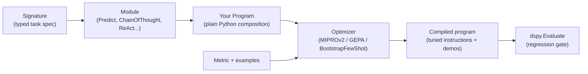
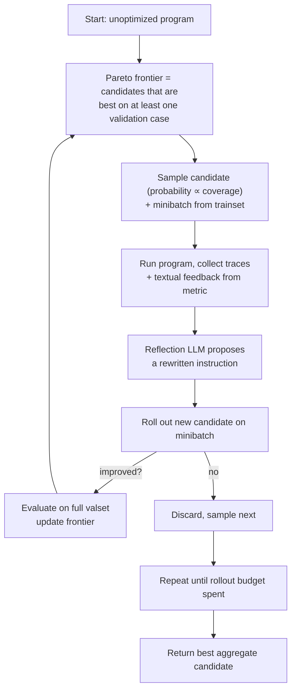

# バックエンドエンジニアのためのDSPy解説: シグネチャ、オプティマイザー、GEPA vs MIPROv2

長生きするSpring Bootサービスを保守したことがあれば、設定とコードの違いはもう知っています。
本番マシンの`application.yml`を手で書き換えたりはしないし、コネクションプールのサイズを勘で
調整したりもしない。宣言し、計測し、レビューされた再現可能なプロセスを通して変更するはずです。

その視点をLLM開発に当ててみてください。多くのチームの「AI活用」は、2009年の私たちのオペスと
同じやり方です。誰かがPRでプロンプト文字列を手直しし、ノートブックで5つの出力を眺め、リリースする。
6週間後、モデルのアップグレードがそれを黙って壊します。

**DSPy**（[dspy.ai](https://dspy.ai)）は「それを止めろ」と言うStanford NLPのフレームワークです。
プロンプトを**コンパイル成果物**として扱う。*ソースコード*——平易なPythonで書く、タスクの型付き
宣言——と、出力を採点する**メトリック**を書く。そして**オプティマイザー**というフレームワークの
部品が、あなたのメトリックに対して、あなたのデータの上で、実際のプロンプトを自動生成し調整します。

この記事では、その仕組みを説明した上で、採用後に実際に直面する問い——**どのオプティマイザーを
使うか**——を深掘りします。現在の2つの主要戦略が**MIPROv2**（命令とfew-shot例のベイズ探索）と
**GEPA**（パレートフロンティア上のリフレクティブなプロンプト進化、ICLR 2026 Oral）です。
両者は探索のやり方が違い、コストの構造が違い、メトリックに求めるものも違います。

すべては、この記事のために私が作った動かせる小さな例に基づいています。ログ行とスタックトレースを
根本原因カテゴリに分類する**Spring Boot本番インシデントトリアージ**プログラムです。このブログが
普段住んでいる領域であり、最適化のコストがドルではなくセントで済む程度に小さく作っています。

スタック: **Python、DSPy 3.5、任意のLLMプロバイダー**。

<div class="post-tldr" markdown="1">
<p class="post-tldr-title">TL;DR</p>

- **DSPy = プロンプトはビルド成果物。** `Signature`（型付き入出力）を宣言し、Pythonで`Module`を組み合わせ、メトリックを書く。すると**オプティマイザー**がそれを、調整済みの命令とfew-shot例へコンパイルします。モデルの変更は、プロンプトの書き直しではなく再コンパイルになります。
- 核となるループはどこでも同じです: **プログラム + 30件ほどのラベル付き例 + メトリック → `optimizer.compile(program, trainset=...)` → 保存されたdiff可能な成果物。** ソースにプロンプト文字列は出てきません。
- **MIPROv2** = 候補グリッド（命令 × デモ）を提案し、ミニバッチ評価の上で**ベイズ最適化**により勝者を選びます。万能型の優等生。長時間の実行には200例以上を求め、メトリックは素のfloatで構いません。
- **GEPA** = **リフレクティブ進化**: 強力なLLMが、予測がなぜ間違ったかを示す*テキストフィードバック*を使って命令を書き直し、**パレートフロンティア**がどれか1つのケースで勝つ候補を保持し続けます。同等のコストで6つのベンチマークタスク全体の成績がMIPROv2を**10%以上**上回り（ICLR 2026 Oral）、RLファインチューニングに**最大35分の1のロールアウト**で匹敵します。
- 判断ルール: **メトリックが間違いを言葉で説明できるならGEPA。メトリックがブラックボックスのスカラーであるか、デモ選択が必要ならMIPROv2。** どちらもプログラムのコードには触れません。
</div>

---

## DSPyとは？

DSPyはオープンソースのPythonフレームワークで、元々はStanford NLPが構築しました（現在は
Databricksの下で開発されています）。2022年12月にDemonstrate-Search-Predictコンパイラとして
初リリースされました。現在のDSPy 3.xは最も広く採用されているLLMフレームワークの1つで、
月間数百万ダウンロード、GitHubスター約4万。ドキュメントのタグラインがその哲学を5単語で
言い当てています。**"Program, don't prompt."**（プログラムせよ、プロンプトを書くな。）

前提はこうです。プロンプトはソースコードではない。それは*出力*であり、ソースコードのように
*保守できる*3つの入力のコンパイル結果です:

1. **タスクが何であるか** — 型付きインターフェース: 入力、出力、制約。
2. **ステップをどう組み合わせるか** — 平易なPythonの制御フロー。
3. **「正しい」が何を意味するか** — ラベル付き例の上のメトリック関数。

#1〜#3を手で書き、プロンプトの生成はアルゴリズムに任せます。モデルが変わってもプロンプトを
書き直しません。**再コンパイル**するのです。

同じ機能のためにGPT-4のプロンプトとClaudeのプロンプトとローカルLlamaのプロンプトを
二重保守したことがあるなら、なぜこれが重要なのかはもう分かっているはずです。手書きのサーバー
設定から宣言的インフラへ向かった、あの本能と同じものです。

## DSPyの仕組み: シグネチャ、モジュール、オプティマイザー

DSPyで学ぶべき抽象化はちょうど3つです。これがフレームワークの全体です。



### DSPyシグネチャとは？

**シグネチャ**は、タスクの入出力動作の宣言的仕様です。型だけでなく意味を持つメソッドシグネチャと
考えてください。フィールド名が意味を運び、DSPyが舞台裏でそれをプロンプトに変えます。

```python
class IncidentTriage(dspy.Signature):
    """Classify a Spring Boot production incident by its root cause and severity,
    and propose a fix."""

    incident_report: str = dspy.InputField(
        desc="Log line, stack trace excerpt or error description"
    )
    root_cause: Literal[
        "config-misconfiguration",
        "dependency-conflict",
        "connection-pool-exhaustion",
        "serialization-error",
        "memory-pressure",
        "thread-starvation",
    ] = dspy.OutputField(desc="One of the fixed root-cause categories")
    severity: Literal["P1", "P2", "P3"] = dspy.OutputField(
        desc="P1 = service down / data risk, P2 = degraded, P3 = contained"
    )
    action: str = dspy.OutputField(desc="One-sentence remediation")
```

シグネチャが与えてくれて、プロンプト文字列にはないものに注目してください。**パーサーが強制できる
構造**です。`root_cause`は`Literal`型なので、モデルは`Probably database stuff`と答えられません。
6つの値のどれかを返すか、さもなくばDSPyのアダプターがリトライして例外を投げます。文字列を手で
パースする代わりにJSONを型付きDTOへマッピングするのと同じ筋肉の記憶です。

### DSPyモジュールとは？

**モジュール**は、任意のシグネチャに一般化された再利用可能なプロンプティング戦略です。PyTorchの
`nn.Module`の発想をプロンプトに適用したものです。すべて`dspy.Predict`の上に築かれており、
有名なものは次のとおりです:

| モジュール | 抽象している戦略 |
|---|---|
| `dspy.Predict(sig)` | 直接補完 |
| `dspy.ChainOfThought(sig)` | 回答の前に推論ステップを追加 |
| `dspy.ReAct(sig, tools=[...])` | エージェント向けの推論 + ツール使用ループ |
| `dspy.ProgramOfThought(sig)` | 回答するコードを生成して実行 |
| `dspy.BestOfN(sig, N)` | N個の候補をサンプリングし、最良スコアのものを保持 |

プログラムは`dspy.Module`のサブクラスで、その`forward()`は平易なPython——条件分岐、ループ、
自作クラス——でサブモジュールを組み合わせます。インシデントトリアージ例のモデルの*全体*が
こちらです:

```python
class IncidentTriageProgram(dspy.Module):
    def __init__(self):
        super().__init__()
        self.triage = dspy.ChainOfThought(IncidentTriage)

    def forward(self, incident_report: str) -> dspy.Prediction:
        return self.triage(incident_report=incident_report)
```

このファイルに**ない**ものを見てください。プロンプトテキストなし、few-shot例なし、モデル名なし、
temperatureなし。それらは存在しますが、*パラメーター*として存在します。それこそが最適化可能で
ある由縁です。プログラムの呼び出しは型付きフィールド（`root_cause`、`severity`、`action`）と、
思考ステップのために`ChainOfThought`が追加する`reasoning`フィールドを返します。

### DSPyオプティマイザーとは？

**オプティマイザー**（かつては*テレプロンプター*と呼ばれていました）は、メトリックを最大化するように
プログラムのパラメーター——命令やfew-shotデモ——を調整するアルゴリズムです。few-shotデモは
プロンプトに注入される、解かれた入力→出力の例です。命令はDSPyがモジュールごとに生成する
システムレベルの指示です。

`optimizer.compile(program, trainset=...)`は文字どおりコンパイルのステップです。データの上で
プログラムを実行し、計測し、探索し、予測器が調整済みの命令とデモを備えた**コンパイル済み
プログラム**を返します。保存は`program.save("optimized.json")`。diffでき、レビューできる成果物です。
マイグレーションスクリプトをレビューするのと同じやり方で。

評価側は1回の呼び出しです:

```python
evaluate = dspy.Evaluate(
    devset=valset,
    metric=triage_metric,
    num_threads=4,
    display_table=3,
)
result = evaluate(program)
```

DSPyドキュメントのサイズの指針は、**価値が出るのに約30件のラベル付き例、本番品質に約300件**です。
分割はおおよそ学習20% / 検証80%。オプティマイザーはすべての候補を検証に対して採点するからです。
これは深層学習の常道とは意図的に*逆*です。適合させるのは重みではなく、探索するのははるかに小さい
空間であり、コンパスは検証セットです。

もう1つ体内化しておくべきことがあります。**メトリックこそが契約である**ということです。
この記事のすべてのオプティマイザーは、出力を採点する関数の賢さ以上には賢くなれません。分類なら
完全一致のメトリックで十分です。あいまいなタスクには、DSPy同梱の`SemanticF1`——それ自体が
小さなDSPyプログラムとして実装されています——があり、部分点を返すアサーション形式のメトリックも
書けます。

---

## 動く例: Spring Bootインシデントトリアージ

理論はこの辺にします。この記事のコンパニオンリポジトリは、すべてのバックエンドエンジニアが
見覚えのあるタスクを実装しています。オンコールのトリアージです。ログ行かスタックトレースの抜粋が
与えられ、**根本原因**（6カテゴリ）と**深刻度**（P1/P2/P3）を分類し、1文の修正案を出します。

データセットは手作りで、意図的に現実的な24件のインシデントです。Hikariのプールタイムアウト、
Jacksonアップグレード後の`NoSuchMethodError`、遅いリモート呼び出しをまたいでコネクションを
保持する`@Transactional`メソッド、ヒープは正常なのにmetaspaceが足りないOOMKilledポッド……
学習用14件、検証用10件。小さいのは意図的です。DSPyのドキュメントによれば価値が出るのは
30例前後からであり、これで実行全体がセント台に収まります。

メトリックには2つの亜種があります。そしてこの分岐こそ、後のGEPA vs MIPROv2の問いの鍵です:

```python
def triage_metric(example, pred, trace=None) -> float:
    """Plain scalar metric — what MIPROv2 and dspy.Evaluate consume."""
    root_ok = pred.root_cause == example.root_cause
    sev_ok = pred.severity == example.severity
    return (1.0 if root_ok else 0.0) + (0.25 if sev_ok else 0.0)


def triage_metric_with_feedback(example, pred, trace=None, pred_name=None, pred_trace=None):
    """GEPA metric: a score PLUS natural-language feedback about the miss."""
    problems = []
    if pred.root_cause == example.root_cause:
        root_score = 1.0
    else:
        root_score = 0.0
        problems.append(
            f"Wrong root cause: you said '{pred.root_cause}', the correct label is "
            f"'{example.root_cause}'."
        )
    # ... same for severity ...
    return dspy.Prediction(score=root_score + sev_score,
                           feedback=" ".join(problems) or "Correct root cause and severity.")
```

同じタスク、同じ採点。1つの版は*「どれくらい？」*に答え、もう1つの版は*「なぜ間違ったのか？」*
にも答えます。この違いを覚えておいてください。今すぐ効いてきます。

## 主要な最適化戦略

DSPyには4つのファミリーに十数個のオプティマイザーが同梱されています。実際に選ぶことになるのは、
そのうちの最後の2つです。

| オプティマイザー | 調整するもの | 探索戦略 | 必要なデータ |
|---|---|---|---|
| `BootstrapFewShot` | デモのみ | 教師を実行し、メトリックを通過するトレースを保持 | 約10以上 |
| `BootstrapFewShotWithRandomSearch` | デモのみ | ブートストラップ + 変種のランダム探索 | 50以上 |
| `COPRO` | 命令のみ | 書き換えに対する座標昇降のヒルクライミング | 任意 |
| `MIPROv2` | 命令 **+ デモ** | 候補グリッドを提案し、**ベイズ最適化** | 長時間の実行には200以上 |
| `GEPA` | 命令（`dspy.Flex`経由でコードも） | パレートフロンティア上の**リフレクティブ進化** | メトリックがフィードバックを返すなら少数でよい |

### MIPROv2: 命令とデモのベイズ探索

**MIPROv2**（Multiprompt Instruction PRoposal Optimizer v2）はDSPyの主力です。「とにかく
最適化して」という問いへの長年のデフォルトの答えです。3つのステージで動きます:

1. **デモのブートストラップ** — few-shot例の集合を`num_candidates`個作成します。ラベルからコピーしたものと、自分のプログラムを実行してメトリックを通過したトレースを保持することで*ブートストラップ*したものがあります。
2. **命令の提案** — `prompt_model`がすべてのモジュールの命令候補を書きます。データセットの要約、プログラムのソースコード、ブートストラップされたデモ、そしてランダムな創造性のヒントに根ざしてです。
3. **ベイズ探索** — （命令, デモ）の組み合わせをサンプリングし、35例のミニバッチでそれぞれ評価し、代理モデルを更新し、改善を予測する箇所を再サンプリングします。数ステップごとにフルの検証評価。`num_trials`の後、最良のプログラムが勝ちます。

```python
optimizer = dspy.MIPROv2(
    metric=triage_metric,     # plain scalar is fine here
    auto="light",             # ~6 candidates; "medium"/"heavy" scale up
    num_threads=4,
)
optimized = optimizer.compile(
    program,
    trainset=trainset,
    valset=valset,
    max_bootstrapped_demos=2,
    max_labeled_demos=2,
)
optimized.save("optimized/miprov2_triage.json")
```

頭の中のモデルは、**賢いサンプラーが探索する固定の候補グリッド**です。ここには実際の帰結があります。
MIPROv2が選べるのは、提案者が事前に生成すると考えた命令候補の中だけです。そのどれもがタスクに
必要なドメインの洞察（「深刻度を判断する前にスタックトレースのシグネチャを照合する」）を
コード化していなければ、ベイズ探索はそれを発明できません。選べるのはグリッド上の最悪でない点
だけです。

### GEPA: パレートフロンティア上のリフレクティブなプロンプト進化

**GEPA**（Genetic-Pareto）——[Agrawal et al., 2025](https://arxiv.org/abs/2507.19457)、
**ICLR 2026 Oral**採録——はこの限界に直接斬り込みます。*突然変異オペレーターがフィードバックを
読むLLM*である進化的探索です:



これを機能させているのは4つのアイデアです:

- **メトリックは数値だけでなくフィードバックを返す。** だからこの例には`dspy.Prediction(score, feedback)`を返す`triage_metric_with_feedback`があるのです。DSPyドキュメントはこれについて率直です。GEPAに素のfloatを与えれば「はるかに弱い自分自身」が返ってくると。フィードバックテキストは*そのまま*リフレクションLMのプロンプトに入ります。「あなたは`thread-starvation`と答えたが、正しいラベルは`memory-pressure`だ。コンテナ上限でのOOMKilledにヒープ使用率が低いということは、制約は*コンテナ*側にある」——したがって各突然変異は無作為ではなく、情報に基づきます。
- **王者方式ではなくパレート選択。** MIPROv2は現行者を1つだけ保持します。全体は平凡でも*特定のスライスで最良*（たとえばシリアライズエラー）な候補は、いずれにせよ排除されます。GEPAのフロンティアはその種のスペシャリストをすべて生かし、そこからサンプリングします。早期のスペシャリスト候補は生き残り、後で再結合されます。遺伝的アルゴリズムが多様な集団を保持するのと同じ理由です。論文のアブレーションでは、貪欲な「常に最良を選ぶ」方式に対するパレートサンプリングは、合計で最大約8%の価値があります。
- **システム認識マージ**（`use_merge=True`）: 2つの系統が互いに補完的な強みを学んでいたとき、GEPAは双方の最良モジュールのマージを試みます。GAの用語で言えば交叉オペレーターです。
- **予算は1つのつまみ**: `auto`（`light`/`medium`/`heavy`）、`max_full_evals`、`max_metric_calls`のうち、ちょうど1つだけを指定します。100例の2予測器プログラムでは、`light` ≈ 1,330回のメトリック呼び出しです。

```python
optimizer = dspy.GEPA(
    metric=triage_metric_with_feedback,  # score + textual feedback
    reflection_lm=reflection_model(),    # a STRONG model, temperature 1.0
    auto="light",
    num_threads=4,
    track_stats=True,                    # fills detailed_results
)
optimized = optimizer.compile(program, trainset=trainset, valset=valset)
```

本番利用からの実務メモが2つあります。1つ目、**リフレクションLMが高価なつまみ**です。逐次実行され
（1実行あたりわずかな呼び出し、中程度の予算で約12〜36回）、タスクモデルより強いモデルを与えて
ください。DSPy自身のチュートリアルもここではフロンティアモデルを使います。2つ目、`track_stats=True`
を設定すること。結果は`detailed_results`を伴い、**すべての候補、その親の系統、例ごとの検証スコア**
が入ります。プロンプトがどう進化したかの監査証跡であり、JSONへエクスポートしてPRのように
レビューできます。

GEPAが*変える*ものは、意図的に狭いです。各予測器の`signature.instructions`だけです。モジュール構成も、
コードも、デモも——手つかず。最適化された命令はモデルをまたいでも驚くほどよく移転します。論文に
よれば、Qwen3-8Bで進化したプロンプトはGPT-4.1 Miniでの再利用で約9%改善しました。

## GEPA vs MIPROv2: どちらのオプティマイザーを使うべきか？

同じフレームワーク、同じプログラム、同じメトリック関数。異なる探索パラダイムです。正直な比較が
こちらです:

| 観点 | MIPROv2 | GEPA |
|---|---|---|
| パラダイム | 固定候補グリッド上の**ベイズ最適化** | 開放的な候補集合上の**リフレクティブ進化** |
| 調整対象 | 命令 **+ few-shotデモ**を同時に | 命令のみ（`dspy.Flex`経由でコードも） |
| メトリック契約 | 素のスカラー（float/bool） | `dspy.Prediction(score, feedback)` — 予測器ごとのフィードバック |
| 探索の記憶 | 最良の現行者1つ | インスタンス別勝者の**パレートフロンティア** + マージ |
| 予算のつまみ | `auto` または `num_candidates` + `num_trials` | ちょうど1つ: `auto` / `max_full_evals` / `max_metric_calls` |
| 典型的なプロンプト | 長くなる（few-shotデモが膨らませる） | 命令は最大**9.2倍短い**（論文の計測） |
| データの指針 | 長時間の実行には200例以上が輝く | フィードバックが豊富なら*少数で機能*。valsetは小さく保つ |
| 目玉の結果 | 堅実なデフォルト。ドキュメントの例ではReAct 24%→51% | 6タスクで**MIPROv2に対し+10%**。AIME 2025で+12% |

論文のコストの数字は、精度の数字より面白いです。GPT-4.1 Miniの実験では、LMへの総支出は
**GEPAが$86、MIPROv2が$76**。同等でありながら、合計の改善幅は約2倍（+13.3% vs +5.6%）です。
RLファインチューニング（GRPO）との比較では、GEPAは**243〜1,179回のロールアウトで24,000回に
匹敵する**最高検証スコアに達し — 最大78倍のサンプル効率 — 平均でGRPOに対し+6%（最大+20%）
でした。SNSで目にする「RLより10〜80倍安い」というフレーミングの、査読済みバージョンがこれです。

**私の判断ルール**です。両方を同じタスクに配線してからの結論:

- **メトリックが外しを言葉で説明できるならGEPAを選ぶ。** 理由付きの分類、スキーマに対して検証する抽出、ステップレベルのトレースで判定されるエージェント。「なぜこれが間違っていたのか」が表現できるあらゆる場所です。そのフィードバックが燃料です。なければ、盲目の適応度関数で進化を回しているのと同じです。
- **メトリックがブラックボックスであるか、デモが命令より重要ならMIPROv2を選ぶ。** プログラムの学習不足の原因がin-context例の欠如なら（命令が間違っているからでなく）、MIPROv2の命令+デモの共同探索がより良いレバーです。最初の一段階としても穏やかです。設定すべき第2のモデルはなく、スカラーメトリックで歓迎されます。
- **どちらにせよ最初の安価な探り**: スカラーメトリックでの`BootstrapFewShotWithRandomSearch`はほぼ無コストで、ギャップが*デモ*のせいなのか（これで埋まる）、*命令*のせいなのか（埋まらない。MIPROv2/GEPAの領域です）をしばしば教えてくれます。

そして2つは排他ではありません。DSPy 3.xには`BetterTogether`が同梱されており、同じプログラム上で
プロンプト最適化と重み最適化（たとえばGEPAの後にGRPO）を連鎖させます。戦略を見つけるための
プロンプト進化と、ロールアウトを注げるときにそれを重みへ圧縮するRLです。

## 例を実行する

上記はすべて、5分で実行できるコードです。コンパニオンリポジトリ:

```bash
git clone https://github.com/javaAndScriptDeveloper/dspy-article
cd dspy-article
uv sync                      # Python 3.11+, installs DSPy 3.5

# Offline sanity check — drives the whole pipeline against a DummyLM:
uv run python smoke_test.py  # no API key needed

# Real runs:
export OPENAI_API_KEY=sk-...     # or set DSPY_MODEL to any dspy.LM string
uv run python 01_baseline.py         # score the unoptimized program
uv run python 02_optimize_miprov2.py # Bayesian search → optimized/miprov2_triage.json
uv run python 03_optimize_gepa.py    # reflective evolution → optimized/gepa_triage.json
```

デフォルトは、タスクモデルが`openai/gpt-4o-mini`、GEPAのリフレクションモデルが`openai/gpt-4o`です
（`DSPY_MODEL` / `DSPY_REFLECTION_MODEL`で上書きできます）。24例では、どちらの最適化実行も
セント台に収まります。

自分の手でやる価値のある瞬間はこれです。各実行の後、保存されたJSONをソースのプログラムとdiffして
みてください。`02_optimize_miprov2.py`は命令を書き込みfew-shotデモを注入しているはずです。
`03_optimize_gepa.py`は命令を書き直しているはずで、`optimized/gepa_results.json`には進化の全系統が
入っています。すべての候補、その親、例ごとのスコアです。このファイルは、DSPyのテーゼ全体を
1つの成果物に収めたものです。**プロンプトは出力であり、ソースではない。**

## DSPyを使うべきではないのはどんなとき？

正直なセクションです。すべてのフレームワークの売り込みには1つ必要ですから。

- **メトリックなしにDSPyなし。** 出力を採点できないなら — たとえ雑でも — オプティマイザーには登るものがありません。評価セットとメトリックの構築が本当の仕事であり、DSPyはそれに対する探索を自動化するだけです。（このステップを飛ばしてプロンプトを手調整するチームは、より悪いデータで探索を*勘で*やっています。）
- **解決済みの問題に対する1つの安定したプロンプト？** 抽象化の税金は足さないこと。DSPyが見合うのは、プログラムが複数ステップのとき、モデルが頻繁に変わるとき、品質ギャップが実際のお金を食っているときです。
- **無限のRL予算と学習可能な重み？** GEPA論文は明示しています。ロールアウトが高価なとき、データが限られるとき、重みがAPIで凍結されているときは、プロンプト進化が勝ちます。ロールアウトが潤沢な状況では、GRPO流のファインチューニングが依然勝ちます。道具が違い、経済性が違うのです。
- **プロンプトの所有者はあなたです。** コンパイル成果物は*あなたのメトリック*に調整されます。本番と一致しない代理メトリックに対して最適化すれば、間違った目的のために美しく最適化されたプログラムをリリースすることになります。昔ながらのルールです。評価スイート*こそが*仕様です。

---

持ち帰るべきパターンは、このブログが他の領域で繰り返しめぐってきたものと同じです。実行時の判断を、
宣言された、計測可能な、バージョン管理された成果物へ移す。私たちはインフラでそれをやり、次に
スキーママイグレーションでやりました。DSPyはスタックで最後まで手書きのままだった成果物——
プロンプト文字列——に対してそれをやります。オプティマイザーは面白い部分ですが、*規律*こそが
見返りです。プロンプトは、誰かが午前2時にいじるものではなくなり、モデル、データ、メトリックが
変わったときにCIが再生成するものになります。

オプティマイザーについてもう1度、より深く知りたければ、一次資料が優れています。[GEPA論文](https://arxiv.org/abs/2507.19457)
（ICLR 2026 Oral）、[MIPROv2論文](https://arxiv.org/abs/2406.11695)、そして
[公式DSPy最適化ガイド](https://dspy.ai/learn/optimization/overview/)です。ガイドには
[ステップバイステップのオプティマイザー選択ツール](https://dspy.ai/diving-deeper/choosing-an-optimizer/)
もあります。

*この記事のコードは
**[github.com/javaAndScriptDeveloper/dspy-article](https://github.com/javaAndScriptDeveloper/dspy-article)**で
公開しています。パイプライン全体がオフラインで検証できます — `uv sync && uv run python smoke_test.py`
がAPIキーなしでGEPAの最適化ループ全体を実行します — そしてバンドルされた24例のデータセットでの
実際の実行はセント台で済みます。*
