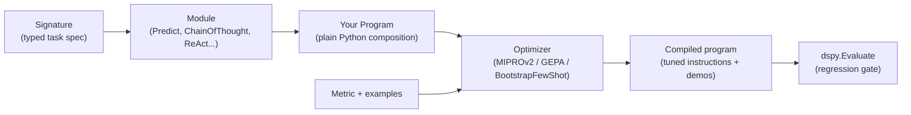
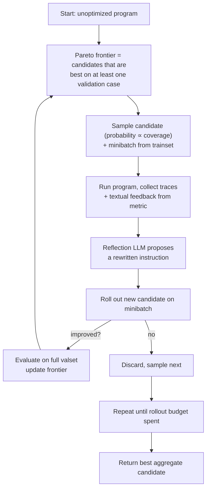

# バックエンドエンジニアのためのDSPy入門: シグネチャ、オプティマイザー、GEPA vs MIPROv2

長く運用されているSpring Bootサービスを保守したことがあれば、設定とコードの違いはすでにご存じのはずです。
本番サーバー上の`application.yml`の値を手で書き換えたりはしませんし、コネクションプールのサイズを
勘で決めることもしません。宣言し、計測し、レビューを経た再現可能な手順で変更します。

その見方をLLM開発に当てはめてみましょう。多くのチームの「AI活用」は、2009年ごろのインフラ運用と
同じやり方です。誰かがPRでプロンプト文字列を手で書き換え、ノートブックで出力を5件ほど目で確認して
リリースし、6週間後にモデルのアップグレードで気づかないうちに壊れます。

**DSPy**（[dspy.ai](https://dspy.ai)）は、Stanford NLPが開発したフレームワークで、その状況に待ったをかけます。
プロンプトは**コンパイルされる成果物**として扱います。書くのは*ソースコード*、つまり素のPythonで組み立てた
型付きのタスク宣言と、出力を採点する**メトリック**です。実際のプロンプトは、**オプティマイザー**と呼ばれる
フレームワークのコンポーネントが、あなたのメトリックとデータに基づいて自動的に生成・調整します。

この記事ではまず仕組みを説明し、そのうえで、採用後に必ず直面する問い、つまり**どのオプティマイザーを使うか**を
掘り下げます。現在の主要な戦略は2つあります。**MIPROv2**（命令とfew-shot例に対するベイズ探索）と、
**GEPA**（パレートフロンティア上のリフレクティブなプロンプト進化、ICLR 2026 Oral）です。
探索の方法もコストの構造も、メトリックに求めるものも異なります。

内容はすべて、この記事のために作った小さな実行可能サンプルに基づいています。ログ行やスタックトレースを
根本原因のカテゴリに分類する**Spring Boot本番インシデントのトリアージ**プログラムで、このブログが
普段扱っている領域です。最適化を丸ごと実行してもコストが小さく済む規模に抑えています。

スタック: **Python 3.11以上、DSPy 3.5、任意のLLMプロバイダー**。

<div class="post-tldr" markdown="1">
<p class="post-tldr-title">TL;DR</p>

- **DSPy = プロンプトをビルド成果物として扱う。** `Signature`（型付きの入出力）を宣言し、Pythonで`Module`を組み合わせ、メトリックを書きます。すると**オプティマイザー**が、それを調整済みの命令とfew-shot例にコンパイルします。モデルを変えるときは、プロンプトの書き直しではなく再コンパイルで済みます。
- 中心となる流れはどこでも同じです。**プログラム + 30件前後のラベル付き例 + メトリック → `optimizer.compile(program, trainset=...)` → 保存されたdiff可能な成果物。** ソースコードにプロンプト文字列は出てきません。
- **MIPROv2** = 候補グリッド（命令 × デモ）を提案し、ミニバッチ評価に対する**ベイズ最適化**で最良のものを選びます。汎用性の高い定番です。長めの実行には200件以上の例が欲しくなりますが、メトリックは素のfloatで構いません。
- **GEPA** = **リフレクティブ進化**。強力なLLMが、予測がなぜ間違ったかを説明する*テキストフィードバック*をもとに命令を書き直し、**パレートフロンティア**が、どれか1つのケースで最良となる候補を残し続けます。6つのベンチマークタスクを通じてMIPROv2を**10ポイント以上**上回り、コストは同程度でした（ICLR 2026 Oral）。GRPOによるファインチューニングも、ロールアウト数を最大**35分の1**に抑えて上回っています。
- 判断ルール: **メトリックが間違いの理由を言葉で説明できるならGEPA。メトリックがブラックボックスのスカラーであるか、デモ選択が必要ならMIPROv2。** どちらもプログラムのコードには手を加えません。
</div>

---

## DSPyとは

DSPyはStanford NLP発のオープンソースPythonフレームワークです。2022年12月のDemonstrate-Search-Predictという
研究から生まれ、現行の3.xは広く使われています。執筆時点で、PyPIのダウンロード数は月間数百万、
GitHubのスターは約4万です。プロジェクト自身のワンライナーが、その思想を端的に表しています。
プロンプトを書くのではなく、言語モデルをプログラミングする。

前提となる考え方はこうです。プロンプトはソースコードではなく*出力*であり、ソースコードと同じように
*保守できる*3つの入力をコンパイルした結果にすぎません。

1. **タスクが何か** — 型付きのインターフェース: 入力、出力、制約。
2. **ステップをどう組み合わせるか** — 素のPythonの制御フロー。
3. **「正しい」とは何か** — ラベル付き例に対するメトリック関数。

手で書くのは1〜3だけで、プロンプトの生成はアルゴリズムに任せます。モデルが変わっても、プロンプトを
書き直すのではなく**再コンパイル**します。

同じ機能のために、GPT-4用、Claude用、ローカルLlama用のプロンプトを並行して保守した経験があれば、
これがなぜ重要かはすぐに分かるはずです。手作業で編集していたサーバー設定が、宣言的なインフラへ
移っていったのと同じ流れです。

## DSPyの仕組み: シグネチャ、モジュール、オプティマイザー

DSPyで学ぶ抽象化は3つだけです。これがフレームワークのすべてです。



### DSPyのシグネチャとは

**シグネチャ**は、タスクの入出力の振る舞いを宣言的に記述した仕様です。型だけでなく意味も持つ
メソッドシグネチャだと考えてください。フィールド名が意味を担い、DSPyが裏側でそれをプロンプトに変換します。

```python
class IncidentTriage(dspy.Signature):
    """Classify a Spring Boot production incident by its root cause and severity,
    and propose a fix."""

    incident_report: str = dspy.InputField(
        desc="Log line, stack trace excerpt or error description"
    )
    root_cause: Literal[
        "config-misconfiguration",
        "dependency-conflict",
        "connection-pool-exhaustion",
        "serialization-error",
        "memory-pressure",
        "thread-starvation",
    ] = dspy.OutputField(desc="One of the fixed root-cause categories")
    severity: Literal["P1", "P2", "P3"] = dspy.OutputField(
        desc="P1 = service down / data risk, P2 = degraded, P3 = contained"
    )
    action: str = dspy.OutputField(desc="One-sentence remediation")
```

プロンプト文字列にはなく、シグネチャにあるものに注目してください。**パーサーが強制できる構造**です。
`root_cause`は`Literal`型なので、モデルは`Probably database stuff`のようには答えられません。6つの値の
どれかを返さなければ、DSPyのアダプターがリトライし、最終的には例外を投げます。文字列を自前でパースする
代わりに、JSONを型付きDTOにマッピングするのと同じ感覚です。

### DSPyのモジュールとは

**モジュール**は、任意のシグネチャに適用できる、再利用可能なプロンプト戦略です。PyTorchの`nn.Module`の
発想をプロンプトに持ち込んだものと言えます。すべて`dspy.Predict`をベースに作られており、主なものは次のとおりです。

| モジュール | 抽象化している戦略 |
|---|---|
| `dspy.Predict(sig)` | そのまま回答を生成する |
| `dspy.ChainOfThought(sig)` | 回答の前に推論のステップを加える |
| `dspy.ReAct(sig, tools=[...])` | エージェント向けの、推論とツール呼び出しのループ |
| `dspy.ProgramOfThought(sig)` | 回答のためのコードを生成して実行する |
| `dspy.BestOfN(sig, N)` | N個の候補をサンプリングし、最高スコアのものを残す |

プログラムは`dspy.Module`のサブクラスで、`forward()`の中で、条件分岐やループ、自作クラスといった
素のPythonを使ってサブモジュールを組み合わせます。インシデントトリアージ例のモデル定義は、*これで全部*です。

```python
class IncidentTriageProgram(dspy.Module):
    def __init__(self):
        super().__init__()
        self.triage = dspy.ChainOfThought(IncidentTriage)

    def forward(self, incident_report: str) -> dspy.Prediction:
        return self.triage(incident_report=incident_report)
```

このファイルに**ないもの**を見てください。プロンプトの文面も、few-shot例も、モデル名も、temperatureもありません。
それらは存在しますが、*パラメーター*として存在します。だからこそ最適化の対象にできます。プログラムを
呼び出すと、型付きのフィールド（`root_cause`、`severity`、`action`）と、思考ステップのために
`ChainOfThought`が追加する`reasoning`フィールドが返ってきます。

### DSPyのオプティマイザーとは

**オプティマイザー**（かつては*テレプロンプター*と呼ばれていました）は、メトリックを最大化するように、
プログラムのパラメーター、つまり命令やfew-shotデモを調整するアルゴリズムです。few-shotデモとは、
プロンプトに差し込まれる、解答つきの入力→出力の例です。命令とは、DSPyがモジュールごとに生成する、
システムレベルの指示文です。

`optimizer.compile(program, trainset=...)`は、文字どおりコンパイルの工程です。データでプログラムを
実行して計測し、探索を行い、調整済みの命令とデモを持つ予測器を備えた**コンパイル済みプログラム**を
返します。`program.save("optimized.json")`で保存でき、マイグレーションスクリプトと同じ感覚で
diffをとってレビューできる成果物になります。

評価側は1回の呼び出しで済みます。

```python
evaluate = dspy.Evaluate(
    devset=valset,
    metric=triage_metric,
    num_threads=4,
    display_table=3,
)
result = evaluate(program)
```

DSPyドキュメントが示すデータ量の目安は、**効果を実感できるのが約30件のラベル付き例、本番品質には約300件**です。
分割は学習20%・検証80%程度にします。オプティマイザーがすべての候補を検証セットで採点するためです。
これは深層学習の通例とは意図的に*逆*です。重みを学習するのではなく、はるかに小さい空間を探索するので、
検証セットが羅針盤になります。

もう1つ、押さえておくべきことがあります。**メトリックは契約**だということです。この記事に出てくる
オプティマイザーはどれも、出力を採点する関数の賢さを超えることはできません。分類なら完全一致の
メトリックで十分です。曖昧なタスクには、DSPyが提供する`dspy.evaluate.SemanticF1`があります。これ自体が
小さなDSPyプログラムとして実装されています。部分点を返すメトリックを自分で書くこともできます。

---

## 実践例: Spring Bootのインシデントトリアージ

理論はここまでにしましょう。この記事のコンパニオンリポジトリでは、バックエンドエンジニアなら誰もが
見覚えのあるタスク、オンコールのトリアージを実装しています。ログ行やスタックトレースの抜粋を受け取り、
**根本原因**（6カテゴリ）と**深刻度**（P1/P2/P3）を分類し、1文の修正案を出力します。

データセットは、手作りの24件のインシデントで、実際にありそうなものに意図的に寄せています。
Hikariのプールタイムアウト、Jacksonのアップグレード後の`NoSuchMethodError`、遅いリモート呼び出しの間も
コネクションを握り続ける`@Transactional`メソッド、ヒープは問題ないのにmetaspaceが足りずにOOMKilledされたポッド、
などです。学習用が14件、検証用が10件で、あえて小さくしています。DSPyのドキュメントによれば、効果が出始めるのは
30件前後からで、この規模なら実行コストも抑えられます。

メトリックには2つのバリエーションがあり、この分け方が、後述するGEPAとMIPROv2の違いを理解する鍵になります。

```python
def triage_metric(example, pred, trace=None) -> float:
    """Plain scalar metric — what MIPROv2 and dspy.Evaluate consume."""
    root_ok = pred.root_cause == example.root_cause
    sev_ok = pred.severity == example.severity
    return (1.0 if root_ok else 0.0) + (0.25 if sev_ok else 0.0)


def triage_metric_with_feedback(example, pred, trace=None, pred_name=None, pred_trace=None):
    """GEPA metric: a score PLUS natural-language feedback about the miss."""
    problems = []
    if pred.root_cause == example.root_cause:
        root_score = 1.0
    else:
        root_score = 0.0
        problems.append(
            f"Wrong root cause: you said '{pred.root_cause}', the correct label is "
            f"'{example.root_cause}'."
        )
    # ... same for severity ...
    return dspy.Prediction(score=root_score + sev_score,
                           feedback=" ".join(problems) or "Correct root cause and severity.")
```

タスクも採点基準も同じですが、一方は*「どれくらい良いか」*に答え、もう一方は*「なぜ間違ったのか」*にも
答えます。この違いが、次に紹介する2つのオプティマイザーの違いそのものです。

## 主な最適化戦略

DSPyには、4つのファミリーに分かれた十数種類のオプティマイザーが付属しています。実際に比較検討することに
なるのは、表の最後の2つです。

| オプティマイザー | 調整対象 | 探索戦略 | 必要なデータ |
|---|---|---|---|
| `BootstrapFewShot` | デモのみ | 教師を実行し、メトリックを通ったトレースを残す | 約10件以上 |
| `BootstrapFewShotWithRandomSearch` | デモのみ | ブートストラップ + 変種に対するランダム探索 | 50件以上 |
| `COPRO` | 命令のみ | 書き換えに対する座標上昇法のヒルクライミング | 任意 |
| `MIPROv2` | 命令 **+ デモ** | 候補グリッドを提案し、**ベイズ最適化** | 長めの実行なら200件以上 |
| `GEPA` | 命令（`dspy.Flex`経由でコードも） | パレートフロンティア上の**リフレクティブ進化** | メトリックがフィードバックを返すなら少数 |

### MIPROv2: 命令とデモに対するベイズ探索

**MIPROv2**（Multiprompt Instruction PRoposal Optimizer v2）は、DSPyの定番です。「とりあえず最適化して」
という場面で、長らくデフォルトの答えでした。3つのステージで動きます。

1. **デモのブートストラップ** — few-shot例のセットを`num_candidates`個作ります。ラベルからそのまま
   コピーしたものもあれば、自分のプログラムを実行し、出力がメトリックを通ったトレースを残して
   *ブートストラップ*したものもあります。
2. **命令の提案** — `prompt_model`が、各モジュールの命令候補を書きます。材料は、データセットの要約、
   プログラムのソースコード、ブートストラップしたデモ、そしてランダムに選ばれた創造性のヒントです。
3. **ベイズ探索** — （命令, デモ）の組み合わせをサンプリングし、それぞれ35件のミニバッチで評価し、
   代理モデルを更新して、改善が見込まれる領域を重点的に再サンプリングします。数ステップごとに
   検証セット全体での評価も行います。`num_trials`が終わると、最良のプログラムが採用されます。

```python
optimizer = dspy.MIPROv2(
    metric=triage_metric,     # plain scalar is fine here
    auto="light",             # ~6 candidates; "medium"/"heavy" scale up
    num_threads=4,
)
optimized = optimizer.compile(
    program,
    trainset=trainset,
    valset=valset,
    max_bootstrapped_demos=2,
    max_labeled_demos=2,
)
optimized.save("optimized/miprov2_triage.json")
```

イメージとしては、**固定された候補グリッドを、賢いサンプラーが探索する**形です。ここには実質的な
制約があります。MIPROv2が選べるのは、提案役が最初に生成した命令候補の中だけです。そのどれにも、
タスクに必要なドメイン知識（たとえば「深刻度を判断する前に、スタックトレースのシグネチャを突き合わせる」）が
含まれていなければ、ベイズ探索はそれを生み出せません。グリッド上で相対的にましな点を選ぶのが精一杯です。

### GEPA: パレートフロンティア上のリフレクティブなプロンプト進化

**GEPA**（Genetic-Pareto）は、[Agrawal et al., 2025](https://arxiv.org/abs/2507.19457)で提案され、
**ICLR 2026 Oral**に採択されました。この限界に正面から取り組む手法で、*突然変異の演算子がフィードバックを
読むLLM*になっている進化的探索です。



この仕組みを支えているのは、4つのアイデアです。

- **メトリックが数値だけでなくフィードバックを返す。** このサンプルに、`dspy.Prediction(score, feedback)`を返す`triage_metric_with_feedback`があるのはそのためです。DSPyのドキュメントははっきり書いています。GEPAに素のfloatだけを渡すと、「はるかに弱い自分自身」しか得られません。フィードバックのテキストは、そのままリフレクションLMのプロンプトに入ります。たとえば「あなたは`thread-starvation`と答えたが、正解は`memory-pressure`。コンテナの上限でOOMKilledされていて、ヒープ使用量が低いなら、制約になっているのは*コンテナ*だ」といった具合です。こうして、各変異はランダムではなく根拠のあるものになります。
- **勝者総取りではなく、パレート選択。** MIPROv2が保持するのは、その時点の最良の候補1つだけです。全体としては平凡でも、*特定の領域*（たとえばシリアライズエラー）では最良という候補は、結局切り捨てられます。GEPAのフロンティアは、そうした専門特化型の候補をすべて残し、そこからサンプリングします。初期に特定の領域で強かった候補が生き延びて、後で組み合わされます。遺伝的アルゴリズムが多様な集団を維持するのと同じ理由です。論文のアブレーションでは、Qwen3 8Bにおいて、常に現時点の最良の候補を選ぶ方式に対し、パレートサンプリングが総合スコアで約6ポイント上回りました。
- **システムを考慮したマージ**（`use_merge=True`）: 2つの系統がそれぞれ相補的な強みを身につけたとき、GEPAは両者の最良のモジュールを統合しようとします。遺伝的アルゴリズムの用語でいう交叉にあたります。
- **予算は1つのパラメーターだけ**: `auto`（`light`/`medium`/`heavy`）、`max_full_evals`、`max_metric_calls`のうち、ちょうど1つを指定します。`light`で評価される候補プロンプトは6つ前後です。実際のメトリック呼び出し回数は、valsetのサイズと予測器の数に応じて増えるので、まず小さなvalsetで確認してください。

```python
optimizer = dspy.GEPA(
    metric=triage_metric_with_feedback,  # score + textual feedback
    reflection_lm=reflection_model(),    # a STRONG model, temperature 1.0
    auto="light",
    num_threads=4,
    track_stats=True,                    # fills detailed_results
    perfect_score=1.25,                  # this metric's max; the default is 1.0
)
optimized = optimizer.compile(program, trainset=trainset, valset=valset)
```

運用上の注意点が2つあります。1つ目は、**コストをかけるべきはリフレクションLM**だということです。
1回の実行で呼ばれる回数はわずかなので、タスクモデルより強力なモデルを割り当ててください。DSPyの
ドキュメントも、小さなモデルを最適化するときは、ここに大きなモデルを使うよう勧めています。2つ目は、
`track_stats=True`を設定することです。結果の`detailed_results`には、**すべての候補、その親の系統、
例ごとの検証スコア**が入ります。プロンプトがどう進化したかを示す監査証跡で、JSONにエクスポートして
PRと同じようにレビューできます。

実際にはまった落とし穴が1つあります。GEPAは、スコアが`perfect_score`に達した例ではリフレクションを
行いません。この`perfect_score`は**デフォルトで1.0**です。私たちのメトリックの上限は1.25（根本原因の1.0に
重大度の0.25を加えたもの）なので、デフォルトのままだと、根本原因が合っている例はすべて満点と見なされ、
GEPAは重大度の取りこぼしを一度も見ませんでした。候補を1〜2個試しただけで、元のプログラムをそのまま
返したのです。メトリックの最大値が1.0でない場合は、`perfect_score`を設定してください。

GEPAが*変更する*対象は、意図的に狭く絞られています。各予測器の`signature.instructions`だけです。
モジュールの構成も、コードも、デモも触りません。最適化された命令は、モデルをまたいでもかなりよく通用します。
論文によれば、Qwen3-8Bで進化させたプロンプトをGPT-4.1 Miniで再利用したところ、約9%向上しました。

## GEPA vs MIPROv2: どちらのオプティマイザーを使うべきか

同じフレームワーク、同じプログラム、同じメトリック関数のもとで、探索のパラダイムが異なります。

| 観点 | MIPROv2 | GEPA |
|---|---|---|
| パラダイム | 固定の候補グリッド上での**ベイズ最適化** | 開かれた候補集合上での**リフレクティブ進化** |
| 調整対象 | 命令 **+ few-shotデモ**を同時に | 命令のみ（`dspy.Flex`経由でコードも） |
| メトリックの契約 | 素のスカラー（float/bool） | `dspy.Prediction(score, feedback)` — 予測器ごとのフィードバック |
| 探索の記憶 | これまでの最良の候補1つ | ケースごとの勝者による**パレートフロンティア** + マージ |
| 予算のパラメーター | `auto`、または`num_candidates` + `num_trials` | 次のうちちょうど1つ: `auto` / `max_full_evals` / `max_metric_calls` |
| プロンプトの傾向 | 長くなりがち（few-shotデモで膨らむ） | 命令が最大**9.2倍短い**（論文の測定値） |
| データ量の目安 | 長めの実行では200件以上で真価を発揮 | *フィードバックが豊富なら*少数でも機能。valsetは小さく保つ |
| 主な成果 | 堅実なデフォルト。ドキュメントのReActの例では 8% → 約42%（MIPROv2、`medium`） | 6タスクで**MIPROv2を10ポイント以上**上回る（論文のabstractより） |

論文が報告するコストの数字は、精度の数字よりも興味深いものです。GPT-4.1 Miniの実験でのLM利用料は、
**GEPAが$86、MIPROv2が$76**と同程度で、総合的な改善幅はおよそ2倍でした（+12.2ポイント対+5.6ポイント、
GEPA+Mergeは+13.3ポイント）。RLによるファインチューニング（GRPO）との比較では、GEPAは
24,000回のロールアウトを要したGRPOの最良の検証スコアに、**243〜1,179回のロールアウト**で並びました。
サンプル効率は最大78倍です。そのうえ、GRPOを平均6ポイント（最大20ポイント）上回っています。
これらは論文自身のベンチマークと条件での結果であり、あなたのワークロードの数字ではありません。
それでも、SNSで見かける「RLより安い」という主張の、査読を経た版にあたります。

**私が使う判断ルール**は、両者の作りに基づいています。

- **メトリックが失敗の理由を言葉で説明できるならGEPA。** 理由つきの分類、スキーマで検証できる抽出、
  ステップ単位のトレースで評価するエージェントなど、「なぜ間違いなのか」を表現できる場面ならどこでも
  当てはまります。そのフィードバックが燃料です。それがなければ、評価関数が見えないまま進化を
  回しているのと変わりません。
- **メトリックがブラックボックスの場合や、命令よりデモが効く場合はMIPROv2。** プログラムの精度が
  足りない原因が、命令の誤りではなくコンテキスト内の例の不足にあるなら、命令とデモを同時に探索する
  MIPROv2のほうが有効なレバーです。最初の一手としても導入しやすく、2つ目のモデルを設定する必要がなく、
  スカラーのメトリックで足ります。
- **どちらを選ぶにしても、最初の安価な試金石として**: スカラーのメトリックで
  `BootstrapFewShotWithRandomSearch`を回すと、ほとんどコストをかけずに、不足しているのが*デモ*なのか
  （これで埋まります）、*命令*なのか（埋まりません。MIPROv2やGEPAの領域です）が分かることがよくあります。

なお、両者は排他的ではありません。DSPy 3.xには`BetterTogether`があり、同じプログラムに対して
プロンプト最適化と重みの最適化（たとえばGEPAのあとにファインチューニング）を連結できます。
プロンプト進化で戦略を見つけ、ロールアウトの予算があるときは、RLでそれを重みに圧縮するという使い分けです。

## サンプルを実行する

ここまでのコードはすべて、5分で実行できます。コンパニオンリポジトリは次のとおりです。

```bash
git clone https://github.com/javaAndScriptDeveloper/dspy-article
cd dspy-article
uv sync                      # Python 3.11+, installs DSPy 3.5

# Offline sanity check — drives the whole pipeline against a DummyLM:
uv run python smoke_test.py  # no API key needed

# Real runs:
export GEMINI_API_KEY=...     # free key: aistudio.google.com/apikey
                              # or set DSPY_MODEL to any dspy.LM string
uv run python 01_baseline.py         # score the unoptimized program
uv run python 02_optimize_miprov2.py # Bayesian search → optimized/miprov2_triage.json
uv run python 03_optimize_gepa.py    # reflective evolution → optimized/gepa_triage.json
```

デフォルトでは、タスクモデルは`gemini/gemini-3.5-flash-lite`、GEPAのリフレクションモデルは
`gemini/gemini-3.5-flash`です（`DSPY_MODEL` / `DSPY_REFLECTION_MODEL`で上書きできます。`dspy.LM`の
文字列ならどれでも使え、`openai/gpt-4o-mini`も含まれます）。Google AI Studioのキーは無料ですが、
無料枠のクォータは小さく、Google側で変更されることもあります。オプティマイザーを走らせる前に、
自分のプロジェクトの上限を確認してください。実行中は数百回の呼び出しが発生し、コードは429エラーでも
失敗せずにリトライします。データセットは24件なので実行は小規模です。実行した結果は次のセクションにあります。

ぜひ自分の手で確かめてほしいのは、各実行のあとに、保存されたJSONを元のプログラムとdiffすることです。
`02_optimize_miprov2.py`は命令を書き込み、few-shotデモを注入しているはずです。`03_optimize_gepa.py`は
命令を書き換えており、`optimized/gepa_results.json`には進化の系統がすべて残っています。すべての候補、
その親、例ごとのスコアです。プログラムのソースと並べて開けば、要点は自然と伝わります。
**プロンプトは出力であり、ソースではありません。**

## 実際に動かしてみた結果

3つのスクリプトをすべて、2026年11月17日にGoogle AI Studioの無料枠で実行しました。タスクモデルは
`gemini-3.5-flash-lite`、GEPAのリフレクションモデルは`gemini-3.5-flash`、両オプティマイザーとも
`auto="light"`、`num_threads=4`です。メトリックは前述の1.25点満点のもので、以下のスコアは検証用の
10件のインシデントにおけるインシデントごとの平均です。

| 実行 | スコア（満点1.25） | 備考 |
|---|---|---|
| 最適化なしのプログラム、キャッシュなしで3回 | 1.10 / 1.12 / 1.10 | 満点の88〜90% |
| MIPROv2、`light` | 1.12 | 上記の実行ごとのばらつきの範囲内 |
| GEPA、`light`、デフォルトの`perfect_score` | 1.10 | 候補は1〜2個で、学習するものがなかった（前述） |
| GEPA、`light`、`perfect_score=1.25` | **1.175**（94%） | 候補21個、メトリック呼び出し420回、実時間で約18分 |

数字が小さいので、引用されるよりも疑われるほうがよいと考えています。次の注意点を踏まえて読んでください。

- **ベースラインはすでに上限に近かった。** モデルは検証用の10件すべてで根本原因を正しく当てました。
  失点はすべて重大度によるもので、ラベルがP2やP3のところをP1と過大に判定していました。伸びしろは
  それだけなので、この実験全体は、10件中およそ2件の重大度ラベルの話にすぎません。
- **GEPAは、私が報告に使うのと同じ10件で勝者を選んでいる**ため、1.175は楽観的な値です。
  ホールドアウトのテストセットはありません。これは配線を確認するデモであり、ベンチマークではありません。
- **MIPROv2の1.12は勝ちではない。** 最適化なしのプログラムも、再実行のたびに1.10〜1.12の間で動きました。
- **DSPyはデフォルトでLMの応答をディスクにキャッシュする。** 最初に行った「同一のベースライン3回」は、
  安定性の証拠ではなく、3回のキャッシュヒットでした。本当のばらつきを見たいときのために、リポジトリは
  `DSPY_CACHE=0`でキャッシュを無効にできるようになっています。

より有益だったのは、`optimized/gepa_triage.json`を開いて確認したことです。これは、前述の
「保存された成果物をdiffする」手順にあたります。進化した命令は、ラベル付きのカンニングペーパーのように
読めます。訓練用のインシデントをほぼそのまま引用し（`HikariPool - Connection is not available`、
`management.server.port in use`、未解決の`${...}`プレースホルダー）、それぞれに重大度を対応づけています。
さらに、許可された6つのカテゴリーに含まれない根本原因`management-port-conflict`が挙げられており、
根本原因の一覧からは`thread-starvation`が消えています。私たちの`Literal`型は、でっち上げられたラベルを
拒否するでしょう。そして命令は、実在するラベルからモデルを遠ざけるようになっています。
スコアは改善しましたが、成果物はメトリックには見えない形で悪化しています。保存されたJSONをコードレビューに
かけるべき理由はまさにここにあり、どのオプティマイザーを選ぶかよりも、ホールドアウトのテストセットと、
カテゴリーの集合を検査するメトリックのほうが重要な理由もここにあります。

この実行からGEPAとMIPROv2の優劣を結論づけてはいませんし、10件での1回の実行では結論づけられません。
言えるのはもっと限定的なことです。モデルがすでにおおむね解けているタスクでは、最適化にお金をかける前に
ベースラインを確認すること、メトリックの値域がオプティマイザーの前提と合っていることを確かめること、
そして進化したプロンプトを、そのスコアを信じる前に読むことです。

## DSPyを使うべきでないのはどんなとき

どのフレームワークの紹介にも必要な、正直な注意書きのセクションです。

- **メトリックがなければ、DSPyの出番はない。** 出力を採点できない（ノイズが多くても構いません）のであれば、
  オプティマイザーには登るべき山がありません。評価セットとメトリックの整備こそが本当の仕事で、
  DSPyはそれに対する探索を自動化するだけです。（この手順を飛ばしてプロンプトを手で調整しているチームは、
  より質の悪いデータで、探索を*勘に頼って*やっているのと同じです。）
- **解決済みの問題に、安定したプロンプトが1つだけあるなら？** 抽象化のコストを上乗せする必要はありません。
  DSPyが見合うのは、プログラムが複数のステップからなるとき、モデルの入れ替わりが激しいとき、
  品質の差が実際の損失につながっているときです。
- **RLの予算が無制限で、重みも学習できるなら？** GEPA論文は明確に述べています。ロールアウトが高価で、
  データが限られ、重みがAPIの向こうで固定されている場合は、プロンプト進化が有利です。
  ロールアウトが潤沢にある領域では、GRPOのようなファインチューニングが今でも優位です。
  道具が違えば、採算も違います。
- **プロンプトの責任はあなたにある。** コンパイルされた成果物は*あなたのメトリック*に合わせて調整されます。
  本番と食い違う代理メトリックに対して最適化すれば、間違った目的に対して見事に最適化された
  プログラムをリリースすることになります。昔からのルールが、ここでも当てはまります。
  評価スイート*こそが*仕様です。

---

バックエンドのスタックでは、他の要素はすでに同じ道をたどってきました。設定はコードになり、スキーマは
マイグレーションになり、インフラは宣言的になりました。プロンプト文字列は、いまだに午前2時に人が手で
いじっている最後の成果物です。DSPyの答えは、他の要素でうまくいったものと同じです。宣言し、計測し、
バージョン管理する。オプティマイザーは興味深い部分ですが、本当に見返りがあるのはこの規律のほうです。
モデルやデータ、メトリックが変わったときに、プロンプトはCIが再生成するものになります。

オプティマイザーをさらに深く知りたい方には、一次資料が優れています。
[GEPA論文](https://arxiv.org/abs/2507.19457)（ICLR 2026 Oral）、
[MIPROv2論文](https://arxiv.org/abs/2406.11695)、そして
[公式のDSPy最適化ガイド](https://dspy.ai/learn/optimization/overview/)です。
ガイドには、[手順に沿ってオプティマイザーを選べるチューザー](https://dspy.ai/diving-deeper/choosing-an-optimizer/)も
あります。

*この記事のコードは
**[github.com/javaAndScriptDeveloper/dspy-article](https://github.com/javaAndScriptDeveloper/dspy-article)**で
公開しています。パイプライン全体がオフラインで検証できます。`uv sync && uv run python smoke_test.py`を
実行すると、APIキーなしでGEPAの最適化ループを最後まで動かせます。実際の実行には、24件の小さな
データセットを使っています。*
