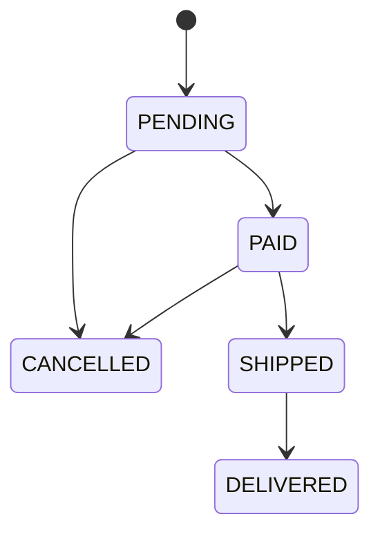

# enumをデータベースに保存する方法: @Enumerated、Postgres enum型、参照テーブル

ほぼすべてのドメインモデルには、限られた値のどれか1つしか取らないフィールドがあります。注文は
`PENDING`、`PAID`、`SHIPPED`、`DELIVERED`、`CANCELLED`のいずれか。支払いはオーソリ済みか
売上確定済みか。サブスクリプションは4つのプランのどれか。Javaなら迷わず`enum`に手が伸びます。
興味深いのは境界で何が起きるかです。**その有限の値の集合がデータベースで実際にはどう生きるのか**、
そして集合が変わる6ヶ月後に、選択肢ごとにいくら支払うことになるのか。

この記事では、Hibernateでenumを永続化する一般的な方法をすべて、実際に出会う順にたどります。
`@Enumerated`の2つのモード、本物のPostgres `ENUM`型、`AttributeConverter`、そして最後に、enumが
独自のテーブルになる参照テーブル方式です。1つの例——注文のステータス——を最初から最後まで
進化させ、最後に私が実際に選ぶ選択肢を示します。

スタック: **Java、Spring Boot、Hibernate、PostgreSQL**。

<div class="post-tldr" markdown="1">
<p class="post-tldr-title">TL;DR</p>

- `@Enumerated(ORDINAL)`はenumの**位置**を保存します。コンパクトですが、途中に値を挿入すると後続の行がすべて黙って破損します。使うしかない場合は、**ユニットテストで序数を固定**してください。
- `@Enumerated(STRING)`は**定数名**を保存します。自己記述的で、デバッグしやすく、順序変更にも耐えます。これがまともなデフォルトです。
- 素の`varchar`で妥協しないこと。本物の**Postgres `ENUM`型**を定義すれば、データベース自身が不正な値を拒否してくれます。
- **`AttributeConverter`**はJava名から切り離された安定したコードを保存するため、**リネームがもはやデータベースの問題ではなくなります**。
- **参照テーブル**が価値を持つのは、値が編集可能なビジネスデータを運ぶときだけです。リネーム回避のための手段ではありません。
</div>

---

## シナリオ

注文管理を構築しているとします。注文は固定のライフサイクルを進みます:



Javaなら当然enumです:

```java
public enum OrderStatus {
    PENDING,
    PAID,
    SHIPPED,
    DELIVERED,
    CANCELLED
}
```

注文エンティティには`status`フィールドがあります。問いは1つ、Hibernateがそれをカラムにどう
マッピングするかだけです。そしてその1つのアノテーションの選択は、今日書くコードより長く生きる
結果をもたらします。

---

## Part 1 — `@Enumerated(ORDINAL)`: intとして保存する

JPAにおけるenumのデフォルトは`ORDINAL`です。各定数は宣言内での位置として保存されます。
`PENDING` → 0、`PAID` → 1、`SHIPPED` → 2、という具合です。

```java
@Entity
@Table(name = "orders_ordinal")
public class OrderOrdinal {

    @Id
    @GeneratedValue(strategy = GenerationType.UUID)
    private UUID id;

    @Enumerated(EnumType.ORDINAL)   // this is also the default if you omit @Enumerated
    @Column(nullable = false)
    private OrderStatus status;
}
```

```sql
CREATE TABLE orders_ordinal (
    id     UUID     PRIMARY KEY DEFAULT gen_random_uuid(),
    status SMALLINT NOT NULL
);
```

ステータス`PAID`の注文を保存すれば、カラムには`1`が入ります。コンパクトで、紙の上では
問題ありません。

### ❌ 罠: 途中に値を挿入する

序数はラベルとして保存されているのではなく、*位置*として保存されており、その位置はソースコードの
順序で定義されています。誰かがpaidとshippedの間に梱包ステップを追加した日のことを
考えてください:

```java
public enum OrderStatus {
    PENDING,
    PAID,
    PACKED,      // <-- inserted here
    SHIPPED,
    DELIVERED,
    CANCELLED
}
```

…`PAID`より後ろのすべての定数が1つずれます:

| 定数 | 挿入前の序数 | 挿入後の序数 |
|---|---|---|
| `PENDING`   | 0 | 0 |
| `PAID`      | 1 | 1 |
| `PACKED`    | — | **2** |
| `SHIPPED`   | 2 | **3** |
| `DELIVERED` | 3 | **4** |
| `CANCELLED` | 4 | **5** |

データベースでは何も変わっていません。既存の`SHIPPED`注文は依然として整数`2`を持っています。
しかし`2`は今や`PACKED`にデコードされます。出荷済み注文は黙って梱包中になり、配達済みは
出荷済みになります。エラーも、失敗したマイグレーションも、ログの1行もありません。動いたのは
データではなく、その解釈です。顧客が「配達済みのはずの注文が梱包中になっているのはなぜか」と
尋ねて初めて分かります。

### 防衛策: 序数を固定する

レガシーなスキーマや、バイト差が実際に問題になる本当にホットで巨大なテーブルなど、`ORDINAL`を
残す理由があるなら、順序が構造を支えていることを*明示的*にしましょう。誰かがenumの順序を変えた
瞬間に失敗するテストを用意します:

```java
class OrdinalPinTest {

    @Test
    void ordinalsAreFrozen() {
        // If this test fails, you reordered OrderStatus. Existing ORDINAL-mapped rows now mean
        // something different. Revert the reorder, or append the new value at the end.
        assertThat(OrderStatus.PENDING.ordinal()).isZero();
        assertThat(OrderStatus.PAID.ordinal()).isEqualTo(1);
        assertThat(OrderStatus.SHIPPED.ordinal()).isEqualTo(2);
        assertThat(OrderStatus.DELIVERED.ordinal()).isEqualTo(3);
        assertThat(OrderStatus.CANCELLED.ordinal()).isEqualTo(4);
        assertThat(OrderStatus.values()).hasSize(5);
    }
}
```

純粋なユニットテストです。Springコンテキストもデータベースも不要です。誰かがenumに触れた瞬間、
見えないデータ破損バグを赤いビルドに変えます。新しい値を追加することは依然として許されます。
ただしそれは末尾に置く必要があります。追加が安全なのは末尾だけです。`ORDINAL`が黙って依存して
いるルールの全体が、書き下ろされた形です。

---

## Part 2 — `@Enumerated(STRING)`: varcharとして保存する

ほとんどの人にとっての解決策は、1単語です:

```java
@Enumerated(EnumType.STRING)
@Column(nullable = false)
private OrderStatus status;
```

これでカラムは定数の*名前*を保存します:

```sql
CREATE TABLE orders_string (
    id     UUID    PRIMARY KEY DEFAULT gen_random_uuid(),
    status VARCHAR NOT NULL
);
```

`PAID`の注文は、文字列リテラル`'PAID'`を保存します。3つのことが即座に良くなります:

- **順序変更は無害になります。** 値がそれ自身の名前であり、位置はもう関係ありません。`PACKED`は好きな場所に追加できます。
- **デバッグしやすくなります。** `SELECT * FROM orders_string WHERE status = 'PAID'`は英語として読めます。解読環も、頭の中でJavaソースと突き合わせる作業もいりません。
- **ダンプやログが自己記述的になります。** CSVエクスポートの1行が、それ自体で意味を持ちます。

確かに`'DELIVERED'`は`3`より多くのバイトを消費します。しかし圧倒的大多数のテーブルでは、その差は
ノイズです。インデックスはいつでも足せます。名前を保存するのが正しいデフォルトであり、「コンパクト」
が「黙って間違う」に見合うことはほぼありません。

### 残された唯一の罠: リネーム

`STRING`は順序の罠を取り除きますが、より小さな罠を持ち込みます。保存される値はそのままJavaの
識別子なので、定数をリネームすると既存の行が孤立します:

```java
PENDING  →  AWAITING_PAYMENT
```

古い`'PENDING'`行はどの定数にも一致しなくなり、Hibernateはそれを読み込むときに例外を投げます。
保存されたデータとコードが、黙って乖離したのです。これはデータマイグレーション
（`UPDATE … SET status = 'AWAITING_PAYMENT' WHERE status = 'PENDING'`）で修正できますし、
それ自体まったく正当な答えです。Part 4では、リネームをそもそもイベントにしない方法も見ます。

---

## Part 3 — 良い作法: 本物のPostgres enum型

上の2つの選択肢はどちらも、データベースが実質理解できないカラムに保存します。enum値を
*たまたま*保持している`smallint`や`varchar`です。Postgresにはもっと良い手段があります。
ファーストクラスのenum型です:

```sql
CREATE TYPE order_status AS ENUM ('PENDING', 'PAID', 'SHIPPED', 'DELIVERED', 'CANCELLED');

CREATE TABLE orders_pgenum (
    id     UUID         PRIMARY KEY DEFAULT gen_random_uuid(),
    status order_status NOT NULL
);
```

今度は*データベース*がドメインを強制します。`INSERT … VALUES ('SHPPED')`——タイプミス、悪い
マイグレーション、暴走スクリプト——は、`invalid input value for enum order_status`として
その場で失敗します。素の`varchar`では、そのゴミはテーブルに着地し、発見は後回しになります。
enum型はドキュメントと制約が1つになったものです。カラムの型が、正当な値のリストを文字通り
保持しています。

Hibernateでのマッピングは前と同じ`@Enumerated(STRING)`です。Hibernateが定数名を文字列として
バインドし、Postgresがそれをenumとして保存します:

```java
@Enumerated(EnumType.STRING)
@Column(nullable = false, columnDefinition = "order_status")
private OrderStatus status;
```

必要な配管は1つだけです。デフォルトではPostgreSQL JDBCドライバーはJavaの`String`を`varchar`型と
して送信しますが、Postgresは`varchar` → `order_status`の暗黙キャストを行いません。そのため
`column "status" is of type order_status but expression is of type character varying`という
エラーが出ます。JDBC URLに`stringtype=unspecified`を追加すると、ドライバーは値を`unknown`として
送信し、Postgresがenumへキャストできるようになります:

```yaml
spring:
  datasource:
    url: jdbc:postgresql://localhost:5434/mydatabase?stringtype=unspecified
```

（Hibernate 6には、名前付きenum型を直接対象にする`@JdbcTypeCode(SqlTypes.NAMED_ENUM)`も
あります。ただし上記の`@Enumerated(STRING)` + `stringtype=unspecified`の組み合わせが最も一般的で、
私もこれを使います。）

**知っておくべき唯一の注意点:** `ALTER TYPE order_status ADD VALUE 'PACKED'`は*追加*しか
できません。値を追加することはでき（PostgreSQL 12以降は特定の値の前後への挿入も可能）、しかし
型を作り直さない限り既存の値の削除や並べ替えはできません。制限的に聞こえますが、よく見るとそれは
序数テストが強制していた*同じルール*です。並べ替えず、追加だけ。ただしここではそれをユニットテスト
ではなくデータベースが保証します。制約こそが機能なのです。

---

## Part 4 — `AttributeConverter`: 名前と値を切り離す

Part 2のリネームの罠は、*保存する値*と*Javaの識別子*を同じ文字列にしていたことに起因します。
JPAの`AttributeConverter`はこの結合を断ち切ります。定数の名前とは無関係な、安定したコードを
保存するのです。

各定数に明示的で永続的なコードを与えます:

```java
public enum OrderStatus {

    PENDING("PND"),
    PAID("PAID"),
    SHIPPED("SHP"),
    DELIVERED("DLV"),
    CANCELLED("CNC");

    private final String code;

    OrderStatus(String code) {
        this.code = code;
    }

    public String getCode() {
        return code;
    }

    public static OrderStatus fromCode(String code) {
        return Arrays.stream(values())
                .filter(s -> s.code.equals(code))
                .findFirst()
                .orElseThrow(() -> new IllegalArgumentException("Unknown OrderStatus code: " + code));
    }
}
```

次に、enum ↔ コードをマッピングするコンバーターを用意します:

```java
@Converter
public class OrderStatusConverter implements AttributeConverter<OrderStatus, String> {

    @Override
    public String convertToDatabaseColumn(OrderStatus status) {
        return status == null ? null : status.getCode();
    }

    @Override
    public OrderStatus convertToEntityAttribute(String code) {
        return code == null ? null : OrderStatus.fromCode(code);
    }
}
```

そしてフィールドには、`@Enumerated`の代わりに`@Convert`を付けます:

```java
@Convert(converter = OrderStatusConverter.class)
@Column(nullable = false)
private OrderStatus status;
```

これでデータベースは識別子としてではなく*コード*として`'PAID'`を保存します。Javaの定数
`PENDING`を`AWAITING_PAYMENT`にリネームしても、保存されたコード`'PND'`は決して変わりません。
リネームはデータベースへの影響ゼロの純粋なリファクタリングです。データベースが知っていることと、
コード内での呼び名を切り離した——それこそ、まさに人々が参照テーブルで得ようとする性質です。
この点を、次のパートのために覚えておいてください。

---

## Part 5 — 参照テーブル方式

最後の方式は、ステータスをenumとして扱うこと自体をやめます。代わりに、ステータスの集合が
独自のテーブルに住み、注文は外部キーでその行を参照します:

```sql
CREATE TABLE order_statuses (
    id       INTEGER PRIMARY KEY,
    code     VARCHAR NOT NULL UNIQUE,
    label    VARCHAR NOT NULL,
    terminal BOOLEAN NOT NULL DEFAULT FALSE
);

INSERT INTO order_statuses (id, code, label, terminal) VALUES
    (1, 'PND',  'Pending',   FALSE),
    (2, 'PAID', 'Paid',      FALSE),
    (3, 'SHP',  'Shipped',   FALSE),
    (4, 'DLV',  'Delivered', TRUE),
    (5, 'CNC',  'Cancelled', TRUE);

CREATE TABLE orders_lookup (
    id        UUID    PRIMARY KEY DEFAULT gen_random_uuid(),
    status_id INTEGER NOT NULL REFERENCES order_statuses (id)
);
```

JPAでは、ステータスは列挙値ではなくリレーションシップになります:

```java
@Entity
@Table(name = "orders_lookup")
public class OrderLookup {

    @Id
    @GeneratedValue(strategy = GenerationType.UUID)
    private UUID id;

    @ManyToOne(fetch = FetchType.EAGER, optional = false)
    @JoinColumn(name = "status_id", nullable = false)
    private OrderStatusDefinition status;
}
```

注文のステータスを知るには——人間が読めるラベルや、それが終端状態かどうか——**結合**します:

```sql
SELECT o.id, s.code, s.label
FROM   orders_lookup o
JOIN   order_statuses s ON s.id = o.status_id
WHERE  o.id = ?;
```

### ✅ この方式が報われるとき

参照テーブルが実際に買ってくれるものは1つです。値の集合と、それぞれに付随するメタデータが、
**コード**ではなく**データ**として存在すること。これが本当に価値を持つのは次のようなときです:

- **各値が編集可能なビジネスデータを運ぶとき** — 表示ラベル、ソート順、色、機能フラグ、SLA。ステータスは同一性だけではなく、小さなレコードです。
- **値を開発者以外が管理するとき**。テナントごとに設定されるとき。デプロイなしで実行時に変わるとき。
- **本当の大量変更があるとき** — 数百万行に現れるラベルを、すべての注文ではなく`order_statuses`の1行の更新でリネームできます。

最後の点が最も強い論拠です。すべてではなく、1箇所だけ変えればよい。もし「enum」が実は管理された
カタログなら、これが正しいモデルです。

---

## 私の考え

*単純な* enum——注文ライフサイクルのようなコードレベルの固定状態集合——には参照テーブルを
使いません。レビューで反対します。

よく聞く言い訳が「値をリネームしたくなったらどうするのか」です。しかし先ほど見たとおり、それは
テーブルなしで解決できます。`AttributeConverter`が保存コードをJava名から切り離し、変わるラベルなら
1行のマイグレーションで済みます。リネームに耐えるために、すべてのクエリに外部キーと結合は
必要ありません。

そのケースで参照テーブルが実際に追加するのは、恒久的なコストです。すべての読み取りは結合するか
2つ目のクエリを抱え、ステータスは値ではなく管理されたリレーションシップになり、コンパイル時に
網羅できた状態の`switch`は、取りこぼし得る実行時のルックアップに変わります。コンパイラが理解する
値を、コンパイラが理解しない行と交換したのです。固定のライフサイクルが決して使わない柔軟性を
買うために。

だから私のルールは、リネームではなく**その値が何であるか**についてのものです:

- 値が**同一性だけ**なら——`SHIPPED`であり、それで終わり——enumのままにします。`@Enumerated(STRING)`でマッピングし、Postgres enum型を背後に置き、リネームを無料にしたくなったら`AttributeConverter`に手を伸ばします。
- 値が**レコード**なら——人が実行時に編集するフィールドを持つなら——それは本当は最初からenumではありません。テーブルを与えましょう。

リネームは決め手ではありません。決め手は、そのものが固有のデータを持つかどうかです。

---

## 判断ガイド

| 方式 | 保存するもの | 使う場面 | 主なリスク |
|---|---|---|---|
| `@Enumerated(ORDINAL)` | 位置（`1`） | ほぼない | 並べ替えで黙って行が破損する |
| `@Enumerated(STRING)` | 定数名（`'PAID'`） | まともなデフォルト | リネームで行が孤立する |
| Postgres `ENUM`型 | DB検証済みの名前 | DBに不正値を拒否させたい | `ADD VALUE`は追加のみ |
| `AttributeConverter` | 安定したコード（`'PAID'`） | リネームを無料にしたい | 保守すべき小さなクラスが1つ増える |
| 参照テーブル | 行への外部キー | 値が編集可能なデータを運ぶ | すべての読み取りで結合が発生 |

ほとんどのプロジェクトにとっての堅実なデフォルトは、**Postgres enum型の上に`@Enumerated(STRING)`**を
載せることです。保存値をJava名から絶縁したくなったその瞬間に、**`AttributeConverter`**へ
アップグレードします。

---

## コード

この記事のコードは
**[github.com/javaAndScriptDeveloper/enums-article](https://github.com/javaAndScriptDeveloper/enums-article)**で
公開しています。同じ`OrderStatus` enumの5方式すべてによる永続化、序数固定のテスト、そして各方式が
実際にディスクに書き込むものを検証するラウンドトリップテストを収録しています。Dockerと1回の
`./gradlew test`でローカル実行できます。

---

## 最後に

enumの保存方法の選択は、5秒で終わる決断に感じられます。だからこそ、立ち止まる価値があるのです。
序数の地雷、リネームの罠、欠けたデータベース制約——どれもアノテーションを書いた日には現れません。
値の集合が変わる日に現れます。それは必ず来ますが、たいていはトレードオフを忘れたずっと後です。

朗報は、デフォルトが簡単なことです。名前を保存し、データベースに検証させ、必要になったらコードと
識別子を切り離す。参照テーブルは、enumではなく本当にカタログであるケースのために取っておきましょう。
これを一度正しくすれば、ステータスは退屈なままです。カラムに払える最大の賛辞は、それです。

---

## 話しましょう

別の方法でenumを保存している場合や、ここで扱わなかった形でこれらの罠に焼かれたことがある場合は、
ぜひ聞かせてください。連絡先はフッターにあります。
