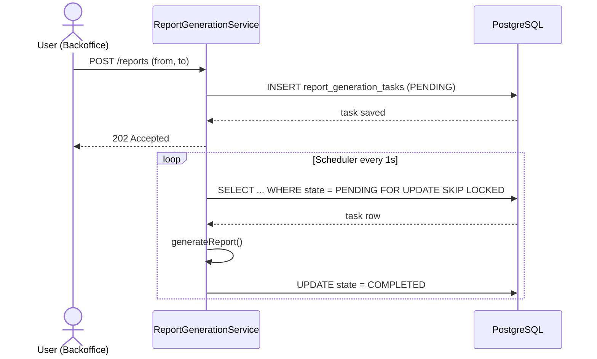
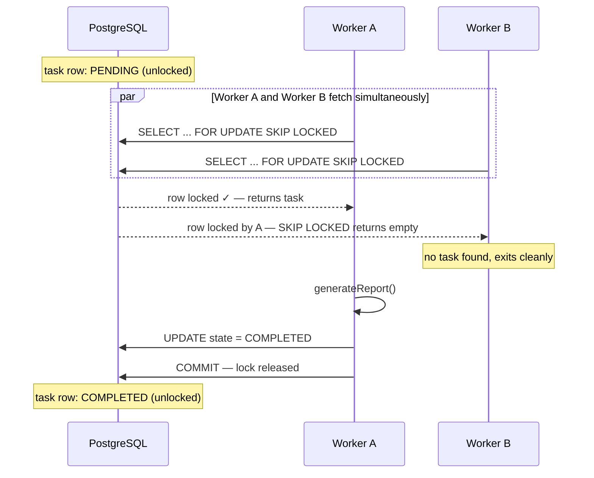
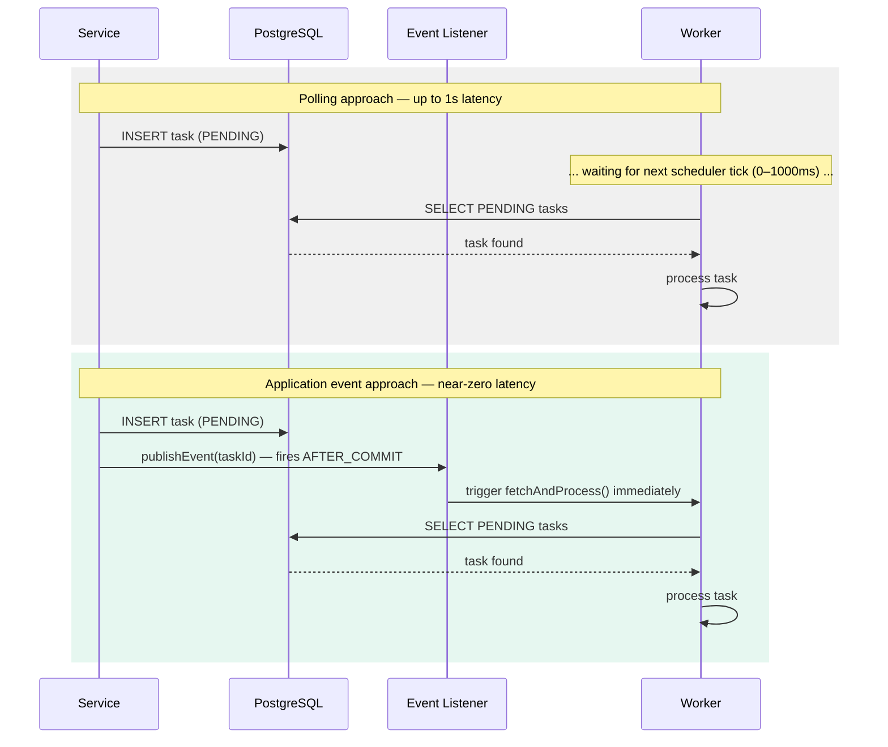
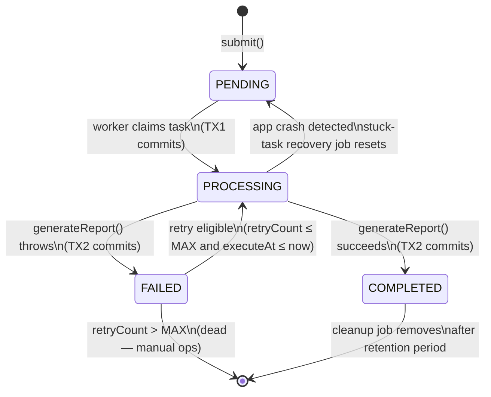
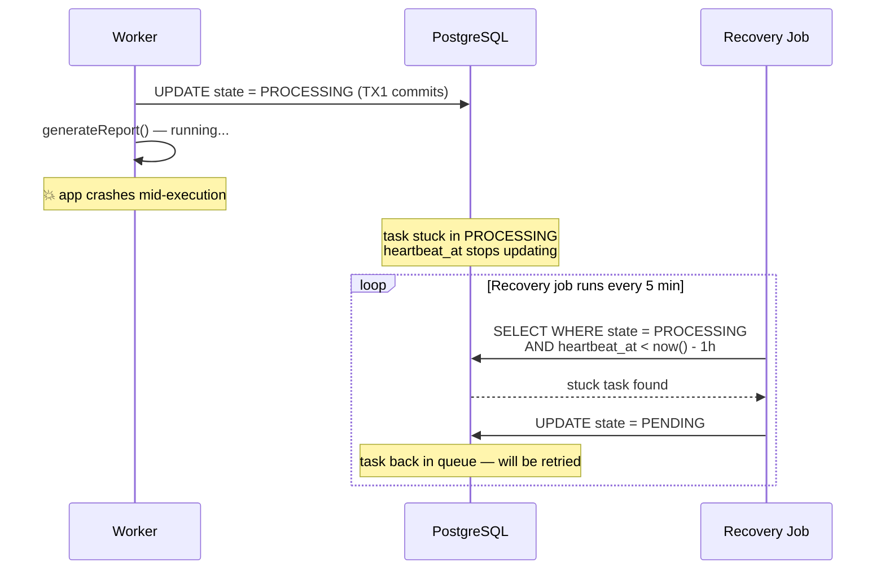
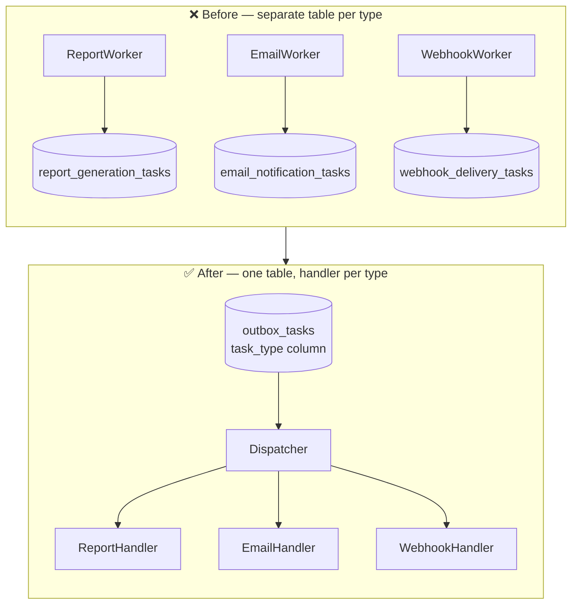

# トランザクショナルアウトボックスパターン: 単一タスクから本番レベルの非同期エンジンへ

ユニットテストでは決して姿を見せず、ステージングでもほとんど現れない類のバグがあります。
それが現れるのは本番、午前2時です。アプリがデータベースにレコードを保存した後、外部サービスを
呼び出そうとして、そのどちらかが失敗する。片側はコミット済み、もう片側はされていない。誰かが
苦情を言うまで、誰も気づきません。

これが**二重書き込み（dual-write）問題**であり、トランザクショナルアウトボックスパターンは
その定番の答えです。発想はシンプルです。外部システムを直接呼び出す代わりに、ドメインの変更と
同じデータベーストランザクション内へタスクを書き込む。バックグラウンドワーカーがそれを拾って
実行します。書き込みはアトミックであり、タスクが失われることはありません。

一方、基本アイデアの「その後」について書かれたものは少ないものです。タスクが失敗したらどうなるか。
2つのワーカーが同じ行を奪い合ったらどうなるか。実行の途中でアプリがクラッシュしたらどうなるか。
1つのテーブルに10種類のタスクが住むようになったらどうするか。そして火曜日の午前3時にキューの
深さが急増したのはなぜか、とステークホルダーに問われたらどう答えるか。

この記事が扱うのはまさにそこです。

私は1つの具体的なシナリオ——**レポート生成サービス**——を通して、考えうる最も単純なアウトボックス
から、本番で安心して運用できるものへと段階的に進化させていきます。掲載するコードはすべて、記事末尾で
リンクしている実際に動くリポジトリから取っています。

スタック: **Java、Spring Boot、PostgreSQL**。

<div class="post-tldr" markdown="1">
<p class="post-tldr-title">TL;DR</p>

- **トランザクショナルアウトボックスパターン**は、ドメインの変更と**同じDBトランザクション**でタスク行を書き込み、それをバックグラウンドワーカーが実行することで、二重書き込み問題を解決します。
- アウトボックステーブルは`SELECT ... FOR UPDATE SKIP LOCKED`でポーリングすれば、複数ワーカーが並行して動いても二重処理になりません。
- 本番品質には基本アイデア以上のものが必要です。**ステートマシン**、**バックオフ付きリトライ**、クラッシュしたワーカーを復旧するための**ハートビート／リース**、**順序**保証、そしてキューの深さの**監視**。
- Kafkaは不要です。信頼性の高い非同期実行には**PostgreSQL単体**で十分です。
</div>

---

## シナリオ



私たちはCRMを構築しているとします。バックオフィスのUIから、月次の分析レポートを依頼できます。
レポートの生成は数千万行の集計を意味し、数分かかることがあります。HTTPリクエストの中で同期的に
実行できるはずがありません。

ユーザーがボタンをクリックする。バックエンドはリクエストを受け付けて保存し、すぐに応答を返します。
バックグラウンドワーカーがタスクを拾い、生成を実行し、完了したらステータスを更新します。

これはアウトボックスが意味を持つ最も単純なケースです。本質的に非同期である仕事、ユーザーが
すでに待つことを想定している仕事です。

---

## Part 1 — 基本のアウトボックス

### アウトボックスに必要なもの

本質的に、どんなアウトボックステーブルにも3つの要素が必要です:

- **ステート** — このタスクはライフサイクルのどの段階にいるのか？
- **ペイロード** — 実際に何を実行すべきなのか？
- **タイムスタンプ** — いつ作成され、最後にいつ変わったのか？

```sql
CREATE TYPE task_state AS ENUM ('PENDING', 'COMPLETED');

CREATE TABLE report_generation_tasks (
                                       id         UUID       PRIMARY KEY DEFAULT gen_random_uuid(),
                                       state      task_state NOT NULL    DEFAULT 'PENDING',
                                       payload    JSONB      NOT NULL,
                                       created_at TIMESTAMP  NOT NULL    DEFAULT now(),
                                       updated_at TIMESTAMP  NOT NULL    DEFAULT now()
);
```

このユースケースのペイロードは日付範囲です:

```java
@Value
@Builder
@Jacksonized
public class ReportGenerationPayload {
  Instant from;
  Instant to;
}
```

JPAエンティティは次のとおりです:

```java
@Entity
@Table(name = "report_generation_tasks")
@Data
@Builder
@NoArgsConstructor
@AllArgsConstructor
public class ReportGenerationEntity {

    @Id
    @GeneratedValue(strategy = GenerationType.UUID)
    @Column(updatable = false, nullable = false)
    private UUID id;

    @Enumerated(EnumType.STRING)
    @Column(nullable = false, columnDefinition = "task_state")
    private TaskState state;

    @JdbcTypeCode(SqlTypes.JSON)
    @Column(nullable = false, updatable = false, columnDefinition = "jsonb")
    private ReportGenerationPayload payload;

    @CreationTimestamp
    @Column(nullable = false, updatable = false)
    private Instant createdAt;

    @UpdateTimestamp
    @Column(nullable = false)
    private Instant updatedAt;
}
```

タスクの登録は次のとおりです:

```java
@Service
@RequiredArgsConstructor
public class ReportGenerationService {

    private final ReportGenerationRepository repository;

    public void submit(ReportGenerationCommand command) {
        repository.save(ReportGenerationEntity.builder()
                .state(TaskState.PENDING)
                .payload(ReportGenerationPayload.builder()
                        .from(command.getFrom())
                        .to(command.getTo())
                        .build())
                .build());
    }
}
```

### ワーカー

スケジュールされたジョブがPENDINGタスクをポーリングして実行します:

```java
@Component
@RequiredArgsConstructor
public class ReportGenerationScheduledJob {

    private final ReportGenerationTaskService taskService;

    @Scheduled(fixedDelay = 1000)
    public void run() {
        taskService.fetchAndProcess();
    }
}
```

```java
@Service
@RequiredArgsConstructor
public class ReportGenerationTaskService {

    private final ReportGenerationRepository repository;

    public void fetchAndProcess() {
        repository.findFirstByStateOrderByCreatedAt(TaskState.PENDING)
                .ifPresent(task -> {
                    generateReport(task);
                    task.setState(TaskState.COMPLETED);
                    repository.save(task);
                });
    }

    private void generateReport(ReportGenerationEntity task) {
        // actual report generation logic
    }
}
```

```java
public interface ReportGenerationRepository extends JpaRepository<ReportGenerationEntity, UUID> {
    Optional<ReportGenerationEntity> findFirstByStateOrderByCreatedAt(TaskState state);
}
```

これは障害のない単一インスタンスアプリなら動きます。現実には2つの問題があります。2つのワーカーが
同じタスクを同時に取得できてしまうことと、タスクが失敗しても回復する道筋がないことです。
両方を直していきます。

---

## Part 2 — 同時実行: 2つのワーカー、1つのタスク

2つのスケジューラースレッド——あるいは2つのアプリインスタンス——が同時に取得クエリを実行すると、
両者が同じ`PENDING`行を読み、両者が実行しようとします。良い場合でも仕事の重複、最悪の場合は
状態の破損です。

解決策は、取得の時点でデータベースロックを取ることです。PostgreSQLの
`SELECT ... FOR UPDATE SKIP LOCKED`はまさにこのユースケースのために作られた構文です。
現在のトランザクションのために行をロックし、待機する代わりに、他のトランザクションがすでに
ロックしている行をスキップします。

```java
public interface ReportGenerationRepository extends JpaRepository<ReportGenerationEntity, UUID> {

    @Lock(LockModeType.PESSIMISTIC_WRITE)
    @QueryHint(name = AvailableSettings.JAKARTA_LOCK_TIMEOUT, value = "-2") // -2 = SKIP_LOCKED
    Optional<ReportGenerationEntity> findFirstByStateOrderByCreatedAt(TaskState state);
}
```

`SKIP_LOCKED`ヒントの値`-2`は、Hibernateが`SKIP LOCKED`句に変換する値です。これを表すファーストクラスの
アノテーションは存在しないため、マジックナンバーをリポジトリのあちこちに散らばらせないよう、
再利用可能なアノテーションに切り出す価値があります:

```java
@Retention(RetentionPolicy.RUNTIME)
@Target({ElementType.METHOD, ElementType.ANNOTATION_TYPE})
@QueryHints(@QueryHint(
    name = AvailableSettings.JAKARTA_LOCK_TIMEOUT,
    value = Timeouts.SKIP_LOCKED_MILLI + ""
))
public @interface SkipLocked {}
```

ずっときれいになりました。リポジトリが配管コードではなく意図を読める形になります:

```java
@SkipLocked
@Lock(LockModeType.PESSIMISTIC_WRITE)
Optional<ReportGenerationEntity> findFirstByStateOrderByCreatedAt(TaskState state);
```

取得〜実行〜更新の一連のサイクルを1つのトランザクションに包めば、処理中もロックを保持し続ける
ことは*できます*。しかし、一般的にやるべきではありません:

```java
// Technically works, but do not use this pattern for outbox processing.
@Transactional
public void fetchAndProcess() {
    repository.findFirstByStateOrderByCreatedAt(TaskState.PENDING)
            .ifPresent(task -> {
                generateReport(task);
                task.setState(TaskState.COMPLETED);
                repository.save(task);
            });
}
```



`generateReport()`が十分に小さく技術的には動いたとしても、開いたトランザクションの下で
アウトボックスの処理を実行するのはアンチパターンです。トランザクションの長さがアウトボックス実行の
長さに依存してはいけません。処理は時間とともに遅くなったり、I/Oでブロックされたり、下流サービスを
呼び出したりして、予測できない期間にわたってデータベース接続と行ロックを保持したままになります。

代わりに、短いトランザクションで行を`PROCESSING`に遷移させて取得し、コミットしてロックを解放し、
その後にアウトボックスの処理を実行します。`COMPLETED`か`FAILED`は、その後の別の短いトランザクションで
記録します。次のセクションで、この状態遷移と回復経路を実装します。

---

## Part 2.5 — アプリケーションイベントでレイテンシーを下げる

ポーリングするスケジューラーには、避けられないレイテンシーの下限があります。ジョブが毎秒発火するなら、
`t=0ms`に登録されたタスクは次のティックまで——最大1000ms後まで——`PENDING`のまま居座ります。
多くの非同期ワークロードなら許容範囲です。しかしトランザクションメールの送信やWebhookの起動のような、
ほぼ即時のピックアップが必要なケースでは話が違います。

Celeryから借りたパターンです。アウトボックスエンティティをデータベースに保存したら、新しいタスクの
IDを載せたSpringの`ApplicationEvent`を即座に発行します。リスナーがそれを受け取り、次のスケジューラー
ティックを待たずに処理をディスパッチします。



スケジューラーもセーフティネットとして引き続き動きます。イベントリスナーが取りこぼしたもの
（アプリの再起動、リスナーの例外、イベントの喪失）を拾うためです。ただし、正常系では
ポーリングの遅延を完全に回避できます。

### 実装

イベントはサービスメソッド内の、保存の後に発行します:

```java
@Service
@RequiredArgsConstructor
public class ReportGenerationService {

    private final ReportGenerationRepository repository;
    private final ApplicationEventPublisher eventPublisher;

    @Transactional
    public void submit(ReportGenerationCommand command) {
        var entity = repository.save(ReportGenerationEntity.builder()
                .state(TaskState.PENDING)
                .payload(ReportGenerationPayload.builder()
                        .from(command.getFrom())
                        .to(command.getTo())
                        .build())
                .build());

        eventPublisher.publishEvent(new ReportGenerationTaskSubmittedEvent(entity.getId()));
    }
}
```

```java
public record ReportGenerationTaskSubmittedEvent(UUID taskId) {}
```

リスナーはこれに反応して、すぐに処理を起動します:

```java
@Component
@RequiredArgsConstructor
public class ReportGenerationTaskEventListener {

    private final ReportGenerationTaskService taskService;

    @TransactionalEventListener(phase = TransactionPhase.AFTER_COMMIT)
    public void onTaskSubmitted(ReportGenerationTaskSubmittedEvent event) {
        taskService.fetchAndProcess();
    }
}
```

### 定番のミス

ここで最もよくある間違いは、`@TransactionalEventListener(phase = TransactionPhase.AFTER_COMMIT)`
の代わりに`@EventListener`を使うことです。

`@EventListener`は`publishEvent()`が呼ばれた瞬間に発火します。つまり`INSERT`がコミットされる前の、
**開いたトランザクションの中**です。リスナーは`fetchAndProcess()`を呼び、このメソッドはIDでタスクを
データベースに問い合わせます。しかし行はまだ存在しません。タスクは黙ってスキップされ、イベントは
失われ、処理が一向に始まらない理由を悩むことになります——数秒後にスケジューラーが結局拾ってくれるので、
ログ上は何も問題なく見えるから余計に厄介です。

```java
// ❌ fires inside the transaction — entity not visible to other connections yet
@EventListener
public void onTaskSubmitted(ReportGenerationTaskSubmittedEvent event) {
    taskService.fetchAndProcess();
}

// ✅ fires after COMMIT — entity is visible, fetch succeeds
@TransactionalEventListener(phase = TransactionPhase.AFTER_COMMIT)
public void onTaskSubmitted(ReportGenerationTaskSubmittedEvent event) {
    taskService.fetchAndProcess();
}
```

`AFTER_COMMIT`は、イベントを発行したトランザクションが完全にコミットした後にのみリスナーが実行される
ことを保証します。その時点で行はすべての接続から見えており、フェッチはそれを見つけられます。

スケジューラーはそのままで、イベントリスナーが取りこぼしたタスクの回復機構として機能します。
2つの方式は互いを補完します。レイテンシーにはイベント、信頼性にはポーリングです。

---

## Part 3 — 障害、リトライ、PROCESSINGステート



アウトボックスの処理を、開いたデータベーストランザクションの下で実行すべきではありません。
ロックを保持したトランザクション方式では、`generateReport()`の実行全体にわたってデータベースロックが
保持されます。2分かかるレポートなら、2分間のロックされた行です。接続が1本拘束され、他のDB操作が
その後ろに並ぶ可能性があります。`SKIP LOCKED`ならワーカー同士はロックで互いをブロックしませんが、
長時間のトランザクションはそれでもコネクションプールを圧迫し、負荷下でデータベースを苦しめます。
非常に小さな処理は、目に見える問題なく完了するかもしれません。それでもトランザクションの長さを
アウトボックス実行の長さに結びつけること自体は、アンチパターンです。

解決策は、タスクの取得と実行を分離することです。短いトランザクションでタスクを`PROCESSING`に
遷移させ、ロックを解放し、その後に実際の作業をトランザクションの外で行います。こうすればDBに触れるのは
冒頭と末尾のごく短い時間だけです。重い処理はその間に、何も保持せずに走ります。

まずenumを拡張します:

```sql
ALTER TYPE task_state ADD VALUE 'PROCESSING';
ALTER TYPE task_state ADD VALUE 'FAILED';

ALTER TABLE report_generation_tasks
    ADD COLUMN retry_count  INTEGER NOT NULL DEFAULT 0,
    ADD COLUMN error_message VARCHAR;
```

`retry_count`は実行を試みた回数を追跡します。リトライは10回で打ち止めにします。それ以上は何かが
本当に壊れており、手動の介入が必要だからです。アラートは後でこれを軸に組みます。`error_message`には
最後の例外を保存します。ログを漁らなくても、タスクが詰まっている*理由*を知るためです。

Javaのenumも一緒に育ちます:

```java
public enum TaskState {
    PENDING,
    PROCESSING,
    COMPLETED,
    FAILED
}
```

サービスは今や、実際の作業を挟んで2つの独立した短いトランザクションを実行します:

```java
@RequiredArgsConstructor
public class ReportGenerationTaskService {

    private final ReportGenerationRepository repository;
    private final TransactionTemplate transactionTemplate;

    private static final int MAX_RETRY_COUNT = 10;

    public void fetchAndProcess() {
        transactionTemplate
                .execute(status ->
                        repository.findFirstEligibleTask(
                                List.of(TaskState.PENDING, TaskState.FAILED),
                                MAX_RETRY_COUNT
                        ).map(this::markProcessing))
                .ifPresentOrElse(
                        task -> {
                            try {
                                generateReport(task);
                                markCompleted(task);
                            } catch (Exception e) {
                                markFailed(task, e);
                                log.error("Task {} failed on attempt {}", task.getId(), task.getRetryCount(), e);
                            }
                        },
                        () -> log.debug("No eligible tasks to process")
                );
    }

    private ReportGenerationEntity markProcessing(ReportGenerationEntity task) {
        task.setState(TaskState.PROCESSING);
        return repository.save(task);
    }

    private void markCompleted(ReportGenerationEntity task) {
        task.setState(TaskState.COMPLETED);
        repository.save(task);
    }

    private void markFailed(ReportGenerationEntity task, Exception e) {
        task.setState(TaskState.FAILED);
        task.setRetryCount(task.getRetryCount() + 1);
        task.setErrorMessage(e.getMessage()); // don't skip this — it's the only trace of what went wrong without digging through logs
        repository.save(task);
    }
}
```

クエリは`PENDING`と`FAILED`の両方のタスクを取得します。`retryCount < 10`の失敗タスクは、新しい
タスクと同等に実行対象です。リトライ回数が上限に達すると、そのタスクは取得されなくなり、誰かが
見るまで恒久的な`FAILED`レコードとして残ります。これは意図的な設計です。10回を超えて失敗するなら
本当に何かが壊れているので、必要なのはもう1回のリトライではなく人の目です。

```java
@SkipLocked
@Lock(LockModeType.PESSIMISTIC_WRITE)
@Query("""
    SELECT t FROM ReportGenerationEntity t
    WHERE t.state IN :states
      AND t.retryCount <= :maxRetryCount
    ORDER BY t.createdAt ASC
    LIMIT 1
    """)
Optional<ReportGenerationEntity> findFirstEligibleTask(
    @Param("states") List<TaskState> states,
    @Param("maxRetryCount") Integer maxRetryCount
);
```

しかし待ってください。失敗したばかりのタスクを、次のスケジューラーティック——数秒後——に本当に
再取得してよいのでしょうか？ 下流システムが落ちているとき、毎秒叩き続けるのは事態を悪化させます。
次のセクションはまさにその話です。

## Part 4 — 指数バックオフ

リトライ間に遅延がなければ、失敗したタスクは次のスケジューラーティック——通常は数秒後——に
キューに戻ります。下流システムが落ちているとき、フルのポーリングレートで叩き続けることになります。
下流システムにも、自分のDBにも悪影響です。

解決策は`execute_at`カラムです。このタイムスタンプが過去になるまで、タスクは実行対象になりません。
新しいタスクには`execute_at = now()`を設定し、すぐに拾われるようにします。失敗したタスクには
`execute_at = now() + delay`を設定し、遅延はリトライごとに伸びていきます。

```sql
ALTER TABLE report_generation_tasks
    ADD COLUMN execute_at TIMESTAMP NOT NULL DEFAULT NOW();
```

遅延スケジュールがすべてを駆動します。`MAX_RETRY_COUNT`はそこから導出され、別途宣言されることは
ありません。こうすれば2つが同期を外れることはありません:

```java
private static final Map<Integer, Duration> RETRY_DELAYS = Map.of(
    0, Duration.ofMinutes(1),
    1, Duration.ofMinutes(5),
    2, Duration.ofMinutes(15),
    3, Duration.ofMinutes(30),
    4, Duration.ofHours(1),
    5, Duration.ofHours(2),
    6, Duration.ofHours(4),
    7, Duration.ofHours(8),
    8, Duration.ofHours(12),
    9, Duration.ofDays(1)
);

private static final int MAX_RETRY_COUNT = RETRY_DELAYS.size();
```

`RETRY_DELAYS`に新しいエントリを追加すれば、リトライ上限は自動的に更新されます。他の場所で
同期を保つべきマジックナンバーはありません。

`markFailed()`では、インクリメントする*前に*現在のリトライ回数を取っておきます。*次回*の試行の
遅延を選ぶのはこの値です:

```java
private void markFailed(ReportGenerationEntity task, Exception e) {
    int currentRetry = task.getRetryCount();
    task.setState(TaskState.FAILED);
    task.setRetryCount(currentRetry + 1);
    task.setErrorMessage(e.getMessage());
    task.setExecuteAt(Instant.now().plus(
            RETRY_DELAYS.getOrDefault(currentRetry, RETRY_DELAYS.get(RETRY_DELAYS.size() - 1))));
    repository.save(task);
}
```

スケジューラーは同じレートで動き続けます。窓がまだ開いていないタスクをスキップするだけです。
失敗タスクは自分の番が来るまで静かに待ち、時が来れば自然にキューへ戻ります。

---

## Part 5 — 詰まったタスクとハートビート



2トランザクション方式では、タスクを`PROCESSING`にした後、`COMPLETED`や`FAILED`にする前に
アプリがクラッシュしたら何が起きるかを考えてみてください。DB上は`PROCESSING`。それを処理している
者はいません。永遠にそこに居座ります。

素朴な解決策は、`PROCESSING`に長居しすぎているタスクを見つけて`PENDING`に戻すリカバリージョブです:

```java
@Transactional
public void recoverStuckTasks() {
    repository.findFirstByStateAndUpdatedAtLessThan(
                    TaskState.PROCESSING,
                    Instant.now().minus(1, ChronoUnit.HOURS))
            .ifPresent(task -> {
                log.warn("Resetting stuck task {} to PENDING", task.getId());
                task.setState(TaskState.PENDING);
                repository.save(task);
            });
}
```

大半のケースではこれで動きます。問題は、行の*何か*が変わるたび——無関係な状態遷移も含めて——
`updated_at`が更新されることです。正当に55分間処理中のタスクは、`updated_at`の観点では
クラッシュしたタスクとまったく同じに見えます。

よりきれいな解決策は**ハートビート**です。タスクが*アクティブに処理されている間だけ*定期的に
更新される専用カラムを用意します。リカバリージョブは`updated_at`ではなくこのカラムを見ます。
直近1時間ハートビートしていないタスクは、本当に詰まっています。

```sql
ALTER TABLE report_generation_tasks ADD COLUMN heartbeat_at TIMESTAMP;
```

ハートビートは処理ロジックから独立して、自分自身のスレッド、自分自身のトランザクションの中で
動きます。最もきれいな実装は`try-with-resources`です。処理の開始とともに始まり、どんな出口経路でも
停止します:

```java
public abstract class Heartbeat implements AutoCloseable {

    private final ScheduledExecutorService executor;

    protected Heartbeat(Runnable heartbeatFn) {
        executor = Executors.newSingleThreadScheduledExecutor();
        executor.scheduleAtFixedRate(heartbeatFn, 0, 10, TimeUnit.SECONDS);
    }

    @Override
    public void close() {
        executor.shutdownNow();
    }
}
```

```java
public class ReportGenerationTaskHeartbeat extends Heartbeat {

    ReportGenerationTaskHeartbeat(UUID taskId, ReportGenerationRepository repository) {
        super(() -> repository.updateHeartbeatAt(taskId, Instant.now()));
    }
}
```

リポジトリメソッドは自分の`@Transactional`を担っているので、呼び出しを手動でラップする必要は
ありません:

```java
@Modifying
@Transactional
@Query("UPDATE ReportGenerationTaskEntity t SET t.heartbeatAt = :now WHERE t.id = :id")
void updateHeartbeatAt(@Param("id") UUID id, @Param("now") Instant now);
```

ファクトリー経由で配線すれば、サービスはきれいなままです:

```java
@Component
@RequiredArgsConstructor
public class ReportGenerationTaskHeartbeatFactory {

    private final ReportGenerationRepository repository;

    public Heartbeat start(UUID taskId) {
        return new ReportGenerationTaskHeartbeat(taskId, repository);
    }
}
```

処理ブロックは次のようになります:

```java
public void fetchAndProcess() {
    transactionTemplate
            .execute(status -> repository.findFirstEligibleTask(
                    List.of(TaskState.PENDING, TaskState.FAILED),
                    MAX_RETRY_COUNT
            ).map(this::markProcessing))
            .ifPresentOrElse(
                    task -> {
                        try (var heartbeat = heartbeatFactory.start(task.getId())) {
                            try {
                                generateReport(task);
                                markCompleted(task);
                            } catch (Exception e) {
                                markFailed(task, e);
                                log.error("Task {} failed", task.getId(), e);
                            }
                        }
                    },
                    () -> log.debug("No eligible tasks to process")
            );
}
```

リカバリージョブは`updated_at`の代わりに`heartbeat_at`を使います:

```java
@Modifying
@Transactional
@Query("UPDATE ReportGenerationEntity t SET t.heartbeatAt = :now WHERE t.id = :id")
void updateHeartbeatAt(@Param("id") UUID id, @Param("now") Instant now);

Optional<ReportGenerationEntity> findFirstByStateAndHeartbeatAtLessThan(
        TaskState state, Instant threshold);
```

`updated_at`はタスクの状態が最後に変わった時刻を反映します。`heartbeat_at`はタスクが今まさに
生きているかを反映します。2つを分けておけば、どちらの質問にも曖昧さなく答えられます。

---

## Part 6 — 複数種別アウトボックス



半年もすると、サービスはレポート生成だけを扱わなくなります。メール通知が必要になる。次に
データエクスポート。さらにWebhook送信。

選択肢は2つです。タスク種別ごとにテーブルを分けるか、`task_type`ディスクリミネーター付きの
共有テーブルを1つにするか。タスク種別が多く、1箇所からの処理で問題ないなら、共有テーブルが
勝ります。リトライ、ハートビート、バックオフ、監視というインフラが1箇所に収まります。新しい
タスク種別の追加は、ハンドラーを1つ足すだけです。

前もって知っておくべきトレードオフ:

- 挙動が悪い新しいタスク種別は、他のすべての種別を遅くし得ます。リトライを燃やし続ける1つの
  悪いハンドラーが、テーブル全体にバックプレッシャーをかけます。
- 順序保証は難しくなります。詳細は後述します。

### スキーマ

```sql
CREATE TYPE outbox_task_type AS ENUM ('REPORT_GENERATION', 'EMAIL_NOTIFICATION');

CREATE TABLE outbox_tasks (
    id            UUID             PRIMARY KEY DEFAULT gen_random_uuid(),
    task_type     outbox_task_type NOT NULL,
    state         task_state       NOT NULL    DEFAULT 'PENDING',
    payload       JSONB            NOT NULL,
    retry_count   INTEGER          NOT NULL    DEFAULT 0,
    error_message VARCHAR,
    execute_at    TIMESTAMPTZ      NOT NULL    DEFAULT NOW(),
    heartbeat_at  TIMESTAMPTZ,
    created_at    TIMESTAMPTZ      NOT NULL    DEFAULT now(),
    updated_at    TIMESTAMPTZ      NOT NULL    DEFAULT now()
);
```

### ハンドラーインターフェース

拡張の要です。タスク種別ごとに1つの実装を用意します:

```java
public interface OutboxTaskHandler<P> {
    OutboxTaskType getType();
    Class<P> payloadClass();
    void handle(UUID taskId, P payload) throws Exception;
}
```

`taskId`はすべてのハンドラーに渡されます。理由は冪等性のセクションで分かります。

具体的なハンドラーは次のとおりです:

```java
@Component
public class EmailNotificationHandler implements OutboxTaskHandler<EmailNotificationPayload> {

    @Override
    public OutboxTaskType getType() {
        return OutboxTaskType.EMAIL_NOTIFICATION;
    }

    @Override
    public Class<EmailNotificationPayload> payloadClass() {
        return EmailNotificationPayload.class;
    }

    @Override
    public void handle(UUID taskId, EmailNotificationPayload payload) throws Exception {
        log.info("Sending email to {} — task {}", payload.getRecipient(), taskId);
        // call email provider
    }
}
```

### ディスパッチャー

サービスは起動時にすべてのハンドラービーンを集め、検索マップを組み立て、各タスクを`taskType`で
ルーティングします:

```java
@Service
@RequiredArgsConstructor
public class OutboxTaskService {

    private final OutboxTaskRepository repository;
    private final ObjectMapper objectMapper;
    private final List<OutboxTaskHandler<?>> handlerList;

    private Map<OutboxTaskType, OutboxTaskHandler<?>> handlers;

    @PostConstruct
    void init() {
        handlers = handlerList.stream()
                .collect(Collectors.toMap(OutboxTaskHandler::getType, Function.identity()));
    }

    @SuppressWarnings("unchecked")
    private void dispatch(OutboxTaskEntity task) throws Exception {
        var handler = (OutboxTaskHandler<Object>) handlers.get(task.getTaskType());
        if (handler == null) {
            throw new IllegalStateException(
                    "No handler registered for task type: " + task.getTaskType());
        }
        var payload = objectMapper.readValue(task.getPayload(), handler.payloadClass());
        handler.handle(task.getId(), payload);
    }
}
```

新しいタスク種別の登録手順は、enumに値を足し、ハンドラービーンを足す。それで終わりです。
ディスパッチャーも、スケジューラーも、リトライロジックも、何も変わりません。

---

## Part 7 — 順序

ユースケースが処理順序を気にしないなら——送りっぱなしの通知や独立したバックグラウンドジョブ——
このセクションは読み飛ばして構いません。とはいえその場合でも、先に挿入されたタスクを先に取得する
方が誠実な振る舞いです。先に登録されたタスクほど長く待っており、登録順に処理されるのがユーザーの
合理的な期待だからです。

明示的な`ORDER BY`がなければ、PostgreSQLは行の返却順序について**何の保証もしません**。
取得クエリでは必ず`created_at ASC`でソートしてください:

```java
@Query("""
    SELECT t FROM OutboxTaskEntity t
    WHERE t.state IN :states
      AND t.retryCount <= :maxRetryCount
      AND t.executeAt <= :now
    ORDER BY t.createdAt ASC
    LIMIT 1
    """)
Optional<OutboxTaskEntity> findFirstEligibleTask(...);
```

これには部分インデックスを合わせて用意します:

```sql
CREATE INDEX idx_outbox_fetch
    ON outbox_tasks (created_at ASC)
    WHERE state IN ('PENDING', 'FAILED');
```

### クロックスキューの罠

まず、この問題が自分のユースケースに関係あるのかを正直に見極めましょう。タスク同士が独立している
なら——レポート生成、メール送信、Webhook送信——処理順序は通常まったく問題になりません。どちらが
先に登録されていようと、タスクAがタスクBより先に終わるのは何の問題もありません。その場合、
このセクション全体があなたの問題ではありません。

本当にFIFOが必要な場合——同じエンティティのタスクを登録順に処理する必要がある場合——は
読み進めてください。

問題は、`created_at`がアプリケーション側で生成されることです。各アプリインスタンスはそれぞれの
システムクロックを持っています。インスタンスAがインスタンスBより200ms進んでいると、Bが`t=100ms`に
登録したタスクの`created_at`は、Aが`t=50ms`に登録したタスクより早くなります——Aのタスクの方が
先に挿入されているにもかかわらず、です。取得クエリは`created_at`でソートするため、Bのタスクを
先に拾います。登録順序が反転します。

NTPはクロックを近づけますが、完全に同期するわけではありません。通常条件でのずれはミリ秒程度です。
負荷下、VMマイグレーション中、コンテナ再起動後には、それ以上になることがあります。

解決策は、順序付けの値をデータベース側で生成することです。アプリケーションに設定させず、
PostgreSQLに`DEFAULT now()`で`created_at`を割り当てさせるか、どのインスタンスが行を挿入しても
単調増加が保証されるデータベースシーケンスを使います。シーケンス方式はこちらです:

```sql
ALTER TABLE outbox_tasks ADD COLUMN seq BIGSERIAL;
```

```java
@Column(insertable = false, updatable = false)
private Long seq;
```

`seq ASC`でソートします。この値はただ1つの権威あるソース——データベース——によって割り当てられる
ため、どのインスタンスがタスクを登録したか、そのインスタンスのクロックが何を刻んでいたかにかかわらず、
真の挿入順序を反映します。

`created_at`はオブザーバビリティのために取り、順序付けには`seq`を使います。

厳密なFIFOがシステムで問題になるなら——これを忘れないでください。

---

## Part 8 — スケールしてもテーブルを速く保つインデックス

アウトボックステーブルは毎秒ポーリングされ、しばしば毎秒複数回に及びます。テーブルのすべての行は、
アクティブな仕事（`PENDING`、`FAILED`、`PROCESSING`）か、過去のノイズ（`COMPLETED`）かの
どちらかです。適切なインデックスがなければ、毎回のポーリングが実行対象のわずかな行を見つけるために
テーブル全体を走査します。

正しい道具は**部分インデックス**です。述語に一致する行だけを含むインデックスです。タスクが
`COMPLETED`に遷移すると、自動的に部分インデックスの外に出ていきます。テーブルがこれまで何個の
タスクを処理しようと、インデックスは永遠に小さなままです。

### 取得インデックス — ホットパス

取得クエリ用のインデックス:

```sql
CREATE INDEX idx_outbox_fetch
    ON outbox_tasks (created_at ASC)
    WHERE state IN ('PENDING', 'FAILED');
```

実際に試した手順です。`PENDING`状態の行を7つだけ含む50,000行を挿入し、HibernateのSQLデバッグ
ログを有効にしてコンソールで生成されたクエリそのものを取得し、そのSQLに`EXPLAIN ANALYZE`を
実行しました:

```
Limit  (cost=0.14..27.50 rows=1 width=102) (actual time=0.082..0.084 rows=1 loops=1)
  ->  LockRows  (actual time=0.081..0.082 rows=1 loops=1)
        ->  Index Scan using idx_outbox_fetch on outbox_tasks
              (actual time=0.030..0.030 rows=1 loops=1)
Planning Time: 1.230 ms
Execution Time: 0.139 ms
```

最も古い実行可能タスクの発見に0.03ms。49,993行の`COMPLETED`は一度も読まれていません。
十分満足のいく結果です。

残り2つのバックグラウンド処理には、さらに2つのインデックスを用意します。

リカバリージョブ用:

```sql
CREATE INDEX idx_outbox_stuck
    ON outbox_tasks (heartbeat_at ASC, created_at ASC)
    WHERE state = 'PROCESSING';
```

クリーンアップジョブ用:

```sql
CREATE INDEX idx_outbox_cleanup
    ON outbox_tasks (updated_at ASC)
    WHERE state = 'COMPLETED';
```

---

## Part 9 — クリーンアップ

アウトボックスは運用テーブルです。すべての取得クエリがこれを走査します。古い行は不要な重荷でしかありません。

ルールはシンプルです。削除するのは**`COMPLETED`**のタスクだけ。`FAILED`タスクは監査証跡です。
触れずに残します。必要になったら手動で、あるいは別の運用プロセスで対処します。

```java
@Modifying
@Transactional
@Query("""
    DELETE FROM OutboxTaskEntity t
    WHERE t.state IN :states
      AND t.updatedAt < :before
    """)
int deleteByStateInAndUpdatedAtBefore(
    @Param("states") List<TaskState> states,
    @Param("before") Instant before
);
```

```java
private static final int CLEANUP_RETENTION_DAYS = 30;

@Transactional
public void cleanup() {
    var cutoff = Instant.now().minus(CLEANUP_RETENTION_DAYS, ChronoUnit.DAYS);
    int deleted = repository.deleteByStateInAndUpdatedAtBefore(
            List.of(TaskState.COMPLETED), cutoff);
    log.info("Cleanup: removed {} completed tasks older than {} days", deleted, CLEANUP_RETENTION_DAYS);
}
```

保持期間はどのくらいか。1日から3ヶ月まで、さまざまな現場を見てきました。判断に迷うなら、
長めに取りましょう。古い行を残すコストはテーブルが少し大きくなることです。削除が早すぎるコストは、
最も必要な日にデバッグ履歴を失うことです。

---

## Part 10 — 冪等性: リトライを安全にする

このアーキテクチャのどこにも、厳密に1回だけの実行を保証するものはありません。タスクの実行と、
`COMPLETED`への状態更新は、2つの別々の操作です。実行の後、状態更新のコミットの前にアプリが
クラッシュすると、タスクはリトライされます。同じ入力で再び実行されるのです。

これは**at-least-once**の配送であり、ここで得られる唯一の保証です。問うべきは、重複実行が
害を起こすかどうかです。

タスクが本質的に冪等なら（同じレポートの2回生成は同じレポートになる）、それで終わりです。
副作用があるなら（メールを送る、カードに課金する）、重複は問題です。

解決策: アウトボックスタスク自身の`id`を、ハンドラー内の冪等性キーとして使います。タスクIDは
リトライをまたいで安定しており、同じ行なら決して変わりません。ハンドラーはこのIDの仕事が
すでに記録済みかを確認し、記録済みならノーオペレーションとします。

この例では、レポート生成の最後に`generated_reports`へ行を挿入します。これが完了した仕事の
記録です。`idempotency_key`に`UNIQUE`制約を付ければ、2インスタンスが競合してもINSERTが勝つのは
1つだけです。負けた側は制約違反を受け取り、それを成功したノーオペレーションとして扱います:

```sql
CREATE TABLE generated_reports (
    id               UUID        PRIMARY KEY DEFAULT gen_random_uuid(),
    idempotency_key  UUID        NOT NULL,
    report_path      VARCHAR     NOT NULL,
    created_at       TIMESTAMPTZ NOT NULL    DEFAULT now(),

    CONSTRAINT uq_generated_reports_idempotency_key UNIQUE (idempotency_key)
);
```

```java
@Component
@RequiredArgsConstructor
public class ReportGenerationHandler implements OutboxTaskHandler<ReportGenerationPayload> {

    private final GeneratedReportRepository reports;

    @Override
    public void handle(UUID taskId, ReportGenerationPayload payload) {
        if (reports.existsByIdempotencyKey(taskId)) {
            log.info("Report already generated for task {} — skipping", taskId);
            return;
        }

        var reportPath = runReportGeneration(payload);

        reports.save(GeneratedReport.builder()
                .idempotencyKey(taskId)
                .reportPath(reportPath)
                .build());
    }
}
```

タスクがDBに書き込む代わりに外部APIを呼ぶなら、そのAPIが冪等性キーに対応しているか確認して
ください。決済プロセッサーとトランザクションメールプロバイダーの大半は対応しています。
アウトボックスタスクIDを、APIが要求する形式（ヘッダー、ボディフィールド、クエリパラメーター）で
冪等性キーとして渡します。重複の排除は相手側のサービスが処理してくれます。

---

## Part 11 — 監視

アウトボックスはバックグラウンドで静かに動きます。動いているときは誰も気づきません。壊れたときも、
誰も気づきません——少なくともすぐには。詰まったタスクは積み上がり、下流サービスはイベントを
受け取り続けられなくなります。誰かがログを見たときには、2時間が経過しています。

Google SREモデルに従えば、3つのシグナルで障害空間を完全に覆えます:

- **レイテンシー** — タスクが取得から完了までどのくらいかかるか？ ここが急騰していたら、ハンドラーが遅いか、DBに負荷がかかっています。
- **スループット** — 単位時間あたりいくつのタスクが完了しているか？ ゼロに落ちたら、スケジューラーが動いていないか、タスクが1つも取得されていません。
- **エラー率** — 試行のうちどの割合が失敗に終わるか？ およそ5%を超えたら、下流の依存が劣化し、リトライの滞留が増えています。


### 計装

`build.gradle.kts`に追加します:

```kotlin
implementation("org.springframework.boot:spring-boot-starter-actuator")
implementation("io.micrometer:micrometer-registry-prometheus")
```

`@Timed`のAOPアスペクトを一度だけ登録します:

```java
@Bean
public TimedAspect timedAspect(MeterRegistry registry) {
    return new TimedAspect(registry);
}
```

メトリック名は定数として持ち、専用のコンポーネントからインクリメントします。サービスメソッドに
散らばらせません:

```java
@Component
@RequiredArgsConstructor
public class OutboxMetrics {

  private static final String TASK_PROCESSED = "outbox.task.processed";
  private static final String OUTCOME_TAG    = "outcome";
  private static final String COMPLETED      = "completed";
  private static final String FAILED         = "failed";

  private final MeterRegistry meterRegistry;
  private final ReportGenerationRepository repository;

  public void recordCompleted() {
    meterRegistry.counter(TASK_PROCESSED, OUTCOME_TAG, COMPLETED).increment();
  }

  public void recordFailed() {
    meterRegistry.counter(TASK_PROCESSED, OUTCOME_TAG, FAILED).increment();
  }

  @PostConstruct
  void registerGauge() {
    Gauge.builder("outbox.tasks.pending", repository,
                    repo -> repo.countByStateIn(List.of(TaskState.PENDING, TaskState.FAILED)))
            .description("Tasks waiting to be processed")
            .register(meterRegistry);
  }
}
```

サービス側は`metrics.recordCompleted()`と`metrics.recordFailed()`を呼ぶだけです。
ビジネスロジックに生の文字列は出てきません。

起動後、`curl localhost:8080/actuator/prometheus | grep outbox`を実行すると次が出ます:

```
outbox_task_duration_seconds{quantile="0.5"}  0.062
outbox_task_duration_seconds{quantile="0.95"} 0.145
outbox_task_duration_seconds{quantile="0.99"} 0.312
outbox_task_processed_total{outcome="completed"} 40.0
outbox_task_processed_total{outcome="failed"}    2.0
outbox_tasks_pending 0.0
```

### アラート

ダッシュボードは画面を見ている人のためのもの。アラートは眠っている人のためのものです。

| アラート | 発火条件 | 継続期間 | 意味 |
|---|---|---|---|
| `OutboxQueueBacklog` | pending > 50 | 5m | 処理が取り込みに追いついていない |
| `OutboxHighErrorRate` | エラー率 > 5% | 2m | ハンドラーか下流が劣化している |
| `OutboxSlowProcessing` | p99レイテンシー > 30s | 5m | DB競合か、遅い外部呼び出し |
| `OutboxStuckTasks` | pending > 0 かつ10分間完了ゼロ | 10m | スケジューラーがクラッシュしたか、全ワーカーが詰まっている |

しきい値は自分の負荷に合わせて調整してください。キューの深さ50は、高スループットのサービスなら
正常かもしれません。低トラフィックの内部ツールなら、5タスクが5分居座るだけでも確認の価値があります。
シグナルのロジックは同じで、変わるのは数字だけです。

---

## 本番チェックリスト

アウトボックスを本番に送り出す前に:

```
☐ Indexes are efficient — partial indexes on PENDING/FAILED and PROCESSING states
☐ EXPLAIN ANALYZE confirms index usage on the fetch query
☐ Ordering is not a problem — ORDER BY seq or created_at, backed by index
☐ Processed data cleanup job running, COMPLETED rows removed after retention period
☐ Idempotency handled inside handlers with side effects
☐ Exponential backoff wired — or confirmed not needed for this use case
☐ Metrics in place — queue depth, throughput, error rate, latency
☐ Alerts configured — backlog, error rate, latency, stuck tasks
```

---

## エコシステム — いつも自作する必要はない

この記事で説明したすべては、自分で構築できるものです。そして少なくとも一度は自作することに
本当の価値があります。障害モードも、インデックスの選択も、順序付けの罠も、それらを織り込んで
設計したからこそ理解できるのです。その知識は、ライブラリに乗り換えても消えません。

とはいえ本番では、これを自分で保守する必要はないことも多いものです。

---

**[db-scheduler](https://github.com/kagkarlsson/db-scheduler)** — Gustav Karlsson氏による、
永続化対応でクラスターフレンドリーなJavaスケジューラーです。私が何度も立ち返るライブラリで、
内部構造もこの記事で作ったものに最も近いものです。単一のデータベーステーブルを使い、
`SKIP LOCKED`によるペシミスティックロック、詰まったタスクを検出するハートビート、そしてすっきりした
タスク／ハンドラーインターフェースを備えています。私が自作アウトボックスを設計するときは、
db-schedulerをリファレンス実装として参照します。インターフェースも、パターンも、障害処理も、
すべて筋が通っているからです。新しいプロジェクトを始めていて、自作ではなく実戦で鍛えられた土台が
欲しいなら、まずここから始めてください。抽象化は薄く、この記事のすべてがソースコードの中で
見つけられるはずです。

---

**[Celery](https://docs.celeryq.dev/)** — Pythonエコシステムにおける非同期タスク実行の
事実上の標準です。CeleryはPostgreSQLを結果バックエンドとして、RedisやRabbitMQをブローカーとして
サポートします。Part 2.5の`AFTER_COMMIT`パターンはここでも通用します。トランザクションの内部では
なく、コミット後にのみCeleryへ投入するのです。

---

**[Quartz Scheduler](https://www.quartz-scheduler.org/)** — JDBCバックエンドのジョブ永続化を
備えた、長い歴史を持つJavaスケジューリングライブラリです。アウトボックスより汎用で、cron式、
トリガー、ジョブストアを持ちます。運用オーバーヘッドはdb-schedulerより大きく、APIは現代の基準では
冗長ですが、`spring-boot-starter-quartz`によるファーストクラスのSpring統合を備え、大規模運用で
実証済みです。

---

## 最後に

この記事の内容の大部分は、巧みな設計の産物ではありません。積み重ねてきた失敗の痕跡です。
`PROCESSING`ステートがあるのは、誰かのアプリがクラッシュしたから。ハートビートがあるのは、
`updated_at`が嘘をついたから。部分インデックスがあるのは、ポーリング頻度でのフルテーブルスキャンが
静かに積み重なり、ある日限界を迎えたから。`AFTER_COMMIT`リスナーがあるのは、トランザクション内で
イベントを発行してしまい、なぜ発火しないのかを何時間もデバッグした人がいたからです。

それぞれの部品は、単体では退屈なものです。組み合わさって初めて、開発環境で動くアウトボックスと、
午前3時でも信頼できるアウトボックスの違いが生まれます。

---

## コード

この記事のコードは**[github.com/javaAndScriptDeveloper/outboxes-article](https://github.com/javaAndScriptDeveloper/outboxes-article)**で公開しています。1つのコマンドでローカルで動かせます。

---

## 話しましょう

私が触れなかった問題に遭遇した場合や、これらの問題を自分のシステムで別の方法で解決した場合——
ぜひ聞かせてください。連絡先はフッターにあります。
