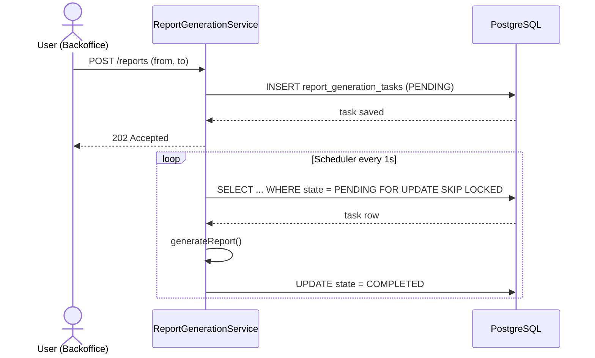
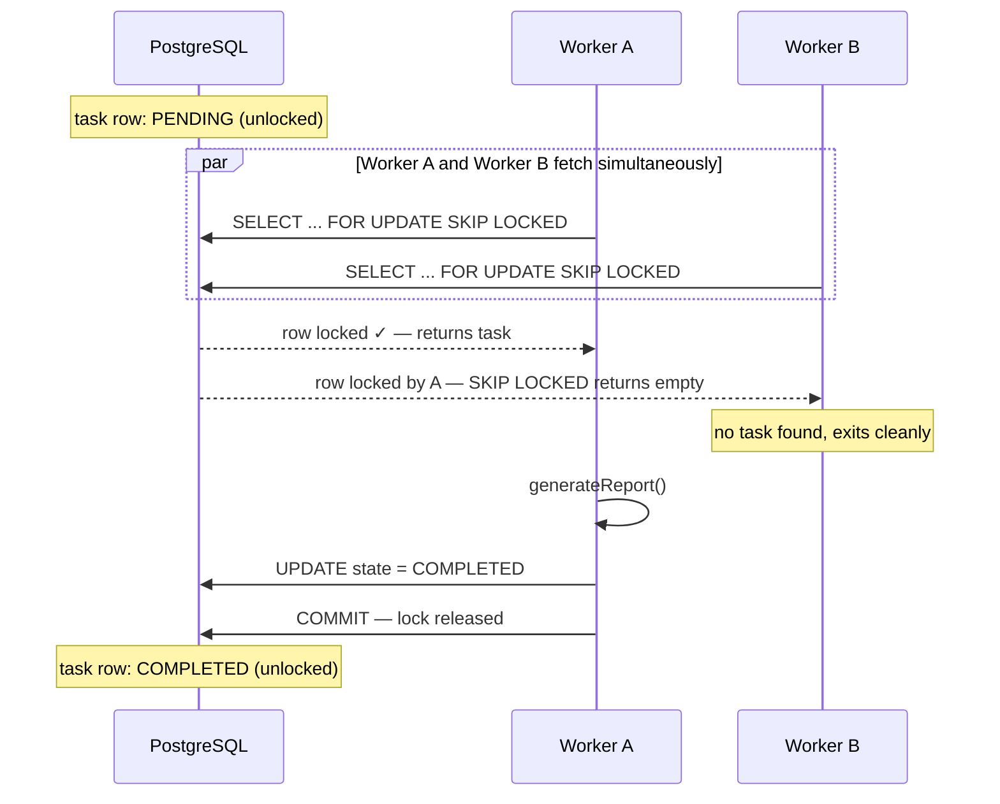
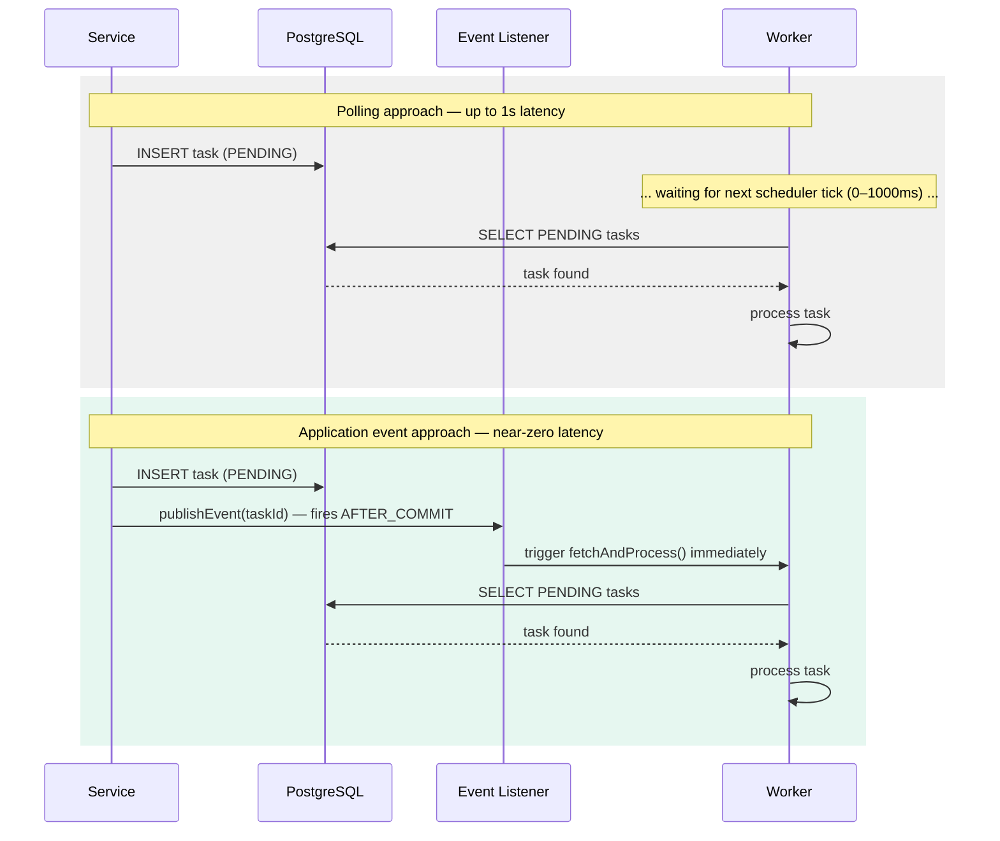
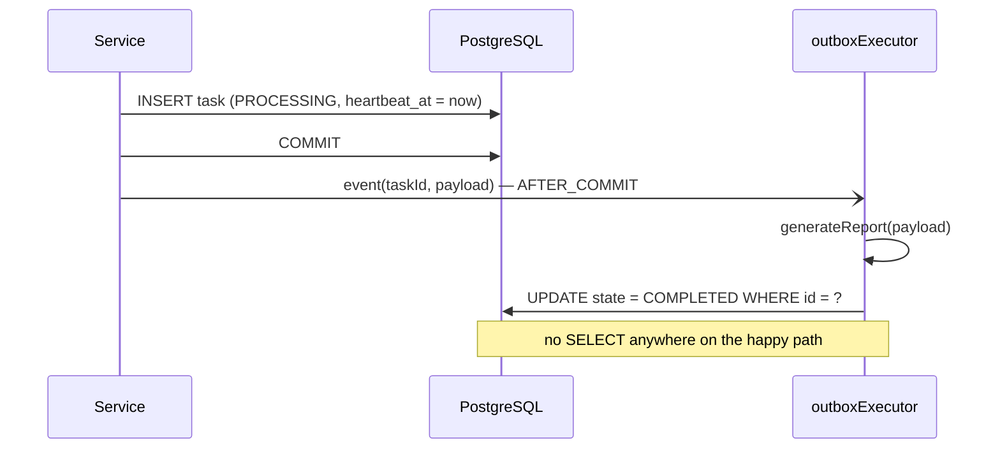
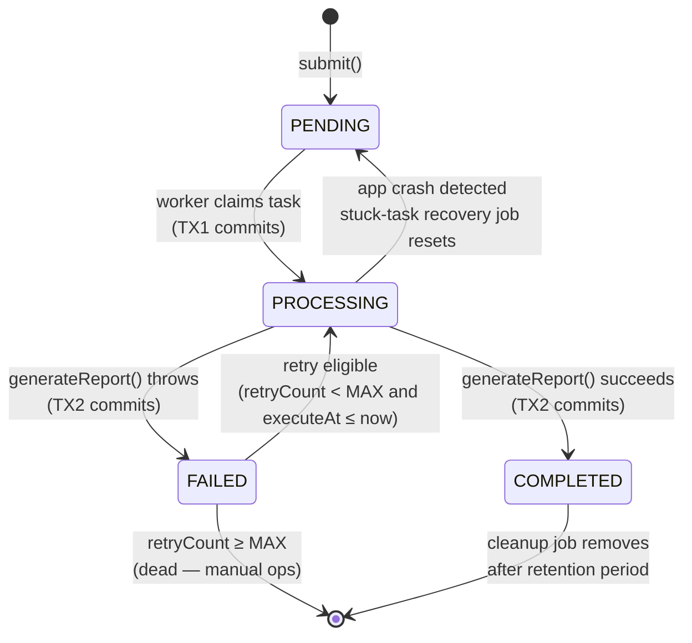
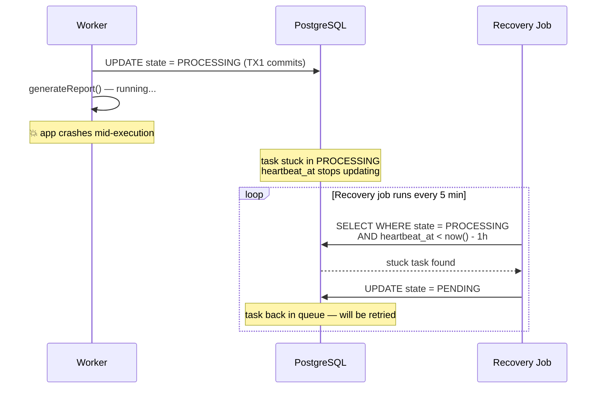
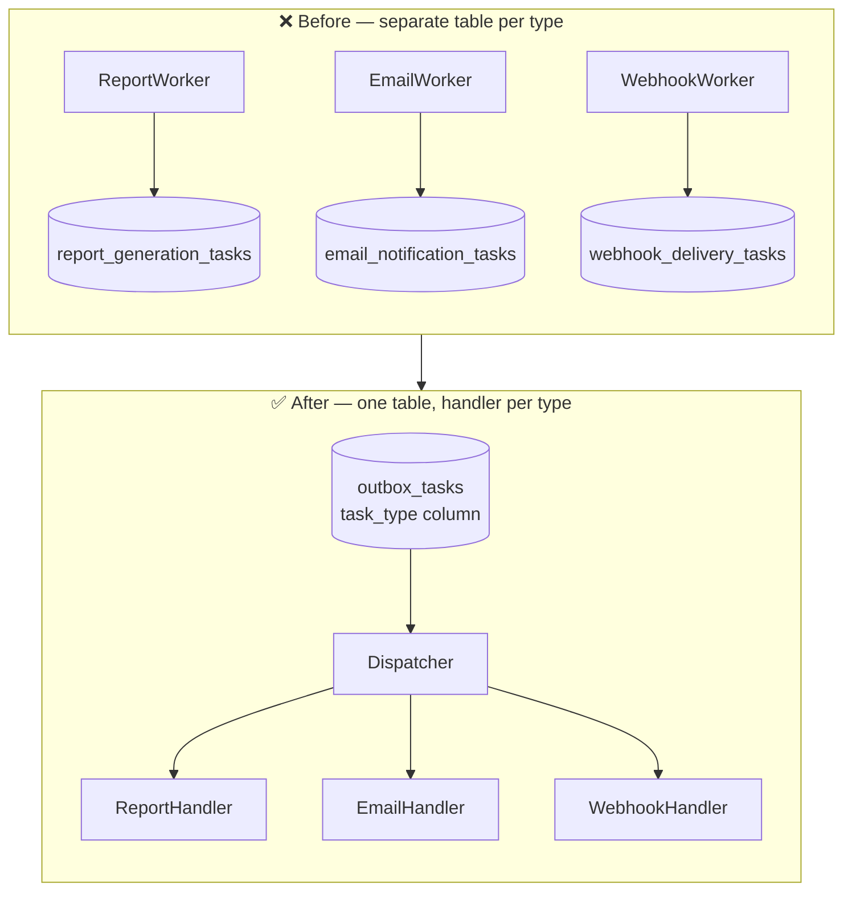
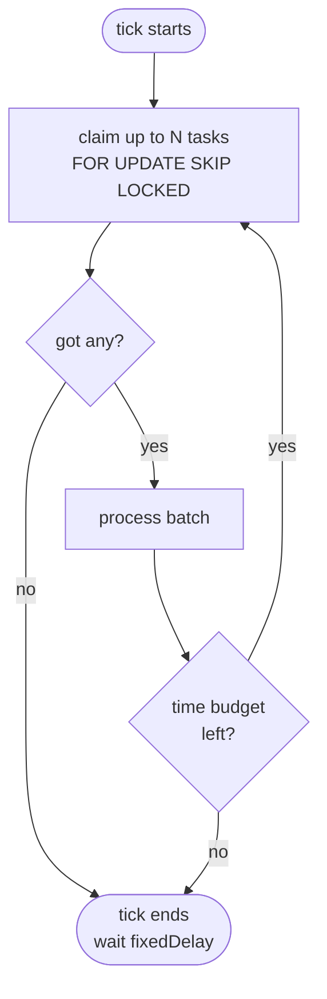

# トランザクショナルアウトボックスパターン: 単一タスクから本番レベルの非同期エンジンへ

ユニットテストでは決して姿を見せず、ステージングでもほとんど現れない類のバグがあります。
それが現れるのは本番、午前2時です。アプリがデータベースにレコードを保存した後、外部サービスを
呼び出そうとして、そのどちらかが失敗する。片側はコミット済み、もう片側はされていない。誰かが
苦情を言うまで、誰も気づきません。

これが**二重書き込み（dual-write）問題**であり、トランザクショナルアウトボックスパターンは
その定番の答えです。発想はシンプルです。外部システムを直接呼び出す代わりに、ドメインの変更と
同じデータベーストランザクション内へタスクを書き込む。バックグラウンドワーカーがそれを拾って
実行します。書き込みはアトミックであり、タスクが失われることはありません。

一方、基本アイデアの「その後」について書かれたものは少ないものです。タスクが失敗したらどうなるか。
2つのワーカーが同じ行を奪い合ったらどうなるか。実行の途中でアプリがクラッシュしたらどうなるか。
1つのテーブルに10種類のタスクが住むようになったらどうするか。そして先週火曜日の午前3時にキューの
深さが急増したのはなぜか、とステークホルダーに問われたらどう答えるか。

この記事が扱うのはまさにそこです。

私は1つの具体的なシナリオ——**レポート生成サービス**——を通して、考えうる最も単純なアウトボックス
から、本番で安心して運用できるものへと段階的に進化させていきます。掲載するコードはすべて、記事末尾で
リンクしている実際に動くリポジトリから取っています。

スタック: **Java、Spring Boot、PostgreSQL**。

<div class="post-tldr" markdown="1">
<p class="post-tldr-title">TL;DR</p>

- **トランザクショナルアウトボックスパターン**は、ドメインの変更と**同じDBトランザクション**でタスク行を書き込み、それをバックグラウンドワーカーが実行することで、二重書き込み問題を解決します。
- アウトボックステーブルは`SELECT ... FOR UPDATE SKIP LOCKED`でポーリングすれば、複数ワーカーが並行して動いても二重処理になりません。
- DBトランザクションの中でKafkaに送信したり他のサービスを呼び出したりしては**いけません**。トランザクションの時間が外部リソースに依存してはならないからです。
- 本番品質には基本アイデア以上のものが必要です。**ステートマシン**、**バックオフとジッター付きのリトライ**、クラッシュしたワーカーを復旧するための**ハートビート／リース**、**順序**保証、意図的に選んだ**フェッチ戦略**、**バッチ化したクリーンアップ**、そしてキューの深さの**監視**。
- レイテンシーを下げるなら、**専用スレッドプール**上の`AFTER_COMMIT`イベントでワーカーを起こします。あるいは**ゼロセレクト**に振り切ってペイロードをイベントに載せ、負荷の制御と引き換えに速度を取ります。
- Kafkaは不要です。信頼性の高い非同期実行には**PostgreSQL単体**で十分です。
</div>

---

## シナリオ



私たちはCRMを構築しているとします。バックオフィスのUIから、月次の分析レポートを依頼できます。
レポートの生成は数千万行の集計を意味し、数分かかることがあります。HTTPリクエストの中で同期的に
実行できるはずがありません。

ユーザーがボタンをクリックする。バックエンドはリクエストを受け付けて保存し、すぐに応答を返します。
バックグラウンドワーカーがタスクを拾い、生成を実行し、完了したらステータスを更新します。

これはアウトボックスが意味を持つ最も単純なケースです。本質的に非同期である仕事、ユーザーが
すでに待つことを想定している仕事です。

---

## Part 1 — 基本のアウトボックス

### アウトボックスに必要なもの

本質的に、どんなアウトボックステーブルにも3つの要素が必要です:

- **ステート** — このタスクはライフサイクルのどの段階にいるのか？
- **ペイロード** — 実際に何を実行すべきなのか？
- **タイムスタンプ** — いつ作成され、最後にいつ変わったのか？

```sql
CREATE TYPE task_state AS ENUM ('PENDING', 'COMPLETED');

CREATE TABLE report_generation_tasks (
                                       id         UUID       PRIMARY KEY DEFAULT gen_random_uuid(),
                                       state      task_state NOT NULL    DEFAULT 'PENDING',
                                       payload    JSONB      NOT NULL,
                                       created_at TIMESTAMP  NOT NULL    DEFAULT now(),
                                       updated_at TIMESTAMP  NOT NULL    DEFAULT now()
);
```

このユースケースのペイロードは日付範囲です:

```java
@Value
@Builder
@Jacksonized
public class ReportGenerationPayload {
  Instant from;
  Instant to;
}
```

JPAエンティティは次のとおりです:

```java
@Entity
@Table(name = "report_generation_tasks")
@Data
@Builder
@NoArgsConstructor
@AllArgsConstructor
public class ReportGenerationEntity {

    @Id
    @GeneratedValue(strategy = GenerationType.UUID)
    @Column(updatable = false, nullable = false)
    private UUID id;

    @Enumerated(EnumType.STRING)
    @Column(nullable = false, columnDefinition = "task_state")
    private TaskState state;

    @JdbcTypeCode(SqlTypes.JSON)
    @Column(nullable = false, updatable = false, columnDefinition = "jsonb")
    private ReportGenerationPayload payload;

    @CreationTimestamp
    @Column(nullable = false, updatable = false)
    private Instant createdAt;

    @UpdateTimestamp
    @Column(nullable = false)
    private Instant updatedAt;
}
```

タスクの登録は次のとおりです:

```java
@Service
@RequiredArgsConstructor
public class ReportGenerationService {

    private final ReportGenerationRepository repository;

    public void submit(ReportGenerationCommand command) {
        repository.save(ReportGenerationEntity.builder()
                .state(TaskState.PENDING)
                .payload(ReportGenerationPayload.builder()
                        .from(command.getFrom())
                        .to(command.getTo())
                        .build())
                .build());
    }
}
```

### ワーカー

スケジュールされたジョブがPENDINGタスクをポーリングして実行します:

```java
@Component
@RequiredArgsConstructor
public class ReportGenerationScheduledJob {

    private final ReportGenerationTaskService taskService;

    @Scheduled(fixedDelay = 1000)
    public void run() {
        taskService.fetchAndProcess();
    }
}
```

```java
@Service
@RequiredArgsConstructor
public class ReportGenerationTaskService {

    private final ReportGenerationRepository repository;

    public void fetchAndProcess() {
        repository.findFirstByStateOrderByCreatedAt(TaskState.PENDING)
                .ifPresent(task -> {
                    generateReport(task);
                    task.setState(TaskState.COMPLETED);
                    repository.save(task);
                });
    }

    private void generateReport(ReportGenerationEntity task) {
        // actual report generation logic
    }
}
```

```java
public interface ReportGenerationRepository extends JpaRepository<ReportGenerationEntity, UUID> {
    Optional<ReportGenerationEntity> findFirstByStateOrderByCreatedAt(TaskState state);
}
```

これは障害のない単一インスタンスアプリなら動きます。現実には2つの問題があります。2つのワーカーが
同じタスクを同時に取得できてしまうことと、タスクが失敗しても回復する道筋がないことです。
両方を直していきます。

---

## Part 2 — 同時実行: 2つのワーカー、1つのタスク

2つのスケジューラースレッド——あるいは2つのアプリインスタンス——が同時に取得クエリを実行すると、
両者が同じ`PENDING`行を読み、両者が実行しようとします。良い場合でも仕事の重複、最悪の場合は
状態の破損です。

解決策は、取得の時点でデータベースロックを取ることです。PostgreSQLの
`SELECT ... FOR UPDATE SKIP LOCKED`はまさにこのユースケースのために作られた構文です。
現在のトランザクションのために行をロックし、待機する代わりに、他のトランザクションがすでに
ロックしている行をスキップします。

```java
public interface ReportGenerationRepository extends JpaRepository<ReportGenerationEntity, UUID> {

    @Lock(LockModeType.PESSIMISTIC_WRITE)
    @QueryHint(name = AvailableSettings.JAKARTA_LOCK_TIMEOUT, value = "-2") // -2 = SKIP_LOCKED
    Optional<ReportGenerationEntity> findFirstByStateOrderByCreatedAt(TaskState state);
}
```

`SKIP_LOCKED`ヒントの値`-2`は、Hibernateが`SKIP LOCKED`句に変換する値です。これを表すファーストクラスの
アノテーションは存在しないため、マジックナンバーをリポジトリのあちこちに散らばらせないよう、
再利用可能なアノテーションに切り出す価値があります:

```java
@Retention(RetentionPolicy.RUNTIME)
@Target({ElementType.METHOD, ElementType.ANNOTATION_TYPE})
@QueryHints(@QueryHint(
    name = AvailableSettings.JAKARTA_LOCK_TIMEOUT,
    value = Timeouts.SKIP_LOCKED_MILLI + ""
))
public @interface SkipLocked {}
```

ずっときれいになりました。リポジトリが配管コードではなく意図を読める形になります:

```java
@SkipLocked
@Lock(LockModeType.PESSIMISTIC_WRITE)
Optional<ReportGenerationEntity> findFirstByStateOrderByCreatedAt(TaskState state);
```

取得〜実行〜更新の一連のサイクルを1つのトランザクションに包めば、処理中もロックを保持し続ける
ことは*できます*。しかし、一般的にやるべきではありません:

```java
// Technically works, but do not use this pattern for outbox processing.
@Transactional
public void fetchAndProcess() {
    repository.findFirstByStateOrderByCreatedAt(TaskState.PENDING)
            .ifPresent(task -> {
                generateReport(task);
                task.setState(TaskState.COMPLETED);
                repository.save(task);
            });
}
```



`generateReport()`が十分に小さく技術的には動いたとしても、開いたトランザクションの下で
アウトボックスの処理を実行するのはアンチパターンです。トランザクションの長さがアウトボックス実行の
長さに依存してはいけません。処理は時間とともに遅くなったり、I/Oでブロックされたり、下流サービスを
呼び出したりして、予測できない期間にわたってデータベース接続と行ロックを保持したままになります。

代わりに、短いトランザクションで行を`PROCESSING`に遷移させて取得し、コミットしてロックを解放し、
その後にアウトボックスの処理を実行します。`COMPLETED`か`FAILED`は、その後の別の短いトランザクションで
記録します。次のセクションで、この状態遷移と回復経路を実装します。

### トランザクションの中で外の世界と話してはいけない

同じルールはアウトボックスのワーカーにとどまらず、はるかに広く当てはまります。そしてこれは、
アウトボックスの周辺コードがサービスを落とす原因として、私が見てきた中で最も多いものです。
見た目は無害です:

```java
// ❌ Kafka send (or an HTTP call, or an S3 upload) inside an open DB transaction
@Transactional
public void approveOrder(UUID orderId) {
    var order = orderRepository.findById(orderId).orElseThrow();
    order.setStatus(OrderStatus.APPROVED);

    kafkaTemplate.send("order-approved", orderId.toString(), toEvent(order)).get(); // blocks
    billingClient.notifyApproved(orderId);                                         // blocks
}
```

調子の良い日には、Kafkaは5msでackを返し、課金サービスは30msで応答するので、誰も気づきません。
調子の悪い日には、ブローカーはリバランス中、課金サービスは劣化していて、どの呼び出しもタイムアウト
まで30秒かかります。すると、実行中の**すべての**トランザクションが30秒間開いたままになります:

- それぞれがプールの接続を1本ずつ握ります。接続が20本で呼び出しが30秒なら、サービス全体で
  承認できる注文は30秒あたり20件になり、それ以外のすべて（正常な読み取りエンドポイントも含む）が
  プールの順番待ちをしてタイムアウトし始めます。
- 書き込みを行った時点で（JPAではコミット時のflushまで遅れることもありますが、それより前のことも
  多い）、行ロックを保持します。同じ注文に触れる処理はすべて、その後ろで待たされます。
- 何かを書き込んだ長いトランザクションは、PostgreSQLのvacuumホライズンを押しとどめます。
  それが終わるまでデータベース全体のデッドタプルが回収できず、このテーブルだけでなくあらゆる
  場所でブロートが膨らんでいきます。

自分が所有していない依存先の劣化が、自分が所有しているデータベースの障害に変わったわけです。
**データベーストランザクションの長さが外部リソースに依存してはいけません。** トランザクションが
待ってよいのは、データベースそのものだけです。

しかもこれは依然として二重書き込みです。Kafkaへの送信が成功した後でコミットが失敗すれば
（制約違反、シリアライゼーション失敗、Podのkill）、コンシューマーは承認されなかった注文の
`order-approved`イベントをすでに見ています。送信をコミットの*後*に動かしても、障害モードが
裏返るだけです。コミットはされたのに、イベントが失われる。これこそアウトボックスが解決するために
存在する問題です。トランザクションの中ではアウトボックスに意図を書き込み、Kafkaと話すのは
その後でワーカーに任せましょう。

コードが正しい場合でも、ガードを2つ追加しておく価値があります。次にそのコードに触れる人が、
このルールを知っているとは限らないからです:

```java
@Transactional(timeout = 5) // seconds
public void approveOrder(UUID orderId) { ... }
```

Springの`timeout`は、すでにブロックしている呼び出しを中断しません。これはその後に続く
データベース操作でチェックされる期限です。期限を過ぎた後に発行されたステートメント（コミット時の
flushを含む）はタイムアウト例外で失敗し、トランザクションはロールバックします。治療法ではなく、
「遅くて静か」を「テストとログで派手に失敗する」に変える仕掛け線として扱ってください。

```sql
-- server-side safety net: kill sessions that sit idle inside an open transaction
ALTER DATABASE app SET idle_in_transaction_session_timeout = '30s';
```

`idle_in_transaction_session_timeout`は、PostgreSQLの視点から見たまさに上記の状況です。
セッションがトランザクションを開き、アプリケーションが別の何かを待っている間、黙り込んでいる状態です。

---

## Part 2.5 — アプリケーションイベントでレイテンシーを下げる

ポーリングするスケジューラーには、避けられないレイテンシーの下限があります。ジョブが毎秒発火するなら、
`t=0ms`に登録されたタスクは次のティックまで——最大1000ms後まで——`PENDING`のまま居座ります。
多くの非同期ワークロードなら許容範囲です。しかしトランザクションメールの送信やWebhookの起動のような、
ほぼ即時のピックアップが必要なケースでは話が違います。

Celeryから借りたパターンです。アウトボックスエンティティをデータベースに保存したら、新しいタスクの
IDを載せたSpringの`ApplicationEvent`を即座に発行します。リスナーがそれを受け取り、次のスケジューラー
ティックを待たずに処理をディスパッチします。



スケジューラーもセーフティネットとして引き続き動きます。イベントリスナーが取りこぼしたもの
（アプリの再起動、リスナーの例外、イベントの喪失）を拾うためです。ただし、正常系では
ポーリングの遅延を完全に回避できます。

### 実装

イベントはサービスメソッド内の、保存の後に発行します:

```java
@Service
@RequiredArgsConstructor
public class ReportGenerationService {

    private final ReportGenerationRepository repository;
    private final ApplicationEventPublisher eventPublisher;

    @Transactional
    public void submit(ReportGenerationCommand command) {
        var entity = repository.save(ReportGenerationEntity.builder()
                .state(TaskState.PENDING)
                .payload(ReportGenerationPayload.builder()
                        .from(command.getFrom())
                        .to(command.getTo())
                        .build())
                .build());

        eventPublisher.publishEvent(new ReportGenerationTaskSubmittedEvent(entity.getId()));
    }
}
```

```java
public record ReportGenerationTaskSubmittedEvent(UUID taskId) {}
```

リスナーはコミットの後、**専用のスレッドプール上で**反応します:

```java
@Component
@RequiredArgsConstructor
public class ReportGenerationTaskEventListener {

    private final ReportGenerationTaskService taskService;

    @Async("outboxExecutor")
    @TransactionalEventListener(phase = TransactionPhase.AFTER_COMMIT)
    public void onTaskSubmitted(ReportGenerationTaskSubmittedEvent event) {
        taskService.fetchAndProcess();
    }
}
```

リスナーが`event.taskId()`を渡していないことに注目してください。これは意図的です。イベントは
単なる**起床シグナル**であり、`fetchAndProcess()`はポーラーとまったく同じ方法で仕事を取得します。
つまり`SKIP LOCKED`付きで、最も古い実行可能タスクを取ります。イベントを発生させたタスクが実行される
とは限りませんが、順序付けと取得のロジックは1箇所にとどまります。*そのタスク*を今すぐ実行したいなら、
IDを渡して直接取得します:

```java
taskService.process(event.taskId()); // WHERE id = :id AND state = 'PENDING' FOR UPDATE SKIP LOCKED
```

こうすれば登録した側のレイテンシーは最小になりますが、その代わり新しいタスクが古い`PENDING`タスクを
追い越すことを許します。独立した仕事なら問題ありませんが、FIFOに依存しているなら誤りです（Part 7）。
このパートの最後で扱うゼロセレクトアウトボックスは、この考えを突き詰め、ペイロード全体を渡します。

`@Async`は飾りではありません。これがない`AFTER_COMMIT`リスナーは、**コミットしたスレッド上で同期的に**
実行されます。つまりHTTPリクエストのスレッドです。ユーザーへの「202 Accepted」は、レポート全体の
生成が終わるまで待たされることになります。さらに悪いことに、その時点ではコミット済みトランザクションの
リソースがまだスレッドに束縛されています。Spring自身のドキュメントも、after-commitコールバックからの
データアクセスは終了したトランザクションにまだ「参加」しており、コードが明示的に`REQUIRES_NEW`を
要求しない限り何もコミットされない、と警告しています。リスナーを別スレッドに移せば、両方が一度に
解決します。

### デフォルトではなく専用のスレッドプールを

名前を指定しない`@Async`は、Spring Bootの共有`applicationTaskExecutor`を使います。これはアプリ内の
他のすべての`@Async`メソッドと共有され、デフォルトでは事実上無制限のキューを持ちます。イベントが
殺到すると、それは次の再起動で消えてしまうインメモリのバックログへと静かに姿を変えます。
アウトボックスには、上限付きの専用プールを与えましょう:

```java
@Configuration
@EnableAsync
public class OutboxExecutorConfig {

    @Bean("outboxExecutor")
    public ThreadPoolTaskExecutor outboxExecutor() {
        var executor = new ThreadPoolTaskExecutor();
        executor.setCorePoolSize(4);
        executor.setMaxPoolSize(4);
        executor.setQueueCapacity(200);                 // bounded: overflow is rejected, not buffered forever
        executor.setThreadNamePrefix("outbox-");        // readable thread dumps and logs
        executor.setRejectedExecutionHandler(new ThreadPoolExecutor.DiscardPolicy());
        executor.setWaitForTasksToCompleteOnShutdown(true);
        executor.setAwaitTerminationSeconds(15);
        return executor;
    }
}
```

これをコピーする前に知っておくべきSpring Bootの細部が1つあります。Bootが`applicationTaskExecutor`を
自動構成するのは、自分で`Executor`ビーンを宣言して**いない**場合だけです。`outboxExecutor`を宣言すると
デフォルトは消え、アプリ内の他の場所にある*名前なしの*`@Async`はすべて、静かに別のエグゼキューター
（場合によってはdiscardポリシーを持つこのプール）に載ることになります。Boot 3.5以降なら
`spring.task.execution.mode=force`を設定して自動構成のものを残し、それより古いバージョンでは
`applicationTaskExecutor`ビーンをこれと並べて明示的に宣言してください。

あふれたときに破棄しても安全なのは、*行がデータベースにあるから*です。イベントはレイテンシーの
最適化にすぎず、イベント経路で落ちたものはポーラーが拾います。このプールに`CallerRunsPolicy`を
使ってはいけません。その「caller」とは、解放しようとしていたリクエストスレッドそのものだからです。

### 定番のミス

最もよくある間違いは、`@TransactionalEventListener(phase = TransactionPhase.AFTER_COMMIT)`の代わりに
`@EventListener`を使うことです。何がおかしくなるかは、リスナーが非同期かどうかで変わります:

- **素の`@EventListener`**は、`publishEvent()`が呼ばれた瞬間に発火します。同じスレッド上で同期的に、
  **まだ開いているトランザクションの中で**です。`fetchAndProcess()`はそのトランザクションに参加するので、
  コミット前の行が*見えてしまい*、その場でタスクを取得して実行します。レポートは登録トランザクションの
  中で生成され（Part 2のアンチパターンそのもの）、リクエストはそれが終わるまで止まり、もしその後で
  登録トランザクションがロールバックすれば、公式には存在しなかったタスクを実行したことになります。
- **`@Async` + `@EventListener`**は、コミット前に、別のスレッド・別の接続で実行されます。行はまだ
  見えず、フェッチは何も見つけられず、イベントは黙って無駄になります。1秒後にスケジューラーが
  タスクを拾うのでログ上は何も問題なく見えますが、気づかないうちにレイテンシーの利点を失っています。

```java
// ❌ fires inside the open transaction (or before it commits, if @Async)
@EventListener
public void onTaskSubmitted(ReportGenerationTaskSubmittedEvent event) {
    taskService.fetchAndProcess();
}

// ✅ fires after COMMIT, on the outbox pool — the row is visible and the caller is free
@Async("outboxExecutor")
@TransactionalEventListener(phase = TransactionPhase.AFTER_COMMIT)
public void onTaskSubmitted(ReportGenerationTaskSubmittedEvent event) {
    taskService.fetchAndProcess();
}
```

スケジューラーはそのままで、イベントリスナーが取りこぼしたタスクの回復機構として機能します。
2つの方式は互いを補完します。レイテンシーにはイベント、信頼性にはポーリングです。

### さらに先へ: ゼロセレクトアウトボックス

上のイベントでも、まだ1往復のコストがかかります。イベントが伝えるのは「何か新しいものが来た」
だけなので、ワーカーは何が来たのかを知るために`SELECT`しなければならず、しかも
`ORDER BY created_at`ではイベントを発生させたタスクを取るとも限りません。レイテンシーが本当に
重要なら、読み取りそのものを省きましょう。**タスクの実行に必要なものをすべてイベントに載せ**、
メモリから直接実行し、結果だけを書き戻すのです。



これはPart 3とPart 5の`PROCESSING`ステートとハートビートを使います。行は最初から`PROCESSING`として
挿入され、新しい`heartbeat_at`がリースの役割を果たします。この細部こそが正しさを保つ鍵です。
もし行を`PENDING`で挿入すると、イベント経路がすでに実行している最中にポーラーがそれを取得でき、
タスクが2回実行されてしまいます。

```java
public record ReportRequestedEvent(UUID taskId, Instant leasedAt, ReportGenerationPayload payload) {}

@Transactional
public void submit(ReportGenerationCommand command) {
    var payload = ReportGenerationPayload.builder()
            .from(command.getFrom())
            .to(command.getTo())
            .build();
    var leasedAt = Instant.now().truncatedTo(ChronoUnit.MICROS); // Postgres stores microseconds
    var entity = repository.save(ReportGenerationEntity.builder()
            .state(TaskState.PROCESSING)
            .heartbeatAt(leasedAt)        // lease: the poller leaves this row alone
            .payload(payload)
            .build());
    eventPublisher.publishEvent(new ReportRequestedEvent(entity.getId(), leasedAt, payload));
}
```

```java
@Async("outboxExecutor")
@TransactionalEventListener(phase = TransactionPhase.AFTER_COMMIT)
public void onReportRequested(ReportRequestedEvent event) {
    // UPDATE ... SET heartbeat_at = now()
    //  WHERE id = :id AND state = 'PROCESSING' AND heartbeat_at = :leasedAt
    if (repository.renewLease(event.taskId(), event.leasedAt()) == 0) {
        return; // the event waited too long: recovery already handed the task to the poller
    }
    try (var heartbeat = heartbeatFactory.start(event.taskId())) {
        generateReport(event.payload());
        repository.markCompleted(event.taskId());              // UPDATE ... WHERE id = :id
    } catch (Exception e) {
        repository.markFailed(event.taskId(), e.getMessage()); // the poller retries it later
    }
}
```

冒頭の`renewLease`チェックは、見た目以上に重要です。リースは挿入時に設定されますが、ハートビートが
始まるのはスレッドがイベントを拾ってからです。イベントがエグゼキューターのキューにリカバリーの
しきい値より長く滞留すると、リカバリージョブが行を`PENDING`に戻し、ポーラーがそれを取得し——
その後でキューに残っていたイベントが2回目の実行をしてしまいます。条件付きUPDATEは、この競合を
ノーオペレーションに変えます。元のリースをもう所有していない側が身を引くのです。

あらゆる障害モードは、従来の経路に戻ってきます。リスナーが例外を投げればタスクは`FAILED`になり、
ポーラーがバックオフ付きでリトライします。実行中にアプリが落ちればハートビートが止まり、
詰まったタスクのリカバリージョブがそれをリセットします。プールがイベントを拒否すれば、行は更新されない
リースを持ったまま`PROCESSING`で残り、リカバリーを待ちます。リースのチェックがあるので、これらの行に
対して短いリカバリーしきい値を使っても安全です。（拒否時にすぐ`PENDING`へ戻すにはタスクIDが必要ですが、
`@Async`の拒否ハンドラーはそれを受け取れません。そうしたいなら、自分でエグゼキューターに投入して
`TaskRejectedException`を捕捉してください。）

**トレードオフ: 仕事の量を制御するのは誰か。** ポーリング型のアウトボックスは*プル*します。何件のタスクを
どれだけの速さで取るかを自分で決めるので、上流で何が起きようと、負荷は設計上制限されています。
ゼロセレクトアウトボックスは*プッシュ*されます。仕事はリクエストが来るのと同じ速さでやってきます。
トラフィックのスパイクはそのまま実行のスパイクになり、ブレーキはプールのサイズとキューの容量しか
ありません。それらが満杯になれば、結局は拒否してポーリングに戻ることになります。ゼロセレクトは、
レイテンシーに敏感で量がほどほどの仕事に、上限付きのプールと組み合わせて使いましょう。それ以外には
ポーラーを使い、そしてセーフティネットとしては常にポーラーを残しておきます。

**最後の書き込みも絞り出す。** スループットを最大化したいなら、さらに一歩進めて、完了を1件ずつ
書き込むのをやめることもできます。完了したIDをメモリに集め、数百ミリ秒ごとに1回の`UPDATE`で
まとめてフラッシュするのです。

```java
@Component
@RequiredArgsConstructor
public class CompletionBuffer {

    private final ConcurrentLinkedQueue<UUID> completed = new ConcurrentLinkedQueue<>();
    private final ReportGenerationRepository repository;

    public void add(UUID taskId) {
        completed.add(taskId);
    }

    @Scheduled(fixedDelay = 200)
    @PreDestroy                                   // flush what we can on a graceful shutdown
    public void flush() {
        var ids = new ArrayList<UUID>();
        for (UUID id; ids.size() < 1_000 && (id = completed.poll()) != null; ) {
            ids.add(id);
        }
        if (!ids.isEmpty()) {
            repository.markCompleted(ids);        // UPDATE ... SET state = 'COMPLETED' WHERE id IN (:ids)
        }
    }
}
```

シャットダウン時のフラッシュはベストエフォートです。その後もバッファに残っているもの、あるいは
ビーンが破棄された後に追加されたものは、単に後で再実行されます。これが何を犠牲にするのかは正確に
把握しておきましょう。クラッシュするとバッファが失われます。失われるのはタスクではなく、*それらが
完了したという記録*です。それらの行は`PROCESSING`のまま残り、リカバリーがリセットし、**もう一度**
実行されます。これが許容できるのは、すべてのハンドラーが冪等である場合だけです（Part 10）。失敗は
バッファリングせず、すぐに書き込んでください。失敗はまれですし、そのエラーメッセージは後から
再構築できない唯一のものだからです。

---

## Part 3 — 障害、リトライ、PROCESSINGステート



アウトボックスの処理を、開いたデータベーストランザクションの下で実行すべきではありません。
ロックを保持したトランザクション方式では、`generateReport()`の実行全体にわたってデータベースロックが
保持されます。2分かかるレポートなら、2分間のロックされた行です。接続が1本拘束され、他のDB操作が
その後ろに並ぶ可能性があります。`SKIP LOCKED`ならワーカー同士はロックで互いをブロックしませんが、
長時間のトランザクションはそれでもコネクションプールを圧迫し、負荷下でデータベースを苦しめます。
非常に小さな処理は、目に見える問題なく完了するかもしれません。それでもトランザクションの長さを
アウトボックス実行の長さに結びつけること自体は、アンチパターンです。

解決策は、タスクの取得と実行を分離することです。短いトランザクションでタスクを`PROCESSING`に
遷移させ、ロックを解放し、その後に実際の作業をトランザクションの外で行います。こうすればDBに触れるのは
冒頭と末尾のごく短い時間だけです。重い処理はその間に、何も保持せずに走ります。

まずenumを拡張します:

```sql
ALTER TYPE task_state ADD VALUE 'PROCESSING';
ALTER TYPE task_state ADD VALUE 'FAILED';

ALTER TABLE report_generation_tasks
    ADD COLUMN retry_count  INTEGER NOT NULL DEFAULT 0,
    ADD COLUMN error_message VARCHAR;
```

`retry_count`は実行を試みた回数を追跡します。リトライは10回で打ち止めにします。それ以上は何かが
本当に壊れており、手動の介入が必要だからです。アラートは後でこれを軸に組みます。`error_message`には
最後の例外を保存します。ログを漁らなくても、タスクが詰まっている*理由*を知るためです。

Javaのenumも一緒に育ちます:

```java
public enum TaskState {
    PENDING,
    PROCESSING,
    COMPLETED,
    FAILED
}
```

サービスは今や、実際の作業を挟んで2つの独立した短いトランザクションを実行します:

```java
@RequiredArgsConstructor
public class ReportGenerationTaskService {

    private final ReportGenerationRepository repository;
    private final TransactionTemplate transactionTemplate;

    private static final int MAX_RETRY_COUNT = 10;

    public void fetchAndProcess() {
        transactionTemplate
                .execute(status ->
                        repository.findFirstEligibleTask(
                                List.of(TaskState.PENDING, TaskState.FAILED),
                                MAX_RETRY_COUNT
                        ).map(this::markProcessing))
                .ifPresentOrElse(
                        task -> {
                            try {
                                generateReport(task);
                                markCompleted(task);
                            } catch (Exception e) {
                                markFailed(task, e);
                                log.error("Task {} failed on attempt {}", task.getId(), task.getRetryCount(), e);
                            }
                        },
                        () -> log.debug("No eligible tasks to process")
                );
    }

    private ReportGenerationEntity markProcessing(ReportGenerationEntity task) {
        task.setState(TaskState.PROCESSING);
        return repository.save(task);
    }

    private void markCompleted(ReportGenerationEntity task) {
        task.setState(TaskState.COMPLETED);
        repository.save(task);
    }

    private void markFailed(ReportGenerationEntity task, Exception e) {
        task.setState(TaskState.FAILED);
        task.setRetryCount(task.getRetryCount() + 1);
        task.setErrorMessage(e.getMessage()); // don't skip this — it's the only trace of what went wrong without digging through logs
        repository.save(task);
    }
}
```

クエリは`PENDING`と`FAILED`の両方のタスクを取得します。`retryCount < 10`の失敗タスクは、新しい
タスクと同等に実行対象です。リトライ回数が上限に達すると、そのタスクは取得されなくなり、誰かが
見るまで恒久的な`FAILED`レコードとして残ります。これは意図的な設計です。10回を超えて失敗するなら
本当に何かが壊れているので、必要なのはもう1回のリトライではなく人の目です。

```java
@SkipLocked
@Lock(LockModeType.PESSIMISTIC_WRITE)
@Query("""
    SELECT t FROM ReportGenerationEntity t
    WHERE t.state IN :states
      AND t.retryCount < :maxRetryCount
    ORDER BY t.createdAt ASC
    LIMIT 1
    """)
Optional<ReportGenerationEntity> findFirstEligibleTask(
    @Param("states") List<TaskState> states,
    @Param("maxRetryCount") Integer maxRetryCount
);
```

しかし待ってください。失敗したばかりのタスクを、次のスケジューラーティック——数秒後——に本当に
再取得してよいのでしょうか？ 下流システムが落ちているとき、毎秒叩き続けるのは事態を悪化させます。
次のセクションはまさにその話です。

## Part 4 — 指数バックオフ

リトライ間に遅延がなければ、失敗したタスクは次のスケジューラーティック——通常は数秒後——に
キューに戻ります。下流システムが落ちているとき、フルのポーリングレートで叩き続けることになります。
下流システムにも、自分のDBにも悪影響です。

解決策は`execute_at`カラムです。このタイムスタンプが過去になるまで、タスクは実行対象になりません。
新しいタスクには`execute_at = now()`を設定し、すぐに拾われるようにします。失敗したタスクには
`execute_at = now() + delay`を設定し、遅延はリトライごとに伸びていきます。

```sql
ALTER TABLE report_generation_tasks
    ADD COLUMN execute_at TIMESTAMP NOT NULL DEFAULT NOW();
```

遅延スケジュールがすべてを駆動します。`MAX_RETRY_COUNT`はそこから導出され、別途宣言されることは
ありません。こうすれば2つが同期を外れることはありません:

```java
private static final Map<Integer, Duration> RETRY_DELAYS = Map.of(
    0, Duration.ofMinutes(1),
    1, Duration.ofMinutes(5),
    2, Duration.ofMinutes(15),
    3, Duration.ofMinutes(30),
    4, Duration.ofHours(1),
    5, Duration.ofHours(2),
    6, Duration.ofHours(4),
    7, Duration.ofHours(8),
    8, Duration.ofHours(12),
    9, Duration.ofDays(1)
);

private static final int MAX_RETRY_COUNT = RETRY_DELAYS.size();
```

`RETRY_DELAYS`に新しいエントリを追加すれば、リトライ上限は自動的に更新されます。他の場所で
同期を保つべきマジックナンバーはありません。

`markFailed()`では、インクリメントする*前に*現在のリトライ回数を取っておきます。*次回*の試行の
遅延を選ぶのはこの値です:

```java
private void markFailed(ReportGenerationEntity task, Exception e) {
    int currentRetry = task.getRetryCount();
    task.setState(TaskState.FAILED);
    task.setRetryCount(currentRetry + 1);
    task.setErrorMessage(e.getMessage());
    task.setExecuteAt(Instant.now().plus(
            RETRY_DELAYS.getOrDefault(currentRetry, RETRY_DELAYS.get(RETRY_DELAYS.size() - 1))));
    repository.save(task);
}
```

取得クエリには条件が1つ——`AND t.executeAt <= :now`——加わり、スケジューラーは同じレートで動き続けます。
窓がまだ開いていないタスクをスキップするだけです。失敗タスクは自分の番が来るまで静かに待ち、時が来れば
自然にキューへ戻ります。

### ジッター: 負荷が襲ってくる前に平らにする

固定のバックオフスケジュールには厄介な性質があります。一緒に失敗したタスクは、一緒にリトライするのです。
メールプロバイダーが2分間落ちていたら、その間に失敗した3,000件のタスクはすべて
`execute_at = failed_at + 1 minute`を受け取り、プロバイダーが復帰した瞬間に、同期した1つの波として
再び押し寄せます。すべての遅延にランダム性を加えて、波を分散させましょう:

```java
private static Instant nextAttempt(Duration baseDelay) {
    long jitterMillis = ThreadLocalRandom.current().nextLong(baseDelay.toMillis() / 2 + 1);
    return Instant.now().plus(baseDelay).plusMillis(jitterMillis); // base + up to 50%
}
```

同じ考え方は**入り口**にも当てはまります。アーキテクチャとして、非同期エンジンが望むのは平らで安定した
負荷であり、大きく突発的なスパイクではありません。夜間インポートが1つのトランザクションで200,000件の
タスクを登録すると、そのすべてが同じミリ秒に実行対象になります。すべてのPodのすべてのワーカーが飽和し、
下流システムはバーストをまともに受け、誰も待っていない仕事のためにレイテンシーのダッシュボードが
真っ赤になります。急ぎでないタスクには、登録時にジッター付きの`execute_at`を与えましょう:

```java
// bulk / non-urgent submission: spread over the next 10 minutes instead of "all now"
entity.setExecuteAt(Instant.now().plusMillis(
        ThreadLocalRandom.current().nextLong(Duration.ofMinutes(10).toMillis())));
```

仕事の総量は変わりません。時間方向に分散されるだけです。ユーザー向けのタスクは`execute_at = now()`の
ままにし、バッチ的な仕事には、どれだけ待てるかに応じたジッター窓を与えます。

---

## Part 5 — 詰まったタスクとハートビート



2トランザクション方式では、タスクを`PROCESSING`にした後、`COMPLETED`や`FAILED`にする前に
アプリがクラッシュしたら何が起きるかを考えてみてください。DB上は`PROCESSING`。それを処理している
者はいません。永遠にそこに居座ります。

素朴な解決策は、`PROCESSING`に長居しすぎているタスクを見つけて`PENDING`に戻すリカバリージョブです:

```java
@Transactional
public void recoverStuckTasks() {
    repository.findFirstByStateAndUpdatedAtLessThan(
                    TaskState.PROCESSING,
                    Instant.now().minus(1, ChronoUnit.HOURS))
            .ifPresent(task -> {
                log.warn("Resetting stuck task {} to PENDING", task.getId());
                task.setState(TaskState.PENDING);
                repository.save(task);
            });
}
```

大半のケースではこれで動きます。問題は、行の*何か*が変わるたび——無関係な状態遷移も含めて——
`updated_at`が更新されることです。正当に55分間処理中のタスクは、`updated_at`の観点では
クラッシュしたタスクとまったく同じに見えます。

よりきれいな解決策は**ハートビート**です。タスクが*アクティブに処理されている間だけ*定期的に
更新される専用カラムを用意します。リカバリージョブは`updated_at`ではなくこのカラムを見ます。
直近1時間ハートビートしていないタスクは、本当に詰まっています。

```sql
ALTER TABLE report_generation_tasks ADD COLUMN heartbeat_at TIMESTAMP;
```

ハートビートは処理ロジックから独立して、自分自身のスレッド、自分自身のトランザクションの中で
動きます。最もきれいな実装は`try-with-resources`です。処理の開始とともに始まり、どんな出口経路でも
停止します:

```java
public abstract class Heartbeat implements AutoCloseable {

    private final ScheduledExecutorService executor;

    protected Heartbeat(Runnable heartbeatFn) {
        executor = Executors.newSingleThreadScheduledExecutor();
        executor.scheduleAtFixedRate(heartbeatFn, 0, 10, TimeUnit.SECONDS);
    }

    @Override
    public void close() {
        executor.shutdownNow();
    }
}
```

```java
public class ReportGenerationTaskHeartbeat extends Heartbeat {

    ReportGenerationTaskHeartbeat(UUID taskId, ReportGenerationRepository repository) {
        super(() -> repository.updateHeartbeatAt(taskId, Instant.now()));
    }
}
```

リポジトリメソッドは自分の`@Transactional`を担っているので、呼び出しを手動でラップする必要は
ありません:

```java
@Modifying
@Transactional
@Query("UPDATE ReportGenerationEntity t SET t.heartbeatAt = :now WHERE t.id = :id")
void updateHeartbeatAt(@Param("id") UUID id, @Param("now") Instant now);
```

ファクトリー経由で配線すれば、サービスはきれいなままです:

```java
@Component
@RequiredArgsConstructor
public class ReportGenerationTaskHeartbeatFactory {

    private final ReportGenerationRepository repository;

    public Heartbeat start(UUID taskId) {
        return new ReportGenerationTaskHeartbeat(taskId, repository);
    }
}
```

処理ブロックは次のようになります:

```java
public void fetchAndProcess() {
    transactionTemplate
            .execute(status -> repository.findFirstEligibleTask(
                    List.of(TaskState.PENDING, TaskState.FAILED),
                    MAX_RETRY_COUNT
            ).map(this::markProcessing))
            .ifPresentOrElse(
                    task -> {
                        try (var heartbeat = heartbeatFactory.start(task.getId())) {
                            try {
                                generateReport(task);
                                markCompleted(task);
                            } catch (Exception e) {
                                markFailed(task, e);
                                log.error("Task {} failed", task.getId(), e);
                            }
                        }
                    },
                    () -> log.debug("No eligible tasks to process")
            );
}
```

リカバリージョブは`updated_at`の代わりに`heartbeat_at`を使います:

```java
@Modifying
@Transactional
@Query("UPDATE ReportGenerationEntity t SET t.heartbeatAt = :now WHERE t.id = :id")
void updateHeartbeatAt(@Param("id") UUID id, @Param("now") Instant now);

@SkipLocked
@Lock(LockModeType.PESSIMISTIC_WRITE)   // two recovery runs never reset the same task
Optional<ReportGenerationEntity> findFirstByStateAndHeartbeatAtLessThanOrderByCreatedAt(
        TaskState state, Instant heartbeatAt);
```

`updated_at`はタスクの状態が最後に変わった時刻を反映します。`heartbeat_at`はタスクが今まさに
生きているかを反映します。2つを分けておけば、どちらの質問にも曖昧さなく答えられます。

---

## Part 6 — 複数種別アウトボックス



半年もすると、サービスはレポート生成だけを扱わなくなります。メール通知が必要になる。次に
データエクスポート。さらにWebhook送信。

選択肢は2つです。タスク種別ごとにテーブルを分けるか、`task_type`ディスクリミネーター付きの
共有テーブルを1つにするか。タスク種別が多く、1箇所からの処理で問題ないなら、共有テーブルが
勝ります。リトライ、ハートビート、バックオフ、監視というインフラが1箇所に収まります。新しい
タスク種別の追加は、ハンドラーを1つ足すだけです。

前もって知っておくべきトレードオフ:

- 挙動が悪い新しいタスク種別は、他のすべての種別を遅くし得ます。リトライを燃やし続ける1つの
  悪いハンドラーが、テーブル全体にバックプレッシャーをかけます。
- 順序保証は難しくなります。詳細は後述します。

### スキーマ

```sql
CREATE TYPE outbox_task_type AS ENUM ('REPORT_GENERATION', 'EMAIL_NOTIFICATION');

CREATE TABLE outbox_tasks (
    id            UUID             PRIMARY KEY DEFAULT gen_random_uuid(),
    task_type     outbox_task_type NOT NULL,
    state         task_state       NOT NULL    DEFAULT 'PENDING',
    payload       JSONB            NOT NULL,
    retry_count   INTEGER          NOT NULL    DEFAULT 0,
    error_message VARCHAR,
    execute_at    TIMESTAMPTZ      NOT NULL    DEFAULT NOW(),
    heartbeat_at  TIMESTAMPTZ,
    created_at    TIMESTAMPTZ      NOT NULL    DEFAULT now(),
    updated_at    TIMESTAMPTZ      NOT NULL    DEFAULT now()
);
```

### ハンドラーインターフェース

拡張の要です。タスク種別ごとに1つの実装を用意します:

```java
public interface OutboxTaskHandler<P> {
    OutboxTaskType getType();
    Class<P> payloadClass();
    void handle(UUID taskId, P payload) throws Exception;
}
```

`taskId`はすべてのハンドラーに渡されます。理由は冪等性のセクションで分かります。

具体的なハンドラーは次のとおりです:

```java
@Component
public class EmailNotificationHandler implements OutboxTaskHandler<EmailNotificationPayload> {

    @Override
    public OutboxTaskType getType() {
        return OutboxTaskType.EMAIL_NOTIFICATION;
    }

    @Override
    public Class<EmailNotificationPayload> payloadClass() {
        return EmailNotificationPayload.class;
    }

    @Override
    public void handle(UUID taskId, EmailNotificationPayload payload) throws Exception {
        log.info("Sending email to {} — task {}", payload.getRecipient(), taskId);
        // call email provider
    }
}
```

### ディスパッチャー

サービスは起動時にすべてのハンドラービーンを集め、検索マップを組み立て、各タスクを`taskType`で
ルーティングします:

```java
@Service
@RequiredArgsConstructor
public class OutboxTaskService {

    private final OutboxTaskRepository repository;
    private final ObjectMapper objectMapper;
    private final List<OutboxTaskHandler<?>> handlerList;

    private Map<OutboxTaskType, OutboxTaskHandler<?>> handlers;

    @PostConstruct
    void init() {
        handlers = handlerList.stream()
                .collect(Collectors.toMap(OutboxTaskHandler::getType, Function.identity()));
    }

    @SuppressWarnings("unchecked")
    private void dispatch(OutboxTaskEntity task) throws Exception {
        var handler = (OutboxTaskHandler<Object>) handlers.get(task.getTaskType());
        if (handler == null) {
            throw new IllegalStateException(
                    "No handler registered for task type: " + task.getTaskType());
        }
        var payload = objectMapper.readValue(task.getPayload(), handler.payloadClass());
        handler.handle(task.getId(), payload);
    }
}
```

新しいタスク種別の登録手順は、enumに値を足し、ハンドラービーンを足す。それで終わりです。
ディスパッチャーも、スケジューラーも、リトライロジックも、何も変わりません。

---

## Part 7 — 順序

ユースケースが処理順序を気にしないなら——送りっぱなしの通知や独立したバックグラウンドジョブ——
このセクションは読み飛ばして構いません。とはいえその場合でも、先に挿入されたタスクを先に取得する
方が誠実な振る舞いです。先に登録されたタスクほど長く待っており、登録順に処理されるのがユーザーの
合理的な期待だからです。

明示的な`ORDER BY`がなければ、PostgreSQLは行の返却順序について**何の保証もしません**。
取得クエリでは必ず`created_at ASC`でソートしてください:

```java
@Query("""
    SELECT t FROM OutboxTaskEntity t
    WHERE t.state IN :states
      AND t.retryCount < :maxRetryCount
      AND t.executeAt <= :now
    ORDER BY t.createdAt ASC
    LIMIT 1
    """)
Optional<OutboxTaskEntity> findFirstEligibleTask(...);
```

これには部分インデックスを合わせて用意します:

```sql
CREATE INDEX idx_outbox_fetch
    ON outbox_tasks (created_at ASC)
    WHERE state IN ('PENDING', 'FAILED');
```

### クロックスキューの罠

まず、この問題が自分のユースケースに関係あるのかを正直に見極めましょう。タスク同士が独立している
なら——レポート生成、メール送信、Webhook送信——処理順序は通常まったく問題になりません。どちらが
先に登録されていようと、タスクAがタスクBより先に終わるのは何の問題もありません。その場合、
このセクション全体があなたの問題ではありません。

本当にFIFOが必要な場合——同じエンティティのタスクを登録順に処理する必要がある場合——は
読み進めてください。

問題は、`created_at`がアプリケーション側で生成されることです。各アプリインスタンスはそれぞれの
システムクロックを持っています。インスタンスAがインスタンスBより200ms進んでいると、Bが`t=100ms`に
登録したタスクの`created_at`は、Aが`t=50ms`に登録したタスクより早くなります——Aのタスクの方が
先に挿入されているにもかかわらず、です。取得クエリは`created_at`でソートするため、Bのタスクを
先に拾います。登録順序が反転します。

NTPはクロックを近づけますが、完全に同期するわけではありません。通常条件でのずれはミリ秒程度です。
負荷下、VMマイグレーション中、コンテナ再起動後には、それ以上になることがあります。

解決策は、順序付けの値をデータベース側で生成することです。アプリケーションに設定させず、
PostgreSQLに`DEFAULT now()`で`created_at`を割り当てさせるか、どのインスタンスが行を挿入しても
単調増加が保証されるデータベースシーケンスを使います。シーケンス方式はこちらです:

```sql
ALTER TABLE outbox_tasks ADD COLUMN seq BIGSERIAL;
```

```java
@Column(insertable = false, updatable = false)
private Long seq;
```

`seq ASC`でソートします。この値はただ1つの権威あるソース——データベース——によって割り当てられる
ため、どのインスタンスがタスクを登録したか、そのインスタンスのクロックが何を刻んでいたかにかかわらず、
真の挿入順序を反映します。

`created_at`はオブザーバビリティのために取り、順序付けには`seq`を使います。

これに頼りすぎる人がはまる注意点が1つあります。シーケンスの値は`COMMIT`時ではなく`INSERT`時に
割り当てられます。トランザクションAが`seq = 100`を取り、トランザクションBが`seq = 101`を取って先に
コミットすると、一瞬だけワーカーには101が見えて100が見えない状態になります。`seq`が与えてくれるのは
クロックに依存しない安定した順序であって、それ単体で「101を100より先に処理しない」ことまでは
保証しません。それが1つのエンティティにとって厳格な要件なら、そのエンティティのタスクは1件ずつ処理して
ください（たとえば、同じキーの古いタスクがまだ`PENDING`か`PROCESSING`である間は、そのタスクを
スキップする）。

厳密なFIFOがシステムで問題になるなら——これを忘れないでください。

---

## Part 7.5 — フェッチ戦略: いつポーリングし、どれだけ取るか

ここまでのワーカーは、ティックごとに1タスクを取る`@Scheduled(fixedDelay = 1000)`でした。デモなら
それで十分ですが、本番で望むものであることはまずありません。重要な判断は2つです。**何が実行を
起動するのか**、そして**1回の実行でどれだけの仕事を取るのか**。

### 何が実行を起動するのか

| トリガー | Spring | 振る舞い | 向いている用途 |
|---|---|---|---|
| 固定遅延 | `@Scheduled(fixedDelay = 1000)` | 次の実行は*前回が終わってから*N ms後に始まる | ほとんどのアウトボックス — 設計上、負荷を意識した動きになる |
| 固定レート | `@Scheduled(fixedRate = 1000)` | 所要時間に関係なく、N msごとに実行が*スケジュール*される | コストが一定のジョブ（メトリクス、ハートビート） |
| Cron | `@Scheduled(cron = "0 */5 * * * *")` | 壁時計の時刻 | クリーンアップ、レポート、「夜間」に結びついたもの全般 |
| しきい値 | 独自のトリガー | バックログがN行以上、または最古のタスクがTより古くなったら実行 | バッチを好む下流（バルクAPI） |

どれを選ぶかは見た目の問題ではありません。`fixedRate`では、周期より長くかかった実行の後に次の実行が
**すぐに**続くので、下流が遅いと1秒間隔のポーラーが休むことのないタイトループに変わります。
`fixedDelay`なら、遅い実行は単に次の実行を後ろにずらすだけです。システムが苦しんでいるとき、
ワーカーは自然に減速します。

### 2つの実行は重なり得るか？

**1つの**Springインスタンス内で、デフォルトのスケジューラーを使っている限り、同じ`@Scheduled`メソッドが
自分自身と並行して実行されることはありません。`fixedRate`であっても、遅れた実行は前回の終了を
待ちます。（仮想スレッドを有効にしているなら、Bootは別のスケジューラーを使うので、この前提を
ドキュメントで確認し直してください。）多くの人はこの安心材料で考えるのをやめてしまいますが、
そこでやめるのは間違いです。実行は次の場合に*実際に*重なります:

- **複数のPod**を動かしている場合。本番のデプロイはすべてそうです。N個のPodは、N個の並行ワーカーです。
- スケジュールされたメソッドが`@Async`である場合、あるいは仕事をエグゼキューターに渡してすぐに
  戻る場合。

重なりは、**自分が扱う行をロックする**ジョブなら問題ありません。そして少し気を配れば、
アウトボックスのジョブはすべてそうできます:

- **フェッチと処理** — `SKIP LOCKED`はまさにそのためにあります。重なったワーカーは、多少の追加
  クエリと引き換えに仕事を分け合うだけです。
- **クリーンアップ** — 同じ範囲を削除する2つのクリーンアップ実行も、バッチ削除が内側の`SELECT`で
  `FOR UPDATE SKIP LOCKED`を使うネイティブクエリであれば問題ありません（Part 9）。各実行はもう一方が
  ロックしていない行を取り、どちらも待ちません。
- **詰まったタスクのリカバリー** — 2つのリカバリー実行が同じタスクを両方ともリセットしかねないので、
  リカバリーのクエリでも行ロックを取る必要があります（`FOR UPDATE SKIP LOCKED`、Part 5）。そうすれば、
  詰まった各行を取るのは1つの実行だけになります。

本当に行単位で安全にできないジョブ——たとえば「日次サマリーメールを送る」——は、1つのインスタンス
だけで実行します。定番の道具は**[ShedLock](https://github.com/lukas-krecan/ShedLock)**です。
スケジュールされたタスクが同時に最大1ノードでしか実行されないようにする小さなライブラリです。
実行の前に共有ストア（自分のデータベースのテーブルで十分です）で名前付きロックを取り、ロックが
保持されている間、他のノードはその実行をスキップします。`lockAtMostFor`は、ロックを保持している
ノードが死んでもロックを解放します。

```java
@Scheduled(cron = "0 0 8 * * *")
@SchedulerLock(name = "daily-summary", lockAtMostFor = "30m")
public void sendDailySummary() { ... }
```

### 1回の実行でどれだけ取るか: ドレインループ

ティックごとに1タスクを取る方式では、キャパシティがどれだけあっても、スループットはPodあたり毎秒
1タスクで頭打ちになります。バッチで取る方がましです。さらに良いのは、**キューが空になるまで
フェッチし続け**、そこで初めてティックを終える実行です:



キューが空なら、1回のティックのコストは安価なインデックス付きクエリ1本です。バックログが溜まると、
ワーカーはバッチ間で待つのをやめ、追いつくまで全速力で走ります。時間予算は重要です。これがないと、
バックログが続く間ティックが終わらず、グレースフルシャットダウンが遅くなり、スケジューラースレッドを
共有する他のジョブが飢えてしまいます。

そして、スレッドは通常*1本しかありません*。Spring Bootのスケジューラーは**デフォルトでシングル
スレッド**です。ポーラー、詰まったタスクのリカバリージョブ、毎時のクリーンアップ、フラッシュジョブが
すべて互いの後ろに並ぶので、20分かかるクリーンアップの実行は、そのPodで20分間ポーリングが止まる
ことを意味します。スケジューラーには持っているジョブに見合ったスレッド数を与えるか、長いジョブを
専用のスケジューラーに載せてください:

```yaml
spring:
  task:
    scheduling:
      pool:
        size: 4
```

```java
@Scheduled(fixedDelay = 1000)
public void run() {
    var deadline = Instant.now().plus(Duration.ofSeconds(30));
    List<OutboxTaskEntity> batch;
    do {
        batch = repository.claimBatch(BATCH_SIZE, MAX_RETRY_COUNT);
        batch.forEach(this::processClaimedTask);
    } while (!batch.isEmpty() && Instant.now().isBefore(deadline));
}
```

バッチは1つのステートメントで取得します。選択、ロック、`PROCESSING`へのマークを1往復で行います:

```java
// no @Modifying: UPDATE ... RETURNING is read back like a SELECT
@Transactional
@Query(nativeQuery = true, value = """
    UPDATE outbox_tasks
       SET state = 'PROCESSING', heartbeat_at = now(), updated_at = now()
     WHERE id IN (
           SELECT id FROM outbox_tasks
            WHERE state IN ('PENDING', 'FAILED')
              AND retry_count < :maxRetryCount
              AND execute_at <= now()
            ORDER BY seq
            LIMIT :batchSize
              FOR UPDATE SKIP LOCKED)
    RETURNING *
    """)
List<OutboxTaskEntity> claimBatch(@Param("batchSize") int batchSize,
                                  @Param("maxRetryCount") int maxRetryCount);
```

1バッチがハートビートの窓に余裕をもって収まるようにバッチサイズを決めてください。また、
`UPDATE ... RETURNING`は返す行が`seq`順になることを保証しない点も忘れずに。順序が重要なら、
メモリ上でリストをソートしてください。

---

## Part 8 — スケールしてもテーブルを速く保つインデックス

アウトボックステーブルは毎秒ポーリングされ、しばしば毎秒複数回に及びます。テーブルのすべての行は、
アクティブな仕事（`PENDING`、`FAILED`、`PROCESSING`）か、過去のノイズ（`COMPLETED`）かの
どちらかです。適切なインデックスがなければ、毎回のポーリングが実行対象のわずかな行を見つけるために
テーブル全体を走査します。

正しい道具は**部分インデックス**です。述語に一致する行だけを含むインデックスです。タスクが
`COMPLETED`に遷移すると、自動的に部分インデックスの外に出ていきます。テーブルがこれまで何個の
タスクを処理しようと、インデックスは永遠に小さなままです。

### 取得インデックス — ホットパス

取得クエリ用のインデックス:

```sql
CREATE INDEX idx_outbox_fetch
    ON outbox_tasks (seq ASC)
    WHERE state IN ('PENDING', 'FAILED');
```

実際に試した手順です。`PENDING`状態の行を7つだけ含む50,000行を挿入し、HibernateのSQLデバッグ
ログを有効にしてコンソールで生成されたクエリそのものを取得し、そのSQLに`EXPLAIN ANALYZE`を
実行しました:

```
Limit  (cost=0.14..27.50 rows=1 width=102) (actual time=0.082..0.084 rows=1 loops=1)
  ->  LockRows  (actual time=0.081..0.082 rows=1 loops=1)
        ->  Index Scan using idx_outbox_fetch on outbox_tasks
              (actual time=0.030..0.030 rows=1 loops=1)
Planning Time: 1.230 ms
Execution Time: 0.139 ms
```

最も古い実行可能タスクの発見に0.03ms。49,993行の`COMPLETED`は一度も読まれていません。
十分満足のいく結果です。

残り2つのバックグラウンド処理には、さらに2つのインデックスを用意します。

リカバリージョブ用:

```sql
CREATE INDEX idx_outbox_stuck
    ON outbox_tasks (heartbeat_at ASC, created_at ASC)
    WHERE state = 'PROCESSING';
```

クリーンアップジョブ用:

```sql
CREATE INDEX idx_outbox_cleanup
    ON outbox_tasks (updated_at ASC)
    WHERE state = 'COMPLETED';
```

---

## Part 9 — クリーンアップ

アウトボックスは運用テーブルです。すべての取得クエリがこれを走査します。古い行は不要な重荷でしかありません。

ルールはシンプルです。削除するのは**`COMPLETED`**のタスクだけ。`FAILED`タスクは監査証跡です。
触れずに残します。必要になったら手動で、あるいは別の運用プロセスで対処します。

素直な実装は、保持期間より古いものすべてを1回の`DELETE`で消すことです:

```java
// ❌ fine on day one, dangerous on the day the job was broken for a week
@Modifying
@Transactional
@Query("""
    DELETE FROM OutboxTaskEntity t
    WHERE t.state IN :states
      AND t.updatedAt < :before
    """)
int deleteByStateInAndUpdatedAtBefore(
    @Param("states") List<TaskState> states,
    @Param("before") Instant before
);
```

PostgreSQLでは、大量の行を**1つのトランザクション**で削除すると、クエリ時間には現れない形で
高くつきます:

- **WALの増大。** 削除された行はすべて先行書き込みログに書かれます（多くの場合フルページイメージ付きで）。
  1,000万行を削除すれば、数分のうちに数ギガバイトのWALが現れます。強制チェックポイント、プライマリの
  ディスク逼迫、追いつこうとするアーカイブやレプリカの遅延、そして巨大な1トランザクションのデコードで
  身動きが取れなくなる論理レプリケーションのコンシューマー。
- **長いロックと古いスナップショット。** 1つの巨大なトランザクションは触れたすべての行のロックを保持し、
  実行している間ずっと、データベース全体で、自分のスナップショットより新しいものをautovacuumが
  回収するのを妨げます。
- **オール・オア・ナッシング。** 20分後に失敗すれば、すべてがロールバックし、次の実行はさらに
  大きくなった山を相手にゼロからやり直しです。

**小さな単位で、ループで、各単位をそれぞれ短いトランザクションで**削除しましょう。私はたいてい
1トランザクションあたり10万行前後で運用しています。自分のハードウェアで1バッチが1〜2秒で終わるように
調整してください。バッチ化してもWALの総量は減りません。どちらにしても同じ行が削除されるからです。
ただしそれを時間方向に分散させるので、チェックポイントもアーカイブもレプリカも追いつけ、ロックは短く、
失敗しても失うのは現在のバッチだけです。

```java
@Modifying
@Transactional
@Query(nativeQuery = true, value = """
    DELETE FROM outbox_tasks
     WHERE id IN (
           SELECT id FROM outbox_tasks
            WHERE state = 'COMPLETED'
              AND updated_at < :before
            LIMIT :batchSize
              FOR UPDATE SKIP LOCKED)       -- overlapping cleanup runs split the work
    """)
int deleteCompletedBatch(@Param("before") Instant before, @Param("batchSize") int batchSize);
```

```java
private static final int CLEANUP_RETENTION_DAYS = 30;
private static final int CLEANUP_BATCH_SIZE = 100_000;

@Scheduled(cron = "0 0 * * * *")
public void cleanup() {                       // deliberately NOT @Transactional
    var cutoff = Instant.now().minus(CLEANUP_RETENTION_DAYS, ChronoUnit.DAYS);
    var deadline = Instant.now().plus(Duration.ofMinutes(40)); // never run into the next hourly run
    int total = 0;
    int deleted;
    do {
        deleted = repository.deleteCompletedBatch(cutoff, CLEANUP_BATCH_SIZE); // own transaction
        total += deleted;
    } while (deleted == CLEANUP_BATCH_SIZE && Instant.now().isBefore(deadline));
    log.info("Cleanup: removed {} completed tasks older than {} days", total, CLEANUP_RETENTION_DAYS);
}
```

外側のメソッドは`@Transactional`にしては**いけません**。そうすると各バッチが1つの大きなトランザクションに
参加し、手順が増えただけの巨大な単一削除に逆戻りです。Part 8の部分インデックス`idx_outbox_cleanup`が、
各バッチの内側の`SELECT`を安価に保ちます。

アウトボックスは、あなたが所有することになるテーブルの中でも最も変動の激しいものの1つでもあります。
すべての行が挿入され、2〜3回更新され、削除されます。そのたびに、autovacuumのためのデッドタプルが
残ります。デフォルト設定（テーブルの約20%がデッドになったらvacuum）は主に増える一方のテーブル向けに
調整されているので、忙しいアウトボックスでは実行の合間にブロートが溜まってしまいます。このテーブル
だけautovacuumをより積極的にしましょう。PostgreSQLでは`ALTER TABLE ... SET (...)`でテーブル単位に
autovacuumの設定を上書きできるので、データベースの他の部分はデフォルトのままにできます。

保持期間はどのくらいか。処理が終わった瞬間に削除するものから、その後1ヶ月残すものまで、さまざまな
現場を見てきました。判断に迷うなら、長めに取りましょう。古い行を残すコストはテーブルが少し大きく
なることです。削除が早すぎるコストは、最も必要な日にデバッグ履歴を失うことです。

---

## Part 10 — 冪等性: リトライを安全にする

このアーキテクチャのどこにも、厳密に1回だけの実行を保証するものはありません。タスクの実行と、
`COMPLETED`への状態更新は、2つの別々の操作です。実行の後、状態更新のコミットの前にアプリが
クラッシュすると、タスクはリトライされます。同じ入力で再び実行されるのです。

これは**at-least-once**の配送であり、ここで得られる唯一の保証です。問うべきは、重複実行が
害を起こすかどうかです。

タスクが本質的に冪等なら（同じレポートの2回生成は同じレポートになる）、それで終わりです。
副作用があるなら（メールを送る、カードに課金する）、重複は問題です。

解決策: アウトボックスタスク自身の`id`を、ハンドラー内の冪等性キーとして使います。タスクIDは
リトライをまたいで安定しており、同じ行なら決して変わりません。ハンドラーはこのIDの仕事が
すでに記録済みかを確認し、記録済みならノーオペレーションとします。

この例では、レポート生成の最後に`generated_reports`へ行を挿入します。これが完了した仕事の
記録です。`idempotency_key`に`UNIQUE`制約を付ければ、2インスタンスが競合してもINSERTが勝つのは
1つだけです。負けた側は制約違反を受け取り、それを成功したノーオペレーションとして扱います:

```sql
CREATE TABLE generated_reports (
    id               UUID        PRIMARY KEY DEFAULT gen_random_uuid(),
    idempotency_key  UUID        NOT NULL,
    report_path      VARCHAR     NOT NULL,
    created_at       TIMESTAMPTZ NOT NULL    DEFAULT now(),

    CONSTRAINT uq_generated_reports_idempotency_key UNIQUE (idempotency_key)
);
```

```java
@Component
@RequiredArgsConstructor
public class ReportGenerationHandler implements OutboxTaskHandler<ReportGenerationPayload> {

    private final GeneratedReportRepository reports;

    @Override
    public void handle(UUID taskId, ReportGenerationPayload payload) {
        if (reports.existsByIdempotencyKey(taskId)) {
            log.info("Report already generated for task {} — skipping", taskId);
            return;
        }

        var reportPath = runReportGeneration(payload);

        try {
            reports.saveAndFlush(GeneratedReport.builder()
                    .idempotencyKey(taskId)
                    .reportPath(reportPath)
                    .build());
        } catch (DataIntegrityViolationException e) { // saveAndFlush: surface it here, not at commit
            log.info("Task {} was completed concurrently — treating as done", taskId);
        }
    }
}
```

タスクがDBに書き込む代わりに外部APIを呼ぶなら、そのAPIが冪等性キーに対応しているか確認して
ください。決済プロセッサーとトランザクションメールプロバイダーの大半は対応しています。
アウトボックスタスクIDを、APIが要求する形式（ヘッダー、ボディフィールド、クエリパラメーター）で
冪等性キーとして渡します。重複の排除は相手側のサービスが処理してくれます。

---

## Part 11 — 監視

アウトボックスはバックグラウンドで静かに動きます。動いているときは誰も気づきません。壊れたときも、
誰も気づきません——少なくともすぐには。詰まったタスクは積み上がり、下流サービスはイベントを
受け取り続けられなくなります。誰かがログを見たときには、2時間が経過しています。

Google SREブックの4つのゴールデンシグナルは、アウトボックスにほぼ1対1で対応します:

- **レイテンシー** — タスクが取得から完了までどのくらいかかるか？ ここが急騰していたら、ハンドラーが遅いか、DBに負荷がかかっています。
- **スループット** — 単位時間あたりいくつのタスクが完了しているか？ ゼロに落ちたら、スケジューラーが動いていないか、タスクが1つも取得されていません。
- **エラー率** — 試行のうちどの割合が失敗に終わるか？ およそ5%を超えたら、下流の依存が劣化し、リトライの滞留が増えています。
- **飽和度** — どれだけの仕事が待っているか？ キューの深さ、そしてそれ以上に役立つのが**最も古い実行可能タスクの経過時間**です。3秒前からの10,000件のバックログは健全ですが、40分前からの3件のバックログは健全ではありません。


### 計装

`build.gradle.kts`に追加します:

```kotlin
implementation("org.springframework.boot:spring-boot-starter-actuator")
implementation("io.micrometer:micrometer-registry-prometheus")
```

`@Timed`のAOPアスペクトを一度だけ登録します:

```java
@Bean
public TimedAspect timedAspect(MeterRegistry registry) {
    return new TimedAspect(registry);
}
```

メトリック名は定数として持ち、専用のコンポーネントからインクリメントします。サービスメソッドに
散らばらせません:

```java
@Component
@RequiredArgsConstructor
public class OutboxMetrics {

  private static final String TASK_PROCESSED = "outbox.task.processed";
  private static final String OUTCOME_TAG    = "outcome";
  private static final String COMPLETED      = "completed";
  private static final String FAILED         = "failed";

  private final MeterRegistry meterRegistry;
  private final ReportGenerationRepository repository;

  public void recordCompleted() {
    meterRegistry.counter(TASK_PROCESSED, OUTCOME_TAG, COMPLETED).increment();
  }

  public void recordFailed() {
    meterRegistry.counter(TASK_PROCESSED, OUTCOME_TAG, FAILED).increment();
  }

  @PostConstruct
  void registerGauge() {
    Gauge.builder("outbox.tasks.pending", repository,
                    repo -> repo.countByStateIn(List.of(TaskState.PENDING, TaskState.FAILED)))
            .description("Tasks waiting to be processed")
            .register(meterRegistry);
  }
}
```

サービス側は`metrics.recordCompleted()`と`metrics.recordFailed()`を呼ぶだけです。
ビジネスロジックに生の文字列は出てきません。

このゲージには罠が1つあります。リトライを使い切った`FAILED`行は削除されない（監査証跡だからです）ので、
`FAILED`行をすべて数えると「pending」は永遠に増え続け、バックログのアラートはいずれ鳴りっぱなしに
なります。数えるのはまだ実行できる行（`retry_count < max`）だけにし、使い切った行は独立した
`outbox.tasks.dead`ゲージとして公開しましょう。この数値はゼロであるべきで、ゼロでないときは
誰かが確認すべきです。

起動後、`curl localhost:8080/actuator/prometheus | grep outbox`を実行すると次が出ます:

```
outbox_task_duration_seconds{quantile="0.5"}  0.062
outbox_task_duration_seconds{quantile="0.95"} 0.145
outbox_task_duration_seconds{quantile="0.99"} 0.312
outbox_task_processed_total{outcome="completed"} 40.0
outbox_task_processed_total{outcome="failed"}    2.0
outbox_tasks_pending 0.0
```

### アラート

ダッシュボードは画面を見ている人のためのもの。アラートは眠っている人のためのものです。

| アラート | 発火条件 | 継続期間 | 意味 |
|---|---|---|---|
| `OutboxQueueBacklog` | pending > 50 | 5m | 処理が取り込みに追いついていない |
| `OutboxHighErrorRate` | エラー率 > 5% | 2m | ハンドラーか下流が劣化している |
| `OutboxSlowProcessing` | p99レイテンシー > 30s | 5m | DB競合か、遅い外部呼び出し |
| `OutboxStuckTasks` | pending > 0 かつ10分間完了ゼロ | 10m | スケジューラーがクラッシュしたか、全ワーカーが詰まっている |

しきい値は自分の負荷に合わせて調整してください。キューの深さ50は、高スループットのサービスなら
正常かもしれません。低トラフィックの内部ツールなら、5タスクが5分居座るだけでも確認の価値があります。
シグナルのロジックは同じで、変わるのは数字だけです。

---

## Part 12 — 運用と付き合う: デプロイとペイロードの変更

本番に出て最初の1ヶ月で、どのアウトボックスにも必ず起きることが2つあります。そしてどちらも、
デモには現れません。

### グレースフルシャットダウン

デプロイのたびに、タスクを実行している最中のPodがkillされます。何も手を打たなければ、それらのタスクは
詰まったタスクのリカバリージョブが気づくまで——Part 5のしきい値なら1時間——`PROCESSING`のまま残り、
その後で最初から再実行されます。1日に10回デプロイするチームなら、1時間の遅延と重複実行が絶えず
ぽつぽつと発生し続けることになります。

望ましいシャットダウンの手順は次のとおりです:

1. **新しい仕事を取るのをやめる。** スケジューラーとイベントエグゼキューターがタスクを受け付けないようにします。
2. **実行中のタスクを終わらせる。** ただしKubernetesの`terminationGracePeriodSeconds`（デフォルトは30秒。
   タスクにもっと時間が必要なら引き上げる）に収まる期限までです。
3. **終わらなかったものは返す。** 期限の時点でまだ実行中のものは`PENDING`に戻します（IDによる`UPDATE`
   1回）。そうすれば1時間後ではなく1秒後に、別のPodが拾ってくれます。

Spring Bootでは、そのほとんどを設定で実現できます:

```yaml
# Kubernetes: terminationGracePeriodSeconds: 60
server:
  shutdown: graceful
spring:
  lifecycle:
    timeout-per-shutdown-phase: 15s
  task:
    scheduling:
      shutdown:
        await-termination: true
        await-termination-period: 15s
```

…これに加えて、Part 2.5の`outboxExecutor`の`setWaitForTasksToCompleteOnShutdown(true)`と15秒の
待機があります。これらの待機は並列ではなく、ほぼ順番に実行されるので、**合計してください**。
15 + 15 + 15 = 45秒がグレース期間に収まらなければ、Podはシャットダウンの途中でkillされ、避けようと
していたまさにその`PROCESSING`行を残すことになります。Part 7.5のドレインループも、バッチの合間に
「シャットダウン中」フラグをチェックすべきです。そうすれば、バックログを抱えたPodでも、停止を
指示された時点で新しいバッチの取得をやめられます。

### ペイロードのバージョニング

ペイロードはテーブルの中で数分、数時間、あるいは——リトライを待つ`FAILED`タスクなら——数日間生き続けます。
つまり**ペイロードを読むコードは、それを書いたコードより新しいことが多い**のです。
`ReportGenerationPayload`のフィールド名を変えてデプロイすれば、前のバージョンが登録したタスクは
すべてデシリアライズに失敗します。

どこで失敗するかが重要です。ペイロードを型付きのJSONカラム（Part 1の`@JdbcTypeCode(SqlTypes.JSON)`）
としてマッピングしていると、Hibernateはそれを**エンティティのロード中に——つまり取得クエリの中で**
デシリアライズします。取得トランザクションはロールバックし、`retry_count`は一向に増えず、同じ毒行が
ティックのたびに失敗し続けます。`LIMIT 1`なら、あるいはそれを含むすべてのバッチで、アウトボックスは
全員にとって止まってしまいます。Part 6の複数種別ディスパッチャーの方が安全です。ペイロードを生の
JSONとして保存し、ハンドラーの経路でデシリアライズするので、不正なペイロードは普通の`FAILED`タスクに
なるだけです。

ペイロードは、過去の自分との契約として扱いましょう:

- 変更は追加的にします。新しいフィールドは任意項目として追加し、古い形の行が`PENDING`や`FAILED`として
  残り得る間は、フィールドの名前変更や削除をしないこと。
- 読み取り側を寛容にします。ペイロードクラスに`@JsonIgnoreProperties(ignoreUnknown = true)`を付け、
  ロールバックしても新しいバージョンが書いた行を読めるようにします。
  （`spring.jackson.deserialization.fail-on-unknown-properties`の設定だけでは不十分です。
  `hibernate.type.json_format_mapper`を設定しない限り、HibernateのJSONマッピングは独自のマッパーを
  使うからです。）
- 本当に破壊的な変更が必要なら、`payload_version`カラム（または新しいタスク種別）を追加し、古い行が
  なくなるまで古いハンドラーを残しておきます。

```sql
ALTER TABLE outbox_tasks ADD COLUMN payload_version SMALLINT NOT NULL DEFAULT 1;
```

<div class="post-sticky" markdown="1">
<p class="post-sticky-title">📌 経験談: Avroのペイロード</p>

あるプロジェクトでは、アウトボックスのペイロードがAvroで、失敗したものはデッドレターテーブルに
送られていました。それらをライタースキーマと一緒に生のバイト列として保存するというのは、プレッシャーの
中で急いで下された決定でした。それでもうまく機能し、実際に後でリプレイもできました。とはいえ、
もう一度同じことはしないでしょう。追加的な変更を前提にした素のJSONの方が、はるかにシンプルです。
</div>

---

## 本番チェックリスト

アウトボックスを本番に送り出す前に:

```
☐ No Kafka sends, HTTP calls or other external I/O inside a DB transaction
☐ Transaction timeout + idle_in_transaction_session_timeout set as guards
☐ Fetch trigger chosen deliberately — fixedDelay by default; every job row-locks what it touches (SKIP LOCKED)
☐ Batch claiming / drain loop with a time budget, not one task per tick
☐ Indexes are efficient — partial indexes on PENDING/FAILED and PROCESSING states
☐ EXPLAIN ANALYZE confirms index usage on the fetch query
☐ Ordering is not a problem — ORDER BY seq or created_at, backed by index
☐ Event listeners are AFTER_COMMIT and @Async on a dedicated, bounded executor
☐ Exponential backoff with jitter wired — or confirmed not needed for this use case
☐ Bulk submissions spread with a jittered execute_at
☐ Cleanup deletes COMPLETED rows in batches, each in its own transaction
☐ Autovacuum tuned for the outbox table
☐ Idempotency handled inside handlers with side effects
☐ Graceful shutdown hands unfinished tasks back instead of leaving them PROCESSING
☐ Payload changes are backward compatible (or versioned)
☐ Metrics in place — queue depth, throughput, error rate, latency
☐ Alerts configured — backlog, error rate, latency, stuck tasks
```

---

## エコシステム — いつも自作する必要はない

この記事で説明したすべては、自分で構築できるものです。そして少なくとも一度は自作することに
本当の価値があります。障害モードも、インデックスの選択も、順序付けの罠も、それらを織り込んで
設計したからこそ理解できるのです。その知識は、ライブラリに乗り換えても消えません。

とはいえ本番では、これを自分で保守する必要はないことも多いものです。

---

**[db-scheduler](https://github.com/kagkarlsson/db-scheduler)** — Gustav Karlsson氏による、
永続化対応でクラスターフレンドリーなJavaスケジューラーです。私が何度も立ち返るライブラリで、
内部構造もこの記事で作ったものに最も近いものです。単一のデータベーステーブルを使い、
`SKIP LOCKED`によるペシミスティックロック、詰まったタスクを検出するハートビート、そしてすっきりした
タスク／ハンドラーインターフェースを備えています。私が自作アウトボックスを設計するときは、
db-schedulerをリファレンス実装として参照します。インターフェースも、パターンも、障害処理も、
すべて筋が通っているからです。新しいプロジェクトを始めていて、自作ではなく実戦で鍛えられた土台が
欲しいなら、まずここから始めてください。抽象化は薄く、この記事のすべてがソースコードの中で
見つけられるはずです。

---

**[JobRunr](https://www.jobrunr.io/)** — Java向けのバックグラウンドジョブで、儀式的なコードがほとんど
要りません。ラムダをエンキューする（`BackgroundJob.enqueue(() -> reportService.generate(from, to))`）
だけで、JobRunrがその呼び出しをシリアライズしてデータベースに保存し、どのインスタンス上でも実行して
くれます。リトライとバックオフ、定期（cron）ジョブ、Webダッシュボードも最初から付いてきます。
db-schedulerと同じカテゴリーに属し、より親しみやすいAPIと充実した組み込みツールを持ちます。一部の機能
（ジョブバッチ、優先度付きキュー、レート制限）は有料のPro版です。*アウトボックス*として使う前に
確認すべきことが1つあります。この記事が土台にしている保証は、ジョブがビジネス上の変更と**同じ
トランザクション**で保存されることです。それに頼る前に、使っているJobRunrのバージョンとストレージ
プロバイダーが`@Transactional`メソッドの中でどう振る舞うかを確かめてください。

---

**[Celery](https://docs.celeryq.dev/)** — Pythonエコシステムにおける非同期タスク実行の
事実上の標準です。CeleryはPostgreSQLを結果バックエンドとして、RedisやRabbitMQをブローカーとして
サポートします。Part 2.5の`AFTER_COMMIT`パターンはここでも通用します。トランザクションの内部では
なく、コミット後にのみCeleryへ投入するのです。

---

**[Debezium](https://debezium.io/documentation/reference/stable/transformations/outbox-event-router.html)**
— 同じ問題への別の答えで、アウトボックスがKafkaへのイベント発行のためだけに存在する場合に知っておく
価値があります。ワーカーがテーブルをポーリングする代わりに、Debeziumはデータベースの先行書き込みログを
読み取り（変更データキャプチャ）、挿入されたアウトボックス行をそれぞれKafkaに発行します。その
outbox event routerが、行を適切なキーを持つメッセージに変換します。ポーリングのレイテンシーも、
テーブルへのポーリング負荷もありません。代償は、Kafka Connectとレプリケーションスロットの運用です。
そして消費されなくなったスロットはPostgreSQLにWALを永遠に保持させるので、それ自体の監視が必要です。
また、カバーするのは「イベントを発行する」ことだけです。「レポートを生成する」や「このAPIをリトライ
付きで呼ぶ」には、やはりこの記事で構築するタスク実行エンジンが必要です。

---

**[Quartz Scheduler](https://www.quartz-scheduler.org/)** — JDBCバックエンドのジョブ永続化を
備えた、長い歴史を持つJavaスケジューリングライブラリです。アウトボックスより汎用で、cron式、
トリガー、ジョブストアを持ちます。運用オーバーヘッドはdb-schedulerより大きく、APIは現代の基準では
冗長ですが、`spring-boot-starter-quartz`によるファーストクラスのSpring統合を備え、大規模運用で
実証済みです。

---

**[Spring Batch](https://spring.io/projects/spring-batch)** — よく同列に語られますが、解決する問題は
別物です。上に挙げたものすべて（db-scheduler、JobRunr、Quartz、この記事のアウトボックス）は、
**小さく独立した多数のタスク**を実行します。メール1通、Webhook 1件、レポート依頼1件。Spring Batchが
実行するのは、**大きなデータセットに対する1つの大きなジョブ**です。数百万行を読み、チャンク単位で
処理し、結果を書き込み、チャンクごとにコミットし、そして——3,200,000行目で失敗したら——ゼロからでは
なく最後にコミットしたチャンクから再開します。ジョブリポジトリは、まさにそのためにすべての実行と
ステップを記録します。仕事をキューに積むことも、イベントに反応することもしません。ジョブを起動する
何かが必要です。2つはうまく組み合わさります。私たちのシナリオでは、アウトボックスのタスクを
「月次レポートジョブを開始する」にして、ジョブ自体をSpring Batchのジョブにできます。

---

## 最後に

この記事の内容の大部分は、巧みな設計の産物ではありません。積み重ねてきた失敗の痕跡です。
`PROCESSING`ステートがあるのは、誰かのアプリがクラッシュしたから。ハートビートがあるのは、
`updated_at`が嘘をついたから。部分インデックスがあるのは、ポーリング頻度でのフルテーブルスキャンが
静かに積み重なり、ある日限界を迎えたから。`AFTER_COMMIT`リスナーがあるのは、トランザクション内で
イベントを発行してしまい、なぜ発火しないのかを何時間もデバッグした人がいたからです。

それぞれの部品は、単体では退屈なものです。組み合わさって初めて、開発環境で動くアウトボックスと、
午前3時でも信頼できるアウトボックスの違いが生まれます。

---

## コード

この記事のコードは**[github.com/javaAndScriptDeveloper/outboxes-article](https://github.com/javaAndScriptDeveloper/outboxes-article)**で公開しています。1つのコマンドでローカルで動かせます。

---

## 話しましょう

私が触れなかった問題に遭遇した場合や、これらの問題を自分のシステムで別の方法で解決した場合——
ぜひ聞かせてください。連絡先はフッターにあります。
