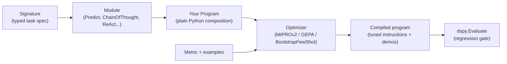
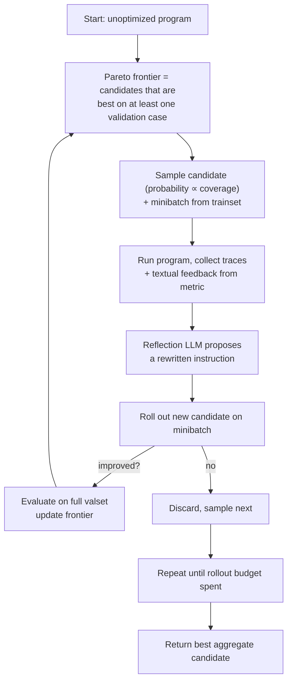

# DSPy Explicado para Engenheiros de Backend: Signatures, Otimizadores e GEPA vs MIPROv2

Se você já manteve um serviço Spring Boot de vida longa, já conhece a diferença entre configuração e
código. Você não edita valores de `application.yml` à mão nas máquinas de produção, e não ajusta
tamanhos de pool de conexões por intuição — você os declara, você os mede, e você os muda por meio de
um processo revisado e reproduzível.

Agora aplique essa lente ao desenvolvimento com LLM. A maioria dos times "faz IA" do jeito que
fazíamos ops em 2009: alguém edita uma string de prompt à mão em um PR, olha cinco saídas em um
notebook, faz o deploy e, seis semanas depois, uma atualização de modelo quebra tudo silenciosamente.

O **DSPy** ([dspy.ai](https://dspy.ai)) é o framework da Stanford NLP que diz: pare. Trate o prompt
como um **artefato compilado**. Você escreve o *código-fonte* — uma declaração tipada da tarefa,
composta em Python comum — mais uma **métrica** que avalia as saídas. Um componente do framework
chamado **otimizador** então gera e ajusta os prompts reais automaticamente, contra a sua métrica, nos
seus dados.

Este artigo explica como isso funciona e depois se aprofunda na pergunta que você realmente
enfrentará ao adotá-lo: **qual otimizador usar**. As duas estratégias principais hoje são o
**MIPROv2** (busca bayesiana sobre instruções e exemplos few-shot) e o **GEPA** (evolução reflexiva
de prompt em uma fronteira de Pareto, ICLR 2026 Oral). Eles buscam de maneira diferente, custam
diferente e pedem coisas diferentes da sua métrica.

Tudo é ancorado em um pequeno exemplo executável que construí para este artigo: um programa de
**triagem de incidentes de produção Spring Boot** que classifica linhas de log e stack traces em
categorias de causa raiz. É o domínio em que este blog normalmente vive — e é pequeno o suficiente
para que otimizá-lo custe centavos, não dólares.

Stack: **Python, DSPy 3.5, qualquer provedor de LLM**.

<div class="post-tldr" markdown="1">
<p class="post-tldr-title">TL;DR</p>

- **DSPy = prompts como artefatos de build.** Você declara uma `Signature` (entradas/saídas tipadas), compõe `Module`s em Python, escreve uma métrica — e um **otimizador** compila tudo em instruções ajustadas + exemplos few-shot. Trocar de modelo vira recompilar, não reescrever prompts.
- O loop central é o mesmo em toda parte: **programa + ~30 exemplos rotulados + métrica → `optimizer.compile(program, trainset=...)` → um artefato salvo e diffável.** Nenhuma string de prompt no seu código-fonte.
- **MIPROv2** = propõe uma grade de candidatos (instruções × demos) e escolhe o vencedor com **otimização bayesiana** em avaliações de minibatch. Ótimo generalista; quer 200+ exemplos para execuções longas; a métrica é um float simples.
- **GEPA** = **evolução reflexiva**: um LLM forte reescreve instruções usando *feedback textual* sobre por que as previsões estavam erradas, e uma **fronteira de Pareto** preserva os candidatos que vencem em qualquer caso individual. Venceu o MIPROv2 por **mais de 10%** em seis tarefas de benchmark a custo comparável (ICLR 2026 Oral) e iguala o fine-tuning por RL com até **35x menos rollouts**.
- Regra de decisão: **a métrica consegue explicar erros em palavras → GEPA. A métrica é um escalar de caixa-preta, ou você precisa de seleção de demos → MIPROv2.** Ambos deixam o código do seu programa intocado.
</div>

---

## O Que É o DSPy?

O DSPy é um framework Python open-source, originalmente construído pela Stanford NLP (o projeto hoje
é desenvolvido sob a Databricks), lançado pela primeira vez como o compilador
Demonstrate-Search-Predict em dezembro de 2022. A linha atual, DSPy 3.x, é um dos frameworks de LLM
mais adotados — milhões de downloads mensais e cerca de 40k estrelas no GitHub — e o slogan da
documentação captura a filosofia em uma frase: **"Programe, não escreva prompts."**

A premissa: um prompt não é código-fonte. É um *resultado* — o resultado compilado de três entradas
que você *pode* manter como código-fonte:

1. **O que a tarefa é** — uma interface tipada: entradas, saídas, restrições.
2. **Como os passos se compõem** — fluxo de controle Python comum.
3. **O que "correto" significa** — uma função de métrica sobre exemplos rotulados.

Escreva à mão o #1–#3 e deixe um algoritmo produzir o prompt. Quando o modelo muda, você não reescreve
o prompt — você **recompila**.

Se você já manteve em paralelo um prompt para GPT-4, um para Claude e um para um Llama local para a
mesma funcionalidade, você já entende por que isso importa. É o mesmo instinto que nos levou de
configuração de servidor editada à mão para infraestrutura declarada.

## Como o DSPy Funciona: Signatures, Módulos, Otimizadores

O DSPy tem exatamente três abstrações para aprender. Este é o framework inteiro.



### O Que É uma Signature do DSPy?

Uma **signature** é uma especificação declarativa do comportamento de entrada/saída de uma tarefa —
pense nela como uma assinatura de método com semântica, não apenas tipos. Os nomes dos campos
carregam significado; o DSPy os transforma em prompts por baixo dos panos.

```python
class IncidentTriage(dspy.Signature):
    """Classify a Spring Boot production incident by its root cause and severity,
    and propose a fix."""

    incident_report: str = dspy.InputField(
        desc="Log line, stack trace excerpt or error description"
    )
    root_cause: Literal[
        "config-misconfiguration",
        "dependency-conflict",
        "connection-pool-exhaustion",
        "serialization-error",
        "memory-pressure",
        "thread-starvation",
    ] = dspy.OutputField(desc="One of the fixed root-cause categories")
    severity: Literal["P1", "P2", "P3"] = dspy.OutputField(
        desc="P1 = service down / data risk, P2 = degraded, P3 = contained"
    )
    action: str = dspy.OutputField(desc="One-sentence remediation")
```

Repare no que uma signature lhe dá que uma string de prompt não dá: **estrutura que o parser pode
impor**. `root_cause` é um tipo `Literal` — o modelo não pode responder `Probably database stuff`;
precisa retornar um dos seis valores, ou o adapter do DSPy tenta de novo e lança exceção. É a mesma
memória muscular de mapear JSON para um DTO tipado em vez de parsear strings à mão.

### O Que É um Módulo do DSPy?

Um **módulo** é uma estratégia de prompting reutilizável, generalizada sobre qualquer signature — a
ideia do `nn.Module` do PyTorch, aplicada a prompts. Todos são construídos sobre o `dspy.Predict`; os
mais conhecidos:

| Módulo | Estratégia que abstrai |
|---|---|
| `dspy.Predict(sig)` | Completion direta |
| `dspy.ChainOfThought(sig)` | Adiciona um passo de raciocínio antes da resposta |
| `dspy.ReAct(sig, tools=[...])` | Loop de raciocínio + uso de ferramentas para agentes |
| `dspy.ProgramOfThought(sig)` | Gera e executa código para responder |
| `dspy.BestOfN(sig, N)` | Amostra N candidatos e mantém o de melhor pontuação |

Seu programa é uma subclasse de `dspy.Module` cujo `forward()` compõe submódulos com Python comum —
condicionais, loops, as suas próprias classes. Aqui está o modelo *inteiro* do nosso exemplo de
triagem de incidentes:

```python
class IncidentTriageProgram(dspy.Module):
    def __init__(self):
        super().__init__()
        self.triage = dspy.ChainOfThought(IncidentTriage)

    def forward(self, incident_report: str) -> dspy.Prediction:
        return self.triage(incident_report=incident_report)
```

Olhe o que **não** está nesse arquivo: nenhum texto de prompt, nenhum exemplo few-shot, nenhum nome
de modelo, nenhuma temperatura. Eles existem — mas como *parâmetros*, que é exatamente o que os torna
otimizáveis. Chamar o programa retorna campos tipados (`root_cause`, `severity`, `action`) mais um
campo `reasoning` que o `ChainOfThought` adiciona para o passo de pensamento.

### O Que É um Otimizador do DSPy?

Um **otimizador** (antigamente chamado de *teleprompter*) é um algoritmo que ajusta os parâmetros do
seu programa — as instruções e/ou demos few-shot — para maximizar a sua métrica. Uma demo few-shot é
um exemplo entrada→saída já resolvido, injetado no prompt; uma instrução é a diretriz de nível de
sistema que o DSPy gera por módulo.

`optimizer.compile(program, trainset=...)` é literalmente um passo de compilação: ele roda o seu
programa em dados, mede, busca e retorna um **programa compilado** cujos predictors agora carregam
instruções e demos ajustadas. Você o salva com `program.save("optimized.json")` — um artefato diffável
e revisável, do mesmo jeito que você revisaria um script de migração.

O lado da avaliação é uma chamada:

```python
evaluate = dspy.Evaluate(
    devset=valset,
    metric=triage_metric,
    num_threads=4,
    display_table=3,
)
result = evaluate(program)
```

A orientação de dimensionamento da documentação do DSPy: **~30 exemplos rotulados para obter valor,
~300 para qualidade de produção** — divididos em ~20% treino / 80% validação, porque os otimizadores
pontuam cada candidato contra a validação. Isso é deliberadamente o *oposto* da prática de deep
learning: você não está ajustando pesos, está buscando em um espaço muito menor, e o conjunto de
validação é a bússola.

Mais uma coisa que vale internalizar: **a sua métrica é o contrato**. Todo otimizador deste artigo é
tão bom quanto a função que avalia as saídas. Para classificação, uma métrica de exact-match serve.
Para tarefas difusas, o DSPy traz o `SemanticF1` — ele próprio implementado como um pequeno programa
DSPy — e você também pode escrever métricas no estilo de asserção que retornam crédito parcial.

---

## Um Exemplo Funcional: Triagem de Incidentes Spring Boot

Chega de teoria. O repositório companheiro deste artigo implementa uma tarefa que todo engenheiro de
backend reconhece: triagem de on-call. Dada uma linha de log ou um trecho de stack trace, classificar
a **causa raiz** (seis categorias), a **severidade** (P1/P2/P3) e produzir uma correção de uma frase.

O dataset tem 24 incidentes feitos à mão, deliberadamente realistas — timeouts de pool do Hikari,
`NoSuchMethodError` depois de uma atualização do Jackson, um método `@Transactional` segurando uma
conexão durante uma chamada remota lenta, um pod OOMKilled cujo heap está bem mas cujo metaspace não
está... 14 para treino, 10 para validação. Pequeno de propósito: a documentação do DSPy diz que o
valor começa por volta de 30 exemplos, e isso mantém a execução inteira na faixa de centavos.

A métrica tem duas variantes — e essa divisão é a chave para a pergunta GEPA vs MIPROv2 mais adiante:

```python
def triage_metric(example, pred, trace=None) -> float:
    """Plain scalar metric — what MIPROv2 and dspy.Evaluate consume."""
    root_ok = pred.root_cause == example.root_cause
    sev_ok = pred.severity == example.severity
    return (1.0 if root_ok else 0.0) + (0.25 if sev_ok else 0.0)


def triage_metric_with_feedback(example, pred, trace=None, pred_name=None, pred_trace=None):
    """GEPA metric: a score PLUS natural-language feedback about the miss."""
    problems = []
    if pred.root_cause == example.root_cause:
        root_score = 1.0
    else:
        root_score = 0.0
        problems.append(
            f"Wrong root cause: you said '{pred.root_cause}', the correct label is "
            f"'{example.root_cause}'."
        )
    # ... same for severity ...
    return dspy.Prediction(score=root_score + sev_score,
                           feedback=" ".join(problems) or "Correct root cause and severity.")
```

A mesma tarefa, a mesma avaliação — uma versão responde *"quanto?"*, a outra também responde *"por
que está errado?"*. Guarde esse pensamento; ele está prestes a importar muito.

## As Principais Estratégias de Otimização

O DSPy traz cerca de uma dúzia de otimizadores em quatro famílias. Os dois entre os quais você
realmente vai escolher são os dois últimos.

| Otimizador | O que ajusta | Estratégia de busca | Dados que quer |
|---|---|---|---|
| `BootstrapFewShot` | Só demos | Roda o teacher, mantém os traces que passam na métrica | ~10+ |
| `BootstrapFewShotWithRandomSearch` | Só demos | Bootstrapping + busca aleatória sobre variantes | 50+ |
| `COPRO` | Só instruções | Hill-climbing por coordinate-ascent sobre reescritas | qualquer |
| `MIPROv2` | Instruções **+ demos** | Propõe grade de candidatos, **otimização bayesiana** | 200+ para execuções longas |
| `GEPA` | Instruções (e código, via `dspy.Flex`) | **Evolução reflexiva** em uma fronteira de Pareto | um punhado, se a métrica dá feedback |

### MIPROv2: Busca Bayesiana Sobre Instruções e Demos

O **MIPROv2** (Multiprompt Instruction PRoposal Optimizer v2) é o cavalo de batalha do DSPy — a
resposta default de longa data para "só otimiza". Ele roda em três estágios:

1. **Bootstrap de demos** — cria `num_candidates` conjuntos de exemplos few-shot: alguns copiados dos
   rótulos, alguns *bootstrapped* rodando o seu próprio programa e mantendo os traces cujas saídas
   passam na métrica.
2. **Propor instruções** — um `prompt_model` escreve candidatos de instrução para cada módulo,
   ancorado em um resumo do dataset, no código-fonte do seu programa, nas demos bootstrapped e em uma
   dica aleatória de criatividade.
3. **Busca bayesiana** — amostra combinações (instrução, demo), avalia cada uma em um minibatch de 35
   exemplos, atualiza um modelo surrogate e reamostra onde prevê melhoria. Avaliações completas de
   validação a cada poucos passos. Depois de `num_trials`, o melhor programa vence.

```python
optimizer = dspy.MIPROv2(
    metric=triage_metric,     # plain scalar is fine here
    auto="light",             # ~6 candidates; "medium"/"heavy" scale up
    num_threads=4,
)
optimized = optimizer.compile(
    program,
    trainset=trainset,
    valset=valset,
    max_bootstrapped_demos=2,
    max_labeled_demos=2,
)
optimized.save("optimized/miprov2_triage.json")
```

O modelo mental é uma **grade fixa de candidatos explorada por um amostrador inteligente**. Isso tem
uma consequência real: o MIPROv2 só pode escolher entre os candidatos de instrução que o seu proposer
pensou em gerar de antemão. Se nenhum deles codificar o insight de domínio que a sua tarefa precisava
("case a assinatura do stack trace antes de julgar a severidade"), a busca bayesiana não pode
inventá-lo — só pode escolher o ponto da grade menos ruim.

### GEPA: Evolução Reflexiva de Prompt em uma Fronteira de Pareto

O **GEPA** (Genetic-Pareto) — [Agrawal et al., 2025](https://arxiv.org/abs/2507.19457),
aceito como **ICLR 2026 Oral** — ataca essa limitação diretamente. É uma busca evolutiva em que o
*operador de mutação é um LLM que lê feedback*:



Quatro ideias fazem isso funcionar:

- **A métrica retorna feedback, não só um número.** É por isso que o nosso exemplo tem
  `triage_metric_with_feedback`, que retorna `dspy.Prediction(score, feedback)`. A documentação do
  DSPy é direta: dê ao GEPA um float puro e você obtém "uma versão muito mais fraca dele mesmo". O
  texto de feedback vai *verbatim* para o prompt do reflection LM — "você disse
  `thread-starvation`, o rótulo correto é `memory-pressure`; OOMKilled no limite do container com
  baixo uso de heap significa que o *container* é a restrição" — então cada mutação é informada, não
  aleatória.
- **Seleção de Pareto em vez de rei do morro.** O MIPROv2 mantém um único incumbent; candidatos que
  são medíocres no geral mas *os melhores em uma fatia específica* (digamos, erros de serialização)
  são eliminados mesmo assim. A fronteira do GEPA mantém cada um desses especialistas vivo e amostra
  deles. Candidatos especialistas precoces sobrevivem para se recombinar depois — a mesma razão pela
  qual algoritmos genéticos mantêm populações diversas. O artigo faz a ablação disso: amostragem de
  Pareto em vez de um greedy "sempre escolha o melhor" vale até ~8% no agregado.
- **Merge system-aware** (`use_merge=True`): quando duas linhagens aprenderam forças complementares,
  o GEPA tenta fazer o merge dos melhores módulos de cada uma — um operador de crossover, em termos
  de algoritmo genético.
- **Orçamento como um único knob**: exatamente um entre `auto` (`light`/`medium`/`heavy`),
  `max_full_evals` ou `max_metric_calls`. Em um programa de dois predictors sobre 100 exemplos,
  `light` ≈ 1.330 chamadas de métrica.

```python
optimizer = dspy.GEPA(
    metric=triage_metric_with_feedback,  # score + textual feedback
    reflection_lm=reflection_model(),    # a STRONG model, temperature 1.0
    auto="light",
    num_threads=4,
    track_stats=True,                    # fills detailed_results
)
optimized = optimizer.compile(program, trainset=trainset, valset=valset)
```

Duas notas operacionais do uso em produção. Primeiro, o **reflection LM é o knob caro** — ele roda
serialmente (um punhado de chamadas por execução, ~12–36 em um orçamento médio), então dê a ele um
modelo mais forte que o modelo da tarefa; os tutoriais do próprio DSPy usam modelos de fronteira ali.
Segundo, defina `track_stats=True`: o resultado traz `detailed_results` com **todo candidato, a sua
linhagem de pais e as pontuações de validação por exemplo** — uma trilha de auditoria de como o prompt
evoluiu, que você pode exportar para JSON e revisar como um PR.

O que o GEPA *muda* é deliberadamente estreito: apenas o `signature.instructions` de cada predictor.
A composição dos seus módulos, o seu código, as suas demos — intocados. As instruções otimizadas
também transferem notavelmente bem entre modelos: o artigo relata prompts evoluídos no Qwen3-8B que
ganharam ~9% quando reutilizados no GPT-4.1 Mini.

## GEPA vs MIPROv2: Qual Otimizador Você Deve Usar?

Mesmo framework, mesmo programa, mesma função de métrica — paradigmas de busca diferentes. Aqui está
a comparação honesta:

| Dimensão | MIPROv2 | GEPA |
|---|---|---|
| Paradigma | **Otimização bayesiana** sobre uma grade fixa de candidatos | **Evolução reflexiva** sobre um conjunto aberto de candidatos |
| O que ajusta | Instruções **+ demos few-shot** em conjunto | Só instruções (código também, via `dspy.Flex`) |
| Contrato da métrica | Escalar simples (float/bool) | `dspy.Prediction(score, feedback)` — feedback por predictor |
| Memória da busca | Um único incumbent melhor-até-agora | **Fronteira de Pareto** de vencedores por instância + merge |
| Knobs de orçamento | `auto` ou `num_candidates` + `num_trials` | exatamente um: `auto` / `max_full_evals` / `max_metric_calls` |
| Prompts típicos | Mais longos (demos few-shot os inflam) | Instruções até **9,2x mais curtas** (medição do artigo) |
| Orientação de dados | 200+ exemplos fazem execuções longas brilharem | Um punhado funciona *se o feedback for rico*; mantenha o valset pequeno |
| Resultados de destaque | Default sólido; ReAct de 24%→51% no exemplo da documentação | **+10% sobre o MIPROv2** em 6 tarefas; +12% no AIME 2025 |

Os números de custo do artigo são mais interessantes que os de acurácia. Nos experimentos com
GPT-4.1 Mini, o gasto total de LM foi de **US$ 86 para o GEPA contra US$ 76 para o MIPROv2** —
comparável — pelo dobro do ganho agregado (+13,3% vs +5,6%). Contra o fine-tuning por RL (GRPO), o
GEPA igualou as melhores pontuações de validação depois de **243–1.179 rollouts contra 24.000** — até
78x mais eficiente em amostragem — com média de +6% (até +20%) sobre o GRPO. Essa é a versão
peer-reviewed do argumento de "10–80x mais barato que RL" que você verá nas redes sociais.

**Minha regra de decisão**, depois de configurar os dois na mesma tarefa:

- **Escolha o GEPA quando a sua métrica consegue explicar os erros em palavras.** Classificação com
  razões, extração validada contra schemas, agentes julgados por traces em nível de passo — qualquer
  lugar em que "por que isso estava errado" é expressável. Esse feedback é o combustível; sem ele,
  você está rodando evolução com uma função de fitness cega.
- **Escolha o MIPROv2 quando a sua métrica é uma caixa-preta, ou quando demos importam mais que
  instruções.** Se o seu programa está com underfitting porque faltam exemplos em contexto (e não
  porque as instruções estão erradas), a busca conjunta de instrução+demo do MIPROv2 é a alavanca
  melhor. Ele também é o primeiro degrau mais suave: sem um segundo modelo para configurar, métricas
  escalares são bem-vindas.
- **Sonda inicial barata de qualquer forma**: `BootstrapFewShotWithRandomSearch` com uma métrica
  escalar custa quase nada e frequentemente diz se a lacuna é de *demos* (ele a fecha) ou de
  *instruções* (ele não fecha — aí é território de MIPROv2/GEPA).

E eles não são mutuamente exclusivos. O DSPy 3.x traz o `BetterTogether`, que encadeia otimização de
prompt e otimização de pesos (por exemplo, GEPA e depois GRPO) no mesmo programa — evolução de prompt
para encontrar a estratégia, RL para comprimi-la em pesos quando você pode pagar os rollouts.

## Rodando o Exemplo

Tudo o que veio acima é código que você pode rodar em cinco minutos. O repositório companheiro:

```bash
git clone https://github.com/javaAndScriptDeveloper/dspy-article
cd dspy-article
uv sync                      # Python 3.11+, installs DSPy 3.5

# Offline sanity check — drives the whole pipeline against a DummyLM:
uv run python smoke_test.py  # no API key needed

# Real runs:
export OPENAI_API_KEY=sk-...     # or set DSPY_MODEL to any dspy.LM string
uv run python 01_baseline.py         # score the unoptimized program
uv run python 02_optimize_miprov2.py # Bayesian search → optimized/miprov2_triage.json
uv run python 03_optimize_gepa.py    # reflective evolution → optimized/gepa_triage.json
```

Defaults: modelo da tarefa `openai/gpt-4o-mini`, modelo de reflection do GEPA
`openai/gpt-4o` (sobrescreva com `DSPY_MODEL` / `DSPY_REFLECTION_MODEL`). Com 24 exemplos, as duas
execuções de otimização ficam na faixa de centavos.

O momento que vale fazer você mesmo: depois de cada execução, faça o diff do JSON salvo contra o
programa-fonte. O `02_optimize_miprov2.py` terá escrito instruções e injetado demos few-shot. O
`03_optimize_gepa.py` terá reescrito a instrução — e o `optimized/gepa_results.json` guarda a linhagem
evolutiva completa: todo candidato, os seus pais, pontuações por exemplo. Esse arquivo é a tese
inteira do DSPy em um único artefato: **o prompt é saída, não código-fonte.**

## Quando Você Não Deve Usar o DSPy?

Seção de honestidade, porque todo pitch de framework precisa de uma.

- **Sem métrica, sem DSPy.** Se você não consegue avaliar as saídas — mesmo que com ruído — o
  otimizador não tem nada para escalar. Construir o eval set e a métrica é o trabalho real; o DSPy só
  automatiza a busca contra eles. (Times que pulam esse passo e ajustam prompts à mão estão fazendo a
  busca *por intuição*, com dados piores.)
- **Um prompt estável em um problema resolvido?** Não adicione o imposto de abstração. O DSPy se paga
  quando os programas são de múltiplos passos, os modelos mudam constantemente, ou as lacunas de
  qualidade estão custando dinheiro de verdade.
- **Orçamento ilimitado de RL e pesos treináveis?** O artigo do GEPA é explícito: a evolução de
  prompt vence quando rollouts são caros, os dados são limitados ou os pesos estão congelados atrás
  de uma API. O fine-tuning no estilo GRPO ainda vence no regime de rollouts abundantes. Ferramentas
  diferentes, economias diferentes.
- **Você é o dono do prompt.** O artefato compilado é ajustado à *sua métrica* — otimize contra uma
  métrica de proxy que não corresponde à produção e você vai entregar um programa lindamente otimizado
  para o objetivo errado. A mesma regra de sempre: o seu conjunto de evals *é* a sua especificação.

---

O padrão a levar deste artigo é o mesmo que este blog persegue em outros domínios: mover o julgamento
de runtime para artefatos declarados, mensuráveis e versionados. Fizemos isso para infraestrutura,
depois para migrações de schema; o DSPy faz isso para o último artefato editado à mão da pilha, a
string de prompt. Os otimizadores são a parte interessante — mas a *disciplina* é o retorno. O prompt
deixa de ser a coisa que alguém ajusta às 2 da manhã e vira a coisa que a CI regenera quando o modelo,
os dados ou a métrica mudam.

Se você quiser uma segunda passada, mais profunda, sobre os otimizadores, as fontes primárias são
excelentes: o [artigo do GEPA](https://arxiv.org/abs/2507.19457) (ICLR 2026
Oral), o [artigo do MIPROv2](https://arxiv.org/abs/2406.11695) e o
[guia oficial de otimização do DSPy](https://dspy.ai/learn/optimization/overview/),
que inclui um [guia passo a passo para escolher o otimizador](https://dspy.ai/diving-deeper/choosing-an-optimizer/).

*O código deste artigo está disponível em
**[github.com/javaAndScriptDeveloper/dspy-article](https://github.com/javaAndScriptDeveloper/dspy-article)**.
O pipeline inteiro verifica offline — `uv sync && uv run python smoke_test.py`
roda um loop completo de otimização GEPA sem chave de API — e as execuções reais custam centavos no
dataset de 24 exemplos incluso.*
