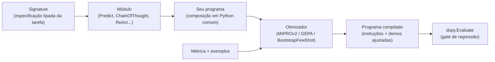
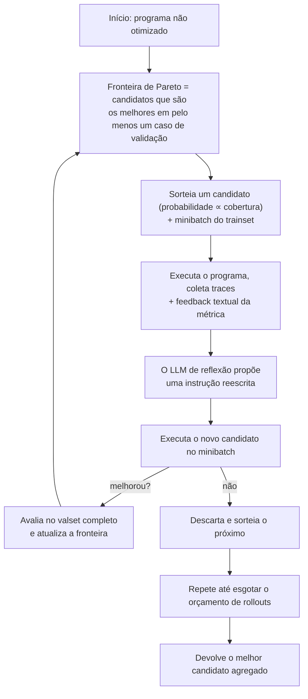

# DSPy para Engenheiros de Backend: Signatures, Otimizadores e GEPA vs MIPROv2

Se você já manteve um serviço Spring Boot de vida longa, conhece a diferença entre configuração e
código. Ninguém edita valores do `application.yml` à mão nos servidores de produção, nem define o
tamanho do pool de conexões no chute: você declara, mede e altera por meio de um processo revisado e
reproduzível.

Agora olhe para o desenvolvimento com LLM por essa mesma lente. A maioria dos times "faz IA" do jeito
que fazíamos ops em 2009: alguém edita uma string de prompt à mão em um PR, confere cinco saídas em um
notebook, faz o deploy, e seis semanas depois uma atualização de modelo quebra tudo em silêncio.

O **DSPy** ([dspy.ai](https://dspy.ai)), framework da Stanford NLP, diz: pare. Trate o prompt como um
**artefato compilado**. Você escreve o *código-fonte*, uma declaração tipada da tarefa composta em
Python comum, mais uma **métrica** que avalia as saídas. Um componente do framework chamado
**otimizador** gera e ajusta os prompts de verdade, automaticamente, contra a sua métrica e com os
seus dados.

Este artigo explica como isso funciona e depois se aprofunda na pergunta que você vai encarar assim
que adotar o framework: **qual otimizador usar**. As duas estratégias principais hoje são o
**MIPROv2** (busca bayesiana sobre instruções e exemplos few-shot) e o **GEPA** (evolução reflexiva
de prompts em uma fronteira de Pareto, ICLR 2026 Oral). Elas buscam de formas diferentes, custam de
formas diferentes e exigem coisas diferentes da sua métrica.

Tudo se apoia em um pequeno exemplo executável que montei para este artigo: um programa de **triagem
de incidentes de produção em Spring Boot**, que classifica linhas de log e stack traces em categorias
de causa raiz. É o domínio em que este blog costuma atuar, e é pequeno o bastante para que uma
execução completa de otimização saia barata.

Stack: **Python 3.11+, DSPy 3.5, qualquer provedor de LLM**.

<div class="post-tldr" markdown="1">
<p class="post-tldr-title">TL;DR</p>

- **DSPy = prompts como artefatos de build.** Você declara uma `Signature` (entradas e saídas tipadas), compõe `Module`s em Python, escreve uma métrica, e um **otimizador** compila tudo em instruções ajustadas + exemplos few-shot. Trocar de modelo vira recompilar, não reescrever prompts.
- O ciclo central é o mesmo em qualquer caso: **programa + ~30 exemplos rotulados + métrica → `optimizer.compile(program, trainset=...)` → um artefato salvo e comparável com diff.** Nenhuma string de prompt no seu código-fonte.
- **MIPROv2** = propõe uma grade de candidatos (instruções × demos) e escolhe o vencedor com **otimização bayesiana** sobre avaliações em minibatches. Ótimo para uso geral; pede 200+ exemplos para execuções longas; a métrica é um float simples.
- **GEPA** = **evolução reflexiva**: um LLM forte reescreve as instruções com base em *feedback textual* sobre por que as previsões erraram, e uma **fronteira de Pareto** preserva os candidatos que vencem em qualquer caso individual. Superou o MIPROv2 em **mais de 10 pontos** em seis tarefas de benchmark, a custo comparável (ICLR 2026 Oral), e superou o fine-tuning por GRPO usando até **35x menos rollouts**.
- Regra de decisão: **a métrica consegue explicar os erros em palavras → GEPA. A métrica é um escalar caixa-preta, ou você precisa selecionar demos → MIPROv2.** Nenhum dos dois mexe no código do seu programa.
</div>

---

## O Que É o DSPy?

O DSPy é um framework Python open source da Stanford NLP. Nasceu da pesquisa
Demonstrate-Search-Predict (dezembro de 2022), e a linha atual, a 3.x, é amplamente usada: vários
milhões de downloads mensais no PyPI e cerca de 40 mil estrelas no GitHub no momento em que escrevo. O
lema do próprio projeto resume a filosofia: programar, e não escrever prompts para, modelos de
linguagem.

A premissa: prompt não é código-fonte. É um *resultado*, o produto compilado de três entradas que você
*pode* manter como código-fonte:

1. **O que a tarefa é**: uma interface tipada com entradas, saídas e restrições.
2. **Como as etapas se compõem**: fluxo de controle em Python comum.
3. **O que significa "correto"**: uma função de métrica sobre exemplos rotulados.

Escreva à mão os itens 1 a 3 e deixe um algoritmo produzir o prompt. Quando o modelo muda, você não
reescreve o prompt: você **recompila**.

Se você já manteve em paralelo um prompt para GPT-4, outro para Claude e outro para um Llama local na
mesma funcionalidade, já entende por que isso importa. É o mesmo instinto que nos levou da
configuração de servidor editada à mão para a infraestrutura declarada.

## Como o DSPy Funciona: Signatures, Módulos e Otimizadores

O DSPy tem exatamente três abstrações para aprender. O framework é isso.



### O Que É uma Signature do DSPy?

Uma **signature** é uma especificação declarativa do comportamento de entrada e saída de uma tarefa.
Pense nela como a assinatura de um método, mas com semântica, e não só com tipos. Os nomes dos campos
carregam significado; o DSPy os transforma em prompts por baixo dos panos.

```python
class IncidentTriage(dspy.Signature):
    """Classify a Spring Boot production incident by its root cause and severity,
    and propose a fix."""

    incident_report: str = dspy.InputField(
        desc="Log line, stack trace excerpt or error description"
    )
    root_cause: Literal[
        "config-misconfiguration",
        "dependency-conflict",
        "connection-pool-exhaustion",
        "serialization-error",
        "memory-pressure",
        "thread-starvation",
    ] = dspy.OutputField(desc="One of the fixed root-cause categories")
    severity: Literal["P1", "P2", "P3"] = dspy.OutputField(
        desc="P1 = service down / data risk, P2 = degraded, P3 = contained"
    )
    action: str = dspy.OutputField(desc="One-sentence remediation")
```

Veja o que uma signature oferece e uma string de prompt não: **estrutura que o parser consegue impor**.
`root_cause` é um tipo `Literal`, então o modelo não pode responder `Probably database stuff`; ele
precisa devolver um dos seis valores, ou o adapter do DSPy tenta de novo e acaba lançando uma exceção.
É o mesmo reflexo de mapear JSON para um DTO tipado em vez de parsear strings na mão.

### O Que É um Módulo do DSPy?

Um **módulo** é uma estratégia de prompting reutilizável, generalizada para qualquer signature: a ideia
do `nn.Module` do PyTorch aplicada a prompts. Todos são construídos sobre o `dspy.Predict`. Os mais
conhecidos:

| Módulo | Estratégia que abstrai |
|---|---|
| `dspy.Predict(sig)` | Completion direta |
| `dspy.ChainOfThought(sig)` | Acrescenta uma etapa de raciocínio antes da resposta |
| `dspy.ReAct(sig, tools=[...])` | Ciclo de raciocínio + uso de ferramentas, para agentes |
| `dspy.ProgramOfThought(sig)` | Gera e executa código para responder |
| `dspy.BestOfN(sig, N)` | Amostra N candidatos e fica com o de maior pontuação |

Seu programa é uma subclasse de `dspy.Module` cujo `forward()` compõe submódulos com Python comum:
condicionais, laços, suas próprias classes. Este é o modelo *inteiro* do nosso exemplo de triagem de
incidentes:

```python
class IncidentTriageProgram(dspy.Module):
    def __init__(self):
        super().__init__()
        self.triage = dspy.ChainOfThought(IncidentTriage)

    def forward(self, incident_report: str) -> dspy.Prediction:
        return self.triage(incident_report=incident_report)
```

Repare no que **não** está nesse arquivo: nenhum texto de prompt, nenhum exemplo few-shot, nenhum nome
de modelo, nenhuma temperatura. Tudo isso existe, mas como *parâmetros*, e é exatamente isso que os
torna otimizáveis. Chamar o programa devolve campos tipados (`root_cause`, `severity`, `action`) mais
um campo `reasoning`, que o `ChainOfThought` adiciona para a etapa de raciocínio.

### O Que É um Otimizador do DSPy?

Um **otimizador** (antes chamado de *teleprompter*) é um algoritmo que ajusta os parâmetros do seu
programa, isto é, as instruções e/ou as demos few-shot, para maximizar a sua métrica. Uma demo
few-shot é um exemplo já resolvido de entrada→saída, injetado no prompt; uma instrução é a diretriz
em nível de sistema que o DSPy gera para cada módulo.

`optimizer.compile(program, trainset=...)` é literalmente uma etapa de compilação: roda o seu programa
sobre os dados, mede, busca e devolve um **programa compilado**, cujos predictors agora carregam
instruções e demos ajustadas. Você o salva com `program.save("optimized.json")`, um artefato
revisável e comparável com diff, como faria com um script de migration.

A avaliação é uma única chamada:

```python
evaluate = dspy.Evaluate(
    devset=valset,
    metric=triage_metric,
    num_threads=4,
    display_table=3,
)
result = evaluate(program)
```

A orientação de dimensionamento da documentação do DSPy: **~30 exemplos rotulados para ver valor,
~300 para qualidade de produção**, divididos em ~20% treino / 80% validação, porque os otimizadores
pontuam cada candidato contra a validação. É deliberadamente o *oposto* da prática de deep learning:
você não está ajustando pesos, está buscando em um espaço muito menor, e o conjunto de validação é a
bússola.

Vale ainda internalizar mais um ponto: **a sua métrica é o contrato**. Todo otimizador deste artigo
é tão inteligente quanto a função que avalia as saídas. Para classificação, uma métrica de
correspondência exata resolve. Para tarefas mais subjetivas, o DSPy traz o `dspy.evaluate.SemanticF1`,
ele próprio implementado como um pequeno programa DSPy, e você também pode escrever métricas que
devolvem crédito parcial.

---

## Um Exemplo Funcional: Triagem de Incidentes em Spring Boot

Chega de teoria. O repositório complementar deste artigo implementa uma tarefa que todo engenheiro de
backend conhece: a triagem de on-call. Dada uma linha de log ou um trecho de stack trace, classificar
a **causa raiz** (seis categorias) e a **severidade** (P1/P2/P3) e produzir uma correção em uma frase.

O dataset tem 24 incidentes feitos à mão, deliberadamente realistas: timeouts do pool do Hikari, um
`NoSuchMethodError` após um upgrade do Jackson, um método `@Transactional` segurando uma conexão
durante uma chamada remota lenta, um pod morto por OOMKilled com o heap saudável mas o metaspace não...
14 para treino, 10 para validação. Pequeno de propósito: a documentação do DSPy diz que o valor começa
por volta de 30 exemplos, e assim cada execução sai barata.

A métrica tem duas variantes, e essa divisão é a chave para a pergunta GEPA vs MIPROv2 mais adiante:

```python
def triage_metric(example, pred, trace=None) -> float:
    """Plain scalar metric — what MIPROv2 and dspy.Evaluate consume."""
    root_ok = pred.root_cause == example.root_cause
    sev_ok = pred.severity == example.severity
    return (1.0 if root_ok else 0.0) + (0.25 if sev_ok else 0.0)


def triage_metric_with_feedback(example, pred, trace=None, pred_name=None, pred_trace=None):
    """GEPA metric: a score PLUS natural-language feedback about the miss."""
    problems = []
    if pred.root_cause == example.root_cause:
        root_score = 1.0
    else:
        root_score = 0.0
        problems.append(
            f"Wrong root cause: you said '{pred.root_cause}', the correct label is "
            f"'{example.root_cause}'."
        )
    # ... same for severity ...
    return dspy.Prediction(score=root_score + sev_score,
                           feedback=" ".join(problems) or "Correct root cause and severity.")
```

Mesma tarefa, mesma avaliação: uma versão responde *"quanto?"* e a outra também responde *"por que
errou?"*. Essa diferença é o que separa os dois otimizadores a seguir.

## As Principais Estratégias de Otimização

O DSPy traz cerca de uma dúzia de otimizadores, em quatro famílias. Os dois entre os quais você vai de
fato escolher são os dois últimos.

| Otimizador | O que ajusta | Estratégia de busca | Dados de que precisa |
|---|---|---|---|
| `BootstrapFewShot` | Só demos | Roda um teacher e mantém os traces que passam na métrica | ~10+ |
| `BootstrapFewShotWithRandomSearch` | Só demos | Bootstrapping + busca aleatória sobre variantes | 50+ |
| `COPRO` | Só instruções | Hill-climbing por coordinate ascent sobre reescritas | qualquer quantidade |
| `MIPROv2` | Instruções **+ demos** | Propõe uma grade de candidatos e aplica **otimização bayesiana** | 200+ para execuções longas |
| `GEPA` | Instruções (e código, via `dspy.Flex`) | **Evolução reflexiva** em uma fronteira de Pareto | um punhado, se a métrica der feedback |

### MIPROv2: Busca Bayesiana sobre Instruções e Demos

O **MIPROv2** (Multiprompt Instruction PRoposal Optimizer v2) é o carro-chefe do DSPy, a resposta
padrão de longa data para "só otimiza isso aí". Ele roda em três estágios:

1. **Bootstrap de demos**: cria `num_candidates` conjuntos de exemplos few-shot, alguns copiados dos
   rótulos e outros *bootstrapped*, rodando o seu próprio programa e mantendo os traces cujas saídas
   passam na métrica.
2. **Proposta de instruções**: um `prompt_model` escreve candidatas de instrução para cada módulo,
   com base em um resumo do dataset, no código-fonte do seu programa, nas demos geradas por bootstrap
   e em uma dica aleatória de criatividade.
3. **Busca bayesiana**: amostra combinações (instrução, demo), avalia cada uma em um minibatch de 35
   exemplos, atualiza um modelo surrogate e reamostra onde ele prevê melhoria. A cada poucos passos há
   uma avaliação completa na validação. Ao fim de `num_trials`, vence o melhor programa.

```python
optimizer = dspy.MIPROv2(
    metric=triage_metric,     # plain scalar is fine here
    auto="light",             # ~6 candidates; "medium"/"heavy" scale up
    num_threads=4,
)
optimized = optimizer.compile(
    program,
    trainset=trainset,
    valset=valset,
    max_bootstrapped_demos=2,
    max_labeled_demos=2,
)
optimized.save("optimized/miprov2_triage.json")
```

O modelo mental é uma **grade fixa de candidatos explorada por um amostrador esperto**. Isso tem uma
consequência real: o MIPROv2 só consegue escolher entre as instruções candidatas que o seu proposer
pensou em gerar de antemão. Se nenhuma delas codificar o insight de domínio de que a sua tarefa
precisava ("case a assinatura do stack trace antes de julgar a severidade"), a busca bayesiana não
tem como inventá-lo; só consegue escolher o ponto menos ruim da grade.

### GEPA: Evolução Reflexiva de Prompts em uma Fronteira de Pareto

O **GEPA** (Genetic-Pareto), de [Agrawal et al., 2025](https://arxiv.org/abs/2507.19457) e aceito como
**ICLR 2026 Oral**, ataca essa limitação diretamente. É uma busca evolutiva em que o *operador de
mutação é um LLM que lê feedback*:



Quatro ideias fazem isso funcionar:

- **A métrica devolve feedback, não só um número.** Por isso o nosso exemplo tem a
  `triage_metric_with_feedback`, que devolve `dspy.Prediction(score, feedback)`. A documentação do DSPy
  é direta: se você der ao GEPA um float puro, ele vira "uma versão bem mais fraca de si mesmo". O texto
  de feedback vai *literalmente* para o prompt do LM de reflexão ("você disse `thread-starvation`, o
  rótulo correto é `memory-pressure`; OOMKilled no limite do container com baixo uso de heap significa
  que a restrição é o *container*"), de modo que cada mutação é informada, não aleatória.
- **Seleção de Pareto em vez de "o vencedor leva tudo".** O MIPROv2 mantém um único incumbent;
  candidatos medianos no geral, mas *os melhores em uma fatia específica* (digamos, erros de
  serialização), são eliminados mesmo assim. A fronteira do GEPA mantém vivos todos esses especialistas
  e amostra a partir deles. Candidatos especialistas do início sobrevivem para se recombinar depois, o
  mesmo motivo pelo qual algoritmos genéticos preservam populações diversas. O artigo faz a ablação
  disso: no Qwen3 8B, a amostragem de Pareto superou a escolha sempre do melhor candidato atual por
  cerca de 6 pontos de pontuação agregada.
- **Merge ciente do sistema** (`use_merge=True`): quando duas linhagens aprenderam pontos fortes
  complementares, o GEPA tenta combinar os melhores módulos de cada uma, um operador de crossover, na
  linguagem dos algoritmos genéticos.
- **Orçamento em um único parâmetro**: exatamente um entre `auto` (`light`/`medium`/`heavy`),
  `max_full_evals` ou `max_metric_calls`. O `light` avalia cerca de seis prompts candidatos; o número
  real de chamadas à métrica cresce com o tamanho do valset e a quantidade de predictors, então teste
  antes em um valset pequeno.

```python
optimizer = dspy.GEPA(
    metric=triage_metric_with_feedback,  # score + textual feedback
    reflection_lm=reflection_model(),    # a STRONG model, temperature 1.0
    auto="light",
    num_threads=4,
    track_stats=True,                    # fills detailed_results
)
optimized = optimizer.compile(program, trainset=trainset, valset=valset)
```

Duas observações operacionais. Primeiro, o **LM de reflexão é onde vale gastar**: ele é chamado só
algumas vezes por execução, então dê a ele um modelo mais forte que o da tarefa; a documentação do DSPy
recomenda um modelo maior ali quando se otimiza um modelo menor. Segundo, ative `track_stats=True`: o
resultado traz `detailed_results` com **todos os candidatos, a linhagem de pais de cada um e as
pontuações de validação por exemplo**, uma trilha de auditoria de como o prompt evoluiu, que você pode
exportar para JSON e revisar como um PR.

O que o GEPA *muda* é deliberadamente restrito: só o `signature.instructions` de cada predictor. A
composição dos seus módulos, o seu código e as suas demos ficam intocados. As instruções otimizadas
também se transferem muito bem entre modelos: o artigo relata que prompts evoluídos no Qwen3-8B
ganharam ~9% quando reaproveitados no GPT-4.1 Mini.

## GEPA vs MIPROv2: Qual Otimizador Usar?

Mesmo framework, mesmo programa, mesma função de métrica, paradigmas de busca diferentes:

| Dimensão | MIPROv2 | GEPA |
|---|---|---|
| Paradigma | **Otimização bayesiana** sobre uma grade fixa de candidatos | **Evolução reflexiva** sobre um conjunto aberto de candidatos |
| O que ajusta | Instruções **+ demos few-shot**, em conjunto | Só instruções (código também, via `dspy.Flex`) |
| Contrato da métrica | Escalar simples (float/bool) | `dspy.Prediction(score, feedback)`, com feedback por predictor |
| Memória da busca | Um único incumbent, o melhor até o momento | **Fronteira de Pareto** com os vencedores por instância + merge |
| Parâmetros de orçamento | `auto` ou `num_candidates` + `num_trials` | exatamente um: `auto` / `max_full_evals` / `max_metric_calls` |
| Prompts típicos | Mais longos (as demos few-shot os inflam) | Instruções até **9,2x mais curtas** (medição do artigo) |
| Orientação sobre dados | Com 200+ exemplos, as execuções longas rendem mais | Um punhado funciona *se o feedback for rico*; mantenha o valset pequeno |
| Resultados de destaque | Padrão sólido; exemplo ReAct da documentação: 8% → ~42% (MIPROv2, `medium`) | **Mais de 10 pontos acima do MIPROv2** em 6 tarefas (segundo o abstract) |

Os números de custo do artigo são mais interessantes que os de acurácia. Nos experimentos com GPT-4.1
Mini, o gasto total com LM foi de **US$ 86 para o GEPA contra US$ 76 para o MIPROv2**, valores
comparáveis, para cerca do dobro do ganho agregado (+12,2 pontos contra +5,6; GEPA+Merge: +13,3).
Contra o fine-tuning por RL (GRPO), o GEPA igualou as melhores pontuações de validação com
**243 a 1.179 rollouts contra 24.000**, até 78x mais eficiente em amostras, e ficou em média 6 pontos
(até 20) acima do GRPO. São os benchmarks e as configurações do próprio artigo, não a sua carga de
trabalho, mas é a versão revisada por pares da afirmação de que "é mais barato que RL" que você vê nas
redes sociais.

**A regra de decisão que eu usaria**, com base em como os dois são construídos:

- **Escolha o GEPA quando a sua métrica consegue explicar os erros em palavras.** Classificação com
  justificativas, extração validada contra schemas, agentes avaliados por traces passo a passo: onde
  quer que dê para expressar "por que isso está errado". Esse feedback é o combustível; sem ele, você
  roda uma evolução com uma função de fitness cega.
- **Escolha o MIPROv2 quando a sua métrica é uma caixa-preta, ou quando as demos importam mais que as
  instruções.** Se o seu programa sofre de underfitting porque faltam exemplos em contexto (e não
  porque as instruções estão erradas), a busca conjunta de instruções e demos do MIPROv2 é a melhor
  alavanca. Ele também é o primeiro degrau mais suave: não exige configurar um segundo modelo, e
  métricas escalares são bem-vindas.
- **Uma sondagem barata, em qualquer caso**: o `BootstrapFewShotWithRandomSearch` com uma métrica
  escalar custa quase nada e costuma mostrar se a lacuna está nas *demos* (ele a fecha) ou nas
  *instruções* (ele não fecha, e aí é território de MIPROv2/GEPA).

E eles não são mutuamente exclusivos. O DSPy 3.x traz o `BetterTogether`, que encadeia a otimização
de prompts e a de pesos (por exemplo, GEPA e depois fine-tuning) no mesmo programa: a evolução de
prompts para achar a estratégia, e o RL para comprimi-la nos pesos quando você pode bancar os rollouts.

## Rodando o Exemplo

Tudo o que vimos acima é código que você roda em cinco minutos. O repositório complementar:

```bash
git clone https://github.com/javaAndScriptDeveloper/dspy-article
cd dspy-article
uv sync                      # Python 3.11+, installs DSPy 3.5

# Offline sanity check — drives the whole pipeline against a DummyLM:
uv run python smoke_test.py  # no API key needed

# Real runs:
export OPENAI_API_KEY=sk-...     # or set DSPY_MODEL to any dspy.LM string
uv run python 01_baseline.py         # score the unoptimized program
uv run python 02_optimize_miprov2.py # Bayesian search → optimized/miprov2_triage.json
uv run python 03_optimize_gepa.py    # reflective evolution → optimized/gepa_triage.json
```

Padrões: modelo da tarefa `openai/gpt-4o-mini`, modelo de reflexão do GEPA `openai/gpt-4o` (sobrescreva
com `DSPY_MODEL` / `DSPY_REFLECTION_MODEL`). O dataset tem 24 exemplos, então a execução é pequena;
confira a página de uso do seu provedor para saber o custo real. Deliberadamente não publico números de
acurácia aqui: 10 exemplos de validação servem para mostrar que a integração funciona, não são um
benchmark. Rode os três scripts e compare as pontuações no seu próprio modelo antes de acreditar em
qualquer otimizador.

O que vale fazer por conta própria: depois de cada execução, compare com diff o JSON salvo e o
programa-fonte. O `02_optimize_miprov2.py` terá escrito instruções e injetado demos few-shot. O
`03_optimize_gepa.py` terá reescrito a instrução, e o `optimized/gepa_results.json` guarda a linhagem
evolutiva completa: cada candidato, seus pais e as pontuações por exemplo. Abra esse arquivo ao lado do
código-fonte do programa e a conclusão salta aos olhos: **o prompt é saída, não código-fonte.**

## Quando Não Usar o DSPy?

Seção de honestidade, porque todo discurso de venda de framework precisa de uma.

- **Sem métrica, sem DSPy.** Se você não consegue avaliar as saídas, nem que seja com ruído, o
  otimizador não tem nada para subir. Montar o conjunto de avaliação e a métrica é o trabalho de
  verdade; o DSPy só automatiza a busca contra elas. (Times que pulam essa etapa e ajustam prompts à
  mão fazem a mesma busca *no feeling*, com dados piores.)
- **Um único prompt estável em um problema já resolvido?** Não pague o custo de abstração. O DSPy
  compensa quando os programas têm várias etapas, os modelos mudam o tempo todo ou as falhas de
  qualidade estão custando dinheiro de verdade.
- **Orçamento de RL ilimitado e pesos treináveis?** O artigo do GEPA é explícito: a evolução de prompts
  vence quando os rollouts são caros, os dados são limitados ou os pesos estão congelados atrás de uma
  API. O fine-tuning no estilo GRPO ainda vence quando há rollouts em abundância. São ferramentas
  diferentes, com economias diferentes.
- **O prompt é responsabilidade sua.** O artefato compilado é ajustado à *sua métrica*: se você otimizar
  contra uma métrica substituta que não corresponde à produção, vai entregar um programa lindamente
  otimizado para o objetivo errado. Vale a regra de sempre: a sua suíte de avaliação *é* a sua
  especificação.

---

Todas as camadas de um backend já passaram por isso: a configuração virou código, o schema virou
migrations, a infraestrutura virou declarativa. A string de prompt é o último artefato que as pessoas
ainda editam à mão às 2 da manhã. A resposta do DSPy é a mesma que funcionou nas outras camadas:
declare, meça, versione. Os otimizadores são a parte interessante, mas o que traz retorno é a
disciplina: o prompt deixa de ser algo que alguém ajusta na madrugada e passa a ser algo que o CI
regenera quando o modelo, os dados ou a métrica mudam.

Se quiser uma segunda passada, mais profunda, sobre os otimizadores, as fontes primárias são
excelentes: o [artigo do GEPA](https://arxiv.org/abs/2507.19457) (ICLR 2026 Oral), o
[artigo do MIPROv2](https://arxiv.org/abs/2406.11695) e o
[guia oficial de otimização do DSPy](https://dspy.ai/learn/optimization/overview/), que inclui um
[passo a passo para escolher o otimizador](https://dspy.ai/diving-deeper/choosing-an-optimizer/).

*O código deste artigo está disponível em
**[github.com/javaAndScriptDeveloper/dspy-article](https://github.com/javaAndScriptDeveloper/dspy-article)**.
O pipeline inteiro é verificável offline (`uv sync && uv run python smoke_test.py` roda um ciclo
completo de otimização do GEPA sem chave de API), e as execuções reais usam um dataset pequeno, de 24
exemplos.*
