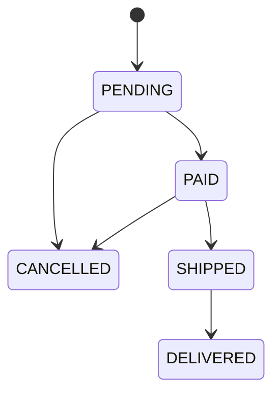

# Armazenando Enums no Banco de Dados: @Enumerated, Tipos Enum do Postgres e Tabelas de Lookup

Quase todo modelo de domínio tem um campo que só pode conter um punhado de valores. Um pedido é
`PENDING`, `PAID`, `SHIPPED`, `DELIVERED` ou `CANCELLED`. Um pagamento é autorizado ou capturado. Uma
assinatura está em um de quatro planos. Em Java, você recorre a um `enum` sem pensar. A pergunta
interessante é o que acontece na fronteira — **como esse conjunto finito de valores realmente vive no
banco de dados** — e o que cada opção custa seis meses depois, quando o conjunto muda.

Este artigo percorre todas as maneiras comuns de persistir um enum com Hibernate, na ordem em que você
realmente as encontraria: os dois modos do `@Enumerated`, um tipo `ENUM` real do Postgres, um
`AttributeConverter` e, por fim, a abordagem de tabela de lookup, em que o enum se torna uma tabela
própria. Vou evoluir um único exemplo — o status de um pedido — do começo ao fim, e terminar com a
escolha que eu realmente faço.

Stack: **Java, Spring Boot, Hibernate, PostgreSQL**.

<div class="post-tldr" markdown="1">
<p class="post-tldr-title">TL;DR</p>

- O `@Enumerated(ORDINAL)` armazena a **posição** do enum — compacto, mas inserir um valor no meio corrompe silenciosamente todas as linhas seguintes. Se precisar usá-lo, **fixe os ordinais com um teste de unidade**.
- O `@Enumerated(STRING)` armazena o **nome da constante** — autodescritivo, fácil de depurar, imune a reordenação. Este é o padrão sensato.
- Não se conforme com um `varchar` puro — defina um **tipo `ENUM` real do Postgres** para que o próprio banco rejeite valores inválidos.
- Um **`AttributeConverter`** persiste um código estável, desacoplado do nome Java, então **renomear deixa de ser um problema de banco de dados**.
- Uma **tabela de lookup** só vale a pena quando os valores carregam dados de negócio editáveis — não como solução para renomeações.
</div>

---

## O Cenário

Estamos construindo gestão de pedidos. Um pedido atravessa um ciclo de vida fixo:



Em Java, é um enum óbvio:

```java
public enum OrderStatus {
    PENDING,
    PAID,
    SHIPPED,
    DELIVERED,
    CANCELLED
}
```

A entidade de pedido tem um campo `status`. A única questão é como o Hibernate o mapeia para uma
coluna — e essa única escolha de anotação tem consequências que sobrevivem ao código que você escreve
hoje.

---

## Parte 1 — `@Enumerated(ORDINAL)`: Armazenar como Int

O default do JPA para um enum é `ORDINAL`. Cada constante é armazenada como a sua posição na
declaração: `PENDING` → 0, `PAID` → 1, `SHIPPED` → 2, e assim por diante.

```java
@Entity
@Table(name = "orders_ordinal")
public class OrderOrdinal {

    @Id
    @GeneratedValue(strategy = GenerationType.UUID)
    private UUID id;

    @Enumerated(EnumType.ORDINAL)   // this is also the default if you omit @Enumerated
    @Column(nullable = false)
    private OrderStatus status;
}
```

```sql
CREATE TABLE orders_ordinal (
    id     UUID     PRIMARY KEY DEFAULT gen_random_uuid(),
    status SMALLINT NOT NULL
);
```

Salve um pedido com status `PAID` e a coluna conterá `1`. É compacto e, no papel, está tudo ok.

### ❌ A Armadilha: Inserir um Valor no Meio

O ordinal não é armazenado como um rótulo — é armazenado como uma *posição*, e a posição é definida
pela ordem no código-fonte. No dia em que alguém adiciona uma etapa de empacotamento entre pago e
enviado:

```java
public enum OrderStatus {
    PENDING,
    PAID,
    PACKED,      // <-- inserted here
    SHIPPED,
    DELIVERED,
    CANCELLED
}
```

…toda constante depois de `PAID` desloca uma posição:

| Constante | Ordinal antes | Ordinal depois |
|---|---|---|
| `PENDING`   | 0 | 0 |
| `PAID`      | 1 | 1 |
| `PACKED`    | — | **2** |
| `SHIPPED`   | 2 | **3** |
| `DELIVERED` | 3 | **4** |
| `CANCELLED` | 4 | **5** |

Nada no banco de dados mudou. Todo pedido `SHIPPED` existente ainda contém o inteiro `2` — mas `2`
agora decodifica para `PACKED`. Pedidos enviados viram silenciosamente empacotados. Entregue vira
enviado. Não há erro, nem migração que falhou, nem linha de log. Os dados não se moveram; a sua
interpretação deles, sim. Você descobre quando um cliente pergunta por que o pedido dele, já entregue,
diz que está sendo empacotado.

### A Salvaguarda: Fixe os Ordinais

Se você tem um motivo para manter `ORDINAL` — um schema legado, uma tabela genuinamente quente e
enorme em que a diferença de bytes importa — então torne explícito que a ordenação sustenta os dados,
com um teste que falha no instante em que alguém reordena o enum:

```java
class OrdinalPinTest {

    @Test
    void ordinalsAreFrozen() {
        // If this test fails, you reordered OrderStatus. Existing ORDINAL-mapped rows now mean
        // something different. Revert the reorder, or append the new value at the end.
        assertThat(OrderStatus.PENDING.ordinal()).isZero();
        assertThat(OrderStatus.PAID.ordinal()).isEqualTo(1);
        assertThat(OrderStatus.SHIPPED.ordinal()).isEqualTo(2);
        assertThat(OrderStatus.DELIVERED.ordinal()).isEqualTo(3);
        assertThat(OrderStatus.CANCELLED.ordinal()).isEqualTo(4);
        assertThat(OrderStatus.values()).hasSize(5);
    }
}
```

É um teste de unidade puro — sem contexto Spring, sem banco de dados. Ele transforma um bug invisível
de corrupção de dados em um build vermelho no instante em que alguém mexe no enum. Novos valores
continuam permitidos; eles só precisam ir para o fim, onde acrescentar é seguro. Essa é a regra
inteira da qual o `ORDINAL` depende silenciosamente, escrita e registrada.

---

## Parte 2 — `@Enumerated(STRING)`: Armazenar como Varchar

A correção para quase todo mundo é uma palavra:

```java
@Enumerated(EnumType.STRING)
@Column(nullable = false)
private OrderStatus status;
```

Agora a coluna armazena o *nome* da constante:

```sql
CREATE TABLE orders_string (
    id     UUID    PRIMARY KEY DEFAULT gen_random_uuid(),
    status VARCHAR NOT NULL
);
```

Um pedido `PAID` armazena a string literal `'PAID'`. Três coisas melhoram imediatamente:

- **Reordenar é inofensivo.** O valor é o próprio nome; posições não importam mais. Adicione
  `PACKED` onde quiser.
- **Dá para depurar.** `SELECT * FROM orders_string WHERE status = 'PAID'` lê-se como inglês. Sem
  tabela de decodificação e sem precisar consultar o código Java de cabeça.
- **Dumps e logs são autodescritivos.** Uma linha em um export CSV significa algo por si só.

Sim, `'DELIVERED'` custa mais bytes que `3`. Para a esmagadora maioria das tabelas, essa diferença é
ruído — e você sempre pode adicionar um índice. Armazenar o nome é o default certo, e "compacto"
quase nunca vale "silenciosamente errado".

### A Armadilha que Restou: Renomeações

O `STRING` remove a armadilha da ordenação, mas introduz uma menor. O valor armazenado *é* o
identificador Java, então renomear a constante deixa as linhas existentes órfãs:

```java
PENDING  →  AWAITING_PAYMENT
```

Toda linha `'PENDING'` antiga deixa de corresponder a qualquer constante, e o Hibernate lança exceção
ao lê-la de volta. Os dados armazenados e o código se distanciaram silenciosamente. Você pode corrigir
isso com uma migração de dados (`UPDATE … SET status = 'AWAITING_PAYMENT' WHERE status = 'PENDING'`) —
e essa é uma resposta perfeitamente aceitável. Também veremos, na Parte 4, uma maneira de transformar
renomeações em algo totalmente indolor.

---

## Parte 3 — Do Jeito Certo: Um Tipo Enum Real do Postgres

Ambas as opções acima armazenam em uma coluna que o banco não entende de verdade — um `smallint` ou um
`varchar` que *por acaso* contém valores de enum. O Postgres pode fazer melhor. Ele tem tipos enum de
primeira classe:

```sql
CREATE TYPE order_status AS ENUM ('PENDING', 'PAID', 'SHIPPED', 'DELIVERED', 'CANCELLED');

CREATE TABLE orders_pgenum (
    id     UUID         PRIMARY KEY DEFAULT gen_random_uuid(),
    status order_status NOT NULL
);
```

Agora o *banco* impõe o domínio. Um `INSERT … VALUES ('SHPPED')` — um typo, uma migração ruim, um
script fora de controle — falha na origem com `invalid input value for enum order_status`. Com um
`varchar` puro, esse lixo entra na tabela e você o descobre depois. O tipo enum é documentação e
constraint em um só lugar: o tipo da coluna literalmente lista os seus valores legais.

Mapeá-lo no Hibernate é o mesmo `@Enumerated(STRING)` de antes — o Hibernate vincula o nome da
constante como string e o Postgres o armazena no enum:

```java
@Enumerated(EnumType.STRING)
@Column(nullable = false, columnDefinition = "order_status")
private OrderStatus status;
```

Há exatamente uma peça de configuração. Por padrão, o driver JDBC do PostgreSQL envia uma `String`
Java como tipo `varchar`, e o Postgres não faz cast implícito de `varchar` → `order_status`, então
você receberia `column "status" is of type order_status but expression is of type character varying`.
Adicione `stringtype=unspecified` à URL JDBC e o driver envia o valor como `unknown`, permitindo que
o Postgres faça o cast para o enum:

```yaml
spring:
  datasource:
    url: jdbc:postgresql://localhost:5434/mydatabase?stringtype=unspecified
```

(O Hibernate 6 também oferece `@JdbcTypeCode(SqlTypes.NAMED_ENUM)` para mirar um tipo enum nomeado
diretamente; a combinação `@Enumerated(STRING)` + `stringtype=unspecified` acima é a mais comum e a
que eu uso.)

**A única ressalva a saber:** `ALTER TYPE order_status ADD VALUE 'PACKED'` apenas *acrescenta*. Você
pode adicionar um valor (e, desde o PostgreSQL 12, até antes/depois de um específico), mas não pode
remover nem reordenar valores existentes sem recriar o tipo. Isso parece limitador até você perceber
que é a *mesma regra* que o teste do ordinal impunha — nunca reordene, apenas adicione — exceto que
aqui o banco a garante em vez de um teste de unidade. A constraint é a funcionalidade.

---

## Parte 4 — `AttributeConverter`: Desacople o Nome do Valor

A armadilha da renomeação da Parte 2 existe porque deixamos o *valor armazenado* e o *identificador
Java* serem a mesma string. Um `AttributeConverter` do JPA quebra esse acoplamento: você persiste um
código estável que não tem nada a ver com o nome da constante.

Dê a cada constante um código explícito e permanente:

```java
public enum OrderStatus {

    PENDING("PND"),
    PAID("PAID"),
    SHIPPED("SHP"),
    DELIVERED("DLV"),
    CANCELLED("CNC");

    private final String code;

    OrderStatus(String code) {
        this.code = code;
    }

    public String getCode() {
        return code;
    }

    public static OrderStatus fromCode(String code) {
        return Arrays.stream(values())
                .filter(s -> s.code.equals(code))
                .findFirst()
                .orElseThrow(() -> new IllegalArgumentException("Unknown OrderStatus code: " + code));
    }
}
```

Depois, um conversor que mapeia enum ↔ código:

```java
@Converter
public class OrderStatusConverter implements AttributeConverter<OrderStatus, String> {

    @Override
    public String convertToDatabaseColumn(OrderStatus status) {
        return status == null ? null : status.getCode();
    }

    @Override
    public OrderStatus convertToEntityAttribute(String code) {
        return code == null ? null : OrderStatus.fromCode(code);
    }
}
```

E ligue-o no campo com `@Convert` em vez de `@Enumerated`:

```java
@Convert(converter = OrderStatusConverter.class)
@Column(nullable = false)
private OrderStatus status;
```

Agora o banco armazena `'PAID'` como *código*, não como identificador. Renomeie a constante Java
`PENDING` para `AWAITING_PAYMENT` e o código armazenado `'PND'` nunca muda — a renomeação é uma
refatoração pura, com zero impacto no banco. Você desacoplou o que o banco conhece de como você chama
as coisas no código, que é exatamente a propriedade pela qual as pessoas recorrem a tabelas de
lookup. Guarde isso para a próxima parte.

---

## Parte 5 — A Abordagem de Tabela de Lookup

A última abordagem deixa de tratar o status como um enum. Em vez disso, o conjunto de status vive em
uma tabela própria, e os pedidos referenciam uma linha por chave estrangeira:

```sql
CREATE TABLE order_statuses (
    id       INTEGER PRIMARY KEY,
    code     VARCHAR NOT NULL UNIQUE,
    label    VARCHAR NOT NULL,
    terminal BOOLEAN NOT NULL DEFAULT FALSE
);

INSERT INTO order_statuses (id, code, label, terminal) VALUES
    (1, 'PND',  'Pending',   FALSE),
    (2, 'PAID', 'Paid',      FALSE),
    (3, 'SHP',  'Shipped',   FALSE),
    (4, 'DLV',  'Delivered', TRUE),
    (5, 'CNC',  'Cancelled', TRUE);

CREATE TABLE orders_lookup (
    id        UUID    PRIMARY KEY DEFAULT gen_random_uuid(),
    status_id INTEGER NOT NULL REFERENCES order_statuses (id)
);
```

No JPA, o status vira um relacionamento, não um valor enumerado:

```java
@Entity
@Table(name = "orders_lookup")
public class OrderLookup {

    @Id
    @GeneratedValue(strategy = GenerationType.UUID)
    private UUID id;

    @ManyToOne(fetch = FetchType.EAGER, optional = false)
    @JoinColumn(name = "status_id", nullable = false)
    private OrderStatusDefinition status;
}
```

Para saber qual status um pedido tem — o rótulo humano, se ele é terminal — você faz **join**:

```sql
SELECT o.id, s.code, s.label
FROM   orders_lookup o
JOIN   order_statuses s ON s.id = o.status_id
WHERE  o.id = ?;
```

### ✅ Quando Isso Vale o Investimento

A tabela de lookup compra uma coisa real: o conjunto de valores, e os metadados anexados a cada um,
passa a viver em **dados** em vez de em **código**. Isso é genuinamente valioso quando:

- **Cada valor carrega dados de negócio editáveis** — um rótulo de exibição, uma ordem de
  classificação, uma cor, um feature flag, um SLA. O status não é só uma identidade; é um pequeno
  registro.
- **Pessoas não desenvolvedoras gerenciam os valores**, ou eles são configurados por tenant, ou
  mudam em runtime sem deploy.
- **Você tem mudanças em massa genuínas** — renomear um rótulo que aparece em milhões de linhas
  atualizando uma única linha em `order_statuses`, não todo pedido.

Esse último ponto é o argumento mais forte: mude em um lugar, não em todos. Se o seu "enum" é, na
verdade, um catálogo mantido, este é o modelo certo.

---

## Minha Opinião

Para um enum *simples* — um conjunto fixo de estados no nível do código, como o ciclo de vida de um
pedido — eu não uso tabela de lookup e argumentaria contra ela em um code review.

A justificativa que normalmente ouço é "e se precisarmos renomear um valor?". Mas acabamos de ver que
isso se resolve sem tabela: um `AttributeConverter` desacopla o código armazenado do nome Java, e um
rótulo que muda é uma migração de uma linha. Você não precisa de uma chave estrangeira e de um join
em toda query para sobreviver a uma renomeação.

O que a tabela de lookup realmente adiciona, nesse caso, é custo permanente: toda leitura faz join ou
carrega uma segunda query, o status vira um relacionamento gerenciado em vez de um valor, e um
`switch` exaustivo em tempo de compilação sobre os seus estados vira uma consulta em runtime que pode
falhar. Você trocou um valor que o seu compilador entende por uma linha que ele não entende, para
comprar uma flexibilidade que um ciclo de vida fixo nunca usa.

Então a minha regra é sobre **o que o valor é**, não sobre renomeações:

- Se o valor é **apenas identidade** — é `SHIPPED`, ponto final — mantenha-o como enum. Mapeie com
  `@Enumerated(STRING)`, respalde-o com um tipo enum do Postgres e recorra a um `AttributeConverter`
  quando quiser que renomeações sejam gratuitas.
- Se o valor é **um registro** — tem campos que são editados, por pessoas, em runtime — então ele
  nunca foi realmente um enum. Dê uma tabela a ele.

Renomear não é o fator decisivo. O fator decisivo é se a coisa tem dados próprios.

---

## Guia de Decisão

| Abordagem | Armazena | Use quando | Risco principal |
|---|---|---|---|
| `@Enumerated(ORDINAL)` | posição (`1`) | quase nunca | reordenar corrompe linhas silenciosamente |
| `@Enumerated(STRING)` | nome da constante (`'PAID'`) | o padrão sensato | renomeações deixam linhas órfãs |
| Tipo `ENUM` do Postgres | nome, validado pelo banco | você quer que o banco rejeite valores inválidos | `ADD VALUE` apenas acrescenta |
| `AttributeConverter` | código estável (`'PAID'`) | você quer renomeações gratuitas | uma pequena classe para manter |
| Tabela de lookup | FK para uma linha | valores carregam dados editáveis | um join em toda leitura |

Um default sólido para a maioria dos projetos: **`@Enumerated(STRING)` sobre um tipo enum do
Postgres**, migrando para um **`AttributeConverter`** no momento em que você quiser o valor armazenado
isolado do nome Java.

---

## Código

O código deste artigo está disponível em
**[github.com/javaAndScriptDeveloper/enums-article](https://github.com/javaAndScriptDeveloper/enums-article)** —
o mesmo enum `OrderStatus` persistido das cinco maneiras, o teste de fixação dos ordinais e um teste
de round-trip por abordagem, que verifica o que cada uma realmente grava no disco. Tudo roda
localmente com Docker e um único `./gradlew test`.

---

## Considerações Finais

Escolher como armazenar um enum parece uma decisão de cinco segundos, e é exatamente por isso que
vale a pena desacelerar. A armadilha do ordinal, a cilada da renomeação, a constraint ausente no
banco — nenhuma delas aparece no dia em que você escreve a anotação. Elas aparecem no dia em que o
conjunto de valores muda, o que sempre acontece, geralmente muito depois de você ter esquecido o
trade-off que fez.

A boa notícia é que os defaults são fáceis: armazene o nome, deixe o banco validá-lo e desacople o
código do identificador quando precisar. Reserve a tabela de lookup para os casos que são
genuinamente um catálogo, e não um enum. Acerte isso uma vez e os seus status continuam entediantes —
o que é o maior elogio que uma coluna pode receber.

---

## Vamos Conversar

Se você armazena enums de forma diferente — ou foi queimado por uma dessas armadilhas de um modo que
eu não cobri — eu gostaria de saber. Os links de contato estão no rodapé.
