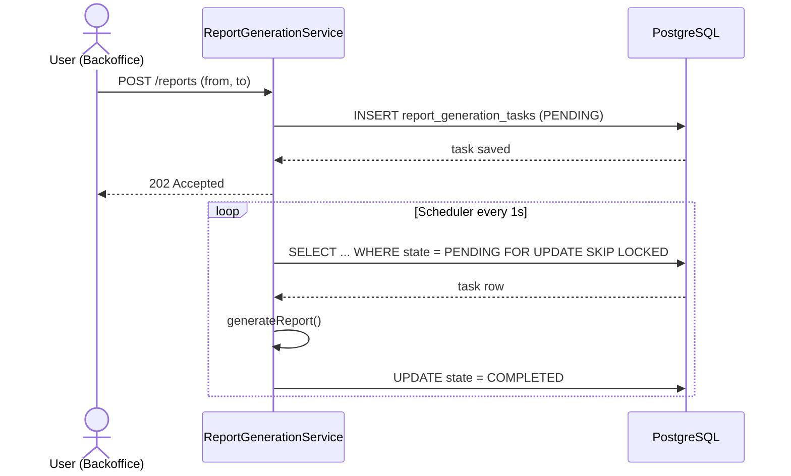
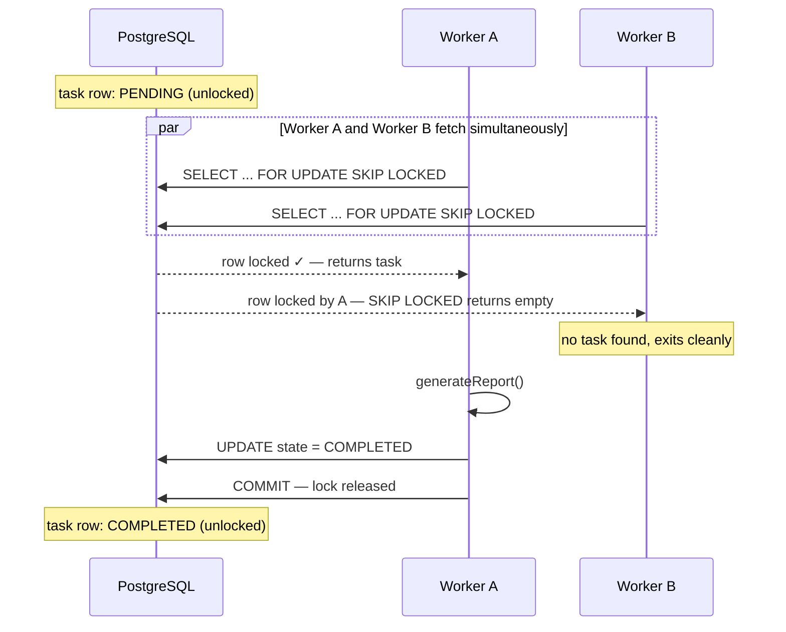
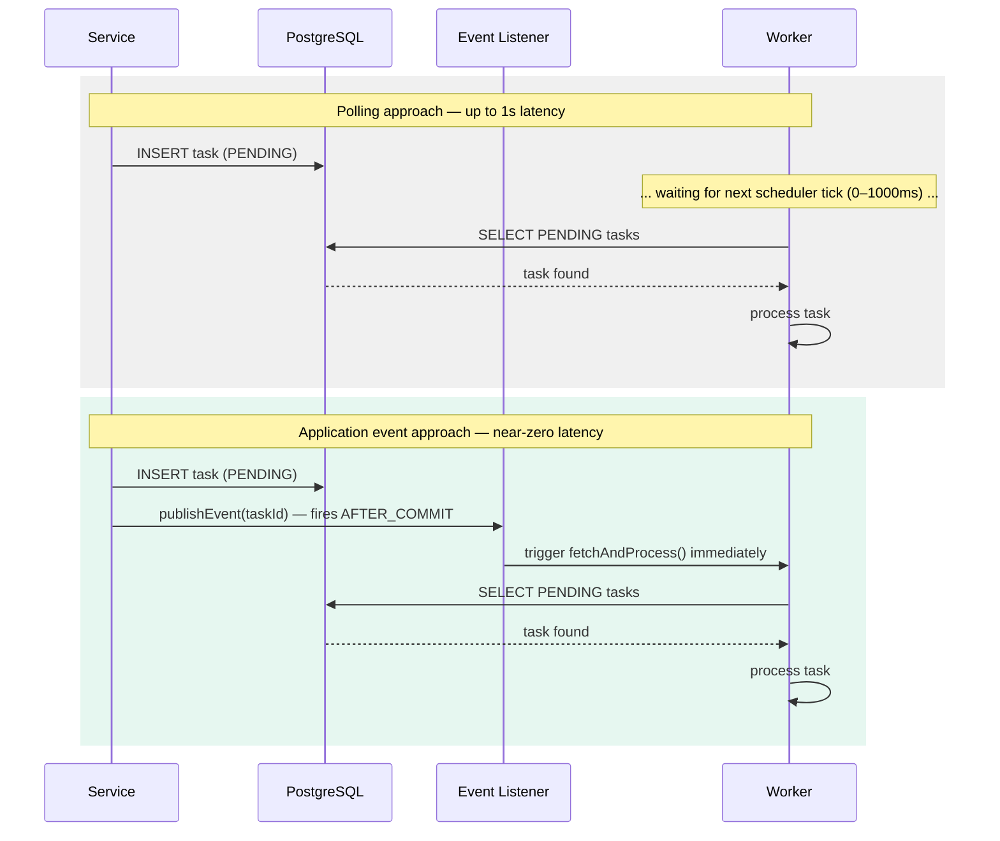
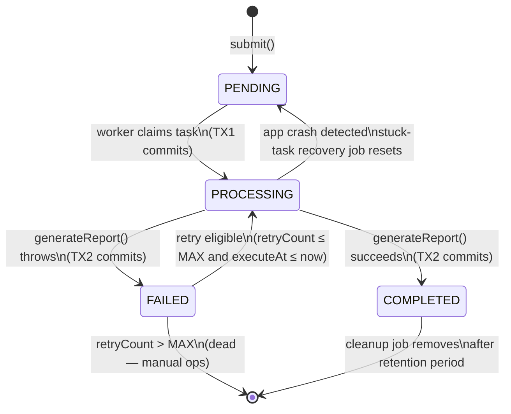
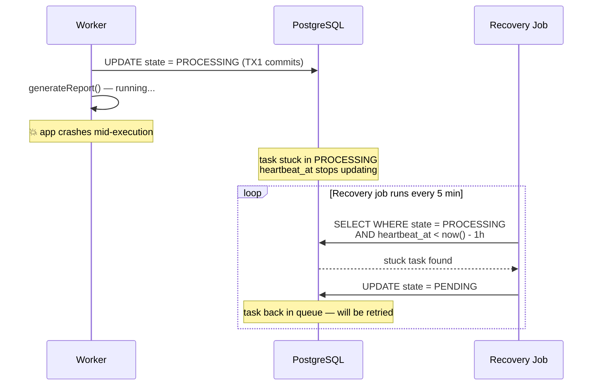
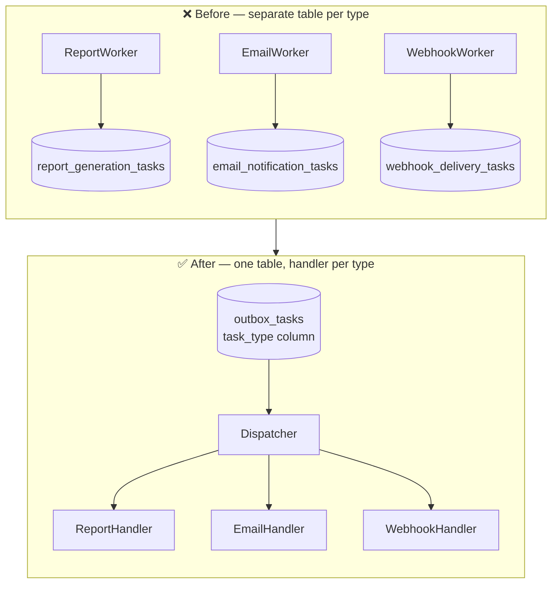

# O Padrão Transactional Outbox: de uma única tarefa a um motor assíncrono pronto para produção

Existe uma classe de bugs que nunca aparece nos seus testes de unidade e raramente surge em staging.
Ela aparece em produção, às 2 da manhã, quando a sua aplicação salva um registro no banco e depois tenta
chamar um serviço externo — e um dos dois falha. Um lado fez commit. O outro não. Ninguém fica
sabendo até um usuário reclamar.

Esse é o **problema de escrita dupla** (dual-write), e o padrão Transactional Outbox é a resposta
padrão para ele. A ideia é simples: em vez de chamar o sistema externo diretamente, grave uma tarefa na
mesma transação do banco que a sua alteração de domínio. Um worker em background a pega e a executa.
A escrita é atômica. A tarefa não pode se perder.

O que está menos documentado é tudo o que vem depois da ideia básica — o que acontece quando tarefas
falham, quando dois workers disputam a mesma linha, quando a sua aplicação cai no meio da execução,
quando você tem dez tipos de tarefa diferentes vivendo em uma mesma tabela, e quando os seus stakeholders
perguntam por que a profundidade da fila disparou às 3 da manhã de terça-feira passada.

É isso que este artigo cobre.

Vou trabalhar um cenário único e concreto — um **serviço de geração de relatórios** — e evoluí-lo
passo a passo, do outbox mais simples possível até algo que eu me sentiria confortável em rodar em
produção. Cada trecho de código vem de um repositório real e funcional, linkado no final.

Stack: **Java, Spring Boot, PostgreSQL**.

<div class="post-tldr" markdown="1">
<p class="post-tldr-title">TL;DR</p>

- O **padrão Transactional Outbox** resolve o problema de escrita dupla gravando a linha da tarefa na **mesma transação do banco** que a sua alteração de domínio e depois executando-a a partir de um worker em background.
- Consulte a tabela de outbox com `SELECT ... FOR UPDATE SKIP LOCKED` para que vários workers possam rodar concorrentemente sem processamento duplicado.
- Nível de produção exige mais que a ideia básica: uma **máquina de estados**, **retries com backoff**, **heartbeats/leases** para recuperar workers que caíram, garantias de **ordenação** e **monitoramento** da profundidade da fila.
- Você não precisa de Kafka — **só o PostgreSQL** já basta para execução assíncrona confiável.
</div>

---

## O Cenário



Estamos construindo um CRM. Os usuários podem solicitar relatórios mensais de analytics a partir de uma
interface de backoffice. Gerar um relatório significa agregar dezenas de milhões de linhas — pode levar
minutos. Obviamente não dá para fazer isso de forma síncrona em uma requisição HTTP.

O usuário clica em um botão. O backend aceita a requisição, a salva e responde imediatamente.
Um worker em background pega a tarefa, executa a geração e atualiza o status ao concluir.

Este é o caso mais simples em que um outbox faz sentido: trabalho genuinamente assíncrono por natureza,
em que o usuário já espera que demore.

---

## Parte 1 — O Outbox Básico

### O que todo outbox precisa

Na essência, qualquer tabela de outbox precisa de três coisas:

- **Estado** — em que ponto do ciclo de vida está essa tarefa?
- **Payload** — o que exatamente precisa ser executado?
- **Timestamps** — quando foi criada, quando mudou pela última vez?

```sql
CREATE TYPE task_state AS ENUM ('PENDING', 'COMPLETED');

CREATE TABLE report_generation_tasks (
                                       id         UUID       PRIMARY KEY DEFAULT gen_random_uuid(),
                                       state      task_state NOT NULL    DEFAULT 'PENDING',
                                       payload    JSONB      NOT NULL,
                                       created_at TIMESTAMP  NOT NULL    DEFAULT now(),
                                       updated_at TIMESTAMP  NOT NULL    DEFAULT now()
);
```

O payload para o nosso caso de uso é um intervalo de datas:

```java
@Value
@Builder
@Jacksonized
public class ReportGenerationPayload {
  Instant from;
  Instant to;
}
```

A entidade JPA:

```java
@Entity
@Table(name = "report_generation_tasks")
@Data
@Builder
@NoArgsConstructor
@AllArgsConstructor
public class ReportGenerationEntity {

    @Id
    @GeneratedValue(strategy = GenerationType.UUID)
    @Column(updatable = false, nullable = false)
    private UUID id;

    @Enumerated(EnumType.STRING)
    @Column(nullable = false, columnDefinition = "task_state")
    private TaskState state;

    @JdbcTypeCode(SqlTypes.JSON)
    @Column(nullable = false, updatable = false, columnDefinition = "jsonb")
    private ReportGenerationPayload payload;

    @CreationTimestamp
    @Column(nullable = false, updatable = false)
    private Instant createdAt;

    @UpdateTimestamp
    @Column(nullable = false)
    private Instant updatedAt;
}
```

Submetendo uma tarefa:

```java
@Service
@RequiredArgsConstructor
public class ReportGenerationService {

    private final ReportGenerationRepository repository;

    public void submit(ReportGenerationCommand command) {
        repository.save(ReportGenerationEntity.builder()
                .state(TaskState.PENDING)
                .payload(ReportGenerationPayload.builder()
                        .from(command.getFrom())
                        .to(command.getTo())
                        .build())
                .build());
    }
}
```

### O Worker

Um job agendado faz polling de tarefas pendentes e as executa:

```java
@Component
@RequiredArgsConstructor
public class ReportGenerationScheduledJob {

    private final ReportGenerationTaskService taskService;

    @Scheduled(fixedDelay = 1000)
    public void run() {
        taskService.fetchAndProcess();
    }
}
```

```java
@Service
@RequiredArgsConstructor
public class ReportGenerationTaskService {

    private final ReportGenerationRepository repository;

    public void fetchAndProcess() {
        repository.findFirstByStateOrderByCreatedAt(TaskState.PENDING)
                .ifPresent(task -> {
                    generateReport(task);
                    task.setState(TaskState.COMPLETED);
                    repository.save(task);
                });
    }

    private void generateReport(ReportGenerationEntity task) {
        // actual report generation logic
    }
}
```

```java
public interface ReportGenerationRepository extends JpaRepository<ReportGenerationEntity, UUID> {
    Optional<ReportGenerationEntity> findFirstByStateOrderByCreatedAt(TaskState state);
}
```

Isso funciona em uma aplicação de instância única e sem falhas. No mundo real, tem dois problemas:
dois workers podem pegar a mesma tarefa simultaneamente, e tarefas podem falhar sem nenhum
caminho de recuperação. Vamos corrigir os dois.

---

## Parte 2 — Concorrência: Dois Workers, Uma Tarefa

Quando duas threads de scheduler — ou duas instâncias da aplicação — executam a query de busca no
mesmo instante, ambas podem ler a mesma linha `PENDING` e ambas tentarão executá-la. O resultado é
trabalho duplicado no melhor dos casos, estado corrompido no pior.

A correção é um lock no banco capturado no momento da busca. O `SELECT ... FOR UPDATE SKIP LOCKED`
do PostgreSQL foi feito exatamente para esse caso de uso: ele trava a linha para a transação corrente
e ignora as linhas já travadas por outra transação, em vez de esperar.

```java
public interface ReportGenerationRepository extends JpaRepository<ReportGenerationEntity, UUID> {

    @Lock(LockModeType.PESSIMISTIC_WRITE)
    @QueryHint(name = AvailableSettings.JAKARTA_LOCK_TIMEOUT, value = "-2") // -2 = SKIP_LOCKED
    Optional<ReportGenerationEntity> findFirstByStateOrderByCreatedAt(TaskState state);
}
```

O valor `-2` da hint `SKIP_LOCKED` é o que o Hibernate traduz para a cláusula `SKIP LOCKED`.
Como não existe uma anotação de primeira classe para isso, vale a pena extrair para uma anotação
reutilizável, para não espalhar o número mágico pelos seus repositórios:

```java
@Retention(RetentionPolicy.RUNTIME)
@Target({ElementType.METHOD, ElementType.ANNOTATION_TYPE})
@QueryHints(@QueryHint(
    name = AvailableSettings.JAKARTA_LOCK_TIMEOUT,
    value = Timeouts.SKIP_LOCKED_MILLI + ""
))
public @interface SkipLocked {}
```

Muito mais limpo. Agora o repositório expressa a intenção, não a infraestrutura:

```java
@SkipLocked
@Lock(LockModeType.PESSIMISTIC_WRITE)
Optional<ReportGenerationEntity> findFirstByStateOrderByCreatedAt(TaskState state);
```

Você *pode* manter o lock durante o processamento envolvendo todo o ciclo busca-executa-atualiza em
uma única transação, mas geralmente não deveria:

```java
// Technically works, but do not use this pattern for outbox processing.
@Transactional
public void fetchAndProcess() {
    repository.findFirstByStateOrderByCreatedAt(TaskState.PENDING)
            .ifPresent(task -> {
                generateReport(task);
                task.setState(TaskState.COMPLETED);
                repository.save(task);
            });
}
```



Mesmo que `generateReport()` seja pequeno o suficiente para isso funcionar tecnicamente, rodar uma
ação de outbox sob uma transação aberta é um antipadrão. A duração da transação não deveria depender
da duração da execução do outbox: a ação pode ficar mais lenta com o tempo, bloquear em I/O ou chamar
um serviço downstream, deixando uma conexão de banco e um lock de linha retidos por um período
imprevisível.

Em vez disso, capture a linha em uma transação curta movendo-a para `PROCESSING`, faça commit e
libere o lock, e só então execute a ação do outbox. Registre `COMPLETED` ou `FAILED` depois, em outra
transação curta. A próxima seção implementa essa transição de estado e o caminho de recuperação dela.

---

## Parte 2.5 — Reduzindo a Latência com Application Events

O scheduler baseado em polling tem um piso de latência inerente. Se o seu job dispara a cada segundo,
uma tarefa submetida em `t=0ms` fica `PENDING` até o próximo tick — até 1000ms depois. Para a maioria
das cargas assíncronas isso é aceitável. Para casos em que você quer captura quase imediata — enviar um
e-mail transacional, disparar um webhook — não é.

O padrão, emprestado do Celery: salve a entidade de outbox no banco e, em seguida, publique
imediatamente um `ApplicationEvent` do Spring carregando o ID da nova tarefa. Um listener o pega e
dispara o processamento na hora, sem esperar o próximo tick do scheduler.



O scheduler continua rodando como rede de segurança — ele captura qualquer coisa que o listener de
eventos perdeu (restart da aplicação, exceção no listener, evento perdido). Mas o caminho feliz
contorna totalmente o atraso do polling.

### Implementação

Publique o evento dentro do método do serviço, após salvar:

```java
@Service
@RequiredArgsConstructor
public class ReportGenerationService {

    private final ReportGenerationRepository repository;
    private final ApplicationEventPublisher eventPublisher;

    @Transactional
    public void submit(ReportGenerationCommand command) {
        var entity = repository.save(ReportGenerationEntity.builder()
                .state(TaskState.PENDING)
                .payload(ReportGenerationPayload.builder()
                        .from(command.getFrom())
                        .to(command.getTo())
                        .build())
                .build());

        eventPublisher.publishEvent(new ReportGenerationTaskSubmittedEvent(entity.getId()));
    }
}
```

```java
public record ReportGenerationTaskSubmittedEvent(UUID taskId) {}
```

O listener reage e dispara o processamento imediatamente:

```java
@Component
@RequiredArgsConstructor
public class ReportGenerationTaskEventListener {

    private final ReportGenerationTaskService taskService;

    @TransactionalEventListener(phase = TransactionPhase.AFTER_COMMIT)
    public void onTaskSubmitted(ReportGenerationTaskSubmittedEvent event) {
        taskService.fetchAndProcess();
    }
}
```

### O Erro Clássico

O erro mais comum aqui é usar `@EventListener` em vez de
`@TransactionalEventListener(phase = TransactionPhase.AFTER_COMMIT)`.

O `@EventListener` dispara no instante em que `publishEvent()` é chamado — ou seja, **dentro da
transação aberta**, antes de o `INSERT` ter feito commit. O listener chama `fetchAndProcess()`,
que consulta o banco pela tarefa por ID. A linha ainda não existe. A tarefa é silenciosamente
ignorada, o evento se perde, e você fica se perguntando por que o processamento nunca começou —
mesmo que o scheduler eventualmente a pegue segundos depois e tudo pareça bem nos logs.

```java
// ❌ fires inside the transaction — entity not visible to other connections yet
@EventListener
public void onTaskSubmitted(ReportGenerationTaskSubmittedEvent event) {
    taskService.fetchAndProcess();
}

// ✅ fires after COMMIT — entity is visible, fetch succeeds
@TransactionalEventListener(phase = TransactionPhase.AFTER_COMMIT)
public void onTaskSubmitted(ReportGenerationTaskSubmittedEvent event) {
    taskService.fetchAndProcess();
}
```

O `AFTER_COMMIT` garante que o listener só execute depois de a transação que publicou o evento ter
feito commit por completo. A partir desse ponto a linha fica visível para todas as conexões e a
busca a encontrará.

O scheduler permanece inalterado — ele atua como mecanismo de recuperação para qualquer tarefa que
o listener de eventos perdeu. As duas abordagens se complementam: eventos para latência, polling
para confiabilidade.

---

## Parte 3 — Falhas, Retries e o Estado PROCESSING



Ações de outbox não deveriam rodar sob uma transação de banco aberta. A abordagem da transação
travada segura um lock de banco por toda a
duração de `generateReport()`. Para um relatório que leva dois minutos, são dois minutos de uma
linha travada — uma conexão ocupada, outras operações de banco potencialmente na fila atrás dela.
Com `SKIP LOCKED` os workers não se bloqueiam mutuamente no lock, mas transações longas ainda
pressionam o pool de conexões e deixam o banco infeliz sob carga. Uma ação muito pequena pode
tecnicamente concluir sem causar problema visível, mas acoplar a duração da transação à duração da
execução do outbox continua sendo um antipadrão.

A correção é separar a captura da tarefa da sua execução. Mude a tarefa para `PROCESSING` em
uma transação curta, libere o lock e só então faça o trabalho real fora de qualquer transação. Assim
o banco é tocado brevemente no início e brevemente no fim — a parte cara acontece no meio, sem
segurar nada.

Primeiro, estenda o enum:

```sql
ALTER TYPE task_state ADD VALUE 'PROCESSING';
ALTER TYPE task_state ADD VALUE 'FAILED';

ALTER TABLE report_generation_tasks
    ADD COLUMN retry_count  INTEGER NOT NULL DEFAULT 0,
    ADD COLUMN error_message VARCHAR;
```

O `retry_count` rastreia quantas vezes a execução foi tentada. Limitamos os retries a 10 — além
disso, algo está genuinamente quebrado e precisa de intervenção manual. Vamos ligar alertas em
volta disso mais adiante. O `error_message` armazena a última exceção, para você saber *por que*
uma tarefa está travada sem vasculhar logs.

O enum Java cresce junto:

```java
public enum TaskState {
    PENDING,
    PROCESSING,
    COMPLETED,
    FAILED
}
```

O serviço agora roda duas transações curtas separadas, com o trabalho real entre elas:

```java
@RequiredArgsConstructor
public class ReportGenerationTaskService {

    private final ReportGenerationRepository repository;
    private final TransactionTemplate transactionTemplate;

    private static final int MAX_RETRY_COUNT = 10;

    public void fetchAndProcess() {
        transactionTemplate
                .execute(status ->
                        repository.findFirstEligibleTask(
                                List.of(TaskState.PENDING, TaskState.FAILED),
                                MAX_RETRY_COUNT
                        ).map(this::markProcessing))
                .ifPresentOrElse(
                        task -> {
                            try {
                                generateReport(task);
                                markCompleted(task);
                            } catch (Exception e) {
                                markFailed(task, e);
                                log.error("Task {} failed on attempt {}", task.getId(), task.getRetryCount(), e);
                            }
                        },
                        () -> log.debug("No eligible tasks to process")
                );
    }

    private ReportGenerationEntity markProcessing(ReportGenerationEntity task) {
        task.setState(TaskState.PROCESSING);
        return repository.save(task);
    }

    private void markCompleted(ReportGenerationEntity task) {
        task.setState(TaskState.COMPLETED);
        repository.save(task);
    }

    private void markFailed(ReportGenerationEntity task, Exception e) {
        task.setState(TaskState.FAILED);
        task.setRetryCount(task.getRetryCount() + 1);
        task.setErrorMessage(e.getMessage()); // don't skip this — it's the only trace of what went wrong without digging through logs
        repository.save(task);
    }
}
```

A query busca tarefas tanto `PENDING` quanto `FAILED` — uma tarefa que falhou com
`retryCount < 10` é tão elegível quanto uma nova. Quando o contador de retries atinge o teto, a
tarefa deixa de ser buscada e fica como um registro `FAILED` permanente até alguém olhar. Isso é
intencional — depois de 10 tentativas algo está genuinamente quebrado e precisa de olhos humanos,
não de mais um retry.

```java
@SkipLocked
@Lock(LockModeType.PESSIMISTIC_WRITE)
@Query("""
    SELECT t FROM ReportGenerationEntity t
    WHERE t.state IN :states
      AND t.retryCount <= :maxRetryCount
    ORDER BY t.createdAt ASC
    LIMIT 1
    """)
Optional<ReportGenerationEntity> findFirstEligibleTask(
    @Param("states") List<TaskState> states,
    @Param("maxRetryCount") Integer maxRetryCount
);
```

Mas espere — uma tarefa que acabou de falhar deveria mesmo ser pega de novo no tick seguinte do
scheduler, segundos depois? Se o sistema downstream está fora do ar, bombardeá-lo a cada segundo
piora as coisas. É o que a próxima seção cobre.

## Parte 4 — Backoff Exponencial

Sem um atraso entre os retries, uma tarefa que falhou reentra na fila no tick seguinte do scheduler
— normalmente segundos depois. Se o sistema downstream está fora do ar, você o bombardeia em taxa
máxima de polling. Isso é ruim para o sistema downstream e ruim para o seu banco.

A correção é uma coluna `execute_at`: a tarefa não é elegível até que esse timestamp esteja no
passado. Tarefas novas recebem `execute_at = now()`, para serem pegas imediatamente. Tarefas que
falharam recebem `execute_at = now() + atraso`, em que o atraso cresce a cada retry.

```sql
ALTER TABLE report_generation_tasks
    ADD COLUMN execute_at TIMESTAMP NOT NULL DEFAULT NOW();
```

O cronograma de atrasos comanda tudo — o `MAX_RETRY_COUNT` é derivado dele, não declarado em
separado. Assim os dois nunca ficam dessincronizados:

```java
private static final Map<Integer, Duration> RETRY_DELAYS = Map.of(
    0, Duration.ofMinutes(1),
    1, Duration.ofMinutes(5),
    2, Duration.ofMinutes(15),
    3, Duration.ofMinutes(30),
    4, Duration.ofHours(1),
    5, Duration.ofHours(2),
    6, Duration.ofHours(4),
    7, Duration.ofHours(8),
    8, Duration.ofHours(12),
    9, Duration.ofDays(1)
);

private static final int MAX_RETRY_COUNT = RETRY_DELAYS.size();
```

Adicione uma nova entrada em `RETRY_DELAYS` e o teto de retries se atualiza automaticamente.
Nenhum número mágico para manter em sincronia em outro lugar.

Em `markFailed()`, capture o contador de retries *atual* antes de incrementá-lo — é ele que
seleciona o atraso para a *próxima* tentativa:

```java
private void markFailed(ReportGenerationEntity task, Exception e) {
    int currentRetry = task.getRetryCount();
    task.setState(TaskState.FAILED);
    task.setRetryCount(currentRetry + 1);
    task.setErrorMessage(e.getMessage());
    task.setExecuteAt(Instant.now().plus(
            RETRY_DELAYS.getOrDefault(currentRetry, RETRY_DELAYS.get(RETRY_DELAYS.size() - 1))));
    repository.save(task);
}
```

O scheduler continua rodando na mesma cadência. Ele apenas ignora tarefas cuja janela ainda não
abriu. As tarefas que falharam ficam quietas até a hora delas e então reentram naturalmente.

---

## Parte 5 — Tarefas Travadas e Heartbeats



Com a abordagem de duas transações, considere o que acontece se a aplicação cair depois de marcar
uma tarefa como `PROCESSING`, mas antes de marcá-la `COMPLETED` ou `FAILED`. O banco mostra
`PROCESSING`. Ninguém a está processando. Ela fica ali para sempre.

A correção ingênua é um job de recuperação que encontra tarefas travadas em `PROCESSING` por tempo
demais e as redefine para `PENDING`:

```java
@Transactional
public void recoverStuckTasks() {
    repository.findFirstByStateAndUpdatedAtLessThan(
                    TaskState.PROCESSING,
                    Instant.now().minus(1, ChronoUnit.HOURS))
            .ifPresent(task -> {
                log.warn("Resetting stuck task {} to PENDING", task.getId());
                task.setState(TaskState.PENDING);
                repository.save(task);
            });
}
```

Isso funciona para a maioria dos casos. O problema: o `updated_at` muda sempre que *qualquer coisa*
muda na linha — incluindo transições de estado não relacionadas. Uma tarefa legitimamente em
processamento há 55 minutos fica idêntica a uma tarefa que caiu, do ponto de vista do `updated_at`.

A solução mais limpa é um **heartbeat**: uma coluna dedicada, atualizada periodicamente *somente
enquanto a tarefa está sendo processada de fato*. O job de recuperação passa a checar essa coluna,
não o `updated_at`. Uma tarefa sem heartbeat na última hora está genuinamente travada.

```sql
ALTER TABLE report_generation_tasks ADD COLUMN heartbeat_at TIMESTAMP;
```

O heartbeat roda em sua própria thread, dentro das suas próprias transações, independente da lógica
de processamento. A implementação mais limpa é um `try-with-resources` — ele inicia quando o
processamento inicia e para em qualquer caminho de saída:

```java
public abstract class Heartbeat implements AutoCloseable {

    private final ScheduledExecutorService executor;

    protected Heartbeat(Runnable heartbeatFn) {
        executor = Executors.newSingleThreadScheduledExecutor();
        executor.scheduleAtFixedRate(heartbeatFn, 0, 10, TimeUnit.SECONDS);
    }

    @Override
    public void close() {
        executor.shutdownNow();
    }
}
```

```java
public class ReportGenerationTaskHeartbeat extends Heartbeat {

    ReportGenerationTaskHeartbeat(UUID taskId, ReportGenerationRepository repository) {
        super(() -> repository.updateHeartbeatAt(taskId, Instant.now()));
    }
}
```

O método do repositório carrega o seu próprio `@Transactional` — sem necessidade de envolver a
chamada manualmente:

```java
@Modifying
@Transactional
@Query("UPDATE ReportGenerationTaskEntity t SET t.heartbeatAt = :now WHERE t.id = :id")
void updateHeartbeatAt(@Param("id") UUID id, @Param("now") Instant now);
```

Ligue-o via uma factory para o serviço permanecer limpo:

```java
@Component
@RequiredArgsConstructor
public class ReportGenerationTaskHeartbeatFactory {

    private final ReportGenerationRepository repository;

    public Heartbeat start(UUID taskId) {
        return new ReportGenerationTaskHeartbeat(taskId, repository);
    }
}
```

O bloco de processamento fica assim:

```java
public void fetchAndProcess() {
    transactionTemplate
            .execute(status -> repository.findFirstEligibleTask(
                    List.of(TaskState.PENDING, TaskState.FAILED),
                    MAX_RETRY_COUNT
            ).map(this::markProcessing))
            .ifPresentOrElse(
                    task -> {
                        try (var heartbeat = heartbeatFactory.start(task.getId())) {
                            try {
                                generateReport(task);
                                markCompleted(task);
                            } catch (Exception e) {
                                markFailed(task, e);
                                log.error("Task {} failed", task.getId(), e);
                            }
                        }
                    },
                    () -> log.debug("No eligible tasks to process")
            );
}
```

O job de recuperação usa `heartbeat_at` em vez de `updated_at`:

```java
@Modifying
@Transactional
@Query("UPDATE ReportGenerationEntity t SET t.heartbeatAt = :now WHERE t.id = :id")
void updateHeartbeatAt(@Param("id") UUID id, @Param("now") Instant now);

Optional<ReportGenerationEntity> findFirstByStateAndHeartbeatAtLessThan(
        TaskState state, Instant threshold);
```

O `updated_at` reflete quando o estado da tarefa mudou pela última vez. O `heartbeat_at` reflete se
a tarefa está viva agora. Mantê-los separados significa que você responde às duas perguntas sem
ambiguidade.

---

## Parte 6 — Outbox Multi-Tipo



Seis meses depois, o seu serviço trata de mais do que geração de relatórios. Você precisa de
notificações por e-mail. Depois de exportações de dados. Depois de entregas de webhook.

Você tem duas opções: uma tabela separada por tipo de tarefa, ou uma tabela compartilhada com um
discriminador `task_type`. A tabela compartilhada vence quando os tipos de tarefa são numerosos e
você se sente confortável em processá-los de um único lugar. A infraestrutura — retries,
heartbeats, backoff, monitoramento — fica em um só lugar. Adicionar um novo tipo de tarefa é apenas
adicionar um novo handler.

Os trade-offs que vale conhecer de antemão:

- Um novo tipo de tarefa mal comportado pode desacelerar todos os outros — um handler ruim queimando
  retries cria backpressure na tabela inteira.
- Garantias de ordenação ficam mais difíceis — mais sobre isso abaixo.

### O Schema

```sql
CREATE TYPE outbox_task_type AS ENUM ('REPORT_GENERATION', 'EMAIL_NOTIFICATION');

CREATE TABLE outbox_tasks (
    id            UUID             PRIMARY KEY DEFAULT gen_random_uuid(),
    task_type     outbox_task_type NOT NULL,
    state         task_state       NOT NULL    DEFAULT 'PENDING',
    payload       JSONB            NOT NULL,
    retry_count   INTEGER          NOT NULL    DEFAULT 0,
    error_message VARCHAR,
    execute_at    TIMESTAMPTZ      NOT NULL    DEFAULT NOW(),
    heartbeat_at  TIMESTAMPTZ,
    created_at    TIMESTAMPTZ      NOT NULL    DEFAULT now(),
    updated_at    TIMESTAMPTZ      NOT NULL    DEFAULT now()
);
```

### A Interface de Handler

O ponto chave de extensibilidade — uma implementação por tipo de tarefa:

```java
public interface OutboxTaskHandler<P> {
    OutboxTaskType getType();
    Class<P> payloadClass();
    void handle(UUID taskId, P payload) throws Exception;
}
```

O `taskId` é passado para todo handler. Você verá por quê na seção de idempotência.

Um handler concreto:

```java
@Component
public class EmailNotificationHandler implements OutboxTaskHandler<EmailNotificationPayload> {

    @Override
    public OutboxTaskType getType() {
        return OutboxTaskType.EMAIL_NOTIFICATION;
    }

    @Override
    public Class<EmailNotificationPayload> payloadClass() {
        return EmailNotificationPayload.class;
    }

    @Override
    public void handle(UUID taskId, EmailNotificationPayload payload) throws Exception {
        log.info("Sending email to {} — task {}", payload.getRecipient(), taskId);
        // call email provider
    }
}
```

### O Dispatcher

O serviço coleta todos os beans de handler na inicialização, constrói um mapa de lookup e roteia
cada tarefa pelo `taskType`:

```java
@Service
@RequiredArgsConstructor
public class OutboxTaskService {

    private final OutboxTaskRepository repository;
    private final ObjectMapper objectMapper;
    private final List<OutboxTaskHandler<?>> handlerList;

    private Map<OutboxTaskType, OutboxTaskHandler<?>> handlers;

    @PostConstruct
    void init() {
        handlers = handlerList.stream()
                .collect(Collectors.toMap(OutboxTaskHandler::getType, Function.identity()));
    }

    @SuppressWarnings("unchecked")
    private void dispatch(OutboxTaskEntity task) throws Exception {
        var handler = (OutboxTaskHandler<Object>) handlers.get(task.getTaskType());
        if (handler == null) {
            throw new IllegalStateException(
                    "No handler registered for task type: " + task.getTaskType());
        }
        var payload = objectMapper.readValue(task.getPayload(), handler.payloadClass());
        handler.handle(task.getId(), payload);
    }
}
```

Registrar um novo tipo de tarefa é: adicionar um valor de enum, adicionar um bean de handler,
pronto. O dispatcher, o scheduler, a lógica de retry — nada disso muda.

---

## Parte 7 — Ordenação

Se o seu caso de uso não se importa com a ordem de processamento — notificações fire-and-forget,
jobs em background independentes — pule esta seção. Mas mesmo assim, buscar primeiro as tarefas
inseridas antes é o comportamento mais honesto: as tarefas submetidas primeiro esperaram mais
tempo, e processá-las em ordem de submissão é o que os usuários razoavelmente esperariam.

Sem um `ORDER BY` explícito, o PostgreSQL **não dá garantia nenhuma** sobre a ordem de retorno das
linhas. Sempre ordene por `created_at ASC` na sua query de busca:

```java
@Query("""
    SELECT t FROM OutboxTaskEntity t
    WHERE t.state IN :states
      AND t.retryCount <= :maxRetryCount
      AND t.executeAt <= :now
    ORDER BY t.createdAt ASC
    LIMIT 1
    """)
Optional<OutboxTaskEntity> findFirstEligibleTask(...);
```

Reforce isso com um índice parcial:

```sql
CREATE INDEX idx_outbox_fetch
    ON outbox_tasks (created_at ASC)
    WHERE state IN ('PENDING', 'FAILED');
```

### A Armadilha do Clock Skew

Primeiro, seja honesto sobre se isso importa para o seu caso de uso. Se as suas tarefas são
independentes — geração de relatórios, envio de e-mails, entrega de webhooks — a ordem de
processamento normalmente não importa nada. A tarefa A terminando antes da tarefa B está ok,
independentemente de qual foi submetida primeiro. Nesse caso, esta seção inteira não é problema seu.

Se você realmente precisa de FIFO — tarefas da mesma entidade que precisam ser processadas em ordem
de submissão — então continue lendo.

O problema é que o `created_at` é gerado no lado da aplicação. Cada instância tem o seu próprio
relógio de sistema. Se a instância A está 200ms à frente da instância B, uma tarefa submetida por B
em `t=100ms` recebe um `created_at` anterior ao de uma tarefa submetida por A em `t=50ms` — mesmo
que a tarefa de A tenha sido inserida primeiro. A query de busca ordena por `created_at` e pega a
tarefa de B primeiro. A ordem de submissão fica invertida.

O NTP mantém os relógios próximos, mas não perfeitamente sincronizados. Em condições normais, o
desvio é de milissegundos. Sob carga, durante migrações de VM ou depois de um restart de container,
pode ser maior.

A correção é gerar o valor de ordenação no lado do banco — deixe o PostgreSQL atribuir o
`created_at` via `DEFAULT now()` em vez de deixar a aplicação defini-lo, ou use uma sequence do
banco, garantidamente monotonicamente crescente independentemente de qual instância inseriu a
linha. Aqui está a abordagem com sequence:

```sql
ALTER TABLE outbox_tasks ADD COLUMN seq BIGSERIAL;
```

```java
@Column(insertable = false, updatable = false)
private Long seq;
```

Ordene por `seq ASC`. O valor é atribuído por uma única fonte autoritativa — o banco — então ele
reflete a ordem real de inserção, independentemente de qual instância submeteu a tarefa ou do que o
relógio dessa instância dizia.

Mantenha o `created_at` para observabilidade. Use o `seq` para ordenação.

Se FIFO estrito importa no seu sistema — não se esqueça disso.

---

## Parte 8 — Índices que Mantêm a Tabela Rápida em Escala

A sua tabela de outbox é consultada a cada segundo, muitas vezes várias vezes por segundo. Cada
linha nela é trabalho ativo (`PENDING`, `FAILED`, `PROCESSING`) ou ruído histórico (`COMPLETED`).
Sem os índices certos, cada consulta varre a tabela inteira para achar as poucas linhas elegíveis.

A ferramenta certa é um **índice parcial** — um que inclui apenas as linhas que correspondem a um
predicado. Quando uma tarefa transita para `COMPLETED`, ela sai do índice parcial automaticamente.
O índice permanece pequeno para sempre, não importa quantas tarefas a tabela já tenha processado.

### O Índice de Busca — o caminho quente

Índice para a query de busca:

```sql
CREATE INDEX idx_outbox_fetch
    ON outbox_tasks (created_at ASC)
    WHERE state IN ('PENDING', 'FAILED');
```

Para testá-lo: inseri 50.000 linhas com apenas 7 em estado `PENDING`, habilitei o log de SQL debug
do Hibernate para obter a query exata gerada no console e rodei `EXPLAIN ANALYZE` sobre esse SQL:

```
Limit  (cost=0.14..27.50 rows=1 width=102) (actual time=0.082..0.084 rows=1 loops=1)
  ->  LockRows  (actual time=0.081..0.082 rows=1 loops=1)
        ->  Index Scan using idx_outbox_fetch on outbox_tasks
              (actual time=0.030..0.030 rows=1 loops=1)
Planning Time: 1.230 ms
Execution Time: 0.139 ms
```

0,03ms para achar a tarefa elegível mais antiga. As 49.993 linhas `COMPLETED` nunca foram lidas.
Passou no teste.

Mais dois índices para as outras duas operações em background:

Para o job de recuperação:

```sql
CREATE INDEX idx_outbox_stuck
    ON outbox_tasks (heartbeat_at ASC, created_at ASC)
    WHERE state = 'PROCESSING';
```

Para o job de limpeza:

```sql
CREATE INDEX idx_outbox_cleanup
    ON outbox_tasks (updated_at ASC)
    WHERE state = 'COMPLETED';
```

---

## Parte 9 — Limpeza

O seu outbox é uma tabela operacional. Toda query de busca a varre. Linhas velhas são peso morto.

A regra: só apague tarefas **`COMPLETED`**. Tarefas `FAILED` são o seu registro de auditoria. Não
mexa nelas. Trate-as manualmente ou por um processo de ops separado quando necessário.

```java
@Modifying
@Transactional
@Query("""
    DELETE FROM OutboxTaskEntity t
    WHERE t.state IN :states
      AND t.updatedAt < :before
    """)
int deleteByStateInAndUpdatedAtBefore(
    @Param("states") List<TaskState> states,
    @Param("before") Instant before
);
```

```java
private static final int CLEANUP_RETENTION_DAYS = 30;

@Transactional
public void cleanup() {
    var cutoff = Instant.now().minus(CLEANUP_RETENTION_DAYS, ChronoUnit.DAYS);
    int deleted = repository.deleteByStateInAndUpdatedAtBefore(
            List.of(TaskState.COMPLETED), cutoff);
    log.info("Cleanup: removed {} completed tasks older than {} days", deleted, CLEANUP_RETENTION_DAYS);
}
```

Por quanto tempo reter: já vi de tudo, de 1 dia a 3 meses. Se estiver em dúvida — retenha por mais
tempo. O custo de reter linhas velhas é uma tabela um pouco maior. O custo de apagá-las cedo demais
é perder o seu histórico de debugging justamente no dia em que mais precisa dele.

---

## Parte 10 — Idempotência: Tornando os Retries Seguros

Nada nesta arquitetura garante execução exactly-once. A execução da tarefa e a atualização do estado
para `COMPLETED` são duas operações separadas. Se a aplicação cair depois da execução, mas antes de
a atualização de estado fazer commit, a tarefa será reexecutada. Ela rodará de novo com as mesmas
entradas.

Isso é entrega **at-least-once** — é a única garantia disponível aqui. A pergunta é se uma execução
duplicada causa dano.

Se a sua tarefa é inerentemente idempotente (gerar o mesmo relatório duas vezes produz o mesmo
relatório), está tudo certo. Se ela tem efeitos colaterais (envia um e-mail, cobra um cartão), uma
duplicata é um problema.

A correção: use o próprio `id` da tarefa de outbox como chave de idempotência dentro do handler.
O ID da tarefa é estável entre os retries: nunca muda para a mesma linha. O handler checa se o
trabalho para esse ID já foi registrado. Se sim, é um no-op.

No nosso caso, a geração de relatório termina inserindo uma linha em `generated_reports` — esse é o
registro do trabalho feito. Adicionamos uma constraint `UNIQUE` em `idempotency_key`, para que,
mesmo que duas instâncias disputem, apenas um INSERT vença. O outro recebe uma violação de
constraint e o trata como um no-op bem-sucedido:

```sql
CREATE TABLE generated_reports (
    id               UUID        PRIMARY KEY DEFAULT gen_random_uuid(),
    idempotency_key  UUID        NOT NULL,
    report_path      VARCHAR     NOT NULL,
    created_at       TIMESTAMPTZ NOT NULL    DEFAULT now(),

    CONSTRAINT uq_generated_reports_idempotency_key UNIQUE (idempotency_key)
);
```

```java
@Component
@RequiredArgsConstructor
public class ReportGenerationHandler implements OutboxTaskHandler<ReportGenerationPayload> {

    private final GeneratedReportRepository reports;

    @Override
    public void handle(UUID taskId, ReportGenerationPayload payload) {
        if (reports.existsByIdempotencyKey(taskId)) {
            log.info("Report already generated for task {} — skipping", taskId);
            return;
        }

        var reportPath = runReportGeneration(payload);

        reports.save(GeneratedReport.builder()
                .idempotencyKey(taskId)
                .reportPath(reportPath)
                .build());
    }
}
```

Se a sua tarefa chama uma API externa em vez de escrever no banco, verifique se essa API suporta
chaves de idempotência — a maioria dos processadores de pagamento e provedores de e-mail
transacional suporta. Passe o ID da tarefa de outbox como chave de idempotência no formato que a
API exigir (header, campo do body, query param). O serviço remoto trata a deduplicação do lado dele.

---

## Parte 11 — Monitoramento

O outbox roda em silêncio em background. Quando funciona, ninguém nota. Quando quebra, ninguém nota
isso também — pelo menos não imediatamente. Tarefas travadas se acumulam. Os serviços downstream
param de receber eventos. Quando alguém olha os logs, já se passaram duas horas.

Três sinais cobrem completamente o espaço de falhas, segundo o modelo de SRE do Google:

- **Latência** — quanto tempo cada tarefa leva da captura à conclusão? Pico aqui significa que o handler está lento ou o banco está sob pressão.
- **Throughput** — quantas tarefas por unidade de tempo estão concluindo? Queda a zero significa que o scheduler não está rodando ou que nenhuma tarefa está sendo capturada.
- **Taxa de erro** — que fração das tentativas termina em falha? Acima de ~5% significa que uma dependência downstream está degradada e a fila de retries está crescendo.


### Instrumentação

Adicione ao `build.gradle.kts`:

```kotlin
implementation("org.springframework.boot:spring-boot-starter-actuator")
implementation("io.micrometer:micrometer-registry-prometheus")
```

Registre o aspecto AOP `@Timed` uma única vez:

```java
@Bean
public TimedAspect timedAspect(MeterRegistry registry) {
    return new TimedAspect(registry);
}
```

Mantenha os nomes das métricas como constantes e incremente a partir de um componente dedicado —
não espalhados pelos métodos de serviço:

```java
@Component
@RequiredArgsConstructor
public class OutboxMetrics {

  private static final String TASK_PROCESSED = "outbox.task.processed";
  private static final String OUTCOME_TAG    = "outcome";
  private static final String COMPLETED      = "completed";
  private static final String FAILED         = "failed";

  private final MeterRegistry meterRegistry;
  private final ReportGenerationRepository repository;

  public void recordCompleted() {
    meterRegistry.counter(TASK_PROCESSED, OUTCOME_TAG, COMPLETED).increment();
  }

  public void recordFailed() {
    meterRegistry.counter(TASK_PROCESSED, OUTCOME_TAG, FAILED).increment();
  }

  @PostConstruct
  void registerGauge() {
    Gauge.builder("outbox.tasks.pending", repository,
                    repo -> repo.countByStateIn(List.of(TaskState.PENDING, TaskState.FAILED)))
            .description("Tasks waiting to be processed")
            .register(meterRegistry);
  }
}
```

O serviço então apenas chama `metrics.recordCompleted()` e `metrics.recordFailed()` — sem strings
cruas na lógica de negócio.

Depois do startup, `curl localhost:8080/actuator/prometheus | grep outbox` lhe dá:

```
outbox_task_duration_seconds{quantile="0.5"}  0.062
outbox_task_duration_seconds{quantile="0.95"} 0.145
outbox_task_duration_seconds{quantile="0.99"} 0.312
outbox_task_processed_total{outcome="completed"} 40.0
outbox_task_processed_total{outcome="failed"}    2.0
outbox_tasks_pending 0.0
```

### Alertas

Dashboards são para humanos olhando telas. Alertas são para humanos que estão dormindo.

| Alerta | Dispara quando | Durante | Significado |
|---|---|---|---|
| `OutboxQueueBacklog` | pendentes > 50 | 5m | O processamento não acompanha a ingestão |
| `OutboxHighErrorRate` | taxa de erro > 5% | 2m | Handler ou downstream degradado |
| `OutboxSlowProcessing` | latência p99 > 30s | 5m | Contenção no banco ou chamada externa lenta |
| `OutboxStuckTasks` | pendentes > 0 e zero conclusões em 10m | 10m | Scheduler caiu ou todos os workers travados |

Ajuste os limiares para a sua própria carga. Uma profundidade de fila de 50 pode ser normal para um
serviço de alto throughput. Para uma ferramenta interna de baixo volume, até 5 tarefas paradas por
5 minutos merecem uma olhada. A lógica do sinal é a mesma; só os números mudam.

---

## Checklist de Produção

Antes de colocar qualquer outbox em produção:

```
☐ Indexes are efficient — partial indexes on PENDING/FAILED and PROCESSING states
☐ EXPLAIN ANALYZE confirms index usage on the fetch query
☐ Ordering is not a problem — ORDER BY seq or created_at, backed by index
☐ Processed data cleanup job running, COMPLETED rows removed after retention period
☐ Idempotency handled inside handlers with side effects
☐ Exponential backoff wired — or confirmed not needed for this use case
☐ Metrics in place — queue depth, throughput, error rate, latency
☐ Alerts configured — backlog, error rate, latency, stuck tasks
```

---

## O Ecossistema — Você Nem Sempre Precisa Construir Isso

Tudo o que está descrito neste artigo é algo que você pode construir sozinho — e há valor real em
fazer isso pelo menos uma vez. Você entende os modos de falha, as escolhas de índice, as armadilhas
de ordenação, porque projetou em torno delas. Esse conhecimento não desaparece quando você troca
para uma biblioteca.

Mas em produção, muitas vezes você não precisa manter isso por conta própria.

---

**[db-scheduler](https://github.com/kagkarlsson/db-scheduler)** — o scheduler persistente e
amigável a clusters do Gustav Karlsson para Java. É a biblioteca à qual eu sempre volto e aquela
cujo funcionamento interno mais se aproxima do que construímos neste artigo. Ela usa uma única
tabela de banco, pessimistic locking com `SKIP LOCKED`, heartbeats para detectar tarefas travadas
e uma interface limpa de tarefa/handler. Quando projeto outboxes próprios, uso o db-scheduler como
implementação de referência — as interfaces, os padrões e o tratamento de falhas são todos
sólidos. Se você está começando um projeto novo e quer uma fundação testada em batalha em vez de
construir a sua própria, comece por aqui. As abstrações são finas o suficiente para você reconhecer
tudo deste artigo no código-fonte.

---

**[Celery](https://docs.celeryq.dev/)** — o padrão de facto para execução assíncrona de tarefas no
ecossistema Python. O Celery suporta PostgreSQL como result backend e Redis ou RabbitMQ como
broker. O padrão `AFTER_COMMIT` da Parte 2.5 se aplica aqui também — envie ao Celery só depois de
a transação fazer commit, não dentro dela.

---

**[Quartz Scheduler](https://www.quartz-scheduler.org/)** — a biblioteca de agendamento Java de
longa data, com persistência de jobs via JDBC. Mais geral que um outbox, com expressões cron,
triggers e job stores. O overhead operacional é maior que o do db-scheduler e a API é verbosa pelos
padrões modernos, mas é comprovada em escala, com integração de primeira classe com o Spring via
`spring-boot-starter-quartz`.

---

## Considerações Finais

A maior parte do que está neste artigo não é engenharia genial — é cicatriz de guerra acumulada.
O estado `PROCESSING` existe porque a aplicação de alguém caiu. O heartbeat existe porque o
`updated_at` mentiu. O índice parcial existe porque um table scan completo na frequência de polling
se acumula em silêncio até o dia em que explode. O listener `AFTER_COMMIT` existe porque alguém
publicou um evento dentro de uma transação e passou horas debugando por que ele nunca disparava.

Cada peça é sem graça sozinha. Juntas, elas fazem a diferença entre um outbox que funciona em
desenvolvimento e um em que você pode confiar às 3 da manhã.

---

## Código

O código deste artigo está disponível em **[github.com/javaAndScriptDeveloper/outboxes-article](https://github.com/javaAndScriptDeveloper/outboxes-article)**. Tudo roda localmente com um único comando.

---

## Vamos Conversar

Se você esbarrou em algo que eu deixei passar, ou resolveu um desses problemas de forma diferente
nos seus próprios sistemas — eu genuinamente gostaria de saber. Os links de contato estão no
rodapé.
