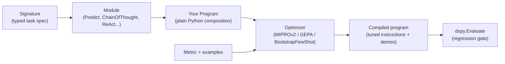
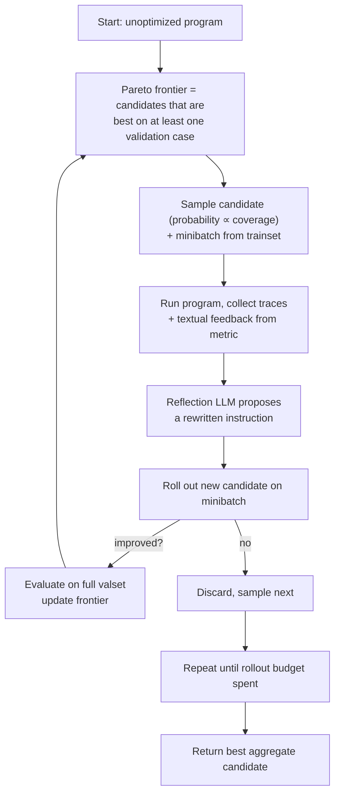

# DSPy для бэкенд-инженеров: сигнатуры, оптимизаторы и GEPA vs MIPROv2

Если вы поддерживали долгоживущий сервис на Spring Boot, то знаете разницу между
конфигурацией и кодом. Значения в `application.yml` на продакшен-серверах руками не правят,
размер пула соединений не подбирают на глазок: его объявляют, измеряют и меняют через
ревью и воспроизводимый процесс.

Теперь посмотрим тем же взглядом на разработку с LLM. Большинство команд «занимается AI» так,
как мы занимались эксплуатацией в 2009-м: кто-то правит строку промпта в PR, прогоняет пять
примеров в ноутбуке и на глаз оценивает вывод, выкатывает, а через шесть недель обновление
модели молча всё ломает.

**DSPy** ([dspy.ai](https://dspy.ai)) — фреймворк от Stanford NLP, который говорит: хватит.
Относитесь к промпту как к **скомпилированному артефакту**. Вы пишете *исходный код* —
типизированное описание задачи, скомпонованное обычным Python-кодом, — и **метрику**, которая
оценивает результаты. Дальше компонент фреймворка, который называется **оптимизатором**,
сам генерирует и настраивает настоящие промпты: под вашу метрику и на ваших данных.

В статье я объясню, как это работает, а затем подробно разберу вопрос, который встанет перед
вами сразу после внедрения: **какой оптимизатор выбрать**. Сегодня основных стратегий две:
**MIPROv2** (байесовский поиск по инструкциям и few-shot примерам) и **GEPA** (рефлексивная
эволюция промптов на фронте Парето, ICLR 2026 Oral). Они ищут по-разному, стоят по-разному
и по-разному относятся к вашей метрике.

Всё опирается на небольшой запускаемый пример, который я собрал специально для этой статьи:
программа **триажа продакшен-инцидентов Spring Boot**, которая относит строки логов и стектрейсы
к категориям первопричин. Это та предметная область, в которой обычно живёт этот блог, а сам
пример достаточно мал, чтобы полный прогон оптимизации оставался дешёвым.

Стек: **Python 3.11+, DSPy 3.5, любой LLM-провайдер**.

<div class="post-tldr" markdown="1">
<p class="post-tldr-title">TL;DR</p>

- **DSPy = промпты как артефакты сборки.** Вы объявляете `Signature` (типизированные входы и выходы), собираете `Module` на Python, пишете метрику, а **оптимизатор** компилирует всё это в настроенные инструкции и few-shot примеры. Смена модели превращается в перекомпиляцию, а не в переписывание промптов.
- Основной цикл везде один: **программа + около 30 размеченных примеров + метрика → `optimizer.compile(program, trainset=...)` → сохранённый артефакт, который можно сравнивать через diff.** Никаких строк с промптами в исходниках.
- **MIPROv2** = сетка кандидатов (инструкции × демо) и выбор победителя **байесовской оптимизацией** по оценкам на minibatch. Хороший универсал; для долгих прогонов нужно 200+ примеров; метрика — обычный float.
- **GEPA** = **рефлексивная эволюция**: сильная LLM переписывает инструкции, опираясь на *текстовую обратную связь* о том, почему предсказания оказались неверными, а **фронт Парето** сохраняет кандидатов, выигрывающих хотя бы на одном примере. Обошёл MIPROv2 **более чем на 10 пунктов** на шести бенчмарках при сопоставимой стоимости (ICLR 2026 Oral) и превзошёл RL-дообучение GRPO, используя **до 35 раз меньше rollouts**.
- Правило выбора: **метрика умеет объяснять ошибки словами — GEPA. Метрика — чёрный ящик, возвращающий скаляр, или нужен подбор демо — MIPROv2.** Оба оставляют код вашей программы нетронутым.
</div>

---

## Что такое DSPy?

DSPy — open-source Python-фреймворк от Stanford NLP. Он вырос из исследования
Demonstrate-Search-Predict (декабрь 2022), а нынешняя линейка 3.x широко используется: на
момент написания у неё несколько миллионов скачиваний в месяц на PyPI и около 40 тысяч звёзд
на GitHub. Девиз проекта хорошо передаёт философию: programming, not prompting — «программируй
языковые модели, а не уговаривай их промптами».

Исходная идея: промпт — не исходный код. Это *результат*, скомпилированный из трёх вещей,
которые как раз можно поддерживать как исходный код:

1. **Что за задача** — типизированный интерфейс: входы, выходы, ограничения.
2. **Как шаги складываются друг с другом** — обычный поток управления на Python.
3. **Что считать правильным** — функция-метрика над размеченными примерами.

Пункты 1–3 вы пишете руками, а промпт порождает алгоритм. Когда меняется модель, промпт
не переписывают, а **перекомпилируют**.

Если вам случалось вести для одной фичи отдельные промпты под GPT-4, Claude и локальную Llama,
вы уже понимаете, почему это важно. Это тот же инстинкт, который когда-то привёл нас от
правки конфигов серверов вручную к декларативной инфраструктуре.

## Как устроен DSPy: сигнатуры, модули, оптимизаторы

В DSPy ровно три абстракции. Это и есть весь фреймворк.



### Что такое сигнатура в DSPy?

**Сигнатура** — декларативное описание входов и выходов задачи. Можно думать о ней как о
сигнатуре метода, но с семантикой, а не только с типами. Имена полей несут смысл: DSPy
превращает их в промпты за кулисами.

```python
class IncidentTriage(dspy.Signature):
    """Classify a Spring Boot production incident by its root cause and severity,
    and propose a fix."""

    incident_report: str = dspy.InputField(
        desc="Log line, stack trace excerpt or error description"
    )
    root_cause: Literal[
        "config-misconfiguration",
        "dependency-conflict",
        "connection-pool-exhaustion",
        "serialization-error",
        "memory-pressure",
        "thread-starvation",
    ] = dspy.OutputField(desc="One of the fixed root-cause categories")
    severity: Literal["P1", "P2", "P3"] = dspy.OutputField(
        desc="P1 = service down / data risk, P2 = degraded, P3 = contained"
    )
    action: str = dspy.OutputField(desc="One-sentence remediation")
```

Обратите внимание, что сигнатура даёт то, чего не даёт строка с промптом: **структуру, которую
может проверить парсер**. Поле `root_cause` имеет тип `Literal`, поэтому модель не может
ответить `Probably database stuff`: она обязана вернуть одно из шести значений, иначе адаптер
DSPy повторит запрос и в итоге бросит исключение. Это знакомое по работе с типизированными DTO
ощущение: вы маппите JSON в объект, а не разбираете строки вручную.

### Что такое модуль в DSPy?

**Модуль** — переиспользуемая стратегия промптинга, обобщённая над любой сигнатурой. Это идея
`nn.Module` из PyTorch, применённая к промптам. Все модули построены на `dspy.Predict`; вот
самые известные:

| Модуль | Какую стратегию абстрагирует |
|---|---|
| `dspy.Predict(sig)` | Прямой запрос к модели |
| `dspy.ChainOfThought(sig)` | Добавляет шаг рассуждения перед ответом |
| `dspy.ReAct(sig, tools=[...])` | Цикл рассуждений и вызовов инструментов для агентов |
| `dspy.ProgramOfThought(sig)` | Генерирует и выполняет код, чтобы получить ответ |
| `dspy.BestOfN(sig, N)` | Генерирует N кандидатов и оставляет лучший по оценке |

Ваша программа — подкласс `dspy.Module`, у которого метод `forward()` собирает подмодули
обычным Python: условиями, циклами, вашими собственными классами. Вот *вся* модель нашего
примера с триажем инцидентов:

```python
class IncidentTriageProgram(dspy.Module):
    def __init__(self):
        super().__init__()
        self.triage = dspy.ChainOfThought(IncidentTriage)

    def forward(self, incident_report: str) -> dspy.Prediction:
        return self.triage(incident_report=incident_report)
```

Посмотрите, чего в этом файле **нет**: ни текста промпта, ни few-shot примеров, ни имени модели,
ни temperature. Всё это существует, но в виде *параметров*, и именно поэтому поддаётся
оптимизации. Вызов программы возвращает типизированные поля (`root_cause`, `severity`,
`action`) и поле `reasoning`, которое `ChainOfThought` добавляет для шага рассуждения.

### Что такое оптимизатор в DSPy?

**Оптимизатор** (раньше назывался *teleprompter*) — алгоритм, который настраивает параметры
вашей программы, то есть инструкции и/или few-shot демо, чтобы максимизировать метрику.
Few-shot демо — это решённый пример «вход → выход», вставленный в промпт; инструкция — это
директива системного уровня, которую DSPy генерирует для каждого модуля.

`optimizer.compile(program, trainset=...)` — это буквально шаг компиляции: программа
прогоняется на данных, измеряется, ищется лучший вариант, а на выходе вы получаете
**скомпилированную программу**, предикторы которой уже несут настроенные инструкции и демо.
Сохраняется она через `program.save("optimized.json")` — получается артефакт, который можно
сравнивать через diff и отдавать на ревью, как скрипт миграции.

Оценка делается одним вызовом:

```python
evaluate = dspy.Evaluate(
    devset=valset,
    metric=triage_metric,
    num_threads=4,
    display_table=3,
)
result = evaluate(program)
```

Рекомендации документации DSPy по объёму данных: **около 30 размеченных примеров, чтобы
получить пользу, около 300 для продакшен-качества**. Делить нужно примерно 20% на обучение
и 80% на валидацию, потому что оптимизаторы оценивают каждого кандидата на валидационной
выборке. Это сознательно *противоположно* практике deep learning: вы не подгоняете веса, а
ищете в куда меньшем пространстве, и валидационная выборка служит компасом.

Стоит усвоить ещё одну вещь: **метрика — это контракт**. Любой оптимизатор из этой статьи
ровно настолько умён, насколько умна функция, оценивающая результаты. Для классификации
вполне достаточно проверки на точное совпадение. Для нечётких задач в DSPy есть
`dspy.evaluate.SemanticF1` (сама реализованная как небольшая DSPy-программа), а ещё можно
писать метрики с частичным зачётом.

---

## Рабочий пример: триаж инцидентов Spring Boot

Хватит теории. Репозиторий к статье реализует задачу, знакомую любому бэкенд-инженеру:
триаж на дежурстве. По строке лога или фрагменту стектрейса нужно определить **первопричину**
(шесть категорий), **серьёзность** (P1/P2/P3) и выдать исправление одним предложением.

Датасет — 24 вручную составленных и намеренно реалистичных инцидента: таймауты пула Hikari,
`NoSuchMethodError` после обновления Jackson, метод с `@Transactional`, который держит
соединение на время медленного удалённого вызова, под, убитый OOMKilled, у которого с heap
всё в порядке, а с metaspace нет... 14 примеров для обучения, 10 для валидации. Датасет
крошечный намеренно: по документации DSPy, польза начинается примерно с 30 примеров, а такой
размер оставляет прогон дешёвым.

У метрики два варианта, и именно это разделение — ключ к вопросу GEPA vs MIPROv2 дальше:

```python
def triage_metric(example, pred, trace=None) -> float:
    """Plain scalar metric — what MIPROv2 and dspy.Evaluate consume."""
    root_ok = pred.root_cause == example.root_cause
    sev_ok = pred.severity == example.severity
    return (1.0 if root_ok else 0.0) + (0.25 if sev_ok else 0.0)


def triage_metric_with_feedback(example, pred, trace=None, pred_name=None, pred_trace=None):
    """GEPA metric: a score PLUS natural-language feedback about the miss."""
    problems = []
    if pred.root_cause == example.root_cause:
        root_score = 1.0
    else:
        root_score = 0.0
        problems.append(
            f"Wrong root cause: you said '{pred.root_cause}', the correct label is "
            f"'{example.root_cause}'."
        )
    # ... same for severity ...
    return dspy.Prediction(score=root_score + sev_score,
                           feedback=" ".join(problems) or "Correct root cause and severity.")
```

Задача и оценка те же. Одна версия отвечает на вопрос *«сколько?»*, другая отвечает ещё и на
вопрос *«почему неверно?»*. Именно это различие отделяет два оптимизатора ниже.

## Основные стратегии оптимизации

В DSPy около дюжины оптимизаторов, они делятся на четыре семейства. Выбирать на практике
придётся между двумя последними.

| Оптимизатор | Что настраивает | Стратегия поиска | Сколько данных нужно |
|---|---|---|---|
| `BootstrapFewShot` | Только демо | Запускает учителя и оставляет трейсы, прошедшие метрику | ~10+ |
| `BootstrapFewShotWithRandomSearch` | Только демо | Bootstrap плюс случайный поиск по вариантам | 50+ |
| `COPRO` | Только инструкции | Покоординатный подъём (hill-climbing) по переписанным вариантам | любое количество |
| `MIPROv2` | Инструкции **+ демо** | Сетка кандидатов, **байесовская оптимизация** | 200+ для долгих прогонов |
| `GEPA` | Инструкции (и код, через `dspy.Flex`) | **Рефлексивная эволюция** на фронте Парето | горстка, если метрика даёт обратную связь |

### MIPROv2: байесовский поиск по инструкциям и демо

**MIPROv2** (Multiprompt Instruction PRoposal Optimizer v2) — рабочая лошадка DSPy и
давний ответ по умолчанию на просьбу «просто оптимизируй». Работает в три этапа:

1. **Bootstrap демо.** Создаются `num_candidates` наборов few-shot примеров: часть взята из
   разметки, часть *получена бутстрэпом* — программа запускается сама, а оставляются трейсы,
   результаты которых прошли метрику.
2. **Генерация инструкций.** `prompt_model` пишет варианты инструкций для каждого модуля,
   опираясь на краткое описание датасета, исходный код вашей программы, полученные бутстрэпом
   демо и случайную подсказку для креативности.
3. **Байесовский поиск.** Сэмплируются комбинации (инструкция, демо), каждая оценивается
   на minibatch из 35 примеров, суррогатная модель обновляется, а новые сэмплы берутся там,
   где она предсказывает улучшение. Каждые несколько шагов выполняется полная оценка
   на валидации. После `num_trials` побеждает лучшая программа.

```python
optimizer = dspy.MIPROv2(
    metric=triage_metric,     # plain scalar is fine here
    auto="light",             # ~6 candidates; "medium"/"heavy" scale up
    num_threads=4,
)
optimized = optimizer.compile(
    program,
    trainset=trainset,
    valset=valset,
    max_bootstrapped_demos=2,
    max_labeled_demos=2,
)
optimized.save("optimized/miprov2_triage.json")
```

Мысленная модель такая: **фиксированная сетка кандидатов, которую исследует умный сэмплер**.
Из этого следует реальное ограничение: MIPROv2 выбирает только из тех вариантов инструкций,
которые его генератор сумел придумать заранее. Если ни один из них не отражает знание о
предметной области, которое нужно задаче («сначала сопоставь сигнатуру стектрейса, потом
оценивай серьёзность»), байесовский поиск это знание не придумает, а только выберет наименее
плохую точку сетки.

### GEPA: рефлексивная эволюция промптов на фронте Парето

**GEPA** (Genetic-Pareto), [Agrawal et al., 2025](https://arxiv.org/abs/2507.19457),
принятый как **ICLR 2026 Oral**, бьёт ровно в это ограничение. Это эволюционный поиск, в
котором *оператором мутации служит LLM, читающая обратную связь*:



Работает это благодаря четырём идеям:

- **Метрика возвращает обратную связь, а не только число.** Поэтому в нашем примере
  `triage_metric_with_feedback` возвращает `dspy.Prediction(score, feedback)`. Документация
  DSPy говорит об этом прямо: если дать GEPA голый float, получится «куда более слабая версия
  самого себя». Текст обратной связи попадает в промпт reflection-модели *дословно*, например:
  «вы ответили `thread-starvation`, правильная метка — `memory-pressure`; OOMKilled на лимите
  контейнера при низком использовании heap означает, что ограничение создаёт сам *контейнер*».
  Так каждая мутация получается осмысленной, а не случайной.
- **Отбор по Парето вместо «царя горы».** MIPROv2 держит одного действующего лидера, и
  кандидаты, посредственные в целом, но *лучшие на отдельном срезе* (скажем, на ошибках
  сериализации), всё равно выбывают. Фронт GEPA сохраняет всех таких специалистов и
  сэмплирует из них. Кандидаты, рано специализировавшиеся на своём срезе, доживают до
  последующих скрещиваний, и по той же причине генетические алгоритмы поддерживают
  разнообразные популяции. В статье есть абляция: на Qwen3 8B сэмплирование по Парето
  обошло постоянный выбор текущего лучшего кандидата примерно на 6 пунктов суммарной оценки.
- **Системно-осознанное слияние** (`use_merge=True`): когда две линии независимо выучили
  дополняющие друг друга сильные стороны, GEPA пробует слить их лучшие модули. На языке
  генетических алгоритмов это оператор кроссовера.
- **Бюджет одним параметром**: ровно один из `auto` (`light`/`medium`/`heavy`),
  `max_full_evals` или `max_metric_calls`. Режим `light` оценивает примерно шесть
  кандидатов-промптов; реальное число вызовов метрики растёт вместе с размером валидационной
  выборки и числом предикторов, так что сначала проверьте его на небольшой выборке.

```python
optimizer = dspy.GEPA(
    metric=triage_metric_with_feedback,  # score + textual feedback
    reflection_lm=reflection_model(),    # a STRONG model, temperature 1.0
    auto="light",
    num_threads=4,
    track_stats=True,                    # fills detailed_results
    perfect_score=1.25,                  # this metric's max; the default is 1.0
)
optimized = optimizer.compile(program, trainset=trainset, valset=valset)
```

Два замечания по эксплуатации. Во-первых, **деньги стоит тратить на reflection-модель**: её
вызывают лишь несколько раз за прогон, поэтому дайте ей модель сильнее той, что решает
задачу; документация DSPy рекомендует именно более крупную модель там, где оптимизируется
меньшая. Во-вторых, включите `track_stats=True`: результат будет содержать `detailed_results`
с **каждым кандидатом, его родословной и оценками по каждому валидационному примеру**. Это
журнал того, как эволюционировал промпт; его можно выгрузить в JSON и ревьюить как PR.

На одну грабли я наступил по-настоящему: GEPA пропускает рефлексию на любом примере, чья
оценка достигла `perfect_score`, а **по умолчанию он равен 1.0**. Наша метрика доходит до
1.25 (1.0 за корневую причину плюс 0.25 за severity), поэтому с дефолтом каждый пример с
верной корневой причиной считался идеальным, и GEPA ни разу не посмотрел на промахи по
severity. Он исследовал одного-двух кандидатов и вернул исходную программу. Если максимум
вашей метрики не равен 1.0, задайте `perfect_score`.

GEPA меняет намеренно немногое: только `signature.instructions` каждого предиктора.
Композиция модулей, ваш код и демо остаются нетронутыми. Оптимизированные инструкции к тому же
хорошо переносятся между моделями: по данным статьи, промпты, эволюционировавшие на Qwen3-8B,
при переносе на GPT-4.1 Mini дали прирост около 9%.

## GEPA vs MIPROv2: какой оптимизатор выбрать?

Тот же фреймворк, та же программа, та же функция метрики, но разные подходы к поиску:

| Критерий | MIPROv2 | GEPA |
|---|---|---|
| Подход | **Байесовская оптимизация** по фиксированной сетке кандидатов | **Рефлексивная эволюция** по открытому множеству кандидатов |
| Что настраивает | Инструкции **+ few-shot демо** совместно | Только инструкции (и код, через `dspy.Flex`) |
| Контракт метрики | Простой скаляр (float/bool) | `dspy.Prediction(score, feedback)` — обратная связь по каждому предиктору |
| Память поиска | Один лучший на данный момент кандидат | **Фронт Парето** из победителей по отдельным примерам + слияние |
| Параметры бюджета | `auto` или `num_candidates` + `num_trials` | ровно один: `auto` / `max_full_evals` / `max_metric_calls` |
| Типичные промпты | Длиннее (их раздувают few-shot демо) | Инструкции до **9,2x короче** (измерение из статьи) |
| Рекомендации по данным | Долгие прогоны раскрываются при 200+ примерах | Горстки хватает, *если обратная связь богатая*; валидационную выборку лучше держать небольшой |
| Главные результаты | Надёжный вариант по умолчанию; пример ReAct из документации: 8% → ~42% (MIPROv2, `medium`) | **Более 10 пунктов над MIPROv2** на 6 задачах (по абстракту статьи) |

Цифры по затратам в статье интереснее цифр по точности. В экспериментах на GPT-4.1 Mini
суммарные расходы на LM составили **$86 у GEPA против $76 у MIPROv2**, то есть сопоставимо, а
суммарный прирост был примерно вдвое больше (+12,2 пункта против +5,6; GEPA+Merge: +13,3).
По сравнению с RL-дообучением (GRPO) GEPA достиг его лучших валидационных оценок после
**243–1 179 rollouts вместо 24 000**, то есть до 78 раз эффективнее по числу сэмплов, и в
среднем на 6 пунктов (максимум на 20) превзошёл GRPO. Это собственные бенчмарки и условия
авторов статьи, а не ваша нагрузка, но это рецензируемая версия утверждения «дешевле, чем RL»,
которое вы наверняка встречали в соцсетях.

**Правило выбора, которым пользуюсь я**, исходя из устройства обоих оптимизаторов:

- **Берите GEPA, когда метрика умеет объяснять промахи словами.** Классификация с
  обоснованиями, извлечение данных с валидацией по схеме, агенты, которых оценивают по
  трейсам отдельных шагов — везде, где можно выразить «почему это неверно». Такая обратная
  связь служит топливом; без неё вы запускаете эволюцию вслепую, с функцией приспособленности,
  которая ничего не объясняет.
- **Берите MIPROv2, когда метрика — чёрный ящик или демо важнее инструкций.** Если программа
  недообучена из-за нехватки in-context примеров, а не из-за плохих инструкций, лучший рычаг
  — совместный поиск инструкций и демо в MIPROv2. Это и более мягкий первый шаг: не нужно
  настраивать вторую модель, скалярные метрики подходят.
- **В любом случае начните с дешёвой пробы**: `BootstrapFewShotWithRandomSearch` со скалярной
  метрикой стоит почти ничего и часто показывает, где разрыв: в *демо* (их он закроет) или в
  *инструкциях* (их не закроет, это территория MIPROv2/GEPA).

Они не исключают друг друга. В DSPy 3.x есть `BetterTogether`, который объединяет оптимизацию
промптов и оптимизацию весов (например, сначала GEPA, потом fine-tuning) на одной программе:
эволюция промптов находит стратегию, а RL вплавляет её в веса, если вы можете позволить себе
rollouts.

## Запуск примера

Всё описанное выше — код, который можно запустить за пять минут. Репозиторий к статье:

```bash
git clone https://github.com/javaAndScriptDeveloper/dspy-article
cd dspy-article
uv sync                      # Python 3.11+, installs DSPy 3.5

# Offline sanity check — drives the whole pipeline against a DummyLM:
uv run python smoke_test.py  # no API key needed

# Real runs:
export GEMINI_API_KEY=...     # free key: aistudio.google.com/apikey
                              # or set DSPY_MODEL to any dspy.LM string
uv run python 01_baseline.py         # score the unoptimized program
uv run python 02_optimize_miprov2.py # Bayesian search → optimized/miprov2_triage.json
uv run python 03_optimize_gepa.py    # reflective evolution → optimized/gepa_triage.json
```

По умолчанию: модель задачи `gemini/gemini-3.5-flash-lite`, reflection-модель GEPA
`gemini/gemini-3.5-flash` (переопределяются через `DSPY_MODEL` /
`DSPY_REFLECTION_MODEL`; подойдёт любая строка `dspy.LM`, включая `openai/gpt-4o-mini`).
Ключ Google AI Studio бесплатный, но квоты бесплатного уровня невелики, и Google их
меняет, поэтому перед запуском оптимизатора посмотрите лимиты своего проекта: он делает
сотни вызовов, а код повторяет запрос при 429, а не падает. Датасет из 24 примеров,
поэтому прогон небольшой. Что получилось у меня, описано в следующем разделе.

Стоит сделать самому вот что: после каждого прогона сравните сохранённый JSON с исходной
программой. `02_optimize_miprov2.py` запишет инструкции и вставит few-shot демо.
`03_optimize_gepa.py` перепишет инструкцию, а `optimized/gepa_results.json` будет хранить
всю эволюционную родословную: каждого кандидата, его родителей и оценки по каждому примеру.
Откройте его рядом с исходником программы, и вывод сделается сам: **промпт — это результат
сборки, а не исходник.**

## Что получилось, когда я это запустил

Я запустил все три скрипта 17 ноября 2026 года на бесплатном уровне Google AI Studio:
`gemini-3.5-flash-lite` как модель задачи, `gemini-3.5-flash` как reflection-модель GEPA,
`auto="light"` для обоих оптимизаторов, `num_threads=4`. Метрика — та самая, на 1.25 балла,
описанная выше; оценки ниже — средние по инцидентам на 10 валидационных инцидентах.

| Прогон | Оценка (максимум 1.25) | Примечания |
|---|---|---|
| Неоптимизированная программа, 3 прогона без кэша | 1.10 / 1.12 / 1.10 | 88–90% от максимума |
| MIPROv2, `light` | 1.12 | в пределах разброса между прогонами выше |
| GEPA, `light`, `perfect_score` по умолчанию | 1.10 | 1–2 кандидата, учиться не на чем (см. выше) |
| GEPA, `light`, `perfect_score=1.25` | **1.175** (94%) | 21 кандидат, 420 вызовов метрики, ~18 мин по часам |

Читайте это с оговорками: цифры маленькие, и я предпочту, чтобы вы им не доверяли, а не
цитировали их.

- **Базовая версия уже была близка к потолку.** Модель определила корневую причину верно
  на всех 10 валидационных инцидентах. Все потерянные баллы — severity: она ставила P1
  там, где в разметке P2 или P3. Это и есть весь запас для роста, так что весь эксперимент
  — это примерно 2 метки severity из 10.
- **GEPA выбирает победителя на тех же 10 примерах, на которых я привожу его оценку**,
  поэтому 1.175 оптимистична. Отложенной тестовой выборки нет. Это демонстрация того, как
  всё связано, а не бенчмарк.
- **1.12 у MIPROv2 — не победа.** Неоптимизированная программа между перезапусками
  колебалась от 1.10 до 1.12.
- **DSPy по умолчанию кэширует ответы LM на диске.** Мои первые «три одинаковых прогона
  базовой версии» были тремя попаданиями в кэш, а не свидетельством стабильности. Теперь
  репозиторий принимает `DSPY_CACHE=0`, чтобы отключить кэш, когда нужен реальный разброс.

Более полезный результат дало открытие `optimized/gepa_triage.json`, то есть шаг
«сравните артефакт», рекомендованный выше. Эволюционировавшая инструкция читается как
размеченная шпаргалка. Она почти дословно цитирует обучающие инциденты
(`HikariPool - Connection is not available`, `management.server.port in use`,
неразрешённые плейсхолдеры `${...}`) и сопоставляет каждому severity. Ещё она перечисляет
корневую причину `management-port-conflict`, которой нет среди шести допустимых категорий,
а в её списке корневых причин больше нет `thread-starvation`. Наш тип `Literal` отклонил бы
выдуманную метку, а инструкция теперь уводит модель от настоящей.
Оценка выросла, а артефакт стал хуже так, как метрика увидеть не может. Именно поэтому
сохранённому JSON место в code review, и именно поэтому отложенная тестовая выборка и
метрика, проверяющая набор категорий, важнее выбора оптимизатора.

Вердикта GEPA против MIPROv2 из этого запуска я не вывожу, да и один прогон на 10
примерах его не даст. Он подтверждает вещи поуже: на задаче, которую модель и так почти
решает, проверьте базовую версию, прежде чем платить за оптимизацию; убедитесь, что
диапазон вашей метрики совпадает с допущениями оптимизатора; и прочитайте эволюционировавший
промпт, прежде чем доверять его оценке.

## Когда DSPy использовать не стоит?

Раздел для честного разговора, потому что он нужен любому рассказу о фреймворке.

- **Нет метрики — нет DSPy.** Если вы не можете оценить результаты, пусть даже неточно,
  оптимизатору не за что зацепиться. Составить eval-набор и метрику — вот настоящая работа;
  DSPy лишь автоматизирует поиск по ним. (Команды, которые пропускают этот шаг и подбирают
  промпты вручную, занимаются тем же поиском, только *на глаз* и с худшими данными.)
- **Один стабильный промпт для решённой задачи?** Не платите налог на абстракцию. DSPy
  окупается, когда программы многошаговые, модели часто меняются, а разрыв в качестве стоит
  реальных денег.
- **Неограниченный RL-бюджет и обучаемые веса?** В статье GEPA прямо сказано: эволюция
  промптов выигрывает, когда rollouts дороги, данных мало или веса закрыты API. Fine-tuning
  в духе GRPO по-прежнему выигрывает там, где rollouts в изобилии. Разные инструменты,
  разная экономика.
- **Промпт принадлежит вам.** Скомпилированный артефакт настроен под *вашу метрику*: если вы
  оптимизируете под прокси-метрику, не совпадающую с продакшеном, вы выкатите прекрасно
  оптимизированную программу для неверной цели. Правило прежнее: ваш eval-набор *и есть*
  спецификация.

---

Каждая часть бэкенд-стека уже прошла через это. Конфигурация стала кодом, схема — миграциями,
инфраструктура — декларативной. Строка с промптом — последний артефакт, который люди всё ещё
правят руками в два часа ночи. Ответ DSPy тот же, что сработал для остального: объявить,
измерить, версионировать. Оптимизаторы — самая интересная часть, но окупается именно
дисциплина: промпт становится тем, что CI пересобирает, когда меняются модель, данные или
метрика.

Если хотите глубже разобраться в оптимизаторах, первоисточники отличные:
[статья про GEPA](https://arxiv.org/abs/2507.19457) (ICLR 2026 Oral),
[статья про MIPROv2](https://arxiv.org/abs/2406.11695) и
[официальное руководство DSPy по оптимизации](https://dspy.ai/learn/optimization/overview/),
в котором есть [пошаговый выбор оптимизатора](https://dspy.ai/diving-deeper/choosing-an-optimizer/).

*Код из этой статьи доступен на
**[github.com/javaAndScriptDeveloper/dspy-article](https://github.com/javaAndScriptDeveloper/dspy-article)**.
Весь пайплайн проверяется офлайн: `uv sync && uv run python smoke_test.py` прогоняет
полный цикл оптимизации GEPA без API-ключа, а реальные прогоны используют небольшой датасет
из 24 примеров.*
