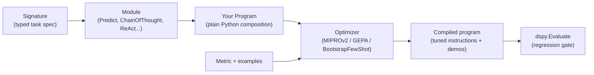
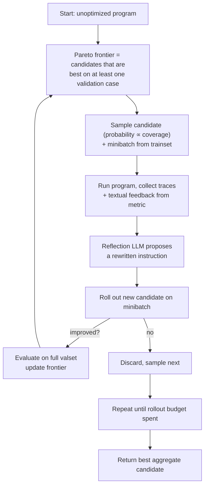

# DSPy для бэкенд-инженеров: сигнатуры, оптимизаторы и GEPA vs MIPROv2

Каждый, кто поддерживал долгоживущий сервис на Spring Boot, знает разницу между конфигурацией
и кодом. Значения в `application.yml` на продакшен-машинах руками не правят, размеры пула
соединений не подбирают на глаз — их объявляют, их измеряют, и меняют их через отревьюенный,
воспроизводимый процесс.

Теперь приложим эту оптику к LLM-разработке. Большинство команд «делают AI» так, как мы в 2009-м
делали ops: кто-то правит строку промпта в PR, глазами оценивает пять выводов в ноутбуке, катит
в прод — и через шесть недель апгрейд модели молча всё ломает.

**DSPy** ([dspy.ai](https://dspy.ai)) — фреймворк Stanford NLP, который говорит: стоп.
Считать промпт **скомпилированным артефактом**. *Исходный код* — типизированное объявление
задачи, собранное обычным Python — плюс **метрика**, оценивающая выводы, пишет разработчик.
А компонент фреймворка под названием **оптимизатор** затем автоматически генерирует и настраивает
реальные промпты — под заданную метрику, на собственных данных проекта.

Статья объясняет, как это устроено, а затем подробно разбирает вопрос, который реально встанет
после adoption'а: **какой оптимизатор выбрать**. Две главные стратегии сегодня — **MIPROv2**
(байесовский поиск по инструкциям и few-shot примерам) и **GEPA** (рефлексивная эволюция
промптов на фронте Парето, ICLR 2026 Oral). Они ищут по-разному, стоят по-разному и предъявляют
разные требования к метрике.

Всё опирается на небольшой запускаемый пример, который я собрал для этой статьи: программа
**триажа продакшен-инцидентов Spring Boot**, классифицирующая строки логов и стектрейсы
по категориям первопричин. Это домен, в котором обычно живёт этот блог, — и пример достаточно
маленький, чтобы его оптимизация стоила центов, а не долларов.

Стек: **Python, DSPy 3.5, любой LLM-провайдер**.

<div class="post-tldr" markdown="1">
<p class="post-tldr-title">TL;DR</p>

- **DSPy = промпты как артефакты сборки.** Объявляется `Signature` (типизированные входы/выходы), собираются `Module` в Python, пишется метрика — а **оптимизатор** компилирует это в настроенные инструкции + few-shot примеры. Смена модели превращается в перекомпиляцию, а не в переписывание промптов.
- Основной цикл везде один: **программа + ~30 размеченных примеров + метрика → `optimizer.compile(program, trainset=...)` → сохранённый, диффабельный артефакт.** Никаких строк промптов в исходниках.
- **MIPROv2** = предложить сетку кандидатов (инструкции × демо) и выбрать победителя **байесовской оптимизацией** на minibatch-оценках. Отличный универсал; для долгих прогонов хочет 200+ примеров; метрика — простой float.
- **GEPA** = **рефлексивная эволюция**: сильная LLM переписывает инструкции, используя *текстовую обратную связь* о том, почему предсказания были неверными, а **фронт Парето** сохраняет кандидатов, побеждающих хотя бы на одном случае. Обошёл MIPROv2 на **более чем 10%** по шести бенчмарк-задачам при сопоставимой цене (ICLR 2026 Oral) и сравнялся с RL-дообучением при **до 35x меньшем числе rollouts**.
- Правило выбора: **метрика умеет объяснять ошибки словами → GEPA. Метрика — чёрный ящик со скаляром, или нужен отбор демо → MIPROv2.** Оба не трогают код программы.
</div>

---

## Что такое DSPy?

DSPy — open-source Python-фреймворк, изначально созданный Stanford NLP (сейчас проект
развивается под крылом Databricks), впервые выпущенный в декабре 2022 года как компилятор
Demonstrate-Search-Predict. Текущая линейка, DSPy 3.x, — один из самых широко применяемых
LLM-фреймворков: миллионы скачиваний в месяц и около 40k звёзд на GitHub, а слоган документации
выражает философию в нескольких словах: **«Пиши программу, а не промпт»**.

Исходная посылка: промпт — не исходный код. Это *вывод* — скомпилированный результат трёх
входных данных, которые как раз можно поддерживать как исходный код:

1. **Что за задача** — типизированный интерфейс: входы, выходы, ограничения.
2. **Как компонуются шаги** — обычный управляющий код на Python.
3. **Что значит «правильно»** — функция-метрика над размеченными примерами.

Пункты 1–3 пишутся руками, а промпт порождает алгоритм. Когда меняется модель, промпт
не переписывают — **перекомпилируют**.

Кто когда-нибудь вёл параллельно промпт для GPT-4, промпт для Claude и промпт для локальной
Llama ради одной и той же фичи, уже понимает, почему это важно. Тот же инстинкт, который привёл
нас от рукоправленного конфига сервера к декларативной инфраструктуре.

## Как устроен DSPy: сигнатуры, модули, оптимизаторы

В DSPy ровно три абстракции, которые нужно освоить. Это весь фреймворк.



### Что такое сигнатура в DSPy?

**Сигнатура** — декларативная спецификация входного/выходного поведения задачи; это как
сигнатура метода, но с семантикой, а не только типами. Имена полей несут смысл — DSPy превращает
их в промпты под капотом.

```python
class IncidentTriage(dspy.Signature):
    """Classify a Spring Boot production incident by its root cause and severity,
    and propose a fix."""

    incident_report: str = dspy.InputField(
        desc="Log line, stack trace excerpt or error description"
    )
    root_cause: Literal[
        "config-misconfiguration",
        "dependency-conflict",
        "connection-pool-exhaustion",
        "serialization-error",
        "memory-pressure",
        "thread-starvation",
    ] = dspy.OutputField(desc="One of the fixed root-cause categories")
    severity: Literal["P1", "P2", "P3"] = dspy.OutputField(
        desc="P1 = service down / data risk, P2 = degraded, P3 = contained"
    )
    action: str = dspy.OutputField(desc="One-sentence remediation")
```

Обратите внимание на то, что даёт сигнатура, но не даёт строка промпта: **структуру, которую
может обеспечить парсер**. `root_cause` имеет тип `Literal` — модель не может ответить
`Probably database stuff`; она обязана вернуть одно из шести значений, иначе адаптер DSPy делает
ретрай и бросает исключение. Та же мышечная память, что при маппинге JSON в типизированный DTO
вместо ручного парсинга строк.

### Что такое модуль в DSPy?

**Модуль** — переиспользуемая стратегия промптинга, обобщённая над любой сигнатурой, — идея
`nn.Module` из PyTorch, применённая к промптам. Все они построены на `dspy.Predict`; самые
известные:

| Модуль | Абстрагируемая стратегия |
|---|---|
| `dspy.Predict(sig)` | Прямое завершение |
| `dspy.ChainOfThought(sig)` | Добавляет шаг рассуждения перед ответом |
| `dspy.ReAct(sig, tools=[...])` | Рассуждение + цикл использования инструментов для агентов |
| `dspy.ProgramOfThought(sig)` | Генерирует и выполняет код для ответа |
| `dspy.BestOfN(sig, N)` | Сэмплирует N кандидатов, оставляет лучший по оценке |

Программа — подкласс `dspy.Module`, чей `forward()` собирает подмодули обычным Python:
условные конструкции, циклы, собственные классы. Вот *полная* модель нашего примера триажа
инцидентов:

```python
class IncidentTriageProgram(dspy.Module):
    def __init__(self):
        super().__init__()
        self.triage = dspy.ChainOfThought(IncidentTriage)

    def forward(self, incident_report: str) -> dspy.Prediction:
        return self.triage(incident_report=incident_report)
```

Посмотрите, чего **нет** в этом файле: ни текста промпта, ни few-shot примеров, ни имени модели,
ни temperature. Всё это существует — но как *параметры*, и именно это делает их оптимизируемыми.
Вызов программы возвращает типизированные поля (`root_cause`, `severity`, `action`) плюс поле
`reasoning`, которое `ChainOfThought` добавляет для шага рассуждения.

### Что такое оптимизатор в DSPy?

**Оптимизатор** (раньше назывался *teleprompter*) — алгоритм, настраивающий параметры программы
— инструкции и/или few-shot демо — для максимизации метрики. Few-shot демо — решённый пример
«вход → выход», вставляемый в промпт; инструкция — директива системного уровня, которую DSPy
генерирует для каждого модуля.

`optimizer.compile(program, trainset=...)` — буквально шаг компиляции: программа прогоняется
на данных, ведутся измерения и поиск, и на выходе — **скомпилированная программа**, чьи
предикторы несут настроенные инструкции и демо. Сохраняется она через `program.save("optimized.json")`
— диффабельный, ревьюабельный артефакт, примерно как ревьюят скрипт миграции.

Оценочная сторона — один вызов:

```python
evaluate = dspy.Evaluate(
    devset=valset,
    metric=triage_metric,
    num_threads=4,
    display_table=3,
)
result = evaluate(program)
```

Рекомендация по объёму данных из документации DSPy: **~30 размеченных примеров, чтобы увидеть
пользу, ~300 для продакшен-качества** — деление примерно 20% train / 80% validation, потому что
оптимизаторы оценивают каждого кандидата на валидации. Это сознательно *противоположно* практике
deep learning: веса никто не подгоняет, пространство поиска куда меньше, и validation-выборка —
компас.

И ещё одно, что стоит уложить в голову: **метрика — это контракт**. Каждый оптимизатор из этой
статьи ровно настолько умён, насколько умна функция, оценивающая выводы. Для классификации
достаточно метрики точного совпадения. Для нечётких задач в DSPy есть `SemanticF1` — сам
реализованный как небольшая DSPy-программа, — плюс можно писать метрики в стиле assertions,
возвращающие частичный зачёт.

---

## Рабочий пример: триаж инцидентов Spring Boot

Достаточно теории. Сопутствующий репозиторий к статье реализует задачу, которую узнает каждый
бэкенд-инженер: триаж на дежурстве. По строке лога или фрагменту стектрейса нужно
классифицировать **первопричину** (шесть категорий), **серьёзность** (P1/P2/P3) и выдать
исправление в одно предложение.

Датасет — 24 рукотворных, нарочно реалистичных инцидента: таймауты пула Hikari,
`NoSuchMethodError` после апгрейда Jackson, метод с `@Transactional`, держащий соединение во время
медленного удалённого вызова, под с OOMKilled, у которого heap в порядке, но metaspace — нет...
14 для обучения, 10 для валидации. Крошечный намеренно: документация DSPy говорит, что польза
начинается примерно с 30 примеров, а такой объём удерживает весь прогон в диапазоне центов.

Метрика имеет два варианта — и это разделение ключ к вопросу GEPA vs MIPROv2 дальше:

```python
def triage_metric(example, pred, trace=None) -> float:
    """Plain scalar metric — what MIPROv2 and dspy.Evaluate consume."""
    root_ok = pred.root_cause == example.root_cause
    sev_ok = pred.severity == example.severity
    return (1.0 if root_ok else 0.0) + (0.25 if sev_ok else 0.0)


def triage_metric_with_feedback(example, pred, trace=None, pred_name=None, pred_trace=None):
    """GEPA metric: a score PLUS natural-language feedback about the miss."""
    problems = []
    if pred.root_cause == example.root_cause:
        root_score = 1.0
    else:
        root_score = 0.0
        problems.append(
            f"Wrong root cause: you said '{pred.root_cause}', the correct label is "
            f"'{example.root_cause}'."
        )
    # ... same for severity ...
    return dspy.Prediction(score=root_score + sev_score,
                           feedback=" ".join(problems) or "Correct root cause and severity.")
```

Та же задача, та же оценка — одна версия отвечает на вопрос *«насколько?»*, вторая отвечает ещё
и на вопрос *«почему неверно?»*. Запомним это — сейчас это станет очень важным.

## Главные стратегии оптимизации

DSPy поставляет около дюжины оптимизаторов в четырёх семействах. Выбирать реально предстоит
между двумя последними.

| Оптимизатор | Что настраивает | Стратегия поиска | Сколько данных нужно |
|---|---|---|---|
| `BootstrapFewShot` | только демо | Прогон учителя, сохраняются трейсы, прошедшие метрику | ~10+ |
| `BootstrapFewShotWithRandomSearch` | только демо | Бутстрап + случайный поиск по вариантам | 50+ |
| `COPRO` | только инструкции | Покоординатный подъём по перезаписям | любые |
| `MIPROv2` | инструкции **+ демо** | Сетка кандидатов, **байесовская оптимизация** | 200+ для долгих прогонов |
| `GEPA` | инструкции (и код, через `dspy.Flex`) | **Рефлексивная эволюция** на фронте Парето | горстка, если метрика даёт feedback |

### MIPROv2: байесовский поиск по инструкциям и демо

**MIPROv2** (Multiprompt Instruction PRoposal Optimizer v2) — рабочая лошадка DSPy, давний
дефолтный ответ на «просто оптимизируй». Работает в три стадии:

1. **Бутстрап демо** — создаются `num_candidates` наборов few-shot примеров: часть скопирована
   из разметки, часть *бутстрапится* запуском собственной программы с сохранением трейсов, чьи
   выводы прошли метрику.
2. **Предложение инструкций** — `prompt_model` пишет варианты инструкций для каждого модуля,
   опираясь на сводку датасета, исходный код программы, забутстрапленные демо и случайный
   совет для креативности.
3. **Байесовский поиск** — сэмплируются комбинации (инструкция, демо), каждая оценивается
   на minibatch из 35 примеров, суррогатная модель обновляется, и сэмплирование повторяется там,
   где она предсказывает улучшение. Полные валидационные прогоны — каждые несколько шагов.
   После `num_trials` побеждает лучшая программа.

```python
optimizer = dspy.MIPROv2(
    metric=triage_metric,     # plain scalar is fine here
    auto="light",             # ~6 candidates; "medium"/"heavy" scale up
    num_threads=4,
)
optimized = optimizer.compile(
    program,
    trainset=trainset,
    valset=valset,
    max_bootstrapped_demos=2,
    max_labeled_demos=2,
)
optimized.save("optimized/miprov2_triage.json")
```

Ментальная модель — **фиксированная сетка кандидатов, исследуемая умным сэмплером**. Из этого
следует реальное ограничение: MIPROv2 может выбирать только среди вариантов инструкций, которые
его proposer додумался сгенерировать заранее. Если ни один не кодирует доменное озарение, нужное
задаче («сначала сверь сигнатуру стектрейса, потом суди о серьёзности»), байесовский поиск не
сможет его выдумать — он способен лишь выбрать наименее плохую точку сетки.

### GEPA: рефлексивная эволюция промптов на фронте Парето

**GEPA** (Genetic-Pareto) — [Agrawal et al., 2025](https://arxiv.org/abs/2507.19457),
принятый как **ICLR 2026 Oral**, — бьёт прямо по этому ограничению. Это эволюционный поиск, в
котором *оператор мутации — LLM, читающая feedback*:



Работу обеспечивают четыре идеи:

- **Метрика возвращает feedback, а не просто число.** Именно поэтому в примере есть
  `triage_metric_with_feedback`, возвращающая `dspy.Prediction(score, feedback)`. Документация
  DSPy говорит прямо: скормите GEPA голый float — получите «гораздо более слабую версию себя».
  Текст feedback идёт *дословно* в промпт reflection LM — «предсказано `thread-starvation`,
  правильная метка — `memory-pressure`; OOMKilled на лимите контейнера при низком расходе heap
  означает, что узкое место — сам *контейнер*» — поэтому каждая мутация информирована, а не
  случайна.
- **Отбор по Парето вместо «короля горы».** MIPROv2 держит одного действующего чемпиона;
  кандидаты, посредственные в целом, но *лучшие на конкретном срезе* (скажем, ошибки
  сериализации), всё равно выбывают. Фронт GEPA сохраняет всех таких специалистов живыми
  и сэмплирует из них. Кандидаты-ранние специалисты доживают до поздних рекомбинаций — по той
  же причине генетические алгоритмы держат разнообразные популяции. В статье есть абляция:
  сэмплирование по Парето против жадного «всегда бери лучшего» стоит до ~8% в сумме.
- **Системно-осознанное слияние** (`use_merge=True`): когда две линии каждая выучили
  комплементарную сильную сторону, GEPA пытается слить их лучшие модули — оператор кроссовера,
  если на языке генетических алгоритмов.
- **Бюджет одной ручкой**: ровно одно из `auto` (`light`/`medium`/`heavy`), `max_full_evals`
  или `max_metric_calls`. На программе с двумя предикторами и 100 примерами `light` — примерно
  1 330 вызовов метрики.

```python
optimizer = dspy.GEPA(
    metric=triage_metric_with_feedback,  # score + textual feedback
    reflection_lm=reflection_model(),    # a STRONG model, temperature 1.0
    auto="light",
    num_threads=4,
    track_stats=True,                    # fills detailed_results
)
optimized = optimizer.compile(program, trainset=trainset, valset=valset)
```

Два эксплуатационных замечания из реального использования. Во-первых, **reflection LM — дорогая
ручка**: она работает последовательно (несколько вызовов за прогон, ~12–36 при среднем бюджете),
поэтому ей отдаётся модель сильнее, чем модель задачи; в собственных туториалах DSPy там стоят
frontier-модели. Во-вторых, стоит включить `track_stats=True`: результат несёт `detailed_results`
с **каждым кандидатом, его родословной и оценками по каждому примеру валидации** — audit trail
того, как эволюционировал промпт, который можно выгрузить в JSON и ревьюить как PR.

GEPA *меняет* намеренно узко: только `signature.instructions` каждого предиктора. Композиция
модулей, код, демо — не тронуты. Оптимизированные инструкции к тому же отлично переносятся между
моделями: в статье промпты, эволюционировавшие на Qwen3-8B, дали ~9% при повторном использовании
на GPT-4.1 Mini.

## GEPA vs MIPROv2: какой оптимизатор выбрать?

Тот же фреймворк, та же программа, та же функция метрики — разные парадигмы поиска. Честное
сравнение:

| Измерение | MIPROv2 | GEPA |
|---|---|---|
| Парадигма | **Байесовская оптимизация** по фиксированной сетке кандидатов | **Рефлексивная эволюция** по открытому множеству кандидатов |
| Что настраивает | Инструкции **+ few-shot демо** совместно | Только инструкции (и код, через `dspy.Flex`) |
| Контракт метрики | Простой скаляр (float/bool) | `dspy.Prediction(score, feedback)` — feedback по каждому предиктору |
| Память поиска | Один лучший на данный момент кандидат | **Фронт Парето** из победителей по отдельным случаям + слияние |
| Ручки бюджета | `auto` или `num_candidates` + `num_trials` | ровно одна: `auto` / `max_full_evals` / `max_metric_calls` |
| Типичные промпты | Длиннее (раздуваются few-shot демо) | Инструкции **до 9,2x короче** (измерение из статьи) |
| Рекомендации по данным | 200+ примеров — для долгих прогонов | Горстка работает, *если feedback богатый*; валидацию держать маленькой |
| Главные результаты | Крепкий дефолт; ReAct 24%→51% в примере из документации | **+10% к MIPROv2** на 6 задачах; +12% на AIME 2025 |

Цифры затрат в статье интереснее цифр точности. В экспериментах на GPT-4.1 Mini суммарные
расходы на LM составили **$86 у GEPA против $76 у MIPROv2** — сопоставимо — за примерно двойной
прирост в сумме (+13,3% против +5,6%). Против RL-дообучения (GRPO) GEPA вышел на его лучшие
валидационные оценки после **243–1 179 rollouts против 24 000** — до 78x лучшая эффективность
по сэмплам — и в среднем +6% (до +20%) сверху над GRPO. Это рецензируемая версия framing'а
«в 10–80 раз дешевле, чем RL», который водится в соцсетях.

**Моё правило выбора**, после подключения обоих на одной задаче:

- **GEPA — когда метрика умеет объяснять промахи словами.** Классификация с причинами,
  экстракция, проверяемая по схемам, агенты, оцениваемые по пошаговым трейсам, — везде, где
  «почему это неверно» выразимо. Такой feedback — топливо; без него получается эволюция со слепой
  функцией приспособленности.
- **MIPROv2 — когда метрика — чёрный ящик, или демо важнее инструкций.** Если программа
  underfit'ит из-за нехватки in-context примеров (а не из-за неверных инструкций), совместный
  поиск инструкция+демо у MIPROv2 — лучший рычаг. Это и более мягкая первая ступень: не нужно
  настраивать вторую модель, скалярные метрики приветствуются.
- **Дешёвая первая проба в любом случае**: `BootstrapFewShotWithRandomSearch` со скалярной
  метрикой стоит почти ничего и часто говорит, в чём разрыв: в *демо* (он его закроет) или
  в *инструкциях* (не закроет — это территория MIPROv2/GEPA).

И они не взаимоисключающие. DSPy 3.x поставляет `BetterTogether`, который цепляет оптимизацию
промптов и оптимизацию весов (например, GEPA, затем GRPO) на одной программе — эволюция промптов
находит стратегию, RL сжимает её в веса, когда бюджет rollouts позволяет.

## Запуск примера

Всё описанное выше — код, запускаемый за пять минут. Сопутствующий репозиторий:

```bash
git clone https://github.com/javaAndScriptDeveloper/dspy-article
cd dspy-article
uv sync                      # Python 3.11+, installs DSPy 3.5

# Offline sanity check — drives the whole pipeline against a DummyLM:
uv run python smoke_test.py  # no API key needed

# Real runs:
export OPENAI_API_KEY=sk-...     # or set DSPY_MODEL to any dspy.LM string
uv run python 01_baseline.py         # score the unoptimized program
uv run python 02_optimize_miprov2.py # Bayesian search → optimized/miprov2_triage.json
uv run python 03_optimize_gepa.py    # reflective evolution → optimized/gepa_triage.json
```

Дефолты: модель задачи `openai/gpt-4o-mini`, reflection-модель GEPA `openai/gpt-4o`
(переопределяются через `DSPY_MODEL` / `DSPY_REFLECTION_MODEL`). На 24 примерах оба прогона
оптимизации укладываются в центы.

Момент, который стоит проделать самому: после каждого прогона сравнить сохранённый JSON
с исходной программой. `02_optimize_miprov2.py` запишет инструкции и вставит few-shot демо.
`03_optimize_gepa.py` перепишет инструкцию, а `optimized/gepa_results.json` будет хранить полную
эволюционную родословную: каждого кандидата, его родителей, оценки по каждому примеру. Этот
файл — вся идея DSPy в одном артефакте: **промпт — это вывод, а не исходник.**

## Когда DSPy не стоит использовать?

Секция честности — она нужна каждой рекламе фреймворка.

- **Нет метрики — нет DSPy.** Если выводы нечем оценивать — хотя бы зашумлённо, — оптимизатору
  не по чему подниматься. Построение eval-набора и метрики — настоящая работа; DSPy лишь
  автоматизирует поиск относительно неё. (Команды, пропускающие этот шаг и тюнящие промпты
  руками, ведут поиск *по ощущениям* — с худшими данными.)
- **Один стабильный промпт на решённой задаче?** Налог на абстракцию добавлять не нужно.
  DSPy окупается, когда программы многошаговые, модели часто меняются или разрывы в качестве
  стоят реальных денег.
- **Безлимитный RL-бюджет и обучаемые веса?** Статья GEPA выражается прямо: эволюция промптов
  выигрывает, когда rollouts дороги, данных мало или веса заморожены за API. Fine-tuning
  в стиле GRPO всё ещё выигрывает в режиме безлимитных rollouts. Другие инструменты, другая
  экономика.
- **Промпт остаётся за командой.** Скомпилированный артефакт настроен под *заданную метрику* —
  оптимизация против прокси-метрики, не совпадающей с продакшеном, даст прекрасно
  оптимизированную программу для неверной цели. Правило прежнее: eval-набор *и есть*
  спецификация.

---

Паттерн, который стоит унести с собой, — тот же, вокруг которого этот блог ходит в других
доменах: переносить рантайм-суждения в декларативные, измеримые, версионированные артефакты.
Мы сделали это для инфраструктуры, потом для миграций схемы; DSPy делает это для последнего
правимого руками артефакта в стеке — строки промпта. Оптимизаторы — самая интересная часть,
но *дисциплина* — главный выигрыш. Промпт перестаёт быть тем, что кто-то подкручивает в два
часа ночи, и становится тем, что CI пересобирает, когда меняются модель, данные или метрика.

Если нужен второй, более глубокий проход по оптимизаторам, первоисточники прекрасны:
[статья GEPA](https://arxiv.org/abs/2507.19457) (ICLR 2026 Oral),
[статья MIPROv2](https://arxiv.org/abs/2406.11695) и
[официальный гайд DSPy по оптимизации](https://dspy.ai/learn/optimization/overview/),
в котором есть [пошаговый выбор оптимизатора](https://dspy.ai/diving-deeper/choosing-an-optimizer/).

*Код из этой статьи доступен в
**[github.com/javaAndScriptDeveloper/dspy-article](https://github.com/javaAndScriptDeveloper/dspy-article)**.
Весь пайплайн проверяется офлайн — `uv sync && uv run python smoke_test.py`
прогоняет полный цикл GEPA-оптимизации без API-ключа, — а реальные прогоны стоят центов
на прилагаемом датасете из 24 примеров.*
