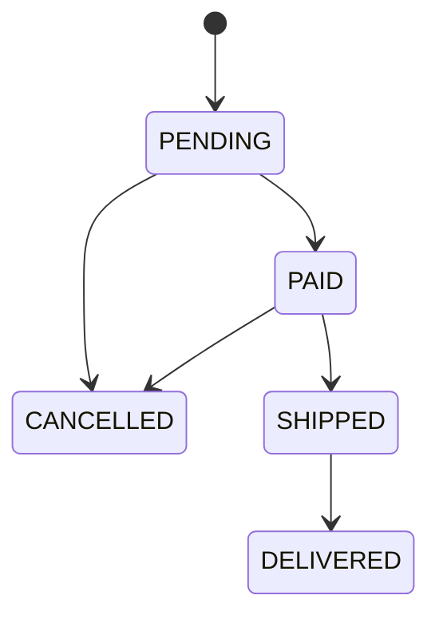

# Хранение enum в базе данных: @Enumerated, enum-типы Postgres и lookup-таблицы

Почти в каждой доменной модели есть поле, которое может принимать лишь несколько значений.
Заказ — `PENDING`, `PAID`, `SHIPPED`, `DELIVERED` или `CANCELLED`. Платёж — авторизован или
захвачен. Подписка — на одном из четырёх тарифов. В Java рука сама тянется к `enum`.
Интересный вопрос — что происходит на границе: **как этот конечный набор значений реально
живёт в базе данных** и во что обойдётся каждый вариант полгода спустя, когда набор изменится.

Статья пройдёт по всем распространённым способам хранения enum с Hibernate в том порядке, в
каком их реально встречаешь: два режима `@Enumerated`, настоящий enum-тип Postgres,
`AttributeConverter` и, наконец, lookup-таблица, где enum становится отдельной таблицей.
Сквозь всю статью мы развиваем один пример — статус заказа, — а в конце я покажу выбор,
который делаю сам.

Стек: **Java, Spring Boot, Hibernate, PostgreSQL**.

<div class="post-tldr" markdown="1">
<p class="post-tldr-title">TL;DR</p>

- `@Enumerated(ORDINAL)` хранит **порядковый номер** константы — компактно, но вставка значения в середину молча портит все последующие строки. Если без него никак, **ординалы закрепляются юнит-тестом**.
- `@Enumerated(STRING)` хранит **имя константы** — самодокументируемо, удобно при отладке, не боится перестановок. Это разумный дефолт.
- Голый `varchar` — не лучший выбор: настоящий **enum-тип Postgres** заставит базу саму отклонять недопустимые значения.
- **`AttributeConverter`** пишет в базу стабильный код, отвязанный от Java-имени, поэтому **переименования перестают быть проблемой базы данных**.
- **Lookup-таблица** оправдана, только когда значения несут редактируемые бизнес-данные, — но не как обходной путь для переименований.
</div>

---

## Сценарий

Строим управление заказами. Заказ проходит фиксированный жизненный цикл:



В Java это очевидный enum:

```java
public enum OrderStatus {
    PENDING,
    PAID,
    SHIPPED,
    DELIVERED,
    CANCELLED
}
```

У сущности заказа есть поле `status`. Единственный вопрос — как Hibernate замапит его на
колонку, и у этого единственного выбора аннотации есть последствия, которые переживут код,
написанный сегодня.

---

## Часть 1 — `@Enumerated(ORDINAL)`: хранение числом

Дефолт JPA для enum — `ORDINAL`. Каждая константа хранится как позиция в объявлении:
`PENDING` → 0, `PAID` → 1, `SHIPPED` → 2 и так далее.

```java
@Entity
@Table(name = "orders_ordinal")
public class OrderOrdinal {

    @Id
    @GeneratedValue(strategy = GenerationType.UUID)
    private UUID id;

    @Enumerated(EnumType.ORDINAL)   // this is also the default if you omit @Enumerated
    @Column(nullable = false)
    private OrderStatus status;
}
```

```sql
CREATE TABLE orders_ordinal (
    id     UUID     PRIMARY KEY DEFAULT gen_random_uuid(),
    status SMALLINT NOT NULL
);
```

Сохранили заказ со статусом `PAID` — в колонке окажется `1`. Компактно, и на бумаге всё хорошо.

### ❌ Ловушка: вставка значения в середину

Ординал хранится не как метка — он хранится как *позиция*, и позиция определяется порядком
в исходном коде. В тот день, когда кто-то добавит шаг упаковки между оплаченным и отгруженным:

```java
public enum OrderStatus {
    PENDING,
    PAID,
    PACKED,      // <-- inserted here
    SHIPPED,
    DELIVERED,
    CANCELLED
}
```

…каждая константа после `PAID` сдвигается на единицу:

| Константа | Ординал до | Ординал после |
|---|---|---|
| `PENDING`   | 0 | 0 |
| `PAID`      | 1 | 1 |
| `PACKED`    | — | **2** |
| `SHIPPED`   | 2 | **3** |
| `DELIVERED` | 3 | **4** |
| `CANCELLED` | 4 | **5** |

В базе не изменилось ничего. Каждый существующий заказ `SHIPPED` по-прежнему хранит число `2` —
но `2` теперь декодируется как `PACKED`. Отгруженные заказы молча становятся упакованными.
Доставленные — отгруженными. Ни ошибки, ни упавшей миграции, ни строчки в логе. Данные не
двигались — сдвинулась их интерпретация. Об этом узнают, когда клиент спрашивает, почему
его доставленный заказ вдруг «упаковывается».

### Защита: закрепить ординалы

Если причина держать `ORDINAL` есть — legacy-схема, по-настоящему горячая огромная таблица, где
разница в байтах существенна, — зависимость от порядка делается *явной*: тест, который падает
в момент, когда кто-то переставляет константы enum:

```java
class OrdinalPinTest {

    @Test
    void ordinalsAreFrozen() {
        // If this test fails, you reordered OrderStatus. Existing ORDINAL-mapped rows now mean
        // something different. Revert the reorder, or append the new value at the end.
        assertThat(OrderStatus.PENDING.ordinal()).isZero();
        assertThat(OrderStatus.PAID.ordinal()).isEqualTo(1);
        assertThat(OrderStatus.SHIPPED.ordinal()).isEqualTo(2);
        assertThat(OrderStatus.DELIVERED.ordinal()).isEqualTo(3);
        assertThat(OrderStatus.CANCELLED.ordinal()).isEqualTo(4);
        assertThat(OrderStatus.values()).hasSize(5);
    }
}
```

Это чистый юнит-тест — без Spring-контекста, без базы. Он превращает невидимый баг с порчей
данных в красную сборку в момент, когда кто-то трогает enum. Новые значения добавлять
по-прежнему можно — но только в конец, где добавление безопасно. Всё правило, на котором молча
держится `ORDINAL`, записано и зафиксировано.

---

## Часть 2 — `@Enumerated(STRING)`: хранение строкой

Для почти всех лекарство — одно слово:

```java
@Enumerated(EnumType.STRING)
@Column(nullable = false)
private OrderStatus status;
```

Теперь колонка хранит *имя* константы:

```sql
CREATE TABLE orders_string (
    id     UUID    PRIMARY KEY DEFAULT gen_random_uuid(),
    status VARCHAR NOT NULL
);
```

Заказ со статусом `PAID` хранит буквальную строку `'PAID'`. Три вещи улучшаются сразу:

- **Перестановки безвредны.** Значение — само имя; позиции больше не важны. `PACKED` можно
  добавлять куда угодно.
- **Отлаживаемость.** `SELECT * FROM orders_string WHERE status = 'PAID'` читается как текст.
  Не нужен шифр для расшифровки и не нужно мысленно сверяться с Java-исходниками.
- **Дампы и логи самодокументируемы.** Строка в CSV-выгрузке сама по себе что-то означает.

Да, `'DELIVERED'` стоит больше байтов, чем `3`. Для подавляющего большинства таблиц эта разница —
шум, а индекс можно добавить в любой момент. Хранение имени — правильный дефолт, и «компактность»
почти никогда не стоит «молчаливой неправильности».

### Единственная оставшаяся ловушка: переименования

`STRING` убирает ловушку порядка, но добавляет меньшую. Хранимое значение — это и есть
Java-идентификатор, поэтому переименование константы оставляет существующие строки сиротами:

```java
PENDING  →  AWAITING_PAYMENT
```

Каждая старая строка `'PENDING'` больше не соответствует ни одной константе, и Hibernate падает
при её чтении. Хранимые данные и код тихо разошлись. Лечится миграцией данных (`UPDATE … SET
status = 'AWAITING_PAYMENT' WHERE status = 'PENDING'`) — вполне достойный ответ. В части 4 мы
также увидим способ, при котором переименование вообще перестаёт быть событием.

---

## Часть 3 — Хороший стиль: настоящий enum-тип Postgres

Оба варианта выше пишут в колонку, которую база по-настоящему не понимает, — `smallint` или
`varchar`, который *случайно* хранит значения enum. Postgres умеет лучше: у него есть
полноценные enum-типы:

```sql
CREATE TYPE order_status AS ENUM ('PENDING', 'PAID', 'SHIPPED', 'DELIVERED', 'CANCELLED');

CREATE TABLE orders_pgenum (
    id     UUID         PRIMARY KEY DEFAULT gen_random_uuid(),
    status order_status NOT NULL
);
```

Теперь домен поддерживает сама *база*. `INSERT … VALUES ('SHPPED')` — опечатка, плохая миграция,
чужой скрипт — падает на месте с `invalid input value for enum order_status`. С голым `varchar`
этот мусор попадает в таблицу и обнаруживается позже. Enum-тип — документация и ограничение
в одном: тип колонки буквально перечисляет её допустимые значения.

Маппинг в Hibernate — тот же `@Enumerated(STRING)`, что и раньше: Hibernate привязывает имя
константы строкой, а Postgres кладёт её в enum:

```java
@Enumerated(EnumType.STRING)
@Column(nullable = false, columnDefinition = "order_status")
private OrderStatus status;
```

Необходима ровно одна настройка. По умолчанию JDBC-драйвер PostgreSQL отправляет Java `String`
как тип `varchar`, а Postgres не приводит `varchar` → `order_status` неявно, поэтому получится
ошибка `column "status" is of type order_status but expression is of type character varying`.
Достаточно добавить `stringtype=unspecified` в JDBC URL — драйвер отправит значение как
`unknown`, и Postgres сможет привести его к enum:

```yaml
spring:
  datasource:
    url: jdbc:postgresql://localhost:5434/mydatabase?stringtype=unspecified
```

(Hibernate 6 предлагает и `@JdbcTypeCode(SqlTypes.NAMED_ENUM)` для прямой работы с именованным
enum-типом; связка `@Enumerated(STRING)` + `stringtype=unspecified` выше — самый распространённый
вариант, и я пользуюсь именно им.)

**Единственный нюанс, который стоит знать:** `ALTER TYPE order_status ADD VALUE 'PACKED'`
только *добавляет в конец*. Значение можно добавить (начиная с PostgreSQL 12 — даже до или
после конкретного), но удалить или переставить существующие значения без пересоздания типа
нельзя. Звучит как ограничение, пока не становится ясно: это *то же правило*, которое закреплял тест
на ординалы, — никогда не переставлять, только добавлять, — только здесь гарантию даёт база,
а не юнит-тест. Ограничение и есть фича.

---

## Часть 4 — `AttributeConverter`: отвязываем имя от значения

Ловушка переименований из части 2 существует потому, что мы позволили *хранимому значению*
и *Java-идентификатору* быть одной и той же строкой. JPA `AttributeConverter` разрывает эту
связку: в базу пишется стабильный код, никак не связанный с именем константы.

Дадим каждой константе явный и постоянный код:

```java
public enum OrderStatus {

    PENDING("PND"),
    PAID("PAID"),
    SHIPPED("SHP"),
    DELIVERED("DLV"),
    CANCELLED("CNC");

    private final String code;

    OrderStatus(String code) {
        this.code = code;
    }

    public String getCode() {
        return code;
    }

    public static OrderStatus fromCode(String code) {
        return Arrays.stream(values())
                .filter(s -> s.code.equals(code))
                .findFirst()
                .orElseThrow(() -> new IllegalArgumentException("Unknown OrderStatus code: " + code));
    }
}
```

Затем конвертер, который отображает enum ↔ код:

```java
@Converter
public class OrderStatusConverter implements AttributeConverter<OrderStatus, String> {

    @Override
    public String convertToDatabaseColumn(OrderStatus status) {
        return status == null ? null : status.getCode();
    }

    @Override
    public OrderStatus convertToEntityAttribute(String code) {
        return code == null ? null : OrderStatus.fromCode(code);
    }
}
```

И подключим его на поле через `@Convert` вместо `@Enumerated`:

```java
@Convert(converter = OrderStatusConverter.class)
@Column(nullable = false)
private OrderStatus status;
```

Теперь база хранит `'PAID'` как *код*, а не как идентификатор. Переименование Java-константы
`PENDING` в `AWAITING_PAYMENT` не меняет хранимый код `'PND'`: переименование становится чистым
рефакторингом с нулевым влиянием на базу. Мы отвязали то, что знает база, от того, как мы
называем вещи в коде, — а это ровно то свойство, ради которого обычно берут lookup-таблицы.
Запомним это к следующей части.

---

## Часть 5 — Lookup-таблица

Последний подход вообще перестаёт считать статус enum'ом. Набор статусов живёт в собственной
таблице, а заказы ссылаются на строку внешним ключом:

```sql
CREATE TABLE order_statuses (
    id       INTEGER PRIMARY KEY,
    code     VARCHAR NOT NULL UNIQUE,
    label    VARCHAR NOT NULL,
    terminal BOOLEAN NOT NULL DEFAULT FALSE
);

INSERT INTO order_statuses (id, code, label, terminal) VALUES
    (1, 'PND',  'Pending',   FALSE),
    (2, 'PAID', 'Paid',      FALSE),
    (3, 'SHP',  'Shipped',   FALSE),
    (4, 'DLV',  'Delivered', TRUE),
    (5, 'CNC',  'Cancelled', TRUE);

CREATE TABLE orders_lookup (
    id        UUID    PRIMARY KEY DEFAULT gen_random_uuid(),
    status_id INTEGER NOT NULL REFERENCES order_statuses (id)
);
```

В JPA статус становится связью, а не перечисляемым значением:

```java
@Entity
@Table(name = "orders_lookup")
public class OrderLookup {

    @Id
    @GeneratedValue(strategy = GenerationType.UUID)
    private UUID id;

    @ManyToOne(fetch = FetchType.EAGER, optional = false)
    @JoinColumn(name = "status_id", nullable = false)
    private OrderStatusDefinition status;
}
```

Чтобы узнать статус заказа — человекочитаемую метку и признак терминальности, — нужен **join**:

```sql
SELECT o.id, s.code, s.label
FROM   orders_lookup o
JOIN   order_statuses s ON s.id = o.status_id
WHERE  o.id = ?;
```

### ✅ Когда это оправдано

Lookup-таблица даёт одно реальное преимущество: набор значений и метаданные при каждом из них
живут в **данных**, а не в **коде**. Это по-настоящему ценно, когда:

- **Каждое значение несёт редактируемые бизнес-данные** — отображаемую метку, порядок
  сортировки, цвет, feature flag, SLA. Статус — не только идентичность, но и маленькая запись.
- **Значениями управляют не разработчики**, либо они настраиваются отдельно для каждого
  тенанта, либо меняются в рантайме без деплоя.
- **Есть настоящие массовые изменения** — метку, встречающуюся в миллионах строк, можно
  переименовать обновлением одной строки в `order_statuses`, а не каждого заказа.

Последний пункт — самый сильный аргумент: изменить одно место, а не все сразу. Если «enum»
на самом деле — поддерживаемый каталог, это правильная модель.

---

## Моё мнение

Для *простого* enum — фиксированного набора состояний на уровне кода вроде жизненного цикла
заказа — я lookup-таблицу не использую и буду возражать против неё на ревью.

Типичный аргумент, который я слышу: «а если понадобится переименовать значение?» Но мы только
что видели, что это решается без таблицы: `AttributeConverter` отвязывает хранимый код от
Java-имени, а изменившаяся метка — миграция в одну строку. Чтобы пережить переименование,
не нужен внешний ключ и join в каждом запросе.

Что lookup-таблица реально добавляет в этом случае — постоянные издержки: каждое чтение либо
делает join, либо тянет второй запрос, статус становится управляемой связью вместо значения,
а исчерпывающий на этапе компиляции `switch` по состояниям превращается в рантайм-поиск,
который может промахнуться. Мы обменяли значение, которое понимает компилятор, на строку,
которую он не понимает, — ради гибкости, которую фиксированный жизненный цикл никогда
не использует.

Поэтому моё правило — про то, **чем является значение**, а не про переименования:

- Если значение — **только идентичность**: это `SHIPPED`, точка, — оставляем enum. Мапим через
  `@Enumerated(STRING)`, подкладываем enum-тип Postgres, а когда нужно сделать переименования
  бесплатными — берём `AttributeConverter`.
- Если значение — **запись**: у него есть поля, которые люди редактируют в рантайме, — то это
  никогда и не был enum. Ему нужна таблица.

Переименования — не решающий фактор. Решающий фактор — есть ли у сущности собственные данные.

---

## Гайд по выбору

| Подход | Что хранит | Когда использовать | Главный риск |
|---|---|---|---|
| `@Enumerated(ORDINAL)` | порядковый номер (`1`) | почти никогда | перестановка молча портит строки |
| `@Enumerated(STRING)` | имя константы (`'PAID'`) | разумный дефолт | переименование осиротит строки |
| enum-тип Postgres `ENUM` | имя, проверяется базой | нужно, чтобы база отклоняла неверные значения | `ADD VALUE` только добавляет в конец |
| `AttributeConverter` | стабильный код (`'PAID'`) | нужны бесплатные переименования | один маленький класс в поддержке |
| Lookup-таблица | FK на строку | значения несут редактируемые данные | join при каждом чтении |

Крепкий дефолт для большинства проектов: **`@Enumerated(STRING)` поверх enum-типа Postgres**
с переходом на **`AttributeConverter`**, как только хранимое значение нужно изолировать
от Java-имени.

---

## Код

Код из этой статьи доступен в
**[github.com/javaAndScriptDeveloper/enums-article](https://github.com/javaAndScriptDeveloper/enums-article)** —
один и тот же enum `OrderStatus`, сохранённый всеми пятью способами, тест на фиксацию ординалов
и round-trip-тест для каждого подхода, проверяющий, что именно этот подход пишет на диск.
Всё запускается локально с Docker и одной командой `./gradlew test`.

---

## Вместо заключения

Выбор способа хранения enum кажется решением на пять секунд — и именно поэтому стоит
притормозить. Мина с ординалами, ловушка переименований, отсутствие ограничения в базе —
ничто из этого не проявится в день, когда пишется аннотация. Проявится в день, когда изменится
набор значений, а это случается всегда — обычно давно после того, как сделанный компромисс
забылся.

Хорошая новость: дефолты просты — храним имя, даём базе его проверять и отвязываем код
от идентификатора, когда это нужно. Lookup-таблицу прибережём для случаев, которые — настоящий
каталог, а не enum. Настроить это один раз правильно — и статусы остаются скучными, а это
высшая похвала, которую можно выразить колонке.

---

## Обсудим

Если enum где-то хранится иначе — или одна из этих ловушек уже укусила способом, который я
не описал, — мне интересно услышать об этом. Ссылки для связи — в футере.
