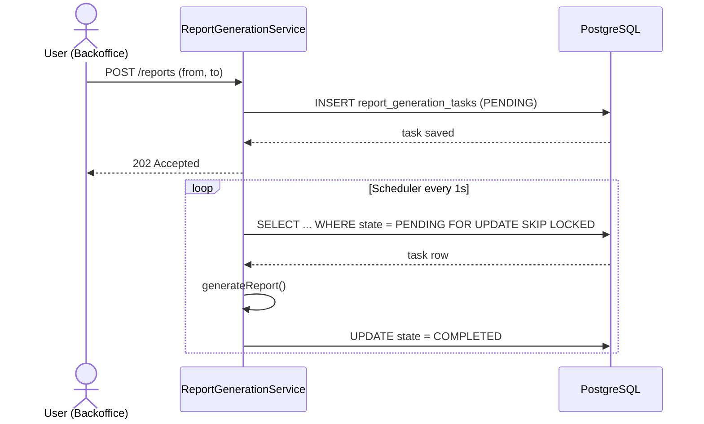
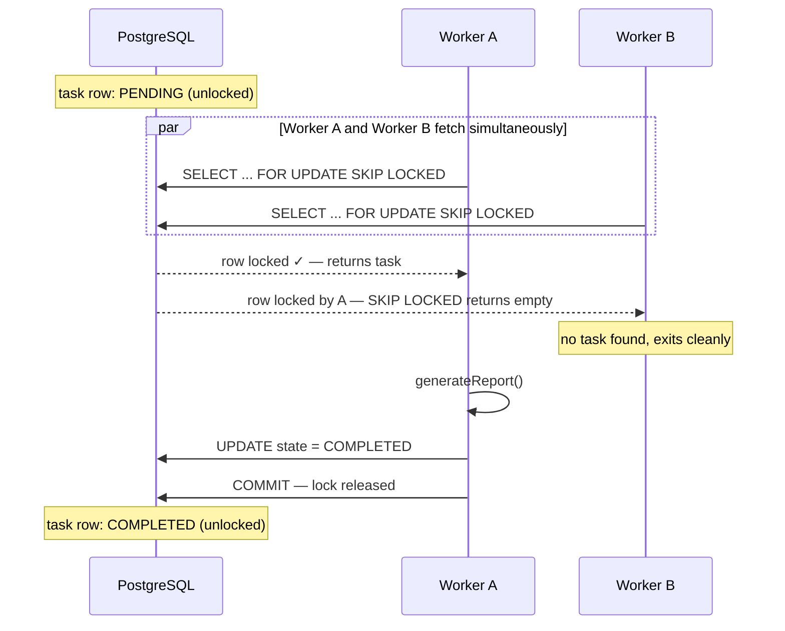
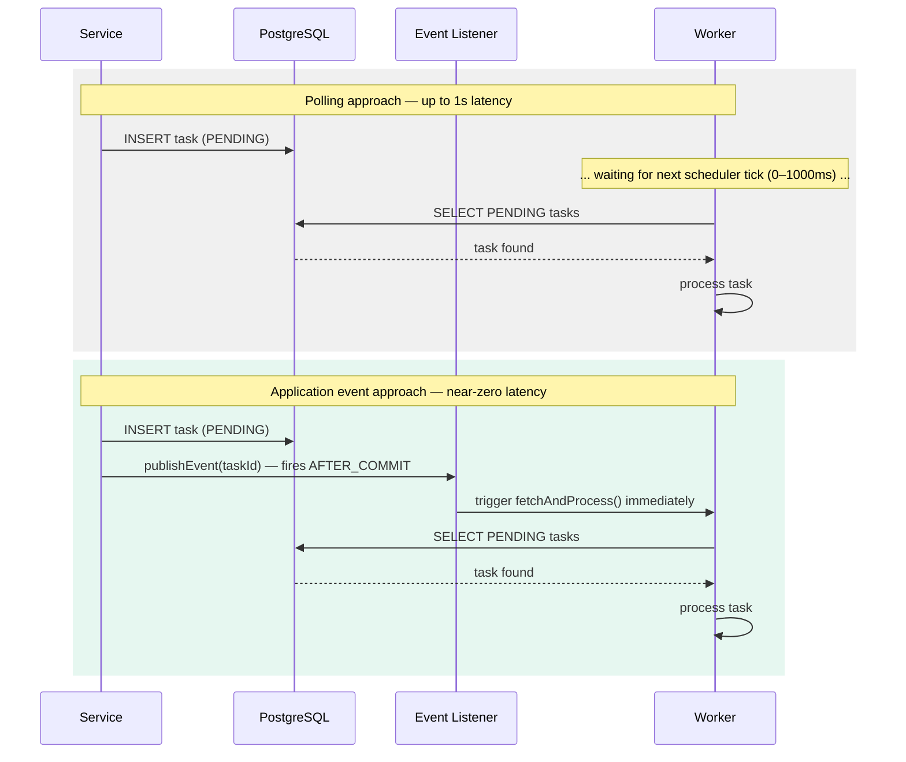
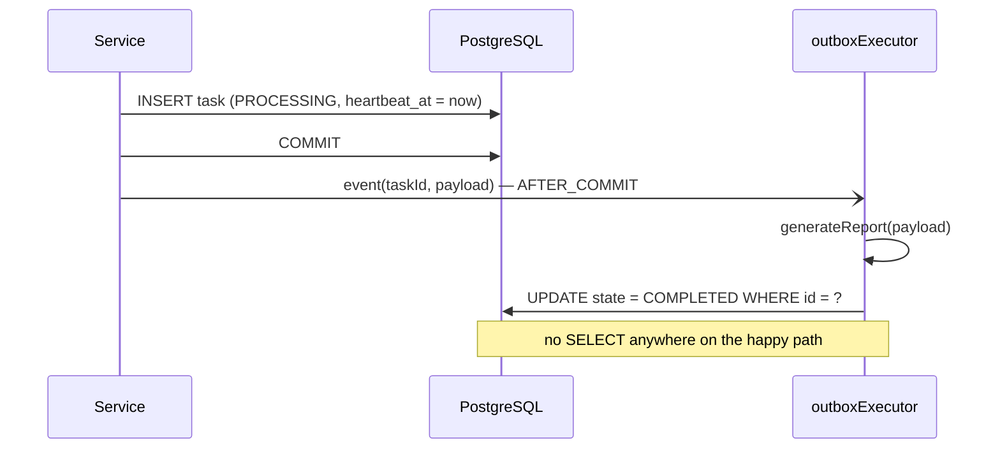
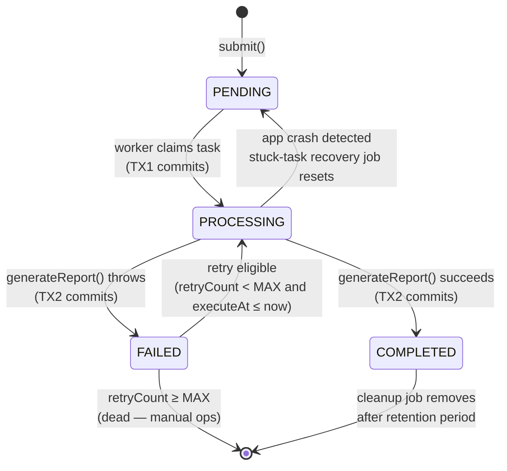
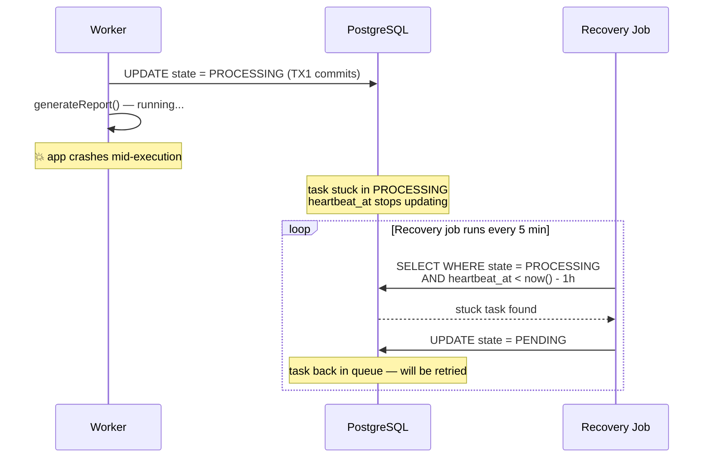
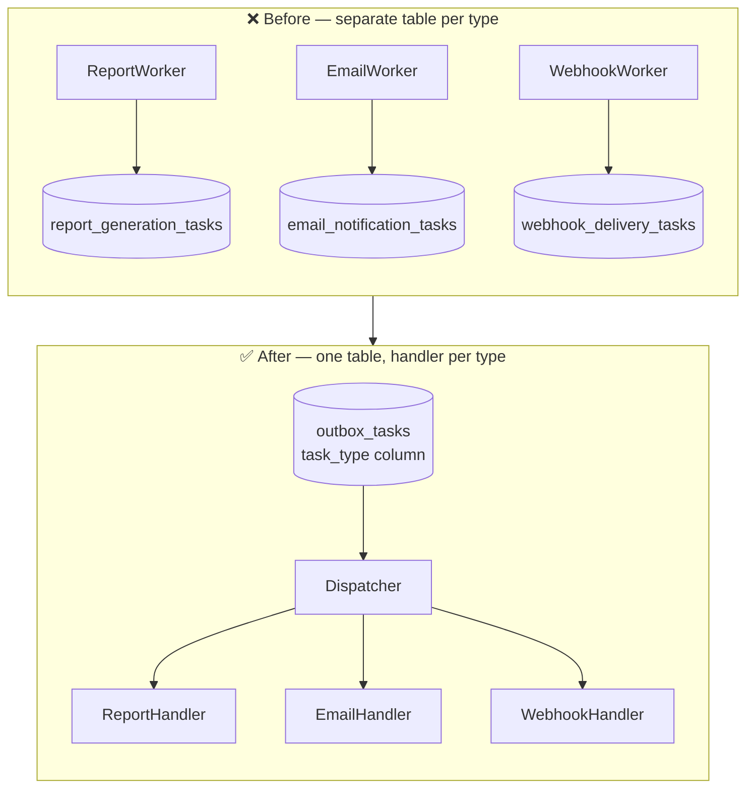
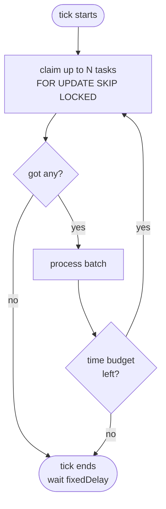

# Паттерн Transactional Outbox: от одной задачи до асинхронного движка продакшен-уровня

Есть класс багов, которые никогда не проявляются в юнит-тестах и редко — на staging.
Они проявляются в продакшене, в два часа ночи: приложение сохраняет запись в базу, затем пытается
вызвать внешний сервис — и одна из операций падает. Одна сторона закоммитила, другая нет. Никто
не узнает об этом, пока не пожалуется пользователь.

Это **проблема двойной записи**, и паттерн Transactional Outbox — стандартный ответ на неё. Идея
простая: вместо прямого вызова внешней системы записать задачу в ту же транзакцию базы данных,
что и доменное изменение. Фоновый воркер подхватывает её и выполняет. Запись атомарна. Задача
не может потеряться.

Гораздо хуже задокументировано всё, что идёт после базовой идеи: что происходит, когда задачи
падают; когда два воркера соревнуются за одну строку; когда приложение падает посреди выполнения;
когда в одной таблице живут десять разных типов задач; и когда стейкхолдеры спрашивают, почему
глубина очереди скакнула в три часа ночи во вторник на прошлой неделе.

Именно об этом эта статья.

Мы разберём один конкретный сценарий — **сервис генерации отчётов** — и шаг за шагом эволюционируем
его от простейшего возможного outbox до решения, которое я бы спокойно запустил в продакшен.
Каждый фрагмент кода взят из реального работающего репозитория, ссылка на него — в конце.

Стек: **Java, Spring Boot, PostgreSQL**.

<div class="post-tldr" markdown="1">
<p class="post-tldr-title">TL;DR</p>

- Паттерн **Transactional Outbox** решает проблему двойной записи: строка задачи пишется в **ту же транзакцию БД**, что и доменное изменение, а выполняется потом фоновым воркером.
- Outbox-таблица опрашивается через `SELECT ... FOR UPDATE SKIP LOCKED`, чтобы несколько воркеров могли работать параллельно без двойной обработки.
- **Никогда** не отправляйте сообщения в Kafka и не вызывайте другие сервисы внутри транзакции БД: время транзакции никогда не должно зависеть от внешнего ресурса.
- Продакшен-уровень требует большего, чем базовая идея: **машину состояний**, **ретраи с backoff и jitter**, **heartbeat/lease** для восстановления после падения воркеров, гарантии **порядка обработки**, осознанную **стратегию выборки**, **пакетную очистку** и **мониторинг** глубины очереди.
- Для низкой задержки будите воркеры событием `AFTER_COMMIT` на **выделенном пуле потоков** — или переходите на **zero-select** и передавайте payload прямо в событии, меняя контроль над нагрузкой на скорость.
- Kafka не нужна — для надёжного асинхронного выполнения достаточно **одного PostgreSQL**.
</div>

---

## Сценарий



Строим CRM. Пользователи могут запрашивать месячные аналитические отчёты из бэкофис-интерфейса.
Генерация отчёта — это агрегация десятков миллионов строк, и она может занимать минуты.
Очевидно, что делать это синхронно, внутри HTTP-запроса, нельзя.

Пользователь нажимает кнопку. Бэкенд принимает запрос, сохраняет его и сразу отвечает.
Фоновый воркер забирает задачу, выполняет генерацию и по завершении обновляет статус.

Это простейший случай, где outbox оправдан: работа, которая по своей природе по-настоящему
асинхронна, и где пользователь изначально готов подождать.

---

## Часть 1 — Базовый outbox

### Из чего состоит любой outbox

В своей основе любая outbox-таблица требует трёх вещей:

- **Состояние** — на каком этапе жизненного цикла находится задача?
- **Payload** — что именно нужно выполнить?
- **Таймстампы** — когда задача создана и когда менялась в последний раз?

```sql
CREATE TYPE task_state AS ENUM ('PENDING', 'COMPLETED');

CREATE TABLE report_generation_tasks (
                                       id         UUID       PRIMARY KEY DEFAULT gen_random_uuid(),
                                       state      task_state NOT NULL    DEFAULT 'PENDING',
                                       payload    JSONB      NOT NULL,
                                       created_at TIMESTAMP  NOT NULL    DEFAULT now(),
                                       updated_at TIMESTAMP  NOT NULL    DEFAULT now()
);
```

Payload для нашего сценария — диапазон дат:

```java
@Value
@Builder
@Jacksonized
public class ReportGenerationPayload {
  Instant from;
  Instant to;
}
```

JPA-сущность:

```java
@Entity
@Table(name = "report_generation_tasks")
@Data
@Builder
@NoArgsConstructor
@AllArgsConstructor
public class ReportGenerationEntity {

    @Id
    @GeneratedValue(strategy = GenerationType.UUID)
    @Column(updatable = false, nullable = false)
    private UUID id;

    @Enumerated(EnumType.STRING)
    @Column(nullable = false, columnDefinition = "task_state")
    private TaskState state;

    @JdbcTypeCode(SqlTypes.JSON)
    @Column(nullable = false, updatable = false, columnDefinition = "jsonb")
    private ReportGenerationPayload payload;

    @CreationTimestamp
    @Column(nullable = false, updatable = false)
    private Instant createdAt;

    @UpdateTimestamp
    @Column(nullable = false)
    private Instant updatedAt;
}
```

Создание задачи:

```java
@Service
@RequiredArgsConstructor
public class ReportGenerationService {

    private final ReportGenerationRepository repository;

    public void submit(ReportGenerationCommand command) {
        repository.save(ReportGenerationEntity.builder()
                .state(TaskState.PENDING)
                .payload(ReportGenerationPayload.builder()
                        .from(command.getFrom())
                        .to(command.getTo())
                        .build())
                .build());
    }
}
```

### Воркер

Джоб по расписанию опрашивает задачи в состоянии PENDING и выполняет их:

```java
@Component
@RequiredArgsConstructor
public class ReportGenerationScheduledJob {

    private final ReportGenerationTaskService taskService;

    @Scheduled(fixedDelay = 1000)
    public void run() {
        taskService.fetchAndProcess();
    }
}
```

```java
@Service
@RequiredArgsConstructor
public class ReportGenerationTaskService {

    private final ReportGenerationRepository repository;

    public void fetchAndProcess() {
        repository.findFirstByStateOrderByCreatedAt(TaskState.PENDING)
                .ifPresent(task -> {
                    generateReport(task);
                    task.setState(TaskState.COMPLETED);
                    repository.save(task);
                });
    }

    private void generateReport(ReportGenerationEntity task) {
        // actual report generation logic
    }
}
```

```java
public interface ReportGenerationRepository extends JpaRepository<ReportGenerationEntity, UUID> {
    Optional<ReportGenerationEntity> findFirstByStateOrderByCreatedAt(TaskState state);
}
```

Это работает в приложении с одним инстансом и без сбоев. В реальном мире у решения две проблемы:
два воркера могут одновременно забрать одну и ту же задачу, а задачи могут падать без всякого
пути восстановления. Исправим и то и другое.

---

## Часть 2 — Конкурентность: два воркера, одна задача

Когда два потока планировщика — или два инстанса приложения — выполняют запрос выборки в один
момент, оба могут прочитать одну и ту же строку `PENDING`, и оба попытаются её выполнить.
Результат — в лучшем случае задублированная работа, в худшем — испорченное состояние.

Решение — блокировка на уровне базы, взятая в момент выборки. `SELECT ... FOR UPDATE SKIP LOCKED`
в PostgreSQL создан ровно для этого сценария: он блокирует строку для текущей транзакции и
пропускает строки, уже заблокированные другой транзакцией, вместо того чтобы ждать.

```java
public interface ReportGenerationRepository extends JpaRepository<ReportGenerationEntity, UUID> {

    @Lock(LockModeType.PESSIMISTIC_WRITE)
    @QueryHint(name = AvailableSettings.JAKARTA_LOCK_TIMEOUT, value = "-2") // -2 = SKIP_LOCKED
    Optional<ReportGenerationEntity> findFirstByStateOrderByCreatedAt(TaskState state);
}
```

Значение хинта `-2` — то, что Hibernate превращает в клаузу `SKIP LOCKED`. Первоклассной
аннотации для этого нет, поэтому стоит вынести её в переиспользуемую аннотацию и не раскидывать
магическое число по всем репозиториям:

```java
@Retention(RetentionPolicy.RUNTIME)
@Target({ElementType.METHOD, ElementType.ANNOTATION_TYPE})
@QueryHints(@QueryHint(
    name = AvailableSettings.JAKARTA_LOCK_TIMEOUT,
    value = Timeouts.SKIP_LOCKED_MILLI + ""
))
public @interface SkipLocked {}
```

Так гораздо чище: репозиторий теперь выражает намерение, а не технические детали:

```java
@SkipLocked
@Lock(LockModeType.PESSIMISTIC_WRITE)
Optional<ReportGenerationEntity> findFirstByStateOrderByCreatedAt(TaskState state);
```

*Можно* удерживать блокировку и во время обработки, обернув весь цикл «выборка — выполнение —
обновление» в одну транзакцию, но делать так обычно не стоит:

```java
// Technically works, but do not use this pattern for outbox processing.
@Transactional
public void fetchAndProcess() {
    repository.findFirstByStateOrderByCreatedAt(TaskState.PENDING)
            .ifPresent(task -> {
                generateReport(task);
                task.setState(TaskState.COMPLETED);
                repository.save(task);
            });
}
```



Даже если `generateReport()` достаточно быстрый и технически всё работает, выполнение
outbox-действия внутри открытой транзакции — антипаттерн. Длительность транзакции не должна
зависеть от длительности outbox-выполнения: действие может со временем замедлиться, блокироваться
на I/O или вызывать нижестоящий сервис, удерживая соединение с базой и блокировку строки
непредсказуемо долго.

Вместо этого стоит захватить строку короткой транзакцией, переведя её в `PROCESSING`, закоммитить
и отпустить блокировку — и только затем выполнять outbox-действие. Статус `COMPLETED` или
`FAILED` записывается другой короткой транзакцией уже после выполнения. Следующий раздел
реализует этот переход состояния и путь восстановления для него.

### Никаких обращений к внешнему миру внутри транзакции

То же правило действует далеко за пределами outbox-воркера, и именно так — чаще всего, что я
видел, — код вокруг outbox кладёт сервис. Выглядит это безобидно:

```java
// ❌ Kafka send (or an HTTP call, or an S3 upload) inside an open DB transaction
@Transactional
public void approveOrder(UUID orderId) {
    var order = orderRepository.findById(orderId).orElseThrow();
    order.setStatus(OrderStatus.APPROVED);

    kafkaTemplate.send("order-approved", orderId.toString(), toEvent(order)).get(); // blocks
    billingClient.notifyApproved(orderId);                                         // blocks
}
```

В хороший день Kafka подтверждает запись за 5 мс, биллинг отвечает за 30 мс, и никто ничего не
замечает. В плохой день брокер ребалансируется или биллинг деградировал, и каждый вызов висит
30 секунд, пока не отвалится по таймауту. Теперь **каждая** выполняющаяся транзакция открыта
30 секунд:

- каждая держит соединение из пула — при 20 соединениях и 30-секундных вызовах весь сервис
  способен одобрить 20 заказов за 30 секунд, а всё остальное (включая здоровые эндпоинты на
  чтение) встаёт в очередь за пулом и начинает отваливаться по таймауту;
- как только транзакция что-то записала (в JPA это может случиться только на flush при коммите,
  но часто раньше), она держит блокировки строк — всё, что трогает те же заказы, ждёт за ней;
- долгая транзакция, которая что-то записала, сдерживает горизонт vacuum в Postgres — мёртвые
  строки во всей базе не могут быть вычищены, пока она не закончится, так что bloat копится
  везде, а не только в этой таблице.

Деградация зависимости, которой вы не владеете, только что превратилась в аварию базы, которой
вы владеете. **Длительность транзакции базы данных никогда не должна зависеть от внешнего
ресурса.** Транзакция должна ждать только саму базу.

К тому же это всё та же двойная запись. Если отправка в Kafka прошла, а коммит затем упал
(нарушение ограничения, ошибка сериализации, под убили), консьюмеры уже увидели событие
`order-approved` для заказа, который так и не был одобрен. Перенос отправки *после* коммита
лишь меняет режим отказа: закоммичено, но событие потеряно. Это ровно та проблема, ради которой
существует outbox: внутри транзакции записываем намерение в outbox, а с Kafka пусть потом
разговаривает воркер.

Два предохранителя стоит добавить даже тогда, когда код корректен, — следующий, кто его тронет,
может не знать этого правила:

```java
@Transactional(timeout = 5) // seconds
public void approveOrder(UUID orderId) { ... }
```

`timeout` в Spring не прерывает вызов, который уже заблокирован, — это дедлайн, который
проверяет последующая работа с базой. Любой запрос, выполненный после дедлайна (включая flush
при коммите), падает с исключением таймаута, и транзакция откатывается. Это растяжка, которая
превращает «медленно и тихо» в «громко падает в тестах и логах», а не лекарство.

```sql
-- server-side safety net: kill sessions that sit idle inside an open transaction
ALTER DATABASE app SET idle_in_transaction_session_timeout = '30s';
```

`idle_in_transaction_session_timeout` — это ровно описанная выше ситуация с точки зрения
Postgres: сессия открыла транзакцию и замолчала, пока приложение ждало чего-то другого.

---

## Часть 2.5 — Снижение задержки с помощью Application Events

У опрашивающего планировщика есть ненулевой нижний предел задержки. Если джоб срабатывает раз
в секунду, задача, созданная в `t=0ms`, висит в `PENDING` до следующего тика — до 1000 мс.
Для большинства асинхронных нагрузок это приемлемо. Для случаев, где нужна почти мгновенная
обработка — отправка транзакционного письма, вызов вебхука, — нет.

Паттерн заимствован из Celery: сохранить outbox-сущность в базу, затем немедленно опубликовать
Spring `ApplicationEvent`, несущий ID новой задачи. Слушатель подхватывает событие и сразу
запускает обработку, не дожидаясь следующего тика планировщика.



Планировщик всё ещё работает как страховка — он ловит всё, что пропустил слушатель событий
(рестарт приложения, исключение в слушателе, потерянное событие). Но счастливый путь полностью
обходит задержку опроса.

### Реализация

Событие публикуется внутри метода сервиса, после сохранения:

```java
@Service
@RequiredArgsConstructor
public class ReportGenerationService {

    private final ReportGenerationRepository repository;
    private final ApplicationEventPublisher eventPublisher;

    @Transactional
    public void submit(ReportGenerationCommand command) {
        var entity = repository.save(ReportGenerationEntity.builder()
                .state(TaskState.PENDING)
                .payload(ReportGenerationPayload.builder()
                        .from(command.getFrom())
                        .to(command.getTo())
                        .build())
                .build());

        eventPublisher.publishEvent(new ReportGenerationTaskSubmittedEvent(entity.getId()));
    }
}
```

```java
public record ReportGenerationTaskSubmittedEvent(UUID taskId) {}
```

Слушатель реагирует после коммита, **в собственном пуле потоков**:

```java
@Component
@RequiredArgsConstructor
public class ReportGenerationTaskEventListener {

    private final ReportGenerationTaskService taskService;

    @Async("outboxExecutor")
    @TransactionalEventListener(phase = TransactionPhase.AFTER_COMMIT)
    public void onTaskSubmitted(ReportGenerationTaskSubmittedEvent event) {
        taskService.fetchAndProcess();
    }
}
```

Обратите внимание: слушатель не передаёт `event.taskId()` дальше. Это сделано намеренно: событие —
лишь **сигнал «проснись»**, а `fetchAndProcess()` захватывает работу точно так же, как поллер, —
самую старую подходящую задачу, с `SKIP LOCKED`. Задача, породившая событие, может оказаться не
той, что выполнится, зато порядок и захват живут в одном месте. Если хочется выполнить *именно
эту* задачу прямо сейчас, передайте id и захватите её напрямую:

```java
taskService.process(event.taskId()); // WHERE id = :id AND state = 'PENDING' FOR UPDATE SKIP LOCKED
```

Это даёт отправителю минимальную задержку ценой того, что новые задачи обгоняют более старые
`PENDING` — нормально для независимой работы и неправильно, если вы полагаетесь на FIFO (часть 7).
Zero-select outbox в конце этой части доводит идею до логического конца и передаёт весь payload.

`@Async` здесь не для красоты. `AFTER_COMMIT`-слушатель без него выполняется **синхронно в
потоке, который делал коммит**, — в потоке HTTP-запроса. Ответ пользователю «202 Accepted» теперь
ждёт, пока сгенерируется весь отчёт. Хуже того, в этот момент ресурсы закоммиченной транзакции
всё ещё привязаны к потоку: документация Spring прямо предупреждает, что доступ к данным из
after-commit-колбэка по-прежнему «участвует» в завершённой транзакции, и никто его не
закоммитит, если код явно не запросит `REQUIRES_NEW`. Перенос слушателя в отдельный поток
решает обе проблемы сразу.

### Выделенный пул потоков, а не пул по умолчанию

`@Async` без имени использует общий `applicationTaskExecutor` из Spring Boot — общий со всеми
остальными `@Async`-методами приложения и по умолчанию с фактически неограниченной очередью.
Лавина событий тихо превратится в бэклог в памяти, который исчезнет при следующем рестарте.
Дайте outbox собственный ограниченный пул:

```java
@Configuration
@EnableAsync
public class OutboxExecutorConfig {

    @Bean("outboxExecutor")
    public ThreadPoolTaskExecutor outboxExecutor() {
        var executor = new ThreadPoolTaskExecutor();
        executor.setCorePoolSize(4);
        executor.setMaxPoolSize(4);
        executor.setQueueCapacity(200);                 // bounded: overflow is rejected, not buffered forever
        executor.setThreadNamePrefix("outbox-");        // readable thread dumps and logs
        executor.setRejectedExecutionHandler(new ThreadPoolExecutor.DiscardPolicy());
        executor.setWaitForTasksToCompleteOnShutdown(true);
        executor.setAwaitTerminationSeconds(15);
        return executor;
    }
}
```

Одна деталь Spring Boot, которую стоит знать, прежде чем копировать этот код: Boot
автоконфигурирует свой `applicationTaskExecutor`, только если вы **не** объявили собственный
бин `Executor`. Объявите `outboxExecutor` — и пул по умолчанию исчезнет: каждый *безымянный*
`@Async` в других местах приложения тихо окажется на другом executor (возможно, на этом, с его
политикой отбрасывания). На Boot 3.5+ задайте `spring.task.execution.mode=force`, чтобы
сохранить автоконфигурированный; на более старых версиях явно объявите бин
`applicationTaskExecutor` рядом с этим.

Отбрасывать при переполнении здесь безопасно *потому, что строка уже в базе*: событие — лишь
оптимизация задержки, и поллер подберёт всё, что выронил событийный путь. Никогда не используйте
`CallerRunsPolicy` для этого пула — «caller» здесь как раз тот поток запроса, который вы
пытались освободить.

### Классическая ошибка

Самая частая ошибка здесь — использовать `@EventListener` вместо
`@TransactionalEventListener(phase = TransactionPhase.AFTER_COMMIT)`. Что именно пойдёт не так,
зависит от того, асинхронный ли слушатель:

- **Обычный `@EventListener`** срабатывает в момент вызова `publishEvent()` — синхронно, в том же
  потоке, **внутри ещё открытой транзакции**. `fetchAndProcess()` присоединяется к этой
  транзакции, поэтому *видит* незакоммиченную строку — и тут же захватывает и выполняет задачу.
  Отчёт генерируется внутри транзакции отправки (ровно антипаттерн из части 2), запрос висит,
  пока генерация не закончится, а если транзакция отправки затем откатится, вы выполнили задачу,
  которой официально никогда не существовало.
- **`@Async` + `@EventListener`** выполняется в другом потоке, с другим соединением, до коммита.
  Строка ещё не видна, выборка ничего не находит, и событие молча пропадает впустую. Планировщик
  подхватит задачу через секунду, так что в логах всё выглядит нормально — вы просто незаметно
  потеряли выигрыш в задержке.

```java
// ❌ fires inside the open transaction (or before it commits, if @Async)
@EventListener
public void onTaskSubmitted(ReportGenerationTaskSubmittedEvent event) {
    taskService.fetchAndProcess();
}

// ✅ fires after COMMIT, on the outbox pool — the row is visible and the caller is free
@Async("outboxExecutor")
@TransactionalEventListener(phase = TransactionPhase.AFTER_COMMIT)
public void onTaskSubmitted(ReportGenerationTaskSubmittedEvent event) {
    taskService.fetchAndProcess();
}
```

Планировщик остаётся без изменений — он служит механизмом восстановления для задач, которые
слушатель событий пропустил. Два подхода дополняют друг друга: события отвечают за задержку,
опрос — за надёжность.

### Идём дальше: zero-select outbox

Событие выше всё равно стоит одного обращения к базе. Оно говорит лишь «пришло что-то новое»,
поэтому воркеру приходится делать `SELECT`, чтобы узнать, что именно, — а с `ORDER BY created_at`
он может даже взять не ту задачу, которая его разбудила. Когда задержка действительно важна,
пропустите чтение совсем: **положите в событие всё, что нужно для выполнения задачи**, выполните
её прямо из памяти, а в базу запишите только результат.



Здесь используются состояние `PROCESSING` и heartbeat из частей 3 и 5. Строка вставляется сразу
в `PROCESSING`, со свежим `heartbeat_at`, который работает как lease. Именно эта деталь
обеспечивает корректность: если бы строка вставлялась как `PENDING`, поллер мог бы захватить её,
пока событийный путь уже выполняет задачу, и задача отработала бы дважды.

```java
public record ReportRequestedEvent(UUID taskId, Instant leasedAt, ReportGenerationPayload payload) {}

@Transactional
public void submit(ReportGenerationCommand command) {
    var payload = ReportGenerationPayload.builder()
            .from(command.getFrom())
            .to(command.getTo())
            .build();
    var leasedAt = Instant.now().truncatedTo(ChronoUnit.MICROS); // Postgres stores microseconds
    var entity = repository.save(ReportGenerationEntity.builder()
            .state(TaskState.PROCESSING)
            .heartbeatAt(leasedAt)        // lease: the poller leaves this row alone
            .payload(payload)
            .build());
    eventPublisher.publishEvent(new ReportRequestedEvent(entity.getId(), leasedAt, payload));
}
```

```java
@Async("outboxExecutor")
@TransactionalEventListener(phase = TransactionPhase.AFTER_COMMIT)
public void onReportRequested(ReportRequestedEvent event) {
    // UPDATE ... SET heartbeat_at = now()
    //  WHERE id = :id AND state = 'PROCESSING' AND heartbeat_at = :leasedAt
    if (repository.renewLease(event.taskId(), event.leasedAt()) == 0) {
        return; // the event waited too long: recovery already handed the task to the poller
    }
    try (var heartbeat = heartbeatFactory.start(event.taskId())) {
        generateReport(event.payload());
        repository.markCompleted(event.taskId());              // UPDATE ... WHERE id = :id
    } catch (Exception e) {
        repository.markFailed(event.taskId(), e.getMessage()); // the poller retries it later
    }
}
```

Проверка `renewLease` в начале важнее, чем кажется. Lease выставляется при вставке, но heartbeat
стартует только тогда, когда какой-то поток возьмёт событие. Если событие пролежит в очереди
executor дольше порога восстановления, recovery-джоб сбросит строку в `PENDING`, поллер её
захватит — и затем событие из очереди выполнило бы задачу второй раз. Условный update
превращает эту гонку в no-op: кто больше не владеет исходным lease, тот отступает.

Любой режим отказа возвращает задачу на классический путь. Если слушатель бросит исключение,
задача станет `FAILED`, и поллер повторит её с backoff. Если приложение умрёт посреди выполнения,
heartbeat остановится, и recovery-джоб сбросит задачу. Если пул отклонит событие, строка
останется в `PROCESSING` с lease, который никто не продлевает, и дождётся восстановления —
благодаря проверке lease короткий порог восстановления для таких строк безопасен. (Чтобы сразу
вернуть её в `PENDING` при отклонении, нужен id задачи, а обработчик отклонения `@Async` его не
получает; если это нужно, отправляйте в executor сами и ловите `TaskRejectedException`.)

**Компромисс: кто управляет объёмом работы.** Опрашивающий outbox *тянет* (pull). Он сам решает,
сколько задач взять и с какой скоростью, поэтому его нагрузка ограничена by design, что бы ни
происходило выше по потоку. Zero-select outbox *толкают* (push): работа приходит с той скоростью,
с какой приходят запросы. Всплеск трафика превращается во всплеск выполнения, и единственные
тормоза — размер пула и ёмкость очереди; когда они заполнены, вы всё равно начинаете отклонять
события и откатываться на опрос. Используйте zero-select для чувствительной к задержке работы
умеренного объёма с ограниченным пулом; для всего остального оставьте поллер — и всегда держите
его как страховку.

**Выжимаем последнюю запись.** Ради максимальной пропускной способности можно пойти ещё дальше и
перестать записывать каждое завершение по отдельности: собирать id завершённых задач в памяти и
сбрасывать их одним `UPDATE` каждые несколько сотен миллисекунд.

```java
@Component
@RequiredArgsConstructor
public class CompletionBuffer {

    private final ConcurrentLinkedQueue<UUID> completed = new ConcurrentLinkedQueue<>();
    private final ReportGenerationRepository repository;

    public void add(UUID taskId) {
        completed.add(taskId);
    }

    @Scheduled(fixedDelay = 200)
    @PreDestroy                                   // flush what we can on a graceful shutdown
    public void flush() {
        var ids = new ArrayList<UUID>();
        for (UUID id; ids.size() < 1_000 && (id = completed.poll()) != null; ) {
            ids.add(id);
        }
        if (!ids.isEmpty()) {
            repository.markCompleted(ids);        // UPDATE ... SET state = 'COMPLETED' WHERE id IN (:ids)
        }
    }
}
```

Сброс при остановке — best effort: всё, что останется в буфере после него или будет добавлено
после уничтожения бина, просто выполнится позже повторно. Важно точно понимать цену. Падение
теряет буфер — не задачи, а *запись о том, что они завершились*. Эти строки остаются в
`PROCESSING`, recovery сбрасывает их, и они выполняются **снова**. Это приемлемо, только если
каждый обработчик идемпотентен (часть 10). Ошибки записывайте сразу, а не через буфер: они
редки, а их сообщение об ошибке — единственное, что потом уже не восстановить.

---

## Часть 3 — Сбои, ретраи и состояние PROCESSING



Outbox-действия не должны выполняться внутри открытой транзакции базы. Подход с блокирующей
транзакцией удерживает блокировку всю длительность `generateReport()`. Для отчёта, который
генерируется две минуты, это две минуты заблокированной строки — занятое соединение и,
возможно, очередь из других операций БД позади. С `SKIP LOCKED` воркеры не блокируют друг друга,
но долгие транзакции всё равно давят на пул соединений и плохо сказываются на базе под нагрузкой.
Совсем маленькое действие, возможно, пройдёт без видимых проблем, но связывать длительность
транзакции с длительностью outbox-выполнения — антипаттерн в любом случае.

Решение — разделить захват задачи и её выполнение. Переводим задачу в `PROCESSING` короткой
транзакцией, отпускаем блокировку и выполняем реальную работу уже вне какой-либо транзакции.
Так база затрагивается коротко в начале и коротко в конце — тяжёлая часть происходит между ними,
ничего не удерживая.

Сначала расширим enum:

```sql
ALTER TYPE task_state ADD VALUE 'PROCESSING';
ALTER TYPE task_state ADD VALUE 'FAILED';

ALTER TABLE report_generation_tasks
    ADD COLUMN retry_count  INTEGER NOT NULL DEFAULT 0,
    ADD COLUMN error_message VARCHAR;
```

`retry_count` считает, сколько раз выполнялась попытка. Ретраи ограничены десятью — после этого
что-то действительно сломалось и требуется ручное вмешательство. Оповещения вокруг этого
настроим позже. `error_message` хранит последнее исключение, чтобы понять, *почему* задача
зависла, не копаясь в логах.

Java-enum растёт вместе с ним:

```java
public enum TaskState {
    PENDING,
    PROCESSING,
    COMPLETED,
    FAILED
}
```

Теперь сервис выполняет две отдельные короткие транзакции, а реальная работа происходит между ними:

```java
@RequiredArgsConstructor
public class ReportGenerationTaskService {

    private final ReportGenerationRepository repository;
    private final TransactionTemplate transactionTemplate;

    private static final int MAX_RETRY_COUNT = 10;

    public void fetchAndProcess() {
        transactionTemplate
                .execute(status ->
                        repository.findFirstEligibleTask(
                                List.of(TaskState.PENDING, TaskState.FAILED),
                                MAX_RETRY_COUNT
                        ).map(this::markProcessing))
                .ifPresentOrElse(
                        task -> {
                            try {
                                generateReport(task);
                                markCompleted(task);
                            } catch (Exception e) {
                                markFailed(task, e);
                                log.error("Task {} failed on attempt {}", task.getId(), task.getRetryCount(), e);
                            }
                        },
                        () -> log.debug("No eligible tasks to process")
                );
    }

    private ReportGenerationEntity markProcessing(ReportGenerationEntity task) {
        task.setState(TaskState.PROCESSING);
        return repository.save(task);
    }

    private void markCompleted(ReportGenerationEntity task) {
        task.setState(TaskState.COMPLETED);
        repository.save(task);
    }

    private void markFailed(ReportGenerationEntity task, Exception e) {
        task.setState(TaskState.FAILED);
        task.setRetryCount(task.getRetryCount() + 1);
        task.setErrorMessage(e.getMessage()); // don't skip this — it's the only trace of what went wrong without digging through logs
        repository.save(task);
    }
}
```

Запрос выбирает и `PENDING`, и `FAILED` задачи — упавшая задача с `retryCount < 10` так же
пригодна к обработке, как и новая. Когда счётчик ретраев доходит до предела, задача перестаёт
выбираться и остаётся постоянной `FAILED`-записью, пока на неё не посмотрят. Это намеренно:
после десяти попыток что-то действительно сломалось, и задаче нужен взгляд человека,
а не ещё один ретрай.

```java
@SkipLocked
@Lock(LockModeType.PESSIMISTIC_WRITE)
@Query("""
    SELECT t FROM ReportGenerationEntity t
    WHERE t.state IN :states
      AND t.retryCount < :maxRetryCount
    ORDER BY t.createdAt ASC
    LIMIT 1
    """)
Optional<ReportGenerationEntity> findFirstEligibleTask(
    @Param("states") List<TaskState> states,
    @Param("maxRetryCount") Integer maxRetryCount
);
```

Но действительно ли только что упавшую задачу стоит снова подхватывать на ближайшем же тике
планировщика, спустя считанные секунды? Если нижестоящая система лежит, долбить её каждую секунду
— значит делать только хуже. Об этом следующий раздел.

## Часть 4 — Экспоненциальная задержка (backoff)

Без задержки между ретраями упавшая задача возвращается в очередь на ближайшем же тике
планировщика — обычно через считанные секунды. Если нижестоящая система лежит, мы долбим её
на полной частоте опроса. Это плохо и для нижестоящей системы, и для нашей базы.

Решение — колонка `execute_at`: задача не подлежит обработке, пока этот таймстамп не окажется
в прошлом. Новые задачи получают `execute_at = now()`, поэтому подхватываются сразу. Упавшие
получают `execute_at = now() + delay`, где delay растёт с каждым ретраем.

```sql
ALTER TABLE report_generation_tasks
    ADD COLUMN execute_at TIMESTAMP NOT NULL DEFAULT NOW();
```

Главный здесь график задержек: `MAX_RETRY_COUNT` вычисляется из него, а не объявляется отдельно.
Так два значения никогда не разъедутся:

```java
private static final Map<Integer, Duration> RETRY_DELAYS = Map.of(
    0, Duration.ofMinutes(1),
    1, Duration.ofMinutes(5),
    2, Duration.ofMinutes(15),
    3, Duration.ofMinutes(30),
    4, Duration.ofHours(1),
    5, Duration.ofHours(2),
    6, Duration.ofHours(4),
    7, Duration.ofHours(8),
    8, Duration.ofHours(12),
    9, Duration.ofDays(1)
);

private static final int MAX_RETRY_COUNT = RETRY_DELAYS.size();
```

Новая запись в `RETRY_DELAYS` автоматически поднимает лимит ретраев. Магического числа,
которое нужно синхронизировать где-то ещё, больше нет.

В `markFailed()` важно взять *текущий* счётчик ретраев до инкремента — именно он выбирает
задержку для *следующей* попытки:

```java
private void markFailed(ReportGenerationEntity task, Exception e) {
    int currentRetry = task.getRetryCount();
    task.setState(TaskState.FAILED);
    task.setRetryCount(currentRetry + 1);
    task.setErrorMessage(e.getMessage());
    task.setExecuteAt(Instant.now().plus(
            RETRY_DELAYS.getOrDefault(currentRetry, RETRY_DELAYS.get(RETRY_DELAYS.size() - 1))));
    repository.save(task);
}
```

Запрос выборки получает одно дополнительное условие — `AND t.executeAt <= :now`, — а планировщик
продолжает работать с той же частотой. Он просто пропускает задачи, у которых окно ещё не
открылось. Упавшие задачи тихо ждут своего часа, а затем естественным образом возвращаются
в обработку.

### Jitter: сгладьте нагрузку до того, как она ударит

У фиксированного графика backoff есть неприятное свойство: задачи, упавшие вместе, вместе и
повторяются. Если почтовый провайдер лежал две минуты, все 3000 задач, упавших в это окно,
получат `execute_at = failed_at + 1 minute` — и ударят по провайдеру одной синхронной волной
ровно в момент, когда он поднимется. Добавьте случайность в каждую задержку, чтобы волна
размазалась:

```java
private static Instant nextAttempt(Duration baseDelay) {
    long jitterMillis = ThreadLocalRandom.current().nextLong(baseDelay.toMillis() / 2 + 1);
    return Instant.now().plus(baseDelay).plusMillis(jitterMillis); // base + up to 50%
}
```

Та же идея работает и **на входе**. Архитектурно асинхронному движку нужна ровная, стабильная
нагрузка, а не большие внезапные пики. Ночной импорт, который отправляет 200 000 задач одной
транзакцией, делает их все пригодными к обработке в одну и ту же миллисекунду: все воркеры на
всех подах упираются в потолок, нижестоящая система получает весь всплеск разом, а дашборды
задержки загораются из-за работы, которую никто не ждал. Если задача не срочная, выдайте ей
`execute_at` с jitter уже при отправке:

```java
// bulk / non-urgent submission: spread over the next 10 minutes instead of "all now"
entity.setExecuteAt(Instant.now().plusMillis(
        ThreadLocalRandom.current().nextLong(Duration.ofMinutes(10).toMillis())));
```

Общий объём работы не меняется — он просто распределяется во времени. Задачи, которых ждёт
пользователь, сохраняют `execute_at = now()`; пакетная работа получает окно jitter по размеру
того, сколько она может позволить себе ждать.

---

## Часть 5 — Зависшие задачи и heartbeat



В подходе с двумя транзакциями подумаем, что произойдёт, если приложение упадёт после перевода
задачи в `PROCESSING`, но до перевода в `COMPLETED` или `FAILED`. В базе значится `PROCESSING`.
Никто её не обрабатывает. Она будет висеть там вечно.

Наивное решение — recovery-джоб, который находит задачи, слишком долго висящие в `PROCESSING`,
и сбрасывает их в `PENDING`:

```java
@Transactional
public void recoverStuckTasks() {
    repository.findFirstByStateAndUpdatedAtLessThan(
                    TaskState.PROCESSING,
                    Instant.now().minus(1, ChronoUnit.HOURS))
            .ifPresent(task -> {
                log.warn("Resetting stuck task {} to PENDING", task.getId());
                task.setState(TaskState.PENDING);
                repository.save(task);
            });
}
```

Это работает в большинстве случаев. Проблема: `updated_at` меняется при *любом* изменении
строки — включая нерелевантные переходы состояния. Задача, которая 55 минут легитимно
обрабатывается, с точки зрения `updated_at` неотличима от задачи, упавшей вместе с приложением.

Более чистое решение — **heartbeat**: отдельная колонка, которая периодически обновляется,
*но только пока задача активно обрабатывается*. Recovery-джоб теперь проверяет эту колонку,
а не `updated_at`. Задача, не подававшая признаков жизни за последний час, действительно
зависла.

```sql
ALTER TABLE report_generation_tasks ADD COLUMN heartbeat_at TIMESTAMP;
```

Heartbeat работает в собственном потоке, внутри собственных транзакций, независимо от логики
обработки. Самая чистая реализация — `try-with-resources`: запускается вместе с началом
обработки и останавливается при любом пути выхода:

```java
public abstract class Heartbeat implements AutoCloseable {

    private final ScheduledExecutorService executor;

    protected Heartbeat(Runnable heartbeatFn) {
        executor = Executors.newSingleThreadScheduledExecutor();
        executor.scheduleAtFixedRate(heartbeatFn, 0, 10, TimeUnit.SECONDS);
    }

    @Override
    public void close() {
        executor.shutdownNow();
    }
}
```

```java
public class ReportGenerationTaskHeartbeat extends Heartbeat {

    ReportGenerationTaskHeartbeat(UUID taskId, ReportGenerationRepository repository) {
        super(() -> repository.updateHeartbeatAt(taskId, Instant.now()));
    }
}
```

Метод репозитория несёт собственную `@Transactional` — оборачивать вызов вручную не нужно:

```java
@Modifying
@Transactional
@Query("UPDATE ReportGenerationEntity t SET t.heartbeatAt = :now WHERE t.id = :id")
void updateHeartbeatAt(@Param("id") UUID id, @Param("now") Instant now);
```

Подключим через фабрику, чтобы сервис оставался чистым:

```java
@Component
@RequiredArgsConstructor
public class ReportGenerationTaskHeartbeatFactory {

    private final ReportGenerationRepository repository;

    public Heartbeat start(UUID taskId) {
        return new ReportGenerationTaskHeartbeat(taskId, repository);
    }
}
```

Блок обработки теперь выглядит так:

```java
public void fetchAndProcess() {
    transactionTemplate
            .execute(status -> repository.findFirstEligibleTask(
                    List.of(TaskState.PENDING, TaskState.FAILED),
                    MAX_RETRY_COUNT
            ).map(this::markProcessing))
            .ifPresentOrElse(
                    task -> {
                        try (var heartbeat = heartbeatFactory.start(task.getId())) {
                            try {
                                generateReport(task);
                                markCompleted(task);
                            } catch (Exception e) {
                                markFailed(task, e);
                                log.error("Task {} failed", task.getId(), e);
                            }
                        }
                    },
                    () -> log.debug("No eligible tasks to process")
            );
}
```

Recovery-джоб использует `heartbeat_at` вместо `updated_at`:

```java
@Modifying
@Transactional
@Query("UPDATE ReportGenerationEntity t SET t.heartbeatAt = :now WHERE t.id = :id")
void updateHeartbeatAt(@Param("id") UUID id, @Param("now") Instant now);

@SkipLocked
@Lock(LockModeType.PESSIMISTIC_WRITE)   // two recovery runs never reset the same task
Optional<ReportGenerationEntity> findFirstByStateAndHeartbeatAtLessThanOrderByCreatedAt(
        TaskState state, Instant heartbeatAt);
```

`updated_at` отражает, когда состояние задачи менялось в последний раз. `heartbeat_at` — жива
ли задача прямо сейчас. Разделение этих значений позволяет отвечать на оба вопроса без
двусмысленностей.

---

## Часть 6 — Outbox с несколькими типами задач



Полгода спустя сервис занимается уже не только генерацией отчётов. Нужны email-уведомления.
Потом выгрузки данных. Потом доставка вебхуков.

Вариантов два: отдельная таблица на каждый тип задач или одна общая таблица с дискриминатором
`task_type`. Общая таблица выигрывает, когда типов задач много и обработка их из одного места
приемлема. Инфраструктура — ретраи, heartbeat, backoff, мониторинг — остаётся в одном месте.
Добавить новый тип задачи — значит добавить новый обработчик, и всё.

Компромиссы, о которых стоит знать заранее:

- Один некорректно ведущий себя новый тип задач может замедлить все остальные — плохой
  обработчик, сжигающий ретраи, создаёт backpressure на всю таблицу.
- Гарантии порядка обработки усложняются — об этом ниже.

### Схема

```sql
CREATE TYPE outbox_task_type AS ENUM ('REPORT_GENERATION', 'EMAIL_NOTIFICATION');

CREATE TABLE outbox_tasks (
    id            UUID             PRIMARY KEY DEFAULT gen_random_uuid(),
    task_type     outbox_task_type NOT NULL,
    state         task_state       NOT NULL    DEFAULT 'PENDING',
    payload       JSONB            NOT NULL,
    retry_count   INTEGER          NOT NULL    DEFAULT 0,
    error_message VARCHAR,
    execute_at    TIMESTAMPTZ      NOT NULL    DEFAULT NOW(),
    heartbeat_at  TIMESTAMPTZ,
    created_at    TIMESTAMPTZ      NOT NULL    DEFAULT now(),
    updated_at    TIMESTAMPTZ      NOT NULL    DEFAULT now()
);
```

### Интерфейс обработчика

Главная точка расширения — одна реализация на каждый тип задач:

```java
public interface OutboxTaskHandler<P> {
    OutboxTaskType getType();
    Class<P> payloadClass();
    void handle(UUID taskId, P payload) throws Exception;
}
```

`taskId` передаётся в каждый обработчик. Зачем — станет ясно в разделе про идемпотентность.

Конкретный обработчик:

```java
@Component
public class EmailNotificationHandler implements OutboxTaskHandler<EmailNotificationPayload> {

    @Override
    public OutboxTaskType getType() {
        return OutboxTaskType.EMAIL_NOTIFICATION;
    }

    @Override
    public Class<EmailNotificationPayload> payloadClass() {
        return EmailNotificationPayload.class;
    }

    @Override
    public void handle(UUID taskId, EmailNotificationPayload payload) throws Exception {
        log.info("Sending email to {} — task {}", payload.getRecipient(), taskId);
        // call email provider
    }
}
```

### Диспетчер

Сервис собирает все бины-обработчики на старте, строит справочную карту и маршрутизирует каждую
задачу по `taskType`:

```java
@Service
@RequiredArgsConstructor
public class OutboxTaskService {

    private final OutboxTaskRepository repository;
    private final ObjectMapper objectMapper;
    private final List<OutboxTaskHandler<?>> handlerList;

    private Map<OutboxTaskType, OutboxTaskHandler<?>> handlers;

    @PostConstruct
    void init() {
        handlers = handlerList.stream()
                .collect(Collectors.toMap(OutboxTaskHandler::getType, Function.identity()));
    }

    @SuppressWarnings("unchecked")
    private void dispatch(OutboxTaskEntity task) throws Exception {
        var handler = (OutboxTaskHandler<Object>) handlers.get(task.getTaskType());
        if (handler == null) {
            throw new IllegalStateException(
                    "No handler registered for task type: " + task.getTaskType());
        }
        var payload = objectMapper.readValue(task.getPayload(), handler.payloadClass());
        handler.handle(task.getId(), payload);
    }
}
```

Регистрация нового типа задачи: добавить значение в enum, добавить бин-обработчик — готово.
Диспетчер, планировщик, логика ретраев — ничего не меняется.

---

## Часть 7 — Порядок обработки

Если сценарию всё равно на порядок обработки — fire-and-forget-уведомления, независимые
фоновые задачи, — этот раздел можно пропустить. Но даже тогда выборка ранее вставленных задач
первыми — более честное поведение: задачи, отправленные первыми, ждут дольше всех, и обработка
в порядке отправки — это то, чего пользователи разумно ожидают.

Без явного `ORDER BY` PostgreSQL **никак не гарантирует** порядок возвращаемых строк.
В запросе выборки сортировка по `created_at ASC` обязательна:

```java
@Query("""
    SELECT t FROM OutboxTaskEntity t
    WHERE t.state IN :states
      AND t.retryCount < :maxRetryCount
      AND t.executeAt <= :now
    ORDER BY t.createdAt ASC
    LIMIT 1
    """)
Optional<OutboxTaskEntity> findFirstEligibleTask(...);
```

Подложим под это частичный индекс:

```sql
CREATE INDEX idx_outbox_fetch
    ON outbox_tasks (created_at ASC)
    WHERE state IN ('PENDING', 'FAILED');
```

### Ловушка рассинхронизации часов

Для начала честно ответим, важно ли это для конкретного сценария. Если задачи независимы —
генерация отчётов, отправка писем, доставка вебхуков, — порядок обработки обычно вообще не
важен. То, что задача A завершится раньше задачи B, нормально независимо от того, какая была
отправлена первой. В этом случае весь этот раздел не про нас.

Если FIFO действительно нужен — задачи одной сущности, которые обязаны обрабатываться в порядке
отправки, — читаем дальше.

Проблема в том, что `created_at` генерируется на стороне приложения. У каждого инстанса — свои
системные часы. Если инстанс A опережает инстанс B на 200 мс, задача от B, отправленная в
`t=100ms`, получит `created_at` раньше, чем задача от A, отправленная в `t=50ms`, — хотя задача
A была вставлена первой. Запрос выборки сортирует по `created_at` и берёт первой задачу B.
Порядок отправки инвертирован.

NTP держит часы близко, но не идеально синхронными. В нормальных условиях расхождение —
миллисекунды. Под нагрузкой, при миграции VM или после рестарта контейнера — больше.

Решение — генерировать значение для порядка на стороне базы: либо позволить PostgreSQL
проставлять `created_at` через `DEFAULT now()` вместо приложения, либо использовать
последовательность (sequence) в базе, которая гарантированно монотонно возрастает независимо
от того, какой инстанс вставил строку. Вот вариант с последовательностью:

```sql
ALTER TABLE outbox_tasks ADD COLUMN seq BIGSERIAL;
```

```java
@Column(insertable = false, updatable = false)
private Long seq;
```

Сортируем по `seq ASC`. Значение присваивается единственным авторитетным источником — базой, —
поэтому оно отражает реальный порядок вставки независимо от того, какой инстанс отправил задачу
и что показывали его часы.

`created_at` оставляем для наблюдаемости. `seq` используем для порядка.

Одна оговорка, о которую спотыкаются те, кто слишком на это полагается: значение sequence
присваивается при `INSERT`, а не при `COMMIT`. Транзакция A может взять `seq = 100`, транзакция B —
`seq = 101` и закоммититься первой: на какой-то момент воркер видит 101, но не видит 100. `seq`
даёт стабильный порядок, не зависящий от часов, но сам по себе не гарантирует «никогда не
обрабатывать 101 раньше 100». Если для одной сущности это жёсткое требование, обрабатывайте
задачи этой сущности строго по одной (например, пропускайте задачу, пока более старая задача
с тем же ключом ещё в `PENDING` или `PROCESSING`).

Если в системе важен строгий FIFO — об этом нельзя забывать.

---

## Часть 7.5 — Стратегии выборки: когда опрашивать и сколько брать

До сих пор воркер был `@Scheduled(fixedDelay = 1000)`, который берёт одну задачу за тик. Для
демо это нормально, а в продакшене почти никогда не то, что нужно. Важны два решения: **что
запускает прогон** и **сколько работы берёт один прогон**.

### Что запускает прогон

| Триггер | Spring | Поведение | Когда подходит |
|---|---|---|---|
| Fixed delay | `@Scheduled(fixedDelay = 1000)` | следующий прогон стартует через N мс *после завершения предыдущего* | большинство outbox — учитывает нагрузку by design |
| Fixed rate | `@Scheduled(fixedRate = 1000)` | прогоны *планируются* каждые N мс, сколько бы они ни длились | джобы с постоянной стоимостью (метрики, heartbeat) |
| Cron | `@Scheduled(cron = "0 */5 * * * *")` | время по настенным часам | очистка, отчёты, всё «ночное» |
| Порог | собственный триггер | прогон, когда бэклог ≥ N строк или самая старая задача старше T | нижестоящие системы, которым удобнее пачки (bulk API) |

Выбор между ними — не косметика. С `fixedRate` прогон, который длится дольше периода, сменяется
следующим **немедленно**, так что медленная нижестоящая система превращает секундный поллер в
плотный цикл без передышки. С `fixedDelay` медленный прогон просто отодвигает следующий —
воркер естественным образом замедляется, когда системе тяжело.

### Могут ли прогоны пересекаться?

В пределах **одного** инстанса Spring, с планировщиком по умолчанию, один и тот же метод
`@Scheduled` не выполняется параллельно сам с собой — даже с `fixedRate` опоздавший прогон ждёт
завершения предыдущего. (Если вы включили виртуальные потоки, Boot использует другой
планировщик; перепроверьте это допущение по его документации.) На этом успокоении многие
останавливаются — и останавливаются не там. Прогоны *пересекаются*, когда:

- у вас **больше одного пода** — то есть в любом продакшен-развёртывании; N подов — это N
  параллельных воркеров;
- запланированный метод помечен `@Async` или передаёт работу в executor и сразу возвращается.

Пересечение не страшно для любого джоба, который **блокирует строки, с которыми работает**, и при
небольшой аккуратности так может каждый outbox-джоб:

- **Выборка и обработка** — для этого и существует `SKIP LOCKED`; пересекающиеся воркеры просто
  делят работу ценой нескольких лишних запросов.
- **Очистка** — два прогона очистки, удаляющих один диапазон, не мешают друг другу, если пакетное
  удаление — нативный запрос, внутренний `SELECT` которого использует `FOR UPDATE SKIP LOCKED`
  (часть 9): каждый прогон берёт строки, которые не заблокировал другой, и никто не ждёт.
- **Восстановление зависших задач** — два прогона recovery могут оба сбросить одну задачу,
  поэтому запрос восстановления тоже должен брать блокировку строки (`FOR UPDATE SKIP LOCKED`,
  часть 5). Тогда каждую зависшую строку получает только один прогон.

Джоб, который по-настоящему нельзя сделать безопасным на уровне строк, — скажем, «отправить
ежедневную сводку», — запускайте только на одном инстансе. Обычный инструмент для этого —
**[ShedLock](https://github.com/lukas-krecan/ShedLock)**: небольшая библиотека, которая
гарантирует, что запланированная задача выполняется не более чем на одном узле одновременно.
Перед прогоном она берёт именованную блокировку в общем хранилище (таблица в вашей же базе
вполне подходит), и остальные узлы пропускают прогон, пока блокировка удерживается.
`lockAtMostFor` отпускает блокировку, даже если узел, который её держит, умер.

```java
@Scheduled(cron = "0 0 8 * * *")
@SchedulerLock(name = "daily-summary", lockAtMostFor = "30m")
public void sendDailySummary() { ... }
```

### Сколько берёт один прогон: цикл дренирования

Одна задача за тик ограничивает пропускную способность одной задачей в секунду на под, сколько бы
мощностей у вас ни было. Брать пачку лучше; ещё лучше — прогон, который **продолжает выбирать,
пока очередь не опустеет**, и только потом завершает тик:



Когда очередь пуста, тик стоит одного дешёвого индексного запроса. Когда копится бэклог, воркер
перестаёт ждать между пачками и работает на полной скорости, пока не догонит. Бюджет времени
важен: без него тик под постоянным бэклогом никогда не заканчивается, из-за чего graceful
shutdown становится медленным, а остальные джобы, делящие поток планировщика, голодают.

А поток этот, как правило, *действительно* один: у планировщика Spring Boot **по умолчанию один
поток**. Поллер, recovery зависших задач, ежечасная очистка и любой flush-джоб встают в очередь
друг за другом, так что 20-минутная очистка означает 20 минут без опроса на этом поде. Дайте
планировщику столько потоков, сколько у вас джобов, или вынесите долгие джобы в собственный
планировщик:

```yaml
spring:
  task:
    scheduling:
      pool:
        size: 4
```

```java
@Scheduled(fixedDelay = 1000)
public void run() {
    var deadline = Instant.now().plus(Duration.ofSeconds(30));
    List<OutboxTaskEntity> batch;
    do {
        batch = repository.claimBatch(BATCH_SIZE, MAX_RETRY_COUNT);
        batch.forEach(this::processClaimedTask);
    } while (!batch.isEmpty() && Instant.now().isBefore(deadline));
}
```

Захватывайте пачку одним запросом — выборка, блокировка и перевод в `PROCESSING` за один
round trip:

```java
// no @Modifying: UPDATE ... RETURNING is read back like a SELECT
@Transactional
@Query(nativeQuery = true, value = """
    UPDATE outbox_tasks
       SET state = 'PROCESSING', heartbeat_at = now(), updated_at = now()
     WHERE id IN (
           SELECT id FROM outbox_tasks
            WHERE state IN ('PENDING', 'FAILED')
              AND retry_count < :maxRetryCount
              AND execute_at <= now()
            ORDER BY seq
            LIMIT :batchSize
              FOR UPDATE SKIP LOCKED)
    RETURNING *
    """)
List<OutboxTaskEntity> claimBatch(@Param("batchSize") int batchSize,
                                  @Param("maxRetryCount") int maxRetryCount);
```

Размер пачки подбирайте так, чтобы одна пачка гарантированно укладывалась в окно heartbeat, и
помните, что `UPDATE ... RETURNING` не гарантирует возврат строк в порядке `seq` — если порядок
важен, отсортируйте список в памяти.

---

## Часть 8 — Индексы, которые держат таблицу быстрой под нагрузкой

Outbox-таблица опрашивается каждую секунду, часто по несколько раз за секунду. Каждая строка
в ней — либо активная работа (`PENDING`, `FAILED`, `PROCESSING`), либо исторический шум
(`COMPLETED`). Без правильных индексов каждый опрос сканирует всю таблицу ради горстки
подходящих строк.

Правильный инструмент — **частичный индекс**: он включает только строки, удовлетворяющие
предикату. Когда задача переходит в `COMPLETED`, она автоматически выпадает из частичного
индекса. Индекс навсегда остаётся маленьким, независимо от того, сколько задач таблица
обработала за свою жизнь.

### Индекс выборки — горячий путь

Индекс под запрос выборки:

```sql
CREATE INDEX idx_outbox_fetch
    ON outbox_tasks (seq ASC)
    WHERE state IN ('PENDING', 'FAILED');
```

Проверка: вставили 50 000 строк, из которых только 7 в состоянии `PENDING`, включили
debug-логирование SQL в Hibernate, чтобы получить точный сгенерированный запрос в консоли,
и прогнали этот SQL через `EXPLAIN ANALYZE`:

```
Limit  (cost=0.14..27.50 rows=1 width=102) (actual time=0.082..0.084 rows=1 loops=1)
  ->  LockRows  (actual time=0.081..0.082 rows=1 loops=1)
        ->  Index Scan using idx_outbox_fetch on outbox_tasks
              (actual time=0.030..0.030 rows=1 loops=1)
Planning Time: 1.230 ms
Execution Time: 0.139 ms
```

0,03 мс, чтобы найти самую старую подходящую задачу. 49 993 строки `COMPLETED` даже не
читались. Результат меня вполне устраивает.

Ещё два индекса для двух других фоновых операций:

Для recovery-джоба:

```sql
CREATE INDEX idx_outbox_stuck
    ON outbox_tasks (heartbeat_at ASC, created_at ASC)
    WHERE state = 'PROCESSING';
```

Для cleanup-джоба:

```sql
CREATE INDEX idx_outbox_cleanup
    ON outbox_tasks (updated_at ASC)
    WHERE state = 'COMPLETED';
```

---

## Часть 9 — Очистка

Outbox — операционная таблица. Каждый запрос выборки сканирует её. Старые строки — мёртвый груз.

Правило: удаляются только задачи **`COMPLETED`**. Задачи `FAILED` — это audit trail. Их не
трогаем: разбираем вручную или через отдельный ops-процесс, когда нужно.

Очевидная реализация — один `DELETE` для всего, что старше срока хранения:

```java
// ❌ fine on day one, dangerous on the day the job was broken for a week
@Modifying
@Transactional
@Query("""
    DELETE FROM OutboxTaskEntity t
    WHERE t.state IN :states
      AND t.updatedAt < :before
    """)
int deleteByStateInAndUpdatedAtBefore(
    @Param("states") List<TaskState> states,
    @Param("before") Instant before
);
```

В PostgreSQL удаление большого числа строк **одной транзакцией** обходится дорого — и это не видно
по времени запроса:

- **Рост WAL.** Каждая удалённая строка пишется в журнал упреждающей записи (часто вместе с
  полными образами страниц). Десять миллионов удалённых строк — это гигабайты WAL за минуты:
  вынужденные чекпоинты, давление на диск primary, отставание архивации и реплик, которые
  догоняют, и консьюмеры логической репликации, застрявшие на декодировании одной гигантской
  транзакции.
- **Долгие блокировки и старый снапшот.** Одна огромная транзакция держит блокировки на всех
  строках, которых коснулась, и не даёт autovacuum вычищать всё, что новее её снапшота, — во всей
  базе, пока она выполняется.
- **Всё или ничего.** Если она упадёт через 20 минут, всё откатится, и следующий прогон начнёт с
  нуля с ещё большей кучей.

Удаляйте **небольшими порциями, в цикле, каждую порцию — в собственной короткой транзакции**. Я
обычно работаю примерно со 100 тысячами строк на транзакцию; подберите размер так, чтобы одна
пачка занимала секунду-две на вашем железе. Пакетирование не уменьшает общий объём WAL — те же
строки удаляются в любом случае, — но размазывает его во времени: чекпоинты, архивация и реплики
успевают, блокировки короткие, а сбой теряет только текущую пачку.

```java
@Modifying
@Transactional
@Query(nativeQuery = true, value = """
    DELETE FROM outbox_tasks
     WHERE id IN (
           SELECT id FROM outbox_tasks
            WHERE state = 'COMPLETED'
              AND updated_at < :before
            LIMIT :batchSize
              FOR UPDATE SKIP LOCKED)       -- overlapping cleanup runs split the work
    """)
int deleteCompletedBatch(@Param("before") Instant before, @Param("batchSize") int batchSize);
```

```java
private static final int CLEANUP_RETENTION_DAYS = 30;
private static final int CLEANUP_BATCH_SIZE = 100_000;

@Scheduled(cron = "0 0 * * * *")
public void cleanup() {                       // deliberately NOT @Transactional
    var cutoff = Instant.now().minus(CLEANUP_RETENTION_DAYS, ChronoUnit.DAYS);
    var deadline = Instant.now().plus(Duration.ofMinutes(40)); // never run into the next hourly run
    int total = 0;
    int deleted;
    do {
        deleted = repository.deleteCompletedBatch(cutoff, CLEANUP_BATCH_SIZE); // own transaction
        total += deleted;
    } while (deleted == CLEANUP_BATCH_SIZE && Instant.now().isBefore(deadline));
    log.info("Cleanup: removed {} completed tasks older than {} days", total, CLEANUP_RETENTION_DAYS);
}
```

Внешний метод **не** должен быть `@Transactional` — иначе каждая пачка присоединится к одной
большой транзакции, и вы вернётесь к одному огромному удалению, только с лишними шагами.
Частичный индекс `idx_outbox_cleanup` из части 8 делает внутренний `SELECT` каждой пачки дешёвым.

Кроме того, outbox — одна из самых «оборотистых» таблиц, какие вам доведётся иметь: каждая строка
вставляется, два-три раза обновляется и удаляется. Каждая такая операция оставляет мёртвый
кортеж для autovacuum. Настройки по умолчанию (vacuum, когда мертво ~20% таблицы) рассчитаны на
таблицы, которые в основном растут, поэтому на нагруженном outbox они позволяют bloat копиться
между прогонами. Сделайте autovacuum агрессивнее для этой одной таблицы — Postgres позволяет
переопределить настройки autovacuum для отдельной таблицы через `ALTER TABLE ... SET (...)`,
так что остальная база сохранит значения по умолчанию.

Срок хранения: я встречал всё — от удаления задачи сразу после обработки до хранения в течение
месяца после неё. Если сомневаетесь, храните дольше.
Цена хранения старых строк — чуть большая таблица. Цена слишком раннего удаления — потеря
истории для отладки в тот самый день, когда она нужна больше всего.

---

## Часть 10 — Идемпотентность: безопасные ретраи

Ничто в этой архитектуре не гарантирует выполнение ровно один раз (exactly-once). Запуск задачи
и обновление состояния на `COMPLETED` — две отдельные операции. Если приложение упадёт после
выполнения, но до коммита обновления состояния, задача будет выполнена повторно. Она снова
отработает с теми же входными данными.

Это доставка **at-least-once** — единственная доступная здесь гарантия. Вопрос в том, вредит
ли повторное выполнение.

Если задача идемпотентна по своей природе (двойная генерация отчёта даёт тот же отчёт),
вопрос закрыт. Если есть побочные эффекты (отправка письма, списание с карты), дубль — проблема.

Решение — использовать собственный `id` outbox-задачи как ключ идемпотентности внутри
обработчика. ID задачи стабилен между ретраями — для одной и той же строки он никогда не
меняется. Обработчик проверяет, записана ли уже работа для этого ID. Если да — это no-op.

В нашем случае генерация отчёта заканчивается вставкой строки в `generated_reports` — это и
есть запись о выполненной работе. Добавим ограничение `UNIQUE` на `idempotency_key`: даже если
два инстанса соревнуются, INSERT выполнит только один. Второй получит нарушение ограничения
и трактует его как успешный no-op:

```sql
CREATE TABLE generated_reports (
    id               UUID        PRIMARY KEY DEFAULT gen_random_uuid(),
    idempotency_key  UUID        NOT NULL,
    report_path      VARCHAR     NOT NULL,
    created_at       TIMESTAMPTZ NOT NULL    DEFAULT now(),

    CONSTRAINT uq_generated_reports_idempotency_key UNIQUE (idempotency_key)
);
```

```java
@Component
@RequiredArgsConstructor
public class ReportGenerationHandler implements OutboxTaskHandler<ReportGenerationPayload> {

    private final GeneratedReportRepository reports;

    @Override
    public void handle(UUID taskId, ReportGenerationPayload payload) {
        if (reports.existsByIdempotencyKey(taskId)) {
            log.info("Report already generated for task {} — skipping", taskId);
            return;
        }

        var reportPath = runReportGeneration(payload);

        try {
            reports.saveAndFlush(GeneratedReport.builder()
                    .idempotencyKey(taskId)
                    .reportPath(reportPath)
                    .build());
        } catch (DataIntegrityViolationException e) { // saveAndFlush: surface it here, not at commit
            log.info("Task {} was completed concurrently — treating as done", taskId);
        }
    }
}
```

Если задача вызывает внешний API вместо записи в базу, стоит проверить, поддерживает ли он
ключи идемпотентности, — большинство платёжных шлюзов и провайдеров транзакционных писем их
поддерживает. ID outbox-задачи передаётся как ключ идемпотентности в том формате, которого
требует API (заголовок, поле тела, query-параметр). Дедупликацией займётся удалённый сервис
на своей стороне.

---

## Часть 11 — Мониторинг

Outbox молча работает в фоне. Когда всё хорошо, никто не замечает. Когда ломается — тоже никто
не замечает, по крайней мере сразу. Зависшие задачи копятся. Нижестоящие сервисы перестают
получать события. К моменту, когда кто-то заглядывает в логи, прошло два часа.

Четыре золотых сигнала из книги Google SRE ложатся на outbox почти один к одному:

- **Latency** — сколько времени занимает каждая задача от захвата до завершения? Скачок означает, что обработчик медленный или база под давлением.
- **Throughput** — сколько задач завершается за единицу времени? Падение до нуля означает, что планировщик не работает или задачи никто не захватывает.
- **Error rate** — какая доля попыток заканчивается неудачей? Больше ~5% — нижестоящая зависимость деградировала, и хвост ретраев растёт.
- **Saturation** — сколько работы ждёт? Глубина очереди и, что ещё полезнее, **возраст самой старой подходящей задачи**: бэклог в 10 000 задач возрастом 3 секунды — это здоровое состояние, бэклог из 3 задач возрастом 40 минут — нет.


### Инструментирование

Добавляем в `build.gradle.kts`:

```kotlin
implementation("org.springframework.boot:spring-boot-starter-actuator")
implementation("io.micrometer:micrometer-registry-prometheus")
```

Аспект AOP `@Timed` регистрируется один раз:

```java
@Bean
public TimedAspect timedAspect(MeterRegistry registry) {
    return new TimedAspect(registry);
}
```

Имена метрик держим константами, а инкремент выполняет отдельный компонент — не размазанный
по методам сервисов:

```java
@Component
@RequiredArgsConstructor
public class OutboxMetrics {

  private static final String TASK_PROCESSED = "outbox.task.processed";
  private static final String OUTCOME_TAG    = "outcome";
  private static final String COMPLETED      = "completed";
  private static final String FAILED         = "failed";

  private final MeterRegistry meterRegistry;
  private final ReportGenerationRepository repository;

  public void recordCompleted() {
    meterRegistry.counter(TASK_PROCESSED, OUTCOME_TAG, COMPLETED).increment();
  }

  public void recordFailed() {
    meterRegistry.counter(TASK_PROCESSED, OUTCOME_TAG, FAILED).increment();
  }

  @PostConstruct
  void registerGauge() {
    Gauge.builder("outbox.tasks.pending", repository,
                    repo -> repo.countByStateIn(List.of(TaskState.PENDING, TaskState.FAILED)))
            .description("Tasks waiting to be processed")
            .register(meterRegistry);
  }
}
```

Дальше сервис просто вызывает `metrics.recordCompleted()` и `metrics.recordFailed()` — никаких
сырых строк в бизнес-логике.

В этом gauge есть ловушка: строки `FAILED`, исчерпавшие ретраи, никогда не удаляются (это audit
trail), поэтому если считать все `FAILED`, «pending» растёт бесконечно, и алерт на бэклог рано
или поздно горит постоянно. Считайте только строки, которые ещё могут выполниться
(`retry_count < max`), а исчерпавшие выводите отдельным gauge `outbox.tasks.dead` — это число
должно быть нулём, и каждый раз, когда это не так, кто-то должен посмотреть.

После старта `curl localhost:8080/actuator/prometheus | grep outbox` вернёт:

```
outbox_task_duration_seconds{quantile="0.5"}  0.062
outbox_task_duration_seconds{quantile="0.95"} 0.145
outbox_task_duration_seconds{quantile="0.99"} 0.312
outbox_task_processed_total{outcome="completed"} 40.0
outbox_task_processed_total{outcome="failed"}    2.0
outbox_tasks_pending 0.0
```

### Алерты

Дашборды — для людей, которые смотрят на экраны. Алерты — для людей, которые спят.

| Алерт | Условие срабатывания | Окно | Что означает |
|---|---|---|---|
| `OutboxQueueBacklog` | pending > 50 | 5m | Обработка не успевает за притоком задач |
| `OutboxHighErrorRate` | error rate > 5% | 2m | Деградация обработчика или нижестоящей зависимости |
| `OutboxSlowProcessing` | p99 latency > 30s | 5m | Конкуренция в БД или медленный внешний вызов |
| `OutboxStuckTasks` | pending > 0 и ни одного завершения за 10m | 10m | Планировщик упал или все воркеры зависли |

Пороги подстраиваются под конкретную нагрузку. Глубина очереди в 50 может быть нормой для
высоконагруженного сервиса. Для низкообъёмного внутреннего инструмента поводом взглянуть
могут стать даже 5 задач, висящих 5 минут. Логика сигналов та же — меняются только числа.

---

## Часть 12 — Жизнь с outbox: деплои и изменения payload

Две вещи случатся с каждым outbox в первый же месяц в продакшене, и ни одна из них не видна
в демо.

### Graceful shutdown

Каждый деплой убивает поды посреди выполнения задач. Если об этом не позаботиться, каждая такая
задача остаётся в `PROCESSING`, пока её не заметит recovery-джоб — через час, с порогом из части 5, —
и затем выполняется заново с самого начала. В команде, которая деплоит десять раз в день, это
постоянный ручеёк часовых задержек и повторных выполнений.

Нужная последовательность остановки:

1. **Перестать брать новую работу.** Остановить планировщик и запретить executor событий
   принимать задачи.
2. **Дать выполняющимся задачам завершиться** — до дедлайна, который укладывается в
   `terminationGracePeriodSeconds` Kubernetes (30 с по умолчанию — увеличьте, если задачам нужно
   больше).
3. **Вернуть то, что не успело завершиться.** Всё, что ещё выполняется к дедлайну, перевести
   обратно в `PENDING` (один `UPDATE` по id), чтобы другой под подхватил это через секунду, а не
   через час.

Большую часть этого Spring Boot даёт через конфигурацию:

```yaml
# Kubernetes: terminationGracePeriodSeconds: 60
server:
  shutdown: graceful
spring:
  lifecycle:
    timeout-per-shutdown-phase: 15s
  task:
    scheduling:
      shutdown:
        await-termination: true
        await-termination-period: 15s
```

…плюс `setWaitForTasksToCompleteOnShutdown(true)` и 15-секундное ожидание на `outboxExecutor`
из части 2.5. Эти ожидания выполняются в основном друг за другом, а не параллельно, поэтому
**их нужно сложить**: 15 + 15 + 15 = 45 секунд должны уложиться в grace period, иначе под убьют
посреди остановки, и он оставит ровно те строки в `PROCESSING`, которых вы пытались избежать.
Цикл дренирования из части 7.5 тоже должен проверять флаг «идёт остановка» между пачками, чтобы
под с бэклогом перестал захватывать новые пачки, как только ему сказали остановиться.

### Версионирование payload

Payload живёт в таблице минуты, часы, а для `FAILED`-задачи, ждущей ретрая, — дни. Это значит,
что **код, который читает payload, часто новее кода, который его записал**. Переименуйте поле в
`ReportGenerationPayload`, задеплойте — и каждая задача, отправленная предыдущей версией, не
сможет десериализоваться.

Важно, где именно это упадёт. Если payload замаплен как типизированная JSON-колонка
(`@JdbcTypeCode(SqlTypes.JSON)` из части 1), Hibernate десериализует его **при загрузке
сущности — внутри запроса захвата**. Транзакция захвата откатывается, `retry_count` не растёт, и
та же ядовитая строка падает снова на каждом тике. С `LIMIT 1` — или в каждой пачке, куда она
попадает, — она останавливает outbox для всех. Мульти-типовой диспетчер из части 6 безопаснее:
он хранит payload как сырой JSON и десериализует его на пути обработчика, так что плохой payload
становится обычной `FAILED`-задачей.

Относитесь к payload как к контракту с самим собой из прошлого:

- Делайте изменения аддитивными: новые поля добавляйте как необязательные и не переименовывайте и
  не удаляйте поле, пока может оставаться хоть одна строка старой формы в `PENDING` или `FAILED`.
- Делайте читателя терпимым — `@JsonIgnoreProperties(ignoreUnknown = true)` на классе payload, —
  чтобы после отката можно было прочитать строки, записанные более новой версией. (Настройки
  `spring.jackson.deserialization.fail-on-unknown-properties` недостаточно: JSON-маппинг
  Hibernate использует собственный mapper, если не настроить `hibernate.type.json_format_mapper`.)
- Для действительно ломающего изменения добавьте колонку `payload_version` (или новый тип задачи)
  и держите старый обработчик, пока старые строки не исчезнут.

```sql
ALTER TABLE outbox_tasks ADD COLUMN payload_version SMALLINT NOT NULL DEFAULT 1;
```

<div class="post-sticky" markdown="1">
<p class="post-sticky-title">📌 Из опыта: payload в Avro</p>

На одном проекте payload нашего outbox был в Avro, а упавшие задачи уходили в dead-letter-таблицу.
Хранить их как сырые байты вместе со схемой писателя решили в спешке, под давлением, — но это
сработало, и позже мы их действительно переиграли. И всё же повторять я бы не стал: обычный JSON
с аддитивными изменениями гораздо проще.
</div>

---

## Продакшен-чеклист

Перед выводом любого outbox в продакшен:

```
☐ Никаких отправок в Kafka, HTTP-вызовов и другого внешнего I/O внутри транзакции БД
☐ Таймаут транзакции и idle_in_transaction_session_timeout выставлены как предохранители
☐ Триггер выборки выбран осознанно — по умолчанию fixedDelay; каждый джоб блокирует строки, которые трогает (SKIP LOCKED)
☐ Пакетный захват / цикл дренирования с бюджетом времени, а не одна задача за тик
☐ Индексы эффективны — частичные индексы на состояниях PENDING/FAILED и PROCESSING
☐ EXPLAIN ANALYZE подтверждает использование индекса запросом выборки
☐ Порядок обработки не проблема — ORDER BY seq или created_at, с опорой на индекс
☐ Слушатели событий — AFTER_COMMIT и @Async на выделенном ограниченном executor
☐ Экспоненциальный backoff с jitter подключён — или подтверждено, что для сценария он не нужен
☐ Массовые отправки размазаны во времени через execute_at с jitter
☐ Очистка удаляет строки COMPLETED пачками, каждая в собственной транзакции
☐ Autovacuum настроен под outbox-таблицу
☐ Идемпотентность обеспечена внутри обработчиков с побочными эффектами
☐ Graceful shutdown возвращает незавершённые задачи, а не оставляет их в PROCESSING
☐ Изменения payload обратно совместимы (или версионируются)
☐ Метрики на месте — глубина очереди, throughput, error rate, latency
☐ Алерты настроены — backlog, error rate, latency, зависшие задачи
```

---

## Экосистема — не всё обязательно писать самому

Всё описанное в статье можно построить самостоятельно — и реальная ценность в том, чтобы сделать
это хотя бы однажды. Становятся понятны режимы отказов, выбор индексов и ловушки порядка
обработки — потому что проектировали мы вокруг них сами. Эти знания никуда не деваются
при переходе на библиотеку.

Но в продакшене часто нет необходимости поддерживать всё это своими силами.

---

**[db-scheduler](https://github.com/kagkarlsson/db-scheduler)** — персистентный, дружелюбный
к кластерам планировщик для Java от Густава Карлссона. Это библиотека, к которой я возвращаюсь
снова и снова, и чья внутренняя кухня ближе всего к тому, что мы построили в этой статье.
Одна таблица в базе, пессимистичные блокировки с `SKIP LOCKED`, heartbeat для обнаружения
зависших задач и аккуратный интерфейс задача/обработчик. Проектируя самописный outbox, я держу
db-scheduler как референсную реализацию — интерфейсы, паттерны и обработка сбоев там продуманы.
Если начинается новый проект и нужна проверенная в боях основа вместо самописной — начинать
стоит отсюда. Абстракции достаточно тонкие, чтобы узнать в исходном коде всё из этой статьи.

---

**[JobRunr](https://www.jobrunr.io/)** — фоновые задачи для Java с минимумом церемоний: вы
ставите в очередь лямбду (`BackgroundJob.enqueue(() -> reportService.generate(from, to))`), а
JobRunr сериализует вызов, сохраняет его в вашей базе и выполняет на любом инстансе — с ретраями
и backoff, повторяющимися (cron) задачами и веб-дашбордом из коробки. Это та же категория, что и
db-scheduler, с более дружелюбным API и большим количеством встроенного инструментария; часть
возможностей (пакеты задач, приоритетные очереди, rate limiting) — в платной редакции Pro. Одно,
что стоит проверить, прежде чем использовать его как *outbox*: гарантия, на которой построена эта
статья, — задача сохраняется в **той же транзакции**, что и бизнес-изменение. Проверьте, как ваша
версия JobRunr и ваш storage provider ведут себя внутри метода с `@Transactional`, прежде чем
полагаться на это.

---

**[Celery](https://docs.celeryq.dev/)** — де-факто стандарт асинхронного выполнения задач
в Python-экосистеме. Celery поддерживает PostgreSQL как result backend и Redis или RabbitMQ
как брокер. Паттерн `AFTER_COMMIT` из части 2.5 применим и здесь — задача уходит в Celery
только после коммита транзакции, не внутри неё.

---

**[Debezium](https://debezium.io/documentation/reference/stable/transformations/outbox-event-router.html)**
— другой ответ на ту же проблему, о котором стоит знать, когда outbox существует только ради
публикации событий в Kafka. Вместо воркера, опрашивающего таблицу, Debezium читает журнал
упреждающей записи базы (change data capture) и публикует каждую вставленную outbox-строку в
Kafka; его outbox event router превращает строку в сообщение с правильным ключом. Нет ни задержки
опроса, ни нагрузки от опроса на таблицу. Цена — эксплуатация Kafka Connect и слота репликации, а
слот, который перестали читать, заставляет Postgres хранить WAL бесконечно, так что ему нужен
собственный мониторинг. И покрывает он только «опубликовать событие»: для «сгенерировать отчёт»
или «вызвать этот API с ретраями» всё равно нужен движок выполнения задач, который строит эта
статья.

---

**[Quartz Scheduler](https://www.quartz-scheduler.org/)** — проверенная временем Java-библиотека
планирования с хранением джобов через JDBC. Более общая, чем outbox: cron-выражения, триггеры,
job stores. Эксплуатационные накладные расходы выше, чем у db-scheduler, а API по современным
меркам многословен, но библиотека доказала себя под нагрузкой и имеет первоклассную интеграцию
со Spring через `spring-boot-starter-quartz`.

---

**[Spring Batch](https://spring.io/projects/spring-batch)** — его часто упоминают на одном
дыхании с остальными, но решает он другую задачу. Всё перечисленное выше (db-scheduler, JobRunr,
Quartz, outbox из этой статьи) выполняет **много маленьких независимых задач**: одно письмо,
один вебхук, один запрос на отчёт. Spring Batch выполняет **одну большую задачу над большим
набором данных**: прочитать миллионы строк, обработать их чанками, записать результаты,
коммитить после каждого чанка и — если упадёт на строке 3 200 000 — перезапуститься с последнего
закоммиченного чанка, а не с нуля. Его job repository записывает каждый запуск и шаг именно для
этого. Он не ставит работу в очередь и не реагирует на события — кто-то должен запустить джоб.
Вместе они хорошо сочетаются: в нашем сценарии outbox-задача может быть «запустить джоб
месячного отчёта», а сам джоб — задачей Spring Batch.

---

## Вместо заключения

Большая часть статьи — не хитрая инженерия, а набитые шишки. Состояние `PROCESSING`
появилось потому, что у кого-то упало приложение. Heartbeat появился потому, что `updated_at`
врал. Частичный индекс появился потому, что полное сканирование таблицы на частоте опроса тихо
копит проблему, пока не положит базу. Слушатель `AFTER_COMMIT` появился
потому, что кто-то опубликовал событие внутри транзакции и часами дебажил, почему оно
не срабатывает.

Каждая деталь по отдельности скучна. Вместе они отличают outbox, который работает в
dev-окружении, от outbox, которому можно доверять в три часа ночи.

---

## Код

Код из этой статьи доступен в **[github.com/javaAndScriptDeveloper/outboxes-article](https://github.com/javaAndScriptDeveloper/outboxes-article)**. Всё запускается локально одной командой.

---

## Обсудим

Если вы заметили, что я что-то упустил, или решали одну из этих задач иначе, мне
будет интересно об этом узнать. Контакты — в футере.
