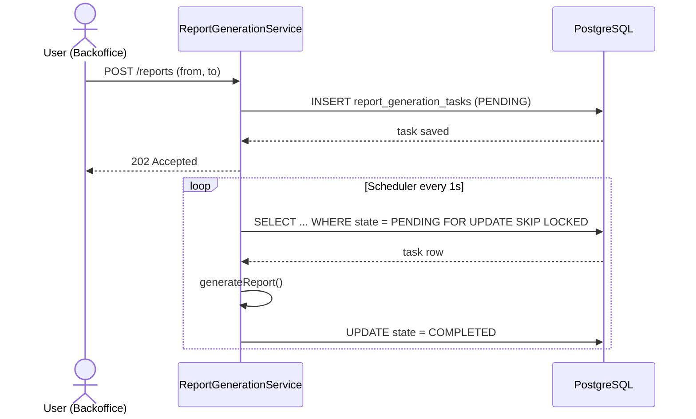
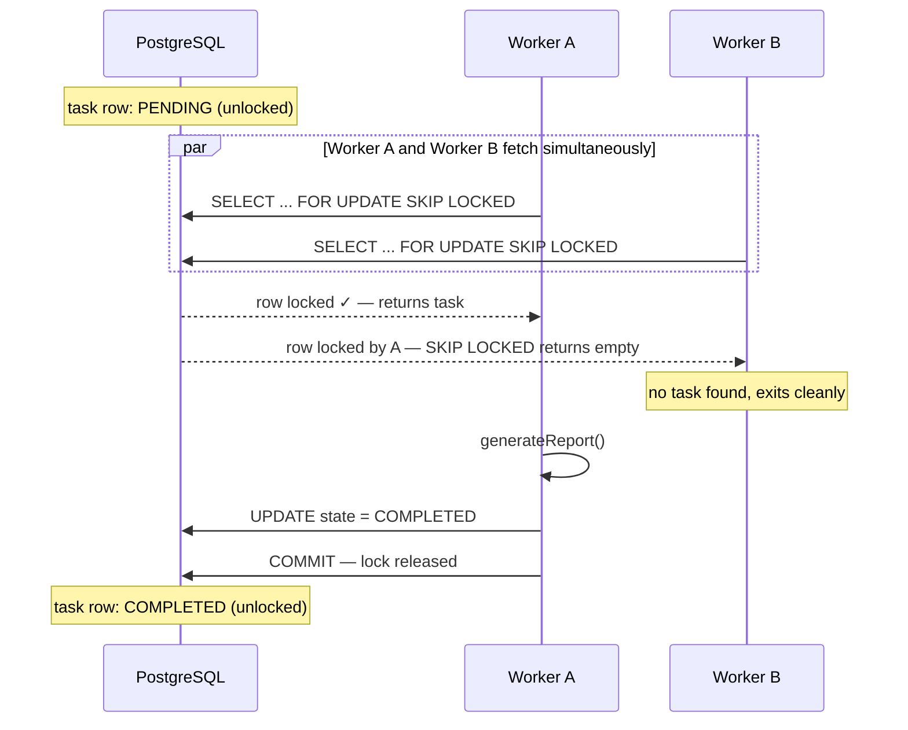
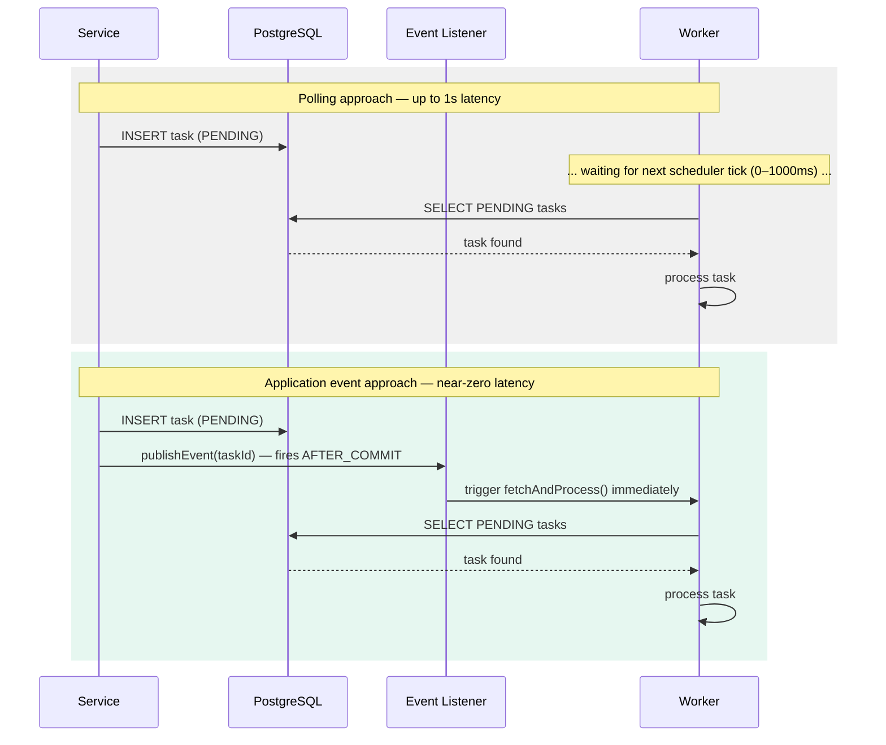
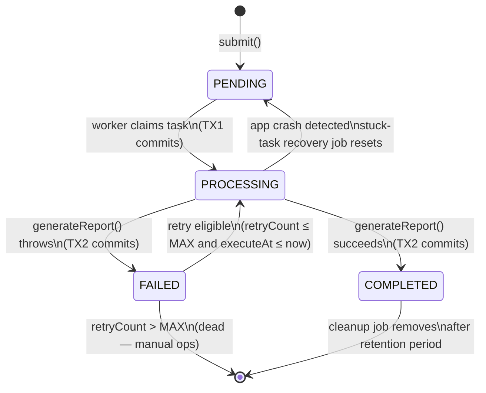
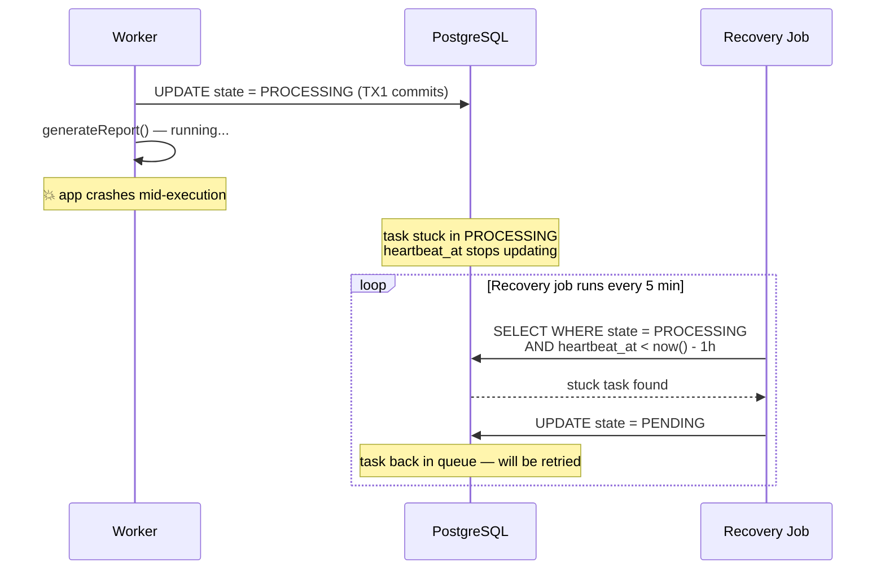
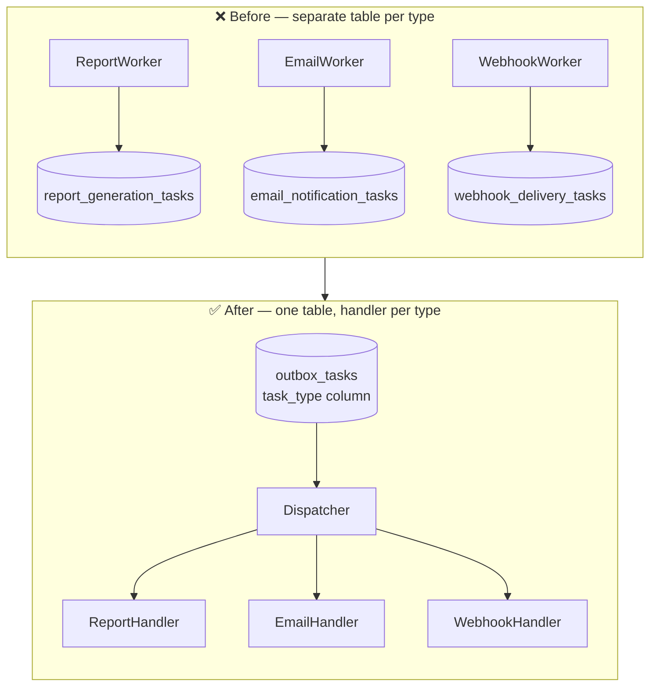

# Паттерн Transactional Outbox: от одной задачи до асинхронного движка продакшен-уровня

Есть класс багов, которые никогда не проявляются в юнит-тестах и редко — на staging.
Они проявляются в продакшене, в два часа ночи: приложение сохраняет запись в базу, затем пытается
вызвать внешний сервис — и одна из операций падает. Одна сторона закоммитила, другая нет. Никто
не узнает об этом, пока не пожалуется пользователь.

Это **проблема двойной записи**, и паттерн Transactional Outbox — стандартный ответ на неё. Идея
простая: вместо прямого вызова внешней системы записать задачу в ту же транзакцию базы данных,
что и доменное изменение. Фоновый воркер подхватывает её и выполняет. Запись атомарна. Задача
не может потеряться.

Гораздо хуже задокументировано всё, что идёт после базовой идеи: что происходит, когда задачи
падают; когда два воркера соревнуются за одну строку; когда приложение падает посреди выполнения;
когда в одной таблице живут десять разных типов задач; и когда стейкхолдеры спрашивают, почему
глубина очереди скакнула в три часа ночи во вторник на прошлой неделе.

Именно об этом эта статья.

Мы разберём один конкретный сценарий — **сервис генерации отчётов** — и шаг за шагом эволюционируем
его от простейшего возможного outbox до решения, которое я бы спокойно запустил в продакшен.
Каждый фрагмент кода взят из реального работающего репозитория, ссылка на него — в конце.

Стек: **Java, Spring Boot, PostgreSQL**.

<div class="post-tldr" markdown="1">
<p class="post-tldr-title">TL;DR</p>

- Паттерн **Transactional Outbox** решает проблему двойной записи: строка задачи пишется в **ту же транзакцию БД**, что и доменное изменение, а выполняется потом фоновым воркером.
- Outbox-таблица опрашивается через `SELECT ... FOR UPDATE SKIP LOCKED`, чтобы несколько воркеров могли работать параллельно без двойной обработки.
- Продакшен-уровень требует большего, чем базовая идея: **машину состояний**, **ретраи с backoff**, **heartbeat/lease** для восстановления после падения воркеров, гарантии **порядка обработки** и **мониторинг** глубины очереди.
- Kafka не нужна — для надёжного асинхронного выполнения достаточно **одного PostgreSQL**.
</div>

---

## Сценарий



Строим CRM. Пользователи могут запрашивать месячные аналитические отчёты из бэкофис-интерфейса.
Генерация отчёта — это агрегация десятков миллионов строк, и она может занимать минуты.
Очевидно, что делать это синхронно, внутри HTTP-запроса, нельзя.

Пользователь нажимает кнопку. Бэкенд принимает запрос, сохраняет его и сразу отвечает.
Фоновый воркер забирает задачу, выполняет генерацию и по завершении обновляет статус.

Это простейший случай, где outbox оправдан: работа, которая по своей природе по-настоящему
асинхронна, и где пользователь изначально готов подождать.

---

## Часть 1 — Базовый outbox

### Из чего состоит любой outbox

В своей основе любая outbox-таблица требует трёх вещей:

- **Состояние** — на каком этапе жизненного цикла находится задача?
- **Payload** — что именно нужно выполнить?
- **Таймстампы** — когда задача создана и когда менялась в последний раз?

```sql
CREATE TYPE task_state AS ENUM ('PENDING', 'COMPLETED');

CREATE TABLE report_generation_tasks (
                                       id         UUID       PRIMARY KEY DEFAULT gen_random_uuid(),
                                       state      task_state NOT NULL    DEFAULT 'PENDING',
                                       payload    JSONB      NOT NULL,
                                       created_at TIMESTAMP  NOT NULL    DEFAULT now(),
                                       updated_at TIMESTAMP  NOT NULL    DEFAULT now()
);
```

Payload для нашего сценария — диапазон дат:

```java
@Value
@Builder
@Jacksonized
public class ReportGenerationPayload {
  Instant from;
  Instant to;
}
```

JPA-сущность:

```java
@Entity
@Table(name = "report_generation_tasks")
@Data
@Builder
@NoArgsConstructor
@AllArgsConstructor
public class ReportGenerationEntity {

    @Id
    @GeneratedValue(strategy = GenerationType.UUID)
    @Column(updatable = false, nullable = false)
    private UUID id;

    @Enumerated(EnumType.STRING)
    @Column(nullable = false, columnDefinition = "task_state")
    private TaskState state;

    @JdbcTypeCode(SqlTypes.JSON)
    @Column(nullable = false, updatable = false, columnDefinition = "jsonb")
    private ReportGenerationPayload payload;

    @CreationTimestamp
    @Column(nullable = false, updatable = false)
    private Instant createdAt;

    @UpdateTimestamp
    @Column(nullable = false)
    private Instant updatedAt;
}
```

Создание задачи:

```java
@Service
@RequiredArgsConstructor
public class ReportGenerationService {

    private final ReportGenerationRepository repository;

    public void submit(ReportGenerationCommand command) {
        repository.save(ReportGenerationEntity.builder()
                .state(TaskState.PENDING)
                .payload(ReportGenerationPayload.builder()
                        .from(command.getFrom())
                        .to(command.getTo())
                        .build())
                .build());
    }
}
```

### Воркер

Джоб по расписанию опрашивает задачи в состоянии PENDING и выполняет их:

```java
@Component
@RequiredArgsConstructor
public class ReportGenerationScheduledJob {

    private final ReportGenerationTaskService taskService;

    @Scheduled(fixedDelay = 1000)
    public void run() {
        taskService.fetchAndProcess();
    }
}
```

```java
@Service
@RequiredArgsConstructor
public class ReportGenerationTaskService {

    private final ReportGenerationRepository repository;

    public void fetchAndProcess() {
        repository.findFirstByStateOrderByCreatedAt(TaskState.PENDING)
                .ifPresent(task -> {
                    generateReport(task);
                    task.setState(TaskState.COMPLETED);
                    repository.save(task);
                });
    }

    private void generateReport(ReportGenerationEntity task) {
        // actual report generation logic
    }
}
```

```java
public interface ReportGenerationRepository extends JpaRepository<ReportGenerationEntity, UUID> {
    Optional<ReportGenerationEntity> findFirstByStateOrderByCreatedAt(TaskState state);
}
```

Это работает в приложении с одним инстансом и без сбоев. В реальном мире у решения две проблемы:
два воркера могут одновременно забрать одну и ту же задачу, а задачи могут падать без всякого
пути восстановления. Исправим и то и другое.

---

## Часть 2 — Конкурентность: два воркера, одна задача

Когда два потока планировщика — или два инстанса приложения — выполняют запрос выборки в один
момент, оба могут прочитать одну и ту же строку `PENDING`, и оба попытаются её выполнить.
Результат — в лучшем случае задублированная работа, в худшем — испорченное состояние.

Решение — блокировка на уровне базы, взятая в момент выборки. `SELECT ... FOR UPDATE SKIP LOCKED`
в PostgreSQL создан ровно для этого сценария: он блокирует строку для текущей транзакции и
пропускает строки, уже заблокированные другой транзакцией, вместо того чтобы ждать.

```java
public interface ReportGenerationRepository extends JpaRepository<ReportGenerationEntity, UUID> {

    @Lock(LockModeType.PESSIMISTIC_WRITE)
    @QueryHint(name = AvailableSettings.JAKARTA_LOCK_TIMEOUT, value = "-2") // -2 = SKIP_LOCKED
    Optional<ReportGenerationEntity> findFirstByStateOrderByCreatedAt(TaskState state);
}
```

Значение хинта `-2` — то, что Hibernate превращает в клаузу `SKIP LOCKED`. Первоклассной
аннотации для этого нет, поэтому стоит вынести её в переиспользуемую аннотацию и не раскидывать
магическое число по всем репозиториям:

```java
@Retention(RetentionPolicy.RUNTIME)
@Target({ElementType.METHOD, ElementType.ANNOTATION_TYPE})
@QueryHints(@QueryHint(
    name = AvailableSettings.JAKARTA_LOCK_TIMEOUT,
    value = Timeouts.SKIP_LOCKED_MILLI + ""
))
public @interface SkipLocked {}
```

Так гораздо чище: репозиторий теперь выражает намерение, а не технические детали:

```java
@SkipLocked
@Lock(LockModeType.PESSIMISTIC_WRITE)
Optional<ReportGenerationEntity> findFirstByStateOrderByCreatedAt(TaskState state);
```

*Можно* удерживать блокировку и во время обработки, обернув весь цикл «выборка — выполнение —
обновление» в одну транзакцию, но делать так обычно не стоит:

```java
// Technically works, but do not use this pattern for outbox processing.
@Transactional
public void fetchAndProcess() {
    repository.findFirstByStateOrderByCreatedAt(TaskState.PENDING)
            .ifPresent(task -> {
                generateReport(task);
                task.setState(TaskState.COMPLETED);
                repository.save(task);
            });
}
```



Даже если `generateReport()` достаточно быстрый и технически всё работает, выполнение
outbox-действия внутри открытой транзакции — антипаттерн. Длительность транзакции не должна
зависеть от длительности outbox-выполнения: действие может со временем замедлиться, блокироваться
на I/O или вызывать нижестоящий сервис, удерживая соединение с базой и блокировку строки
непредсказуемо долго.

Вместо этого стоит захватить строку короткой транзакцией, переведя её в `PROCESSING`, закоммитить
и отпустить блокировку — и только затем выполнять outbox-действие. Статус `COMPLETED` или
`FAILED` записывается другой короткой транзакцией уже после выполнения. Следующий раздел
реализует этот переход состояния и путь восстановления для него.

---

## Часть 2.5 — Снижение задержки с помощью Application Events

У опрашивающего планировщика есть ненулевой нижний предел задержки. Если джоб срабатывает раз
в секунду, задача, созданная в `t=0ms`, висит в `PENDING` до следующего тика — до 1000 мс.
Для большинства асинхронных нагрузок это приемлемо. Для случаев, где нужна почти мгновенная
обработка — отправка транзакционного письма, вызов вебхука, — нет.

Паттерн заимствован из Celery: сохранить outbox-сущность в базу, затем немедленно опубликовать
Spring `ApplicationEvent`, несущий ID новой задачи. Слушатель подхватывает событие и сразу
запускает обработку, не дожидаясь следующего тика планировщика.



Планировщик всё ещё работает как страховка — он ловит всё, что пропустил слушатель событий
(рестарт приложения, исключение в слушателе, потерянное событие). Но счастливый путь полностью
обходит задержку опроса.

### Реализация

Событие публикуется внутри метода сервиса, после сохранения:

```java
@Service
@RequiredArgsConstructor
public class ReportGenerationService {

    private final ReportGenerationRepository repository;
    private final ApplicationEventPublisher eventPublisher;

    @Transactional
    public void submit(ReportGenerationCommand command) {
        var entity = repository.save(ReportGenerationEntity.builder()
                .state(TaskState.PENDING)
                .payload(ReportGenerationPayload.builder()
                        .from(command.getFrom())
                        .to(command.getTo())
                        .build())
                .build());

        eventPublisher.publishEvent(new ReportGenerationTaskSubmittedEvent(entity.getId()));
    }
}
```

```java
public record ReportGenerationTaskSubmittedEvent(UUID taskId) {}
```

Слушатель реагирует и сразу запускает обработку:

```java
@Component
@RequiredArgsConstructor
public class ReportGenerationTaskEventListener {

    private final ReportGenerationTaskService taskService;

    @TransactionalEventListener(phase = TransactionPhase.AFTER_COMMIT)
    public void onTaskSubmitted(ReportGenerationTaskSubmittedEvent event) {
        taskService.fetchAndProcess();
    }
}
```

### Классическая ошибка

Самая частая ошибка здесь — использовать `@EventListener` вместо
`@TransactionalEventListener(phase = TransactionPhase.AFTER_COMMIT)`.

`@EventListener` срабатывает в момент вызова `publishEvent()` — а это **внутри открытой
транзакции**, до коммита `INSERT`. Слушатель вызывает `fetchAndProcess()`, который ищет задачу
в базе по ID. Строки ещё не существует. Задача молча пропускается, событие теряется, и вы гадаете,
почему обработка не началась. При этом планировщик через несколько секунд
всё-таки подхватит задачу, и в логах всё выглядит нормально.

```java
// ❌ fires inside the transaction — entity not visible to other connections yet
@EventListener
public void onTaskSubmitted(ReportGenerationTaskSubmittedEvent event) {
    taskService.fetchAndProcess();
}

// ✅ fires after COMMIT — entity is visible, fetch succeeds
@TransactionalEventListener(phase = TransactionPhase.AFTER_COMMIT)
public void onTaskSubmitted(ReportGenerationTaskSubmittedEvent event) {
    taskService.fetchAndProcess();
}
```

`AFTER_COMMIT` гарантирует, что слушатель выполнится только после полного коммита транзакции,
опубликовавшей событие. К этому моменту строка видна всем соединениям, и выборка её найдёт.

Планировщик остаётся без изменений — он служит механизмом восстановления для задач, которые
слушатель событий пропустил. Два подхода дополняют друг друга: события отвечают за задержку,
опрос — за надёжность.

---

## Часть 3 — Сбои, ретраи и состояние PROCESSING



Outbox-действия не должны выполняться внутри открытой транзакции базы. Подход с блокирующей
транзакцией удерживает блокировку всю длительность `generateReport()`. Для отчёта, который
генерируется две минуты, это две минуты заблокированной строки — занятое соединение и,
возможно, очередь из других операций БД позади. С `SKIP LOCKED` воркеры не блокируют друг друга,
но долгие транзакции всё равно давят на пул соединений и плохо сказываются на базе под нагрузкой.
Совсем маленькое действие, возможно, пройдёт без видимых проблем, но связывать длительность
транзакции с длительностью outbox-выполнения — антипаттерн в любом случае.

Решение — разделить захват задачи и её выполнение. Переводим задачу в `PROCESSING` короткой
транзакцией, отпускаем блокировку и выполняем реальную работу уже вне какой-либо транзакции.
Так база затрагивается коротко в начале и коротко в конце — тяжёлая часть происходит между ними,
ничего не удерживая.

Сначала расширим enum:

```sql
ALTER TYPE task_state ADD VALUE 'PROCESSING';
ALTER TYPE task_state ADD VALUE 'FAILED';

ALTER TABLE report_generation_tasks
    ADD COLUMN retry_count  INTEGER NOT NULL DEFAULT 0,
    ADD COLUMN error_message VARCHAR;
```

`retry_count` считает, сколько раз выполнялась попытка. Ретраи ограничены десятью — после этого
что-то действительно сломалось и требуется ручное вмешательство. Оповещения вокруг этого
настроим позже. `error_message` хранит последнее исключение, чтобы понять, *почему* задача
зависла, не копаясь в логах.

Java-enum растёт вместе с ним:

```java
public enum TaskState {
    PENDING,
    PROCESSING,
    COMPLETED,
    FAILED
}
```

Теперь сервис выполняет две отдельные короткие транзакции, а реальная работа происходит между ними:

```java
@RequiredArgsConstructor
public class ReportGenerationTaskService {

    private final ReportGenerationRepository repository;
    private final TransactionTemplate transactionTemplate;

    private static final int MAX_RETRY_COUNT = 10;

    public void fetchAndProcess() {
        transactionTemplate
                .execute(status ->
                        repository.findFirstEligibleTask(
                                List.of(TaskState.PENDING, TaskState.FAILED),
                                MAX_RETRY_COUNT
                        ).map(this::markProcessing))
                .ifPresentOrElse(
                        task -> {
                            try {
                                generateReport(task);
                                markCompleted(task);
                            } catch (Exception e) {
                                markFailed(task, e);
                                log.error("Task {} failed on attempt {}", task.getId(), task.getRetryCount(), e);
                            }
                        },
                        () -> log.debug("No eligible tasks to process")
                );
    }

    private ReportGenerationEntity markProcessing(ReportGenerationEntity task) {
        task.setState(TaskState.PROCESSING);
        return repository.save(task);
    }

    private void markCompleted(ReportGenerationEntity task) {
        task.setState(TaskState.COMPLETED);
        repository.save(task);
    }

    private void markFailed(ReportGenerationEntity task, Exception e) {
        task.setState(TaskState.FAILED);
        task.setRetryCount(task.getRetryCount() + 1);
        task.setErrorMessage(e.getMessage()); // don't skip this — it's the only trace of what went wrong without digging through logs
        repository.save(task);
    }
}
```

Запрос выбирает и `PENDING`, и `FAILED` задачи — упавшая задача с `retryCount < 10` так же
пригодна к обработке, как и новая. Когда счётчик ретраев доходит до предела, задача перестаёт
выбираться и остаётся постоянной `FAILED`-записью, пока на неё не посмотрят. Это намеренно:
после десяти попыток что-то действительно сломалось, и задаче нужен взгляд человека,
а не ещё один ретрай.

```java
@SkipLocked
@Lock(LockModeType.PESSIMISTIC_WRITE)
@Query("""
    SELECT t FROM ReportGenerationEntity t
    WHERE t.state IN :states
      AND t.retryCount <= :maxRetryCount
    ORDER BY t.createdAt ASC
    LIMIT 1
    """)
Optional<ReportGenerationEntity> findFirstEligibleTask(
    @Param("states") List<TaskState> states,
    @Param("maxRetryCount") Integer maxRetryCount
);
```

Но действительно ли только что упавшую задачу стоит снова подхватывать на ближайшем же тике
планировщика, спустя считанные секунды? Если нижестоящая система лежит, долбить её каждую секунду
— значит делать только хуже. Об этом следующий раздел.

## Часть 4 — Экспоненциальная задержка (backoff)

Без задержки между ретраями упавшая задача возвращается в очередь на ближайшем же тике
планировщика — обычно через считанные секунды. Если нижестоящая система лежит, мы долбим её
на полной частоте опроса. Это плохо и для нижестоящей системы, и для нашей базы.

Решение — колонка `execute_at`: задача не подлежит обработке, пока этот таймстамп не окажется
в прошлом. Новые задачи получают `execute_at = now()`, поэтому подхватываются сразу. Упавшие
получают `execute_at = now() + delay`, где delay растёт с каждым ретраем.

```sql
ALTER TABLE report_generation_tasks
    ADD COLUMN execute_at TIMESTAMP NOT NULL DEFAULT NOW();
```

Главный здесь график задержек: `MAX_RETRY_COUNT` вычисляется из него, а не объявляется отдельно.
Так два значения никогда не разъедутся:

```java
private static final Map<Integer, Duration> RETRY_DELAYS = Map.of(
    0, Duration.ofMinutes(1),
    1, Duration.ofMinutes(5),
    2, Duration.ofMinutes(15),
    3, Duration.ofMinutes(30),
    4, Duration.ofHours(1),
    5, Duration.ofHours(2),
    6, Duration.ofHours(4),
    7, Duration.ofHours(8),
    8, Duration.ofHours(12),
    9, Duration.ofDays(1)
);

private static final int MAX_RETRY_COUNT = RETRY_DELAYS.size();
```

Новая запись в `RETRY_DELAYS` автоматически поднимает лимит ретраев. Магического числа,
которое нужно синхронизировать где-то ещё, больше нет.

В `markFailed()` важно взять *текущий* счётчик ретраев до инкремента — именно он выбирает
задержку для *следующей* попытки:

```java
private void markFailed(ReportGenerationEntity task, Exception e) {
    int currentRetry = task.getRetryCount();
    task.setState(TaskState.FAILED);
    task.setRetryCount(currentRetry + 1);
    task.setErrorMessage(e.getMessage());
    task.setExecuteAt(Instant.now().plus(
            RETRY_DELAYS.getOrDefault(currentRetry, RETRY_DELAYS.get(RETRY_DELAYS.size() - 1))));
    repository.save(task);
}
```

Планировщик продолжает работать с той же частотой. Он просто пропускает задачи, у которых окно
ещё не открылось. Упавшие задачи тихо ждут своего часа, а затем естественным образом
возвращаются в обработку.

---

## Часть 5 — Зависшие задачи и heartbeat



В подходе с двумя транзакциями подумаем, что произойдёт, если приложение упадёт после перевода
задачи в `PROCESSING`, но до перевода в `COMPLETED` или `FAILED`. В базе значится `PROCESSING`.
Никто её не обрабатывает. Она будет висеть там вечно.

Наивное решение — recovery-джоб, который находит задачи, слишком долго висящие в `PROCESSING`,
и сбрасывает их в `PENDING`:

```java
@Transactional
public void recoverStuckTasks() {
    repository.findFirstByStateAndUpdatedAtLessThan(
                    TaskState.PROCESSING,
                    Instant.now().minus(1, ChronoUnit.HOURS))
            .ifPresent(task -> {
                log.warn("Resetting stuck task {} to PENDING", task.getId());
                task.setState(TaskState.PENDING);
                repository.save(task);
            });
}
```

Это работает в большинстве случаев. Проблема: `updated_at` меняется при *любом* изменении
строки — включая нерелевантные переходы состояния. Задача, которая 55 минут легитимно
обрабатывается, с точки зрения `updated_at` неотличима от задачи, упавшей вместе с приложением.

Более чистое решение — **heartbeat**: отдельная колонка, которая периодически обновляется,
*но только пока задача активно обрабатывается*. Recovery-джоб теперь проверяет эту колонку,
а не `updated_at`. Задача, не подававшая признаков жизни за последний час, действительно
зависла.

```sql
ALTER TABLE report_generation_tasks ADD COLUMN heartbeat_at TIMESTAMP;
```

Heartbeat работает в собственном потоке, внутри собственных транзакций, независимо от логики
обработки. Самая чистая реализация — `try-with-resources`: запускается вместе с началом
обработки и останавливается при любом пути выхода:

```java
public abstract class Heartbeat implements AutoCloseable {

    private final ScheduledExecutorService executor;

    protected Heartbeat(Runnable heartbeatFn) {
        executor = Executors.newSingleThreadScheduledExecutor();
        executor.scheduleAtFixedRate(heartbeatFn, 0, 10, TimeUnit.SECONDS);
    }

    @Override
    public void close() {
        executor.shutdownNow();
    }
}
```

```java
public class ReportGenerationTaskHeartbeat extends Heartbeat {

    ReportGenerationTaskHeartbeat(UUID taskId, ReportGenerationRepository repository) {
        super(() -> repository.updateHeartbeatAt(taskId, Instant.now()));
    }
}
```

Метод репозитория несёт собственную `@Transactional` — оборачивать вызов вручную не нужно:

```java
@Modifying
@Transactional
@Query("UPDATE ReportGenerationTaskEntity t SET t.heartbeatAt = :now WHERE t.id = :id")
void updateHeartbeatAt(@Param("id") UUID id, @Param("now") Instant now);
```

Подключим через фабрику, чтобы сервис оставался чистым:

```java
@Component
@RequiredArgsConstructor
public class ReportGenerationTaskHeartbeatFactory {

    private final ReportGenerationRepository repository;

    public Heartbeat start(UUID taskId) {
        return new ReportGenerationTaskHeartbeat(taskId, repository);
    }
}
```

Блок обработки теперь выглядит так:

```java
public void fetchAndProcess() {
    transactionTemplate
            .execute(status -> repository.findFirstEligibleTask(
                    List.of(TaskState.PENDING, TaskState.FAILED),
                    MAX_RETRY_COUNT
            ).map(this::markProcessing))
            .ifPresentOrElse(
                    task -> {
                        try (var heartbeat = heartbeatFactory.start(task.getId())) {
                            try {
                                generateReport(task);
                                markCompleted(task);
                            } catch (Exception e) {
                                markFailed(task, e);
                                log.error("Task {} failed", task.getId(), e);
                            }
                        }
                    },
                    () -> log.debug("No eligible tasks to process")
            );
}
```

Recovery-джоб использует `heartbeat_at` вместо `updated_at`:

```java
@Modifying
@Transactional
@Query("UPDATE ReportGenerationEntity t SET t.heartbeatAt = :now WHERE t.id = :id")
void updateHeartbeatAt(@Param("id") UUID id, @Param("now") Instant now);

Optional<ReportGenerationEntity> findFirstByStateAndHeartbeatAtLessThan(
        TaskState state, Instant threshold);
```

`updated_at` отражает, когда состояние задачи менялось в последний раз. `heartbeat_at` — жива
ли задача прямо сейчас. Разделение этих значений позволяет отвечать на оба вопроса без
двусмысленностей.

---

## Часть 6 — Outbox с несколькими типами задач



Полгода спустя сервис занимается уже не только генерацией отчётов. Нужны email-уведомления.
Потом выгрузки данных. Потом доставка вебхуков.

Вариантов два: отдельная таблица на каждый тип задач или одна общая таблица с дискриминатором
`task_type`. Общая таблица выигрывает, когда типов задач много и обработка их из одного места
приемлема. Инфраструктура — ретраи, heartbeat, backoff, мониторинг — остаётся в одном месте.
Добавить новый тип задачи — значит добавить новый обработчик, и всё.

Компромиссы, о которых стоит знать заранее:

- Один некорректно ведущий себя новый тип задач может замедлить все остальные — плохой
  обработчик, сжигающий ретраи, создаёт backpressure на всю таблицу.
- Гарантии порядка обработки усложняются — об этом ниже.

### Схема

```sql
CREATE TYPE outbox_task_type AS ENUM ('REPORT_GENERATION', 'EMAIL_NOTIFICATION');

CREATE TABLE outbox_tasks (
    id            UUID             PRIMARY KEY DEFAULT gen_random_uuid(),
    task_type     outbox_task_type NOT NULL,
    state         task_state       NOT NULL    DEFAULT 'PENDING',
    payload       JSONB            NOT NULL,
    retry_count   INTEGER          NOT NULL    DEFAULT 0,
    error_message VARCHAR,
    execute_at    TIMESTAMPTZ      NOT NULL    DEFAULT NOW(),
    heartbeat_at  TIMESTAMPTZ,
    created_at    TIMESTAMPTZ      NOT NULL    DEFAULT now(),
    updated_at    TIMESTAMPTZ      NOT NULL    DEFAULT now()
);
```

### Интерфейс обработчика

Главная точка расширения — одна реализация на каждый тип задач:

```java
public interface OutboxTaskHandler<P> {
    OutboxTaskType getType();
    Class<P> payloadClass();
    void handle(UUID taskId, P payload) throws Exception;
}
```

`taskId` передаётся в каждый обработчик. Зачем — станет ясно в разделе про идемпотентность.

Конкретный обработчик:

```java
@Component
public class EmailNotificationHandler implements OutboxTaskHandler<EmailNotificationPayload> {

    @Override
    public OutboxTaskType getType() {
        return OutboxTaskType.EMAIL_NOTIFICATION;
    }

    @Override
    public Class<EmailNotificationPayload> payloadClass() {
        return EmailNotificationPayload.class;
    }

    @Override
    public void handle(UUID taskId, EmailNotificationPayload payload) throws Exception {
        log.info("Sending email to {} — task {}", payload.getRecipient(), taskId);
        // call email provider
    }
}
```

### Диспетчер

Сервис собирает все бины-обработчики на старте, строит справочную карту и маршрутизирует каждую
задачу по `taskType`:

```java
@Service
@RequiredArgsConstructor
public class OutboxTaskService {

    private final OutboxTaskRepository repository;
    private final ObjectMapper objectMapper;
    private final List<OutboxTaskHandler<?>> handlerList;

    private Map<OutboxTaskType, OutboxTaskHandler<?>> handlers;

    @PostConstruct
    void init() {
        handlers = handlerList.stream()
                .collect(Collectors.toMap(OutboxTaskHandler::getType, Function.identity()));
    }

    @SuppressWarnings("unchecked")
    private void dispatch(OutboxTaskEntity task) throws Exception {
        var handler = (OutboxTaskHandler<Object>) handlers.get(task.getTaskType());
        if (handler == null) {
            throw new IllegalStateException(
                    "No handler registered for task type: " + task.getTaskType());
        }
        var payload = objectMapper.readValue(task.getPayload(), handler.payloadClass());
        handler.handle(task.getId(), payload);
    }
}
```

Регистрация нового типа задачи: добавить значение в enum, добавить бин-обработчик — готово.
Диспетчер, планировщик, логика ретраев — ничего не меняется.

---

## Часть 7 — Порядок обработки

Если сценарию всё равно на порядок обработки — fire-and-forget-уведомления, независимые
фоновые задачи, — этот раздел можно пропустить. Но даже тогда выборка ранее вставленных задач
первыми — более честное поведение: задачи, отправленные первыми, ждут дольше всех, и обработка
в порядке отправки — это то, чего пользователи разумно ожидают.

Без явного `ORDER BY` PostgreSQL **никак не гарантирует** порядок возвращаемых строк.
В запросе выборки сортировка по `created_at ASC` обязательна:

```java
@Query("""
    SELECT t FROM OutboxTaskEntity t
    WHERE t.state IN :states
      AND t.retryCount <= :maxRetryCount
      AND t.executeAt <= :now
    ORDER BY t.createdAt ASC
    LIMIT 1
    """)
Optional<OutboxTaskEntity> findFirstEligibleTask(...);
```

Подложим под это частичный индекс:

```sql
CREATE INDEX idx_outbox_fetch
    ON outbox_tasks (created_at ASC)
    WHERE state IN ('PENDING', 'FAILED');
```

### Ловушка рассинхронизации часов

Для начала честно ответим, важно ли это для конкретного сценария. Если задачи независимы —
генерация отчётов, отправка писем, доставка вебхуков, — порядок обработки обычно вообще не
важен. То, что задача A завершится раньше задачи B, нормально независимо от того, какая была
отправлена первой. В этом случае весь этот раздел не про нас.

Если FIFO действительно нужен — задачи одной сущности, которые обязаны обрабатываться в порядке
отправки, — читаем дальше.

Проблема в том, что `created_at` генерируется на стороне приложения. У каждого инстанса — свои
системные часы. Если инстанс A опережает инстанс B на 200 мс, задача от B, отправленная в
`t=100ms`, получит `created_at` раньше, чем задача от A, отправленная в `t=50ms`, — хотя задача
A была вставлена первой. Запрос выборки сортирует по `created_at` и берёт первой задачу B.
Порядок отправки инвертирован.

NTP держит часы близко, но не идеально синхронными. В нормальных условиях расхождение —
миллисекунды. Под нагрузкой, при миграции VM или после рестарта контейнера — больше.

Решение — генерировать значение для порядка на стороне базы: либо позволить PostgreSQL
проставлять `created_at` через `DEFAULT now()` вместо приложения, либо использовать
последовательность (sequence) в базе, которая гарантированно монотонно возрастает независимо
от того, какой инстанс вставил строку. Вот вариант с последовательностью:

```sql
ALTER TABLE outbox_tasks ADD COLUMN seq BIGSERIAL;
```

```java
@Column(insertable = false, updatable = false)
private Long seq;
```

Сортируем по `seq ASC`. Значение присваивается единственным авторитетным источником — базой, —
поэтому оно отражает реальный порядок вставки независимо от того, какой инстанс отправил задачу
и что показывали его часы.

`created_at` оставляем для наблюдаемости. `seq` используем для порядка.

Если в системе важен строгий FIFO — об этом нельзя забывать.

---

## Часть 8 — Индексы, которые держат таблицу быстрой под нагрузкой

Outbox-таблица опрашивается каждую секунду, часто по несколько раз за секунду. Каждая строка
в ней — либо активная работа (`PENDING`, `FAILED`, `PROCESSING`), либо исторический шум
(`COMPLETED`). Без правильных индексов каждый опрос сканирует всю таблицу ради горстки
подходящих строк.

Правильный инструмент — **частичный индекс**: он включает только строки, удовлетворяющие
предикату. Когда задача переходит в `COMPLETED`, она автоматически выпадает из частичного
индекса. Индекс навсегда остаётся маленьким, независимо от того, сколько задач таблица
обработала за свою жизнь.

### Индекс выборки — горячий путь

Индекс под запрос выборки:

```sql
CREATE INDEX idx_outbox_fetch
    ON outbox_tasks (created_at ASC)
    WHERE state IN ('PENDING', 'FAILED');
```

Проверка: вставили 50 000 строк, из которых только 7 в состоянии `PENDING`, включили
debug-логирование SQL в Hibernate, чтобы получить точный сгенерированный запрос в консоли,
и прогнали этот SQL через `EXPLAIN ANALYZE`:

```
Limit  (cost=0.14..27.50 rows=1 width=102) (actual time=0.082..0.084 rows=1 loops=1)
  ->  LockRows  (actual time=0.081..0.082 rows=1 loops=1)
        ->  Index Scan using idx_outbox_fetch on outbox_tasks
              (actual time=0.030..0.030 rows=1 loops=1)
Planning Time: 1.230 ms
Execution Time: 0.139 ms
```

0,03 мс, чтобы найти самую старую подходящую задачу. 49 993 строки `COMPLETED` даже не
читались. Результат меня вполне устраивает.

Ещё два индекса для двух других фоновых операций:

Для recovery-джоба:

```sql
CREATE INDEX idx_outbox_stuck
    ON outbox_tasks (heartbeat_at ASC, created_at ASC)
    WHERE state = 'PROCESSING';
```

Для cleanup-джоба:

```sql
CREATE INDEX idx_outbox_cleanup
    ON outbox_tasks (updated_at ASC)
    WHERE state = 'COMPLETED';
```

---

## Часть 9 — Очистка

Outbox — операционная таблица. Каждый запрос выборки сканирует её. Старые строки — мёртвый груз.

Правило: удаляются только задачи **`COMPLETED`**. Задачи `FAILED` — это audit trail. Их не
трогаем: разбираем вручную или через отдельный ops-процесс, когда нужно.

```java
@Modifying
@Transactional
@Query("""
    DELETE FROM OutboxTaskEntity t
    WHERE t.state IN :states
      AND t.updatedAt < :before
    """)
int deleteByStateInAndUpdatedAtBefore(
    @Param("states") List<TaskState> states,
    @Param("before") Instant before
);
```

```java
private static final int CLEANUP_RETENTION_DAYS = 30;

@Transactional
public void cleanup() {
    var cutoff = Instant.now().minus(CLEANUP_RETENTION_DAYS, ChronoUnit.DAYS);
    int deleted = repository.deleteByStateInAndUpdatedAtBefore(
            List.of(TaskState.COMPLETED), cutoff);
    log.info("Cleanup: removed {} completed tasks older than {} days", deleted, CLEANUP_RETENTION_DAYS);
}
```

Срок хранения: я встречал всё от 1 дня до 3 месяцев. Если сомневаетесь, храните дольше.
Цена хранения старых строк — чуть большая таблица. Цена слишком раннего удаления — потеря
истории для отладки в тот самый день, когда она нужна больше всего.

---

## Часть 10 — Идемпотентность: безопасные ретраи

Ничто в этой архитектуре не гарантирует выполнение ровно один раз (exactly-once). Запуск задачи
и обновление состояния на `COMPLETED` — две отдельные операции. Если приложение упадёт после
выполнения, но до коммита обновления состояния, задача будет выполнена повторно. Она снова
отработает с теми же входными данными.

Это доставка **at-least-once** — единственная доступная здесь гарантия. Вопрос в том, вредит
ли повторное выполнение.

Если задача идемпотентна по своей природе (двойная генерация отчёта даёт тот же отчёт),
вопрос закрыт. Если есть побочные эффекты (отправка письма, списание с карты), дубль — проблема.

Решение — использовать собственный `id` outbox-задачи как ключ идемпотентности внутри
обработчика. ID задачи стабилен между ретраями — для одной и той же строки он никогда не
меняется. Обработчик проверяет, записана ли уже работа для этого ID. Если да — это no-op.

В нашем случае генерация отчёта заканчивается вставкой строки в `generated_reports` — это и
есть запись о выполненной работе. Добавим ограничение `UNIQUE` на `idempotency_key`: даже если
два инстанса соревнуются, INSERT выполнит только один. Второй получит нарушение ограничения
и должен трактовать его как успешный no-op:

```sql
CREATE TABLE generated_reports (
    id               UUID        PRIMARY KEY DEFAULT gen_random_uuid(),
    idempotency_key  UUID        NOT NULL,
    report_path      VARCHAR     NOT NULL,
    created_at       TIMESTAMPTZ NOT NULL    DEFAULT now(),

    CONSTRAINT uq_generated_reports_idempotency_key UNIQUE (idempotency_key)
);
```

```java
@Component
@RequiredArgsConstructor
public class ReportGenerationHandler implements OutboxTaskHandler<ReportGenerationPayload> {

    private final GeneratedReportRepository reports;

    @Override
    public void handle(UUID taskId, ReportGenerationPayload payload) {
        if (reports.existsByIdempotencyKey(taskId)) {
            log.info("Report already generated for task {} — skipping", taskId);
            return;
        }

        var reportPath = runReportGeneration(payload);

        reports.save(GeneratedReport.builder()
                .idempotencyKey(taskId)
                .reportPath(reportPath)
                .build());
    }
}
```

Если задача вызывает внешний API вместо записи в базу, стоит проверить, поддерживает ли он
ключи идемпотентности, — большинство платёжных шлюзов и провайдеров транзакционных писем их
поддерживает. ID outbox-задачи передаётся как ключ идемпотентности в том формате, которого
требует API (заголовок, поле тела, query-параметр). Дедупликацией займётся удалённый сервис
на своей стороне.

---

## Часть 11 — Мониторинг

Outbox молча работает в фоне. Когда всё хорошо, никто не замечает. Когда ломается — тоже никто
не замечает, по крайней мере сразу. Зависшие задачи копятся. Нижестоящие сервисы перестают
получать события. К моменту, когда кто-то заглядывает в логи, прошло два часа.

Три сигнала полностью покрывают пространство отказов — по модели Google SRE:

- **Latency** — сколько времени занимает каждая задача от захвата до завершения? Скачок означает, что обработчик медленный или база под давлением.
- **Throughput** — сколько задач завершается за единицу времени? Падение до нуля означает, что планировщик не работает или задачи никто не захватывает.
- **Error rate** — какая доля попыток заканчивается неудачей? Больше ~5% — нижестоящая зависимость деградировала, и хвост ретраев растёт.


### Инструментирование

Добавляем в `build.gradle.kts`:

```kotlin
implementation("org.springframework.boot:spring-boot-starter-actuator")
implementation("io.micrometer:micrometer-registry-prometheus")
```

Аспект AOP `@Timed` регистрируется один раз:

```java
@Bean
public TimedAspect timedAspect(MeterRegistry registry) {
    return new TimedAspect(registry);
}
```

Имена метрик держим константами, а инкремент выполняет отдельный компонент — не размазанный
по методам сервисов:

```java
@Component
@RequiredArgsConstructor
public class OutboxMetrics {

  private static final String TASK_PROCESSED = "outbox.task.processed";
  private static final String OUTCOME_TAG    = "outcome";
  private static final String COMPLETED      = "completed";
  private static final String FAILED         = "failed";

  private final MeterRegistry meterRegistry;
  private final ReportGenerationRepository repository;

  public void recordCompleted() {
    meterRegistry.counter(TASK_PROCESSED, OUTCOME_TAG, COMPLETED).increment();
  }

  public void recordFailed() {
    meterRegistry.counter(TASK_PROCESSED, OUTCOME_TAG, FAILED).increment();
  }

  @PostConstruct
  void registerGauge() {
    Gauge.builder("outbox.tasks.pending", repository,
                    repo -> repo.countByStateIn(List.of(TaskState.PENDING, TaskState.FAILED)))
            .description("Tasks waiting to be processed")
            .register(meterRegistry);
  }
}
```

Дальше сервис просто вызывает `metrics.recordCompleted()` и `metrics.recordFailed()` — никаких
сырых строк в бизнес-логике.

После старта `curl localhost:8080/actuator/prometheus | grep outbox` вернёт:

```
outbox_task_duration_seconds{quantile="0.5"}  0.062
outbox_task_duration_seconds{quantile="0.95"} 0.145
outbox_task_duration_seconds{quantile="0.99"} 0.312
outbox_task_processed_total{outcome="completed"} 40.0
outbox_task_processed_total{outcome="failed"}    2.0
outbox_tasks_pending 0.0
```

### Алерты

Дашборды — для людей, которые смотрят на экраны. Алерты — для людей, которые спят.

| Алерт | Условие срабатывания | Окно | Что означает |
|---|---|---|---|
| `OutboxQueueBacklog` | pending > 50 | 5m | Обработка не успевает за притоком задач |
| `OutboxHighErrorRate` | error rate > 5% | 2m | Деградация обработчика или нижестоящей зависимости |
| `OutboxSlowProcessing` | p99 latency > 30s | 5m | Конкуренция в БД или медленный внешний вызов |
| `OutboxStuckTasks` | pending > 0 и ни одного завершения за 10m | 10m | Планировщик упал или все воркеры зависли |

Пороги подстраиваются под конкретную нагрузку. Глубина очереди в 50 может быть нормой для
высоконагруженного сервиса. Для низкообъёмного внутреннего инструмента поводом взглянуть
могут стать даже 5 задач, висящих 5 минут. Логика сигналов та же — меняются только числа.

---

## Продакшен-чеклист

Перед выводом любого outbox в продакшен:

```
☐ Индексы эффективны — частичные индексы на состояниях PENDING/FAILED и PROCESSING
☐ EXPLAIN ANALYZE подтверждает использование индекса запросом выборки
☐ Порядок обработки не проблема — ORDER BY seq или created_at, с опорой на индекс
☐ Cleanup-джоб обработанных данных работает, строки COMPLETED удаляются после срока хранения
☐ Идемпотентность обеспечена внутри обработчиков с побочными эффектами
☐ Экспоненциальный backoff подключён — или подтверждено, что для сценария он не нужен
☐ Метрики на месте — глубина очереди, throughput, error rate, latency
☐ Алерты настроены — backlog, error rate, latency, зависшие задачи
```

---

## Экосистема — не всё обязательно писать самому

Всё описанное в статье можно построить самостоятельно — и реальная ценность в том, чтобы сделать
это хотя бы однажды. Становятся понятны режимы отказов, выбор индексов и ловушки порядка
обработки — потому что проектировали мы вокруг них сами. Эти знания никуда не деваются
при переходе на библиотеку.

Но в продакшене часто нет необходимости поддерживать всё это своими силами.

---

**[db-scheduler](https://github.com/kagkarlsson/db-scheduler)** — персистентный, дружелюбный
к кластерам планировщик для Java от Густава Карлссона. Это библиотека, к которой я возвращаюсь
снова и снова, и чья внутренняя кухня ближе всего к тому, что мы построили в этой статье.
Одна таблица в базе, пессимистичные блокировки с `SKIP LOCKED`, heartbeat для обнаружения
зависших задач и аккуратный интерфейс задача/обработчик. Проектируя самописный outbox, я держу
db-scheduler как референсную реализацию — интерфейсы, паттерны и обработка сбоев там продуманы.
Если начинается новый проект и нужна проверенная в боях основа вместо самописной — начинать
стоит отсюда. Абстракции достаточно тонкие, чтобы узнать в исходном коде всё из этой статьи.

---

**[Celery](https://docs.celeryq.dev/)** — де-факто стандарт асинхронного выполнения задач
в Python-экосистеме. Celery поддерживает PostgreSQL как result backend и Redis или RabbitMQ
как брокер. Паттерн `AFTER_COMMIT` из части 2.5 применим и здесь — задача уходит в Celery
только после коммита транзакции, не внутри неё.

---

**[Quartz Scheduler](https://www.quartz-scheduler.org/)** — проверенная временем Java-библиотека
планирования с хранением джобов через JDBC. Более общая, чем outbox: cron-выражения, триггеры,
job stores. Эксплуатационные накладные расходы выше, чем у db-scheduler, а API по современным
меркам многословен, но библиотека доказала себя под нагрузкой и имеет первоклассную интеграцию
со Spring через `spring-boot-starter-quartz`.

---

## Вместо заключения

Большая часть статьи — не хитрая инженерия, а набитые шишки. Состояние `PROCESSING`
появилось потому, что у кого-то упало приложение. Heartbeat появился потому, что `updated_at`
врал. Частичный индекс появился потому, что полное сканирование таблицы на частоте опроса тихо
копит проблему, пока не положит базу. Слушатель `AFTER_COMMIT` появился
потому, что кто-то опубликовал событие внутри транзакции и часами дебажил, почему оно
не срабатывает.

Каждая деталь по отдельности скучна. Вместе они отличают outbox, который работает в
dev-окружении, от outbox, которому можно доверять в три часа ночи.

---

## Код

Код из этой статьи доступен в **[github.com/javaAndScriptDeveloper/outboxes-article](https://github.com/javaAndScriptDeveloper/outboxes-article)**. Всё запускается локально одной командой.

---

## Обсудим

Если вы заметили, что я что-то упустил, или решали одну из этих задач иначе, мне
будет интересно об этом узнать. Контакты — в футере.
