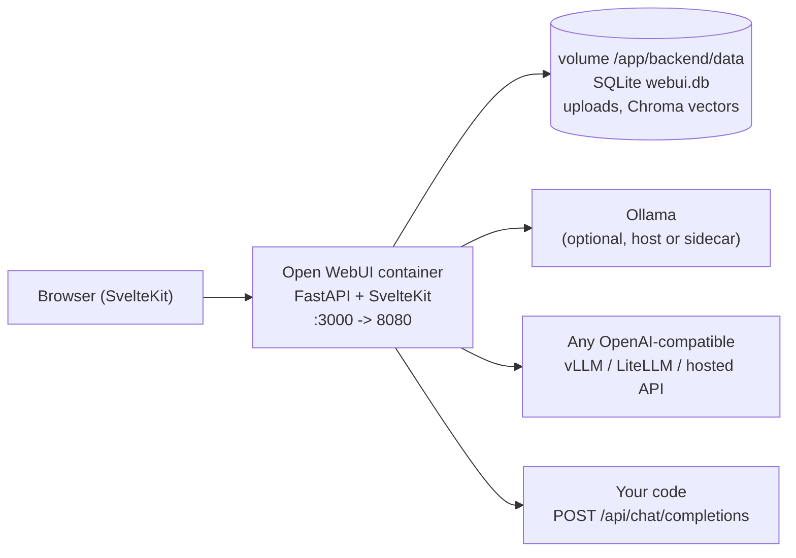

# Self-Hosting Open WebUI for a Backend Team: What the Docs Bury

Every backend team I know went through the same sequence. First everyone got a
ChatGPT account. Then someone asked "can we point it at our own docs", then
someone asked "can we use the models we're already paying for", then someone
in compliance asked where the chats actually live. At that point you want a
self-hosted UI, and the name that comes up first is
[Open WebUI](https://github.com/open-webui/open-webui) — ~158k stars, SvelteKit
frontend, FastAPI backend, runs fully offline if you want it to.

Getting it running is one `docker compose up`. That's not what this article is
about. This is about everything that decides whether the deployment survives
its second month: the secret key that silently logs everyone out, the API keys
that are disabled by default, the license clause nobody reads, the plugin
system that got deprecated last month, and the SQLite-shaped cliff at the end
of the single-instance road.

Everything here runs from a [companion repo](https://github.com/javaAndScriptDeveloper/openwebui-article):
a compose file for a small team, a dependency-free Python client for its API,
and one real server-side Function. The client's smoke test runs offline against
a stub of the API — same pattern as the other repos on this blog.

Stack: **Docker, Python (stdlib only), any OpenAI-compatible model backend**.

<div class="post-tldr" markdown="1">
<p class="post-tldr-title">TL;DR</p>

- One compose service runs the whole thing: SvelteKit + FastAPI, SQLite, an embedded vector store, user management. First account = admin; later sign-ups wait for approval by default.
- **`WEBUI_SECRET_KEY` is not optional.** It signs JWTs *and* encrypts data at rest; leave it auto-generated and every container recreation logs everyone out. `openssl rand -hex 32`, in `.env`, before first boot.
- **API keys ship disabled.** `ENABLE_API_KEYS=true` (or Settings → Authentication), then per-user keys in Settings → Account. `/api/chat/completions` is OpenAI-compatible, so your existing client code barely changes.
- The **license** (since v0.6.6) requires keeping the branding, except for deployments of **≤50 users in 30 days** — an internal team is fine, a public SaaS is not.
- **Pipelines is dead** (archived Oct 2026). Server-side extensibility is now **Functions** — Python classes stored in the DB, admin-only to create, because they're arbitrary code execution by design.
- Single instance = SQLite + embedded Chroma, totally fine. Multi-replica = PostgreSQL + Redis + `VECTOR_DB=pgvector`, and exactly one process may run DB migrations during upgrade.
</div>

---

## What You're Actually Deploying



The mental model matters more than the commands: one stateful container. The
volume at `/app/backend/data` holds the SQLite database, uploaded files, and
the vector store — lose it and you lose users, chats, and knowledge bases.
Everything else is replaceable.

The compose file in the repo is the docs' quick-start plus the four things a
team actually needs:

```yaml
services:
  open-webui:
    image: ghcr.io/open-webui/open-webui:main
    ports:
      - "3000:8080"
    extra_hosts:
      - "host.docker.internal:host-gateway"   # reach Ollama on the host
    volumes:
      - open-webui:/app/backend/data
    environment:
      - WEBUI_SECRET_KEY=${WEBUI_SECRET_KEY:?set it in .env}
      - ENABLE_API_KEYS=true                  # off by default; see below
      - DEFAULT_USER_ROLE=pending             # signups wait for an admin
    restart: unless-stopped
```

## Users and Auth: How It Behaves on Day One

Two facts decide your first week, and both are easy to miss:

1. **The first account created becomes admin.** Create it yourself, from your
   own machine, before you share the URL.
2. **Later sign-ups default to `pending`.** They see an "awaiting approval"
   screen until an admin activates them. That's the right default for an
   internal deployment — you keep it.

For anything beyond a handful of people, wire up SSO instead of local
passwords: `ENABLE_OAUTH_SIGNUP`, `OAUTH_CLIENT_ID`/`SECRET`, and
`OPENID_PROVIDER_URL` (the `.well-known/openid-configuration` URL — the docs
are explicit that leaving it unset breaks logout). One OAuth provider at a
time, and the OAuth env vars win over UI edits unless you flip
`ENABLE_OAUTH_PERSISTENT_CONFIG`.

## The API: Where Backend Engineers Live

The part I care about — because the UI is nice but the value is "one managed
endpoint for every script and service I run" — is that Open WebUI proxies
models through an **OpenAI-compatible API**:

```python
from client.openwebui_client import OpenWebUIClient

client = OpenWebUIClient("http://localhost:3000", api_key="sk-...")
models = client.models()                    # GET /api/models
answer = client.chat("qwen3:8b", "summarize INC-1042")
```

The client in the repo is ~100 lines of stdlib: Bearer auth, retry with
backoff on 429/5xx, multipart file upload, and the knowledge-base attach call.
It exists because the official API surface beyond `/api/chat/completions`
changes often enough that a thin client you own beats a generated SDK —
Swagger is only served under `/docs` with `ENV=dev`, and the docs themselves
admit the endpoints "are not documented any more".

Two gotchas before any of that works:

- **API keys are off by default.** `ENABLE_API_KEYS=true`, plus the
  per-user `features.api_keys` permission. Keys don't expire; one per account;
  a new key replaces the old one.
- If you use Functions as outlets (below), note that on tagged releases the
  `/api/chat/completions` path does **not** run `outlet()` filters — API
  callers must hit `/api/chat/completed` for that. It's documented, but only
  if you go looking.

## Extensibility: Functions, Not Pipelines

If you read anything older than a few months, it mentions **Pipelines** — a
separate sidecar server for custom logic. It was
[archived in October 2026](https://github.com/open-webui/pipelines); the repo
says "do not use Pipelines" for new *or existing* setups. The migration is
mechanical: pipe pipelines → Pipe Functions, filters → Filter Functions.

A **Function** is a Python class stored as source in the database and executed
inside the server. Creating them is admin-only, for an obvious reason: it's
arbitrary Python on your box. The four kinds (Pipe, Filter, Action, Event) are
auto-detected by class name. A Filter runs on every message:

```python
class Filter:
    class Valves(BaseModel):
        tag: str = "filtered"
        inject_date: bool = True

    def __init__(self):
        self.valves = self.Valves()

    async def inlet(self, body: dict, __user__: dict | None = None) -> dict:
        # runs before the model sees the message
        ...
        return body

    async def outlet(self, body: dict, __user__: dict | None = None) -> dict:
        # runs after the model answers
        return body
```

The repo ships one real filter — `date_guardrail_filter.py` — that injects
today's date into the system prompt (so the model stops answering "as of my
knowledge cutoff" for anything time-sensitive) and stamps responses with a
visible tag.

## The Single-Instance Cliff

The deployment above scales further than a team of 50 needs, and the docs are
refreshingly direct about where it stops:

- **SQLite is fine on one instance with a local disk** — and unsupported on
  NFS/network volumes (pool timeouts, WAL deadlocks).
- **Multiple replicas change the requirements list**: PostgreSQL
  (`DATABASE_URL`), Redis (`REDIS_URL`, `WEBSOCKET_MANAGER=redis`), and a
  client-server vector DB (`VECTOR_DB=pgvector` is one of the two the team
  commits to maintaining). Embedded Chroma is SQLite-backed and
  single-writer; replicas will corrupt it.
- **Upgrades run DB migrations at startup**, and exactly one process may run
  them — no other instance may serve traffic until it finishes. Read that
  again if you run two replicas behind a load balancer.
- `THREAD_POOL_SIZE` defaults to 40, which the docs themselves call far too
  low for production; 2000+ is their lower bound for real multi-user servers.

That last list is why I'd treat "team chat" and "company platform" as two
different projects. The first is this article. The second is a PostgreSQL, a
Redis, and a runbook.

## Is the License OK?

BSD-3 through v0.6.5; since v0.6.6 (April 2025) it's a custom license: free
for personal and commercial use, **but you may not remove or obscure the
branding**, except for deployments of ≤50 users in a 30-day window. An
internal tool for your engineering org: fine. A public product built on it:
read the [license page](https://docs.openwebui.com/license) first.

## When You Should Not Do This

- You need data isolation per tenant — the docs are blunt that there's no
  per-tenant crypto separation; separate instances are the boundary.
- You want zero-ops. This is a stateful service with a database, migrations,
  and a vector store; somebody owns upgrades.
- Your team is three people who all already have paid accounts and no
  compliance pressure. The juice isn't worth the squeeze yet.

Otherwise: `cp .env.example .env`, generate the secret, `docker compose up -d`,
create the admin account before you share the link. The whole thing, client
and filter included, is at
**[github.com/javaAndScriptDeveloper/openwebui-article](https://github.com/javaAndScriptDeveloper/openwebui-article)** —
the client smoke test runs offline with `python client/smoke_test.py`, no
container required.
