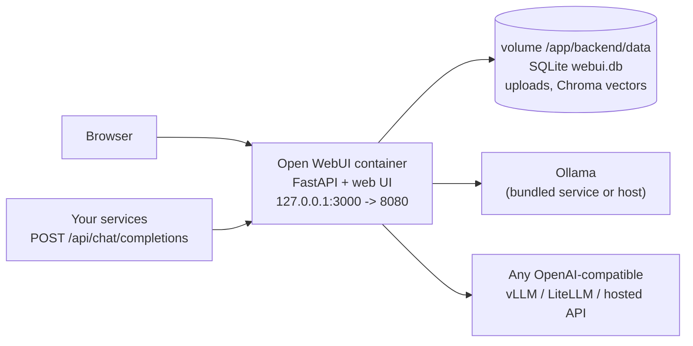

# Self-Hosting Open WebUI for a Backend Team: What the Docs Bury

The usual path to a self-hosted chat UI is not ideological. Individual
subscriptions pile up, someone wants the chat pointed at internal documents,
someone wants to reuse the model endpoints the company already pays for, and
compliance asks where the conversations are stored. [Open WebUI](https://github.com/open-webui/open-webui)
(roughly 158k GitHub stars as of November 2026; FastAPI backend, Svelte frontend) is the
usual first candidate.

Starting it is one `docker compose up`. This article is about what decides
whether the deployment is still healthy in month two: a secret key that
invalidates sessions, API keys that are off by default, settings that stop
reading your environment after first boot, a license clause about branding, a
plugin system that was replaced, and the point where single-instance SQLite
stops being enough.

Code: [github.com/javaAndScriptDeveloper/openwebui-article](https://github.com/javaAndScriptDeveloper/openwebui-article),
a compose file, a standard-library Python client and one Function.
Stack: **Docker Compose, Python (stdlib only), any OpenAI-compatible or Ollama model backend**.

**What was and was not verified.** Every factual claim about Open WebUI below
was checked against its current source and docs (`open-webui/open-webui`,
`open-webui/docs`, `open-webui/pipelines`) in November 2026, release v0.13.3.
In the companion repo, `docker compose config` validates the compose file, and
the client's smoke test and the Filter's unit test pass offline. **No Open
WebUI container was started** while writing this: the client was tested against
a stub modelled on the source, not a live instance, and the Filter was not
loaded into one. No LLM was involved anywhere.

<div class="post-tldr" markdown="1">
<p class="post-tldr-title">TL;DR</p>

- **State lives in one volume** (`/app/backend/data`: SQLite, uploads, vectors). Back it up; pin the image tag; upgrades run DB migrations on startup.
- **Set `WEBUI_SECRET_KEY` yourself.** It signs JWTs and encrypts data at rest. The auto-generated fallback lives in the container, so a recreated container gets a new key and invalidates sessions and encrypted data.
- **API keys are off by default** and need a global switch plus a per-user permission. One key per account, inherits that user's permissions. Several settings (including this one) are *persistent config*: env seeds them on first boot, then the Admin UI wins.
- **License:** BSD-3-style plus a branding clause that does not apply up to 50 users per rolling 30 days. Over that, keep the branding or get an enterprise license.
- **Pipelines is archived.** Server-side extensibility is **Functions**: Python executed inside your server, admin-created, so treat them as deployed code.
- **Single instance is fine; replicas are a different project.** Replicas need PostgreSQL, Redis, an external vector DB, shared files, and a stop-the-fleet upgrade procedure.
</div>

---

## What You're Actually Deploying



The mental model: one stateful container. The volume at `/app/backend/data`
holds the SQLite database, uploaded files and the embedded vector store. Lose
it and you lose users, chats and knowledge bases; everything else is
replaceable. So the volume gets backups, and the image tag gets pinned.

The compose file in the repo (abridged):

```yaml
services:
  open-webui:
    image: ghcr.io/open-webui/open-webui:${OPEN_WEBUI_VERSION:-v0.13.3}
    depends_on: [ollama]
    ports:
      - "${OPEN_WEBUI_BIND:-127.0.0.1}:3000:8080"   # loopback; proxy with TLS for the team
    volumes:
      - open-webui:/app/backend/data
    environment:
      - WEBUI_SECRET_KEY=${WEBUI_SECRET_KEY:?set it in .env (signs JWTs, encrypts data at rest)}
      - OLLAMA_BASE_URL=${OLLAMA_BASE_URL:-http://ollama:11434}
      - ENABLE_API_KEYS=${ENABLE_API_KEYS:-true}
      - DEFAULT_USER_ROLE=${DEFAULT_USER_ROLE:-pending}
    restart: unless-stopped
```

Three deliberate departures from the docs' quick start: the image is pinned to
a release instead of the rolling `:main` tag (the v0.13.3 tag is what the
GitHub release list shows; I did not pull the image), the port binds to
loopback so the first thing on your network is not an unauthenticated
sign-up page, and the secret key is required, not optional.

## Users and Auth: Day One

1. **The first account created becomes admin.** Create it yourself before you
   share the URL.
2. **Later sign-ups are `pending` by default**, so they wait for an admin. That
   is already the default value of `DEFAULT_USER_ROLE`; the compose file sets
   it explicitly so a later change is a visible diff.
3. **Persistent config.** Many settings, including `ENABLE_API_KEYS`,
   `DEFAULT_USER_ROLE` and most OAuth values, are "persistent config": the
   environment variable seeds the database on first boot, and afterwards the
   value saved in the Admin UI takes precedence. If you edit `.env` months
   later and nothing changes, this is why. `ENABLE_PERSISTENT_CONFIG=false`
   flips it so the environment wins, but then UI edits are lost on restart.
   (OAuth settings are an exception: they are read from the environment by
   default unless `ENABLE_OAUTH_PERSISTENT_CONFIG=true`.)

Past a handful of people, use SSO instead of local passwords:
`ENABLE_OAUTH_SIGNUP`, `OAUTH_CLIENT_ID` / `OAUTH_CLIENT_SECRET`, and
`OPENID_PROVIDER_URL`. The docs mark `OPENID_PROVIDER_URL` as mandatory:
without it logout does not work for most providers.

### The secret key

`WEBUI_SECRET_KEY` signs JWTs and encrypts sensitive data at rest (OAuth
tokens, stored app credentials). If unset, the Docker entrypoint generates a
random key and saves it to a file inside the container. That is fine until the
container is *recreated* without that file on a persisted volume: then a new
key is generated, every session is invalidated, tokens encrypted under the old
key stop decrypting, and with MFA enabled Open WebUI refuses to start unless
`MFA_ENCRYPTION_KEY` is set. `docker compose up` after an image bump is
exactly a recreate. Generate it once (`openssl rand -hex 32`), keep it in your
secret store, and with multiple replicas it must be identical on all of them.

## The API: What a Backend Team Wants

Open WebUI fronts your model backends behind one OpenAI-compatible endpoint,
`POST /api/chat/completions`, plus its own management endpoints:

```python
from client.openwebui_client import OpenWebUIClient

client = OpenWebUIClient("http://localhost:3000", api_key="sk-...")
models = client.models()                    # GET /api/models
answer = client.chat("qwen3:8b", "summarize INC-1042")
```

The client in the repo is about 125 lines of standard library: Bearer auth,
retry with backoff on 429/502/503, multipart upload, file-processing polling,
knowledge-base attach. It is thin on purpose. The docs state that the
endpoints "are not documented any more" because the API changes often; Swagger
is only served under `/docs` when `ENV=dev`. Own a small client and pin the
server version, rather than depending on an SDK that may lag.

One real defect the stub-based test now covers: uploads are processed in the
background by default, and attaching a file to a knowledge base before that
finishes is rejected by the server. The client polls
`GET /api/v1/files/{id}/process/status` before calling
`POST /api/v1/knowledge/{id}/file/add`. I read this from the source
(`routers/files.py`, `routers/knowledge.py`), not from a live run.

### API keys, as an ops problem

- **Off by default.** An admin enables them globally (`ENABLE_API_KEYS` or
  Admin Settings > Authentication). Admins can then create keys; other users
  also need the API Keys feature permission, via default permissions or a
  group. Prefer a group over granting it to everyone.
- **One key per account**; creating a new one replaces the old one immediately.
  A key acts as its owner, with that user's role and group permissions
  re-checked on every request. For a service, create a dedicated user with the
  minimum role instead of using a person's key. The docs describe no expiry,
  so rotation is a process you own: replace the key and redeploy the consumer.
- **You can narrow what keys may call.** `ENABLE_API_KEYS_ENDPOINT_RESTRICTIONS`
  with `API_KEYS_ALLOWED_ENDPOINTS` (for example only
  `/api/v1/chat/completions`) limits every API key on the instance. It is
  global, not per key.
- **Audit.** With audit logging enabled, requests made with a key are logged
  under the owner's identity.

## Extensibility: Functions, Not Pipelines

Older material mentions **Pipelines**, a separate sidecar server for custom
logic. [The repository is archived](https://github.com/open-webui/pipelines)
(last commit 29 October 2026), and its README says not to use it, for new or
existing setups, with no further security fixes. Replacement table from that
README: pipe pipelines become Pipe Functions, filter pipelines become Filter
Functions, plain providers need only an OpenAI-compatible connection.

A **Function** is Python source stored in the database and executed inside the
Open WebUI server. Type is detected from the class name: `Pipe`, `Filter`,
`Action` or `Event`. Creation is admin-only because it is arbitrary code
execution on the host. Treat a Function like a deployed service: review it,
and note that it lives in the database, not in git, unless you put it there.

A Filter runs on every request to the models it is attached to:

```python
class Filter:
    class Valves(BaseModel):
        inject_date: bool = True
        log_truncation: bool = True

    async def inlet(self, body: dict, __user__: dict | None = None) -> dict:
        ...  # before the model sees the messages
        return body

    async def outlet(self, body: dict, __user__: dict | None = None) -> dict:
        ...  # after the reply is complete
        return body
```

The repo's filter does two small things. `inlet` adds today's date to the
system message (the server's local date, UTC in a stock container, so the
model stops guessing from its training cutoff). `outlet` logs a warning when a
reply ended with `finish_reason == "length"`, i.e. the model hit its token
limit and the user got a silently truncated answer, recording only user and
chat ids, no content. It deliberately does not rewrite replies. The docs
recommend logging over editing in `outlet`, the reply text is stored in both
`content` and `output` so a naive edit does not stick, and for direct API
callers outlet edits are never written back into the HTTP response. Note also
that `outlet()` does run for `/api/chat/completions` calls by default
(`ENABLE_API_OUTLET_FILTERS=true`); its side effects happen, but your client
does not see its edits. `POST /api/chat/completed` is the documented way to get
the filtered payload back over HTTP.

## The Single-Instance Limit

What the docs say, with the numbers they give:

- **SQLite is fine for a single replica** when `webui.db` is on locally
  attached SSD/NVMe. On NFS, CephFS and similar network storage it "works at
  low load and then fails under concurrency" (pool timeouts, `database is
  locked`). Moving to PostgreSQL does not migrate data for you, so decide
  before you accumulate production data.
- **Multiple replicas** need PostgreSQL (`DATABASE_URL`), Redis (`REDIS_URL`
  with `WEBSOCKET_MANAGER=redis`), shared file storage, an identical
  `WEBUI_SECRET_KEY`, and a client-server vector DB, because embedded Chroma
  is single-writer and crashes under concurrent writes. The core team
  maintains PGVector and Chroma; other stores are contributed integrations.
- **Upgrades are not rolling.** Migrations run on startup and only one process
  may run them; old and new versions must never serve the same database at the
  same time. The documented procedure is: stop all replicas, let one migrate,
  bring the rest back. That is a short full outage.
- **`THREAD_POOL_SIZE`** is unset by default (an effective limit of 40
  concurrent blocking operations). The docs say that is far too low for a real
  multi-user server, where the symptom is the app appearing to hang while CPU
  and memory look idle, and give 2000 as a lower bound; on small hardware keep
  it at a few hundred.

I would treat "team chat" and "company platform" as two projects. The first is
this article. The second adds a database, Redis, object or shared storage, an
upgrade runbook and someone on call for it.

## Is the License OK?

The code up to and including v0.6.5 is BSD-3-Clause. From v0.6.6 (April 2025)
the LICENSE adds a clause: you may not alter, remove, obscure or replace the
"Open WebUI" branding, except (i) for deployments with no more than 50 end
users in any rolling 30-day period, (ii) with written permission from the
copyright holder, or (iii) with an enterprise license. It restricts rebranding,
not usage: running it with 200 users and the branding intact is within the
text. Whether your case, for example a white-labeled product, is covered is a
question for the LICENSE text and your counsel. The
[license page](https://docs.openwebui.com/license) and `LICENSE_HISTORY` in the
repo are the sources.

## When Not to Do This

- **Per-tenant isolation.** The docs recommend separate instances with separate
  databases, credentials and operators for teams with different trust
  boundaries. Admins can read other users' chats; `ENABLE_ADMIN_CHAT_ACCESS=false`
  hides them in the UI but, per the docs, does not keep an admin away from the
  data. If compliance cares who can read conversations, that is the answer to
  "where do the chats live".
- **You want zero ops.** This is a stateful service: database, migrations,
  vector store, a pinned-version upgrade process, an owner.
- **Three people with paid accounts and no compliance driver.** The setup and
  upkeep cost more than it returns.

Otherwise: `cp .env.example .env`, generate the secret, `docker compose up -d`,
create the admin account, then put a TLS proxy in front. The compose file,
client, stub and filter are in
**[github.com/javaAndScriptDeveloper/openwebui-article](https://github.com/javaAndScriptDeveloper/openwebui-article)**.
`python client/smoke_test.py` runs offline, with no container.
