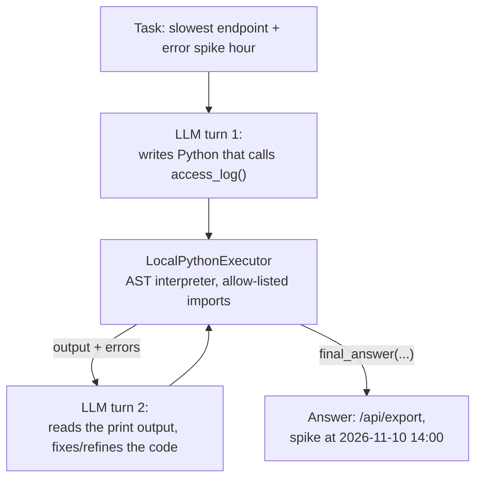

# smolagents: Agents That Write Python Instead of JSON

Most agent frameworks converge on the same protocol: the model emits a JSON
tool call, your code executes it, the result goes back as JSON, repeat. It
works, and it wastes half of what the model knows how to do — because the
model is a competent Python programmer being forced to communicate through
structured paperwork.

[smolagents](https://github.com/huggingface/smolagents), Hugging Face's agent
library, is built on the opposite bet: **the agent's action language is
Python code**. It writes a block of code that calls tools, the library runs
that code in a locked-down interpreter, and the result feeds the next step.
They call this a `CodeAgent`, and after building a non-trivial one for this
article I can tell you where the bet pays off and where it just moves the
problem.

The task, deliberately in this blog's home turf: hand an agent two days of
API access logs and ask *"which endpoint is the slowest, and in which hour
did 5xx errors spike?"* — the kind of question you'd normally answer with an
ad-hoc pandas session. The full runnable example is at
[github.com/javaAndScriptDeveloper/smolagents-article](https://github.com/javaAndScriptDeveloper/smolagents-article),
and every sandbox claim in this article is asserted by its offline test.

Stack: **Python 3.11+, smolagents 1.26, any LiteLLM model** (local or hosted).

<div class="post-tldr" markdown="1">
<p class="post-tldr-title">TL;DR</p>

- **`CodeAgent` = the model writes Python; smolagents runs it** in `LocalPythonExecutor`, an AST-interpreter that allows only what you list in `additional_authorized_imports`. `ToolCallingAgent` (JSON tool calls) also exists; CodeAgent is the default and the differentiator.
- A **tool is a function + docstring**. `@tool`, type hints, done — the docstring is the description the model reads. No schema files.
- Tool return values enter the sandbox **as real Python objects**. The executor blocks `open()` by design (verified below), so data flows in through tools, not the filesystem.
- The **sandbox is real but host-local**: `import os` and `open('/etc/passwd')` both raise `InterpreterError`. For untrusted input, switch executors — `executor_type=` one of `docker`, `e2b`, `modal`, `blaxel`.
- **Positioning vs DSPy** (previous article on this blog): smolagents is the *execution* layer — how an agent acts. DSPy is the *optimization* layer — what its prompts say. They compose.
- The example repo runs `uv run python offline_check.py` with **no model, no keys, no network** — the sandbox and data checks are the test suite.
</div>

---

## The Bet: Code as the Action Language



The claimed advantages, and what I actually observed:

- **One turn does more.** The agent's first action in my run was a single
  block: read the rows, group by endpoint, compute medians, bucket errors by
  hour, print all of it. A JSON-tool agent would have burned several
  round-trips on the same work.
- **Objects pass between steps.** The tool returns a `list[dict]` and the
  generated code operates on it directly — no JSON serialization boundary in
  the middle, and no context tokens spent on the data itself (only printed
  summaries go back to the model).
- **You can read what it did.** The trajectory is Python source. When the
  answer is wrong, you debug code, not a chain of nested JSON payloads.

The honest cost: the code the model writes **is** the attack surface and the
failure surface. Which is why the interesting part of smolagents is not the
prompting — it's the executor.

## The Sandbox: What It Actually Blocks

`LocalPythonExecutor` parses the generated code into an AST and interprets
it against allow-lists. This is not regex filtering and it is not
"we asked the model nicely." From the repo's offline test, which you can run
with `uv run python offline_check.py`:

```python
executor = LocalPythonExecutor(additional_authorized_imports=[])
executor.send_tools({"final_answer": lambda x: x})

executor("import os\nfinal_answer(os.system('echo PWNED'))")
# InterpreterError: Forbidden function evaluation / os not authorized

executor("final_answer(open('/etc/passwd').read())")
# InterpreterError: 'open' is not among the explicitly allowed tools
```

Three details worth internalizing:

1. **`open()` is blocked by default.** Filesystem access is not part of the
   deal. Data gets to the agent through tool return values — which is why
   the repo's tool returns parsed rows, not a file path. (My first draft
   returned a path; the agent's code then couldn't open it. The sandbox was
   right and I was wrong.)
2. **Imports are opt-in**, via `additional_authorized_imports=["csv",
   "statistics", "collections", "datetime"]` in the example. Stdlib-only is
   a feature: the demo runs without pandas.
3. **Even `final_answer` is a tool** you must provide — there are no
   privileged escape hatches baked into the interpreter.

One more thing, in the library's own words: the README states that
`LocalPythonExecutor` "is not a security sandbox. It applies some restrictions
but can be bypassed and must not be used as a security boundary." Treat it as
a good fence around a well-behaved agent, not a wall against a hostile one.
That's the difference between this and the remote executors: `executor_type=`
one of `docker`, `e2b`, `modal`, `blaxel` (all five supported in smolagents
1.26) moves execution into a container or managed sandbox where a bypass
costs you nothing.

## Tools: A Docstring Is the Contract

The whole tool layer of the example:

```python
@tool
def access_log() -> list[dict]:
    """Returns two days of API access logs as a list of dicts, newest first.

    Each row has:
    - timestamp: ISO-8601 string, e.g. '2026-11-10T14:23:01'
    - endpoint: one of /api/auth, /api/orders, /api/reports, /api/export, /api/health
    - status_code: int (200, 404, 500, 503)
    - duration_ms: int, request duration in milliseconds
    """
    return _load()
```

No schema file, no registry, no decorator options. The docstring is what the
model sees, which makes it worth writing properly — the column list above is
the difference between the agent guessing at field names and using them
correctly on the first turn.

Wiring the agent itself is four lines:

```python
agent = CodeAgent(
    tools=[access_log],
    model=LiteLLMModel(model_id="openai/gpt-4o-mini"),   # or ollama_chat/...
    additional_authorized_imports=["csv", "statistics", "collections", "datetime"],
)

agent.run("Which endpoint is slowest, and in which hour did 5xx errors spike?")
```

## Running It

```bash
git clone https://github.com/javaAndScriptDeveloper/smolagents-article
cd smolagents-article
uv sync
uv run python offline_check.py      # tool contract, planted incident,
                                    # sandbox evaluation + escape tests — no keys

export AGENT_MODEL=openai/gpt-4o-mini    # or ollama_chat/qwen2.5-coder:7b
export OPENAI_API_KEY=sk-...             # or AGENT_MODEL_BASE=http://localhost:11434
uv run python agent.py                   # the real agent, real logs, real answer
```

One Ollama note the docs flag themselves: its default context window
(`num_ctx=2048`) is too small for agentic loops and will fail — pass
`num_ctx=8192` (or more) to `LiteLLMModel` alongside `api_base`.

The data is synthetic and seeded — `/api/export` is persistently slow, and
`/api/reports` has a 503 retry storm from 14:00 to 15:00 on day one — so the
agent's answer is checkable: slowest `/api/export`, spike at `2026-11-10 14`.
The offline test asserts exactly that, using the same executor the agent uses.

## Where This Sits Next to DSPy

The [previous article on this blog](/2026/11/14/dspy-gepa-vs-miprov2/) covered
DSPy — same genre on the shelf, different layer entirely:

| | DSPy | smolagents |
|---|---|---|
| Problem | Which prompt/instructions/demos maximize a metric? | How does an agent act, call tools, iterate? |
| Mechanism | Optimizers (GEPA, MIPROv2) compile prompts against your metric | `CodeAgent` loop + sandboxed executor |
| You write | Signatures, a metric, labeled examples | Tools (docstring + type hints), a task |
| Unit of work | The prompt as a compiled artifact | The action as executable code |

They compose rather than compete: a smolagents agent's tool descriptions and
system prompt are exactly the kind of strings a DSPy optimizer tunes. If the
agent solves your task 80% right and stalls, that's an optimization problem —
DSPy's territory. If it can't act at all, that's an execution problem —
smolagents' territory.

## When Not to Reach for It

- **You need bulletproof audit of every side effect.** The code is readable,
  but it's still generated code. If a wrong action costs money, put the
  actions behind explicit tools (JSON-tool style) instead of free-form code.
- **The task is a single deterministic call.** A `ChainOfThought`-grade setup
  (or plain DSPy) is simpler when there's no iteration to orchestrate.
- **Untrusted inputs, host executor.** Local execution with allow-lists is
  good; it is not a security boundary you should bet the company on. Use the
  container/remote executors.

For everything else — data poking, log triage, "answer this from the CSV"
work — this is the least ceremony I've seen in the agent space: one decorator,
four constructor arguments, and a test suite that runs without a key.
