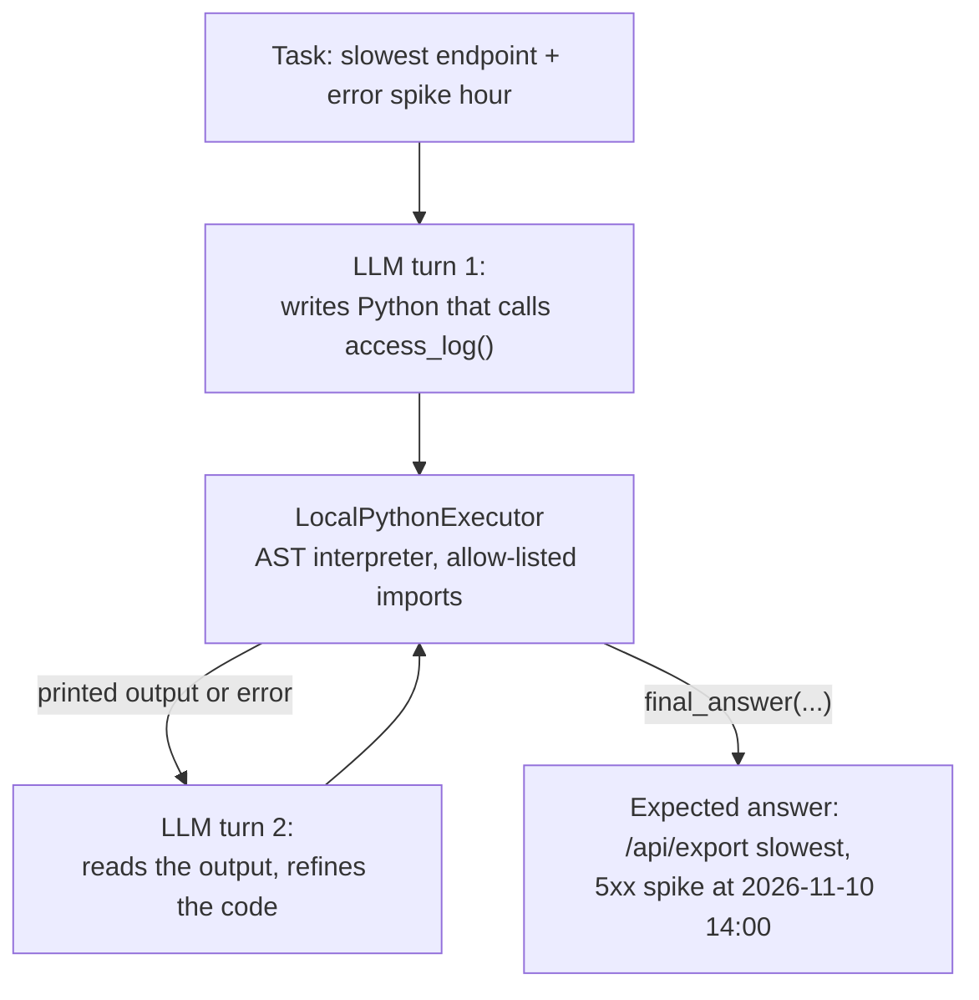

# smolagents: Agents That Write Python Instead of JSON

Most agent frameworks use the same protocol: the model emits a JSON tool call,
your code executes it, the result goes back as JSON, repeat. Every step is one
model round trip, and any logic between two tool calls (filter this, join
that, loop over the rest) has to be re-expressed as another round trip.

[smolagents](https://github.com/huggingface/smolagents), Hugging Face's agent
library, takes the other route: **the agent's action is a block of Python**.
The model writes code that calls your tools, the library executes it, and
what the code prints feeds the next step. That is a `CodeAgent`.

For a backend team the interesting questions are not about prompting. They are
the operational ones: what runs on your host, what the generated code can
touch, what happens when it fails, and what the loop costs. This article walks
through those on a small example: give an agent two days of API access logs
and ask *"which endpoint is the slowest, and in which hour did 5xx errors
spike?"*, the question you would otherwise answer in an ad-hoc pandas session.

Code: [github.com/javaAndScriptDeveloper/smolagents-article](https://github.com/javaAndScriptDeveloper/smolagents-article).
Stack: **Python 3.11+, smolagents 1.26 (`smolagents[litellm]`), any LiteLLM model**.

**What was and was not verified.** The repo's `offline_check.py` runs with no
model, no keys and no network. It verifies the tool contract, the planted
incident in the data, the sandbox behaviour quoted below, and the real
`CodeAgent` loop driven by a *scripted* model that returns canned code. It does
**not** tell you how well any actual LLM writes this analysis: `agent.py` was
not run against a real model while writing this article, so there is no
transcript of a live run here, and none is implied.

<div class="post-tldr" markdown="1">
<p class="post-tldr-title">TL;DR</p>

- **`CodeAgent`**: the model writes Python, smolagents runs it and feeds the printed output back. `ToolCallingAgent` (JSON tool calls) is the alternative in the same library.
- **A tool is a function plus a docstring.** `@tool` and type hints; smolagents derives the description and input schema from them.
- **`LocalPythonExecutor` is a restriction layer, not a sandbox.** It blocks `import os` and `open()` (asserted in the repo's test), and the README still says it "must not be used as a security boundary". For anything untrusted use `executor_type` `docker`, `e2b`, `modal` or `blaxel`.
- **Data enters through tools**, as real Python objects. The rows never go into the prompt; only what the generated code prints does.
- **Not verified here:** quality, latency and cost with a real model. Measure those on your own logs before trusting any claim, including the design rationale below.
</div>

---

## The Bet: Code as the Action Language



The case for it, as a design argument rather than a measurement:

- **Composition inside a turn.** Group, aggregate and filter happen in the same
  block that fetched the data, so a multi-step analysis does not need a model
  round trip per operation. Whether that saves tokens or latency for your task
  depends on the model and the prompt; the repo does not measure it.
- **No serialization boundary.** The tool returns a `list[dict]` and the code
  works on it directly. Thousands of rows never pass through the model's
  context; the model sees only what `print` emits.
- **Reviewable trajectory.** Each step is Python source plus its output. When an
  answer is wrong you read code, which is a better debugging surface than a
  chain of nested JSON arguments.

The cost is the mirror image: the generated code is both your attack surface and
your failure surface. Most of what matters operationally is in the executor.

## The Executor: What the Local One Does and Does Not Do

`LocalPythonExecutor` parses the generated code into an AST and interprets it
against allow-lists. It is not regex filtering. From the repo's offline test:

```python
executor = LocalPythonExecutor(additional_authorized_imports=[])
executor.send_tools({"final_answer": FinalAnswerTool()})

executor("import os\nfinal_answer(os.system('echo PWNED'))")
# InterpreterError: Import of os is not allowed. Authorized imports are: [...]

executor("final_answer(open('/etc/passwd').read())")
# InterpreterError: Forbidden function evaluation: 'open' is not among the
# explicitly allowed tools or defined/imported in the preceding code
```

What that gives you, concretely:

1. **No filesystem access from generated code by default.** Data comes in
   through tool return values, which is why the example's tool returns parsed
   rows, not a path. A tool is where you decide what the agent may read, and
   where you enforce your own limits: row caps, tenant filters, timeouts.
2. **Imports are opt-in beyond a small default list.** The default allows
   modules such as `math`, `statistics`, `collections`, `datetime`, `re` and
   `itertools`. The example needs nothing more, so it adds nothing
   (`additional_authorized_imports=[]`). Adding `pandas` or `json` is an
   explicit decision you review.
3. **Errors are data.** A blocked import raises `InterpreterError`, which
   becomes the next step's observation. The offline test drives exactly this:
   a scripted first step tries `import os`, the error is fed back, and the
   second step recovers. A real model may or may not recover; that part is
   untested.

Now the caveat that decides your architecture. The smolagents README says the
local executor "is not a security sandbox. It applies some restrictions but can
be bypassed and must not be used as a security boundary." Take that literally.
It is a guard rail for a mostly well-behaved agent. If the agent processes
anything an outsider can influence (user-submitted text, scraped pages, logs
with attacker-controlled fields: prompt injection is a normal input, not an
exotic one), run the code elsewhere. `CodeAgent(executor_type=...)` accepts
`"local"` (default), `"docker"`, `"e2b"`, `"modal"` and `"blaxel"`; the last
four are remote or containerized and need their own extra
(for example `smolagents[docker]`). Costs of the isolated options are the ones
you would expect: another moving part to run, an image or a vendor account,
startup latency, and tools that must work across that boundary. Note that in
1.26 `managed_agents` (multi-agent setups) are not supported with the remote
executors.

## Tools: The Docstring Is Part of the Prompt

The whole tool layer of the example:

```python
@tool
def access_log() -> list[dict]:
    """Returns two days of API access logs as a list of dicts, newest first.

    Each row has:
    - timestamp: ISO-8601 string, e.g. '2026-11-10T14:23:01'
    - endpoint: one of /api/auth, /api/orders, /api/reports, /api/export, /api/health
    - status_code: int (200, 404, 500, 503)
    - duration_ms: int, request duration in milliseconds

    Group with collections.defaultdict; compute medians with statistics.
    """
    return _load()
```

No schema file, no registry. smolagents builds the tool description and input
schema from the signature and docstring. Treat that docstring like an API
contract: it is what stops the model guessing at field names, and the last line
steers it toward imports the executor actually allows. `final_answer` is added
to a `CodeAgent` automatically; you only supply it when driving the executor
directly, as the test does.

Wiring the agent:

```python
agent = CodeAgent(
    tools=[access_log],
    model=LiteLLMModel(model_id="openai/gpt-4o-mini"),   # or ollama_chat/...
    additional_authorized_imports=[],
    max_print_outputs_length=4000,
)

agent.run(QUESTION)
```

Two knobs here are operational, not cosmetic. `max_steps` bounds the loop (and
therefore the worst-case number of model calls per task); `max_print_outputs_length`
bounds how much of the output goes back into the context each step. Set both
deliberately if the agent runs unattended.

## Running It

```bash
git clone https://github.com/javaAndScriptDeveloper/smolagents-article
cd smolagents-article
uv sync
uv run python offline_check.py      # tool contract, planted incident, sandbox
                                    # checks, scripted CodeAgent loop. No keys.

export AGENT_MODEL=openai/gpt-4o-mini    # or ollama_chat/qwen2.5-coder:7b
export OPENAI_API_KEY=sk-...             # or AGENT_MODEL_BASE=http://localhost:11434
uv run python agent.py                   # needs a real model
```

For an Ollama model, `agent.py` passes `num_ctx` (default 8192, override with
`AGENT_NUM_CTX`). smolagents' own docs flag Ollama's default context of 2048
tokens as too small for agent loops.

The data is synthetic and seeded: `/api/export` is persistently slow, and
`/api/reports` has a burst of 503s with ~30 s durations between 14:00 and 15:00
on the first day. The offline test asserts the planted answer
(`/api/export`, spike at `2026-11-10 14`) with a margin over background noise,
using the same executor the agent uses, so the task is known to be solvable.
Whether a given model solves it is the part you have to run.

## Where This Sits Next to DSPy

The [previous article on this blog](/2026/11/14/dspy-gepa-vs-miprov2/) covered
DSPy. The two address different problems:

| | DSPy | smolagents |
|---|---|---|
| Problem | Which prompt, instructions and demos maximize a metric? | How does an agent act, call tools, iterate? |
| Mechanism | Optimizers (GEPA, MIPROv2) compile prompts against your metric | `CodeAgent` loop plus an executor |
| You write | Signatures, a metric, labeled examples | Tools (docstring + type hints), a task |

They are not competitors, and the text a smolagents agent runs on (its tool
descriptions, its system prompt) is the kind of text a prompt optimizer works
on. This article does not demonstrate that combination, so treat it as a
direction to evaluate, not a tested recipe.

## When Not to Reach for It

- **A wrong action costs real money or data.** Readable generated code is still
  generated code. Put side effects behind narrow, explicit tools with their own
  validation, and keep the agent read-only where you can.
- **The task is one deterministic call.** A plain function or a single model
  call is simpler than a loop with an interpreter.
- **Untrusted input with the local executor.** See above: use a remote
  executor, and also assume the tools themselves need authorization checks.
- **You need predictable cost and latency.** A loop of unknown length driven by
  a model is hard to budget. Cap `max_steps`, log token usage per run, and
  measure before putting it on a request path.

For internal log triage and "answer this from the data" tooling, it is a small
amount of code: one decorator, one constructor call, and an offline test suite
that pins down everything except the model itself.
