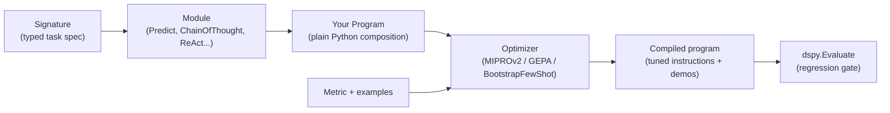
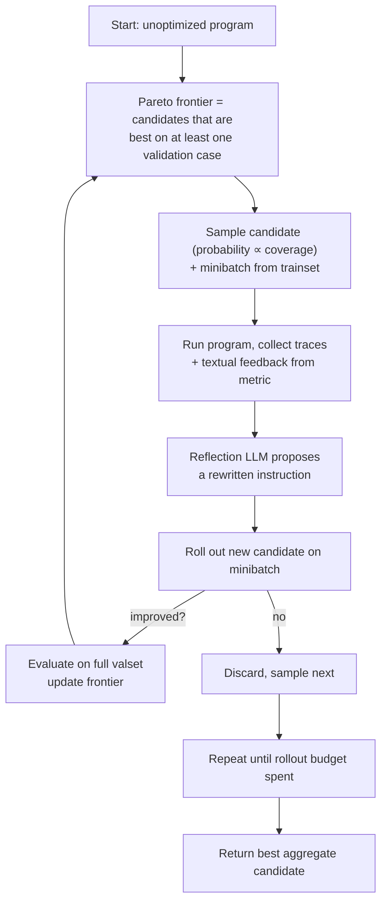

# DSPy для бекенд-інженерів: сигнатури, оптимізатори та GEPA vs MIPROv2

Якщо ви супроводжували довговічний Spring Boot-сервіс, ви вже знаєте різницю між конфігурацією
та кодом. Значення в `application.yml` на продакшен-машинах вручну не редагують, і розміри пулу
з’єднань не підганяють «на вайбах» — ви їх декларуєте, вимірюєте і змінюєте через перевірений,
відтворюваний процес.

Тепер застосуйте цю оптику до LLM-розробки. Більшість команд «робить AI» так, як ми робили ops
у 2009: хтось вручну редагує рядок промпта в PR, придивляється до п’яти виводів у ноутбуці,
шипить — а за шість тижнів оновлення моделі мовчки ламає все.

**DSPy** ([dspy.ai](https://dspy.ai)) — фреймворк від Stanford NLP, який каже: стоп. Ставтеся
до промпта як до **скомпільованого артефакту**. Ви пишете *вихідний код* — типізовану декларацію
задачі, складену звичайним Python, — плюс **метрику**, що оцінює виводи. Компонент фреймворку,
який зветься **оптимізатором**, далі автоматично генерує та підганяє справжні промпти — проти
вашої метрики, на ваших даних.

Ця стаття пояснює, як це працює, а потім заглиблюється в питання, з яким ви реально зіткнетеся
після взяття фреймворку на озброєння: **який оптимізатор обрати**. Дві головні стратегії
сьогодні — **MIPROv2** (байєсівський пошук за інструкціями та few-shot прикладами) і **GEPA**
(рефлексивна еволюція промптів на Парето-фронті, ICLR 2026 Oral). Вони шукають по-різному,
коштують по-різному і вимагають різного від вашої метрики.

Усе зведено до малого прикладу, який можна запустити і який я зібрав для цієї статті: програма
**тріажу продакшен-інцидентів на Spring Boot**, що класифікує рядки логів і стек-трейси
за категоріями першопричин. Це домен, де зазвичай живе цей блог, — і він достатньо малий, щоб
оптимізація коштувала центи, а не долари.

Стек: **Python, DSPy 3.5, будь-який LLM-провайдер**.

<div class="post-tldr" markdown="1">
<p class="post-tldr-title">TL;DR</p>

- **DSPy = промпти як білд-артефакти.** Ви декларуєте `Signature` (типізовані входи/виходи), компонуєте `Module`-и в Python, пишете метрику — і **оптимізатор** компілює це в підігнані інструкції + few-shot приклади. Зміна моделі стає перекомпіляцією, а не переписуванням промптів.
- Основний цикл скрізь однаковий: **програма + ~30 розмічених прикладів + метрика → `optimizer.compile(program, trainset=...)` → збережений, diff-абельний артефакт.** Жодних рядків промптів у вихідному коді.
- **MIPROv2** = пропонує сітку кандидатів (інструкції × демо) і обирає переможця **байєсівською оптимізацією** на мінібатч-оцінках. Чудовий універсал; хоче 200+ прикладів для довгих запусків; метрика — простий float.
- **GEPA** = **рефлексивна еволюція**: сильна LLM переписує інструкції, використовуючи *текстовий фідбек* про те, чому передбачення було хибним, а **Парето-фронт** зберігає кандидатів, що перемагають хоча б на одному кейсі. Обійшов MIPROv2 на **понад 10%** на шести бенчмарк-задачах за порівнянної вартості (ICLR 2026 Oral) і зрівнявся з RL fine-tuning, використовуючи до **35x менше rollout’ів**.
- Правило вибору: **метрика може пояснити помилки словами → GEPA. Метрика — чорна скринька зі скаляром, або потрібен підбір демо → MIPROv2.** Обидва не торкаються коду вашої програми.
</div>

---

## Що таке DSPy?

DSPy — open-source Python-фреймворк, створений Stanford NLP (тепер проєкт розвивається під
Databricks), уперше випущений як компілятор Demonstrate-Search-Predict у грудні 2022. Поточна
лінія, DSPy 3.x, — один із найпоширеніших LLM-фреймворків: мільйони завантажень щомісяця
і близько 40k зірок на GitHub, а слоган документації схоплює філософію у п’ятьох словах:
**«Програмуй, а не промптай»** ("Program, don't prompt").

Посилка: промпт — не вихідний код. Це *вивід* — скомпільований результат трьох вхідних, які ви
*можете* супроводжувати як вихідний код:

1. **Що це за задача** — типізований інтерфейс: входи, виходи, обмеження.
2. **Як компонуються кроки** — звичайний контрольний потік Python.
3. **Що означає «коректно»** — функція метрики над розміченими прикладами.

Напишіть вручну #1–#3, а промпт дозвольте створити алгоритму. Коли модель змінюється, ви
не переписуєте промпт — ви **перекомпілюєте**.

Якщо ви коли-небудь паралельно супроводжували промпт для GPT-4, промпт для Claude і промпт
для локальної Llama для однієї фічі — ви вже розумієте, чому це важливо. Це той самий інстинкт,
який провів нас від ручного редагування конфігів серверів до декларативної інфраструктури.

## Як працює DSPy: сигнатури, модулі, оптимізатори

DSPy має рівно три абстракції, які треба вивчити. Це весь фреймворк.



### Що таке сигнатура DSPy?

**Сигнатура** — декларативна специфікація вхідної/вихідної поведінки задачі — уявіть собі
сигнатуру методу з семантикою, а не лише типами. Імена полів несуть зміст; DSPy перетворює їх
на промпти за лаштунками.

```python
class IncidentTriage(dspy.Signature):
    """Classify a Spring Boot production incident by its root cause and severity,
    and propose a fix."""

    incident_report: str = dspy.InputField(
        desc="Log line, stack trace excerpt or error description"
    )
    root_cause: Literal[
        "config-misconfiguration",
        "dependency-conflict",
        "connection-pool-exhaustion",
        "serialization-error",
        "memory-pressure",
        "thread-starvation",
    ] = dspy.OutputField(desc="One of the fixed root-cause categories")
    severity: Literal["P1", "P2", "P3"] = dspy.OutputField(
        desc="P1 = service down / data risk, P2 = degraded, P3 = contained"
    )
    action: str = dspy.OutputField(desc="One-sentence remediation")
```

Зверніть увагу, що дає сигнатура, чого не дає рядок промпта: **структуру, яку може забезпечити
парсер**. `root_cause` — тип `Literal`: модель не може відповісти `Probably database stuff`;
вона мусить повернути одне з шести значень, або адаптер DSPy ретраїть і кидає виняток. Це та
самa м’язова пам’ять, що й мапінг JSON у типізований DTO замість ручного парсингу рядків.

### Що таке модуль DSPy?

**Модуль** — багаторазова стратегія промптингу, узагальнена над будь-якою сигнатурою —
ідея `nn.Module` з PyTorch, застосована до промптів. Усі побудовані на `dspy.Predict`;
найвідоміші:

| Модуль | Стратегія, яку абстрагує |
|---|---|
| `dspy.Predict(sig)` | Пряме завершення |
| `dspy.ChainOfThought(sig)` | Додає крок міркування перед відповіддю |
| `dspy.ReAct(sig, tools=[...])` | Цикл міркування + використання інструментів для агентів |
| `dspy.ProgramOfThought(sig)` | Генерує й виконує код для відповіді |
| `dspy.BestOfN(sig, N)` | Семплює N кандидатів, лишає найкращий за оцінкою |

Ваша програма — підклас `dspy.Module`, чий `forward()` компонує підмодулі звичайним Python —
умовами, циклами, власними класами. Ось *повна* модель нашого прикладу тріажу інцидентів:

```python
class IncidentTriageProgram(dspy.Module):
    def __init__(self):
        super().__init__()
        self.triage = dspy.ChainOfThought(IncidentTriage)

    def forward(self, incident_report: str) -> dspy.Prediction:
        return self.triage(incident_report=incident_report)
```

Подивіться, чого **немає** в цьому файлі: жодного тексту промпта, жодних few-shot прикладів,
жодного імені моделі, жодної температури. Усе це існує — але як *параметри*, і саме це робить їх
придатними для оптимізації. Виклик програми повертає типізовані поля (`root_cause`,
`severity`, `action`) плюс поле `reasoning`, яке додає `ChainOfThought` для кроку міркування.

### Що таке оптимізатор DSPy?

**Оптимізатор** (раніше звався *teleprompter*) — алгоритм, що підганяє параметри вашої програми —
інструкції та/або few-shot демо — під максимум вашої метрики. Few-shot демо — розв’язаний
приклад вхід→вихід, вбудований у промпт; інструкція — системна директива, яку DSPy генерує
для кожного модуля.

`optimizer.compile(program, trainset=...)` — буквально крок компіляції: він запускає вашу
програму на даних, вимірює, шукає і повертає **скомпільовану програму**, чиї предиктори тепер
несуть підігнані інструкції та демо. Ви зберігаєте її через `program.save("optimized.json")` —
diff-абельний артефакт, придатний для рев’ю, як migration-скрипт.

Бік оцінювання — один виклик:

```python
evaluate = dspy.Evaluate(
    devset=valset,
    metric=triage_metric,
    num_threads=4,
    display_table=3,
)
result = evaluate(program)
```

Рекомендації документації DSPy за обсягом: **~30 розмічених прикладів, щоб побачити цінність,
~300 для продакшен-якості** — розподіл ~20% train / 80% validation, бо оптимізатори оцінюють
кожного кандидата на валідаційній множині. Це навмисно *навпаки* до практик глибокого навчання:
ви не підганяєте ваги, ви шукаєте в значно меншому просторі, і валідаційна множина — ваш компас.

І ще одне, варте усвідомлення: **ваша метрика — це контракт**. Кожен оптимізатор у цій статті
розумний настільки, наскільки розумна функція, що оцінює виводи. Для класифікації метрики exact-match
досить. Для нечітких задач DSPy постачає `SemanticF1` — сам реалізований як маленька DSPy-програма, —
плюс можна писати assertion-метрики, що повертають частковий зарах.

---

## Робочий приклад: тріаж інцидентів Spring Boot

Досить теорії. Супутній репозиторій цієї статті реалізує задачу, яку впізнає кожен бекенд-інженер:
тріаж на черзі чергувань. Задано рядок лога або фрагмент стек-трейсу — класифікуй **першопричину**
(шість категорій), **серйозність** (P1/P2/P3) і видай виправлення одним реченням.

Набір даних — 24 вручну зроблені, навмисно реалістичні інциденти: таймаути пулу Hikari,
`NoSuchMethodError` після оновлення Jackson, метод із `@Transactional`, що тримає з’єднання
протягом повільного віддаленого виклику, OOMKilled-pod, у якого heap гаразд, але metaspace — ні...
14 для тренування, 10 для валідації. Малий — намірено: документація DSPy каже, цінність
починається приблизно з 30 прикладів, а це тримає весь запуск у межах центів.

Метрика має два варіанти — і цей поділ ключовий для питання GEPA vs MIPROv2 далі:

```python
def triage_metric(example, pred, trace=None) -> float:
    """Plain scalar metric — what MIPROv2 and dspy.Evaluate consume."""
    root_ok = pred.root_cause == example.root_cause
    sev_ok = pred.severity == example.severity
    return (1.0 if root_ok else 0.0) + (0.25 if sev_ok else 0.0)


def triage_metric_with_feedback(example, pred, trace=None, pred_name=None, pred_trace=None):
    """GEPA metric: a score PLUS natural-language feedback about the miss."""
    problems = []
    if pred.root_cause == example.root_cause:
        root_score = 1.0
    else:
        root_score = 0.0
        problems.append(
            f"Wrong root cause: you said '{pred.root_cause}', the correct label is "
            f"'{example.root_cause}'."
        )
    # ... same for severity ...
    return dspy.Prediction(score=root_score + sev_score,
                           feedback=" ".join(problems) or "Correct root cause and severity.")
```

Та сама задача, та сама оцінка — одна версія відповідає на *«наскільки?»*, друга ще й на
*«чому хибно?»*. Запам’ятайте цю думку; за мить вона стане дуже важливою.

## Основні стратегії оптимізації

DSPy постачає близько десятка оптимізаторів у чотирьох родинах. Два, між якими ви реально
обиратимете, — останні два.

| Оптимізатор | Що підганяє | Стратегія пошуку | Яких даних хоче |
|---|---|---|---|
| `BootstrapFewShot` | Лише демо | Запускає вчителя, лишає трейси, що проходять метрику | ~10+ |
| `BootstrapFewShotWithRandomSearch` | Лише демо | Бутстрапінг + випадковий пошук за варіантами | 50+ |
| `COPRO` | Лише інструкції | Coordinate-ascent hill-climbing по переписуваннях | будь-що |
| `MIPROv2` | Інструкції **+ демо** | Пропонує сітку кандидатів, **байєсівська оптимізація** | 200+ для довгих запусків |
| `GEPA` | Інструкції (і код, через `dspy.Flex`) | **Рефлексивна еволюція** на Парето-фронті | жменя, якщо метрика дає фідбек |

### MIPROv2: байєсівський пошук за інструкціями та демо

**MIPROv2** (Multiprompt Instruction PRoposal Optimizer v2) — робоча конячка DSPy — давня
дефолтна відповідь на запит «просто оптимізувати». Він працює у три стадії:

1. **Бутстрап демо** — створює `num_candidates` наборів few-shot прикладів: частина скопійована
   з міток, частина *бутстраплена* запуском вашої власної програми з утриманням трейсів, чиї
   виводи проходять метрику.
2. **Пропонує інструкції** — `prompt_model` пише кандидатів-інструкції для кожного модуля,
   спираючись на резюме набору даних, вихідний код вашої програми, бутстраплені демо та випадкову
   пораду щодо креативності.
3. **Байєсівський пошук** — семплює комбінації (інструкція, демо), оцінює кожну на мінібатчі
   з 35 прикладів, оновлює сурогатну модель і пересемплює там, де вона передбачає покращення.
   Повні валідаційні оцінки кожні кілька кроків. Після `num_trials` переможує найкраща програма.

```python
optimizer = dspy.MIPROv2(
    metric=triage_metric,     # plain scalar is fine here
    auto="light",             # ~6 candidates; "medium"/"heavy" scale up
    num_threads=4,
)
optimized = optimizer.compile(
    program,
    trainset=trainset,
    valset=valset,
    max_bootstrapped_demos=2,
    max_labeled_demos=2,
)
optimized.save("optimized/miprov2_triage.json")
```

Ментальна модель — **фіксована сітка кандидатів, досліджувана розумним семплером**. Це має
реальний наслідок: MIPROv2 може обрати лише з кандидатів-інструкцій, які його пропоузер
здогадався згенерувати наперед. Якщо жоден із них не кодує доменного інсайту, потрібного вашій
задачі («зістав аспект стек-трейсу, перш ніж судити про серйозність»), байєсівський пошук не може
його винайти — він може лише обрати найменш погану точку сітки.

### GEPA: рефлексивна еволюція промптів на Парето-фронті

**GEPA** (Genetic-Pareto) — [Agrawal et al., 2025](https://arxiv.org/abs/2507.19457),
прийнятий як **ICLR 2026 Oral** — б’є прямо по цьому обмеженню. Це еволюційний пошук, де
*оператор мутації — LLM, що читає фідбек*:



Чотири ідеї роблять це працюючим:

- **Метрика повертає фідбек, а не лише число.** Саме тому наш приклад має
  `triage_metric_with_feedback`, що повертає `dspy.Prediction(score, feedback)`. Документація
  DSPy без зайвих слів: дайте GEPA голий float — і отримаєте «значно слабшу версію самого себе».
  Текст фідбеку йде *дослівно* у промпт reflection LM — «вказано `thread-starvation`, коректна
  мітка — `memory-pressure`; OOMKilled на лімітах контейнера з низьким використанням heap
  означає, що обмеження — *контейнер*» — тож кожна мутація інформована, а не випадкова.
- **Парето-відбір замість king-of-the-hill.** MIPROv2 тримає одного чинного чемпіона; кандидати,
  посередні загалом, але *найкращі на конкретному зрізі* (кажімо, помилки серіалізації), все одно
  вилучаються. Парето-фронт GEPA тримає кожного такого спеціаліста живим і семплює з них.
  Кандидати ранніх спеціалізацій виживають до пізнішої рекомбінації — та сама причина, з якої
  генетичні алгоритми тримають різноманітні популяції. У статті це абльовано: Парето-семплінг
  проти жадібного «завжди бери найкраще» коштує до ~8% агрегату.
- **System-aware merge** (`use_merge=True`): коли дві лінії кожна винайшли комплементарну силу,
  GEPA пробує злити їхні найкращі модулі — оператор кросовера в термінах генетичних алгоритмів.
- **Бюджет як одна ручка**: рівно одна з `auto` (`light`/`medium`/`heavy`), `max_full_evals`
  або `max_metric_calls`. На програмі з двома предикторами над 100 прикладами `light` ≈ 1 330
  викликів метрики.

```python
optimizer = dspy.GEPA(
    metric=triage_metric_with_feedback,  # score + textual feedback
    reflection_lm=reflection_model(),    # a STRONG model, temperature 1.0
    auto="light",
    num_threads=4,
    track_stats=True,                    # fills detailed_results
)
optimized = optimizer.compile(program, trainset=trainset, valset=valset)
```

Дві операційні примітки з продакшен-використання. Перше: **reflection LM — дорога ручка** —
він працює серійно (жменя викликів за запуск, ~12–36 при середньому бюджеті), тож дайте йому
сильнішу модель, ніж модель задачі; власні туторіали DSPy ставлять туди frontier-моделі.
Друге: встановіть `track_stats=True`: результат несе `detailed_results` з **кожним кандидатом,
його батьківською лінією та оцінками по кожному прикладу** — аудит-слід еволюції промпта,
який можна експортувати в JSON і розглядати як PR.

Що GEPA *змінює* — навмисно вузько: лише `signature.instructions` кожного предиктора.
Композиція модулів, ваш код, ваші демо — недоторкані. Оптимізовані інструкції також чудово
переносяться між моделями: у статті промпти, виведені еволюцією на Qwen3-8B, дали ~9% при
повторному використанні на GPT-4.1 Mini.

## GEPA vs MIPROv2: який оптимізатор обрати?

Той самий фреймворк, та сама програма, та сама функція метрики — різні парадигми пошуку.
Ось чесне порівняння:

| Вимір | MIPROv2 | GEPA |
|---|---|---|
| Парадигма | **Байєсівська оптимізація** над фіксованою сіткою кандидатів | **Рефлексивна еволюція** над відкритою множиною кандидатів |
| Що підганяє | Інструкції **+ few-shot демо** спільно | Лише інструкції (і код, через `dspy.Flex`) |
| Контракт метрики | Простий скаляр (float/bool) | `dspy.Prediction(score, feedback)` — фідбек на предиктор |
| Пам’ять пошуку | Один чинний найкращий | **Парето-фронт** переможців по інстансах + merge |
| Ручки бюджету | `auto` або `num_candidates` + `num_trials` | рівно одна: `auto` / `max_full_evals` / `max_metric_calls` |
| Типові промпти | Довші (few-shot демо роздувають) | Інструкції до **9.2x коротші** (вимірювання зі статті) |
| Вказівки за даними | 200+ прикладів розкривають довгі запуски | Жменя працює *якщо фідбек багатий*; тримайте valset малим |
| Головні результати | Надійний дефолт; ReAct 24%→51% у прикладі документації | **+10% над MIPROv2** на 6 задачах; +12% на AIME 2025 |

Числа вартості зі статті цікавіші за числа точності. На експериментах з GPT-4.1 Mini загальні
витрати LM — **$86 для GEPA проти $76 для MIPROv2** — порівнянні — за приблизно подвійний
агрегований приріст (+13.3% проти +5.6%). Проти RL fine-tuning (GRPO) GEPA зрівнявся з найкращими
валідаційними оцінками після **243–1 179 rollout’ів проти 24 000** — до 78x краща ефективність
семплінгу — при середньому +6% (до +20%) над GRPO. Це рецензована версія тези «10–80x дешевше
за RL», яку ви бачитимете в соцмережах.

**Моє правило вибору**, після підключення обох на тій самій задачі:

- **Обирайте GEPA, коли ваша метрика може пояснити промахи словами.** Класифікація з причинами,
  екстракція з валідацією за схемами, агенти, оцінювані за покроковими трейсами — будь-де, де
  «чому це було хибно» виражуване. Цей фідбек — пальне; без нього ви запускаєте еволюцію зі
  сліпою функцією придатності.
- **Обирайте MIPROv2, коли ваша метрика — чорна скринька, або демо важать більше за інструкції.**
  Якщо програма недонавчається, бо їй бракує in-context прикладів (а не тому, що інструкції
  хибні), спільний пошук інструкція+демо у MIPROv2 — кращий важіль. Це також м’якший перший
  щабель: немає другої моделі для налаштування, скалярні метрики вітаються.
- **Дешева перша проба в будь-якому разі**: `BootstrapFewShotWithRandomSearch` зі скалярною
  метрикою майже нічого не коштує і часто підказує, чи розрив у *демо* (він його закриє) чи
  в *інструкціях* (не закриє — це територія MIPROv2/GEPA).

І вони не взаємовиключні. DSPy 3.x постачає `BetterTogether`, який ланцюжить оптимізацію
промптів і оптимізацію ваг (наприклад, GEPA, потім GRPO) на одній програмі — еволюція промптів,
щоб знайти стратегію, RL, щоб стиснути її у ваги, коли можете дозволити собі rollout’и.

## Запуск прикладу

Усе вище — код, який можна запустити за п’ять хвилин. Супутній репозиторій:

```bash
git clone https://github.com/javaAndScriptDeveloper/dspy-article
cd dspy-article
uv sync                      # Python 3.11+, installs DSPy 3.5

# Offline sanity check — drives the whole pipeline against a DummyLM:
uv run python smoke_test.py  # no API key needed

# Real runs:
export OPENAI_API_KEY=sk-...     # or set DSPY_MODEL to any dspy.LM string
uv run python 01_baseline.py         # score the unoptimized program
uv run python 02_optimize_miprov2.py # Bayesian search → optimized/miprov2_triage.json
uv run python 03_optimize_gepa.py    # reflective evolution → optimized/gepa_triage.json
```

Дефолти: модель задачі `openai/gpt-4o-mini`, reflection-модель GEPA
`openai/gpt-4o` (перевизначте через `DSPY_MODEL` / `DSPY_REFLECTION_MODEL`). На 24
прикладах обидва оптимізаційні запуски вкладаються в центи.

Момент, який варто зробити власноруч: після кожного запуску зробіть diff збереженого JSON
із вихідною програмою. `02_optimize_miprov2.py` запише інструкції та вбудує few-shot демо.
`03_optimize_gepa.py` перепише інструкцію — а `optimized/gepa_results.json` тримає повну
еволюційну лінію: кожен кандидат, його батьки, оцінки по кожному прикладу. Цей файл — вся теза
DSPy в одному артефакті: **промпт — це вивід, а не вихідний код.**

## Коли не варто використовувати DSPy?

Розділ чесності, бо продаж кожного фреймворка його потребує.

- **Немає метрики — немає DSPy.** Якщо ви не можете оцінити виводи — хоча б шумно —
  оптимізатору немає чого піднімати. Побудова eval-множини та метрики — справжня робота;
  DSPy лише автоматизує пошук проти неї. (Команди, що пропускають цей крок і вручну підганяють
  промпти, роблять пошук *на вайбах*, з гіршими даними.)
- **Один стабільний промпт на розв’язаній проблемі?** Не додавайте податок на абстракцію.
  DSPy виправдовується, коли програми багатокрокові, моделі міняються, або розриви якості
  коштують справжніх грошей.
- **Невичерпний бюджет RL і треновувані ваги?** Стаття GEPA виразна: еволюція промптів
  перемагає, коли rollout’и дорогі, даних обмаль, або ваги заморожені на боці API. Fine-tuning
  у стилі GRPO все одно перемагає в режимі невичерпних rollout’ів. Різні інструменти, різна
  економіка.
- **Промпт належить вам.** Скомпільований артефакт підігнаний під *вашу метрику* —
  оптимізуйте проти проксі-метрики, що не збігається з продакшеном, і ви шипите чудово
  оптимізовану програму для хибної цілі. Правило старе як світ: ваш eval-набір *і є* ваша
  специфікація.

---

Патерн, який варто забрати, — той самий, що цей блог обертає й в інших доменах: переносіть
рантайм-судження в декларативні, вимірювані, версіоновані артефакти. Ми зробили це для
інфраструктури, потім для міграцій схем; DSPy робить це для останнього артефакта ручного
редагування в стеку — рядка промпта. Оптимізатори — цікава частина, але *дисципліна* — виграш.
Промпт перестає бути тим, що хтось підкручує о другій ночі, і стає тим, що CI перегенеровує,
коли змінюються модель, дані чи метрика.

Якщо хочете другого, глибшого проходу по оптимізаторах, первинні джерела чудові:
[стаття GEPA](https://arxiv.org/abs/2507.19457) (ICLR 2026 Oral),
[стаття MIPROv2](https://arxiv.org/abs/2406.11695) і
[офіційний гід із оптимізації DSPy](https://dspy.ai/learn/optimization/overview/),
що містить [покроковий вибірник оптимізатора](https://dspy.ai/diving-deeper/choosing-an-optimizer/).

*Код із цієї статті доступний у
**[github.com/javaAndScriptDeveloper/dspy-article](https://github.com/javaAndScriptDeveloper/dspy-article)**.
Весь пайплайн перевіряється офлайн — `uv sync && uv run python smoke_test.py`
проганяє повний цикл оптимізації GEPA без API-ключа — а реальні запуски коштують центи
на вбудованому наборі з 24 прикладів.*
