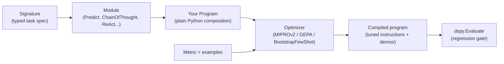
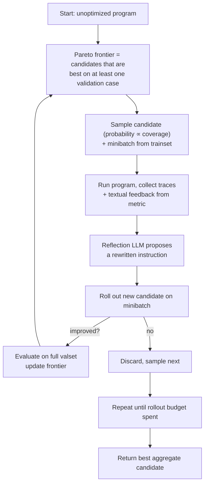

# DSPy для бекенд-інженерів: сигнатури, оптимізатори та GEPA vs MIPROv2

Якщо ви довго підтримували Spring Boot-сервіс, то знаєте різницю між конфігурацією та
кодом. Значення в `application.yml` на продакшен-серверах руками не правлять, а розмір
пулу з’єднань не підбирають «на око»: його декларують, вимірюють і змінюють через
перевірений, відтворюваний процес.

Тепер подивіться так на розробку з LLM. Більшість команд «роблять AI» так, як ми
адміністрували сервери у 2009-му: хтось правкою в PR змінює рядок промпта, пробігає очима
п’ять відповідей у ноутбуці, викочує в прод — а за шість тижнів оновлення моделі мовчки
все ламає.

**DSPy** ([dspy.ai](https://dspy.ai)) — фреймворк від Stanford NLP, який пропонує зупинитися.
Ставтеся до промпта як до **скомпільованого артефакту**. *Вихідним кодом* є типізований опис
задачі, зібраний звичайним Python, плюс **метрика**, що оцінює відповіді. Далі компонент
фреймворку — **оптимізатор** — сам генерує й налаштовує справжні промпти під вашу метрику
на ваших даних.

У статті я спочатку поясню, як це працює, а тоді докладно розберу питання, з яким ви
зіткнетеся після впровадження: **який оптимізатор обрати**. Сьогодні є дві головні
стратегії: **MIPROv2** (байєсівський пошук за інструкціями та few-shot прикладами) і
**GEPA** (рефлексивна еволюція промптів на Парето-фронті, ICLR 2026 Oral). Вони шукають
по-різному, коштують по-різному й по-різному ставляться до вашої метрики.

Усе спирається на невеликий запускний приклад, який я зібрав для цієї статті: програму
для **тріажу продакшен-інцидентів Spring Boot**, що відносить рядки логів і стек-трейси до
категорій першопричин. Це знайома для цього блогу територія, а сам приклад достатньо
малий, щоб повний запуск оптимізації лишався дешевим.

Стек: **Python 3.11+, DSPy 3.5, будь-який LLM-провайдер**.

<div class="post-tldr" markdown="1">
<p class="post-tldr-title">TL;DR</p>

- **DSPy = промпти як артефакти збірки.** Ви оголошуєте `Signature` (типізовані входи й виходи), компонуєте `Module` у Python, пишете метрику — а **оптимізатор** компілює це в налаштовані інструкції та few-shot приклади. Зміна моделі означає перекомпіляцію, а не переписування промптів.
- Основний цикл скрізь однаковий: **програма + приблизно 30 розмічених прикладів + метрика → `optimizer.compile(program, trainset=...)` → збережений артефакт, який можна переглянути через diff.** Жодних рядків із промптами у вихідному коді.
- **MIPROv2** = пропонує сітку кандидатів (інструкції × демонстрації) і обирає переможця **байєсівською оптимізацією** на оцінках за мінібатчами. Хороший універсал; для довгих запусків потрібно 200+ прикладів; метрика — звичайне число з плаваючою комою.
- **GEPA** = **рефлексивна еволюція**: сильна LLM переписує інструкції на основі *текстового фідбеку* про те, чому передбачення були хибними, а **Парето-фронт** зберігає кандидатів, які виграють хоча б на одному прикладі. Випередив MIPROv2 **більш ніж на 10 пунктів** на шести бенчмарках за порівнянної вартості (ICLR 2026 Oral) і перевершив fine-tuning за GRPO, використавши до **35 разів менше rollout**.
- Правило вибору: **метрика вміє пояснити помилки словами — GEPA. Метрика — чорна скринька зі скаляром або потрібен підбір демонстрацій — MIPROv2.** Жоден із них не чіпає код вашої програми.
</div>

---

## Що таке DSPy?

DSPy — open-source Python-фреймворк від Stanford NLP. Він виріс із дослідження
Demonstrate-Search-Predict (грудень 2022), а поточна гілка 3.x широко використовується:
на момент написання — кілька мільйонів завантажень на місяць із PyPI і близько 40 тисяч
зірок на GitHub. Девіз проєкту передає філософію коротко: programming, not prompting —
програмувати мовні моделі, а не підбирати для них промпти.

Вихідна думка: промпт — це не вихідний код. Це *результат*, скомпільований із трьох
складників, які *можна* підтримувати як вихідний код:

1. **Що це за задача** — типізований інтерфейс: входи, виходи, обмеження.
2. **Як поєднуються кроки** — звичайний потік керування в Python.
3. **Що означає «правильно»** — функція-метрика над розміченими прикладами.

Пункти 1–3 ви пишете вручну, а промпт залишаєте алгоритму. Коли модель змінюється, ви не
переписуєте промпт — ви **перекомпільовуєте**.

Якщо вам доводилося паралельно підтримувати промпт для GPT-4, для Claude і для локальної
Llama в межах однієї фічі, ви вже розумієте, чому це важливо. Той самий інстинкт колись
привів нас від ручних правок конфігів на серверах до декларативної інфраструктури.

## Як працює DSPy: сигнатури, модулі, оптимізатори

У DSPy лише три абстракції. Це весь фреймворк.



### Що таке сигнатура в DSPy?

**Сигнатура** — декларативний опис вхідної та вихідної поведінки задачі. Це схоже на
сигнатуру методу, але не лише з типами, а й із семантикою. Назви полів несуть зміст: DSPy
сам перетворює їх на промпти.

```python
class IncidentTriage(dspy.Signature):
    """Classify a Spring Boot production incident by its root cause and severity,
    and propose a fix."""

    incident_report: str = dspy.InputField(
        desc="Log line, stack trace excerpt or error description"
    )
    root_cause: Literal[
        "config-misconfiguration",
        "dependency-conflict",
        "connection-pool-exhaustion",
        "serialization-error",
        "memory-pressure",
        "thread-starvation",
    ] = dspy.OutputField(desc="One of the fixed root-cause categories")
    severity: Literal["P1", "P2", "P3"] = dspy.OutputField(
        desc="P1 = service down / data risk, P2 = degraded, P3 = contained"
    )
    action: str = dspy.OutputField(desc="One-sentence remediation")
```

Зверніть увагу, що дає сигнатура на відміну від рядка з промптом: **структуру, яку може
перевірити парсер**. `root_cause` має тип `Literal`, тож модель не може відповісти
`Probably database stuff`: вона мусить повернути одне з шести значень, інакше адаптер DSPy
повторює запит і зрештою кидає виняток. Це те саме, що мапити JSON на типізований DTO
замість ручного розбору рядків.

### Що таке модуль у DSPy?

**Модуль** — це багаторазова стратегія промптингу, узагальнена для будь-якої сигнатури.
Ідея та сама, що й `nn.Module` у PyTorch, тільки для промптів. Усі модулі побудовано на
`dspy.Predict`; найвідоміші:

| Модуль | Яку стратегію абстрагує |
|---|---|
| `dspy.Predict(sig)` | Пряме завершення |
| `dspy.ChainOfThought(sig)` | Додає крок міркування перед відповіддю |
| `dspy.ReAct(sig, tools=[...])` | Цикл «міркування + виклик інструментів» для агентів |
| `dspy.ProgramOfThought(sig)` | Генерує й виконує код, щоб відповісти |
| `dspy.BestOfN(sig, N)` | Генерує N кандидатів і лишає той, що отримав найвищу оцінку |

Ваша програма — це підклас `dspy.Module`, у чиєму `forward()` підмодулі компонуються
звичайним Python: умовами, циклами, вашими власними класами. Ось *вся* модель нашого
прикладу з тріажем інцидентів:

```python
class IncidentTriageProgram(dspy.Module):
    def __init__(self):
        super().__init__()
        self.triage = dspy.ChainOfThought(IncidentTriage)

    def forward(self, incident_report: str) -> dspy.Prediction:
        return self.triage(incident_report=incident_report)
```

Подивіться, чого в цьому файлі **немає**: тексту промпта, few-shot прикладів, назви
моделі, температури. Усе це існує, але як *параметри*, і саме тому їх можна оптимізувати.
Виклик програми повертає типізовані поля (`root_cause`, `severity`, `action`) і поле
`reasoning`, яке `ChainOfThought` додає для кроку міркування.

### Що таке оптимізатор у DSPy?

**Оптимізатор** (раніше його називали *teleprompter*) — алгоритм, який налаштовує
параметри вашої програми, тобто інструкції та/або few-shot демонстрації, щоб максимізувати
метрику. Few-shot демонстрація — це розв’язаний приклад «вхід → вихід», вставлений у
промпт; інструкція — системна директива, яку DSPy генерує для кожного модуля.

`optimizer.compile(program, trainset=...)` — буквально крок компіляції: він запускає вашу
програму на даних, вимірює, шукає й повертає **скомпільовану програму**, предиктори якої
тепер містять налаштовані інструкції та демонстрації. Зберегти її можна через
`program.save("optimized.json")` — це артефакт, який можна переглянути через diff і
відрецензувати, як скрипт міграції.

Оцінювання — це один виклик:

```python
evaluate = dspy.Evaluate(
    devset=valset,
    metric=triage_metric,
    num_threads=4,
    display_table=3,
)
result = evaluate(program)
```

Рекомендації документації DSPy щодо обсягу даних: **близько 30 розмічених прикладів, щоб
побачити користь, і близько 300 для продакшен-якості**. Розподіл — приблизно 20% на
тренування й 80% на валідацію, бо оптимізатори оцінюють кожного кандидата на валідаційній
вибірці. Це свідомо *навпаки* порівняно з глибоким навчанням: ви не підбираєте ваги, а
шукаєте в значно меншому просторі, і валідаційна вибірка править за компас.

Ще одну річ варто засвоїти: **ваша метрика — це контракт**. Кожен оптимізатор у цій статті
настільки розумний, наскільки розумна функція, що оцінює результати. Для класифікації
достатньо метрики на точний збіг. Для нечітких задач DSPy постачає
`dspy.evaluate.SemanticF1` — сама вона реалізована як невелика програма на DSPy, — а ще
можна писати метрики, що повертають часткову оцінку.

---

## Робочий приклад: тріаж інцидентів Spring Boot

Годі теорії. У репозиторії до цієї статті реалізовано задачу, знайому кожному бекенд-інженеру:
тріаж під час чергування. За рядком логу або фрагментом стек-трейсу потрібно визначити
**першопричину** (шість категорій), **серйозність** (P1/P2/P3) і запропонувати виправлення
одним реченням.

Датасет складається з 24 вручну підготовлених, навмисно реалістичних інцидентів: таймаути
пулу Hikari, `NoSuchMethodError` після оновлення Jackson, метод із `@Transactional`, який
тримає з’єднання під час повільного віддаленого виклику, pod, убитий через OOMKilled, коли з
heap усе гаразд, а з metaspace — ні... 14 для тренування, 10 для валідації. Навмисно мало:
за документацією DSPy, користь починається приблизно з 30 прикладів, а так запуск лишається
дешевим.

У метрики два варіанти, і саме цей поділ — ключ до питання GEPA vs MIPROv2 нижче:

```python
def triage_metric(example, pred, trace=None) -> float:
    """Plain scalar metric — what MIPROv2 and dspy.Evaluate consume."""
    root_ok = pred.root_cause == example.root_cause
    sev_ok = pred.severity == example.severity
    return (1.0 if root_ok else 0.0) + (0.25 if sev_ok else 0.0)


def triage_metric_with_feedback(example, pred, trace=None, pred_name=None, pred_trace=None):
    """GEPA metric: a score PLUS natural-language feedback about the miss."""
    problems = []
    if pred.root_cause == example.root_cause:
        root_score = 1.0
    else:
        root_score = 0.0
        problems.append(
            f"Wrong root cause: you said '{pred.root_cause}', the correct label is "
            f"'{example.root_cause}'."
        )
    # ... same for severity ...
    return dspy.Prediction(score=root_score + sev_score,
                           feedback=" ".join(problems) or "Correct root cause and severity.")
```

Та сама задача, те саме оцінювання: одна версія відповідає на питання *«наскільки?»*, друга
ще й на *«чому хибно?»*. Цей поділ і є різницею між двома оптимізаторами нижче.

## Основні стратегії оптимізації

DSPy постачає близько десятка оптимізаторів у чотирьох родинах. Обирати ви реально будете
між двома останніми.

| Оптимізатор | Що налаштовує | Стратегія пошуку | Скільки даних потрібно |
|---|---|---|---|
| `BootstrapFewShot` | Лише демонстрації | Запускає «вчителя», лишає трейси, що проходять метрику | ~10+ |
| `BootstrapFewShotWithRandomSearch` | Лише демонстрації | Bootstrap + випадковий пошук серед варіантів | 50+ |
| `COPRO` | Лише інструкції | Coordinate ascent (підйом на пагорб) за переписаними варіантами | будь-скільки |
| `MIPROv2` | Інструкції **+ демонстрації** | Пропонує сітку кандидатів, **байєсівська оптимізація** | 200+ для довгих запусків |
| `GEPA` | Інструкції (і код, через `dspy.Flex`) | **Рефлексивна еволюція** на Парето-фронті | кілька, якщо метрика дає фідбек |

### MIPROv2: байєсівський пошук за інструкціями та демонстраціями

**MIPROv2** (Multiprompt Instruction PRoposal Optimizer v2) — робоча конячка DSPy, давня
відповідь за замовчуванням на прохання «просто оптимізуй». Працює в три етапи:

1. **Bootstrap демонстрацій** — створює `num_candidates` наборів few-shot прикладів: одні
   беруться з розмітки, інші *бутстрепляться*: ваша програма запускається, і лишаються
   трейси, чиї результати проходять метрику.
2. **Генерація інструкцій** — `prompt_model` пише кандидатів-інструкції для кожного модуля,
   спираючись на короткий опис датасету, вихідний код вашої програми, згенеровані
   демонстрації та випадкову «підказку для креативності».
3. **Байєсівський пошук** — семплує комбінації (інструкція, демонстрації), оцінює кожну на
   мінібатчі з 35 прикладів, оновлює сурогатну модель і знову семплює там, де вона
   прогнозує покращення. Кожні кілька кроків — повна оцінка на валідаційній вибірці. Після
   `num_trials` перемагає найкраща програма.

```python
optimizer = dspy.MIPROv2(
    metric=triage_metric,     # plain scalar is fine here
    auto="light",             # ~6 candidates; "medium"/"heavy" scale up
    num_threads=4,
)
optimized = optimizer.compile(
    program,
    trainset=trainset,
    valset=valset,
    max_bootstrapped_demos=2,
    max_labeled_demos=2,
)
optimized.save("optimized/miprov2_triage.json")
```

Ментальна модель тут така: **фіксована сітка кандидатів, яку досліджує розумний
семплер**. З цього випливає реальний наслідок: MIPROv2 може вибрати лише з тих інструкцій,
які його генератор здогадався створити заздалегідь. Якщо жодна з них не містить
доменного інсайту, потрібного вашій задачі («спершу зіставте сигнатуру стек-трейсу, а тоді
оцінюйте серйозність»), байєсівський пошук його не вигадає — лише обере найменш погану
точку сітки.

### GEPA: рефлексивна еволюція промптів на Парето-фронті

**GEPA** (Genetic-Pareto) — [Agrawal et al., 2025](https://arxiv.org/abs/2507.19457),
прийнятий як **ICLR 2026 Oral** — націлений саме на це обмеження. Це еволюційний пошук, у
якому *оператор мутації — LLM, що читає фідбек*:



Працює це завдяки чотирьом ідеям:

- **Метрика повертає фідбек, а не лише число.** Тому в нашому прикладі є
  `triage_metric_with_feedback`, що повертає `dspy.Prediction(score, feedback)`. Документація
  DSPy каже про це прямо: дайте GEPA голе число з плаваючою комою — і отримаєте «значно
  слабшу версію самого себе». Текст фідбеку потрапляє *дослівно* в промпт reflection-моделі:
  «ви відповіли `thread-starvation`, правильна мітка — `memory-pressure`; OOMKilled на ліміті
  контейнера за малого використання heap означає, що обмеженням є *контейнер*». Тому кожна
  мутація інформована, а не випадкова.
- **Відбір за Парето замість «король гори».** MIPROv2 тримає одного чинного лідера; кандидати,
  посередні загалом, але *найкращі на певному зрізі* (скажімо, помилки серіалізації), усе
  одно відсіюються. Парето-фронт GEPA зберігає кожного такого спеціаліста й семплює серед
  них. Кандидати, що рано спеціалізувалися, доживають до пізнішого схрещування — з тієї
  самої причини, з якої генетичні алгоритми підтримують різноманітну популяцію. У статті це
  перевірено абляцією: на Qwen3 8B семплування за Парето випередило постійний вибір поточного
  найкращого кандидата приблизно на 6 пунктів сукупної оцінки.
- **System-aware merge** (`use_merge=True`): коли дві лінії еволюції набули взаємодоповнювальних
  сильних сторін, GEPA намагається злити їхні найкращі модулі — у термінах генетичних
  алгоритмів це оператор кросоверу.
- **Бюджет — єдине налаштування**: рівно одне з `auto` (`light`/`medium`/`heavy`),
  `max_full_evals` або `max_metric_calls`. Режим `light` оцінює близько шести промптів-кандидатів;
  реальна кількість викликів метрики зростає з розміром valset і кількістю предикторів, тож
  спершу перевірте її на малому valset.

```python
optimizer = dspy.GEPA(
    metric=triage_metric_with_feedback,  # score + textual feedback
    reflection_lm=reflection_model(),    # a STRONG model, temperature 1.0
    auto="light",
    num_threads=4,
    track_stats=True,                    # fills detailed_results
    perfect_score=1.25,                  # this metric's max; the default is 1.0
)
optimized = optimizer.compile(program, trainset=trainset, valset=valset)
```

Дві примітки з практики. По-перше, **reflection-модель — це та, на якій варто не
економити**: її викликають лише кілька разів за запуск, тож дайте їй сильнішу модель, ніж
для самої задачі; документація DSPy радить брати там більшу модель, коли оптимізується
менша. По-друге, вмикайте `track_stats=True`: результат міститиме `detailed_results` з
**кожним кандидатом, його батьківською лінією та оцінками на кожному валідаційному
прикладі** — це журнал аудиту того, як еволюціонував промпт; його можна експортувати в JSON
і рецензувати, як PR.

Одна граблина, на яку я справді наступив: GEPA пропускає рефлексію для кожного прикладу,
оцінка якого досягає `perfect_score`, а той **за замовчуванням дорівнює 1.0**. Наша метрика
сягає максимум 1.25 (1.0 за першопричину плюс 0.25 за severity), тож зі значенням за
замовчуванням кожен приклад із правильною першопричиною вважався ідеальним, і GEPA ніколи не
дивився на промахи в severity. Він дослідив одного-двох кандидатів і повернув вихідну
програму. Якщо максимум вашої метрики не дорівнює 1.0, задайте `perfect_score`.

Те, що GEPA *змінює*, свідомо вузьке: лише `signature.instructions` кожного предиктора.
Композиція модулів, ваш код, ваші демонстрації лишаються недоторканими. Оптимізовані
інструкції також напрочуд добре переносяться між моделями: за даними статті, промпти,
еволюціоновані на Qwen3-8B, дали приріст близько 9% після перенесення на GPT-4.1 Mini.

## GEPA vs MIPROv2: який оптимізатор обрати?

Той самий фреймворк, та сама програма, та сама функція метрики — різні парадигми пошуку:

| Критерій | MIPROv2 | GEPA |
|---|---|---|
| Парадигма | **Байєсівська оптимізація** над фіксованою сіткою кандидатів | **Рефлексивна еволюція** над відкритою множиною кандидатів |
| Що налаштовує | Інструкції **+ few-shot демонстрації** разом | Лише інструкції (код теж, через `dspy.Flex`) |
| Контракт метрики | Звичайний скаляр (float/bool) | `dspy.Prediction(score, feedback)` — фідбек для кожного предиктора |
| Пам’ять пошуку | Єдиний найкращий на поточний момент кандидат | **Парето-фронт** переможців за окремими прикладами + merge |
| Налаштування бюджету | `auto` або `num_candidates` + `num_trials` | рівно одне: `auto` / `max_full_evals` / `max_metric_calls` |
| Типові промпти | Довші (їх роздувають few-shot демонстрації) | Інструкції до **9,2 раза коротші** (вимірювання зі статті) |
| Рекомендації щодо даних | 200+ прикладів для довгих запусків | Вистачає кількох, *якщо фідбек багатий*; тримайте valset малим |
| Головні результати | Надійний варіант за замовчуванням; ReAct-приклад із документації: 8% → ~42% (MIPROv2, `medium`) | **Понад 10 пунктів поверх MIPROv2** на 6 задачах (за анотацією статті) |

Цифри вартості в статті цікавіші за цифри точності. В експериментах із GPT-4.1 Mini загальні
витрати на LM становили **$86 для GEPA проти $76 для MIPROv2**, тобто співмірні, за приблизно
удвічі більшого сукупного приросту (+12,2 пункта проти +5,6; GEPA+Merge: +13,3). Порівняно з
RL fine-tuning (GRPO), GEPA досяг його найкращих валідаційних оцінок за **243–1 179 rollout
проти 24 000** — до 78 разів вища ефективність за кількістю семплів — і в середньому
перевершив GRPO на 6 пунктів (до 20). Це власні бенчмарки та налаштування авторів, а не ваше
навантаження, але це рецензована версія тези «дешевше за RL», яку ви бачите в соцмережах.

**Правило вибору, яким я б користувався**, виходячи з того, як вони влаштовані:

- **Обирайте GEPA, коли метрика вміє пояснити промахи словами.** Класифікація з
  обґрунтуванням, витягування даних із перевіркою за схемою, агенти, яких оцінюють за
  покроковими трейсами — усюди, де «чому це хибно» можна висловити. Саме фідбек — пальне;
  без нього ви запускаєте еволюцію зі сліпою функцією пристосованості.
- **Обирайте MIPROv2, коли метрика — чорна скринька або демонстрації важливіші за
  інструкції.** Якщо програма недонавчена через брак in-context прикладів (а не через
  хибні інструкції), спільний пошук інструкцій і демонстрацій у MIPROv2 — кращий важіль. Це
  також м’якший перший крок: не потрібна друга модель, скалярні метрики підходять.
- **Дешева перша проба в будь-якому разі**: `BootstrapFewShotWithRandomSearch` зі скалярною
  метрикою коштує майже нічого й часто показує, чи проблема в *демонстраціях* (він її
  закриє), чи в *інструкціях* (не закриє — це територія MIPROv2/GEPA).

Вони й не виключають один одного. DSPy 3.x постачає `BetterTogether`, що ланцюжком
поєднує оптимізацію промптів і оптимізацію ваг (наприклад, GEPA, потім fine-tuning) на одній
програмі: еволюція промптів знаходить стратегію, а RL стискає її у ваги, коли ви можете
дозволити собі rollout.

## Запуск прикладу

Усе вище — код, який можна запустити за п’ять хвилин. Репозиторій до статті:

```bash
git clone https://github.com/javaAndScriptDeveloper/dspy-article
cd dspy-article
uv sync                      # Python 3.11+, installs DSPy 3.5

# Offline sanity check — drives the whole pipeline against a DummyLM:
uv run python smoke_test.py  # no API key needed

# Real runs:
export GEMINI_API_KEY=...     # free key: aistudio.google.com/apikey
                              # or set DSPY_MODEL to any dspy.LM string
uv run python 01_baseline.py         # score the unoptimized program
uv run python 02_optimize_miprov2.py # Bayesian search → optimized/miprov2_triage.json
uv run python 03_optimize_gepa.py    # reflective evolution → optimized/gepa_triage.json
```

Значення за замовчуванням: модель для задачі — `gemini/gemini-3.5-flash-lite`, reflection-модель
GEPA — `gemini/gemini-3.5-flash` (перевизначаються через `DSPY_MODEL` /
`DSPY_REFLECTION_MODEL`; підійде будь-який рядок `dspy.LM`, зокрема `openai/gpt-4o-mini`).
Ключ Google AI Studio безкоштовний, але квоти безкоштовного рівня невеликі, і Google їх
змінює, тож перед запуском оптимізатора перегляньте ліміти свого проєкту: вони роблять сотні
викликів, а код повторює запити при 429, а не падає. Датасет складається з 24 прикладів, тож
запуск невеликий. Що вийшло в мене, описано в наступному розділі.

Варто зробити самому ось що: після кожного запуску порівняйте збережений JSON із вихідною
програмою через diff. `02_optimize_miprov2.py` запише інструкції та додасть few-shot
демонстрації. `03_optimize_gepa.py` перепише інструкцію, а `optimized/gepa_results.json`
міститиме повну еволюційну лінію: кожного кандидата, його батьків, оцінки на кожному
прикладі. Відкрийте його поруч із вихідним кодом програми — і висновок очевидний:
**промпт — це результат, а не вихідний код.**

## Що вийшло, коли я це запустив

Я запустив усі три скрипти 17 листопада 2026 року на безкоштовному рівні Google AI Studio:
`gemini-3.5-flash-lite` як модель для задачі, `gemini-3.5-flash` як reflection-модель GEPA,
`auto="light"` для обох оптимізаторів, `num_threads=4`. Метрика — та сама, 1.25-бальна, що
вище; наведені оцінки — середні за інцидент на 10 валідаційних інцидентах.

| Запуск | Оцінка (макс. 1.25) | Примітки |
|---|---|---|
| Неоптимізована програма, 3 запуски без кешу | 1.10 / 1.12 / 1.10 | 88–90% від максимуму |
| MIPROv2, `light` | 1.12 | у межах розкиду між запусками, наведеного вище |
| GEPA, `light`, `perfect_score` за замовчуванням | 1.10 | 1–2 кандидати, нема з чого вчитися (див. вище) |
| GEPA, `light`, `perfect_score=1.25` | **1.175** (94%) | 21 кандидат, 420 викликів метрики, ~18 хв реального часу |

Читайте це з такими застереженнями, бо цифри малі, і я краще, щоб ви їм не довіряли, ніж
цитували:

- **Базова лінія вже була близько до стелі.** Модель вгадала першопричину в усіх 10
  валідаційних інцидентах. Кожен втрачений бал — це severity: вона завищувала P1, де в
  розмітці P2 або P3. Це весь запас для покращення, тож увесь експеримент — це приблизно 2
  мітки severity з 10.
- **GEPA обирає переможця на тих самих 10 прикладах, на яких я звітую**, тож 1.175 —
  оптимістична оцінка. Відкладеної тестової вибірки немає. Це демонстрація роботи
  пайплайна, а не бенчмарк.
- **1.12 у MIPROv2 — не перемога.** Неоптимізована програма між повторними запусками
  коливалася від 1.10 до 1.12.
- **DSPy за замовчуванням кешує відповіді LM на диск.** Мої перші «три однакові запуски
  базової лінії» були трьома влучаннями в кеш, а не доказом стабільності. Тепер репозиторій
  приймає `DSPY_CACHE=0`, щоб вимкнути кеш, коли потрібна справжня дисперсія.

Корисніший результат дало відкриття `optimized/gepa_triage.json` — це той самий крок
«порівняйте артефакт через diff», що рекомендований вище. Еволюціонована інструкція
виглядає як розмічена шпаргалка. Вона майже дослівно цитує тренувальні інциденти
(`HikariPool - Connection is not available`, `management.server.port in use`,
нерозв’язані плейсхолдери `${...}`) і зіставляє кожен із severity. Також вона згадує
першопричину `management-port-conflict`, якої немає серед шести дозволених категорій, а в
її переліку першопричин більше немає `thread-starvation`. Наш тип `Literal` відхилив би
вигадану мітку, а інструкція тепер відводить модель від справжньої.
Оцінка зросла, а артефакт став гіршим у спосіб, якого метрика не бачить. Саме тому
збережений JSON має потрапляти в code review, і саме тому відкладена тестова вибірка та
метрика, що перевіряє набір категорій, важать більше, ніж вибір оптимізатора.

Вердикту GEPA проти MIPROv2 з цього запуску я не виводив, та й один запуск на 10 прикладах
його не дасть. Він підтримує вужчий висновок: на задачі, яку модель уже здебільшого
розв’язує, перевірте базову лінію, перш ніж платити за оптимізацію; переконайтеся, що
діапазон вашої метрики відповідає припущенням оптимізатора; і прочитайте еволюціонований
промпт, перш ніж довіряти його оцінці.

## Коли не варто використовувати DSPy?

Розділ для чесності, бо кожен фреймворк потребує такого.

- **Немає метрики — немає DSPy.** Якщо ви не можете оцінити результати, навіть неточно,
  оптимізатору нема за що зачепитися. Складання eval-набору та метрики — це справжня робота;
  DSPy лише автоматизує пошук за нею. (Команди, які пропускають цей крок і правлять
  промпти вручну, теж шукають — *«на око»* і на гірших даних.)
- **Один стабільний промпт для вже розв’язаної задачі?** Не додавайте зайвий рівень
  абстракції. DSPy окупається, коли програми багатокрокові, моделі змінюються, а прогалини
  в якості коштують реальних грошей.
- **Необмежений бюджет на RL і ваги, які можна навчати?** Автори GEPA пишуть прямо:
  еволюція промптів виграє, коли rollout дорогі, даних мало або ваги закриті за API.
  Fine-tuning у стилі GRPO все ще виграє там, де rollout вдосталь. Різні інструменти — різна
  економіка.
- **Промпт тепер ваша відповідальність.** Скомпільований артефакт налаштований під *вашу
  метрику*: оптимізуйте проти проксі-метрики, що не збігається з продакшеном, — і викотите
  чудово оптимізовану програму для хибної мети. Правило те саме, що й завжди: ваш eval-набір
  *і є* ваша специфікація.

---

Кожен шар бекенд-стека вже пройшов через це: конфігурація стала кодом, схема — міграціями,
інфраструктура — декларативною. Рядок із промптом лишається останнім артефактом, який люди
досі правлять руками о другій ночі. Відповідь DSPy — та сама, що спрацювала в решті
випадків: декларуйте, вимірюйте, версіонуйте. Оптимізатори — найцікавіша частина, але
окупається саме дисципліна: промпт стає тим, що CI перегенеровує, коли змінюються модель,
дані чи метрика.

Якщо хочете глибше розібратися в оптимізаторах, першоджерела чудові:
[стаття про GEPA](https://arxiv.org/abs/2507.19457) (ICLR 2026 Oral),
[стаття про MIPROv2](https://arxiv.org/abs/2406.11695) та
[офіційний посібник DSPy з оптимізації](https://dspy.ai/learn/optimization/overview/),
який містить [покроковий вибір оптимізатора](https://dspy.ai/diving-deeper/choosing-an-optimizer/).

*Код із цієї статті доступний на
**[github.com/javaAndScriptDeveloper/dspy-article](https://github.com/javaAndScriptDeveloper/dspy-article)**.
Увесь пайплайн перевіряється офлайн: `uv sync && uv run python smoke_test.py` проганяє
повний цикл оптимізації GEPA без API-ключа, а реальні запуски використовують невеликий
датасет із 24 прикладів.*
