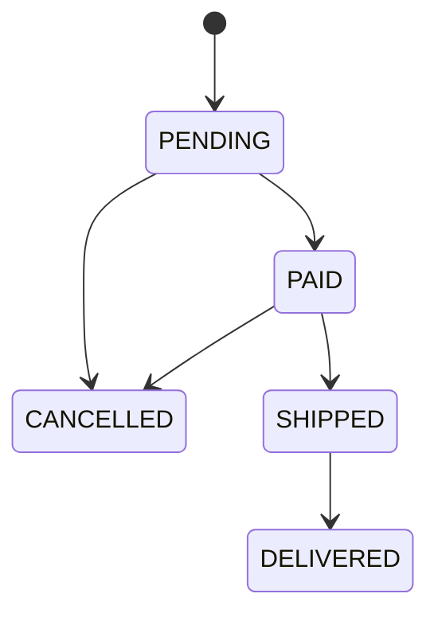

# Зберігання enum у базі даних: @Enumerated, enum-типи Postgres і таблиці-довідники

Майже в кожній доменній моделі є поле, яке може мати лише одне з кількох значень. Замовлення —
`PENDING`, `PAID`, `SHIPPED`, `DELIVERED` або `CANCELLED`. Платіж — авторизований або захоплений.
Підписка — на одному з чотирьох планів. У Java рука сама тягнеться до `enum`. Цікаве питання —
що відбувається на межі: **як ця скінченна множина значень насправді живе в базі даних** і чого
коштує кожен варіант шістьма місяцями пізніше, коли множина змінюється.

Ця стаття проходить усі поширені способи персистенції enum з Hibernate в тому порядку, в якому
ви їх реально зустрінете: два режими `@Enumerated`, справжній Postgres-тип `ENUM`,
`AttributeConverter` і нарешті підхід із lookup-таблицею, де enum стає окремою таблицею.
Я проведу один приклад — статус замовлення — через увесь шлях і завершу вибором, який
роблю насправді.

Стек: **Java, Spring Boot, Hibernate, PostgreSQL**.

<div class="post-tldr" markdown="1">
<p class="post-tldr-title">TL;DR</p>

- `@Enumerated(ORDINAL)` зберігає **позицію** константи — компактно, але вставлення значення в середину мовчки пошкоджує всі наступні рядки. Якщо все ж використовуєте — **зафіксуйте ordinals юніт-тестом**.
- `@Enumerated(STRING)` зберігає **ім’я константи** — самодокументоване, зручне для дебагу, стійке до перевпорядкування. Це розумний дефолт.
- Не зупиняйтеся на голому `varchar` — визначте справжній **Postgres-тип `ENUM`**, щоб сама база відхиляла некоректні значення.
- **`AttributeConverter`** персистує стабільний код, відв’язаний від Java-імені, тож **перейменування перестають бути проблемою бази даних**.
- **Lookup-таблиця** вартує зусиль лише коли значення несуть редаговані бізнес-дані — а не як обхідний шлях для перейменувань.
</div>

---

## Сценарій

Будуємо управління замовленнями. Замовлення проходить фіксований життєвий цикл:



У Java це очевидний enum:

```java
public enum OrderStatus {
    PENDING,
    PAID,
    SHIPPED,
    DELIVERED,
    CANCELLED
}
```

Ентиті замовлення має поле `status`. Єдине питання — як Hibernate змушує його в колонку,
і цей вибір однієї анотації має наслідки, які переживуть код, який ви пишете сьогодні.

---

## Частина 1 — `@Enumerated(ORDINAL)`: зберігаємо як число

Дефолт JPA для enum — `ORDINAL`. Кожна константа зберігається як позиція в оголошенні:
`PENDING` → 0, `PAID` → 1, `SHIPPED` → 2 і так далі.

```java
@Entity
@Table(name = "orders_ordinal")
public class OrderOrdinal {

    @Id
    @GeneratedValue(strategy = GenerationType.UUID)
    private UUID id;

    @Enumerated(EnumType.ORDINAL)   // this is also the default if you omit @Enumerated
    @Column(nullable = false)
    private OrderStatus status;
}
```

```sql
CREATE TABLE orders_ordinal (
    id     UUID     PRIMARY KEY DEFAULT gen_random_uuid(),
    status SMALLINT NOT NULL
);
```

Збережіть замовлення зі статусом `PAID` — у колонці буде `1`. Компактно, і на папері все гаразд.

### ❌ Пастка: вставлення значення в середину

Ordinal зберігається не як мітка — а як *позиція*, і позицію визначає порядок у вихідному коді.
Одного дня хтось додає крок упакування між `PAID` і `SHIPPED`:

```java
public enum OrderStatus {
    PENDING,
    PAID,
    PACKED,      // <-- inserted here
    SHIPPED,
    DELIVERED,
    CANCELLED
}
```

…кожна константа після `PAID` зсувається на одиницю:

| Константа | Ordinal до | Ordinal після |
|---|---|---|
| `PENDING`   | 0 | 0 |
| `PAID`      | 1 | 1 |
| `PACKED`    | — | **2** |
| `SHIPPED`   | 2 | **3** |
| `DELIVERED` | 3 | **4** |
| `CANCELLED` | 4 | **5** |

У базі нічого не змінилося. Кожне наявне замовлення `SHIPPED` досі зберігає ціле число `2` — але
`2` тепер декодується як `PACKED`. Відправлені замовлення мовчки стають упакованими. Доставлені
стають відправленими. Ні помилки, ні падіння міграції, ні рядка в логах. Дані не змінилися;
ваша інтерпретація їх — так. Дізнаєтеся ви, коли клієнт спитає, чому його доставлене замовлення
начебто пакується.

### Захист: зафіксуйте ordinals

Якщо у вас є причина тримати `ORDINAL` — легасі-схема, справді гаряча величезна таблиця, де
різниця в байтах має значення, — тоді зробіть залежність від порядку *явною*: тестом, який падає
в ту мить, як хтось перевпорядкує enum:

```java
class OrdinalPinTest {

    @Test
    void ordinalsAreFrozen() {
        // If this test fails, you reordered OrderStatus. Existing ORDINAL-mapped rows now mean
        // something different. Revert the reorder, or append the new value at the end.
        assertThat(OrderStatus.PENDING.ordinal()).isZero();
        assertThat(OrderStatus.PAID.ordinal()).isEqualTo(1);
        assertThat(OrderStatus.SHIPPED.ordinal()).isEqualTo(2);
        assertThat(OrderStatus.DELIVERED.ordinal()).isEqualTo(3);
        assertThat(OrderStatus.CANCELLED.ordinal()).isEqualTo(4);
        assertThat(OrderStatus.values()).hasSize(5);
    }
}
```

Це чистий юніт-тест — без Spring-контексту, без бази. Він перетворює невидимий баг пошкодження
даних на червоний білд у мить, як хтось торкнеться enum. Нові значення все ще дозволені; просто
мають додаватися в кінець, де append безпечний. Це єдине правило, на якому тримається безпека `ORDINAL`, виражене кодом.

---

## Частина 2 — `@Enumerated(STRING)`: зберігаємо як varchar

Для майже всіх рішення — одне слово:

```java
@Enumerated(EnumType.STRING)
@Column(nullable = false)
private OrderStatus status;
```

Тепер колонка зберігає *ім’я* константи:

```sql
CREATE TABLE orders_string (
    id     UUID    PRIMARY KEY DEFAULT gen_random_uuid(),
    status VARCHAR NOT NULL
);
```

Замовлення `PAID` зберігає буквальний рядок `'PAID'`. Одразу покращуються три речі:

- **Перевпорядкування нешкідливе.** Значення — це власне ім’я; позиції більше нічого не значать.
  Додавайте `PACKED` де завгодно.
- **Це зручно дебажити.** `SELECT * FROM orders_string WHERE status = 'PAID'` читається як текст.
  Не треба тримати в голові таблицю відповідностей до коду Java.
- **Дампи та логи самодокументовані.** Рядок у CSV-експорті щось означає сам по собі.

Так, `'DELIVERED'` коштує більше байтів, ніж `3`. Для переважної більшості таблиць ця різниця —
шум, а індекс завжди можна додати. Зберігання імені — правильний дефолт, а «компактність» майже ніколи не варта ризику мовчки отримати хибні дані.

### Єдина пастка, що лишається: перейменування

`STRING` прибирає пастку порядку, але додає меншу. Збережене значення — це й є Java-ідентифікатор,
тому перейменування константи робить наявні рядки сиротами:

```java
PENDING  →  AWAITING_PAYMENT
```

Кожен старий рядок `'PENDING'` більше не збігається з жодною константою, і Hibernate падає при
читанні. Збережені дані й код мовчки розійшлися. Це можна виправити міграцією даних
(`UPDATE … SET status = 'AWAITING_PAYMENT' WHERE status = 'PENDING'`) — і це цілком прийнятна
відповідь. У частині 4 ми також побачимо спосіб зробити перейменування взагалі непроблемою.

---

## Частина 3 — Хороша практика: справжній enum-тип Postgres

Обидва варіанти вище зберігають у колонку, яку база по-справжньому не розуміє — `smallint` або
`varchar`, який *випадково* містить значення enum. Postgres уміє краще. У нього є повноцінні
enum-типи:

```sql
CREATE TYPE order_status AS ENUM ('PENDING', 'PAID', 'SHIPPED', 'DELIVERED', 'CANCELLED');

CREATE TABLE orders_pgenum (
    id     UUID         PRIMARY KEY DEFAULT gen_random_uuid(),
    status order_status NOT NULL
);
```

Тепер *база даних* забезпечує домен. `INSERT … VALUES ('SHPPED')` — одруківка, погана міграція,
кривий скрипт — одразу падає з `invalid input value for enum order_status`. З голим
`varchar` це сміття опиняється в таблиці, і ви виявите його пізніше. Enum-тип — це документація
та обмеження в одному: тип колонки буквально перелічує допустимі значення.

Мапінг у Hibernate — той самий `@Enumerated(STRING)`, що й раніше: Hibernate біндить ім’я
константи як рядок, а Postgres зберігає його в enum:

```java
@Enumerated(EnumType.STRING)
@Column(nullable = false, columnDefinition = "order_status")
private OrderStatus status;
```

Є рівно один шматок сантехніки. За замовчуванням JDBC-драйвер PostgreSQL надсилає Java `String`
як тип `varchar`, і Postgres не робить неявний каст `varchar` → `order_status`, тож ви отримаєте
`column "status" is of type order_status but expression is of type character varying`. Додайте
`stringtype=unspecified` до JDBC URL, і драйвер надішле значення як `unknown`, дозволяючи
Postgres скастити його в enum:

```yaml
spring:
  datasource:
    url: jdbc:postgresql://localhost:5434/mydatabase?stringtype=unspecified
```

(Hibernate 6 також пропонує `@JdbcTypeCode(SqlTypes.NAMED_ENUM)` для цілеспрямування в іменований
enum-тип; комбінація `@Enumerated(STRING)` + `stringtype=unspecified` вище — найпоширеніша і та,
яку я обираю.)

**Єдине застереження, яке варто знати:** `ALTER TYPE order_status ADD VALUE 'PACKED'` лише
*додає в кінець*. Значення можна додати (а з PostgreSQL 12 — навіть до/після конкретного), але
без перестворення типу не можна видалити чи перевпорядкувати наявні. Звучить як обмеження,
доки не помітиш: це *те саме правило*, яке забезпечував ordinal-тест — ніколи не
перевпорядковувати, лише додавати, — тільки тут його гарантує база, а не юніт-тест. Обмеження
і є фіча.

---

## Частина 4 — `AttributeConverter`: розв’язуємо ім’я та значення

Пастка перейменування з частини 2 існує, бо ми дозволили *збереженому значенню* та
*Java-ідентифікатору* бути одним рядком. JPA `AttributeConverter` розриває цей зв’язок:
ви персистуєте стабільний код, який нічого не має спільного з іменем константи.

Дайте кожній константі явний, постійний код:

```java
public enum OrderStatus {

    PENDING("PND"),
    PAID("PAID"),
    SHIPPED("SHP"),
    DELIVERED("DLV"),
    CANCELLED("CNC");

    private final String code;

    OrderStatus(String code) {
        this.code = code;
    }

    public String getCode() {
        return code;
    }

    public static OrderStatus fromCode(String code) {
        return Arrays.stream(values())
                .filter(s -> s.code.equals(code))
                .findFirst()
                .orElseThrow(() -> new IllegalArgumentException("Unknown OrderStatus code: " + code));
    }
}
```

Далі — конвертер, що мапить enum ↔ код:

```java
@Converter
public class OrderStatusConverter implements AttributeConverter<OrderStatus, String> {

    @Override
    public String convertToDatabaseColumn(OrderStatus status) {
        return status == null ? null : status.getCode();
    }

    @Override
    public OrderStatus convertToEntityAttribute(String code) {
        return code == null ? null : OrderStatus.fromCode(code);
    }
}
```

І підключіть його на полі через `@Convert` замість `@Enumerated`:

```java
@Convert(converter = OrderStatusConverter.class)
@Column(nullable = false)
private OrderStatus status;
```

Тепер база зберігає `'PAID'` як *код*, а не як ідентифікатор. Перейменуйте Java-константу
`PENDING` у `AWAITING_PAYMENT` — і збережений код `'PND'` не зміниться: перейменування стає
чистим рефакторингом з нульовим впливом на базу. Ви розділили те, що знає база, і те, як ви
називаєте речі в коді, — і це саме та властивість, за якою люди беруться за lookup-таблиці.
Запам’ятайте це до наступної частини.

---

## Частина 5 — Підхід із таблицею-довідником

Останній підхід взагалі перестає трактувати статус як enum. Натомість множина статусів живе
у власній таблиці, а замовлення посилаються на рядок зовнішнім ключем:

```sql
CREATE TABLE order_statuses (
    id       INTEGER PRIMARY KEY,
    code     VARCHAR NOT NULL UNIQUE,
    label    VARCHAR NOT NULL,
    terminal BOOLEAN NOT NULL DEFAULT FALSE
);

INSERT INTO order_statuses (id, code, label, terminal) VALUES
    (1, 'PND',  'Pending',   FALSE),
    (2, 'PAID', 'Paid',      FALSE),
    (3, 'SHP',  'Shipped',   FALSE),
    (4, 'DLV',  'Delivered', TRUE),
    (5, 'CNC',  'Cancelled', TRUE);

CREATE TABLE orders_lookup (
    id        UUID    PRIMARY KEY DEFAULT gen_random_uuid(),
    status_id INTEGER NOT NULL REFERENCES order_statuses (id)
);
```

У JPA статус стає зв’язком, а не перелічуваним значенням:

```java
@Entity
@Table(name = "orders_lookup")
public class OrderLookup {

    @Id
    @GeneratedValue(strategy = GenerationType.UUID)
    private UUID id;

    @ManyToOne(fetch = FetchType.EAGER, optional = false)
    @JoinColumn(name = "status_id", nullable = false)
    private OrderStatusDefinition status;
}
```

Щоб дізнатися статус замовлення — людську мітку, чи є він термінальним — потрібен **join**:

```sql
SELECT o.id, s.code, s.label
FROM   orders_lookup o
JOIN   order_statuses s ON s.id = o.status_id
WHERE  o.id = ?;
```

### ✅ Коли це виправдовує себе

Таблиця-довідник купує одну реальну річ: множина значень і метадані кожного з них живуть
у **даних**, а не в **коді**. Це справді цінно, коли:

- **Кожне значення несе редаговані бізнес-дані** — мітку для показу, порядок сортування, колір,
  feature flag, SLA. Статус — не просто ідентичність; це маленький запис.
- **Значеннями керують не розробники**, або вони налаштовуються per tenant, або змінюються
  в рантаймі без деплою.
- **Вам справді потрібні масові зміни** — перейменувати мітку, що зустрічається в мільйонах рядків,
  оновленням одного рядка в `order_statuses`, а не кожного замовлення.

Останній пункт — найсильніший аргумент: змінити в одному місці, а не в усіх. Якщо ваш «enum»
насправді — каталог, що підтримується, це правильна модель.

---

## Мій вибір

Для *простого* enum — фіксованої множини станів на рівні коду, як-от життєвий цикл замовлення, —
я не використовую таблицю-довідник і чинив би опір їй на рев’ю.

Типове обґрунтування, яке я чую: «а якщо треба перейменувати значення?». Але ми щойно бачили,
що це розв’язується без таблиці: `AttributeConverter` розділяє збережений код і Java-ім’я,
а мітка, що змінюється, — міграція на один рядок. Не потрібен зовнішній ключ і join у кожному
запиті, щоб пережити перейменування.

Що таблиця-довідник насправді додає в цьому кейсі — постійну вартість: кожне читання або робить
join, або тягне другий запит, статус тепер керований зв’язок замість значення, а вичерпний
на етапі компіляції `switch` по станах стає рантайм-пошуком, який може не знайти. Ви обміняли
значення, яке розуміє компілятор, на рядок, якого компілятор не розуміє, — щоб купити
гнучкість, якої фіксований життєвий цикл ніколи не використає.

Тож моє правило стосується **того, чим є значення**, а не перейменувань:

- Якщо значення — **лише ідентичність** — це `SHIPPED`, крапка, — тримайте його enum’ом.
  Мапіть `@Enumerated(STRING)`, підкріпіть enum-типом Postgres і беріть `AttributeConverter`,
  коли хочете безкоштовних перейменувань.
- Якщо значення — **запис** — у нього є поля, які люди редагують у рантаймі, — то це ніколи
  не був справжній enum. Дайте йому таблицю.

Перейменування — не вирішальний фактор. Вирішальний фактор — чи має річ власні дані.

---

## Як обрати підхід

| Підхід | Зберігає | Коли використовувати | Головний ризик |
|---|---|---|---|
| `@Enumerated(ORDINAL)` | позицію (`1`) | майже ніколи | перевпорядкування мовчки пошкоджує рядки |
| `@Enumerated(STRING)` | ім’я константи (`'PAID'`) | розумний дефолт | перейменування роблять рядки сиротами |
| enum-тип Postgres | ім’я, валідується базою | хочете, щоб база відхиляла погані значення | `ADD VALUE` лише додає в кінець |
| `AttributeConverter` | стабільний код (`'PAID'`) | хочете безкоштовних перейменувань | один маленький клас для підтримки |
| Lookup-таблиця | FK на рядок | значення несуть редаговані дані | join у кожному читанні |

Надійний дефолт для більшості проєктів: **`@Enumerated(STRING)` поверх enum-типу Postgres**,
з апгрейдом до **`AttributeConverter`**, щойно хочете ізолювати збережене значення від
Java-імені.

---

## Код

Код із цієї статті доступний у
**[github.com/javaAndScriptDeveloper/enums-article](https://github.com/javaAndScriptDeveloper/enums-article)** —
той самий enum `OrderStatus`, персистований усіма п’ятьма способами, тест фіксації ordinals
і round-trip тест на кожен підхід, який перевіряє, що кожен справді пише на диск. Усе запускається
локально з Docker і однією командою `./gradlew test`.

---

## Підсумок

Вибір способу зберігання enum здається п’ятисекундним рішенням — і саме тому варто пригальмувати.
Ordinal-граблі, пастка перейменування, відсутнє обмеження бази — жодне з них не проявляється
в день, коли ви пишете анотацію. Вони проявляються в день, коли множина значень змінюється,
а вона змінюється завжди — зазвичай задовго після того, як ви забули компроміс, на який погодилися.

Хороша новина: дефолти прості. Зберігайте ім’я, дозвольте базі його валідувати, і відв’язуйте
код від ідентифікатора, коли це потрібно. Таблицю-довідник залиште для випадків, що справді є
каталогом, а не enum. Зробіть це правильно один раз — і ваші статуси залишаться нудними,
а це найвища похвала, яку може отримати колонка.

---

## Поговоримо

Якщо ви зберігаєте enum інакше — або обпеклися на одній із цих пасток способом, якого я
не розглянув, — буду радий почути. Контактні посилання — у футері.
