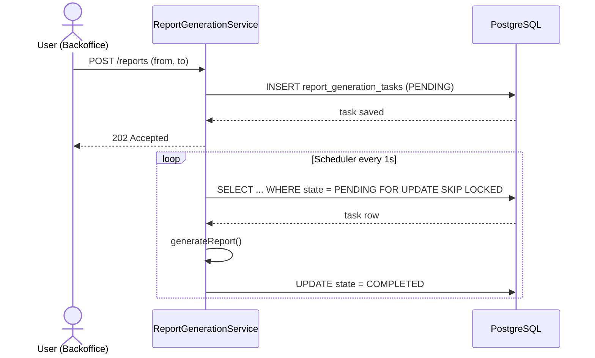
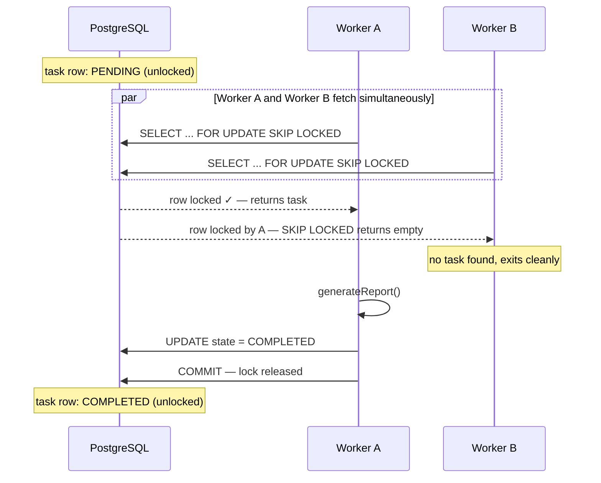
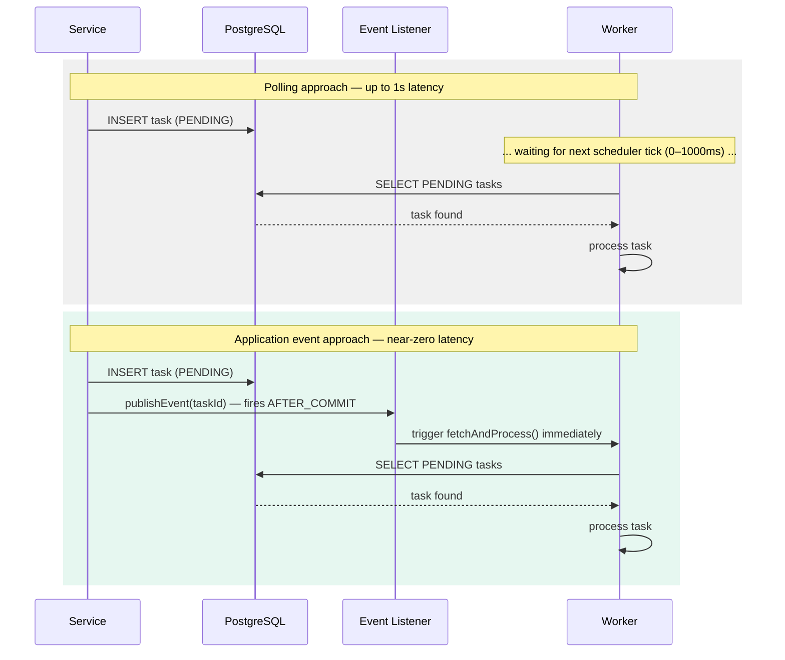
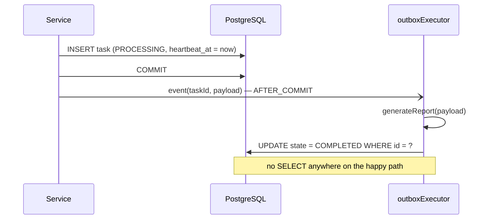
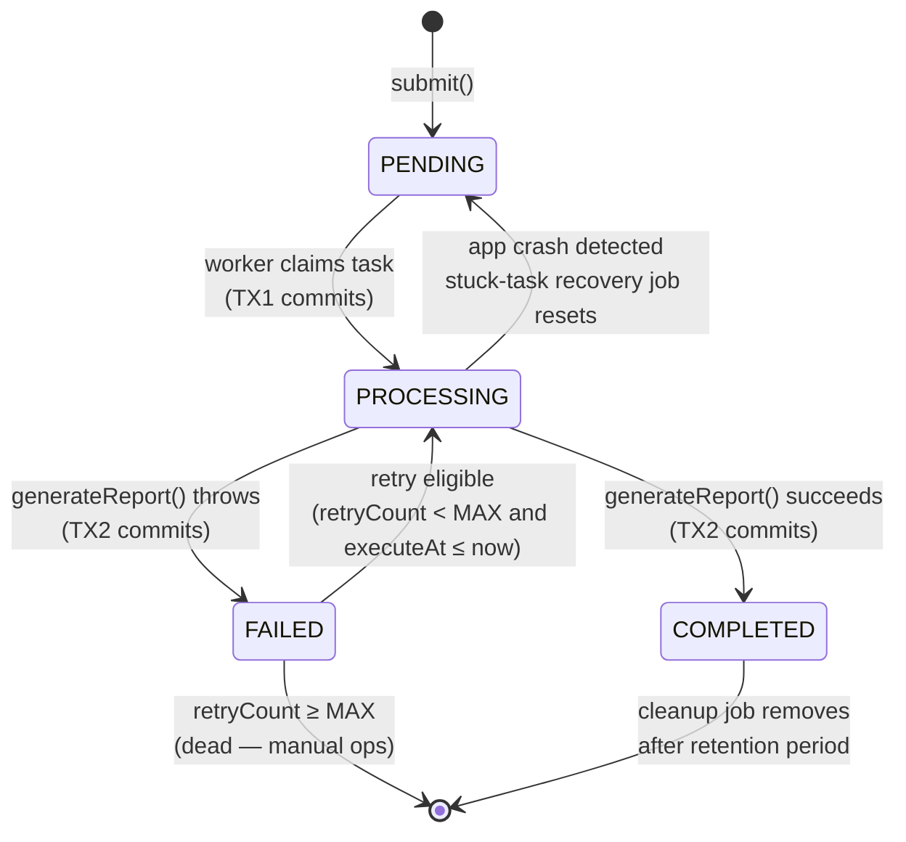
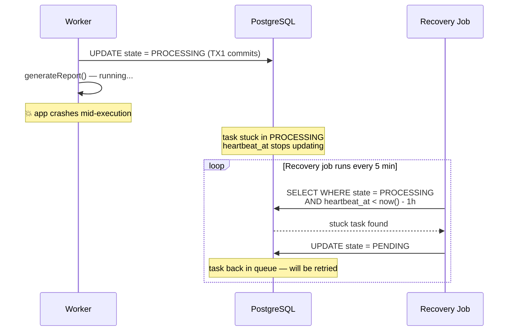
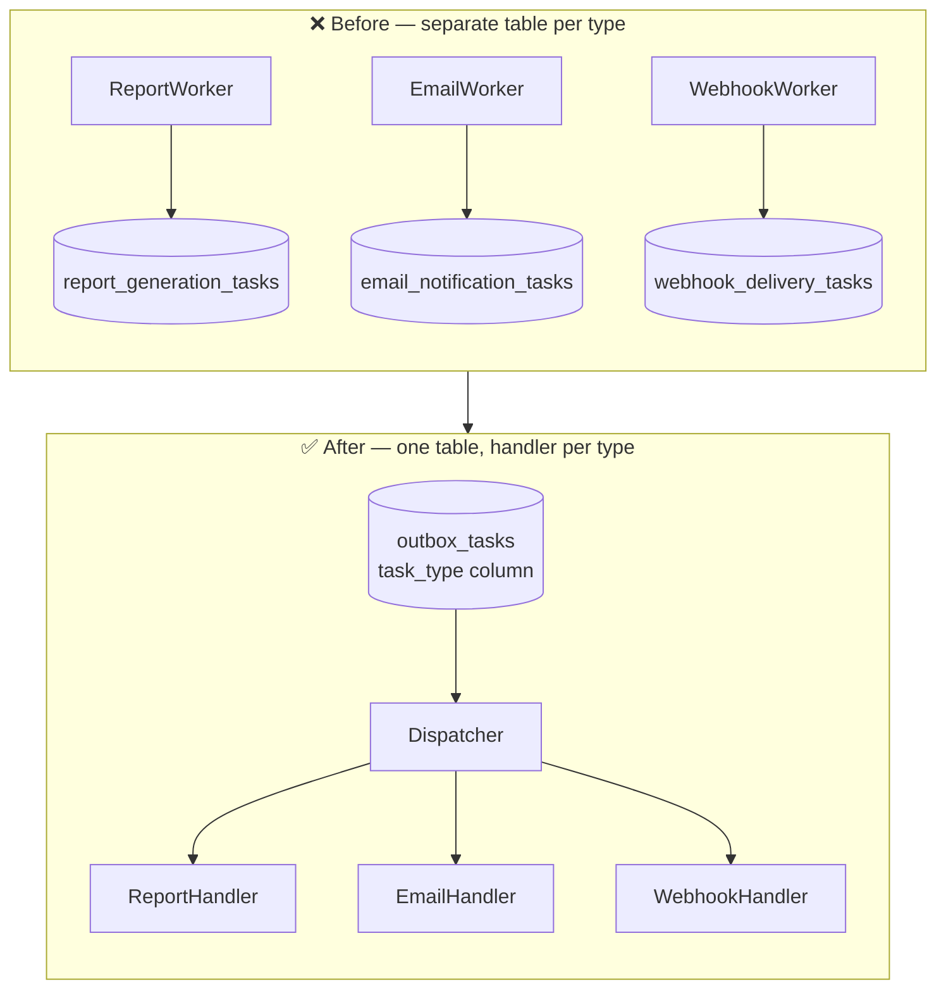
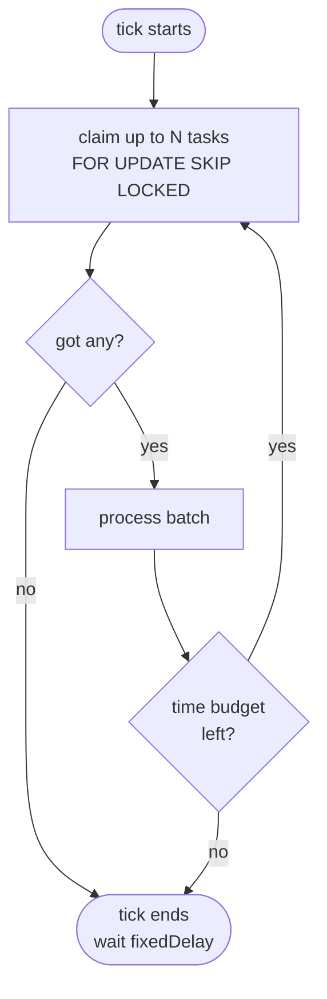

# Патерн Transactional Outbox: від однієї задачі до асинхронного рушія продакшен-рівня

Існує клас багів, який ніколи не проявляється в юніт-тестах і рідко з’являється на стейджингу.
Він проявляється в продакшені, о другій ночі, коли ваш застосунок зберігає запис у базу, а потім
намагається викликати зовнішній сервіс — і щось із цього падає. Одна сторона закомітила. Інша —
ні. Ніхто не дізнається, доки користувач не поскаржиться.

Це **проблема подвійного запису** (dual-write), і патерн Transactional Outbox — стандартна
відповідь на неї. Ідея проста: замість прямого виклику зовнішньої системи запишіть задачу в ту
саму транзакцію бази даних, що й зміну вашої доменної моделі. Фоновий воркер підхопить її та
виконає. Запис атомарний. Задачу неможливо втратити.

А от що задокументовано значно гірше — усе, що йде після базової ідеї: що відбувається, коли
задачі падають, коли два воркери змагаються за той самий рядок, коли застосунок падає посеред
виконання, коли в одній таблиці живе десять різних типів задач, і коли стейкхолдери питають,
чому глибина черги різко зросла о третій ночі минулого вівторка.

Саме це й розбирає ця стаття.

Розбиратиму один конкретний сценарій — **сервіс генерації звітів** — і крок за кроком
еволюціонуватиму його від найпростішого outbox до рішення, яке я був би готовий тримати в
продакшені. Усі фрагменти коду взяті з реального робочого репозиторію, посилання наприкінці.

Стек: **Java, Spring Boot, PostgreSQL**.

<div class="post-tldr" markdown="1">
<p class="post-tldr-title">TL;DR</p>

- **Патерн Transactional Outbox** усуває проблему подвійного запису: рядок задачі пишеться в **ту саму транзакцію БД**, що й зміна домену, а виконує його фоновий воркер.
- Опитуйте таблицю outbox через `SELECT ... FOR UPDATE SKIP LOCKED`, щоб кілька воркерів працювали паралельно без подвійної обробки.
- **Ніколи** не надсилайте повідомлення в Kafka і не викликайте інші сервіси всередині транзакції БД: час транзакції ніколи не повинен залежати від зовнішнього ресурсу.
- Продакшен-рівень вимагає більшого за базову ідею: **машину станів**, **повтори з backoff і jitter**, **heartbeats/lease** для відновлення після падіння воркера, гарантії **порядку**, свідомо обрану **стратегію вибірки**, **пакетне очищення** та **моніторинг** глибини черги.
- Для низької затримки будіть воркерів подією `AFTER_COMMIT` на **виділеному пулі потоків** — або переходьте на **zero-select** і передавайте payload прямо в події, поступаючись контролем над навантаженням заради швидкості.
- Kafka не потрібна — **самого PostgreSQL** достатньо для надійного асинхронного виконання.
</div>

---

## Сценарій



Будуємо CRM. Користувачі можуть запитувати місячні аналітичні звіти з бекофіс-інтерфейсу.
Генерація звіту означає агрегацію десятків мільйонів рядків — це може тривати хвилини.
Очевидно, що синхронно в HTTP-запиті це робити не можна.

Користувач натискає кнопку. Бекенд приймає запит, зберігає його й одразу відповідає.
Фоновий воркер забирає задачу, виконує генерацію та оновлює статус по завершенні.

Це найпростіший випадок, коли outbox доречний: робота, яка за своєю природою справді
асинхронна, і користувач уже очікує на результат.

---

## Частина 1 — Базовий outbox

### Що потрібне кожному outbox

По суті, будь-якій таблиці outbox потрібні три речі:

- **Стан** — на якому етапі життєвого циклу перебуває ця задача?
- **Payload** — що саме потрібно виконати?
- **Мітки часу** — коли створено, коли змінювалося востаннє?

```sql
CREATE TYPE task_state AS ENUM ('PENDING', 'COMPLETED');

CREATE TABLE report_generation_tasks (
                                       id         UUID       PRIMARY KEY DEFAULT gen_random_uuid(),
                                       state      task_state NOT NULL    DEFAULT 'PENDING',
                                       payload    JSONB      NOT NULL,
                                       created_at TIMESTAMP  NOT NULL    DEFAULT now(),
                                       updated_at TIMESTAMP  NOT NULL    DEFAULT now()
);
```

Payload для нашого кейсу — діапазон дат:

```java
@Value
@Builder
@Jacksonized
public class ReportGenerationPayload {
  Instant from;
  Instant to;
}
```

JPA-ентиті:

```java
@Entity
@Table(name = "report_generation_tasks")
@Data
@Builder
@NoArgsConstructor
@AllArgsConstructor
public class ReportGenerationEntity {

    @Id
    @GeneratedValue(strategy = GenerationType.UUID)
    @Column(updatable = false, nullable = false)
    private UUID id;

    @Enumerated(EnumType.STRING)
    @Column(nullable = false, columnDefinition = "task_state")
    private TaskState state;

    @JdbcTypeCode(SqlTypes.JSON)
    @Column(nullable = false, updatable = false, columnDefinition = "jsonb")
    private ReportGenerationPayload payload;

    @CreationTimestamp
    @Column(nullable = false, updatable = false)
    private Instant createdAt;

    @UpdateTimestamp
    @Column(nullable = false)
    private Instant updatedAt;
}
```

Створення задачі:

```java
@Service
@RequiredArgsConstructor
public class ReportGenerationService {

    private final ReportGenerationRepository repository;

    public void submit(ReportGenerationCommand command) {
        repository.save(ReportGenerationEntity.builder()
                .state(TaskState.PENDING)
                .payload(ReportGenerationPayload.builder()
                        .from(command.getFrom())
                        .to(command.getTo())
                        .build())
                .build());
    }
}
```

### Воркер

Запланована задача опитує таблицю на предмет задач у стані PENDING і виконує їх:

```java
@Component
@RequiredArgsConstructor
public class ReportGenerationScheduledJob {

    private final ReportGenerationTaskService taskService;

    @Scheduled(fixedDelay = 1000)
    public void run() {
        taskService.fetchAndProcess();
    }
}
```

```java
@Service
@RequiredArgsConstructor
public class ReportGenerationTaskService {

    private final ReportGenerationRepository repository;

    public void fetchAndProcess() {
        repository.findFirstByStateOrderByCreatedAt(TaskState.PENDING)
                .ifPresent(task -> {
                    generateReport(task);
                    task.setState(TaskState.COMPLETED);
                    repository.save(task);
                });
    }

    private void generateReport(ReportGenerationEntity task) {
        // actual report generation logic
    }
}
```

```java
public interface ReportGenerationRepository extends JpaRepository<ReportGenerationEntity, UUID> {
    Optional<ReportGenerationEntity> findFirstByStateOrderByCreatedAt(TaskState state);
}
```

Це працює в застосунку з одним інстансом і без збоїв. У реальному світі тут дві проблеми:
два воркери можуть забрати ту саму задачу одночасно, а задачі можуть падати без жодного шляху
відновлення. Виправимо обидві.

---

## Частина 2 — Конкурентність: два воркери, одна задача

Коли два потоки планувальника — або два інстанси застосунку — виконують запит вибірки в той самий
момент, обидва можуть прочитати той самий рядок `PENDING`, і обидва спробують його виконати.
Результат — щонайменше дублювання роботи, щонайбільше — пошкоджений стан.

Рішення — блокування на рівні бази даних, взяте під час вибірки. `SELECT ... FOR UPDATE SKIP
LOCKED` у PostgreSQL створений саме для такого сценарію: він блокує рядок для поточної транзакції
та пропускає рядки, вже заблоковані іншою транзакцією, замість того, щоб чекати.

```java
public interface ReportGenerationRepository extends JpaRepository<ReportGenerationEntity, UUID> {

    @Lock(LockModeType.PESSIMISTIC_WRITE)
    @QueryHint(name = AvailableSettings.JAKARTA_LOCK_TIMEOUT, value = "-2") // -2 = SKIP_LOCKED
    Optional<ReportGenerationEntity> findFirstByStateOrderByCreatedAt(TaskState state);
}
```

Значення `-2` для хінта `SKIP_LOCKED` — те, що Hibernate перетворює на clause `SKIP LOCKED`.
Оскільки окремої анотації першого класу для цього немає, варто винести це в повторно
використовувану анотацію, щоб не розкидати магічне число по всіх репозиторіях:

```java
@Retention(RetentionPolicy.RUNTIME)
@Target({ElementType.METHOD, ElementType.ANNOTATION_TYPE})
@QueryHints(@QueryHint(
    name = AvailableSettings.JAKARTA_LOCK_TIMEOUT,
    value = Timeouts.SKIP_LOCKED_MILLI + ""
))
public @interface SkipLocked {}
```

Значно чистіше. Тепер репозиторій читається як виражений намір, а не як технічна обв’язка:

```java
@SkipLocked
@Lock(LockModeType.PESSIMISTIC_WRITE)
Optional<ReportGenerationEntity> findFirstByStateOrderByCreatedAt(TaskState state);
```

Ви *можете* утримувати блокування протягом обробки, обгорнувши весь цикл «вибірка—виконання—
оновлення» в одну транзакцію, але зазвичай цього не варто робити:

```java
// Technically works, but do not use this pattern for outbox processing.
@Transactional
public void fetchAndProcess() {
    repository.findFirstByStateOrderByCreatedAt(TaskState.PENDING)
            .ifPresent(task -> {
                generateReport(task);
                task.setState(TaskState.COMPLETED);
                repository.save(task);
            });
}
```



Навіть якщо `generateReport()` настільки малий, що технічно все працює, виконання outbox-дії
під відкритою транзакцією — антипатерн. Тривалість транзакції не повинна залежати від тривалості
виконання outbox-дії: дія може ставати повільнішою з часом, блокуватися на I/O або викликати
залежний сервіс, утримуючи з’єднання з БД і блокування рядка непередбачувано довго.

Замість цього забирайте рядок у короткій транзакції, переводячи його в `PROCESSING`, комітьте
й відпускайте блокування, і лише потім виконуйте outbox-дію. Стан `COMPLETED` або `FAILED`
фіксуйте вже після цього — окремою короткою транзакцією. Наступний розділ реалізує цей перехід
станів і шлях відновлення.

### Ніколи не звертайтеся до зовнішнього світу всередині транзакції

Те саме правило діє далеко за межами outbox-воркера, і саме його порушення найчастіше, з того, що
я бачив, кладе сервіс у коді довкола outbox. Виглядає це невинно:

```java
// ❌ Kafka send (or an HTTP call, or an S3 upload) inside an open DB transaction
@Transactional
public void approveOrder(UUID orderId) {
    var order = orderRepository.findById(orderId).orElseThrow();
    order.setStatus(OrderStatus.APPROVED);

    kafkaTemplate.send("order-approved", orderId.toString(), toEvent(order)).get(); // blocks
    billingClient.notifyApproved(orderId);                                         // blocks
}
```

У хороший день Kafka підтверджує запис за 5 мс, а білінг відповідає за 30 мс, тож ніхто нічого
не помічає. У поганий день брокер ребалансується або білінг деградував, і кожен виклик висить
30 секунд, перш ніж відвалитися за таймаутом. Тепер **кожна** активна транзакція відкрита
30 секунд:

- кожна тримає з’єднання з пулу — з 20 з’єднаннями й 30-секундними викликами весь ваш сервіс
  може підтвердити 20 замовлень за 30 секунд, а все інше (включно зі здоровими ендпоінтами на
  читання) стоїть у черзі до пулу й починає падати за таймаутом;
- щойно транзакція щось записала (у JPA це може статися лише під час flush на коміті, але часто
  раніше), вона тримає блокування рядків — усе, що торкається тих самих замовлень, чекає за ними;
- довга транзакція, яка вже щось записала, стримує горизонт vacuum у Postgres — мертві рядки по
  всій базі не можна прибрати, доки вона не завершиться, тож bloat накопичується скрізь, а не
  лише в цій таблиці.

Деградація залежності, якою ви не володієте, щойно перетворилася на аварію бази даних, якою
володієте ви. **Тривалість транзакції бази даних ніколи не повинна залежати від зовнішнього
ресурсу.** Транзакція має чекати лише на саму базу даних.

До того ж це все одно подвійний запис. Якщо надсилання в Kafka вдалося, а коміт потім упав
(порушення обмеження, помилка серіалізації, под убили), консьюмери вже побачили подію
`order-approved` для замовлення, яке так і не було підтверджене. Перенесення надсилання *після*
коміту лише перевертає режим відмови: закомічено, але подію втрачено. Саме цю проблему й
розв’язує outbox — запишіть намір в outbox у межах транзакції, а з Kafka нехай потім говорить
воркер.

Два запобіжники варто додати навіть тоді, коли код правильний, бо наступна людина, яка його
чіпатиме, може не знати цього правила:

```java
@Transactional(timeout = 5) // seconds
public void approveOrder(UUID orderId) { ... }
```

`timeout` у Spring не перериває виклик, який уже заблокований, — це дедлайн, який перевіряє
наступна робота з базою. Будь-яка інструкція, виконана після дедлайну (включно з flush на
коміті), падає з винятком таймауту, і транзакція відкочується. Сприймайте це як розтяжку, що
перетворює «повільно й тихо» на «гучно падає в тестах і логах», а не як ліки.

```sql
-- server-side safety net: kill sessions that sit idle inside an open transaction
ALTER DATABASE app SET idle_in_transaction_session_timeout = '30s';
```

`idle_in_transaction_session_timeout` — це рівно описана вище ситуація з погляду Postgres:
сесія відкрила транзакцію, а потім замовкла, поки застосунок чекав на щось інше.

---

## Частина 2.5 — Зниження затримки за допомогою Application Events

У планувальника з опитуванням є вроджена нижня межа затримки. Якщо задача спрацьовує щосекунди,
задача, створена о `t=0ms`, висить у стані `PENDING` до наступного тику — до 1000 мс. Для більшості
асинхронних навантажень це прийнятно. Для випадків, коли потрібне майже миттєве взяття в роботу —
надсилання транзакційного листа, виклик вебхуку — ні.

Патерн, запозичений у Celery: зберегти outbox-ентиті в базу, а потім одразу опублікувати Spring
`ApplicationEvent` з ID нової задачі. Лістенер підхоплює подію та негайно запускає обробку,
не чекаючи наступного тику планувальника.



Планувальник усе одно працює як страховка — він підхоплює все, що пропустив лістенер подій
(перезапуск застосунку, виняток у лістенері, втрачена подія). Але щасливий шлях повністю
обходить затримку опитування.

### Реалізація

Публікуйте подію всередині методу сервісу, після збереження:

```java
@Service
@RequiredArgsConstructor
public class ReportGenerationService {

    private final ReportGenerationRepository repository;
    private final ApplicationEventPublisher eventPublisher;

    @Transactional
    public void submit(ReportGenerationCommand command) {
        var entity = repository.save(ReportGenerationEntity.builder()
                .state(TaskState.PENDING)
                .payload(ReportGenerationPayload.builder()
                        .from(command.getFrom())
                        .to(command.getTo())
                        .build())
                .build());

        eventPublisher.publishEvent(new ReportGenerationTaskSubmittedEvent(entity.getId()));
    }
}
```

```java
public record ReportGenerationTaskSubmittedEvent(UUID taskId) {}
```

Лістенер реагує після коміту, **на власному пулі потоків**:

```java
@Component
@RequiredArgsConstructor
public class ReportGenerationTaskEventListener {

    private final ReportGenerationTaskService taskService;

    @Async("outboxExecutor")
    @TransactionalEventListener(phase = TransactionPhase.AFTER_COMMIT)
    public void onTaskSubmitted(ReportGenerationTaskSubmittedEvent event) {
        taskService.fetchAndProcess();
    }
}
```

Зверніть увагу: лістенер не передає `event.taskId()` далі. Це навмисно: подія — лише **сигнал
пробудження**, а `fetchAndProcess()` забирає роботу так само, як і поллер, — найстаршу придатну
задачу, зі `SKIP LOCKED`. Задача, яка породила подію, може й не бути тією, що виконається, зате
логіка порядку та захоплення живе в одному місці. Якщо ж ви хочете виконати саме *цю* задачу
просто зараз, передайте id і захопіть її напряму:

```java
taskService.process(event.taskId()); // WHERE id = :id AND state = 'PENDING' FOR UPDATE SKIP LOCKED
```

Так автор запиту отримує найменшу затримку — ціною того, що нові задачі обганяють старіші в
`PENDING`. Для незалежної роботи це нормально, а от якщо ви покладаєтеся на FIFO (частина 7) —
ні. Zero-select outbox наприкінці цієї частини доводить ідею до логічного завершення й передає
весь payload.

`@Async` тут не для краси. Лістенер `AFTER_COMMIT` без нього виконується **синхронно в потоці,
який закомітив транзакцію**, — тобто в потоці HTTP-запиту. Відповідь «202 Accepted» тепер чекає,
доки згенерується весь звіт. Гірше того, на цей момент ресурси закоміченої транзакції все ще
прив’язані до потоку: документація Spring прямо попереджає, що доступ до даних з after-commit
колбеку все ще «бере участь» у завершеній транзакції, і ніхто цю роботу не закомітить, якщо код
явно не попросить `REQUIRES_NEW`. Перенесення лістенера в окремий потік виправляє обидві проблеми
одразу.

### Виділений пул потоків, а не стандартний

`@Async` без імені використовує спільний `applicationTaskExecutor` зі Spring Boot — спільний з
усіма іншими `@Async`-методами застосунку і, за замовчуванням, із фактично необмеженою чергою.
Шквал подій тихо перетвориться на беклог у пам’яті, який зникне з наступним перезапуском. Дайте
outbox власний обмежений пул:

```java
@Configuration
@EnableAsync
public class OutboxExecutorConfig {

    @Bean("outboxExecutor")
    public ThreadPoolTaskExecutor outboxExecutor() {
        var executor = new ThreadPoolTaskExecutor();
        executor.setCorePoolSize(4);
        executor.setMaxPoolSize(4);
        executor.setQueueCapacity(200);                 // bounded: overflow is rejected, not buffered forever
        executor.setThreadNamePrefix("outbox-");        // readable thread dumps and logs
        executor.setRejectedExecutionHandler(new ThreadPoolExecutor.DiscardPolicy());
        executor.setWaitForTasksToCompleteOnShutdown(true);
        executor.setAwaitTerminationSeconds(15);
        return executor;
    }
}
```

Одна деталь Spring Boot, яку варто знати, перш ніж це копіювати: Boot автоконфігурує свій
`applicationTaskExecutor` лише тоді, коли ви **не** оголосили власного біна `Executor`. Оголосіть
`outboxExecutor` — і стандартний зникне: кожен *безіменний* `@Async` деінде в застосунку тихо
опиниться на іншому екзекуторі (можливо, на цьому, з його discard-політикою). На Boot 3.5+
виставте `spring.task.execution.mode=force`, щоб зберегти автоконфігурований; на старіших версіях
явно оголосіть бін `applicationTaskExecutor` поруч із цим.

Відкидати надлишок тут безпечно, *бо рядок уже в базі*: подія — лише оптимізація затримки, і
поллер підбере все, що впустив шлях через події. Ніколи не використовуйте `CallerRunsPolicy` для
цього пулу — «caller» тут саме той потік запиту, який ви намагалися звільнити.

### Класична помилка

Найпоширеніша помилка тут — використання `@EventListener` замість
`@TransactionalEventListener(phase = TransactionPhase.AFTER_COMMIT)`. Що саме піде не так,
залежить від того, чи лістенер асинхронний:

- **Звичайний `@EventListener`** спрацьовує в момент виклику `publishEvent()` — синхронно, у тому
  самому потоці, **всередині ще відкритої транзакції**. `fetchAndProcess()` приєднується до цієї
  транзакції, тож *бачить* незакомічений рядок — і тут же захоплює та виконує задачу. Звіт
  генерується всередині транзакції submit (той самий антипатерн із частини 2), запит висить, доки
  все не завершиться, а якщо транзакція submit потім відкотиться, ви виконали задачу, якої
  офіційно ніколи не існувало.
- **`@Async` + `@EventListener`** виконується в іншому потоці з іншим з’єднанням, ще до коміту.
  Рядок поки невидимий, вибірка нічого не знаходить, і подія мовчки марнується. Планувальник
  підхопить задачу за секунду, тож у логах усе виглядає нормально — ви просто непомітно втратили
  виграш у затримці.

```java
// ❌ fires inside the open transaction (or before it commits, if @Async)
@EventListener
public void onTaskSubmitted(ReportGenerationTaskSubmittedEvent event) {
    taskService.fetchAndProcess();
}

// ✅ fires after COMMIT, on the outbox pool — the row is visible and the caller is free
@Async("outboxExecutor")
@TransactionalEventListener(phase = TransactionPhase.AFTER_COMMIT)
public void onTaskSubmitted(ReportGenerationTaskSubmittedEvent event) {
    taskService.fetchAndProcess();
}
```

Планувальник залишається без змін — він слугує механізмом відновлення для задач, які лістенер
подій пропустив. Два підходи доповнюють один одного: події — заради затримки, опитування —
заради надійності.

### Ще далі: zero-select outbox

Подія вище все одно коштує одного походу в базу. Вона лише каже «з’явилося щось нове», тож
воркеру доводиться робити `SELECT`, щоб дізнатися, що саме, — а з `ORDER BY created_at` він може
навіть узяти не ту задачу, яка його розбудила. Коли затримка справді важлива, приберіть читання
взагалі: **покладіть у подію все, що потрібно для виконання задачі**, виконайте її просто з
пам’яті й запишіть назад лише результат.



Тут використовуються стан `PROCESSING` і heartbeat із частин 3 і 5. Рядок вставляється одразу в
`PROCESSING`, зі свіжим `heartbeat_at`, який працює як lease. Саме ця деталь і забезпечує
коректність: якби рядок вставлявся в `PENDING`, поллер міг би захопити його, поки шлях через
подію вже виконує задачу, — і задача виконалася б двічі.

```java
public record ReportRequestedEvent(UUID taskId, Instant leasedAt, ReportGenerationPayload payload) {}

@Transactional
public void submit(ReportGenerationCommand command) {
    var payload = ReportGenerationPayload.builder()
            .from(command.getFrom())
            .to(command.getTo())
            .build();
    var leasedAt = Instant.now().truncatedTo(ChronoUnit.MICROS); // Postgres stores microseconds
    var entity = repository.save(ReportGenerationEntity.builder()
            .state(TaskState.PROCESSING)
            .heartbeatAt(leasedAt)        // lease: the poller leaves this row alone
            .payload(payload)
            .build());
    eventPublisher.publishEvent(new ReportRequestedEvent(entity.getId(), leasedAt, payload));
}
```

```java
@Async("outboxExecutor")
@TransactionalEventListener(phase = TransactionPhase.AFTER_COMMIT)
public void onReportRequested(ReportRequestedEvent event) {
    // UPDATE ... SET heartbeat_at = now()
    //  WHERE id = :id AND state = 'PROCESSING' AND heartbeat_at = :leasedAt
    if (repository.renewLease(event.taskId(), event.leasedAt()) == 0) {
        return; // the event waited too long: recovery already handed the task to the poller
    }
    try (var heartbeat = heartbeatFactory.start(event.taskId())) {
        generateReport(event.payload());
        repository.markCompleted(event.taskId());              // UPDATE ... WHERE id = :id
    } catch (Exception e) {
        repository.markFailed(event.taskId(), e.getMessage()); // the poller retries it later
    }
}
```

Перевірка `renewLease` на початку важить більше, ніж здається. Lease виставляється під час
вставки, але heartbeat стартує лише тоді, коли якийсь потік бере подію в роботу. Якщо подія
простоїть у черзі екзекутора довше за поріг відновлення, задача відновлення скине рядок у
`PENDING`, поллер його захопить — і тоді подія з черги виконала б задачу вдруге. Умовне оновлення
перетворює цю гонку на no-op: той, хто більше не володіє початковим lease, відступає.

Кожен сценарій збою повертає задачу на класичний шлях. Якщо лістенер кидає виняток, задача стає
`FAILED`, і поллер повторить її з backoff. Якщо застосунок падає посеред виконання, heartbeat
зупиняється, і задача відновлення застряглих задач її скидає. Якщо пул відхиляє подію, рядок
лишається в `PROCESSING` з lease, який ніхто не оновлює, і чекає на відновлення — завдяки
перевірці lease короткий поріг відновлення для таких рядків безпечний. (Повернути його одразу в
`PENDING` при відхиленні можна лише знаючи id задачі, а обробник відхилень `@Async` його не
отримує; якщо вам це потрібно, передавайте задачу в екзекутор самі й перехоплюйте
`TaskRejectedException`.)

**Компроміс: хто контролює обсяг роботи.** Outbox з опитуванням *тягне* (pull). Він сам вирішує,
скільки задач узяти і як швидко, тож його навантаження обмежене за задумом, хоч би що відбувалося
вище за течією. Zero-select outbox *штовхають* (push): робота надходить із тією швидкістю, з якою
надходять запити. Сплеск трафіку стає сплеском виконання, і єдині гальма — розмір пулу та місткість
черги; щойно вони заповнені, ви однаково відхиляєте й відкочуєтеся на опитування. Використовуйте
zero-select для чутливої до затримки роботи помірного обсягу з обмеженим пулом; для всього
іншого лишайте поллер — і завжди як страховку.

**Вичавлюємо останній запис.** Для максимальної пропускної здатності можна піти ще на крок далі й
перестати записувати кожне завершення окремо: збирати id завершених задач у пам’яті й скидати їх
одним `UPDATE` раз на кілька сотень мілісекунд.

```java
@Component
@RequiredArgsConstructor
public class CompletionBuffer {

    private final ConcurrentLinkedQueue<UUID> completed = new ConcurrentLinkedQueue<>();
    private final ReportGenerationRepository repository;

    public void add(UUID taskId) {
        completed.add(taskId);
    }

    @Scheduled(fixedDelay = 200)
    @PreDestroy                                   // flush what we can on a graceful shutdown
    public void flush() {
        var ids = new ArrayList<UUID>();
        for (UUID id; ids.size() < 1_000 && (id = completed.poll()) != null; ) {
            ids.add(id);
        }
        if (!ids.isEmpty()) {
            repository.markCompleted(ids);        // UPDATE ... SET state = 'COMPLETED' WHERE id IN (:ids)
        }
    }
}
```

Скидання під час зупинки — best effort: усе, що лишилося в буфері після нього або потрапило туди
вже після знищення біна, просто виконається пізніше ще раз. Будьте точні щодо ціни. Падіння
застосунку втрачає буфер — не задачі, а *запис про те, що вони завершилися*. Ці рядки лишаються в
`PROCESSING`, відновлення їх скидає, і вони виконуються **знову**. Це прийнятно лише тоді, коли
кожен обробник ідемпотентний (частина 10). Невдачі записуйте одразу, а не буферизуйте: вони
рідкісні, а їхнє повідомлення про помилку — єдине, що ви потім не відновите.

---

## Частина 3 — Збої, повтори та стан PROCESSING



Outbox-дії не повинні виконуватися під відкритою транзакцією БД. Підхід із транзакцією-блокуванням
тримає блокування в базі весь час виконання `generateReport()`. Для звіту, що триває дві хвилини,
це дві хвилини заблокованого рядка — зайняте з’єднання, і інші операції БД можуть вишикуватися
в чергу за ним. З `SKIP LOCKED` воркери не блокують одне одного на цьому блокуванні, але довгі
транзакції все одно тиснуть на пул з’єднань і навантажують базу. Дуже мала дія
може технічно завершитися без видимих проблем, але прив’язка тривалості транзакції до тривалості
виконання outbox — все одно антипатерн.

Рішення — розділити взяття задачі та її виконання. Переведіть задачу в `PROCESSING` у короткій
транзакції, відпустіть блокування, а справжню роботу виконуйте поза будь-якою транзакцією. Тоді
БД торкаємося лише коротко на початку і коротко наприкінці — дорога частина відбувається між
ними, нічого не утримуючи.

Спершу розширте enum:

```sql
ALTER TYPE task_state ADD VALUE 'PROCESSING';
ALTER TYPE task_state ADD VALUE 'FAILED';

ALTER TABLE report_generation_tasks
    ADD COLUMN retry_count  INTEGER NOT NULL DEFAULT 0,
    ADD COLUMN error_message VARCHAR;
```

`retry_count` рахує, скільки разів виконання намагалися здійснити. Повтори обмежуємо десятьма —
понад це щось справді зламане і потребує ручного втручання. Пізніше ми навісимо на це алертинг.
`error_message` зберігає останній виняток, щоб ви знали, *чому* задача застрягла, не прочісуючи
логи.

Java-enum росте разом із ним:

```java
public enum TaskState {
    PENDING,
    PROCESSING,
    COMPLETED,
    FAILED
}
```

Тепер сервіс виконує дві окремі короткі транзакції, а справжня робота відбувається між ними:

```java
@RequiredArgsConstructor
public class ReportGenerationTaskService {

    private final ReportGenerationRepository repository;
    private final TransactionTemplate transactionTemplate;

    private static final int MAX_RETRY_COUNT = 10;

    public void fetchAndProcess() {
        transactionTemplate
                .execute(status ->
                        repository.findFirstEligibleTask(
                                List.of(TaskState.PENDING, TaskState.FAILED),
                                MAX_RETRY_COUNT
                        ).map(this::markProcessing))
                .ifPresentOrElse(
                        task -> {
                            try {
                                generateReport(task);
                                markCompleted(task);
                            } catch (Exception e) {
                                markFailed(task, e);
                                log.error("Task {} failed on attempt {}", task.getId(), task.getRetryCount(), e);
                            }
                        },
                        () -> log.debug("No eligible tasks to process")
                );
    }

    private ReportGenerationEntity markProcessing(ReportGenerationEntity task) {
        task.setState(TaskState.PROCESSING);
        return repository.save(task);
    }

    private void markCompleted(ReportGenerationEntity task) {
        task.setState(TaskState.COMPLETED);
        repository.save(task);
    }

    private void markFailed(ReportGenerationEntity task, Exception e) {
        task.setState(TaskState.FAILED);
        task.setRetryCount(task.getRetryCount() + 1);
        task.setErrorMessage(e.getMessage()); // don't skip this — it's the only trace of what went wrong without digging through logs
        repository.save(task);
    }
}
```

Запит вибирає і задачі `PENDING`, і `FAILED` — задача, що впала з `retryCount < 10`, така ж
придатна до виконання, як і нова. Щойно лічильник повторів досягає ліміту, задача перестає
вибиратися і залишається постійним записом `FAILED`, поки на неї не подивляться. Це навмисно —
після 10 спроб щось справді зламане, і потрібні очі, а не ще один повтор.

```java
@SkipLocked
@Lock(LockModeType.PESSIMISTIC_WRITE)
@Query("""
    SELECT t FROM ReportGenerationEntity t
    WHERE t.state IN :states
      AND t.retryCount < :maxRetryCount
    ORDER BY t.createdAt ASC
    LIMIT 1
    """)
Optional<ReportGenerationEntity> findFirstEligibleTask(
    @Param("states") List<TaskState> states,
    @Param("maxRetryCount") Integer maxRetryCount
);
```

Але зачекайте — чи справді варто брати щойно впалу задачу знову в роботу на наступному ж тику
планувальника, за кілька секунд? Якщо залежна система лежить, бомбардувати її запитами щосекунди — тільки
гірше. Про це наступний розділ.

## Частина 4 — Експоненційна затримка

Без затримки між повторами впала задача знову потрапляє в чергу на найближчому тику
планувальника — зазвичай за кілька секунд. Якщо залежна система лежить, ви бомбардуєте її запитами на повній
частоті опитування. Це погано для залежної системи і погано для вашої БД.

Рішення — колонка `execute_at`: задача не придатна до виконання, доки ця мітка часу не минула.
Нові задачі отримують `execute_at = now()`, щоб їх брали одразу. Впалі задачі отримують
`execute_at = now() + delay`, де затримка зростає з кожним повтором.

```sql
ALTER TABLE report_generation_tasks
    ADD COLUMN execute_at TIMESTAMP NOT NULL DEFAULT NOW();
```

Графік затримок керує всім — `MAX_RETRY_COUNT` виводиться з нього, а не оголошується окремо.
Так вони ніколи не розсинхронізуються:

```java
private static final Map<Integer, Duration> RETRY_DELAYS = Map.of(
    0, Duration.ofMinutes(1),
    1, Duration.ofMinutes(5),
    2, Duration.ofMinutes(15),
    3, Duration.ofMinutes(30),
    4, Duration.ofHours(1),
    5, Duration.ofHours(2),
    6, Duration.ofHours(4),
    7, Duration.ofHours(8),
    8, Duration.ofHours(12),
    9, Duration.ofDays(1)
);

private static final int MAX_RETRY_COUNT = RETRY_DELAYS.size();
```

Додайте новий запис у `RETRY_DELAYS` — і ліміт повторів оновиться автоматично. Жодного
магічного числа, яке треба тримати синхронним десь ще.

У `markFailed()` зафіксуйте *поточний* лічильник повторів до інкременту — саме він обирає
затримку для *наступної* спроби:

```java
private void markFailed(ReportGenerationEntity task, Exception e) {
    int currentRetry = task.getRetryCount();
    task.setState(TaskState.FAILED);
    task.setRetryCount(currentRetry + 1);
    task.setErrorMessage(e.getMessage());
    task.setExecuteAt(Instant.now().plus(
            RETRY_DELAYS.getOrDefault(currentRetry, RETRY_DELAYS.get(RETRY_DELAYS.size() - 1))));
    repository.save(task);
}
```

Запит вибірки отримує одну додаткову умову — `AND t.executeAt <= :now`, — а планувальник працює
з тією самою частотою. Він просто пропускає задачі, для яких вікно ще не відкрилося. Впалі задачі
тихо чекають свого часу, а потім природно повертаються в чергу.

### Jitter: згладжуйте навантаження, перш ніж воно вас накриє

Фіксований графік затримок має неприємну властивість: задачі, що впали разом, разом і
повторюються. Якщо email-провайдер лежав дві хвилини, усі 3 000 задач, що впали в цьому вікні,
отримують `execute_at = failed_at + 1 minute` — і вдаряють по провайдеру знову однією
синхронною хвилею, щойно він піднімається. Додайте до кожної затримки випадковість, щоб хвиля
розтягнулася:

```java
private static Instant nextAttempt(Duration baseDelay) {
    long jitterMillis = ThreadLocalRandom.current().nextLong(baseDelay.toMillis() / 2 + 1);
    return Instant.now().plus(baseDelay).plusMillis(jitterMillis); // base + up to 50%
}
```

Та сама ідея працює і на **вході**. Архітектурно асинхронний рушій хоче рівного, стабільного
навантаження — а не великих раптових сплесків. Нічний імпорт, який створює 200 000 задач в одній
транзакції, робить їх усі придатними до виконання в ту саму мілісекунду: кожен воркер на кожному
поді насичується, залежна система отримує весь удар повністю, а дашборди затримки спалахують
через роботу, на яку ніхто не чекав. Коли задача не термінова, давайте їй `execute_at` з jitter
уже під час створення:

```java
// bulk / non-urgent submission: spread over the next 10 minutes instead of "all now"
entity.setExecuteAt(Instant.now().plusMillis(
        ThreadLocalRandom.current().nextLong(Duration.ofMinutes(10).toMillis())));
```

Загальний обсяг роботи не змінюється — він просто розподіляється в часі. Задачі, на які чекає
користувач, зберігають `execute_at = now()`; пакетна робота отримує вікно jitter такого розміру,
скільки вона може собі дозволити чекати.

---

## Частина 5 — Застряглі задачі та heartbeats



У разі підходу з двома транзакціями подумайте, що станеться, якщо застосунок упаде після
переведення задачі в `PROCESSING`, але до `COMPLETED` чи `FAILED`. У БД стан `PROCESSING`.
Ніхто її не обробляє. Вона сидить там вічно.

Наївне рішення — задача відновлення, яка знаходить задачі, надто довго висячі в `PROCESSING`,
і скидає їх у `PENDING`:

```java
@Transactional
public void recoverStuckTasks() {
    repository.findFirstByStateAndUpdatedAtLessThan(
                    TaskState.PROCESSING,
                    Instant.now().minus(1, ChronoUnit.HOURS))
            .ifPresent(task -> {
                log.warn("Resetting stuck task {} to PENDING", task.getId());
                task.setState(TaskState.PENDING);
                repository.save(task);
            });
}
```

Це працює для більшості випадків. Проблема: `updated_at` змінюється щоразу, коли змінюється
*що завгодно* в рядку — включно з неспорідненими переходами станів. Задача, що чесно
обробляється 55 хвилин, з погляду `updated_at` виглядає ідентично до впалої задачі.

Чистіше рішення — **heartbeat**: окрема колонка, яка оновлюється періодично і *лише поки задачу
активно обробляють*. Задача відновлення тепер перевіряє цю колонку, а не `updated_at`. Задача,
яка не подавала ознак життя останню годину, справді застрягла.

```sql
ALTER TABLE report_generation_tasks ADD COLUMN heartbeat_at TIMESTAMP;
```

Heartbeat працює в окремому потоці, у власних транзакціях, незалежно від логіки обробки.
Найчистіша реалізація — `try-with-resources`: запускається разом із початком обробки і
зупиняється на будь-якому шляху виходу:

```java
public abstract class Heartbeat implements AutoCloseable {

    private final ScheduledExecutorService executor;

    protected Heartbeat(Runnable heartbeatFn) {
        executor = Executors.newSingleThreadScheduledExecutor();
        executor.scheduleAtFixedRate(heartbeatFn, 0, 10, TimeUnit.SECONDS);
    }

    @Override
    public void close() {
        executor.shutdownNow();
    }
}
```

```java
public class ReportGenerationTaskHeartbeat extends Heartbeat {

    ReportGenerationTaskHeartbeat(UUID taskId, ReportGenerationRepository repository) {
        super(() -> repository.updateHeartbeatAt(taskId, Instant.now()));
    }
}
```

Метод репозиторію несе власний `@Transactional` — вручну огортати виклик не потрібно:

```java
@Modifying
@Transactional
@Query("UPDATE ReportGenerationEntity t SET t.heartbeatAt = :now WHERE t.id = :id")
void updateHeartbeatAt(@Param("id") UUID id, @Param("now") Instant now);
```

Підключіть його через фабрику, щоб сервіс залишався чистим:

```java
@Component
@RequiredArgsConstructor
public class ReportGenerationTaskHeartbeatFactory {

    private final ReportGenerationRepository repository;

    public Heartbeat start(UUID taskId) {
        return new ReportGenerationTaskHeartbeat(taskId, repository);
    }
}
```

Блок обробки тепер виглядає так:

```java
public void fetchAndProcess() {
    transactionTemplate
            .execute(status -> repository.findFirstEligibleTask(
                    List.of(TaskState.PENDING, TaskState.FAILED),
                    MAX_RETRY_COUNT
            ).map(this::markProcessing))
            .ifPresentOrElse(
                    task -> {
                        try (var heartbeat = heartbeatFactory.start(task.getId())) {
                            try {
                                generateReport(task);
                                markCompleted(task);
                            } catch (Exception e) {
                                markFailed(task, e);
                                log.error("Task {} failed", task.getId(), e);
                            }
                        }
                    },
                    () -> log.debug("No eligible tasks to process")
            );
}
```

Задача відновлення використовує `heartbeat_at` замість `updated_at`:

```java
@Modifying
@Transactional
@Query("UPDATE ReportGenerationEntity t SET t.heartbeatAt = :now WHERE t.id = :id")
void updateHeartbeatAt(@Param("id") UUID id, @Param("now") Instant now);

@SkipLocked
@Lock(LockModeType.PESSIMISTIC_WRITE)   // two recovery runs never reset the same task
Optional<ReportGenerationEntity> findFirstByStateAndHeartbeatAtLessThanOrderByCreatedAt(
        TaskState state, Instant heartbeatAt);
```

`updated_at` відображає, коли стан задачі змінювався востаннє. `heartbeat_at` — чи жива задача
прямо зараз. Розділивши їх, ви відповідаєте на обидва питання без двозначності.

---

## Частина 6 — Багатотиповий outbox



За пів року ваш сервіс робить більше, ніж генерацію звітів. Знадобилися email-сповіщення.
Потім експорти даних. Потім доставка вебхуків.

У вас два варіанти: окрема таблиця на кожен тип задач або одна спільна таблиця з
дискримінатором `task_type`. Спільна таблиця виграє, коли типів задач багато і ви готові
обробляти їх з одного місця. Інфраструктура — повтори, heartbeats, backoff, моніторинг —
залишається в одному місці. Додати новий тип задач — просто додати новий обробник.

Компроміси, про які варто знати заздалегідь:

- Новий тип задач із поганою поведінкою може уповільнити всі інші — один проблемний обробник,
  що спалює повтори, створює backpressure на всю таблицю.
- Гарантії порядку стають складнішими — про це нижче.

### Схема

```sql
CREATE TYPE outbox_task_type AS ENUM ('REPORT_GENERATION', 'EMAIL_NOTIFICATION');

CREATE TABLE outbox_tasks (
    id            UUID             PRIMARY KEY DEFAULT gen_random_uuid(),
    task_type     outbox_task_type NOT NULL,
    state         task_state       NOT NULL    DEFAULT 'PENDING',
    payload       JSONB            NOT NULL,
    retry_count   INTEGER          NOT NULL    DEFAULT 0,
    error_message VARCHAR,
    execute_at    TIMESTAMPTZ      NOT NULL    DEFAULT NOW(),
    heartbeat_at  TIMESTAMPTZ,
    created_at    TIMESTAMPTZ      NOT NULL    DEFAULT now(),
    updated_at    TIMESTAMPTZ      NOT NULL    DEFAULT now()
);
```

### Інтерфейс обробника

Ключова точка розширення — одна реалізація на тип задач:

```java
public interface OutboxTaskHandler<P> {
    OutboxTaskType getType();
    Class<P> payloadClass();
    void handle(UUID taskId, P payload) throws Exception;
}
```

`taskId` передається в кожен обробник. Побачите чому в розділі про ідемпотентність.

Конкретний обробник:

```java
@Component
public class EmailNotificationHandler implements OutboxTaskHandler<EmailNotificationPayload> {

    @Override
    public OutboxTaskType getType() {
        return OutboxTaskType.EMAIL_NOTIFICATION;
    }

    @Override
    public Class<EmailNotificationPayload> payloadClass() {
        return EmailNotificationPayload.class;
    }

    @Override
    public void handle(UUID taskId, EmailNotificationPayload payload) throws Exception {
        log.info("Sending email to {} — task {}", payload.getRecipient(), taskId);
        // call email provider
    }
}
```

### Диспетчер

Сервіс збирає всі біни-обробники на старті, будує мапу пошуку і маршрутизує кожну задачу
за `taskType`:

```java
@Service
@RequiredArgsConstructor
public class OutboxTaskService {

    private final OutboxTaskRepository repository;
    private final ObjectMapper objectMapper;
    private final List<OutboxTaskHandler<?>> handlerList;

    private Map<OutboxTaskType, OutboxTaskHandler<?>> handlers;

    @PostConstruct
    void init() {
        handlers = handlerList.stream()
                .collect(Collectors.toMap(OutboxTaskHandler::getType, Function.identity()));
    }

    @SuppressWarnings("unchecked")
    private void dispatch(OutboxTaskEntity task) throws Exception {
        var handler = (OutboxTaskHandler<Object>) handlers.get(task.getTaskType());
        if (handler == null) {
            throw new IllegalStateException(
                    "No handler registered for task type: " + task.getTaskType());
        }
        var payload = objectMapper.readValue(task.getPayload(), handler.payloadClass());
        handler.handle(task.getId(), payload);
    }
}
```

Додавання нового типу задач: додати значення enum, додати бін-обробник, готово. Диспетчер,
планувальник, логіка повторів — жодне з них не змінюється.

---

## Частина 7 — Порядок

Якщо вашому кейсу порядок обробки байдужий — fire-and-forget сповіщення, незалежні фонові
задачі — пропускайте цей розділ. Але навіть тоді брати раніше створені задачі першими —
чесніша поведінка: задачі, створені першими, чекають довше, і обробка в порядку створення —
те, чого користувачі розумно очікують.

Без явного `ORDER BY` PostgreSQL **не дає жодних гарантій** щодо порядку повернення рядків.
Завжди сортуйте за `created_at ASC` у запиті вибірки:

```java
@Query("""
    SELECT t FROM OutboxTaskEntity t
    WHERE t.state IN :states
      AND t.retryCount < :maxRetryCount
      AND t.executeAt <= :now
    ORDER BY t.createdAt ASC
    LIMIT 1
    """)
Optional<OutboxTaskEntity> findFirstEligibleTask(...);
```

Підкріпіть це частковим індексом:

```sql
CREATE INDEX idx_outbox_fetch
    ON outbox_tasks (created_at ASC)
    WHERE state IN ('PENDING', 'FAILED');
```

### Пастка розсинхронізації годинників (clock skew)

Спершу чесно оцініть, чи це важливо для вашого кейсу. Якщо задачі незалежні — генерація
звітів, надсилання листів, доставка вебхуків — порядок обробки зазвичай узагалі не має значення.
Задача A, що завершується раніше за задачу B, — нормально, незалежно від того, яка була створена
першою. У такому разі весь цей розділ — не ваша проблема.

Якщо вам справді потрібен FIFO — задачі однієї сутності, що мають оброблятися в порядку
створення, — читайте далі.

Проблема в тому, що `created_at` генерується на боці застосунку. Кожен інстанс має власний
системний годинник. Якщо інстанс A на 200 мс попереду інстансу B, задача, створена B
о `t=100ms`, отримає `created_at` раніше, ніж задача, створена A о `t=50ms` — хоча задача A
була вставлена першою. Запит вибірки сортує за `created_at` і бере спершу задачу B. Порядок
створення перевернуто.

NTP тримає годинники близько, але не ідеально синхронізованими. У нормальних умовах дрейф —
мілісекунди. Під навантаженням, під час міграцій VM або після перезапуску контейнера — може
бути більше.

Рішення — генерувати значення порядку на боці бази даних: або дозвольте PostgreSQL призначати
`created_at` через `DEFAULT now()` замість того, щоб задавати його зі застосунку, або
використайте послідовність на боці БД, яка гарантовано монотонно зростає незалежно від того,
який інстанс вставив рядок. Ось варіант із послідовністю:

```sql
ALTER TABLE outbox_tasks ADD COLUMN seq BIGSERIAL;
```

```java
@Column(insertable = false, updatable = false)
private Long seq;
```

Сортуйте за `seq ASC`. Значення призначає єдине авторитетне джерело — база даних, — тому воно
відображає справжній порядок вставки, незалежно від того, який інстанс створив задачу і що
показував його годинник.

`created_at` тримайте для спостережуваності. `seq` — для порядку.

Одне застереження, яке боляче б’є тих, хто надто на це покладається: значення послідовності
призначається під час `INSERT`, а не під час `COMMIT`. Транзакція A може взяти `seq = 100`,
транзакція B — `seq = 101` і закомітитися першою, тож на якусь мить воркер бачить 101, але ще
не бачить 100. `seq` дає стабільний порядок, незалежний від годинників; сам по собі він не
гарантує «ніколи не обробляти 101 раніше за 100». Якщо для однієї сутності це жорстка вимога,
обробляйте її задачі по одній (наприклад, пропускайте задачу, поки старіша задача з тим самим
ключем ще в `PENDING` чи `PROCESSING`).

Якщо строгий FIFO важливий у вашій системі — не забудьте про це.

---

## Частина 7.5 — Стратегії вибірки: коли опитувати і скільки брати

Досі воркер був `@Scheduled(fixedDelay = 1000)`, який бере одну задачу за тик. Для демо це
нормально, а в продакшені майже ніколи не те, що вам потрібно. Важливі два рішення: **що
запускає прогін** і **скільки роботи бере один прогін**.

### Що запускає прогін

| Тригер | Spring | Поведінка | Для чого підходить |
|---|---|---|---|
| Fixed delay | `@Scheduled(fixedDelay = 1000)` | наступний прогін стартує через N мс *після завершення попереднього* | більшість outbox — враховує навантаження за задумом |
| Fixed rate | `@Scheduled(fixedRate = 1000)` | прогони *плануються* кожні N мс, незалежно від того, скільки вони тривають | задачі зі сталою вартістю (метрики, heartbeats) |
| Cron | `@Scheduled(cron = "0 */5 * * * *")` | за настінним годинником | очищення, звіти, усе, що прив’язане до «щоночі» |
| Поріг | власний тригер | запуск, коли беклог ≥ N рядків або найстаршій задачі понад T | залежні системи, яким зручніше пакетами (bulk API) |

Вибір між ними — не косметика. З `fixedRate` прогін, який триває довше за період, змінюється
наступним **одразу**, тож повільна залежна система перетворює поллер «раз на секунду» на щільний
цикл без жодного перепочинку. З `fixedDelay` повільний прогін просто відсуває наступний — воркер
природно сповільнюється, коли системі важко.

### Чи можуть два прогони перекриватися?

У межах **одного** інстансу Spring зі стандартним планувальником той самий `@Scheduled`-метод не
виконується паралельно сам із собою — навіть із `fixedRate` запізнілий прогін чекає, доки
завершиться попередній. (Якщо ви ввімкнули віртуальні потоки, Boot використовує інший
планувальник; перевірте це припущення за його документацією.) На цьому заспокоєнні багато хто й
зупиняється — і це неправильне місце, щоб зупинятися. Прогони *таки* перекриваються, коли:

- у вас **більше одного пода** — а це кожне продакшен-розгортання; N подів — це N паралельних
  воркерів;
- запланований метод позначений `@Async` або передає роботу в екзекутор і одразу повертається.

Перекриття не страшне для будь-якої задачі, що **блокує рядки, з якими працює**, а при певній
акуратності так можуть робити всі outbox-задачі:

- **Вибірка й обробка** — саме для цього й існує `SKIP LOCKED`; воркери, що перекриваються,
  просто ділять роботу ціною кількох зайвих запитів.
- **Очищення** — два прогони очищення, що видаляють той самий діапазон, — це нормально, коли
  пакетне видалення є native-запитом, внутрішній `SELECT` якого використовує
  `FOR UPDATE SKIP LOCKED` (частина 9): кожен прогін бере рядки, яких не заблокував інший, і
  ніхто не чекає.
- **Відновлення застряглих задач** — два прогони відновлення могли б обидва скинути ту саму
  задачу, тож запит відновлення теж має брати блокування рядка (`FOR UPDATE SKIP LOCKED`,
  частина 5). Тоді кожен застряглий рядок дістається лише одному прогону.

Для задачі, яку справді не можна зробити безпечною на рівні рядків, — скажімо, «надіслати
щоденний підсумковий лист», — запускайте її лише на одному інстансі. Звичний інструмент для цього —
**[ShedLock](https://github.com/lukas-krecan/ShedLock)**: невелика бібліотека, яка гарантує, що
запланована задача виконується щонайбільше на одному вузлі одночасно. Перед прогоном вона бере
іменоване блокування в спільному сховищі (таблиця у вашій же базі цілком підходить), а інші
вузли пропускають цей прогін, поки блокування утримується. `lockAtMostFor` звільняє блокування,
навіть якщо вузол, що його тримає, помер.

```java
@Scheduled(cron = "0 0 8 * * *")
@SchedulerLock(name = "daily-summary", lockAtMostFor = "30m")
public void sendDailySummary() { ... }
```

### Скільки бере один прогін: цикл вичерпування

Одна задача за тик обмежує пропускну здатність однією задачею на секунду на под, хоч би яку
потужність ви мали. Брати пакет — краще; ще краще — прогін, який **вибирає задачі, доки черга
не спорожніє**, і лише тоді завершує свій тик:



Коли черга порожня, тик коштує одного дешевого індексованого запиту. Коли накопичується беклог,
воркер перестає чекати між пакетами й працює на повній швидкості, доки не наздожене. Бюджет часу
важливий: без нього тик під сталим беклогом ніколи не завершується, а це сповільнює graceful
shutdown і морить голодом будь-яку іншу задачу, що ділить потік планувальника.

А такий потік зазвичай *справді* один: планувальник Spring Boot **за замовчуванням має один
потік**. Поллер, відновлення застряглих задач, щогодинне очищення та будь-яка flush-задача
стоять у черзі одне за одним, тож 20-хвилинний прогін очищення означає 20 хвилин без опитування
на цьому поді. Дайте планувальнику достатньо потоків для ваших задач або винесіть довгі задачі
в окремий планувальник:

```yaml
spring:
  task:
    scheduling:
      pool:
        size: 4
```

```java
@Scheduled(fixedDelay = 1000)
public void run() {
    var deadline = Instant.now().plus(Duration.ofSeconds(30));
    List<OutboxTaskEntity> batch;
    do {
        batch = repository.claimBatch(BATCH_SIZE, MAX_RETRY_COUNT);
        batch.forEach(this::processClaimedTask);
    } while (!batch.isEmpty() && Instant.now().isBefore(deadline));
}
```

Захоплюйте пакет однією інструкцією — вибрати, заблокувати й позначити `PROCESSING` за один
похід у базу:

```java
// no @Modifying: UPDATE ... RETURNING is read back like a SELECT
@Transactional
@Query(nativeQuery = true, value = """
    UPDATE outbox_tasks
       SET state = 'PROCESSING', heartbeat_at = now(), updated_at = now()
     WHERE id IN (
           SELECT id FROM outbox_tasks
            WHERE state IN ('PENDING', 'FAILED')
              AND retry_count < :maxRetryCount
              AND execute_at <= now()
            ORDER BY seq
            LIMIT :batchSize
              FOR UPDATE SKIP LOCKED)
    RETURNING *
    """)
List<OutboxTaskEntity> claimBatch(@Param("batchSize") int batchSize,
                                  @Param("maxRetryCount") int maxRetryCount);
```

Підбирайте розмір пакета так, щоб один пакет гарантовано вкладався у вікно heartbeat, і
пам’ятайте, що `UPDATE ... RETURNING` не гарантує повернення рядків у порядку `seq` — якщо
порядок важливий, відсортуйте список у пам’яті.

---

## Частина 8 — Індекси, які зберігають швидкість таблиці на масштабі

Таблицю outbox опитують щосекунди, часто кілька разів на секунду. Кожен рядок у ній — або
активна робота (`PENDING`, `FAILED`, `PROCESSING`), або історичний шум (`COMPLETED`). Без правильних
індексів кожне опитування сканує всю таблицю, щоб знайти жменю придатних рядків.

Правильний інструмент — **частковий індекс** (partial index): він включає лише рядки, що
задовольняють предикат. Щойно задача переходить у `COMPLETED`, вона автоматично випадає
з індексу. Індекс залишається малим назавжди, незалежно від того, скільки задач таблиця
коли-небудь обробила.

### Індекс вибірки — гарячий шлях

Індекс для запиту вибірки:

```sql
CREATE INDEX idx_outbox_fetch
    ON outbox_tasks (seq ASC)
    WHERE state IN ('PENDING', 'FAILED');
```

Перевірка: вставив 50 000 рядків, з яких лише 7 у стані `PENDING`, увімкнув SQL debug-логування
Hibernate, щоб отримати точний згенерований запит у консолі, і прогнав `EXPLAIN ANALYZE`
по тому SQL:

```
Limit  (cost=0.14..27.50 rows=1 width=102) (actual time=0.082..0.084 rows=1 loops=1)
  ->  LockRows  (actual time=0.081..0.082 rows=1 loops=1)
        ->  Index Scan using idx_outbox_fetch on outbox_tasks
              (actual time=0.030..0.030 rows=1 loops=1)
Planning Time: 1.230 ms
Execution Time: 0.139 ms
```

0,03 мс, щоб знайти найстаршу придатну задачу. 49 993 рядки `COMPLETED` так і не були прочитані.
Мене це влаштовує.

Ще два індекси для двох інших фонових операцій:

Для задачі відновлення:

```sql
CREATE INDEX idx_outbox_stuck
    ON outbox_tasks (heartbeat_at ASC, created_at ASC)
    WHERE state = 'PROCESSING';
```

Для задачі очищення:

```sql
CREATE INDEX idx_outbox_cleanup
    ON outbox_tasks (updated_at ASC)
    WHERE state = 'COMPLETED';
```

---

## Частина 9 — Очищення

Ваш outbox — операційна таблиця. Кожен запит вибірки сканує її. Старі рядки — мертвий вантаж.

Правило: видаляйте лише задачі **`COMPLETED`**. Задачі `FAILED` — ваш аудит-слід. Не чіпайте їх.
Обробляйте вручну або через окремий ops-процес, коли потрібно.

Очевидна реалізація — один `DELETE` для всього, що старіше за вікно зберігання:

```java
// ❌ fine on day one, dangerous on the day the job was broken for a week
@Modifying
@Transactional
@Query("""
    DELETE FROM OutboxTaskEntity t
    WHERE t.state IN :states
      AND t.updatedAt < :before
    """)
int deleteByStateInAndUpdatedAtBefore(
    @Param("states") List<TaskState> states,
    @Param("before") Instant before
);
```

У PostgreSQL видалення великої кількості рядків **в одній транзакції** дороге в тих аспектах,
які не видно в часі виконання запиту:

- **Зростання WAL.** Кожен видалений рядок пишеться в журнал попереднього запису (часто з
  full-page images). Десять мільйонів видалених рядків — це гігабайти WAL за лічені хвилини:
  примусові checkpoints, тиск на диск primary, архівування й репліки відстають, поки
  наздоганяють, а консьюмери логічної реплікації застрягають, декодуючи одну величезну транзакцію.
- **Довгі блокування й старий знімок.** Одна гігантська транзакція тримає блокування на всіх
  рядках, яких торкнулася, і не дає autovacuum прибрати будь-що новіше за її знімок — по всій
  базі, весь час, поки вона виконується.
- **Усе або нічого.** Якщо вона впаде через 20 хвилин, усе відкотиться, і наступний прогін
  почне з нуля з іще більшою купою.

Видаляйте **невеликими порціями, у циклі, кожну порцію — у власній короткій транзакції**. Я
зазвичай працюю з порціями близько 100k рядків на транзакцію; підберіть розмір так, щоб один
пакет займав секунду-дві на вашому залізі. Пакетування не зменшує загальний обсяг WAL — ті самі
рядки видаляються в будь-якому разі, — воно розподіляє його в часі, тож checkpoints, архівування
й репліки встигають, блокування короткі, а збій втрачає лише поточний пакет.

```java
@Modifying
@Transactional
@Query(nativeQuery = true, value = """
    DELETE FROM outbox_tasks
     WHERE id IN (
           SELECT id FROM outbox_tasks
            WHERE state = 'COMPLETED'
              AND updated_at < :before
            LIMIT :batchSize
              FOR UPDATE SKIP LOCKED)       -- overlapping cleanup runs split the work
    """)
int deleteCompletedBatch(@Param("before") Instant before, @Param("batchSize") int batchSize);
```

```java
private static final int CLEANUP_RETENTION_DAYS = 30;
private static final int CLEANUP_BATCH_SIZE = 100_000;

@Scheduled(cron = "0 0 * * * *")
public void cleanup() {                       // deliberately NOT @Transactional
    var cutoff = Instant.now().minus(CLEANUP_RETENTION_DAYS, ChronoUnit.DAYS);
    var deadline = Instant.now().plus(Duration.ofMinutes(40)); // never run into the next hourly run
    int total = 0;
    int deleted;
    do {
        deleted = repository.deleteCompletedBatch(cutoff, CLEANUP_BATCH_SIZE); // own transaction
        total += deleted;
    } while (deleted == CLEANUP_BATCH_SIZE && Instant.now().isBefore(deadline));
    log.info("Cleanup: removed {} completed tasks older than {} days", total, CLEANUP_RETENTION_DAYS);
}
```

Зовнішній метод **не** повинен бути `@Transactional` — інакше кожен пакет приєднається до однієї
великої транзакції, і ви повернетеся до одного гігантського видалення, тільки з зайвими кроками.
Частковий індекс `idx_outbox_cleanup` із частини 8 робить внутрішній `SELECT` кожного пакета
дешевим.

Outbox — ще й одна з таблиць із найвищою плинністю даних, якими ви будь-коли володітимете: кожен
рядок вставляється, оновлюється два-три рази й видаляється. Кожна з цих операцій лишає по собі
мертвий кортеж для autovacuum. Стандартні налаштування (vacuum, коли мертві ~20% таблиці)
розраховані на таблиці, які здебільшого ростуть, тож на завантаженому outbox вони дозволяють
bloat накопичуватися між прогонами. Зробіть autovacuum агресивнішим саме для цієї таблиці —
Postgres дозволяє перевизначати налаштування autovacuum для окремої таблиці через
`ALTER TABLE ... SET (...)`, тож решта бази зберігає стандартні значення.

Скільки зберігати: я бачив усе — від видалення задачі одразу після обробки до зберігання протягом
місяця після неї. Якщо не впевнені — зберігайте довше.
Ціна зберігання старих рядків — трохи більша таблиця. Ціна передчасного видалення — втрата
історії для дебагу саме того дня, коли вона потрібна найбільше.

---

## Частина 10 — Ідемпотентність: робимо повтори безпечними

Ніщо в цій архітектурі не гарантує виконання рівно один раз. Виконання задачі та оновлення
стану на `COMPLETED` — дві окремі операції. Якщо застосунок упаде після виконання, але до коміту
оновлення стану, задачу буде виконано знову. Вона запуститься вдруге з тими самими вхідними.

Це доставка **at-least-once** — іншої гарантії тут просто немає. Питання в тому, чи шкодить
дубльоване виконання.

Якщо ваша задача за природою ідемпотентна (двічі згенерований звіт — той самий звіт), усе
гаразд. Якщо вона має побічні ефекти (надсилає лист, списує гроші з картки), дублікат — проблема.

Рішення: використовуйте власний `id` outbox-задачі як ключ ідемпотентності всередині обробника.
ID задачі стабільний між повторами — для того самого рядка він ніколи не змінюється. Обробник
перевіряє, чи робота для цього ID уже зафіксована. Якщо так — це no-op.

У нашому випадку генерація звіту завершується вставкою рядка в `generated_reports` — це й є
зафіксований факт виконаної роботи. Додаємо `UNIQUE`-обмеження на `idempotency_key`, щоб навіть
якщо два інстанси змагаються, виграв лише один INSERT. Другий отримає порушення обмеження
і трактує це як успішний no-op:

```sql
CREATE TABLE generated_reports (
    id               UUID        PRIMARY KEY DEFAULT gen_random_uuid(),
    idempotency_key  UUID        NOT NULL,
    report_path      VARCHAR     NOT NULL,
    created_at       TIMESTAMPTZ NOT NULL    DEFAULT now(),

    CONSTRAINT uq_generated_reports_idempotency_key UNIQUE (idempotency_key)
);
```

```java
@Component
@RequiredArgsConstructor
public class ReportGenerationHandler implements OutboxTaskHandler<ReportGenerationPayload> {

    private final GeneratedReportRepository reports;

    @Override
    public void handle(UUID taskId, ReportGenerationPayload payload) {
        if (reports.existsByIdempotencyKey(taskId)) {
            log.info("Report already generated for task {} — skipping", taskId);
            return;
        }

        var reportPath = runReportGeneration(payload);

        try {
            reports.saveAndFlush(GeneratedReport.builder()
                    .idempotencyKey(taskId)
                    .reportPath(reportPath)
                    .build());
        } catch (DataIntegrityViolationException e) { // saveAndFlush: surface it here, not at commit
            log.info("Task {} was completed concurrently — treating as done", taskId);
        }
    }
}
```

Якщо ваша задача викликає зовнішній API замість запису в БД, перевірте, чи підтримує цей API
ключі ідемпотентності — більшість платіжних процесорів і провайдерів транзакційних листів
підтримують. Передавайте ID outbox-задачі як ключ ідемпотентності в тому форматі, який вимагає
API (заголовок, поле тіла, query-параметр). Дедуплікацію виконає віддалений
сервіс.

---

## Частина 11 — Моніторинг

Outbox працює мовчки у фоні. Коли все працює, ніхто не помічає. Коли ламається — ніхто теж
не помічає, принаймні одразу. Застряглі задачі накопичуються. Залежні сервіси перестають
отримувати події. Коли хтось нарешті зазирне в логи, мине вже дві години.

Чотири «золоті сигнали» з книги Google SRE лягають на outbox майже один в один:

- **Latency** — скільки часу проходить від взяття задачі до її завершення? Спайк тут означає, що обробник повільний або БД під тиском.
- **Throughput** — скільки задач завершується за одиницю часу? Падіння до нуля означає, що планувальник не працює або задачі ніхто не забирає.
- **Error rate** — яка частка спроб завершується невдачею? Понад ~5% — залежна система деградувала, і черга повторів росте.
- **Saturation** — скільки роботи чекає? Глибина черги, а ще корисніше — **вік найстаршої придатної задачі**: беклог у 10 000 задач віком 3 секунди — це здоров’я, беклог із 3 задач віком 40 хвилин — ні.


### Інструментування

Додайте в `build.gradle.kts`:

```kotlin
implementation("org.springframework.boot:spring-boot-starter-actuator")
implementation("io.micrometer:micrometer-registry-prometheus")
```

Зареєструйте AOP-аспект `@Timed` один раз:

```java
@Bean
public TimedAspect timedAspect(MeterRegistry registry) {
    return new TimedAspect(registry);
}
```

Тримайте назви метрик як константи й інкрементуйте з окремого компонента — не розкидаючи сирих
рядків по методах сервісів:

```java
@Component
@RequiredArgsConstructor
public class OutboxMetrics {

  private static final String TASK_PROCESSED = "outbox.task.processed";
  private static final String OUTCOME_TAG    = "outcome";
  private static final String COMPLETED      = "completed";
  private static final String FAILED         = "failed";

  private final MeterRegistry meterRegistry;
  private final ReportGenerationRepository repository;

  public void recordCompleted() {
    meterRegistry.counter(TASK_PROCESSED, OUTCOME_TAG, COMPLETED).increment();
  }

  public void recordFailed() {
    meterRegistry.counter(TASK_PROCESSED, OUTCOME_TAG, FAILED).increment();
  }

  @PostConstruct
  void registerGauge() {
    Gauge.builder("outbox.tasks.pending", repository,
                    repo -> repo.countByStateIn(List.of(TaskState.PENDING, TaskState.FAILED)))
            .description("Tasks waiting to be processed")
            .register(meterRegistry);
  }
}
```

Далі сервіс просто викликає `metrics.recordCompleted()` і `metrics.recordFailed()` — без сирих
рядків у бізнес-логіці.

Одна пастка в цьому gauge: рядки `FAILED`, які вичерпали повтори, ніколи не видаляються (це
аудит-слід), тож підрахунок усіх рядків `FAILED` змушує «pending» рости вічно, і алерт на беклог
зрештою горить постійно. Рахуйте лише рядки, які ще можуть виконатися (`retry_count < max`), а
вичерпані виведіть в окремий gauge `outbox.tasks.dead` — це число має бути нулем, і щоразу, коли
воно не нуль, хтось має подивитися.

Після старту `curl localhost:8080/actuator/prometheus | grep outbox` дає вам:

```
outbox_task_duration_seconds{quantile="0.5"}  0.062
outbox_task_duration_seconds{quantile="0.95"} 0.145
outbox_task_duration_seconds{quantile="0.99"} 0.312
outbox_task_processed_total{outcome="completed"} 40.0
outbox_task_processed_total{outcome="failed"}    2.0
outbox_tasks_pending 0.0
```

### Алерти

Дашборди — для людей, що дивляться на екрани. Алерти — для людей, які сплять.

| Алерт | Спрацьовує, коли | Протягом | Що означає |
|---|---|---|---|
| `OutboxQueueBacklog` | pending > 50 | 5 хв | Обробка не встигає за надходженням |
| `OutboxHighErrorRate` | частка помилок > 5% | 2 хв | Обробник або залежна система деградували |
| `OutboxSlowProcessing` | p99 затримка > 30 с | 5 хв | Конкуренція в БД або повільний зовнішній виклик |
| `OutboxStuckTasks` | pending > 0 і нуль завершень за 10 хв | 10 хв | Планувальник упав або всі воркери застрягли |

Підлаштуйте пороги під власне навантаження. Глибина черги 50 може бути нормою для
високонавантаженого сервісу. Для малопоточного внутрішнього інструменту навіть 5 задач, що
сидять 5 хвилин, — привід розібратися. Логіка сигналів та сама; змінюються лише числа.

---

## Частина 12 — Життя з outbox: деплої та зміни payload

Дві речі стануться з кожним outbox у перший же місяць у продакшені, і жодна з них не проявляється
в демо.

### Graceful shutdown

Кожен деплой вбиває поди, які саме виконують задачі. Без належної уваги кожна така задача
лишається в `PROCESSING`, доки її не помітить задача відновлення застряглих задач — через годину,
з порогом із частини 5, — і тоді виконується знову з початку. У команді, яка деплоїть десять разів
на день, це постійний струмочок годинних затримок і дубльованих виконань.

Потрібна така послідовність зупинки:

1. **Перестаньте брати нову роботу.** Зупиніть планувальник і забороніть екзекутору подій
   приймати задачі.
2. **Дайте поточним задачам завершитися** — до дедлайну, що вкладається в
   `terminationGracePeriodSeconds` Kubernetes (за замовчуванням 30 с — збільште, якщо вашим задачам
   треба більше).
3. **Поверніть те, що не встигло завершитися.** Усе, що ще виконується на момент дедлайну,
   переведіть назад у `PENDING` (один `UPDATE` за id), щоб інший под підхопив це за секунду, а не за
   годину.

Більшу частину цього Spring Boot дає через конфігурацію:

```yaml
# Kubernetes: terminationGracePeriodSeconds: 60
server:
  shutdown: graceful
spring:
  lifecycle:
    timeout-per-shutdown-phase: 15s
  task:
    scheduling:
      shutdown:
        await-termination: true
        await-termination-period: 15s
```

…плюс `setWaitForTasksToCompleteOnShutdown(true)` і 15-секундне очікування на `outboxExecutor` із
частини 2.5. Ці очікування здебільшого йдуть одне за одним, а не паралельно, тож **складайте їх**:
15 + 15 + 15 = 45 секунд мають вкластися в grace period, інакше под уб’ють посеред зупинки, і він
залишить саме ті рядки `PROCESSING`, яких ви намагалися уникнути. Цикл вичерпування з частини 7.5
теж має перевіряти прапорець «зупиняємося» між пакетами, щоб под із беклогом перестав захоплювати
нові пакети, щойно йому скажуть зупинитися.

### Версіонування payload

Payload живуть у таблиці хвилини, години або — для задачі `FAILED`, що чекає на повтор, — дні.
Отже, **код, який читає payload, часто новіший за код, який його записав**. Перейменуйте поле в
`ReportGenerationPayload`, задеплойте — і кожна задача, створена попередньою версією, не
десеріалізується.

Важливо, де саме вона падає. Якщо payload змаплений як типізована JSON-колонка
(`@JdbcTypeCode(SqlTypes.JSON)` із частини 1), Hibernate десеріалізує його **під час завантаження
ентиті — всередині запиту захоплення**. Транзакція захоплення відкочується, `retry_count` ніколи
не зростає, і той самий отруйний рядок падає знову на кожному тику. З `LIMIT 1` — або в кожному
пакеті, що його містить, — він зупиняє outbox для всіх. Багатотиповий диспетчер із частини 6
безпечніший: він зберігає payload як сирий JSON і десеріалізує його вже на шляху обробника, тож
поганий payload стає звичайною задачею `FAILED`.

Ставтеся до payload як до контракту з самим собою з минулого:

- Робіть зміни адитивними: додавайте нові поля як необов’язкові й не перейменовуйте та не
  видаляйте поле, доки в `PENDING` чи `FAILED` ще може лишатися хоч один рядок старої форми.
- Робіть читача толерантним — `@JsonIgnoreProperties(ignoreUnknown = true)` на класі payload, —
  щоб після відкату релізу ще можна було прочитати рядки, записані новішою версією. (Налаштування
  `spring.jackson.deserialization.fail-on-unknown-properties` недостатньо: JSON-мапінг Hibernate
  використовує власний mapper, якщо ви не налаштуєте `hibernate.type.json_format_mapper`.)
- Для справді несумісної зміни додайте колонку `payload_version` (або новий тип задач) і
  тримайте старий обробник, доки старі рядки не зникнуть.

```sql
ALTER TABLE outbox_tasks ADD COLUMN payload_version SMALLINT NOT NULL DEFAULT 1;
```

<div class="post-sticky" markdown="1">
<p class="post-sticky-title">📌 З досвіду: payload в Avro</p>

На одному проєкті наші outbox-payload були в Avro, а невдалі потрапляли в dead-letter таблицю.
Зберігати їх як сирі байти разом зі схемою записувача — рішення, ухвалене поспіхом, під тиском, —
але воно спрацювало, і пізніше ми їх таки переграли. І все ж я б так більше не робив: звичайний JSON
з адитивними змінами — набагато простіше.
</div>

---

## Продакшен-чекліст

Перед випуском будь-якого outbox у продакшен:

```
☐ Жодних надсилань у Kafka, HTTP-викликів чи іншого зовнішнього I/O всередині транзакції БД
☐ Timeout транзакції та idle_in_transaction_session_timeout налаштовані як запобіжники
☐ Тригер вибірки обрано свідомо — за замовчуванням fixedDelay; кожна задача блокує рядки, яких торкається (SKIP LOCKED)
☐ Пакетне захоплення / цикл вичерпування з бюджетом часу, а не одна задача за тик
☐ Індекси ефективні — часткові індекси на станах PENDING/FAILED та PROCESSING
☐ EXPLAIN ANALYZE підтверджує використання індексу запитом вибірки
☐ Порядок не є проблемою — ORDER BY seq або created_at, підкріплений індексом
☐ Лістенери подій — AFTER_COMMIT і @Async на виділеному обмеженому екзекуторі
☐ Експоненційна затримка з jitter підключена — або підтверджено, що для цього кейсу вона не потрібна
☐ Масові створення задач розподілені через execute_at з jitter
☐ Очищення видаляє рядки COMPLETED пакетами, кожен у власній транзакції
☐ Autovacuum налаштований для таблиці outbox
☐ Ідемпотентність оброблена всередині обробників із побічними ефектами
☐ Graceful shutdown повертає незавершені задачі, а не залишає їх у PROCESSING
☐ Зміни payload зворотно сумісні (або версіоновані)
☐ Метрики на місці — глибина черги, пропускна здатність, частка помилок, затримка
☐ Алерти налаштовані — backlog, частка помилок, затримка, застряглі задачі
```

---

## Екосистема — не завжди потрібно будувати це самому

Усе описане в цій статті можна побудувати самому — і в цьому є справжня цінність, хоча б один
раз. Ви розумієте режими відмов, вибір індексів, пастки порядку, бо проєктували з огляду на них.
Ці знання не зникають, коли ви переходите на бібліотеку.

Але в продакшені часто немає потреби підтримувати це самому.

---

**[db-scheduler](https://github.com/kagkarlsson/db-scheduler)** — персистентний, дружній до
кластерів планувальник для Java від Ґустава Карлссона. Це бібліотека, до якої я повертався знову
і знову, і та, чиї внутрішності найближче збігаються з тим, що ми побудували в цій статті.
Вона використовує одну таблицю бази даних, песимістичне блокування з `SKIP LOCKED`, heartbeats
для виявлення застряглих задач і чистий інтерфейс task/handler. Коли я проєктую самописні
outbox’и, db-scheduler — моя референсна реалізація: інтерфейси, патерни, обробка відмов — усе
продумано. Якщо ви починаєте новий проєкт і хочете перевірений у боях фундамент замість
самописного рішення — почніть звідси. Абстракції настільки тонкі, що ви впізнаєте в вихідному
коді все з цієї статті.

---

**[JobRunr](https://www.jobrunr.io/)** — фонові задачі для Java з мінімумом церемоній: ви ставите
в чергу лямбду (`BackgroundJob.enqueue(() -> reportService.generate(from, to))`), а JobRunr
серіалізує виклик, зберігає його у вашій базі й виконує на будь-якому інстансі — з повторами та
backoff, періодичними (cron) задачами й веб-дашбордом із коробки. Це та сама категорія, що й
db-scheduler, але з дружнішим API та багатшим вбудованим інструментарієм; частина можливостей
(пакети задач, черги з пріоритетами, rate limiting) доступна лише в платній Pro-версії. Одне, що
варто перевірити, перш ніж використовувати його як *outbox*: уся ця стаття спирається на гарантію,
що задача зберігається в **тій самій транзакції**, що й бізнес-зміна. Перевірте, як ваша версія
JobRunr і ваш storage provider поводяться всередині методу з `@Transactional`, перш ніж на це
покладатися.

---

**[Celery](https://docs.celeryq.dev/)** — стандарт де-факто для асинхронного виконання задач
в екосистемі Python. Celery підтримує PostgreSQL як result backend і Redis або RabbitMQ як
брокер. Патерн `AFTER_COMMIT` із частини 2.5 застосовується і тут — штовхайте задачу в Celery
лише після коміту транзакції, а не всередині неї.

---

**[Debezium](https://debezium.io/documentation/reference/stable/transformations/outbox-event-router.html)**
— інша відповідь на ту саму проблему, яку варто знати, коли outbox існує лише для того, щоб
публікувати події в Kafka. Замість воркера, що опитує таблицю, Debezium читає журнал попереднього
запису бази (change data capture) і публікує кожен вставлений рядок outbox у Kafka; його outbox
event router перетворює рядок на повідомлення з правильним ключем. Немає ні затримки опитування,
ні навантаження від опитування на таблицю. Ціна — експлуатація Kafka Connect і слота реплікації,
а слот, який перестали споживати, змушує Postgres зберігати WAL вічно, тож його треба окремо
моніторити. До того ж це покриває лише «опублікувати подію»: для «згенерувати звіт» чи «викликати
цей API з повторами» вам усе одно потрібен рушій виконання задач, який будує ця стаття.

---

**[Quartz Scheduler](https://www.quartz-scheduler.org/)** — перевірена часом бібліотека
планування для Java з персистентністю задач через JDBC. Вона більш загальна, ніж outbox:
cron-вирази, тригери, job stores. Операційні витрати вищі, ніж у db-scheduler, а API за сучасними
мірками багатослівний, але вона доведена до масштабу й має першокласну інтеграцію зі Spring
через `spring-boot-starter-quartz`.

---

**[Spring Batch](https://spring.io/projects/spring-batch)** — його часто згадують на одному
диханні з рештою, але він розв’язує іншу задачу. Усе вище (db-scheduler, JobRunr, Quartz, outbox
із цієї статті) виконує **багато дрібних незалежних задач**: один лист, один вебхук, один запит на
звіт. Spring Batch виконує **одну велику задачу над великим набором даних**: прочитати мільйони
рядків, обробити їх порціями (chunks), записати результати, комітячи після кожної порції, і —
якщо впаде на рядку 3 200 000 — перезапуститися з останньої закоміченої порції, а не з нуля. Його
job repository фіксує кожен запуск і крок саме для цього. Він не ставить роботу в чергу й не
реагує на події — щось має запустити job. Разом вони добре поєднуються: у нашому сценарії
outbox-задача може бути «запустити місячний звіт», а сам звіт — job у Spring Batch.

---

## Підсумок

Більшість того, що описано в цій статті, — не хитромудра інженерія, а наслідки пережитих інцидентів.
Стан `PROCESSING` існує, бо колись упав чийсь застосунок. Heartbeat існує, бо `updated_at` брехав.
Частковий індекс існує, бо повне сканування таблиці на частоті опитування тихо накопичується,
поки раптом не перестає бути терпимим. Лістенер `AFTER_COMMIT` існує, бо хтось опублікував подію
всередині транзакції й витратив години на пошуки причини, чому вона не спрацювала.

Кожна деталь окремо — нудна. Разом вони становлять різницю між outbox, що працює в
девелопменті, і тим, якому можна довіряти о третій ночі.

---

## Код

Код із цієї статті доступний у **[github.com/javaAndScriptDeveloper/outboxes-article](https://github.com/javaAndScriptDeveloper/outboxes-article)**.
Усе запускається локально однією командою.

---

## Поговоримо

Якщо натрапили на щось, чого я не розглянув, або ви розв’язали одну з цих проблем інакше
у своїх системах — мені щиро цікаво почути. Контактні посилання — у футері.
