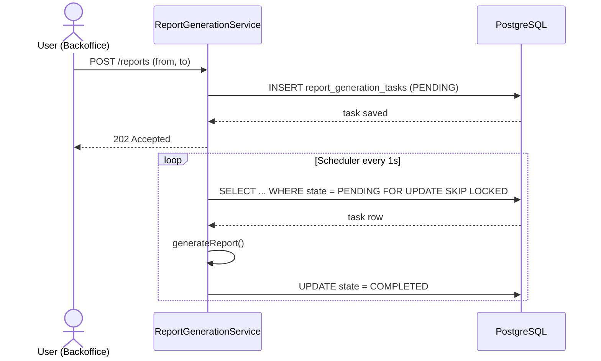
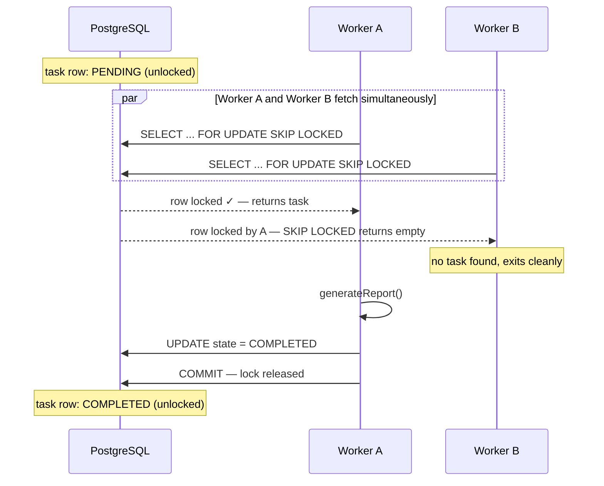
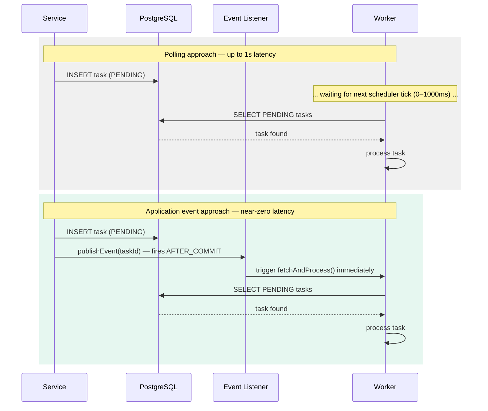
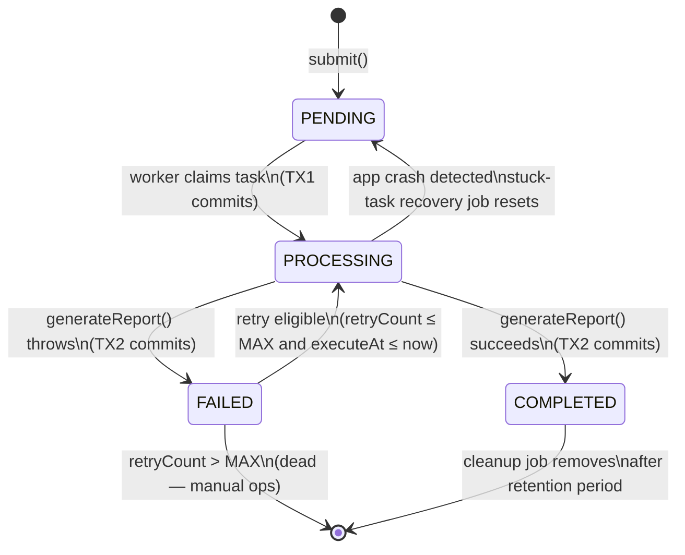
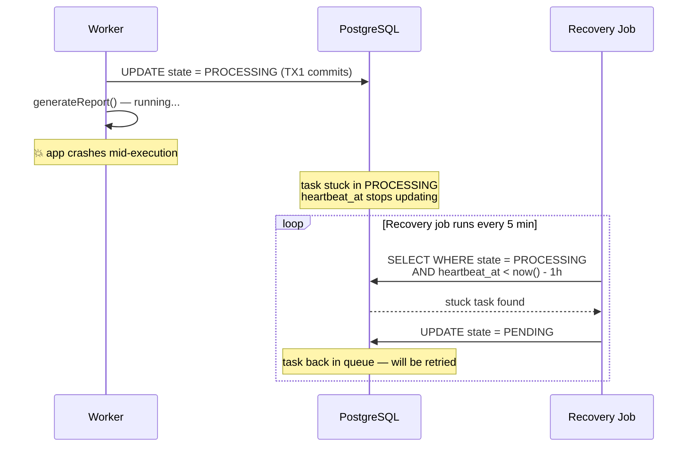
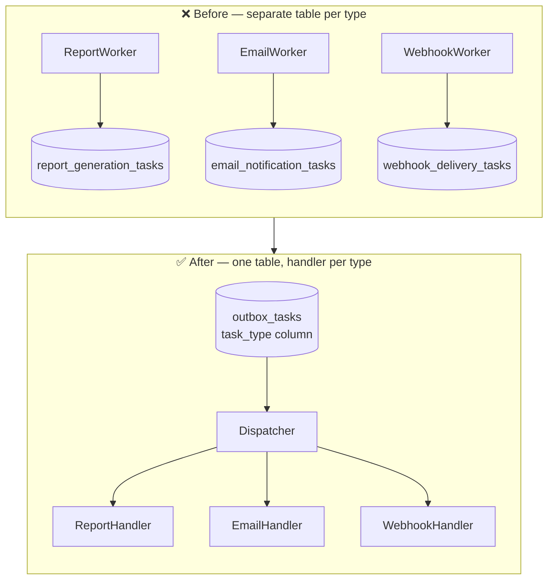

# Патерн Transactional Outbox: від однієї задачі до асинхронного рушія продакшен-рівня

Існує клас багів, який ніколи не проявляється в юніт-тестах і рідко з’являється на стейджингу.
Він проявляється в продакшені, о другій ночі, коли ваш застосунок зберігає запис у базу, а потім
намагається викликати зовнішній сервіс — і щось із цього падає. Одна сторона закомітила. Інша —
ні. Ніхто не дізнається, доки користувач не поскаржиться.

Це **проблема подвійного запису** (dual-write), і патерн Transactional Outbox — стандартна
відповідь на неї. Ідея проста: замість прямого виклику зовнішньої системи запишіть задачу в ту
саму транзакцію бази даних, що й зміну вашої доменної моделі. Фоновий воркер підхопить її та
виконає. Запис атомарний. Задачу неможливо втратити.

А от що задокументовано значно гірше — усе, що йде після базової ідеї: що відбувається, коли
задачі падають, коли два воркери змагаються за той самий рядок, коли застосунок падає посеред
виконання, коли в одній таблиці живе десять різних типів задач, і коли стейкхолдери питають,
чому глибина черги різко зросла о третій ночі минулого вівторка.

Саме це й розбирає ця стаття.

Розбиратиму один конкретний сценарій — **сервіс генерації звітів** — і крок за кроком
еволюціонуватиму його від найпростішого outbox до рішення, яке я був би готовий тримати в
продакшені. Усі фрагменти коду взяті з реального робочого репозиторію, посилання наприкінці.

Стек: **Java, Spring Boot, PostgreSQL**.

<div class="post-tldr" markdown="1">
<p class="post-tldr-title">TL;DR</p>

- **Патерн Transactional Outbox** усуває проблему подвійного запису: рядок задачі пишеться в **ту саму транзакцію БД**, що й зміна домену, а виконує його фоновий воркер.
- Опитуйте таблицю outbox через `SELECT ... FOR UPDATE SKIP LOCKED`, щоб кілька воркерів працювали паралельно без подвійної обробки.
- Продакшен-рівень вимагає більшого за базову ідею: **машину станів**, **повтори з backoff**, **heartbeats/lease** для відновлення після падіння воркера, гарантії **порядку** та **моніторинг** глибини черги.
- Kafka не потрібна — **самого PostgreSQL** достатньо для надійного асинхронного виконання.
</div>

---

## Сценарій



Будуємо CRM. Користувачі можуть запитувати місячні аналітичні звіти з бекофіс-інтерфейсу.
Генерація звіту означає агрегацію десятків мільйонів рядків — це може тривати хвилини.
Очевидно, що синхронно в HTTP-запиті це робити не можна.

Користувач натискає кнопку. Бекенд приймає запит, зберігає його й одразу відповідає.
Фоновий воркер забирає задачу, виконує генерацію та оновлює статус по завершенні.

Це найпростіший випадок, коли outbox доречний: робота, яка за своєю природою справді
асинхронна, і користувач уже очікує на результат.

---

## Частина 1 — Базовий outbox

### Що потрібне кожному outbox

По суті, будь-якій таблиці outbox потрібні три речі:

- **Стан** — на якому етапі життєвого циклу перебуває ця задача?
- **Payload** — що саме потрібно виконати?
- **Мітки часу** — коли створено, коли змінювалося востаннє?

```sql
CREATE TYPE task_state AS ENUM ('PENDING', 'COMPLETED');

CREATE TABLE report_generation_tasks (
                                       id         UUID       PRIMARY KEY DEFAULT gen_random_uuid(),
                                       state      task_state NOT NULL    DEFAULT 'PENDING',
                                       payload    JSONB      NOT NULL,
                                       created_at TIMESTAMP  NOT NULL    DEFAULT now(),
                                       updated_at TIMESTAMP  NOT NULL    DEFAULT now()
);
```

Payload для нашого кейсу — діапазон дат:

```java
@Value
@Builder
@Jacksonized
public class ReportGenerationPayload {
  Instant from;
  Instant to;
}
```

JPA-ентиті:

```java
@Entity
@Table(name = "report_generation_tasks")
@Data
@Builder
@NoArgsConstructor
@AllArgsConstructor
public class ReportGenerationEntity {

    @Id
    @GeneratedValue(strategy = GenerationType.UUID)
    @Column(updatable = false, nullable = false)
    private UUID id;

    @Enumerated(EnumType.STRING)
    @Column(nullable = false, columnDefinition = "task_state")
    private TaskState state;

    @JdbcTypeCode(SqlTypes.JSON)
    @Column(nullable = false, updatable = false, columnDefinition = "jsonb")
    private ReportGenerationPayload payload;

    @CreationTimestamp
    @Column(nullable = false, updatable = false)
    private Instant createdAt;

    @UpdateTimestamp
    @Column(nullable = false)
    private Instant updatedAt;
}
```

Створення задачі:

```java
@Service
@RequiredArgsConstructor
public class ReportGenerationService {

    private final ReportGenerationRepository repository;

    public void submit(ReportGenerationCommand command) {
        repository.save(ReportGenerationEntity.builder()
                .state(TaskState.PENDING)
                .payload(ReportGenerationPayload.builder()
                        .from(command.getFrom())
                        .to(command.getTo())
                        .build())
                .build());
    }
}
```

### Воркер

Запланована задача опитує таблицю на предмет задач у стані PENDING і виконує їх:

```java
@Component
@RequiredArgsConstructor
public class ReportGenerationScheduledJob {

    private final ReportGenerationTaskService taskService;

    @Scheduled(fixedDelay = 1000)
    public void run() {
        taskService.fetchAndProcess();
    }
}
```

```java
@Service
@RequiredArgsConstructor
public class ReportGenerationTaskService {

    private final ReportGenerationRepository repository;

    public void fetchAndProcess() {
        repository.findFirstByStateOrderByCreatedAt(TaskState.PENDING)
                .ifPresent(task -> {
                    generateReport(task);
                    task.setState(TaskState.COMPLETED);
                    repository.save(task);
                });
    }

    private void generateReport(ReportGenerationEntity task) {
        // actual report generation logic
    }
}
```

```java
public interface ReportGenerationRepository extends JpaRepository<ReportGenerationEntity, UUID> {
    Optional<ReportGenerationEntity> findFirstByStateOrderByCreatedAt(TaskState state);
}
```

Це працює в застосунку з одним інстансом і без збоїв. У реальному світі тут дві проблеми:
два воркери можуть забрати ту саму задачу одночасно, а задачі можуть падати без жодного шляху
відновлення. Виправимо обидві.

---

## Частина 2 — Конкурентність: два воркери, одна задача

Коли два потоки планувальника — або два інстанси застосунку — виконують запит вибірки в той самий
момент, обидва можуть прочитати той самий рядок `PENDING`, і обидва спробують його виконати.
Результат — щонайменше дублювання роботи, щонайбільше — пошкоджений стан.

Рішення — блокування на рівні бази даних, взяте під час вибірки. `SELECT ... FOR UPDATE SKIP
LOCKED` у PostgreSQL створений саме для такого сценарію: він блокує рядок для поточної транзакції
та пропускає рядки, вже заблоковані іншою транзакцією, замість того, щоб чекати.

```java
public interface ReportGenerationRepository extends JpaRepository<ReportGenerationEntity, UUID> {

    @Lock(LockModeType.PESSIMISTIC_WRITE)
    @QueryHint(name = AvailableSettings.JAKARTA_LOCK_TIMEOUT, value = "-2") // -2 = SKIP_LOCKED
    Optional<ReportGenerationEntity> findFirstByStateOrderByCreatedAt(TaskState state);
}
```

Значення `-2` для хінта `SKIP_LOCKED` — те, що Hibernate перетворює на clause `SKIP LOCKED`.
Оскільки окремої анотації першого класу для цього немає, варто винести це в повторно
використовувану анотацію, щоб не розкидати магічне число по всіх репозиторіях:

```java
@Retention(RetentionPolicy.RUNTIME)
@Target({ElementType.METHOD, ElementType.ANNOTATION_TYPE})
@QueryHints(@QueryHint(
    name = AvailableSettings.JAKARTA_LOCK_TIMEOUT,
    value = Timeouts.SKIP_LOCKED_MILLI + ""
))
public @interface SkipLocked {}
```

Значно чистіше. Тепер репозиторій читається як виражений намір, а не як технічна обв’язка:

```java
@SkipLocked
@Lock(LockModeType.PESSIMISTIC_WRITE)
Optional<ReportGenerationEntity> findFirstByStateOrderByCreatedAt(TaskState state);
```

Ви *можете* утримувати блокування протягом обробки, обгорнувши весь цикл «вибірка—виконання—
оновлення» в одну транзакцію, але зазвичай цього не варто робити:

```java
// Technically works, but do not use this pattern for outbox processing.
@Transactional
public void fetchAndProcess() {
    repository.findFirstByStateOrderByCreatedAt(TaskState.PENDING)
            .ifPresent(task -> {
                generateReport(task);
                task.setState(TaskState.COMPLETED);
                repository.save(task);
            });
}
```



Навіть якщо `generateReport()` настільки малий, що технічно все працює, виконання outbox-дії
під відкритою транзакцією — антипатерн. Тривалість транзакції не повинна залежати від тривалості
виконання outbox-дії: дія може ставати повільнішою з часом, блокуватися на I/O або викликати
залежний сервіс, утримуючи з’єднання з БД і блокування рядка непередбачувано довго.

Замість цього забирайте рядок у короткій транзакції, переводячи його в `PROCESSING`, комітьте
й відпускайте блокування, і лише потім виконуйте outbox-дію. Стан `COMPLETED` або `FAILED`
фіксуйте вже після цього — окремою короткою транзакцією. Наступний розділ реалізує цей перехід
станів і шлях відновлення.

---

## Частина 2.5 — Зниження затримки за допомогою Application Events

У планувальника з опитуванням є вроджена нижня межа затримки. Якщо задача спрацьовує щосекунди,
задача, створена о `t=0ms`, висить у стані `PENDING` до наступного тику — до 1000 мс. Для більшості
асинхронних навантажень це прийнятно. Для випадків, коли потрібне майже миттєве взяття в роботу —
надсилання транзакційного листа, виклик вебхуку — ні.

Патерн, запозичений у Celery: зберегти outbox-ентиті в базу, а потім одразу опублікувати Spring
`ApplicationEvent` з ID нової задачі. Лістенер підхоплює подію та негайно запускає обробку,
не чекаючи наступного тику планувальника.



Планувальник усе одно працює як страховка — він підхоплює все, що пропустив лістенер подій
(перезапуск застосунку, виняток у лістенері, втрачена подія). Але щасливий шлях повністю
обходить затримку опитування.

### Реалізація

Публікуйте подію всередині методу сервісу, після збереження:

```java
@Service
@RequiredArgsConstructor
public class ReportGenerationService {

    private final ReportGenerationRepository repository;
    private final ApplicationEventPublisher eventPublisher;

    @Transactional
    public void submit(ReportGenerationCommand command) {
        var entity = repository.save(ReportGenerationEntity.builder()
                .state(TaskState.PENDING)
                .payload(ReportGenerationPayload.builder()
                        .from(command.getFrom())
                        .to(command.getTo())
                        .build())
                .build());

        eventPublisher.publishEvent(new ReportGenerationTaskSubmittedEvent(entity.getId()));
    }
}
```

```java
public record ReportGenerationTaskSubmittedEvent(UUID taskId) {}
```

Лістенер реагує і негайно запускає обробку:

```java
@Component
@RequiredArgsConstructor
public class ReportGenerationTaskEventListener {

    private final ReportGenerationTaskService taskService;

    @TransactionalEventListener(phase = TransactionPhase.AFTER_COMMIT)
    public void onTaskSubmitted(ReportGenerationTaskSubmittedEvent event) {
        taskService.fetchAndProcess();
    }
}
```

### Класична помилка

Найпоширеніша помилка тут — використання `@EventListener` замість
`@TransactionalEventListener(phase = TransactionPhase.AFTER_COMMIT)`.

`@EventListener` спрацьовує в момент виклику `publishEvent()` — тобто **всередині відкритої
транзакції**, до того, як `INSERT` закомітився. Лістенер викликає `fetchAndProcess()`, який
шукає задачу в базі за ID. Рядка ще не існує. Задача мовчки пропускається, подія втрачається,
і ви ламаєте голову, чому обробка так і не почалася — хоча планувальник через кілька секунд
таки підхопить задачу, і в логах усе виглядає нормально.

```java
// ❌ fires inside the transaction — entity not visible to other connections yet
@EventListener
public void onTaskSubmitted(ReportGenerationTaskSubmittedEvent event) {
    taskService.fetchAndProcess();
}

// ✅ fires after COMMIT — entity is visible, fetch succeeds
@TransactionalEventListener(phase = TransactionPhase.AFTER_COMMIT)
public void onTaskSubmitted(ReportGenerationTaskSubmittedEvent event) {
    taskService.fetchAndProcess();
}
```

`AFTER_COMMIT` гарантує, що лістенер виконається лише після повного коміту транзакції, яка
опублікувала подію. На той момент рядок видимий усім з’єднанням, і вибірка його знайде.

Планувальник залишається без змін — він слугує механізмом відновлення для задач, які лістенер
подій пропустив. Два підходи доповнюють один одного: події — заради затримки, опитування —
заради надійності.

---

## Частина 3 — Збої, повтори та стан PROCESSING



Outbox-дії не повинні виконуватися під відкритою транзакцією БД. Підхід із транзакцією-блокуванням
тримає блокування в базі весь час виконання `generateReport()`. Для звіту, що триває дві хвилини,
це дві хвилини заблокованого рядка — зайняте з’єднання, і інші операції БД можуть вишикуватися
в чергу за ним. З `SKIP LOCKED` воркери не блокують одне одного на цьому блокуванні, але довгі
транзакції все одно тиснуть на пул з’єднань і навантажують базу. Дуже мала дія
може технічно завершитися без видимих проблем, але прив’язка тривалості транзакції до тривалості
виконання outbox — все одно антипатерн.

Рішення — розділити взяття задачі та її виконання. Переведіть задачу в `PROCESSING` у короткій
транзакції, відпустіть блокування, а справжню роботу виконуйте поза будь-якою транзакцією. Тоді
БД торкаємося лише коротко на початку і коротко наприкінці — дорога частина відбувається між
ними, нічого не утримуючи.

Спершу розширте enum:

```sql
ALTER TYPE task_state ADD VALUE 'PROCESSING';
ALTER TYPE task_state ADD VALUE 'FAILED';

ALTER TABLE report_generation_tasks
    ADD COLUMN retry_count  INTEGER NOT NULL DEFAULT 0,
    ADD COLUMN error_message VARCHAR;
```

`retry_count` рахує, скільки разів виконання намагалися здійснити. Повтори обмежуємо десятьма —
понад це щось справді зламане і потребує ручного втручання. Пізніше ми навісимо на це алертинг.
`error_message` зберігає останній виняток, щоб ви знали, *чому* задача застрягла, не прочісуючи
логи.

Java-enum росте разом із ним:

```java
public enum TaskState {
    PENDING,
    PROCESSING,
    COMPLETED,
    FAILED
}
```

Тепер сервіс виконує дві окремі короткі транзакції, а справжня робота відбувається між ними:

```java
@RequiredArgsConstructor
public class ReportGenerationTaskService {

    private final ReportGenerationRepository repository;
    private final TransactionTemplate transactionTemplate;

    private static final int MAX_RETRY_COUNT = 10;

    public void fetchAndProcess() {
        transactionTemplate
                .execute(status ->
                        repository.findFirstEligibleTask(
                                List.of(TaskState.PENDING, TaskState.FAILED),
                                MAX_RETRY_COUNT
                        ).map(this::markProcessing))
                .ifPresentOrElse(
                        task -> {
                            try {
                                generateReport(task);
                                markCompleted(task);
                            } catch (Exception e) {
                                markFailed(task, e);
                                log.error("Task {} failed on attempt {}", task.getId(), task.getRetryCount(), e);
                            }
                        },
                        () -> log.debug("No eligible tasks to process")
                );
    }

    private ReportGenerationEntity markProcessing(ReportGenerationEntity task) {
        task.setState(TaskState.PROCESSING);
        return repository.save(task);
    }

    private void markCompleted(ReportGenerationEntity task) {
        task.setState(TaskState.COMPLETED);
        repository.save(task);
    }

    private void markFailed(ReportGenerationEntity task, Exception e) {
        task.setState(TaskState.FAILED);
        task.setRetryCount(task.getRetryCount() + 1);
        task.setErrorMessage(e.getMessage()); // don't skip this — it's the only trace of what went wrong without digging through logs
        repository.save(task);
    }
}
```

Запит вибирає і задачі `PENDING`, і `FAILED` — задача, що впала з `retryCount < 10`, така ж
придатна до виконання, як і нова. Щойно лічильник повторів досягає ліміту, задача перестає
вибиратися і залишається постійним записом `FAILED`, поки на неї не подивляться. Це навмисно —
після 10 спроб щось справді зламане, і потрібні очі, а не ще один повтор.

```java
@SkipLocked
@Lock(LockModeType.PESSIMISTIC_WRITE)
@Query("""
    SELECT t FROM ReportGenerationEntity t
    WHERE t.state IN :states
      AND t.retryCount <= :maxRetryCount
    ORDER BY t.createdAt ASC
    LIMIT 1
    """)
Optional<ReportGenerationEntity> findFirstEligibleTask(
    @Param("states") List<TaskState> states,
    @Param("maxRetryCount") Integer maxRetryCount
);
```

Але зачекайте — чи справді варто брати щойно впалу задачу знову в роботу на наступному ж тику
планувальника, за кілька секунд? Якщо залежна система лежить, бомбардувати її запитами щосекунди — тільки
гірше. Про це наступний розділ.

## Частина 4 — Експоненційна затримка

Без затримки між повторами впала задача знову потрапляє в чергу на найближчому тику
планувальника — зазвичай за кілька секунд. Якщо залежна система лежить, ви бомбардуєте її запитами на повній
частоті опитування. Це погано для залежної системи і погано для вашої БД.

Рішення — колонка `execute_at`: задача не придатна до виконання, доки ця мітка часу не минула.
Нові задачі отримують `execute_at = now()`, щоб їх брали одразу. Впалі задачі отримують
`execute_at = now() + delay`, де затримка зростає з кожним повтором.

```sql
ALTER TABLE report_generation_tasks
    ADD COLUMN execute_at TIMESTAMP NOT NULL DEFAULT NOW();
```

Графік затримок керує всім — `MAX_RETRY_COUNT` виводиться з нього, а не оголошується окремо.
Так вони ніколи не розсинхронізуються:

```java
private static final Map<Integer, Duration> RETRY_DELAYS = Map.of(
    0, Duration.ofMinutes(1),
    1, Duration.ofMinutes(5),
    2, Duration.ofMinutes(15),
    3, Duration.ofMinutes(30),
    4, Duration.ofHours(1),
    5, Duration.ofHours(2),
    6, Duration.ofHours(4),
    7, Duration.ofHours(8),
    8, Duration.ofHours(12),
    9, Duration.ofDays(1)
);

private static final int MAX_RETRY_COUNT = RETRY_DELAYS.size();
```

Додайте новий запис у `RETRY_DELAYS` — і ліміт повторів оновиться автоматично. Жодного
магічного числа, яке треба тримати синхронним десь ще.

У `markFailed()` зафіксуйте *поточний* лічильник повторів до інкременту — саме він обирає
затримку для *наступної* спроби:

```java
private void markFailed(ReportGenerationEntity task, Exception e) {
    int currentRetry = task.getRetryCount();
    task.setState(TaskState.FAILED);
    task.setRetryCount(currentRetry + 1);
    task.setErrorMessage(e.getMessage());
    task.setExecuteAt(Instant.now().plus(
            RETRY_DELAYS.getOrDefault(currentRetry, RETRY_DELAYS.get(RETRY_DELAYS.size() - 1))));
    repository.save(task);
}
```

Планувальник працює з тією самою частотою. Він просто пропускає задачі, для яких вікно ще
не відкрилося. Впалі задачі тихо чекають свого часу, а потім природно повертаються в чергу.

---

## Частина 5 — Застряглі задачі та heartbeats



У разі підходу з двома транзакціями подумайте, що станеться, якщо застосунок упаде після
переведення задачі в `PROCESSING`, але до `COMPLETED` чи `FAILED`. У БД стан `PROCESSING`.
Ніхто її не обробляє. Вона сидить там вічно.

Наївне рішення — задача відновлення, яка знаходить задачі, надто довго висячі в `PROCESSING`,
і скидає їх у `PENDING`:

```java
@Transactional
public void recoverStuckTasks() {
    repository.findFirstByStateAndUpdatedAtLessThan(
                    TaskState.PROCESSING,
                    Instant.now().minus(1, ChronoUnit.HOURS))
            .ifPresent(task -> {
                log.warn("Resetting stuck task {} to PENDING", task.getId());
                task.setState(TaskState.PENDING);
                repository.save(task);
            });
}
```

Це працює для більшості випадків. Проблема: `updated_at` змінюється щоразу, коли змінюється
*що завгодно* в рядку — включно з неспорідненими переходами станів. Задача, що чесно
обробляється 55 хвилин, з погляду `updated_at` виглядає ідентично до впалої задачі.

Чистіше рішення — **heartbeat**: окрема колонка, яка оновлюється періодично і *лише поки задачу
активно обробляють*. Задача відновлення тепер перевіряє цю колонку, а не `updated_at`. Задача,
яка не подавала ознак життя останню годину, справді застрягла.

```sql
ALTER TABLE report_generation_tasks ADD COLUMN heartbeat_at TIMESTAMP;
```

Heartbeat працює в окремому потоці, у власних транзакціях, незалежно від логіки обробки.
Найчистіша реалізація — `try-with-resources`: запускається разом із початком обробки і
зупиняється на будь-якому шляху виходу:

```java
public abstract class Heartbeat implements AutoCloseable {

    private final ScheduledExecutorService executor;

    protected Heartbeat(Runnable heartbeatFn) {
        executor = Executors.newSingleThreadScheduledExecutor();
        executor.scheduleAtFixedRate(heartbeatFn, 0, 10, TimeUnit.SECONDS);
    }

    @Override
    public void close() {
        executor.shutdownNow();
    }
}
```

```java
public class ReportGenerationTaskHeartbeat extends Heartbeat {

    ReportGenerationTaskHeartbeat(UUID taskId, ReportGenerationRepository repository) {
        super(() -> repository.updateHeartbeatAt(taskId, Instant.now()));
    }
}
```

Метод репозиторію несе власний `@Transactional` — вручну огортати виклик не потрібно:

```java
@Modifying
@Transactional
@Query("UPDATE ReportGenerationTaskEntity t SET t.heartbeatAt = :now WHERE t.id = :id")
void updateHeartbeatAt(@Param("id") UUID id, @Param("now") Instant now);
```

Підключіть його через фабрику, щоб сервіс залишався чистим:

```java
@Component
@RequiredArgsConstructor
public class ReportGenerationTaskHeartbeatFactory {

    private final ReportGenerationRepository repository;

    public Heartbeat start(UUID taskId) {
        return new ReportGenerationTaskHeartbeat(taskId, repository);
    }
}
```

Блок обробки тепер виглядає так:

```java
public void fetchAndProcess() {
    transactionTemplate
            .execute(status -> repository.findFirstEligibleTask(
                    List.of(TaskState.PENDING, TaskState.FAILED),
                    MAX_RETRY_COUNT
            ).map(this::markProcessing))
            .ifPresentOrElse(
                    task -> {
                        try (var heartbeat = heartbeatFactory.start(task.getId())) {
                            try {
                                generateReport(task);
                                markCompleted(task);
                            } catch (Exception e) {
                                markFailed(task, e);
                                log.error("Task {} failed", task.getId(), e);
                            }
                        }
                    },
                    () -> log.debug("No eligible tasks to process")
            );
}
```

Задача відновлення використовує `heartbeat_at` замість `updated_at`:

```java
@Modifying
@Transactional
@Query("UPDATE ReportGenerationEntity t SET t.heartbeatAt = :now WHERE t.id = :id")
void updateHeartbeatAt(@Param("id") UUID id, @Param("now") Instant now);

Optional<ReportGenerationEntity> findFirstByStateAndHeartbeatAtLessThan(
        TaskState state, Instant threshold);
```

`updated_at` відображає, коли стан задачі змінювався востаннє. `heartbeat_at` — чи жива задача
прямо зараз. Розділивши їх, ви відповідаєте на обидва питання без двозначності.

---

## Частина 6 — Багатотиповий outbox



За пів року ваш сервіс робить більше, ніж генерацію звітів. Знадобилися email-сповіщення.
Потім експорти даних. Потім доставка вебхуків.

У вас два варіанти: окрема таблиця на кожен тип задач або одна спільна таблиця з
дискримінатором `task_type`. Спільна таблиця виграє, коли типів задач багато і ви готові
обробляти їх з одного місця. Інфраструктура — повтори, heartbeats, backoff, моніторинг —
залишається в одному місці. Додати новий тип задач — просто додати новий обробник.

Компроміси, про які варто знати заздалегідь:

- Новий тип задач із поганою поведінкою може уповільнити всі інші — один проблемний обробник,
  що спалює повтори, створює backpressure на всю таблицю.
- Гарантії порядку стають складнішими — про це нижче.

### Схема

```sql
CREATE TYPE outbox_task_type AS ENUM ('REPORT_GENERATION', 'EMAIL_NOTIFICATION');

CREATE TABLE outbox_tasks (
    id            UUID             PRIMARY KEY DEFAULT gen_random_uuid(),
    task_type     outbox_task_type NOT NULL,
    state         task_state       NOT NULL    DEFAULT 'PENDING',
    payload       JSONB            NOT NULL,
    retry_count   INTEGER          NOT NULL    DEFAULT 0,
    error_message VARCHAR,
    execute_at    TIMESTAMPTZ      NOT NULL    DEFAULT NOW(),
    heartbeat_at  TIMESTAMPTZ,
    created_at    TIMESTAMPTZ      NOT NULL    DEFAULT now(),
    updated_at    TIMESTAMPTZ      NOT NULL    DEFAULT now()
);
```

### Інтерфейс обробника

Ключова точка розширення — одна реалізація на тип задач:

```java
public interface OutboxTaskHandler<P> {
    OutboxTaskType getType();
    Class<P> payloadClass();
    void handle(UUID taskId, P payload) throws Exception;
}
```

`taskId` передається в кожен обробник. Побачите чому в розділі про ідемпотентність.

Конкретний обробник:

```java
@Component
public class EmailNotificationHandler implements OutboxTaskHandler<EmailNotificationPayload> {

    @Override
    public OutboxTaskType getType() {
        return OutboxTaskType.EMAIL_NOTIFICATION;
    }

    @Override
    public Class<EmailNotificationPayload> payloadClass() {
        return EmailNotificationPayload.class;
    }

    @Override
    public void handle(UUID taskId, EmailNotificationPayload payload) throws Exception {
        log.info("Sending email to {} — task {}", payload.getRecipient(), taskId);
        // call email provider
    }
}
```

### Диспетчер

Сервіс збирає всі біни-обробники на старті, будує мапу пошуку і маршрутизує кожну задачу
за `taskType`:

```java
@Service
@RequiredArgsConstructor
public class OutboxTaskService {

    private final OutboxTaskRepository repository;
    private final ObjectMapper objectMapper;
    private final List<OutboxTaskHandler<?>> handlerList;

    private Map<OutboxTaskType, OutboxTaskHandler<?>> handlers;

    @PostConstruct
    void init() {
        handlers = handlerList.stream()
                .collect(Collectors.toMap(OutboxTaskHandler::getType, Function.identity()));
    }

    @SuppressWarnings("unchecked")
    private void dispatch(OutboxTaskEntity task) throws Exception {
        var handler = (OutboxTaskHandler<Object>) handlers.get(task.getTaskType());
        if (handler == null) {
            throw new IllegalStateException(
                    "No handler registered for task type: " + task.getTaskType());
        }
        var payload = objectMapper.readValue(task.getPayload(), handler.payloadClass());
        handler.handle(task.getId(), payload);
    }
}
```

Додавання нового типу задач: додати значення enum, додати бін-обробник, готово. Диспетчер,
планувальник, логіка повторів — жодне з них не змінюється.

---

## Частина 7 — Порядок

Якщо вашому кейсу порядок обробки байдужий — fire-and-forget сповіщення, незалежні фонові
задачі — пропускайте цей розділ. Але навіть тоді брати раніше створені задачі першими —
чесніша поведінка: задачі, створені першими, чекають довше, і обробка в порядку створення —
те, чого користувачі розумно очікують.

Без явного `ORDER BY` PostgreSQL **не дає жодних гарантій** щодо порядку повернення рядків.
Завжди сортуйте за `created_at ASC` у запиті вибірки:

```java
@Query("""
    SELECT t FROM OutboxTaskEntity t
    WHERE t.state IN :states
      AND t.retryCount <= :maxRetryCount
      AND t.executeAt <= :now
    ORDER BY t.createdAt ASC
    LIMIT 1
    """)
Optional<OutboxTaskEntity> findFirstEligibleTask(...);
```

Підкріпіть це частковим індексом:

```sql
CREATE INDEX idx_outbox_fetch
    ON outbox_tasks (created_at ASC)
    WHERE state IN ('PENDING', 'FAILED');
```

### Пастка розсинхронізації годинників (clock skew)

Спершу чесно оцініть, чи це важливо для вашого кейсу. Якщо задачі незалежні — генерація
звітів, надсилання листів, доставка вебхуків — порядок обробки зазвичай узагалі не має значення.
Задача A, що завершується раніше за задачу B, — нормально, незалежно від того, яка була створена
першою. У такому разі весь цей розділ — не ваша проблема.

Якщо вам справді потрібен FIFO — задачі однієї сутності, що мають оброблятися в порядку
створення, — читайте далі.

Проблема в тому, що `created_at` генерується на боці застосунку. Кожен інстанс має власний
системний годинник. Якщо інстанс A на 200 мс попереду інстансу B, задача, створена B
о `t=100ms`, отримає `created_at` раніше, ніж задача, створена A о `t=50ms` — хоча задача A
була вставлена першою. Запит вибірки сортує за `created_at` і бере спершу задачу B. Порядок
створення перевернуто.

NTP тримає годинники близько, але не ідеально синхронізованими. У нормальних умовах дрейф —
мілісекунди. Під навантаженням, під час міграцій VM або після перезапуску контейнера — може
бути більше.

Рішення — генерувати значення порядку на боці бази даних: або дозвольте PostgreSQL призначати
`created_at` через `DEFAULT now()` замість того, щоб задавати його зі застосунку, або
використайте послідовність на боці БД, яка гарантовано монотонно зростає незалежно від того,
який інстанс вставив рядок. Ось варіант із послідовністю:

```sql
ALTER TABLE outbox_tasks ADD COLUMN seq BIGSERIAL;
```

```java
@Column(insertable = false, updatable = false)
private Long seq;
```

Сортуйте за `seq ASC`. Значення призначає єдине авторитетне джерело — база даних, — тому воно
відображає справжній порядок вставки, незалежно від того, який інстанс створив задачу і що
показував його годинник.

`created_at` тримайте для спостережуваності. `seq` — для порядку.

Якщо строгий FIFO важливий у вашій системі — не забудьте про це.

---

## Частина 8 — Індекси, які зберігають швидкість таблиці на масштабі

Таблицю outbox опитують щосекунди, часто кілька разів на секунду. Кожен рядок у ній — або
активна робота (`PENDING`, `FAILED`, `PROCESSING`), або історичний шум (`COMPLETED`). Без правильних
індексів кожне опитування сканує всю таблицю, щоб знайти жменю придатних рядків.

Правильний інструмент — **частковий індекс** (partial index): він включає лише рядки, що
задовольняють предикат. Щойно задача переходить у `COMPLETED`, вона автоматично випадає
з індексу. Індекс залишається малим назавжди, незалежно від того, скільки задач таблиця
коли-небудь обробила.

### Індекс вибірки — гарячий шлях

Індекс для запиту вибірки:

```sql
CREATE INDEX idx_outbox_fetch
    ON outbox_tasks (created_at ASC)
    WHERE state IN ('PENDING', 'FAILED');
```

Перевірка: вставив 50 000 рядків, з яких лише 7 у стані `PENDING`, увімкнув SQL debug-логування
Hibernate, щоб отримати точний згенерований запит у консолі, і прогнав `EXPLAIN ANALYZE`
по тому SQL:

```
Limit  (cost=0.14..27.50 rows=1 width=102) (actual time=0.082..0.084 rows=1 loops=1)
  ->  LockRows  (actual time=0.081..0.082 rows=1 loops=1)
        ->  Index Scan using idx_outbox_fetch on outbox_tasks
              (actual time=0.030..0.030 rows=1 loops=1)
Planning Time: 1.230 ms
Execution Time: 0.139 ms
```

0,03 мс, щоб знайти найстаршу придатну задачу. 49 993 рядки `COMPLETED` так і не були прочитані.
Мене це влаштовує.

Ще два індекси для двох інших фонових операцій:

Для задачі відновлення:

```sql
CREATE INDEX idx_outbox_stuck
    ON outbox_tasks (heartbeat_at ASC, created_at ASC)
    WHERE state = 'PROCESSING';
```

Для задачі очищення:

```sql
CREATE INDEX idx_outbox_cleanup
    ON outbox_tasks (updated_at ASC)
    WHERE state = 'COMPLETED';
```

---

## Частина 9 — Очищення

Ваш outbox — операційна таблиця. Кожен запит вибірки сканує її. Старі рядки — мертвий вантаж.

Правило: видаляйте лише задачі **`COMPLETED`**. Задачі `FAILED` — ваш аудит-слід. Не чіпайте їх.
Обробляйте вручну або через окремий ops-процес, коли потрібно.

```java
@Modifying
@Transactional
@Query("""
    DELETE FROM OutboxTaskEntity t
    WHERE t.state IN :states
      AND t.updatedAt < :before
    """)
int deleteByStateInAndUpdatedAtBefore(
    @Param("states") List<TaskState> states,
    @Param("before") Instant before
);
```

```java
private static final int CLEANUP_RETENTION_DAYS = 30;

@Transactional
public void cleanup() {
    var cutoff = Instant.now().minus(CLEANUP_RETENTION_DAYS, ChronoUnit.DAYS);
    int deleted = repository.deleteByStateInAndUpdatedAtBefore(
            List.of(TaskState.COMPLETED), cutoff);
    log.info("Cleanup: removed {} completed tasks older than {} days", deleted, CLEANUP_RETENTION_DAYS);
}
```

Скільки зберігати: я бачив усе — від 1 дня до 3 місяців. Якщо не впевнені — зберігайте довше.
Ціна зберігання старих рядків — трохи більша таблиця. Ціна передчасного видалення — втрата
історії для дебагу саме того дня, коли вона потрібна найбільше.

---

## Частина 10 — Ідемпотентність: робимо повтори безпечними

Ніщо в цій архітектурі не гарантує виконання рівно один раз. Виконання задачі та оновлення
стану на `COMPLETED` — дві окремі операції. Якщо застосунок упаде після виконання, але до коміту
оновлення стану, задачу буде виконано знову. Вона запуститься вдруге з тими самими вхідними.

Це доставка **at-least-once** — іншої гарантії тут просто немає. Питання в тому, чи шкодить
дубльоване виконання.

Якщо ваша задача за природою ідемпотентна (двічі згенерований звіт — той самий звіт), усе
гаразд. Якщо вона має побічні ефекти (надсилає лист, списує гроші з картки), дублікат — проблема.

Рішення: використовуйте власний `id` outbox-задачі як ключ ідемпотентності всередині обробника.
ID задачі стабільний між повторами — для того самого рядка він ніколи не змінюється. Обробник
перевіряє, чи робота для цього ID уже зафіксована. Якщо так — це no-op.

У нашому випадку генерація звіту завершується вставкою рядка в `generated_reports` — це й є
зафіксований факт виконаної роботи. Додаємо `UNIQUE`-обмеження на `idempotency_key`, щоб навіть
якщо два інстанси змагаються, виграв лише один INSERT. Другий отримає порушення обмеження
і трактує це як успішний no-op:

```sql
CREATE TABLE generated_reports (
    id               UUID        PRIMARY KEY DEFAULT gen_random_uuid(),
    idempotency_key  UUID        NOT NULL,
    report_path      VARCHAR     NOT NULL,
    created_at       TIMESTAMPTZ NOT NULL    DEFAULT now(),

    CONSTRAINT uq_generated_reports_idempotency_key UNIQUE (idempotency_key)
);
```

```java
@Component
@RequiredArgsConstructor
public class ReportGenerationHandler implements OutboxTaskHandler<ReportGenerationPayload> {

    private final GeneratedReportRepository reports;

    @Override
    public void handle(UUID taskId, ReportGenerationPayload payload) {
        if (reports.existsByIdempotencyKey(taskId)) {
            log.info("Report already generated for task {} — skipping", taskId);
            return;
        }

        var reportPath = runReportGeneration(payload);

        reports.save(GeneratedReport.builder()
                .idempotencyKey(taskId)
                .reportPath(reportPath)
                .build());
    }
}
```

Якщо ваша задача викликає зовнішній API замість запису в БД, перевірте, чи підтримує цей API
ключі ідемпотентності — більшість платіжних процесорів і провайдерів транзакційних листів
підтримують. Передавайте ID outbox-задачі як ключ ідемпотентності в тому форматі, який вимагає
API (заголовок, поле тіла, query-параметр). Дедуплікацію виконає віддалений
сервіс.

---

## Частина 11 — Моніторинг

Outbox працює мовчки у фоні. Коли все працює, ніхто не помічає. Коли ламається — ніхто теж
не помічає, принаймні одразу. Застряглі задачі накопичуються. Залежні сервіси перестають
отримувати події. Коли хтось нарешті зазирне в логи, мине вже дві години.

Три сигнали повністю покривають простір відмов — за моделлю Google SRE:

- **Latency** — скільки часу проходить від взяття задачі до її завершення? Спайк тут означає, що обробник повільний або БД під тиском.
- **Throughput** — скільки задач завершується за одиницю часу? Падіння до нуля означає, що планувальник не працює або задачі ніхто не забирає.
- **Error rate** — яка частка спроб завершується невдачею? Понад ~5% — залежна система деградувала, і черга повторів росте.


### Інструментування

Додайте в `build.gradle.kts`:

```kotlin
implementation("org.springframework.boot:spring-boot-starter-actuator")
implementation("io.micrometer:micrometer-registry-prometheus")
```

Зареєструйте AOP-аспект `@Timed` один раз:

```java
@Bean
public TimedAspect timedAspect(MeterRegistry registry) {
    return new TimedAspect(registry);
}
```

Тримайте назви метрик як константи й інкрементуйте з окремого компонента — не розкидаючи сирих
рядків по методах сервісів:

```java
@Component
@RequiredArgsConstructor
public class OutboxMetrics {

  private static final String TASK_PROCESSED = "outbox.task.processed";
  private static final String OUTCOME_TAG    = "outcome";
  private static final String COMPLETED      = "completed";
  private static final String FAILED         = "failed";

  private final MeterRegistry meterRegistry;
  private final ReportGenerationRepository repository;

  public void recordCompleted() {
    meterRegistry.counter(TASK_PROCESSED, OUTCOME_TAG, COMPLETED).increment();
  }

  public void recordFailed() {
    meterRegistry.counter(TASK_PROCESSED, OUTCOME_TAG, FAILED).increment();
  }

  @PostConstruct
  void registerGauge() {
    Gauge.builder("outbox.tasks.pending", repository,
                    repo -> repo.countByStateIn(List.of(TaskState.PENDING, TaskState.FAILED)))
            .description("Tasks waiting to be processed")
            .register(meterRegistry);
  }
}
```

Далі сервіс просто викликає `metrics.recordCompleted()` і `metrics.recordFailed()` — без сирих
рядків у бізнес-логіці.

Після старту `curl localhost:8080/actuator/prometheus | grep outbox` дає вам:

```
outbox_task_duration_seconds{quantile="0.5"}  0.062
outbox_task_duration_seconds{quantile="0.95"} 0.145
outbox_task_duration_seconds{quantile="0.99"} 0.312
outbox_task_processed_total{outcome="completed"} 40.0
outbox_task_processed_total{outcome="failed"}    2.0
outbox_tasks_pending 0.0
```

### Алерти

Дашборди — для людей, що дивляться на екрани. Алерти — для людей, які сплять.

| Алерт | Спрацьовує, коли | Протягом | Що означає |
|---|---|---|---|
| `OutboxQueueBacklog` | pending > 50 | 5 хв | Обробка не встигає за надходженням |
| `OutboxHighErrorRate` | частка помилок > 5% | 2 хв | Обробник або залежна система деградували |
| `OutboxSlowProcessing` | p99 затримка > 30 с | 5 хв | Конкуренція в БД або повільний зовнішній виклик |
| `OutboxStuckTasks` | pending > 0 і нуль завершень за 10 хв | 10 хв | Планувальник упав або всі воркери застрягли |

Підлаштуйте пороги під власне навантаження. Глибина черги 50 може бути нормою для
високонавантаженого сервісу. Для малопоточного внутрішнього інструменту навіть 5 задач, що
сидять 5 хвилин, — привід розібратися. Логіка сигналів та сама; змінюються лише числа.

---

## Продакшен-чекліст

Перед випуском будь-якого outbox у продакшен:

```
☐ Індекси ефективні — часткові індекси на станах PENDING/FAILED та PROCESSING
☐ EXPLAIN ANALYZE підтверджує використання індексу запитом вибірки
☐ Порядок не є проблемою — ORDER BY seq або created_at, підкріплений індексом
☐ Задача очищення оброблених даних працює, рядки COMPLETED видаляються після періоду зберігання
☐ Ідемпотентність оброблена всередині обробників із побічними ефектами
☐ Експоненційна затримка підключена — або підтверджено, що для цього кейсу вона не потрібна
☐ Метрики на місці — глибина черги, пропускна здатність, частка помилок, затримка
☐ Алерти налаштовані — backlog, частка помилок, затримка, застряглі задачі
```

---

## Екосистема — не завжди потрібно будувати це самому

Усе описане в цій статті можна побудувати самому — і в цьому є справжня цінність, хоча б один
раз. Ви розумієте режими відмов, вибір індексів, пастки порядку, бо проєктували з огляду на них.
Ці знання не зникають, коли ви переходите на бібліотеку.

Але в продакшені часто немає потреби підтримувати це самому.

---

**[db-scheduler](https://github.com/kagkarlsson/db-scheduler)** — персистентний, дружній до
кластерів планувальник для Java від Ґустава Карлссона. Це бібліотека, до якої я повертався знову
і знову, і та, чиї внутрішності найближче збігаються з тим, що ми побудували в цій статті.
Вона використовує одну таблицю бази даних, песимістичне блокування з `SKIP LOCKED`, heartbeats
для виявлення застряглих задач і чистий інтерфейс task/handler. Коли я проєктую самописні
outbox’и, db-scheduler — моя референсна реалізація: інтерфейси, патерни, обробка відмов — усе
продумано. Якщо ви починаєте новий проєкт і хочете перевірений у боях фундамент замість
самописного рішення — почніть звідси. Абстракції настільки тонкі, що ви впізнаєте в вихідному
коді все з цієї статті.

---

**[Celery](https://docs.celeryq.dev/)** — стандарт де-факто для асинхронного виконання задач
в екосистемі Python. Celery підтримує PostgreSQL як result backend і Redis або RabbitMQ як
брокер. Патерн `AFTER_COMMIT` із частини 2.5 застосовується і тут — штовхайте задачу в Celery
лише після коміту транзакції, а не всередині неї.

---

**[Quartz Scheduler](https://www.quartz-scheduler.org/)** — перевірена часом бібліотека
планування для Java з персистентністю задач через JDBC. Вона більш загальна, ніж outbox:
cron-вирази, тригери, job stores. Операційні витрати вищі, ніж у db-scheduler, а API за сучасними
мірками багатослівний, але вона доведена до масштабу й має першокласну інтеграцію зі Spring
через `spring-boot-starter-quartz`.

---

## Підсумок

Більшість того, що описано в цій статті, — не хитромудра інженерія, а наслідки пережитих інцидентів.
Стан `PROCESSING` існує, бо колись упав чийсь застосунок. Heartbeat існує, бо `updated_at` брехав.
Частковий індекс існує, бо повне сканування таблиці на частоті опитування тихо накопичується,
поки раптом не перестає бути терпимим. Лістенер `AFTER_COMMIT` існує, бо хтось опублікував подію
всередині транзакції й витратив години на пошуки причини, чому вона не спрацювала.

Кожна деталь окремо — нудна. Разом вони становлять різницю між outbox, що працює в
девелопменті, і тим, якому можна довіряти о третій ночі.

---

## Код

Код із цієї статті доступний у **[github.com/javaAndScriptDeveloper/outboxes-article](https://github.com/javaAndScriptDeveloper/outboxes-article)**.
Усе запускається локально однією командою.

---

## Поговоримо

Якщо натрапили на щось, чого я не розглянув, або ви розв’язали одну з цих проблем інакше
у своїх системах — мені щиро цікаво почути. Контактні посилання — у футері.
