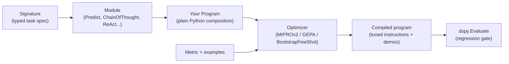
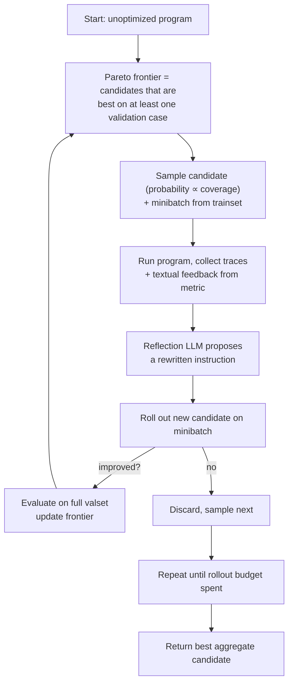

# 写给后端工程师的 DSPy 详解：Signature、Optimizer，以及 GEPA 与 MIPROv2 怎么选

如果你维护过长期运行的 Spring Boot 服务，就知道配置和代码的区别。你不会在生产机器上手改
`application.yml` 里的值，也不会凭感觉调连接池大小，而是先声明、再度量，并通过经过评审、
可复现的流程去修改。

现在用同样的眼光看 LLM 开发。大多数团队「做 AI」的方式，像极了 2009 年的运维：有人在 PR 里
手改一段提示词字符串，在 notebook 里肉眼扫五条输出，就上线了；六周后一次模型升级，悄无声息地
把它搞坏。

**DSPy**（[dspy.ai](https://dspy.ai)）是斯坦福 NLP 提出的框架，它的主张是：别再这样了，把提示词当作
**编译产物**。你写的是*源代码*：一份带类型的任务声明，用普通 Python 组合；再加一个给输出打分的
**指标（metric）**。名为 **optimizer** 的组件会根据你的指标，在你的数据上自动生成并调优真正的提示词。

本文先讲清它的工作方式，再深入你采用 DSPy 之后必然要面对的问题：**该选哪个 optimizer**。目前的
两大主流策略是 **MIPROv2**（对指令和 few-shot 示例做贝叶斯搜索）与 **GEPA**（在帕累托前沿上做
反思式提示词进化，ICLR 2026 Oral）。它们的搜索方式不同、成本不同，对指标的要求也不同。

文中所有内容都基于我为本文写的一个可运行小示例：**Spring Boot 生产故障分诊**程序，把日志行和
堆栈信息归类到根因类别。这正是本博客一贯关注的领域，而且规模足够小，完整跑一轮优化的成本也很低。

技术栈：**Python 3.11+、DSPy 3.5、任意 LLM 提供商**。

<div class="post-tldr" markdown="1">
<p class="post-tldr-title">TL;DR</p>

- **DSPy = 提示词即构建产物。** 你声明 `Signature`（带类型的输入/输出），用 Python 组合 `Module`，再写一个指标，**optimizer** 就会把它编译成调优过的指令加 few-shot 示例。换模型只需重新编译，不必重写提示词。
- 各处通用的核心流程：**程序 + 约 30 条标注样本 + 指标 → `optimizer.compile(program, trainset=...)` → 一份可保存、可 diff 的产物。** 源码里不再出现提示词字符串。
- **MIPROv2** = 先生成候选网格（指令 × demo），再用小批量评估上的**贝叶斯优化**挑出最优组合。是个全能型选手；跑较长的优化需要 200 条以上样本；指标就是普通浮点数。
- **GEPA** = **反思式进化**：一个强力 LLM 根据「预测为什么错了」的*文本反馈*重写指令，**帕累托前沿**则保留在任何单个用例上表现最好的候选。在六个基准任务上，它以相近的成本领先 MIPROv2 **超过 10 个百分点**（ICLR 2026 Oral），并以最多少 **35 倍**的 rollout 胜过 GRPO 微调。
- 决策规则：**指标能用文字解释错误 → GEPA；指标是黑盒标量，或需要挑选 demo → MIPROv2。** 两者都不会改动你的程序代码。
</div>

---

## 什么是 DSPy？

DSPy 是斯坦福 NLP 开源的 Python 框架，源自 2022 年 12 月的 Demonstrate-Search-Predict 研究。
目前的 3.x 版本应用广泛：撰文时 PyPI 月下载量达数百万次，GitHub 星标约 4 万。项目自己的一句话
介绍就概括了它的理念：用编程而非提示的方式使用语言模型。

它的前提是：提示词不是源码，而是*产物*，由三项你完全可以像源码一样维护的输入编译而来：

1. **任务是什么**——一个带类型的接口：输入、输出、约束。
2. **步骤如何组合**——普通的 Python 控制流。
3. **什么算「正确」**——一个作用于标注样本的指标函数。

手写 #1 到 #3，让算法产出提示词。模型换了，你不用重写提示词，而是**重新编译**。

如果你曾为同一个功能同时维护 GPT-4、Claude 和本地 Llama 三份提示词，就明白这有多重要。
这和当年我们从手改服务器配置转向声明式基础设施，是同一种直觉。

## DSPy 的工作原理：Signature、Module、Optimizer

DSPy 要学的抽象只有三个，这就是整个框架。



### 什么是 DSPy Signature？

**Signature** 是对任务输入/输出行为的声明式规约，可以理解为带语义的方法签名，而不只是类型。
字段名本身就承载含义，DSPy 会在幕后把它们转换成提示词。

```python
class IncidentTriage(dspy.Signature):
    """Classify a Spring Boot production incident by its root cause and severity,
    and propose a fix."""

    incident_report: str = dspy.InputField(
        desc="Log line, stack trace excerpt or error description"
    )
    root_cause: Literal[
        "config-misconfiguration",
        "dependency-conflict",
        "connection-pool-exhaustion",
        "serialization-error",
        "memory-pressure",
        "thread-starvation",
    ] = dspy.OutputField(desc="One of the fixed root-cause categories")
    severity: Literal["P1", "P2", "P3"] = dspy.OutputField(
        desc="P1 = service down / data risk, P2 = degraded, P3 = contained"
    )
    action: str = dspy.OutputField(desc="One-sentence remediation")
```

注意 signature 提供了提示词字符串给不了的东西：**解析器可以强制执行的结构**。`root_cause` 是
`Literal` 类型，模型不能回答 `Probably database stuff`，必须返回六个值之一，否则 DSPy 的
adapter 会重试并最终抛出异常。这就像把 JSON 映射成带类型的 DTO，而不是手工解析字符串，
是同样的工程习惯。

### 什么是 DSPy Module？

**Module** 是一种可复用的提示策略，可以套用到任意 signature 上，思路类似 PyTorch 的
`nn.Module`，只不过作用对象是提示词。它们都构建在 `dspy.Predict` 之上，常见的有：

| Module | 所封装的策略 |
|---|---|
| `dspy.Predict(sig)` | 直接补全 |
| `dspy.ChainOfThought(sig)` | 在答案前加一步推理 |
| `dspy.ReAct(sig, tools=[...])` | 面向 agent 的「推理 + 工具调用」循环 |
| `dspy.ProgramOfThought(sig)` | 生成并运行代码来作答 |
| `dspy.BestOfN(sig, N)` | 采样 N 个候选，保留得分最高的 |

你的程序是 `dspy.Module` 的子类，其 `forward()` 用普通 Python（条件、循环、你自己的类）来
组合子模块。故障分诊示例的*整个*模型就是下面这些：

```python
class IncidentTriageProgram(dspy.Module):
    def __init__(self):
        super().__init__()
        self.triage = dspy.ChainOfThought(IncidentTriage)

    def forward(self, incident_report: str) -> dspy.Prediction:
        return self.triage(incident_report=incident_report)
```

再看这个文件里**没有**什么：没有提示词文本，没有 few-shot 示例，没有模型名，也没有
temperature。这些东西依然存在，只是以*参数*的形式存在，这正是它们能被优化的原因。调用程序会
返回带类型的字段（`root_cause`、`severity`、`action`），外加 `ChainOfThought` 为推理步骤添加的
`reasoning` 字段。

### 什么是 DSPy Optimizer？

**Optimizer**（旧称 *teleprompter*）是一种算法，负责调优程序的参数，也就是指令和/或
few-shot demo，使你的指标最大化。few-shot demo 是注入提示词的一条已解决的「输入→输出」
示例；指令则是 DSPy 为每个 module 生成的系统级指示。

`optimizer.compile(program, trainset=...)` 就是名副其实的编译步骤：它在数据上运行你的程序，
度量并搜索，最后返回一个**编译后的程序**，其中各 predictor 已带上调优过的指令和 demo。
用 `program.save("optimized.json")` 保存下来，就得到一份可 diff、可评审的产物，评审方式和
迁移脚本一样。

评估只需一次调用：

```python
evaluate = dspy.Evaluate(
    devset=valset,
    metric=triage_metric,
    num_threads=4,
    display_table=3,
)
result = evaluate(program)
```

DSPy 文档给出的数据量建议是：**约 30 条标注样本就能看到价值，约 300 条可达生产质量**。
划分比例约为 20% 训练、80% 验证，因为 optimizer 会用验证集给每个候选打分。这恰好与深度学习
的惯例*相反*：你不是在拟合权重，而是在小得多的空间里搜索，验证集就是指南针。

另一点值得牢记：**指标就是契约**。本文的每个 optimizer，聪明程度都不会超过给输出打分的那个
函数。分类任务用精确匹配的指标就够了；对于模糊的任务，DSPy 提供了 `dspy.evaluate.SemanticF1`
（它本身就是一个小型 DSPy 程序），你也可以自己写能给部分分的指标。

---

## 实战示例：Spring Boot 生产故障分诊

理论讲得够多了。本文的配套仓库实现了每个后端工程师都熟悉的任务：on-call 故障分诊。给定一行
日志或一段堆栈摘录，判断**根因**（六个类别）和**严重级别**（P1/P2/P3），并给出一句修复建议。

数据集是 24 条手工编写、刻意贴近真实的故障：Hikari 连接池超时、升级 Jackson 后出现的
`NoSuchMethodError`、`@Transactional` 方法在慢速远程调用期间一直占着连接、堆内存正常但
metaspace 撑爆而被 OOMKilled 的 pod……其中 14 条用于训练，10 条用于验证。规模刻意做小：DSPy
文档称 30 条左右才开始见效，而小数据集能让一次运行的成本保持低廉。

指标有两个版本，这个拆分正是后面比较 GEPA 与 MIPROv2 的关键：

```python
def triage_metric(example, pred, trace=None) -> float:
    """Plain scalar metric — what MIPROv2 and dspy.Evaluate consume."""
    root_ok = pred.root_cause == example.root_cause
    sev_ok = pred.severity == example.severity
    return (1.0 if root_ok else 0.0) + (0.25 if sev_ok else 0.0)


def triage_metric_with_feedback(example, pred, trace=None, pred_name=None, pred_trace=None):
    """GEPA metric: a score PLUS natural-language feedback about the miss."""
    problems = []
    if pred.root_cause == example.root_cause:
        root_score = 1.0
    else:
        root_score = 0.0
        problems.append(
            f"Wrong root cause: you said '{pred.root_cause}', the correct label is "
            f"'{example.root_cause}'."
        )
    # ... same for severity ...
    return dspy.Prediction(score=root_score + sev_score,
                           feedback=" ".join(problems) or "Correct root cause and severity.")
```

同一个任务、同一套评分：一个版本只回答*「得了多少分」*，另一个还能回答*「为什么错」*。
下面两个 optimizer 的差别，正在于此。

## 主要的优化策略

DSPy 自带十几个 optimizer，分为四个系列。真正需要你二选一的是最后两个。

| Optimizer | 调优对象 | 搜索策略 | 数据量要求 |
|---|---|---|---|
| `BootstrapFewShot` | 仅 demo | 运行 teacher，保留通过指标的 trace | 约 10 条以上 |
| `BootstrapFewShotWithRandomSearch` | 仅 demo | Bootstrap + 对多个变体随机搜索 | 50 条以上 |
| `COPRO` | 仅指令 | 对改写结果做坐标上升式爬山 | 不限 |
| `MIPROv2` | 指令 **+ demo** | 生成候选网格，再做**贝叶斯优化** | 长时间运行需 200 条以上 |
| `GEPA` | 指令（经 `dspy.Flex` 也可改代码） | 帕累托前沿上的**反思式进化** | 少量即可，前提是指标能给出反馈 |

### MIPROv2：对指令和 demo 的贝叶斯搜索

**MIPROv2**（Multiprompt Instruction PRoposal Optimizer v2）是 DSPy 的主力 optimizer，也是
「先帮我优化一下」这类需求长期以来的默认选择。它分三个阶段运行：

1. **Bootstrap demo**：生成 `num_candidates` 组 few-shot 示例，一部分直接取自标注数据，
   另一部分通过运行你自己的程序来 *bootstrap*，只保留输出通过指标的 trace。
2. **生成指令**：由 `prompt_model` 为每个 module 撰写候选指令，依据是数据集摘要、程序源码、
   bootstrap 得到的 demo，以及一条随机的「创意提示」。
3. **贝叶斯搜索**：采样（指令，demo）组合，在 35 条样本的小批量上评估，更新代理模型，并在
   模型预测会有提升的区域重新采样；每隔几步在完整验证集上评估一次。跑完 `num_trials` 后，
   选出最优程序。

```python
optimizer = dspy.MIPROv2(
    metric=triage_metric,     # plain scalar is fine here
    auto="light",             # ~6 candidates; "medium"/"heavy" scale up
    num_threads=4,
)
optimized = optimizer.compile(
    program,
    trainset=trainset,
    valset=valset,
    max_bootstrapped_demos=2,
    max_labeled_demos=2,
)
optimized.save("optimized/miprov2_triage.json")
```

可以把它理解为**由聪明的采样器去探索的一张固定候选网格**。这会带来一个实际后果：MIPROv2 只能
从 proposer 事先生成的候选指令里挑选。如果没有一条候选包含你的任务所需的领域洞察（比如
「先匹配堆栈特征，再判断严重级别」），贝叶斯搜索也无法凭空发明，只能在网格里挑出相对最好的
那一个。

### GEPA：帕累托前沿上的反思式提示进化

**GEPA**（Genetic-Pareto）出自 [Agrawal et al., 2025](https://arxiv.org/abs/2507.19457)，
入选 **ICLR 2026 Oral**，正是针对这一局限而设计。它是一种进化搜索，区别在于*变异算子是一个会
阅读反馈的 LLM*：



它有四个关键设计：

- **指标返回的是反馈，而不只是一个数字。** 这就是示例中 `triage_metric_with_feedback` 返回
  `dspy.Prediction(score, feedback)` 的原因。DSPy 文档说得很直接：只给 GEPA 一个裸浮点数，
  得到的是「一个弱得多的 GEPA」。反馈文本会*原样*放进反思 LM 的提示词，例如「你回答的是
  `thread-starvation`，正确标签是 `memory-pressure`；容器内存限额处 OOMKilled 而堆占用很低，
  说明瓶颈在*容器*」，这样每次变异都有依据，而不是随机试错。
- **用帕累托选择，而不是赢家通吃。** MIPROv2 只保留一个当前最优者，那些整体平庸、却在*某一类
  样本*（比如序列化错误）上表现最好的候选，照样会被淘汰。GEPA 的前沿则让每个这样的「偏科生」
  都留下来，并从中采样。早期的专精候选得以存活，之后还能重组，这与遗传算法要保持种群多样性
  是同一个道理。论文做过消融实验：在 Qwen3 8B 上，帕累托采样比始终选择当前最优候选，综合
  得分高出约 6 个点。
- **系统感知合并**（`use_merge=True`）：当两条谱系各自学到互补的长处时，GEPA 会尝试合并它们
  最好的 module，用遗传算法的术语说就是交叉算子。
- **预算只有一个旋钮**：`auto`（`light`/`medium`/`heavy`）、`max_full_evals`、`max_metric_calls`
  三者必须且只能设置一个。`light` 大约会评估六个候选提示词；实际的指标调用次数随验证集大小和
  predictor 数量增长，建议先在小验证集上试一下。

```python
optimizer = dspy.GEPA(
    metric=triage_metric_with_feedback,  # score + textual feedback
    reflection_lm=reflection_model(),    # a STRONG model, temperature 1.0
    auto="light",
    num_threads=4,
    track_stats=True,                    # fills detailed_results
    perfect_score=1.25,                  # this metric's max; the default is 1.0
)
optimized = optimizer.compile(program, trainset=trainset, valset=valset)
```

有两点运维上的提示。第一，**反思 LM 值得多花钱**：每次运行只会调用它几次，所以要给它配比任务
模型更强的模型；DSPy 文档也建议，优化较小的模型时，反思环节用更大的模型。第二，设置
`track_stats=True`：结果中的 `detailed_results` 包含**每个候选、它的父代谱系和逐样本验证得分**，
这是一份提示词演化过程的审计记录，可以导出成 JSON，像评审 PR 一样检查。

我亲身踩过一个坑：GEPA 会跳过得分达到 `perfect_score` 的样本，不对其做反思，而这个值**默认是 1.0**。
我们的指标满分是 1.25（根因对得 1.0，严重等级对再加 0.25），所以用默认值时，凡是根因判对的样本都被
当成满分，GEPA 从未看到那些严重等级判错的样本。它只探索了一两个候选，最后返回的还是原程序。如果你的
指标满分不是 1.0，请设置 `perfect_score`。

GEPA *改动*的范围刻意收得很窄：只有每个 predictor 的 `signature.instructions`。你的 module 组合、
代码和 demo 都不会动。优化后的指令跨模型迁移的效果也相当不错：论文报告，在 Qwen3-8B 上进化出
的提示词复用到 GPT-4.1 Mini 上，仍能带来约 9% 的提升。

## GEPA 与 MIPROv2：该选哪个 Optimizer？

同样的框架、同样的程序、同样的指标函数，搜索范式却不同：

| 维度 | MIPROv2 | GEPA |
|---|---|---|
| 范式 | 在固定候选网格上做**贝叶斯优化** | 在开放候选集上做**反思式进化** |
| 调优对象 | 指令 **+ few-shot demo** 联合调优 | 仅指令（经 `dspy.Flex` 也可改代码） |
| 指标契约 | 普通标量（float/bool） | `dspy.Prediction(score, feedback)`——逐 predictor 反馈 |
| 搜索记忆 | 只保留当前最优的一个候选 | **帕累托前沿**：各用例的最优者 + 合并 |
| 预算旋钮 | `auto` 或 `num_candidates` + `num_trials` | 恰好一个：`auto` / `max_full_evals` / `max_metric_calls` |
| 典型提示词 | 更长（few-shot demo 会让它变大） | 指令最多**短 9.2 倍**（论文实测） |
| 数据建议 | 200 条以上样本、长时间运行才能发挥优势 | 少量样本即可，*前提是反馈足够丰富*；valset 宜小 |
| 代表性结果 | 稳健的默认选择；文档中的 ReAct 示例：8% → 约 42%（MIPROv2，`medium`） | 6 个任务上**领先 MIPROv2 10 个点以上**（出自论文摘要） |

论文里的成本数字比准确率数字更有意思。在 GPT-4.1 Mini 的实验中，总 LM 开销是 **GEPA 86 美元、
MIPROv2 76 美元**，相差不大，但综合提升约为后者的两倍（+12.2 个点对 +5.6 个点；GEPA+Merge 为
+13.3）。对比 RL 微调（GRPO），GEPA 只用 **243 到 1,179 次 rollout（GRPO 为 24,000 次）**就达到了
GRPO 的最佳验证得分，样本效率最高达 78 倍，平均还比 GRPO 高 6 个点（最高 20 个点）。需要注意，
这些都是论文自己的基准和实验设置，不等于你的实际负载；但它是社交媒体上「比 RL 便宜」这一说法
经过同行评审的版本。

**我会这样决策**，依据是两者的设计原理：

- **指标能用文字解释错误时，选 GEPA。** 带理由的分类、按 schema 校验的信息抽取、按步骤 trace
  评判的 agent，凡是「错在哪里」能说清楚的场景都适用。反馈是它的燃料，没有反馈，就等于用
  一个盲目的适应度函数做进化。
- **指标是黑盒，或者 demo 比指令更重要时，选 MIPROv2。** 如果程序表现不佳是因为缺少上下文
  示例（而不是指令写得不对），MIPROv2 对指令和 demo 的联合搜索更对症。它也是更平缓的入门
  台阶：不用额外配置第二个模型，普通标量指标即可使用。
- **无论选哪个，都可以先做一次低成本的探测：** 用标量指标跑 `BootstrapFewShotWithRandomSearch`，
  几乎不花钱，往往就能看出差距来自 *demo*（它能补上），还是来自*指令*（它补不上，这时就该
  上 MIPROv2 或 GEPA）。

两者也并不互斥。DSPy 3.x 提供了 `BetterTogether`，可以在同一个程序上串联提示词优化和权重优化
（例如先 GEPA，再微调）：先用提示词进化找到策略，等预算允许 rollout 时，再用 RL 把它固化进
权重。

## 运行示例

上面的内容都可以用代码跑起来，五分钟即可。配套仓库如下：

```bash
git clone https://github.com/javaAndScriptDeveloper/dspy-article
cd dspy-article
uv sync                      # Python 3.11+, installs DSPy 3.5

# Offline sanity check — drives the whole pipeline against a DummyLM:
uv run python smoke_test.py  # no API key needed

# Real runs:
export GEMINI_API_KEY=...     # free key: aistudio.google.com/apikey
                              # or set DSPY_MODEL to any dspy.LM string
uv run python 01_baseline.py         # score the unoptimized program
uv run python 02_optimize_miprov2.py # Bayesian search → optimized/miprov2_triage.json
uv run python 03_optimize_gepa.py    # reflective evolution → optimized/gepa_triage.json
```

默认配置：任务模型为 `gemini/gemini-3.5-flash-lite`，GEPA 反思模型为 `gemini/gemini-3.5-flash`（可通过
`DSPY_MODEL` / `DSPY_REFLECTION_MODEL` 覆盖；任何 `dspy.LM` 字符串都可以用，包括 `openai/gpt-4o-mini`）。
Google AI Studio 的 key 是免费的，但免费额度很小，而且 Google 会调整，所以在运行 optimizer 之前，请先
查看你项目的额度限制：它们会发起数百次调用，代码遇到 429 会重试，而不是直接失败。数据集只有 24 条样本，
所以一次运行规模很小。我实际运行的结果见下一节。

最值得亲自动手的一步：每次运行结束后，把保存下来的 JSON 与源程序对比一下。`02_optimize_miprov2.py`
会写入指令并注入 few-shot demo；`03_optimize_gepa.py` 则会重写指令，而 `optimized/gepa_results.json`
保存着完整的进化谱系：每个候选、它的父代，以及逐样本得分。把它和你的程序源码并排打开，道理就
一目了然：**提示词是输出，不是源码。**

## 我实际运行的结果

我在 2026 年 11 月 17 日用 Google AI Studio 免费额度跑了这三个脚本：任务模型为 `gemini-3.5-flash-lite`，
GEPA 的反思模型为 `gemini-3.5-flash`，两个 optimizer 都用 `auto="light"`，`num_threads=4`。指标就是上面
那个满分 1.25 的指标；下面的得分是 10 条验证故障上的单条平均值。

| 运行 | 得分（满分 1.25） | 备注 |
|---|---|---|
| 未优化程序，3 次未命中缓存的运行 | 1.10 / 1.12 / 1.10 | 达到满分的 88–90% |
| MIPROv2，`light` | 1.12 | 落在上面的运行间波动范围内 |
| GEPA，`light`，默认 `perfect_score` | 1.10 | 1–2 个候选，无从学习（见上文） |
| GEPA，`light`，`perfect_score=1.25` | **1.175**（94%） | 21 个候选，420 次指标调用，耗时约 18 分钟 |

这些数字很小，我宁可你对它们保持怀疑，也不希望你直接引用，所以请带着下面几点来读：

- **基线本来就已经接近上限。** 模型在全部 10 条验证故障上都判对了根因。它丢掉的每一分都在严重等级上：
  标签是 P2 或 P3 的地方，它判成了 P1。可提升的空间仅此而已，所以整个实验其实只涉及 10 个样本里的
  2 个严重等级标签。
- **GEPA 挑选最优候选用的是我汇报得分的同一批 10 条样本**，所以 1.175 偏乐观。这里没有留出的测试集。
  它只是流程演示，不是基准测试。
- **MIPROv2 的 1.12 不算赢。** 未优化程序在多次重跑中本来就在 1.10 到 1.12 之间波动。
- **DSPy 默认把 LM 响应缓存在磁盘上。** 我最初的「三次相同的基线运行」其实是三次缓存命中，并不能说明
  稳定性。现在仓库支持用 `DSPY_CACHE=0` 关闭缓存，想看真实波动时可以用。

更有价值的发现，来自打开 `optimized/gepa_triage.json`，也就是上文推荐的「对比产物」那一步。进化出的
指令读起来像一份带标签的速查表。它几乎原样引用了训练集中的故障（`HikariPool - Connection is not available`、
`management.server.port in use`、未解析的 `${...}` 占位符），并把每一条映射到一个严重等级。它还列出了
一个不在六个允许类别之内的根因 `management-port-conflict`，而它的根因列表里已经不再提 `thread-starvation`。
我们的 `Literal` 类型会拒绝这个凭空造出来的标签，而指令现在却在引导模型远离一个真实存在的类别。
得分提高了，产物却在指标看不到的地方变差了。这正是保存下来的 JSON 应该进入代码评审的原因，也是为什么
留出的测试集和一个会检查类别集合的指标，比你选哪个 optimizer 更重要。

这次运行并没有得出 GEPA 与 MIPROv2 的优劣结论，在 10 条样本上跑一次也不可能得出。它能支持的结论要窄
得多：对于模型本来就基本能解决的任务，在花钱做优化之前先看基线；确保你指标的取值范围符合 optimizer 的
假设；在相信进化出的提示词的得分之前，先读一遍这份提示词。

## 什么时候不该用 DSPy？

这一节说句实话，因为每份框架推介都该有这么一节。

- **没有指标，就别用 DSPy。** 如果你没法给输出打分（哪怕打分不准），optimizer 就没有可以攀爬的
  梯度。构建评估集和指标才是真正的工作，DSPy 只是把针对它们的搜索自动化了。（跳过这一步、
  靠手工调提示词的团队，其实是在用更差的数据*凭感觉*做搜索。）
- **只有一条稳定的提示词、问题也已解决？** 那就不必再引入抽象成本。DSPy 适合多步骤的程序、
  模型频繁更换，或质量差距正在造成实际损失的场景。
- **RL 预算无限、权重也可训练？** GEPA 论文说得很明确：提示词进化的优势在于 rollout 昂贵、数据有限，
  或者权重被 API 锁定的场景；而在 rollout 充足的条件下，GRPO 式微调仍占上风。工具不同，
  成本结构也不同。
- **提示词要自己掌握。** 编译产物是针对*你的指标*调优的：如果拿一个与生产环境不一致的代理指标去
  优化，交付的就是一个为错误目标精心优化的程序。规则一如既往：评估套件*就是*你的规格说明。

---

后端技术栈的每个环节都已经经历过这样的演进：配置变成了代码，schema 变成了迁移脚本，基础设施
变成了声明式定义。提示词字符串是最后一个还有人在凌晨两点手改的产物。DSPy 给出的答案和其他环节
被验证过的做法一样：声明它，度量它，版本化它。optimizer 是其中有意思的部分，但真正带来回报的
是这套工程纪律：当模型、数据或指标发生变化时，提示词由 CI 重新生成。

如果想进一步深入了解 optimizer，一手资料都很出色：[GEPA 论文](https://arxiv.org/abs/2507.19457)
（ICLR 2026 Oral）、[MIPROv2 论文](https://arxiv.org/abs/2406.11695)，以及
[DSPy 官方优化指南](https://dspy.ai/learn/optimization/overview/)，其中还有一份
[分步式 optimizer 选择指南](https://dspy.ai/diving-deeper/choosing-an-optimizer/)。

*本文代码见
**[github.com/javaAndScriptDeveloper/dspy-article](https://github.com/javaAndScriptDeveloper/dspy-article)**。
整条流程都可以离线验证：`uv sync && uv run python smoke_test.py` 无需 API key，即可跑完一轮完整的
GEPA 优化循环；真实运行则使用规模很小的 24 条样本数据集。*
