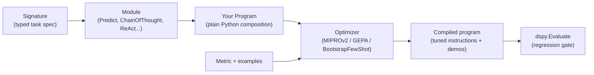
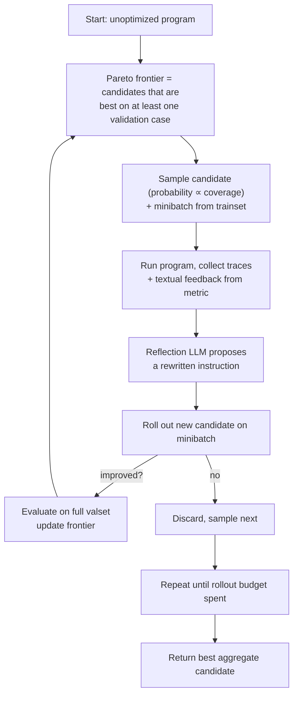

# 写给后端工程师的 DSPy 详解：Signature、Optimizer，以及 GEPA 与 MIPROv2 怎么选

如果你维护过一个长期演进的 Spring Boot 服务，你已经懂配置和代码的区别。你不会在生产机器上
手改 `application.yml` 里的值，也不会凭感觉调连接池大小——你声明它们、度量它们，并通过一个
经过评审、可复现的流程去修改它们。

现在把这个视角套到 LLM 开发上。大多数团队「做 AI」的方式像极了我们在 2009 年做运维的样子：
有人在 PR 里手改一条提示词字符串，在 notebook 里肉眼扫五个输出，上线，六周之后一次模型升级
把它悄悄弄坏。

**DSPy**（[dspy.ai](https://dspy.ai)）是斯坦福 NLP 的框架，它说：住手。把提示词当作
**编译产物**。你写的是*源代码*——一份带类型的任务声明，用普通 Python 组合——外加一个给
输出打分的**指标（metric）**。框架里叫 **optimizer** 的组件，随后针对你的指标、在你的数据上
自动生成并调优真正的提示词。

本文先解释它如何工作，然后深挖你一旦采用就必然面对的问题：**该用哪个 optimizer**。当下的
两大主流策略是 **MIPROv2**（对指令和 few-shot 示例做贝叶斯搜索）和 **GEPA**（帕累托前沿上
的反思式提示进化，ICLR 2026 Oral）。它们的搜索方式不同、成本不同，对你的指标的要求也不同。

所有内容都落在一个我为本文写的可运行小示例上：一个 **Spring Boot 生产故障分诊**程序，把
日志行和堆栈分类到根因类别。这是这个博客常驻的领域——而且它足够小，跑一轮优化的成本以
美分计，不是以美元计。

技术栈：**Python、DSPy 3.5、任意 LLM 提供商**。

<div class="post-tldr" markdown="1">
<p class="post-tldr-title">TL;DR</p>

- **DSPy = 提示词即构建产物。**你声明一个 `Signature`（带类型的输入/输出），用 Python 组合 `Module`，写一个指标——然后 **optimizer** 把它编译成调优过的指令 + few-shot 示例。换模型变成重新编译，而不是重写提示词。
- 核心循环放之四海皆准：**程序 + 30 条左右标注样本 + 指标 → `optimizer.compile(program, trainset=...)` → 一份可保存、可 diff 的产物。**源码里不出现提示词字符串。
- **MIPROv2** = 提出候选网格（指令 × demo），用小批量评估上的**贝叶斯优化**挑赢家。全能型选手；长时间运行想要 200+ 样本；指标是普通浮点数。
- **GEPA** = **反思式进化**：一个强 LLM 根据「为什么预测错了」的*文本反馈*重写指令，**帕累托前沿**保住在任一用例上获胜的候选。在六个基准任务上以相当成本领先 MIPROv2 **超过 10%**（ICLR 2026 Oral），并以最多少 **35 倍**的 rollout 数达到与 RL 微调相当的效果。
- 决策规则：**指标能用文字解释错误 → GEPA。指标是黑盒标量，或需要 demo 选择 → MIPROv2。**两者都不动你的程序代码。
</div>

---

## 什么是 DSPy？

DSPy 是一个开源 Python 框架，最初由斯坦福 NLP 构建（该项目现归入 Databricks 旗下开发），
2022 年 12 月以 Demonstrate-Search-Predict 编译器的身份首次发布。当前的 DSPy 3.x 线是采用最广
的 LLM 框架之一——每月数百万次下载、GitHub 星数约 4 万——它的文档标语用五个词概括了
哲学：**「Program, don't prompt.」（编程，而非调提示词。）**

前提是：提示词不是源码。它是*输出*——三个你能像源码一样维护的输入编译之后的结果：

1. **任务是什么**——一个带类型的接口：输入、输出、约束。
2. **步骤如何组合**——普通的 Python 控制流。
3. **什么算「正确」**——一个作用于标注样本的指标函数。

手写 #1–#3，让算法产出提示词。模型换了，你不重写提示词——你**重新编译**。

如果你曾经为同一个功能同时维护 GPT-4 提示词、Claude 提示词和本地 Llama 提示词，你已经明白
这件事为什么重要。这与我们从手改服务器配置走向声明式基础设施，是同一种本能。

## DSPy 的工作原理：Signature、Module、Optimizer

DSPy 需要学的抽象恰好只有三个。这就是框架的全部。



### 什么是 DSPy Signature？

**Signature** 是对任务输入/输出行为的声明式规约——可以理解为带语义的方法签名，而不只是
类型。字段名本身携带含义；DSPy 会在幕后把它们变成提示词。

```python
class IncidentTriage(dspy.Signature):
    """Classify a Spring Boot production incident by its root cause and severity,
    and propose a fix."""

    incident_report: str = dspy.InputField(
        desc="Log line, stack trace excerpt or error description"
    )
    root_cause: Literal[
        "config-misconfiguration",
        "dependency-conflict",
        "connection-pool-exhaustion",
        "serialization-error",
        "memory-pressure",
        "thread-starvation",
    ] = dspy.OutputField(desc="One of the fixed root-cause categories")
    severity: Literal["P1", "P2", "P3"] = dspy.OutputField(
        desc="P1 = service down / data risk, P2 = degraded, P3 = contained"
    )
    action: str = dspy.OutputField(desc="One-sentence remediation")
```

注意 signature 给了你什么是提示词字符串给不了的：**解析器能强制的结构**。`root_cause` 是
`Literal` 类型——模型不能回答 `Probably database stuff`，它必须返回六个值之一，否则 DSPy 的
adapter 会重试并抛错。这与「把 JSON 映射成带类型的 DTO，而不是手工解析字符串」是同一块
肌肉记忆。

### 什么是 DSPy Module？

**Module** 是一种可复用的提示策略，泛化到任意 signature 之上——相当于把 PyTorch
`nn.Module` 的思想套在提示词上。它们全部构建在 `dspy.Predict` 之上；知名的有：

| Module | 抽象的策略 |
|---|---|
| `dspy.Predict(sig)` | 直接补全 |
| `dspy.ChainOfThought(sig)` | 在答案前加一步推理 |
| `dspy.ReAct(sig, tools=[...])` | 面向 agent 的推理 + 工具调用循环 |
| `dspy.ProgramOfThought(sig)` | 生成并运行代码来作答 |
| `dspy.BestOfN(sig, N)` | 采样 N 个候选，保留得分最高者 |

你的程序是 `dspy.Module` 的子类，其 `forward()` 用普通 Python——条件、循环、你自己的类——
组合子模块。下面是我们故障分诊示例的*全部*模型代码：

```python
class IncidentTriageProgram(dspy.Module):
    def __init__(self):
        super().__init__()
        self.triage = dspy.ChainOfThought(IncidentTriage)

    def forward(self, incident_report: str) -> dspy.Prediction:
        return self.triage(incident_report=incident_report)
```

看看这个文件里**没有**什么：没有提示词文本，没有 few-shot 示例，没有模型名，没有
temperature。它们存在——但作为*参数*存在，这恰恰是它们可被优化的原因。调用程序会返回带
类型的字段（`root_cause`、`severity`、`action`），外加一个由 `ChainOfThought` 为思考步骤加上
的 `reasoning` 字段。

### 什么是 DSPy Optimizer？

**Optimizer**（旧称 *teleprompter*）是一种算法，它调优你程序的参数——指令和/或 few-shot
demo——以最大化你的指标。few-shot demo 是一条已解决的输入→输出示例，被注入提示词；
指令则是 DSPy 为每个模块生成的系统级指令。

`optimizer.compile(program, trainset=...)` 就是一个货真价实的编译步骤：它在数据上运行你的
程序、度量、搜索，返回一个**编译后的程序**，其 predictor 已带上调优过的指令和 demo。用
`program.save("optimized.json")` 保存它——一份可 diff、可评审的产物，就像评审一条迁移脚本
那样。

评估侧只需一次调用：

```python
evaluate = dspy.Evaluate(
    devset=valset,
    metric=triage_metric,
    num_threads=4,
    display_table=3,
)
result = evaluate(program)
```

DSPy 文档的规模建议：**约 30 条标注样本开始有价值，约 300 条达到生产质量**——按约 20%
训练 / 80% 验证划分，因为 optimizer 会拿验证集给每个候选打分。这是刻意与深度学习实践
*相反*的：你不是在拟合权重，而是在一个小得多的空间里搜索，验证集就是罗盘。

还有一件事值得内化：**你的指标就是契约**。本文的每个 optimizer 都只和打分函数一样聪明。
对分类任务，精确匹配的指标就够了。对模糊任务，DSPy 自带 `SemanticF1`——它本身就是一个小
DSPy 程序——你还可以写返回部分得分的断言式指标。

---

## 实战示例：Spring Boot 生产故障分诊

理论到此为止。本文的配套仓库实现了一个每个后端工程师都认得的任务：on-call 分诊。给定
一行日志或一段堆栈摘录，分类出**根因**（六个类别）、**严重级别**（P1/P2/P3），并给出一句
修复建议。

数据集是 24 条手工打造、刻意贴近现实的故障——Hikari 连接池超时、Jackson 升级后的
`NoSuchMethodError`、一个 `@Transactional` 方法在慢速远程调用期间占着连接、一个 heap 没事但
metaspace 出事的 OOMKilled pod……14 条训练、10 条验证。刻意做小：DSPy 文档说 30 条左右开始
有价值，这也让整轮优化的成本保持在美分级别。

指标有两个变体——这个拆分正是后文 GEPA 与 MIPROv2 之争的关键：

```python
def triage_metric(example, pred, trace=None) -> float:
    """Plain scalar metric — what MIPROv2 and dspy.Evaluate consume."""
    root_ok = pred.root_cause == example.root_cause
    sev_ok = pred.severity == example.severity
    return (1.0 if root_ok else 0.0) + (0.25 if sev_ok else 0.0)


def triage_metric_with_feedback(example, pred, trace=None, pred_name=None, pred_trace=None):
    """GEPA metric: a score PLUS natural-language feedback about the miss."""
    problems = []
    if pred.root_cause == example.root_cause:
        root_score = 1.0
    else:
        root_score = 0.0
        problems.append(
            f"Wrong root cause: you said '{pred.root_cause}', the correct label is "
            f"'{example.root_cause}'."
        )
    # ... same for severity ...
    return dspy.Prediction(score=root_score + sev_score,
                           feedback=" ".join(problems) or "Correct root cause and severity.")
```

同一个任务、同一套评分——一个版本回答*「差多少？」*，另一个还回答*「为什么错？」*。
记住这一点，它马上就要变得非常重要。

## 主要的优化策略

DSPy 自带约十来个 optimizer，分四个家族。你真正会二选一的，是最后两个。

| Optimizer | 调优对象 | 搜索策略 | 所需数据量 |
|---|---|---|---|
| `BootstrapFewShot` | 仅 demo | 运行 teacher，保留通过指标的轨迹 | 约 10+ |
| `BootstrapFewShotWithRandomSearch` | 仅 demo | Bootstrap + 随机搜索变体 | 50+ |
| `COPRO` | 仅指令 | 坐标上升式爬山改写 | 任意 |
| `MIPROv2` | 指令 **+ demo** | 提出候选网格，**贝叶斯优化** | 长时间运行需 200+ |
| `GEPA` | 指令（经 `dspy.Flex` 也可改代码） | 帕累托前沿上的**反思式进化** | 少量即可，前提是指标给反馈 |

### MIPROv2：对指令和 demo 的贝叶斯搜索

**MIPROv2**（Multiprompt Instruction PRoposal Optimizer v2）是 DSPy 的主力干将——「帮我优化
一下」这个问题的长期默认答案。它分三个阶段运行：

1. **Bootstrap demo**——生成 `num_candidates` 组 few-shot 示例：一部分直接复制自标注，
   另一部分通过运行你自己的程序 *bootstrap* 出来，保留输出通过指标的轨迹。
2. **提出指令**——一个 `prompt_model` 为每个模块撰写指令候选，依据包括数据集摘要、你程序
   的源码、bootstrap 出的 demo，外加一条随机的创意提示。
3. **贝叶斯搜索**——采样（指令， demo）组合，在 35 条样本的小批量上评估，更新代理模型，
   并在它预测有改进的地方重新采样。每隔几步做一次完整验证集评估。`num_trials` 之后，
   最优程序胜出。

```python
optimizer = dspy.MIPROv2(
    metric=triage_metric,     # plain scalar is fine here
    auto="light",             # ~6 candidates; "medium"/"heavy" scale up
    num_threads=4,
)
optimized = optimizer.compile(
    program,
    trainset=trainset,
    valset=valset,
    max_bootstrapped_demos=2,
    max_labeled_demos=2,
)
optimized.save("optimized/miprov2_triage.json")
```

心智模型是**一个被聪明采样器探索的固定候选网格**。这有一个真实后果：MIPROv2 只能从它的
proposer 事先想到要生成的指令候选里挑。如果这些候选没有一个编码了你任务需要的领域洞见
（「先比对堆栈签名，再判断严重级别」），贝叶斯搜索无法发明它——它只能挑出网格里最不差的
那个点。

### GEPA：帕累托前沿上的反思式提示进化

**GEPA**（Genetic-Pareto）——[Agrawal et al., 2025](https://arxiv.org/abs/2507.19457)，
已被接收为 **ICLR 2026 Oral**——正面解决了这个局限。它是一种进化搜索，只不过*变异算子是
一个会读反馈的 LLM*：



四个想法让它成立：

- **指标返回反馈，而不只是一个数字。**这正是示例里 `triage_metric_with_feedback` 返回
  `dspy.Prediction(score, feedback)` 的原因。DSPy 文档说得很直白：给 GEPA 一个裸浮点数，
  你得到的是「它自身的一个弱化得多的版本」。反馈文本会*一字不差*地进入反思 LM 的
  提示词——「你说 `thread-starvation`，正确标签是 `memory-pressure`；在容器限额处 OOMKilled
  且 heap 占用很低，说明受限的是*容器*」——于是每次变异都是有依据的，而不是随机瞎撞。
- **帕累托选择，而不是赢家通吃。**MIPROv2 只保留一个现任最优；那些整体平庸但在*特定切面*
  上*最好*的候选（比如说，序列化错误）照样会被淘汰。GEPA 的前沿让每个这样的专才都活着，
  并从它们之中采样。早期「偏科」的候选得以存活、留到后面重组——这也是遗传算法保持种群
  多样性的同一理由。论文做了消融实验：相对于贪婪的「永远选最好」，帕累托采样最多值约 8%
  的整体提升。
- **系统感知合并**（`use_merge=True`）：当两个谱系各自学到了互补的优势，GEPA 会尝试合并
  它们最好的模块——用遗传算法的术语说，就是交叉算子。
- **预算只有一个旋钮**：`auto`（`light`/`medium`/`heavy`）、`max_full_evals`、`max_metric_calls`
  三者恰好设置其一。对一个双 predictor、100 条样本的程序，`light` ≈ 1,330 次指标调用。

```python
optimizer = dspy.GEPA(
    metric=triage_metric_with_feedback,  # score + textual feedback
    reflection_lm=reflection_model(),    # a STRONG model, temperature 1.0
    auto="light",
    num_threads=4,
    track_stats=True,                    # fills detailed_results
)
optimized = optimizer.compile(program, trainset=trainset, valset=valset)
```

两条来自生产使用的运维备注。第一，**反思 LM 是最贵的旋钮**——它串行运行（每轮少量调用，
中等预算下约 12–36 次），所以要给它比任务模型更强的模型；DSPy 官方教程在那里用的就是
前沿模型。第二，设置 `track_stats=True`：结果会携带 `detailed_results`，包含**每个候选、它的
父谱系和逐样本验证得分**——一份提示词如何演化的审计轨迹，可以导出成 JSON，像评审 PR 一样
过一遍。

GEPA *改动*的东西刻意很窄：只有每个 predictor 的 `signature.instructions`。你的模块组合、你的
代码、你的 demo——一概不动。优化出的指令跨模型迁移的表现也出奇地好：论文报告，在
Qwen3-8B 上进化出的提示词复用到 GPT-4.1 Mini 上仍提升约 9%。

## GEPA 对比 MIPROv2：你该用哪个 Optimizer？

同一个框架、同一个程序、同一个指标函数——不同的搜索范式。这是诚实的对比：

| 维度 | MIPROv2 | GEPA |
|---|---|---|
| 范式 | 固定候选网格上的**贝叶斯优化** | 开放候选集上的**反思式进化** |
| 调优对象 | 指令 **+ few-shot demo** 联合调优 | 仅指令（经 `dspy.Flex` 也可改代码） |
| 指标契约 | 普通标量（float/bool） | `dspy.Prediction(score, feedback)`——逐 predictor 反馈 |
| 搜索记忆 | 单个历史最优（best-so-far） | **帕累托前沿**：逐用例赢家 + 合并 |
| 预算旋钮 | `auto` 或 `num_candidates` + `num_trials` | 恰好一个：`auto` / `max_full_evals` / `max_metric_calls` |
| 典型提示词 | 更长（被 few-shot demo 撑大） | 指令最多可**缩短 9.2 倍**（论文实测） |
| 数据建议 | 长时间运行 200+ 样本才出彩 | 少量样本即可，*前提是反馈够丰富*；valset 保持小 |
| 代表性结果 | 稳健默认；文档示例中 ReAct 24%→51% | 6 个任务**领先 MIPROv2 超过 10%**；AIME 2025 上 +12% |

论文里的成本数字比准确率数字更有意思。在 GPT-4.1 Mini 实验上，总 LM 开销是 **GEPA 86 美元
对 MIPROv2 76 美元**——相当——换来约两倍的整体收益（+13.3% 对 +5.6%）。对照 RL 微调
（GRPO），GEPA 用 **243–1,179 次 rollout 对 24,000 次**就达到了它最好的验证得分——样本效率
最高好 78 倍——同时平均再高出 +6%（最高 +20%）。这就是你在社交媒体上看到的「比 RL 便宜
10–80 倍」这一说法的经同行评审的版本。

**我的决策规则**，来自在同一个任务上把两个都跑通之后：

- **当你的指标能用文字解释错误时，选 GEPA。**带原因的分类、对照 schema 校验的抽取、按步骤
  轨迹评判的 agent——任何「为什么错」可以用语言表达的地方。反馈是燃料；没有它，你是在用
  一个瞎掉的适应度函数跑进化。
- **当你的指标是黑盒，或 demo 比指令更重要时，选 MIPROv2。**如果你的程序欠拟合是因为缺少
  上下文示例（而不是指令写错了），MIPROv2 的指令+demo 联合搜索是更对的杠杆。它也是更温和
  的第一级台阶：不用配置第二个模型，标量指标直接可用。
- **无论哪边，都先做一次廉价探针**：用标量指标跑 `BootstrapFewShotWithRandomSearch` 几乎零
  成本，而且常常能告诉你差距出在 *demo*（它能补上）还是*指令*（它补不上——那就是
  MIPROv2/GEPA 的地盘了）。

而且两者并不互斥。DSPy 3.x 提供 `BetterTogether`，在同一个程序上串联提示词优化和权重优化
（例如先 GEPA 再 GRPO）——用提示词进化找到策略，当你负担得起 rollout 时，再用 RL 把它压缩
进权重。

## 运行示例

上面的一切都是五分钟能跑起来的代码。配套仓库：

```bash
git clone https://github.com/javaAndScriptDeveloper/dspy-article
cd dspy-article
uv sync                      # Python 3.11+, installs DSPy 3.5

# Offline sanity check — drives the whole pipeline against a DummyLM:
uv run python smoke_test.py  # no API key needed

# Real runs:
export OPENAI_API_KEY=sk-...     # or set DSPY_MODEL to any dspy.LM string
uv run python 01_baseline.py         # score the unoptimized program
uv run python 02_optimize_miprov2.py # Bayesian search → optimized/miprov2_triage.json
uv run python 03_optimize_gepa.py    # reflective evolution → optimized/gepa_triage.json
```

默认值：任务模型 `openai/gpt-4o-mini`，GEPA 反思模型 `openai/gpt-4o`（可用 `DSPY_MODEL` /
`DSPY_REFLECTION_MODEL` 覆盖）。在 24 条样本上，两轮优化的成本都在美分级。

最值得亲手做的一步：每轮结束后，把保存的 JSON 与源程序 diff 一下。`02_optimize_miprov2.py`
会写入指令并注入 few-shot demo。`03_optimize_gepa.py` 会重写指令——而
`optimized/gepa_results.json` 保存着完整的进化谱系：每个候选、它的父辈、逐样本得分。那一个
文件就是 DSPy 全部论点的浓缩：**提示词是输出，不是源码。**

## 什么时候不该用 DSPy？

诚实章节，因为每个框架的布道都需要一章这个。

- **没有指标，就没有 DSPy。**如果你没法给输出打分——哪怕打得不准——optimizer 就没有可爬
  的坡。构建评估集和指标才是真正的工作；DSPy 只是自动化了针对它们的搜索。（跳过这一步、
  靠手调提示词的团队，是在*凭感觉*做搜索，数据还更差。）
- **问题已解决、只剩一条稳定提示词？**别交抽象税。当程序是多步骤的、模型频繁更替、或质量
  差距在烧真金白银时，DSPy 才有回报。
- **RL 预算无限且权重可训练？**GEPA 论文说得很明白：当 rollout 昂贵、数据有限或权重被 API
  冻结时，提示词进化是赢家。rollout 管够的场景里，GRPO 式微调仍然更强。不同的工具，
  不同的经济学。
- **提示词的主人是你。**编译产物是针对*你的指标*调优的——拿一个与生产不符的代理指标去
  优化，你会交付一个为错误目标精心优化过的程序。规则一如既往：你的评估套件*就是*你的规格
  说明。

---

值得带走的模式，是这个博客在其他领域反复环绕的那一个：把运行时的判断搬进声明的、可度量
的、可版本化的产物。我们为基础设施做过这件事，然后为 schema 迁移做过；DSPy 为技术栈里最后
一件手改的产物——提示词字符串——做了这件事。optimizer 是有趣的部分——但*纪律*才是回报。
提示词不再是有人凌晨两点随手调一调的东西，而变成模型、数据或指标变化时由 CI 重新生成的
东西。

如果你想对 optimizer 做第二次更深的功课，一手资料非常出色：[GEPA 论文](https://arxiv.org/abs/2507.19457)
（ICLR 2026 Oral）、[MIPROv2 论文](https://arxiv.org/abs/2406.11695)，以及
[官方 DSPy 优化指南](https://dspy.ai/learn/optimization/overview/)，里面还有一个
[step-by-step 的 optimizer 选择器](https://dspy.ai/diving-deeper/choosing-an-optimizer/)。

*本文代码见
**[github.com/javaAndScriptDeveloper/dspy-article](https://github.com/javaAndScriptDeveloper/dspy-article)**。
整条流水线支持离线验证——`uv sync && uv run python smoke_test.py` 无需 API key 即可跑完一轮
完整的 GEPA 优化——在自带的 24 条样本数据集上，真实运行的成本也只有几美分。*
