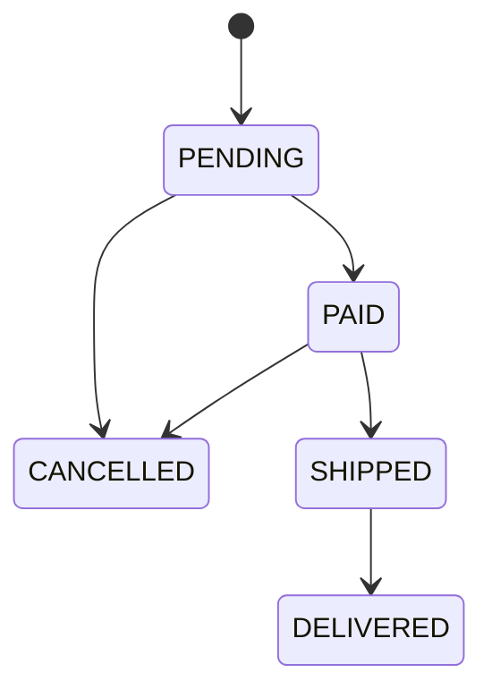

# 枚举值怎么存进数据库：@Enumerated、Postgres 原生枚举类型与查找表

几乎每个领域模型都有一个只能取有限几个值的字段。一笔订单是 `PENDING`、`PAID`、`SHIPPED`、
`DELIVERED` 或 `CANCELLED`。一笔付款要么已授权要么已扣款。一份订阅处于四个套餐之一。
在 Java 里你会不假思索地伸手去拿 `enum`。有意思的问题在边界上——**这组有限的值到底怎么
在数据库里安身**，以及六个月后这组值发生变化时，每种方案各自要你付出什么。

本文按你实际会遇到的顺序，过一遍用 Hibernate 持久化枚举的每种常见方式：`@Enumerated` 的
两种模式、真正的 Postgres `ENUM` 类型、`AttributeConverter`，最后是让枚举自成一表的查找表
方案。我会用一个例子——订单状态——贯穿全程，最后给出我自己实际会做的选择。

技术栈：**Java、Spring Boot、Hibernate、PostgreSQL**。

<div class="post-tldr" markdown="1">
<p class="post-tldr-title">TL;DR</p>

- `@Enumerated(ORDINAL)` 存的是枚举的**位置**——紧凑，但在中间插入值会悄悄污染之后的所有行。如果非用不可，**用单元测试钉死序号**。
- `@Enumerated(STRING)` 存的是**常量名**——自描述、可调试、对重排序免疫。这是最理智的默认选择。
- 别满足于裸 `varchar`——定义真正的 **Postgres `ENUM` 类型**，让数据库亲自拒绝非法值。
- **`AttributeConverter`** 持久化一个与 Java 名称解耦的稳定代码，于是**重命名不再是数据库问题**。
- **查找表**只有在值携带可编辑业务数据时才值得——而不是作为应付重命名的权宜之计。
</div>

---

## 业务场景

我们在做订单管理。一笔订单沿着固定的生命周期流转：



在 Java 里这就是个显而易见的枚举：

```java
public enum OrderStatus {
    PENDING,
    PAID,
    SHIPPED,
    DELIVERED,
    CANCELLED
}
```

订单实体上有个 `status` 字段。唯一的问题是 Hibernate 怎么把它映射到列——而这一注解选择
带来的后果，会比今天写下的代码活得更久。

---

## 第 1 部分 — `@Enumerated(ORDINAL)`：按整数存

JPA 对枚举的默认值就是 `ORDINAL`。每个常量按声明时的位置存储：`PENDING` → 0，
`PAID` → 1，`SHIPPED` → 2，依此类推。

```java
@Entity
@Table(name = "orders_ordinal")
public class OrderOrdinal {

    @Id
    @GeneratedValue(strategy = GenerationType.UUID)
    private UUID id;

    @Enumerated(EnumType.ORDINAL)   // this is also the default if you omit @Enumerated
    @Column(nullable = false)
    private OrderStatus status;
}
```

```sql
CREATE TABLE orders_ordinal (
    id     UUID     PRIMARY KEY DEFAULT gen_random_uuid(),
    status SMALLINT NOT NULL
);
```

保存一笔状态为 `PAID` 的订单，列里存的是 `1`。紧凑，纸面上也说得过去。

### ❌ 陷阱：在中间插入一个值

序号存的不是标签，而是*位置*，而位置由源码顺序定义。某天有人在 `PAID` 和 `SHIPPED`
之间加入了一个打包环节：

```java
public enum OrderStatus {
    PENDING,
    PAID,
    PACKED,      // <-- inserted here
    SHIPPED,
    DELIVERED,
    CANCELLED
}
```

……`PAID` 之后的每个常量都下移一位：

| 常量 | 插入前序号 | 插入后序号 |
|---|---|---|
| `PENDING`   | 0 | 0 |
| `PAID`      | 1 | 1 |
| `PACKED`    | — | **2** |
| `SHIPPED`   | 2 | **3** |
| `DELIVERED` | 3 | **4** |
| `CANCELLED` | 4 | **5** |

数据库里什么都没变。每一条已存在的 `SHIPPED` 订单仍然存着整数 `2`——但 `2` 现在解码为
`PACKED`。已发货的订单悄悄变成已打包。已送达变成已发货。没有报错，没有失败的迁移，
没有日志行。数据没动，动的是你对它的解释。当客户来问为什么已送达的订单显示「打包中」
时，你才会发现。

### 防线：钉死序号

如果你有理由继续用 `ORDINAL`——遗留 schema、一张真正热点且巨大的表、字节差异确实重要——
那就把「顺序承重」这件事*显式化*：写一个测试，谁敢重排枚举，它就立刻变红：

```java
class OrdinalPinTest {

    @Test
    void ordinalsAreFrozen() {
        // If this test fails, you reordered OrderStatus. Existing ORDINAL-mapped rows now mean
        // something different. Revert the reorder, or append the new value at the end.
        assertThat(OrderStatus.PENDING.ordinal()).isZero();
        assertThat(OrderStatus.PAID.ordinal()).isEqualTo(1);
        assertThat(OrderStatus.SHIPPED.ordinal()).isEqualTo(2);
        assertThat(OrderStatus.DELIVERED.ordinal()).isEqualTo(3);
        assertThat(OrderStatus.CANCELLED.ordinal()).isEqualTo(4);
        assertThat(OrderStatus.values()).hasSize(5);
    }
}
```

这是一个纯单元测试——不需要 Spring 上下文，不需要数据库。一旦有人碰了枚举的顺序，它就
把一个不可见的数据污染 bug 立刻变成红色的构建。新值仍然可以加，只是必须加在末尾——
追加在那里是安全的。这就是 `ORDINAL` 悄悄依赖的全部规则，把它写下来而已。

---

## 第 2 部分 — `@Enumerated(STRING)`：按字符串存

对绝大多数人来说，解药只有一个词：

```java
@Enumerated(EnumType.STRING)
@Column(nullable = false)
private OrderStatus status;
```

现在列里存的是常量*名*：

```sql
CREATE TABLE orders_string (
    id     UUID    PRIMARY KEY DEFAULT gen_random_uuid(),
    status VARCHAR NOT NULL
);
```

状态为 `PAID` 的订单存的是字面字符串 `'PAID'`。三件事立刻变好：

- **重排无害。**值就是它自己的名字；位置不再重要。`PACKED` 想加哪儿加哪儿。
- **可调试。**`SELECT * FROM orders_string WHERE status = 'PAID'` 一眼就能读懂。不需要解码环，
  不需要在脑子里跟你的 Java 源码做 join。
- **导出和日志自描述。**CSV 导出里的一行数据自己就能说明问题。

是的，`'DELIVERED'` 比 `3` 多花几个字节。对绝大多数表来说这个差异是噪音——而且索引随时
可加。存名字才是正确的默认，「紧凑」几乎从来不值得「悄悄出错」。

### 仅剩的陷阱：重命名

`STRING` 消灭了顺序陷阱，但引入了一个更小的。存储的值*就是* Java 标识符，所以重命名常量
会让已有行变成孤儿：

```java
PENDING  →  AWAITING_PAYMENT
```

每一条老的 `'PENDING'` 行不再匹配任何常量，Hibernate 读到它们时会抛异常。存储的数据和
代码悄悄漂移了。你可以用一次数据迁移来修复
（`UPDATE … SET status = 'AWAITING_PAYMENT' WHERE status = 'PENDING'`）——这是完全正当的
答案。第 4 部分还会看到一种让重命名彻底变成「无事发生」的办法。

---

## 第 3 部分 — 更进一步：真正的 Postgres 枚举类型

上面两种方案都是把值存进一个数据库并不真正理解的列——一个 `smallint` 或一个*碰巧*装着
枚举值的 `varchar`。Postgres 可以做得更好。它有一等公民的枚举类型：

```sql
CREATE TYPE order_status AS ENUM ('PENDING', 'PAID', 'SHIPPED', 'DELIVERED', 'CANCELLED');

CREATE TABLE orders_pgenum (
    id     UUID         PRIMARY KEY DEFAULT gen_random_uuid(),
    status order_status NOT NULL
);
```

现在由*数据库*来执行领域约束。一条 `INSERT … VALUES ('SHPPED')`——一个手误、一次糟糕的
迁移、一个失控的脚本——会在源头直接失败，报 `invalid input value for enum order_status`。
用裸 `varchar` 的话，这些垃圾会落进表里，你之后才会发现。枚举类型既是文档也是约束：
列的类型本身就列出了它的合法值。

在 Hibernate 里映射它和之前一样是 `@Enumerated(STRING)`——Hibernate 把常量名作为字符串
绑定，Postgres 把它存进枚举：

```java
@Enumerated(EnumType.STRING)
@Column(nullable = false, columnDefinition = "order_status")
private OrderStatus status;
```

只有一处管道需要处理。默认情况下 PostgreSQL JDBC 驱动把 Java `String` 按 `varchar` 类型
发送，而 Postgres 不会隐式地把 `varchar` 强转成 `order_status`，于是你会得到
`column "status" is of type order_status but expression is of type character varying`。
在 JDBC URL 上加 `stringtype=unspecified`，驱动就会以 `unknown` 发送该值，让 Postgres 把它
强转成枚举：

```yaml
spring:
  datasource:
    url: jdbc:postgresql://localhost:5434/mydatabase?stringtype=unspecified
```

（Hibernate 6 还提供 `@JdbcTypeCode(SqlTypes.NAMED_ENUM)` 来直接指向具名枚举类型；上面
`@Enumerated(STRING)` + `stringtype=unspecified` 的组合最常见，也是我自己会用的。）

**唯一要知道的注意事项：**`ALTER TYPE order_status ADD VALUE 'PACKED'` 只能*追加*。你可以
增加值（PostgreSQL 12 起甚至可以加在某个特定值的前面或后面），但不重建类型就无法删除或
重排已有值。这听起来像限制，直到你意识到它和序号测试强制执行的*是同一条规则*——永不
重排，只做追加——只不过这里由数据库来保证，而不是单元测试。约束本身就是特性。

---

## 第 4 部分 — `AttributeConverter`：把名称和存储值解耦

第 2 部分的重命名陷阱之所以存在，是因为我们让*存储值*和 *Java 标识符*成了同一个字符串。
JPA 的 `AttributeConverter` 打破这种耦合：你持久化的是一个与常量名毫无关系的稳定代码。

给每个常量一个显式、永久的代码：

```java
public enum OrderStatus {

    PENDING("PND"),
    PAID("PAID"),
    SHIPPED("SHP"),
    DELIVERED("DLV"),
    CANCELLED("CNC");

    private final String code;

    OrderStatus(String code) {
        this.code = code;
    }

    public String getCode() {
        return code;
    }

    public static OrderStatus fromCode(String code) {
        return Arrays.stream(values())
                .filter(s -> s.code.equals(code))
                .findFirst()
                .orElseThrow(() -> new IllegalArgumentException("Unknown OrderStatus code: " + code));
    }
}
```

然后是一个在枚举 ↔ 代码之间互转的转换器：

```java
@Converter
public class OrderStatusConverter implements AttributeConverter<OrderStatus, String> {

    @Override
    public String convertToDatabaseColumn(OrderStatus status) {
        return status == null ? null : status.getCode();
    }

    @Override
    public OrderStatus convertToEntityAttribute(String code) {
        return code == null ? null : OrderStatus.fromCode(code);
    }
}
```

再用 `@Convert`（而不是 `@Enumerated`）挂到字段上：

```java
@Convert(converter = OrderStatusConverter.class)
@Column(nullable = false)
private OrderStatus status;
```

现在数据库把 `'PAID'` 当作*代码*存储，而不是标识符。把 Java 常量 `PENDING` 重命名为
`AWAITING_PAYMENT`，存储的代码 `'PND'` 纹丝不动——重命名变成一次零数据库影响的纯重构。
你把「数据库知道什么」和「你在代码里怎么称呼它」解耦了，而这恰恰是人们求助于查找表想要
得到的性质。带着这个结论进入下一部分。

---

## 第 5 部分 — 查找表方案

最后一种方案干脆不再把状态当作枚举。状态集合自成一表，订单通过外键引用其中一行：

```sql
CREATE TABLE order_statuses (
    id       INTEGER PRIMARY KEY,
    code     VARCHAR NOT NULL UNIQUE,
    label    VARCHAR NOT NULL,
    terminal BOOLEAN NOT NULL DEFAULT FALSE
);

INSERT INTO order_statuses (id, code, label, terminal) VALUES
    (1, 'PND',  'Pending',   FALSE),
    (2, 'PAID', 'Paid',      FALSE),
    (3, 'SHP',  'Shipped',   FALSE),
    (4, 'DLV',  'Delivered', TRUE),
    (5, 'CNC',  'Cancelled', TRUE);

CREATE TABLE orders_lookup (
    id        UUID    PRIMARY KEY DEFAULT gen_random_uuid(),
    status_id INTEGER NOT NULL REFERENCES order_statuses (id)
);
```

在 JPA 里，状态变成一个关联关系，而不是枚举值：

```java
@Entity
@Table(name = "orders_lookup")
public class OrderLookup {

    @Id
    @GeneratedValue(strategy = GenerationType.UUID)
    private UUID id;

    @ManyToOne(fetch = FetchType.EAGER, optional = false)
    @JoinColumn(name = "status_id", nullable = false)
    private OrderStatusDefinition status;
}
```

想知道一笔订单的状态——它的人类可读标签、它是不是终态——你需要 **join**：

```sql
SELECT o.id, s.code, s.label
FROM   orders_lookup o
JOIN   order_statuses s ON s.id = o.status_id
WHERE  o.id = ?;
```

### ✅ 什么时候它才物有所值

查找表真正买到的东西只有一件：值的集合以及挂在每个值上的元数据，从**代码**搬进了
**数据**。这在以下情况是真有价值：

- **每个值携带可编辑的业务数据**——展示标签、排序、颜色、功能开关、SLA。状态不只是一个
  身份，它是一条小记录。
- **由非开发人员管理这些值**，或者按租户配置，或者在运行时随改随生效、不需要发版。
- **你确实有大规模变更**——重命名一个出现在数百万行里的标签，只需要更新 `order_statuses`
  里的某一行，而不是每一笔订单。

最后一点是最有力的论据：改一处，而不是改所有处。如果你的「枚举」其实是一份被持续维护的
目录（catalog），那这才是正确的模型。

---

## 我的取舍

对于一个*朴素*的枚举——像订单生命周期这种固定的代码级状态集合——我不用查找表，并且在
code review 里会推回这种方案。

我常听到的理由是「万一以后要重命名某个值呢？」但我们刚刚看到，不用表也能解决：
`AttributeConverter` 把存储代码和 Java 名称解耦，一个要改的标签就是一行迁移。为了活过一次
重命名，你不需要在每个查询上都背上外键和 join。

对这种情况，查找表真正添加的是永久成本：每次读取要么 join、要么多一次查询，状态从值变成
了受管理的关联关系，而一个编译期可穷举的 `switch` 变成了可能落空的运行时查找。你用一个
编译器能理解的值，换来了一个编译器看不懂的行，买来的是固定生命周期永远用不上的灵活性。

所以我的规则针对的是**这个值是什么**，而不是重命名：

- 如果这个值**只是身份**——它就是 `SHIPPED`，句号——那就保持枚举。用 `@Enumerated(STRING)`
  映射，用 Postgres 枚举类型兜底，想让重命名免费时就上 `AttributeConverter`。
- 如果这个值**是一条记录**——它有需要人在运行时编辑的字段——那它从来就不是真正的枚举。
  给它一张表。

重命名不是决定性因素。决定性因素是：这东西有没有属于自己的数据。

---

## 决策指南

| 方案 | 存储内容 | 适用场景 | 主要风险 |
|---|---|---|---|
| `@Enumerated(ORDINAL)` | 位置（`1`） | 几乎任何场景都别用 | 重排悄悄污染已有行 |
| `@Enumerated(STRING)` | 常量名（`'PAID'`） | 最理智的默认 | 重命名产生孤儿行 |
| Postgres `ENUM` 类型 | 名称，数据库校验 | 想让数据库拒绝非法值 | `ADD VALUE` 只能追加 |
| `AttributeConverter` | 稳定代码（`'PAID'`） | 想让重命名零成本 | 多维护一个小类 |
| 查找表 | 外键指向一行 | 值携带可编辑数据 | 每次读取都要 join |

对多数项目而言，一个可靠的默认是：**在 Postgres 枚举类型之上用 `@Enumerated(STRING)`**，
一旦想让存储值与 Java 名称隔离，就升级为 **`AttributeConverter`**。

---

## 示例代码

本文代码见
**[github.com/javaAndScriptDeveloper/enums-article](https://github.com/javaAndScriptDeveloper/enums-article)**——
同一个 `OrderStatus` 枚举的全部五种持久化方式、钉序号的测试，以及每种方案一个 round-trip
测试，断言每种方案到底往磁盘上写了什么。Docker 加一条 `./gradlew test` 即可全部本地运行。

---

## 写在最后

挑选枚举的存储方式感觉像一个五秒钟的决定，而这恰恰是它值得你慢下来的原因。序号深坑、
重命名地雷、缺失的数据库约束——没有一个是写注解当天会出现的。它们出现在值集合发生变化
的那一天，而那一天总会来，通常是在你早已忘记当初的取舍之后很久。

好消息是默认选项很简单：存名字，让数据库校验，需要时把代码和标识符解耦。把查找表留给
那些真的是目录而不是枚举的场景。做对一次，你的状态字段从此安安分分——这是你能给一个列
的最高评价。

---

## 欢迎交流

如果你用别的方式存储枚举——或者你曾被这些陷阱中的某一个烧伤过、而我恰好没写到——我想
听听。联系方式见页脚。
