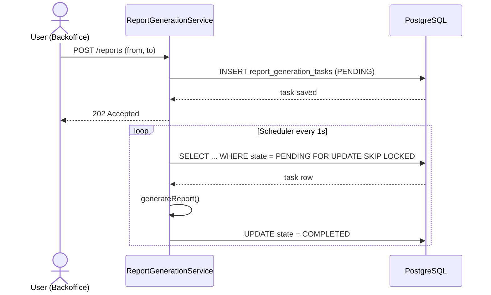
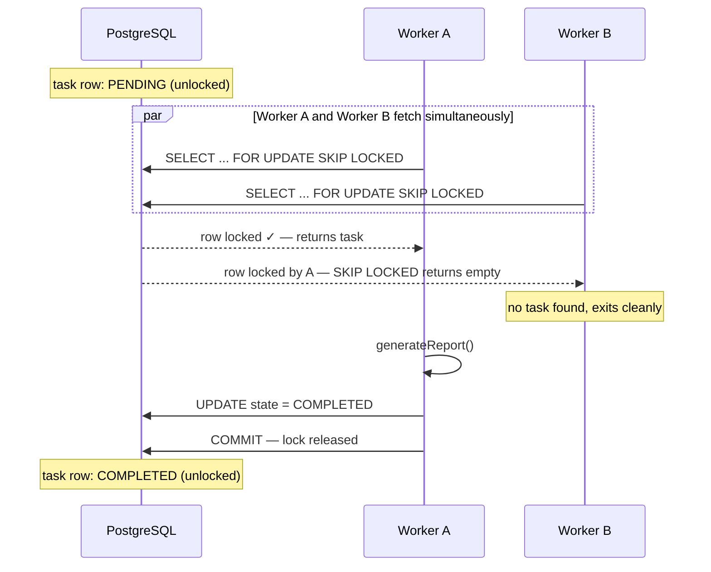
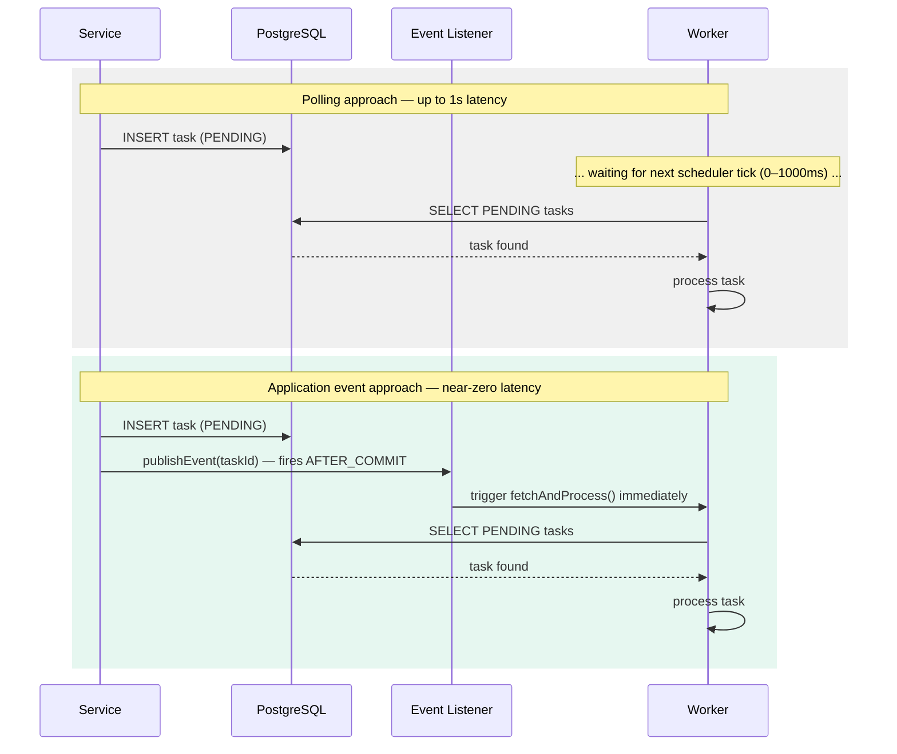
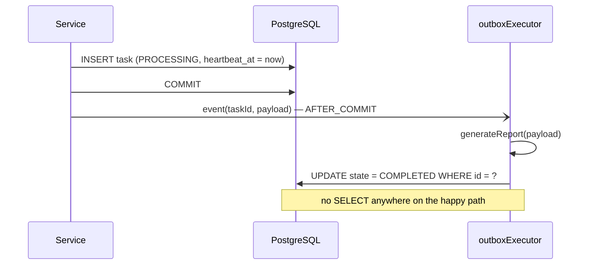
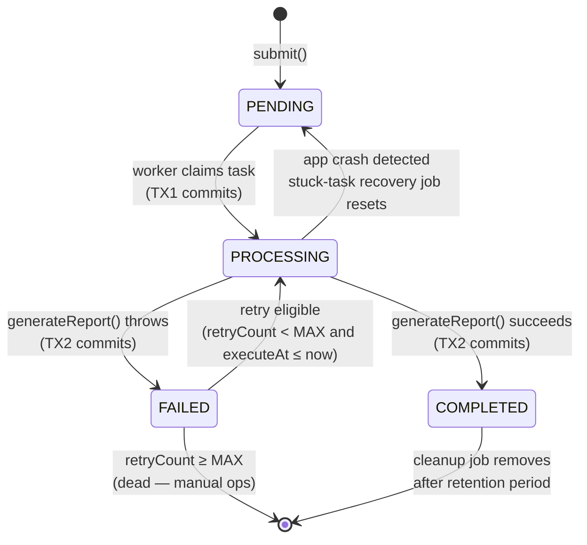
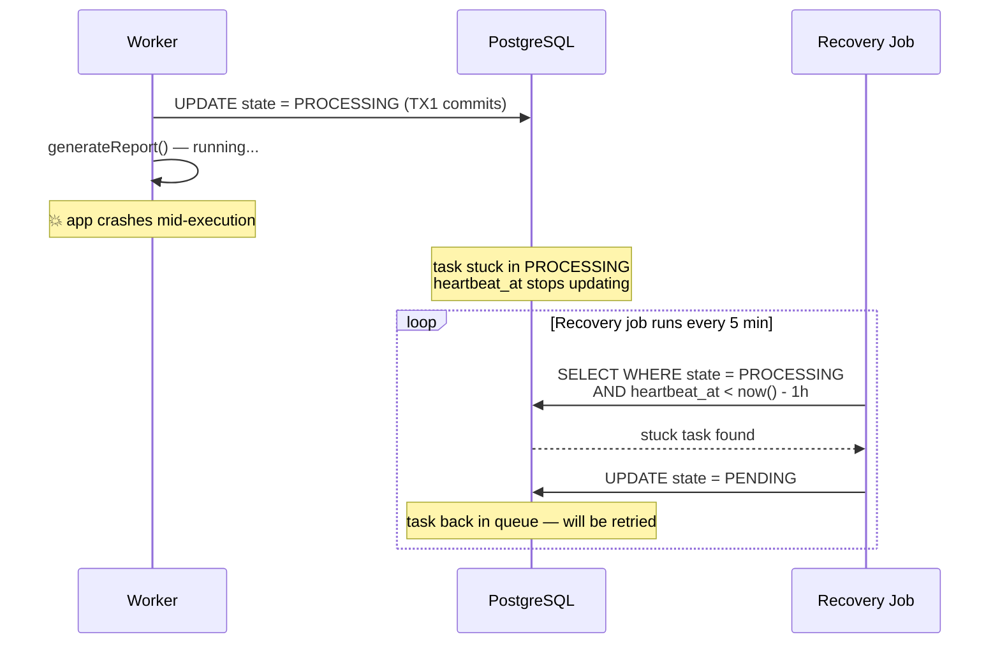
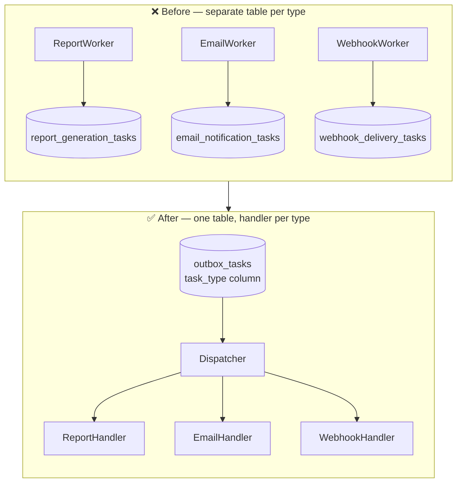
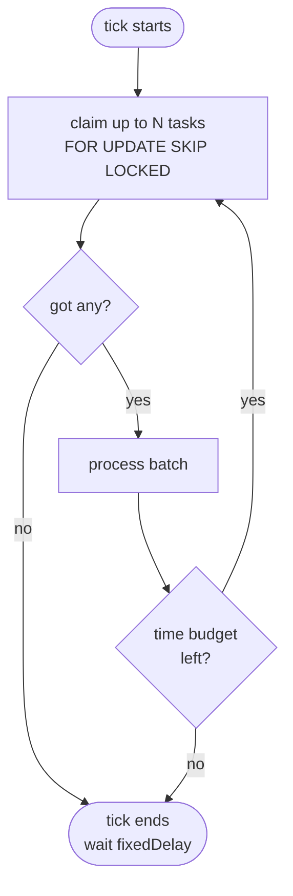

# Transactional Outbox 事务发件箱模式实战：从单个任务到生产级异步任务引擎

有一类 bug 在单元测试里永远不会出现，在预发环境里也罕见。它出现在生产环境，凌晨两点：
你的应用刚把一条记录存进数据库，接着尝试调用一个外部服务——然后其中一方失败了。
一边提交了。另一边没有。直到有用户投诉，才有人知道出了问题。

这就是**双写问题（dual-write problem）**，而事务发件箱（Transactional Outbox）模式是它的标准答案。
思路很简单：不要直接调用外部系统，而是把一个任务写进与业务变更相同的数据库事务里。
后台 worker 把它取出来执行。写入是原子的。任务不可能丢。

但基础思路之后的一切就少有人写了——任务失败怎么办？两个 worker 抢同一行怎么办？
应用在执行中途崩溃怎么办？十种不同类型的任务挤在同一张表里怎么办？当相关方问起
上周二凌晨 3 点队列深度为什么飙升时，你怎么回答？

这就是本文要覆盖的内容。

我会围绕一个具体场景——**报表生成服务**——一步一步把它从最简陋的发件箱演进到
我自己敢放进生产环境的形态。文中每一段代码都来自文末链接的真实可运行仓库。

技术栈：**Java、Spring Boot、PostgreSQL**。

<div class="post-tldr" markdown="1">
<p class="post-tldr-title">TL;DR</p>

- **Transactional Outbox 模式**通过在**同一个数据库事务**中写入任务行、再由后台 worker 执行的方式，解决双写问题。
- 用 `SELECT ... FOR UPDATE SKIP LOCKED` 轮询发件箱表，多个 worker 即可并发运行而不会重复处理。
- **绝不要**在数据库事务里发 Kafka 消息或调用其他服务：事务时长绝不能取决于外部资源。
- 生产级实现需要的不止基础思路：**状态机**、**带退避与抖动（jitter）的重试**、恢复崩溃 worker 的**心跳/租约**、**顺序**保证、经过斟酌的**抓取策略**、**分批清理**，以及对队列深度的**监控**。
- 想要低延迟，就用 `AFTER_COMMIT` 事件在**专用线程池**上唤醒 worker——或者走**零查询（zero-select）**路线，直接在事件里携带载荷，用对负载的控制权换取速度。
- 你不需要 Kafka——**仅靠 PostgreSQL** 就足以支撑可靠的异步执行。
</div>

---

## 业务场景



我们在做一个 CRM。用户可以在后台管理界面请求生成月度分析报表。生成一份报表意味着
聚合数千万行数据——可能耗时数分钟。显然，我们没法在一次 HTTP 请求里同步完成。

用户点击按钮。后端接受请求、保存、立即响应。后台 worker 领取任务、执行生成、
完成后更新状态。

这是发件箱能发挥作用的最简场景：天然就是异步的工作，用户本来就在等着看结果。

---

## 第一部分 — 最基础的发件箱

### 一张发件箱表需要什么

归根结底，任何发件箱表都需要三样东西：

- **状态（State）**——这个任务处于生命周期的哪个阶段？
- **载荷（Payload）**——到底要执行什么？
- **时间戳**——什么时候创建的，最后一次变更是什么时候？

```sql
CREATE TYPE task_state AS ENUM ('PENDING', 'COMPLETED');

CREATE TABLE report_generation_tasks (
                                       id         UUID       PRIMARY KEY DEFAULT gen_random_uuid(),
                                       state      task_state NOT NULL    DEFAULT 'PENDING',
                                       payload    JSONB      NOT NULL,
                                       created_at TIMESTAMP  NOT NULL    DEFAULT now(),
                                       updated_at TIMESTAMP  NOT NULL    DEFAULT now()
);
```

对我们这个场景，载荷就是一个日期区间：

```java
@Value
@Builder
@Jacksonized
public class ReportGenerationPayload {
  Instant from;
  Instant to;
}
```

JPA 实体：

```java
@Entity
@Table(name = "report_generation_tasks")
@Data
@Builder
@NoArgsConstructor
@AllArgsConstructor
public class ReportGenerationEntity {

    @Id
    @GeneratedValue(strategy = GenerationType.UUID)
    @Column(updatable = false, nullable = false)
    private UUID id;

    @Enumerated(EnumType.STRING)
    @Column(nullable = false, columnDefinition = "task_state")
    private TaskState state;

    @JdbcTypeCode(SqlTypes.JSON)
    @Column(nullable = false, updatable = false, columnDefinition = "jsonb")
    private ReportGenerationPayload payload;

    @CreationTimestamp
    @Column(nullable = false, updatable = false)
    private Instant createdAt;

    @UpdateTimestamp
    @Column(nullable = false)
    private Instant updatedAt;
}
```

提交一个任务：

```java
@Service
@RequiredArgsConstructor
public class ReportGenerationService {

    private final ReportGenerationRepository repository;

    public void submit(ReportGenerationCommand command) {
        repository.save(ReportGenerationEntity.builder()
                .state(TaskState.PENDING)
                .payload(ReportGenerationPayload.builder()
                        .from(command.getFrom())
                        .to(command.getTo())
                        .build())
                .build());
    }
}
```

### 后台 Worker

一个定时任务轮询待处理的任务并执行它们：

```java
@Component
@RequiredArgsConstructor
public class ReportGenerationScheduledJob {

    private final ReportGenerationTaskService taskService;

    @Scheduled(fixedDelay = 1000)
    public void run() {
        taskService.fetchAndProcess();
    }
}
```

```java
@Service
@RequiredArgsConstructor
public class ReportGenerationTaskService {

    private final ReportGenerationRepository repository;

    public void fetchAndProcess() {
        repository.findFirstByStateOrderByCreatedAt(TaskState.PENDING)
                .ifPresent(task -> {
                    generateReport(task);
                    task.setState(TaskState.COMPLETED);
                    repository.save(task);
                });
    }

    private void generateReport(ReportGenerationEntity task) {
        // actual report generation logic
    }
}
```

```java
public interface ReportGenerationRepository extends JpaRepository<ReportGenerationEntity, UUID> {
    Optional<ReportGenerationEntity> findFirstByStateOrderByCreatedAt(TaskState state);
}
```

在单实例、无故障的前提下，这样跑得起来。但在真实世界里它有两个问题：两个 worker
可能同时认领同一个任务，任务失败后也没有任何恢复路径。下面把这两个都修掉。

---

## 第二部分 — 并发：两个 Worker，一个任务

当两个调度线程——或两个应用实例——在同一时刻执行抓取查询时，双方都可能读到同一个
`PENDING` 行，并且都会去执行它。结果轻则是重复劳动，重则是状态被写坏。

解决办法是在抓取时就加数据库锁。PostgreSQL 的 `SELECT ... FOR UPDATE SKIP LOCKED`
正是为这种场景而生：它为当前事务锁住该行，并直接跳过已被其他事务锁定的行，而不是等待。

```java
public interface ReportGenerationRepository extends JpaRepository<ReportGenerationEntity, UUID> {

    @Lock(LockModeType.PESSIMISTIC_WRITE)
    @QueryHint(name = AvailableSettings.JAKARTA_LOCK_TIMEOUT, value = "-2") // -2 = SKIP_LOCKED
    Optional<ReportGenerationEntity> findFirstByStateOrderByCreatedAt(TaskState state);
}
```

`SKIP_LOCKED` 的提示值 `-2` 就是 Hibernate 翻译成 `SKIP LOCKED` 子句的来源。由于没有一等公民的注解可用，
值得把它抽成一个可复用的注解，免得这个魔法数字散落在各个 repository 里：

```java
@Retention(RetentionPolicy.RUNTIME)
@Target({ElementType.METHOD, ElementType.ANNOTATION_TYPE})
@QueryHints(@QueryHint(
    name = AvailableSettings.JAKARTA_LOCK_TIMEOUT,
    value = Timeouts.SKIP_LOCKED_MILLI + ""
))
public @interface SkipLocked {}
```

清爽多了。现在 repository 读出来的是意图，而不是管道代码：

```java
@SkipLocked
@Lock(LockModeType.PESSIMISTIC_WRITE)
Optional<ReportGenerationEntity> findFirstByStateOrderByCreatedAt(TaskState state);
```

你*可以*把整个抓取-执行-更新的循环包进一个事务、处理期间一直持有锁，但一般不应该这么做：

```java
// Technically works, but do not use this pattern for outbox processing.
@Transactional
public void fetchAndProcess() {
    repository.findFirstByStateOrderByCreatedAt(TaskState.PENDING)
            .ifPresent(task -> {
                generateReport(task);
                task.setState(TaskState.COMPLETED);
                repository.save(task);
            });
}
```



即使 `generateReport()` 足够小、技术上能跑通，在未提交的事务里执行发件箱动作也是反模式。
事务时长不应取决于发件箱执行的时长：这个动作可能随时间变慢、在 I/O 上阻塞，或者调用
下游服务，导致一条数据库连接和一把行锁被占住一段不可预测的时间。

正确的做法是：在一个短事务里把行置为 `PROCESSING` 完成认领，提交并释放锁，然后再执行
发件箱动作；之后再在另一个短事务里记录 `COMPLETED` 或 `FAILED`。下一节会实现这个状态
流转及其恢复路径。

### 永远不要在事务里与外部世界通信

同样的规则远不止适用于发件箱 worker。在我见过的案例里，这是发件箱周边代码把整个服务
拖垮的最常见方式。它看上去人畜无害：

```java
// ❌ Kafka send (or an HTTP call, or an S3 upload) inside an open DB transaction
@Transactional
public void approveOrder(UUID orderId) {
    var order = orderRepository.findById(orderId).orElseThrow();
    order.setStatus(OrderStatus.APPROVED);

    kafkaTemplate.send("order-approved", orderId.toString(), toEvent(order)).get(); // blocks
    billingClient.notifyApproved(orderId);                                         // blocks
}
```

日子好的时候，Kafka 5ms 就 ack，计费服务 30ms 就响应，没人察觉任何异常。日子不好的时候，
broker 在做 rebalance，或者计费服务已经劣化，每次调用都要卡 30 秒才超时。于是**每一个**
进行中的事务都要开 30 秒：

- 每个事务都占着一条连接池连接——20 条连接、每次调用 30 秒，你的整个服务每 30 秒只能
  审批 20 个订单，其余一切（包括本来健康的读接口）都在排队等连接，然后开始超时；
- 一旦它写过数据（在 JPA 里可能要到提交时 flush 才真正写，但通常更早），它就持有行锁——
  任何碰到这些订单的操作都得排在后面等；
- 一个写过数据的长事务会拖住 Postgres 的 vacuum 水位线——在它结束之前，整个数据库里的
  死元组都无法被清理，于是膨胀会在各处累积，而不只是这一张表。

一个不归你管的依赖发生劣化，就这样变成了你自己的数据库的一次故障。**数据库事务的时长
绝不能取决于外部资源。** 事务只应该等待数据库本身。

而且这仍然是双写。如果 Kafka 发送成功了，而提交随后失败（约束冲突、序列化失败、pod 被杀），
消费者早已看到一个 `order-approved` 事件，而这个订单其实从未被审批。把发送挪到提交*之后*
只是把故障模式翻了个面：提交成功了，事件却丢了。这正是发件箱要解决的问题——在事务里把
意图写进发件箱，再让 worker 事后去和 Kafka 打交道。

即使代码已经写对了，也值得加两道防护，因为下一个改这段代码的人未必知道这条规则：

```java
@Transactional(timeout = 5) // seconds
public void approveOrder(UUID orderId) { ... }
```

Spring 的 `timeout` 不会打断一个已经阻塞住的调用——它是一个截止时间，由之后的数据库操作
去检查。截止时间过后发出的任何语句（包括提交时的 flush）都会抛出超时异常，事务回滚。
把它当作一根绊线：把「又慢又悄无声息」变成「在测试和日志里大声失败」，而不是当作解药。

```sql
-- server-side safety net: kill sessions that sit idle inside an open transaction
ALTER DATABASE app SET idle_in_transaction_session_timeout = '30s';
```

从 Postgres 的视角看，`idle_in_transaction_session_timeout` 描述的正是上面那种情况：
会话开启了一个事务，然后在应用等待别的东西时一声不吭。

---

## 第 2.5 部分 — 用应用事件降低抓取延迟

轮询调度器有一个天然的延迟下限。如果任务每秒触发一次，那么在 `t=0ms` 提交的任务要一直
处于 `PENDING`，直到下一个 tick——最多晚 1000ms。对大多数异步负载来说这可以接受。但如果你
想要近实时的拾取——发送事务性邮件、触发 webhook——就不行了。

这里借鉴了 Celery 的模式：先把发件箱实体存库，然后立即发布一个携带新任务 ID 的 Spring
`ApplicationEvent`。监听器接住它并马上触发处理，不必等下一个调度 tick。



调度器仍然作为兜底运行——它负责兜住事件监听器漏掉的一切（应用重启、监听器异常、
丢失的事件）。但正常路径完全绕过了轮询延迟。

### 具体实现

在 service 方法里、保存之后发布事件：

```java
@Service
@RequiredArgsConstructor
public class ReportGenerationService {

    private final ReportGenerationRepository repository;
    private final ApplicationEventPublisher eventPublisher;

    @Transactional
    public void submit(ReportGenerationCommand command) {
        var entity = repository.save(ReportGenerationEntity.builder()
                .state(TaskState.PENDING)
                .payload(ReportGenerationPayload.builder()
                        .from(command.getFrom())
                        .to(command.getTo())
                        .build())
                .build());

        eventPublisher.publishEvent(new ReportGenerationTaskSubmittedEvent(entity.getId()));
    }
}
```

```java
public record ReportGenerationTaskSubmittedEvent(UUID taskId) {}
```

监听器在提交之后、**在它自己的线程池上**做出响应：

```java
@Component
@RequiredArgsConstructor
public class ReportGenerationTaskEventListener {

    private final ReportGenerationTaskService taskService;

    @Async("outboxExecutor")
    @TransactionalEventListener(phase = TransactionPhase.AFTER_COMMIT)
    public void onTaskSubmitted(ReportGenerationTaskSubmittedEvent event) {
        taskService.fetchAndProcess();
    }
}
```

注意，监听器并没有把 `event.taskId()` 往下传。这是刻意的：事件只是一个**唤醒信号**，
`fetchAndProcess()` 认领任务的方式和轮询器完全一样——取最旧的合格任务，并带上
`SKIP LOCKED`。触发事件的那个任务未必就是被执行的那个，但排序和认领逻辑只存在于一处。
如果你更希望*立刻*执行*那个*任务，就把 id 传下去并直接认领它：

```java
taskService.process(event.taskId()); // WHERE id = :id AND state = 'PENDING' FOR UPDATE SKIP LOCKED
```

这样提交者能获得最低的延迟，代价是新任务可以插队到更早的 `PENDING` 任务前面——对相互
独立的工作来说没问题，但如果你依赖 FIFO（第七部分）就是错的。本部分末尾的零查询发件箱
把这个思路推到极致：直接传整份载荷。

`@Async` 不是摆设。没有它的 `AFTER_COMMIT` 监听器会**在执行提交的那个线程上同步运行**——
也就是 HTTP 请求线程。用户拿到的「202 Accepted」现在要等整份报表生成完才返回。更糟的是，
此时已提交事务的资源仍然绑定在这个线程上：Spring 自己的文档就警告过，在 after-commit
回调里做数据访问，仍然会「参与」那个已经结束的事务，除非代码显式要求 `REQUIRES_NEW`，
否则没有任何东西会去提交它。把监听器挪到单独的线程上，两个问题一次解决。

### 用专用线程池，而不是默认那个

不带名字的 `@Async` 使用 Spring Boot 共享的 `applicationTaskExecutor`——它与应用里所有其他
`@Async` 方法共用，并且默认情况下队列实际上是无界的。一波事件洪峰会悄无声息地变成内存里
的积压，下次重启时就凭空消失。给发件箱一个它自己的、有界的线程池：

```java
@Configuration
@EnableAsync
public class OutboxExecutorConfig {

    @Bean("outboxExecutor")
    public ThreadPoolTaskExecutor outboxExecutor() {
        var executor = new ThreadPoolTaskExecutor();
        executor.setCorePoolSize(4);
        executor.setMaxPoolSize(4);
        executor.setQueueCapacity(200);                 // bounded: overflow is rejected, not buffered forever
        executor.setThreadNamePrefix("outbox-");        // readable thread dumps and logs
        executor.setRejectedExecutionHandler(new ThreadPoolExecutor.DiscardPolicy());
        executor.setWaitForTasksToCompleteOnShutdown(true);
        executor.setAwaitTerminationSeconds(15);
        return executor;
    }
}
```

照抄之前有一个 Spring Boot 细节要知道：只有在你**没有**自己声明任何 `Executor` bean 时，
Boot 才会自动配置 `applicationTaskExecutor`。一旦声明了 `outboxExecutor`，默认的那个就消失了——
应用里其他地方所有*不带名字*的 `@Async` 都会悄悄落到另一个 executor 上（很可能就是这个，
连同它的丢弃策略）。在 Boot 3.5+ 上，设置 `spring.task.execution.mode=force` 来保留自动配置的
那个；更早的版本上，在它旁边显式声明一个 `applicationTaskExecutor` bean。

溢出时直接丢弃在这里是安全的，*因为那一行已经在数据库里了*：事件只是一个延迟优化，
事件路径丢掉的任何东西，轮询器都会捡起来。这个线程池绝不要用 `CallerRunsPolicy`——
所谓的「caller」正是你想要解放出来的那个请求线程。

### 最经典的错误

这里最常见的错误是用 `@EventListener` 而不是
`@TransactionalEventListener(phase = TransactionPhase.AFTER_COMMIT)`。会出什么问题，取决于
监听器是不是异步的：

- **普通的 `@EventListener`** 在 `publishEvent()` 被调用的那一刻就触发——同步执行，在同一个
  线程上，**处于仍未提交的事务之内**。`fetchAndProcess()` 加入这个事务，所以它*确实*能看到
  那条未提交的行——并且当场认领、执行了这个任务。报表在提交请求的事务里生成（正是第二部分
  里的那个反模式），请求一直挂着直到生成结束；而如果提交请求的事务随后回滚了，你就执行了
  一个名义上从未存在过的任务。
- **`@Async` + `@EventListener`** 在另一个线程、用另一条连接、在提交之前运行。行还不可见，
  抓取什么也找不到，事件被悄无声息地浪费掉。一秒之后调度器把任务捞了起来，所以日志看起来
  一切正常——你只是在不知不觉中失去了延迟上的好处。

```java
// ❌ fires inside the open transaction (or before it commits, if @Async)
@EventListener
public void onTaskSubmitted(ReportGenerationTaskSubmittedEvent event) {
    taskService.fetchAndProcess();
}

// ✅ fires after COMMIT, on the outbox pool — the row is visible and the caller is free
@Async("outboxExecutor")
@TransactionalEventListener(phase = TransactionPhase.AFTER_COMMIT)
public void onTaskSubmitted(ReportGenerationTaskSubmittedEvent event) {
    taskService.fetchAndProcess();
}
```

调度器保持不变——它充当事件监听器漏掉任务的恢复机制。两种方式互补：事件负责延迟，
轮询负责可靠性。

### 更进一步：零查询发件箱

上面的事件仍然要多付一次往返。它只说了「来了点新东西」，所以 worker 还得 `SELECT` 一次
才知道是什么——而且在 `ORDER BY created_at` 之下，它甚至未必会选中触发事件的那个任务。
当延迟真的很关键时，干脆把读取这一步省掉：**把执行任务所需的一切都放进事件里**，直接从
内存执行，只把结果写回去。



这里用到了第三部分和第五部分的 `PROCESSING` 状态与心跳。这一行在插入时就已经是
`PROCESSING`，并带着一个新鲜的 `heartbeat_at` 充当租约。正是这个细节保证了正确性：
如果插入时是 `PENDING`，轮询器就可能在事件路径已经在执行它的同时认领它，任务就会被执行两次。

```java
public record ReportRequestedEvent(UUID taskId, Instant leasedAt, ReportGenerationPayload payload) {}

@Transactional
public void submit(ReportGenerationCommand command) {
    var payload = ReportGenerationPayload.builder()
            .from(command.getFrom())
            .to(command.getTo())
            .build();
    var leasedAt = Instant.now().truncatedTo(ChronoUnit.MICROS); // Postgres stores microseconds
    var entity = repository.save(ReportGenerationEntity.builder()
            .state(TaskState.PROCESSING)
            .heartbeatAt(leasedAt)        // lease: the poller leaves this row alone
            .payload(payload)
            .build());
    eventPublisher.publishEvent(new ReportRequestedEvent(entity.getId(), leasedAt, payload));
}
```

```java
@Async("outboxExecutor")
@TransactionalEventListener(phase = TransactionPhase.AFTER_COMMIT)
public void onReportRequested(ReportRequestedEvent event) {
    // UPDATE ... SET heartbeat_at = now()
    //  WHERE id = :id AND state = 'PROCESSING' AND heartbeat_at = :leasedAt
    if (repository.renewLease(event.taskId(), event.leasedAt()) == 0) {
        return; // the event waited too long: recovery already handed the task to the poller
    }
    try (var heartbeat = heartbeatFactory.start(event.taskId())) {
        generateReport(event.payload());
        repository.markCompleted(event.taskId());              // UPDATE ... WHERE id = :id
    } catch (Exception e) {
        repository.markFailed(event.taskId(), e.getMessage()); // the poller retries it later
    }
}
```

开头那个 `renewLease` 检查比看上去更重要。租约在插入时设置，但心跳要等到某个线程接手事件
之后才开始。如果事件在 executor 队列里待的时间超过了恢复阈值，恢复任务就会把这一行重置为
`PENDING`，某个轮询器认领了它——然后排队中的那个事件会再执行它一次。这个条件更新把这种
竞争变成了 no-op：谁不再持有原来的租约，谁就退出。

每一种故障模式最终都会落回经典路径。如果监听器抛异常，任务变成 `FAILED`，由轮询器按退避
策略重试。如果应用在执行中途挂掉，心跳停止，卡死任务恢复任务会重置它。如果线程池拒绝了
事件，这一行就保持 `PROCESSING`，租约永远不会续期，等着被恢复——由于有租约检查，对这类行
使用很短的恢复阈值是安全的。（想在被拒绝时直接把它交还给 `PENDING`，需要任务 id，而
`@Async` 的拒绝处理器拿不到它；如果你想这么做，就自己往 executor 提交任务并捕获
`TaskRejectedException`。）

**取舍：由谁来控制工作量。** 轮询式发件箱是*拉*（pull）模式。它自己决定取多少任务、取多快，
所以无论上游发生什么，它的负载在设计上都是有界的。零查询发件箱是*推*（push）模式：工作
以请求到达的速率到来。流量尖峰会变成执行尖峰，唯一的刹车就是线程池大小和队列容量——一旦
它们满了，你就在拒绝任务，最终还是回退到轮询。零查询适合对延迟敏感、量级适中、并配有有界
线程池的工作；其余的一切仍交给轮询器，并且轮询器永远作为兜底存在。

**榨干最后一次写入。** 为了追求极致吞吐，你还可以再进一步，不再逐个写入完成状态：把已完成
的 id 收集在内存里，每隔几百毫秒用一条 `UPDATE` 批量刷回。

```java
@Component
@RequiredArgsConstructor
public class CompletionBuffer {

    private final ConcurrentLinkedQueue<UUID> completed = new ConcurrentLinkedQueue<>();
    private final ReportGenerationRepository repository;

    public void add(UUID taskId) {
        completed.add(taskId);
    }

    @Scheduled(fixedDelay = 200)
    @PreDestroy                                   // flush what we can on a graceful shutdown
    public void flush() {
        var ids = new ArrayList<UUID>();
        for (UUID id; ids.size() < 1_000 && (id = completed.poll()) != null; ) {
            ids.add(id);
        }
        if (!ids.isEmpty()) {
            repository.markCompleted(ids);        // UPDATE ... SET state = 'COMPLETED' WHERE id IN (:ids)
        }
    }
}
```

关停时的 flush 只是尽力而为——之后还留在缓冲区里的、或者在 bean 销毁后才加入的，都会在
之后被简单地重跑一遍。要准确地说清楚这样做的代价。崩溃会丢失缓冲区——丢的不是任务，而是
*它们已完成的记录*。这些行保持 `PROCESSING`，恢复任务把它们重置，于是它们会**再次**执行。
只有当每个 handler 都是幂等的（第十部分）时，这才可以接受。失败要立即写入，而不要缓冲：
失败很少见，而它的错误信息是你事后唯一无法重建的东西。

---

## 第三部分 — 失败、重试与 PROCESSING 状态



发件箱动作不应该在未提交的数据库事务里执行。持锁事务的方式会在 `generateReport()` 的
整个执行期间占着一把数据库锁。对一份要跑两分钟的报表来说，就是两分钟的行锁——
一条连接被占死，其他数据库操作可能排在它后面。有了 `SKIP LOCKED`，worker 之间不会互相
阻塞，但长时间运行的事务仍会给连接池施压，让数据库在高负载下不好受。非常小的动作也许
技术上能不出问题，但把事务时长和发件箱执行时长绑在一起仍然是反模式。

修复办法是把「认领任务」和「执行任务」分开。先在一个短事务里把任务置为 `PROCESSING`，
释放锁，然后在任何事务之外做真正的工作。这样数据库只在开头和结尾被短暂触碰——昂贵的
部分发生在中间，不占用任何东西。

先扩展枚举：

```sql
ALTER TYPE task_state ADD VALUE 'PROCESSING';
ALTER TYPE task_state ADD VALUE 'FAILED';

ALTER TABLE report_generation_tasks
    ADD COLUMN retry_count  INTEGER NOT NULL DEFAULT 0,
    ADD COLUMN error_message VARCHAR;
```

`retry_count` 记录执行被尝试了多少次。我们把重试上限设为 10——超过这个数，说明真的出了
问题，需要人工介入。稍后会围绕它配置告警。`error_message` 存最后一次异常，这样你不用翻
日志就知道任务*为什么*卡住。

Java 枚举随之扩展：

```java
public enum TaskState {
    PENDING,
    PROCESSING,
    COMPLETED,
    FAILED
}
```

service 现在运行两个独立的短事务，真正的工作夹在中间：

```java
@RequiredArgsConstructor
public class ReportGenerationTaskService {

    private final ReportGenerationRepository repository;
    private final TransactionTemplate transactionTemplate;

    private static final int MAX_RETRY_COUNT = 10;

    public void fetchAndProcess() {
        transactionTemplate
                .execute(status ->
                        repository.findFirstEligibleTask(
                                List.of(TaskState.PENDING, TaskState.FAILED),
                                MAX_RETRY_COUNT
                        ).map(this::markProcessing))
                .ifPresentOrElse(
                        task -> {
                            try {
                                generateReport(task);
                                markCompleted(task);
                            } catch (Exception e) {
                                markFailed(task, e);
                                log.error("Task {} failed on attempt {}", task.getId(), task.getRetryCount(), e);
                            }
                        },
                        () -> log.debug("No eligible tasks to process")
                );
    }

    private ReportGenerationEntity markProcessing(ReportGenerationEntity task) {
        task.setState(TaskState.PROCESSING);
        return repository.save(task);
    }

    private void markCompleted(ReportGenerationEntity task) {
        task.setState(TaskState.COMPLETED);
        repository.save(task);
    }

    private void markFailed(ReportGenerationEntity task, Exception e) {
        task.setState(TaskState.FAILED);
        task.setRetryCount(task.getRetryCount() + 1);
        task.setErrorMessage(e.getMessage()); // don't skip this — it's the only trace of what went wrong without digging through logs
        repository.save(task);
    }
}
```

查询同时抓取 `PENDING` 和 `FAILED` 的任务——一个 `retryCount < 10` 的失败任务和新任务一样
有资格被处理。一旦重试次数触顶，任务不再被抓取，作为一条永久的 `FAILED` 记录躺在那里，
直到有人来看。这是刻意为之——超过 10 次尝试说明真的出了问题，需要人来处理，而不是再来
一次重试。

```java
@SkipLocked
@Lock(LockModeType.PESSIMISTIC_WRITE)
@Query("""
    SELECT t FROM ReportGenerationEntity t
    WHERE t.state IN :states
      AND t.retryCount < :maxRetryCount
    ORDER BY t.createdAt ASC
    LIMIT 1
    """)
Optional<ReportGenerationEntity> findFirstEligibleTask(
    @Param("states") List<TaskState> states,
    @Param("maxRetryCount") Integer maxRetryCount
);
```

但等等——一个刚失败的任务，真的应该在下一个调度 tick、几秒之后就被再次拾取吗？如果下游
系统挂了，每秒锤它一次只会雪上加霜。这正是下一节要解决的。

## 第四部分 — 指数退避

如果重试之间没有间隔，失败的任务会在下一个调度 tick 重新入队——通常就是几秒之后。如果
下游系统挂了，你正在以全速轮询频率锤它。这对下游系统有害，对你的数据库也有害。

修复办法是加一个 `execute_at` 列：在这个时间戳过去之前，任务不具备被处理的资格。新任务
设 `execute_at = now()`，立即可以被拾取。失败的任务设 `execute_at = now() + delay`，延迟随
每次重试递增。

```sql
ALTER TABLE report_generation_tasks
    ADD COLUMN execute_at TIMESTAMP NOT NULL DEFAULT NOW();
```

延迟表决定了一切——`MAX_RETRY_COUNT` 由它推导而来，而不是单独声明。这样两者永远不会
失去同步：

```java
private static final Map<Integer, Duration> RETRY_DELAYS = Map.of(
    0, Duration.ofMinutes(1),
    1, Duration.ofMinutes(5),
    2, Duration.ofMinutes(15),
    3, Duration.ofMinutes(30),
    4, Duration.ofHours(1),
    5, Duration.ofHours(2),
    6, Duration.ofHours(4),
    7, Duration.ofHours(8),
    8, Duration.ofHours(12),
    9, Duration.ofDays(1)
);

private static final int MAX_RETRY_COUNT = RETRY_DELAYS.size();
```

往 `RETRY_DELAYS` 里加一项，重试上限就会自动更新。不需要在其他地方再维护一个魔法数字。

在 `markFailed()` 里，先取*当前*的重试次数再自增——它用来选出*下一次*尝试的延迟：

```java
private void markFailed(ReportGenerationEntity task, Exception e) {
    int currentRetry = task.getRetryCount();
    task.setState(TaskState.FAILED);
    task.setRetryCount(currentRetry + 1);
    task.setErrorMessage(e.getMessage());
    task.setExecuteAt(Instant.now().plus(
            RETRY_DELAYS.getOrDefault(currentRetry, RETRY_DELAYS.get(RETRY_DELAYS.size() - 1))));
    repository.save(task);
}
```

抓取查询多了一个条件——`AND t.executeAt <= :now`——调度器保持原来的频率运行。它只是跳过
窗口还没打开的任务。失败的任务安静地等到属于自己的时刻，然后自然地重新入队。

### 抖动（Jitter）：在负载砸过来之前把它摊平

固定的退避表有一个讨厌的特性：一起失败的任务会一起重试。如果邮件服务商挂了两分钟，在这个
窗口内失败的 3,000 个任务全都拿到 `execute_at = failed_at + 1 minute`——等服务商一恢复，它们
就作为一波整齐划一的浪潮再次砸过去。给每个延迟加上随机量，让这波浪潮散开：

```java
private static Instant nextAttempt(Duration baseDelay) {
    long jitterMillis = ThreadLocalRandom.current().nextLong(baseDelay.toMillis() / 2 + 1);
    return Instant.now().plus(baseDelay).plusMillis(jitterMillis); // base + up to 50%
}
```

同样的思路也适用于**入口**。从架构上讲，异步引擎想要的是平稳、持续的负载——而不是突如其来
的大尖峰。一个夜间导入任务在一个事务里提交 200,000 个任务，会让它们在同一毫秒全部具备执行
资格；每个 pod 上的每个 worker 都被打满，下游系统承受整个突发流量，而你的延迟大盘为一堆
根本没人在等的工作亮起红灯。当任务并不紧急时，在提交时就给它一个带抖动的 `execute_at`：

```java
// bulk / non-urgent submission: spread over the next 10 minutes instead of "all now"
entity.setExecuteAt(Instant.now().plusMillis(
        ThreadLocalRandom.current().nextLong(Duration.ofMinutes(10).toMillis())));
```

总工作量不变，只是在时间上摊开了。面向用户的任务保持 `execute_at = now()`；批量工作则按
它能承受的等待时长，配一个相应大小的抖动窗口。

---

## 第五部分 — 卡死任务与心跳



采用双事务方案后，想一想：如果应用在把任务置为 `PROCESSING` 之后、置为 `COMPLETED` 或
`FAILED` 之前崩溃了，会发生什么？数据库显示 `PROCESSING`。没有人在处理它。它永远躺在那里。

朴素的修复是一个恢复任务：找出在 `PROCESSING` 状态停留过久的任务，重置回 `PENDING`：

```java
@Transactional
public void recoverStuckTasks() {
    repository.findFirstByStateAndUpdatedAtLessThan(
                    TaskState.PROCESSING,
                    Instant.now().minus(1, ChronoUnit.HOURS))
            .ifPresent(task -> {
                log.warn("Resetting stuck task {} to PENDING", task.getId());
                task.setState(TaskState.PENDING);
                repository.save(task);
            });
}
```

大多数情况下这能工作。问题在于：只要行上*任何*内容变化，`updated_at` 都会更新——包括
无关的状态流转。一个合法地处理了 55 分钟的任务，从 `updated_at` 的角度看和一个崩溃的
任务一模一样。

更干净的方案是**心跳（heartbeat）**：一个专用列，*只在任务正被积极处理时*周期性地更新它。
恢复任务改为检查这个列，而不是 `updated_at`。一个最近一小时没有心跳的任务，才是真正
卡死的任务。

```sql
ALTER TABLE report_generation_tasks ADD COLUMN heartbeat_at TIMESTAMP;
```

心跳运行在自己的线程上、自己的事务里，独立于处理逻辑。最干净的实现是
`try-with-resources`——处理开始时启动，任何退出路径上停止：

```java
public abstract class Heartbeat implements AutoCloseable {

    private final ScheduledExecutorService executor;

    protected Heartbeat(Runnable heartbeatFn) {
        executor = Executors.newSingleThreadScheduledExecutor();
        executor.scheduleAtFixedRate(heartbeatFn, 0, 10, TimeUnit.SECONDS);
    }

    @Override
    public void close() {
        executor.shutdownNow();
    }
}
```

```java
public class ReportGenerationTaskHeartbeat extends Heartbeat {

    ReportGenerationTaskHeartbeat(UUID taskId, ReportGenerationRepository repository) {
        super(() -> repository.updateHeartbeatAt(taskId, Instant.now()));
    }
}
```

repository 方法自带 `@Transactional`——不需要手动包一层事务：

```java
@Modifying
@Transactional
@Query("UPDATE ReportGenerationEntity t SET t.heartbeatAt = :now WHERE t.id = :id")
void updateHeartbeatAt(@Param("id") UUID id, @Param("now") Instant now);
```

通过工厂接入，让 service 保持干净：

```java
@Component
@RequiredArgsConstructor
public class ReportGenerationTaskHeartbeatFactory {

    private final ReportGenerationRepository repository;

    public Heartbeat start(UUID taskId) {
        return new ReportGenerationTaskHeartbeat(taskId, repository);
    }
}
```

处理代码块现在长这样：

```java
public void fetchAndProcess() {
    transactionTemplate
            .execute(status -> repository.findFirstEligibleTask(
                    List.of(TaskState.PENDING, TaskState.FAILED),
                    MAX_RETRY_COUNT
            ).map(this::markProcessing))
            .ifPresentOrElse(
                    task -> {
                        try (var heartbeat = heartbeatFactory.start(task.getId())) {
                            try {
                                generateReport(task);
                                markCompleted(task);
                            } catch (Exception e) {
                                markFailed(task, e);
                                log.error("Task {} failed", task.getId(), e);
                            }
                        }
                    },
                    () -> log.debug("No eligible tasks to process")
            );
}
```

恢复任务改用 `heartbeat_at` 而不是 `updated_at`：

```java
@Modifying
@Transactional
@Query("UPDATE ReportGenerationEntity t SET t.heartbeatAt = :now WHERE t.id = :id")
void updateHeartbeatAt(@Param("id") UUID id, @Param("now") Instant now);

@SkipLocked
@Lock(LockModeType.PESSIMISTIC_WRITE)   // two recovery runs never reset the same task
Optional<ReportGenerationEntity> findFirstByStateAndHeartbeatAtLessThanOrderByCreatedAt(
        TaskState state, Instant heartbeatAt);
```

`updated_at` 反映任务状态最后一次变更的时间。`heartbeat_at` 反映任务此刻是否还活着。
把两者分开，意味着你可以无歧义地同时回答这两个问题。

---

## 第六部分 — 多类型发件箱



六个月后，你的服务不只处理报表生成了。你需要邮件通知。然后是数据导出。然后是
webhook 投递。

你有两个选择：每种任务类型一张独立的表，或者一张共享表加一个 `task_type` 判别列。
当任务类型众多、而你又愿意从一个地方统一处理时，共享表更优。基础设施——重试、心跳、
退避、监控——都留在同一个地方。新增一种任务类型只是多写一个 handler。

值得提前知道的取舍：

- 一种行为不端的新任务类型可能拖慢所有其他类型——一个疯狂重试的坏 handler 会在整张表上
  制造背压。
- 顺序保证变得更难——下面细说。

### 表结构

```sql
CREATE TYPE outbox_task_type AS ENUM ('REPORT_GENERATION', 'EMAIL_NOTIFICATION');

CREATE TABLE outbox_tasks (
    id            UUID             PRIMARY KEY DEFAULT gen_random_uuid(),
    task_type     outbox_task_type NOT NULL,
    state         task_state       NOT NULL    DEFAULT 'PENDING',
    payload       JSONB            NOT NULL,
    retry_count   INTEGER          NOT NULL    DEFAULT 0,
    error_message VARCHAR,
    execute_at    TIMESTAMPTZ      NOT NULL    DEFAULT NOW(),
    heartbeat_at  TIMESTAMPTZ,
    created_at    TIMESTAMPTZ      NOT NULL    DEFAULT now(),
    updated_at    TIMESTAMPTZ      NOT NULL    DEFAULT now()
);
```

### Handler 接口

关键的扩展点——每种任务类型一个实现：

```java
public interface OutboxTaskHandler<P> {
    OutboxTaskType getType();
    Class<P> payloadClass();
    void handle(UUID taskId, P payload) throws Exception;
}
```

`taskId` 被传入每个 handler。原因会在幂等性那一节揭晓。

一个具体的 handler：

```java
@Component
public class EmailNotificationHandler implements OutboxTaskHandler<EmailNotificationPayload> {

    @Override
    public OutboxTaskType getType() {
        return OutboxTaskType.EMAIL_NOTIFICATION;
    }

    @Override
    public Class<EmailNotificationPayload> payloadClass() {
        return EmailNotificationPayload.class;
    }

    @Override
    public void handle(UUID taskId, EmailNotificationPayload payload) throws Exception {
        log.info("Sending email to {} — task {}", payload.getRecipient(), taskId);
        // call email provider
    }
}
```

### 调度器（Dispatcher）

service 在启动时收集所有 handler bean，构建一张查找表，然后按 `taskType` 为每个任务路由：

```java
@Service
@RequiredArgsConstructor
public class OutboxTaskService {

    private final OutboxTaskRepository repository;
    private final ObjectMapper objectMapper;
    private final List<OutboxTaskHandler<?>> handlerList;

    private Map<OutboxTaskType, OutboxTaskHandler<?>> handlers;

    @PostConstruct
    void init() {
        handlers = handlerList.stream()
                .collect(Collectors.toMap(OutboxTaskHandler::getType, Function.identity()));
    }

    @SuppressWarnings("unchecked")
    private void dispatch(OutboxTaskEntity task) throws Exception {
        var handler = (OutboxTaskHandler<Object>) handlers.get(task.getTaskType());
        if (handler == null) {
            throw new IllegalStateException(
                    "No handler registered for task type: " + task.getTaskType());
        }
        var payload = objectMapper.readValue(task.getPayload(), handler.payloadClass());
        handler.handle(task.getId(), payload);
    }
}
```

注册一种新任务类型的步骤：加一个枚举值，加一个 handler bean，完事。调度器、定时任务、
重试逻辑——全都不用动。

---

## 第七部分 — 顺序保证

如果你的场景不在乎处理顺序——即发即忘的通知、相互独立的后台任务——可以跳过这一节。
但即便如此，优先处理先插入的任务也是更公道的做法：先提交的任务等得更久，按提交顺序
处理才符合用户的合理预期。

没有显式 `ORDER BY` 时，PostgreSQL 对行的返回顺序**不作任何保证**。抓取查询里永远按
`created_at ASC` 排序：

```java
@Query("""
    SELECT t FROM OutboxTaskEntity t
    WHERE t.state IN :states
      AND t.retryCount < :maxRetryCount
      AND t.executeAt <= :now
    ORDER BY t.createdAt ASC
    LIMIT 1
    """)
Optional<OutboxTaskEntity> findFirstEligibleTask(...);
```

再用一个部分索引支撑它：

```sql
CREATE INDEX idx_outbox_fetch
    ON outbox_tasks (created_at ASC)
    WHERE state IN ('PENDING', 'FAILED');
```

### 时钟偏移的陷阱

首先要诚实地问自己：这对你的场景到底重不重要。如果任务之间相互独立——报表生成、
发邮件、webhook 投递——处理顺序通常完全无所谓。任务 A 比任务 B 先完成，无论谁先提交，
都没问题。这种情况下，整节内容都与你无关。

如果你确实需要 FIFO——同一实体的多个任务必须按提交顺序处理——那接着往下读。

问题在于 `created_at` 是在应用侧生成的。每个应用实例都有自己的系统时钟。如果实例 A 的
时钟比实例 B 快 200ms，B 在 `t=100ms` 提交的任务拿到的 `created_at` 会早于 A 在 `t=50ms`
提交的任务——尽管 A 的任务先插入。抓取查询按 `created_at` 排序，会先取到 B 的任务。
提交顺序被颠倒了。

NTP 能让时钟接近同步，但做不到完全一致。正常情况下偏差是毫秒级。高负载下、虚拟机迁移
期间、或容器重启之后，偏差可能更大。

修复办法是把排序值放到数据库侧生成——要么让 PostgreSQL 通过 `DEFAULT now()` 来赋
`created_at`，而不是让应用设置它；要么使用由数据库支撑的序列（sequence），无论哪个实例
插入，它都保证单调递增。下面是序列方案：

```sql
ALTER TABLE outbox_tasks ADD COLUMN seq BIGSERIAL;
```

```java
@Column(insertable = false, updatable = false)
private Long seq;
```

按 `seq ASC` 排序。这个值由唯一的权威来源——数据库——分配，因此它反映真实的插入顺序，
与哪个实例提交了任务、那台实例的时钟说了什么无关。

`created_at` 留着做可观测性。排序用 `seq`。

有一个注意事项，会坑到那些过分依赖它的人：序列值是在 `INSERT` 时分配的，而不是在 `COMMIT`
时。事务 A 可以拿到 `seq = 100`，事务 B 拿到 `seq = 101` 并且先提交——在某个瞬间，worker
能看到 101，却看不到 100。`seq` 给你的是稳定、与时钟无关的顺序；它本身并不能保证「绝不在
100 之前处理 101」。如果这对某个实体是硬性要求，就让该实体的任务一次只处理一个（例如，只要
同一个 key 下还有更早的任务处于 `PENDING` 或 `PROCESSING`，就跳过当前任务）。

如果严格的 FIFO 在你的系统里很重要——别忘掉这一条。

---

## 第 7.5 部分 — 抓取策略：何时轮询，一次取多少

到目前为止，worker 一直是一个每个 tick 只取一个任务的 `@Scheduled(fixedDelay = 1000)`。
做演示没问题，但在生产环境里几乎从来不是你想要的。有两个决定至关重要：**由什么触发一次
运行**，以及**一次运行取多少工作**。

### 由什么触发一次运行

| 触发方式 | Spring | 行为 | 适用场景 |
|---|---|---|---|
| 固定延迟 | `@Scheduled(fixedDelay = 1000)` | 下一次运行在*上一次结束之后* N ms 开始 | 大多数发件箱——天生能感知负载 |
| 固定频率 | `@Scheduled(fixedRate = 1000)` | 每 N ms *排定*一次运行，不管每次跑多久 | 开销稳定的任务（指标、心跳） |
| Cron | `@Scheduled(cron = "0 */5 * * * *")` | 按挂钟时间 | 清理、报表，以及一切与「每晚」挂钩的任务 |
| 阈值 | 自定义触发器 | 积压 ≥ N 行，或最旧的任务等待超过 T 时运行 | 偏好批量调用的下游（批量 API） |

在它们之间做选择可不是表面功夫。用 `fixedRate` 时，如果一次运行耗时超过周期，下一次会
**紧接着**开始，于是一个缓慢的下游会把每秒一次的轮询器变成一个永不停歇的死循环。用
`fixedDelay` 时，慢的运行只是把下一次往后推——系统吃力时，worker 会自然而然地放慢。

### 两次运行会重叠吗？

在**单个** Spring 实例内、使用默认调度器时，同一个 `@Scheduled` 方法不会与自己并发运行——
即使用的是 `fixedRate`，迟到的那次也会等上一次结束。（如果你开启了虚拟线程，Boot 会使用
另一种调度器；请对照它的文档重新确认这个假设。）很多人看到这个结论就放心了，而这恰恰是
不该停下来的地方。在以下情况下，运行*确实*会重叠：

- 你运行了**不止一个 pod**——每个生产部署都是如此；N 个 pod 就是 N 个并发 worker；
- 被调度的方法是 `@Async` 的，或者把工作交给某个 executor 后立即返回。

对于**锁住自己所处理的行**的任务，重叠没有问题；只要稍加小心，每个发件箱任务都能做到：

- **抓取并处理**——这正是 `SKIP LOCKED` 的用武之地；重叠的 worker 只是分摊工作，代价是多跑
  一些查询。
- **清理**——当分批删除是一条内层 `SELECT` 使用 `FOR UPDATE SKIP LOCKED` 的原生查询时（第九
  部分），两个清理任务删除同一范围也没问题：每次运行都只拿对方没锁住的行，谁也不用等谁。
- **卡死任务恢复**——两次恢复运行可能会重置同一个任务，所以恢复查询也必须加行锁
  （`FOR UPDATE SKIP LOCKED`，第五部分）。这样每一条卡死的行只会被一次运行拿到。

对于确实无法做到行级安全的任务——比如「发送每日汇总邮件」——就只在一个实例上运行它。常用
的工具是 **[ShedLock](https://github.com/lukas-krecan/ShedLock)**：一个小巧的库，确保一个定时
任务在任意时刻最多只在一个节点上运行。每次运行之前，它会在一个共享存储（用你自己数据库里的
一张表就行）里获取一把具名锁，锁被持有期间，其他节点会跳过这次运行。`lockAtMostFor` 保证
即使持锁的节点挂了，锁也会被释放。

```java
@Scheduled(cron = "0 0 8 * * *")
@SchedulerLock(name = "daily-summary", lockAtMostFor = "30m")
public void sendDailySummary() { ... }
```

### 一次运行取多少：排空循环（drain loop）

每个 tick 只取一个任务，会把吞吐上限钉死在每个 pod 每秒一个任务，不管你有多少余量。取一批
会更好；更好的是让一次运行**持续抓取，直到队列被排空**，然后才结束这个 tick：



队列为空时，一个 tick 的代价只是一次廉价的索引查询。积压出现时，worker 不再在批次之间
等待，而是全速运行直到追上进度。时间预算很重要：没有它，在持续积压下一个 tick 永远不会
结束，这会让优雅停机变得缓慢，并饿死共用调度线程的其他任务。

而共用的通常*就只有*一个线程：Spring Boot 的调度器**默认只有单线程**。轮询器、卡死任务
恢复、每小时的清理以及任何 flush 任务都排在彼此后面，所以一次 20 分钟的清理就意味着这个
pod 上 20 分钟没有轮询。给调度器配上足以应付现有任务的线程数，或者把长任务放到它们自己的
调度器上：

```yaml
spring:
  task:
    scheduling:
      pool:
        size: 4
```

```java
@Scheduled(fixedDelay = 1000)
public void run() {
    var deadline = Instant.now().plus(Duration.ofSeconds(30));
    List<OutboxTaskEntity> batch;
    do {
        batch = repository.claimBatch(BATCH_SIZE, MAX_RETRY_COUNT);
        batch.forEach(this::processClaimedTask);
    } while (!batch.isEmpty() && Instant.now().isBefore(deadline));
}
```

用一条语句认领一批任务——在一次往返里完成查询、加锁和标记 `PROCESSING`：

```java
// no @Modifying: UPDATE ... RETURNING is read back like a SELECT
@Transactional
@Query(nativeQuery = true, value = """
    UPDATE outbox_tasks
       SET state = 'PROCESSING', heartbeat_at = now(), updated_at = now()
     WHERE id IN (
           SELECT id FROM outbox_tasks
            WHERE state IN ('PENDING', 'FAILED')
              AND retry_count < :maxRetryCount
              AND execute_at <= now()
            ORDER BY seq
            LIMIT :batchSize
              FOR UPDATE SKIP LOCKED)
    RETURNING *
    """)
List<OutboxTaskEntity> claimBatch(@Param("batchSize") int batchSize,
                                  @Param("maxRetryCount") int maxRetryCount);
```

批大小要让一批任务能在心跳窗口内宽裕地完成；还要记住，`UPDATE ... RETURNING` 不保证返回的
行按 `seq` 排序——如果顺序重要，就在内存里对列表排一次序。

---

## 第八部分 — 让表在大规模下保持高性能的索引

你的发件箱表每秒被轮询一次，甚至一秒多次。表里的每一行要么是活跃工作（`PENDING`、
`FAILED`、`PROCESSING`），要么是历史噪音（`COMPLETED`）。索引不对，每次轮询都要扫描
整张表去找那一小撮符合条件的行。

正确的工具是**部分索引（partial index）**——只包含满足谓词的行。当任务流转到
`COMPLETED`，它会自动从部分索引中掉出去。无论这张表历史上处理过多少任务，索引永远
保持很小。

### 抓取索引 — 热点路径

为抓取查询建索引：

```sql
CREATE INDEX idx_outbox_fetch
    ON outbox_tasks (seq ASC)
    WHERE state IN ('PENDING', 'FAILED');
```

实测过程：插入 50,000 行、其中只有 7 行处于 `PENDING` 状态，开启 Hibernate 的 SQL debug
日志拿到控制台里实际生成的查询，对这段 SQL 跑 `EXPLAIN ANALYZE`：

```
Limit  (cost=0.14..27.50 rows=1 width=102) (actual time=0.082..0.084 rows=1 loops=1)
  ->  LockRows  (actual time=0.081..0.082 rows=1 loops=1)
        ->  Index Scan using idx_outbox_fetch on outbox_tasks
              (actual time=0.030..0.030 rows=1 loops=1)
Planning Time: 1.230 ms
Execution Time: 0.139 ms
```

0.03ms 找到最旧的合格任务。那 49,993 行 `COMPLETED` 从未被读取。我对这个结果很满意。

另外两个后台操作各配一个索引：

给恢复任务用：

```sql
CREATE INDEX idx_outbox_stuck
    ON outbox_tasks (heartbeat_at ASC, created_at ASC)
    WHERE state = 'PROCESSING';
```

给清理任务用：

```sql
CREATE INDEX idx_outbox_cleanup
    ON outbox_tasks (updated_at ASC)
    WHERE state = 'COMPLETED';
```

---

## 第九部分 — 数据清理

你的发件箱是一张运维性质的表。每一次抓取查询都要扫它。老行就是死重量。

规则：只删除 **`COMPLETED`** 的任务。`FAILED` 的任务是你的审计线索。别动它们。需要时
人工处理，或者交给独立的运维流程。

最直接的实现，是用一条 `DELETE` 删掉所有超出保留期的数据：

```java
// ❌ fine on day one, dangerous on the day the job was broken for a week
@Modifying
@Transactional
@Query("""
    DELETE FROM OutboxTaskEntity t
    WHERE t.state IN :states
      AND t.updatedAt < :before
    """)
int deleteByStateInAndUpdatedAtBefore(
    @Param("states") List<TaskState> states,
    @Param("before") Instant before
);
```

在 PostgreSQL 上，在**一个事务**里删除大量行的代价很高，而且这些代价不会体现在查询耗时上：

- **WAL 膨胀。** 每一条被删除的行都会写进预写日志（WAL，往往还带着整页镜像）。删除一千万行
  意味着几分钟内冒出几个 GB 的 WAL：被迫触发的 checkpoint、主库的磁盘压力、归档和副本在追赶
  时落后，还有逻辑复制的消费者卡在解码一个巨型事务上。
- **长时间持锁，以及一个陈旧的快照。** 一个巨型事务会对它碰过的所有行持有行锁，并且在它运行
  期间，让 autovacuum 无法清理整个数据库里比它的快照更新的任何东西。
- **全有或全无。** 如果它跑了 20 分钟后失败，一切回滚，下一次运行从零开始，面对的还是一堆
  更大的数据。

要**分小批、循环删除，每一批都在自己的短事务里**。我通常每个事务处理 10 万行左右；按你的
硬件调整，让一批耗时一两秒即可。分批并不会让 WAL 总量变小——无论怎么删，删掉的都是同样
那些行——但它把 WAL 摊开了，于是 checkpoint、归档和副本都能跟上，锁的持有时间很短，失败
也只会损失当前这一批。

```java
@Modifying
@Transactional
@Query(nativeQuery = true, value = """
    DELETE FROM outbox_tasks
     WHERE id IN (
           SELECT id FROM outbox_tasks
            WHERE state = 'COMPLETED'
              AND updated_at < :before
            LIMIT :batchSize
              FOR UPDATE SKIP LOCKED)       -- overlapping cleanup runs split the work
    """)
int deleteCompletedBatch(@Param("before") Instant before, @Param("batchSize") int batchSize);
```

```java
private static final int CLEANUP_RETENTION_DAYS = 30;
private static final int CLEANUP_BATCH_SIZE = 100_000;

@Scheduled(cron = "0 0 * * * *")
public void cleanup() {                       // deliberately NOT @Transactional
    var cutoff = Instant.now().minus(CLEANUP_RETENTION_DAYS, ChronoUnit.DAYS);
    var deadline = Instant.now().plus(Duration.ofMinutes(40)); // never run into the next hourly run
    int total = 0;
    int deleted;
    do {
        deleted = repository.deleteCompletedBatch(cutoff, CLEANUP_BATCH_SIZE); // own transaction
        total += deleted;
    } while (deleted == CLEANUP_BATCH_SIZE && Instant.now().isBefore(deadline));
    log.info("Cleanup: removed {} completed tasks older than {} days", total, CLEANUP_RETENTION_DAYS);
}
```

外层方法**不能**是 `@Transactional`——否则每一批都会加入同一个大事务，你又回到了一次巨型
删除，只是多绕了几步。第八部分的部分索引 `idx_outbox_cleanup` 让每一批的内层 `SELECT`
都保持廉价。

发件箱也是你可能拥有的流转最频繁的表之一：每一行都要被插入、更新两三次、再被删除。每一次
操作都会给 autovacuum 留下一个死元组。默认配置（死元组约占表的 20% 时才 vacuum）是为主要在
增长的表调优的，所以在一张繁忙的发件箱表上，它们会放任膨胀在两次运行之间累积。只针对这一张
表把 autovacuum 调得更激进——Postgres 允许用 `ALTER TABLE ... SET (...)` 按表覆盖 autovacuum
参数，数据库的其他部分则保持默认。

保留多久：我见过从任务一处理完就删除、到处理后再保留一个月的各种做法。拿不准就留久一点。
保留老行的代价是表稍微大一点；过早删除的代价是，在你最需要排查的那一天丢掉了调试历史。

---

## 第十部分 — 幂等性：让重试变得安全

这套架构里的任何机制都不保证恰好一次（exactly-once）执行。任务执行和状态更新为
`COMPLETED` 是两个独立的操作。如果应用在执行之后、状态更新提交之前崩溃，任务会被重试。
它会带着相同的输入再跑一遍。

这是**至少一次（at-least-once）**投递——也是这里唯一能给出的保证。问题只在于：重复执行
会不会造成伤害。

如果任务天然幂等（同一份报表生成两次得到同样的结果），那就没事。如果它有副作用
（发邮件、扣款），重复就是事故。

修复：在 handler 内部用发件箱任务自己的 `id` 作为幂等键。任务 ID 在重试之间是稳定的——
同一行永远不变。handler 检查这个 ID 对应的工作是否已经记录过。如果是，就直接跳过。

在我们的例子里，报表生成以向 `generated_reports` 插入一行收尾——那就是「工作已完成」的
凭证。我们在 `idempotency_key` 上加 `UNIQUE` 约束，这样即使两个实例赛跑，也只有一个
INSERT 能成功，另一个收到约束冲突，并把它当作成功的 no-op：

```sql
CREATE TABLE generated_reports (
    id               UUID        PRIMARY KEY DEFAULT gen_random_uuid(),
    idempotency_key  UUID        NOT NULL,
    report_path      VARCHAR     NOT NULL,
    created_at       TIMESTAMPTZ NOT NULL    DEFAULT now(),

    CONSTRAINT uq_generated_reports_idempotency_key UNIQUE (idempotency_key)
);
```

```java
@Component
@RequiredArgsConstructor
public class ReportGenerationHandler implements OutboxTaskHandler<ReportGenerationPayload> {

    private final GeneratedReportRepository reports;

    @Override
    public void handle(UUID taskId, ReportGenerationPayload payload) {
        if (reports.existsByIdempotencyKey(taskId)) {
            log.info("Report already generated for task {} — skipping", taskId);
            return;
        }

        var reportPath = runReportGeneration(payload);

        try {
            reports.saveAndFlush(GeneratedReport.builder()
                    .idempotencyKey(taskId)
                    .reportPath(reportPath)
                    .build());
        } catch (DataIntegrityViolationException e) { // saveAndFlush: surface it here, not at commit
            log.info("Task {} was completed concurrently — treating as done", taskId);
        }
    }
}
```

如果你的任务调用的是外部 API 而不是写库，先看看那个 API 是否支持幂等键——大多数支付
处理方和事务性邮件服务商都支持。按 API 要求的形式（header、body 字段、query 参数）把
发件箱任务 ID 作为幂等键传过去。远端服务会在它们那边做去重。

---

## 第十一部分 — 监控

发件箱在后台安静地运行。它正常工作时，没人注意。它坏掉时，同样没人注意——至少不会立刻
注意到。任务越积越多。下游服务收不到事件。等有人想起来看日志，已经过去两个小时了。

Google SRE 书中的四个黄金信号，几乎可以一一对应到发件箱上：

- **延迟（Latency）**——每个任务从被拾取到完成要多久？这里飙升意味着 handler 变慢或数据库承压。
- **吞吐（Throughput）**——单位时间内有多少任务完成？跌到零意味着调度器没在运行，或者没有任务被认领。
- **错误率（Error rate）**——多大比例的尝试以失败告终？超过约 5% 意味着某个下游依赖已劣化，重试积压正在增长。
- **饱和度（Saturation）**——有多少工作在等待？看队列深度，更有用的是看**最旧的合格任务已经等了多久**：10,000 个只积压了 3 秒的任务是健康的，3 个已经积压 40 分钟的任务则不是。


### 埋点

往 `build.gradle.kts` 里加：

```kotlin
implementation("org.springframework.boot:spring-boot-starter-actuator")
implementation("io.micrometer:micrometer-registry-prometheus")
```

注册一次 `@Timed` 的 AOP 切面：

```java
@Bean
public TimedAspect timedAspect(MeterRegistry registry) {
    return new TimedAspect(registry);
}
```

指标名保持为常量，并从一个专门的组件递增——不要散落在各个 service 方法里：

```java
@Component
@RequiredArgsConstructor
public class OutboxMetrics {

  private static final String TASK_PROCESSED = "outbox.task.processed";
  private static final String OUTCOME_TAG    = "outcome";
  private static final String COMPLETED      = "completed";
  private static final String FAILED         = "failed";

  private final MeterRegistry meterRegistry;
  private final ReportGenerationRepository repository;

  public void recordCompleted() {
    meterRegistry.counter(TASK_PROCESSED, OUTCOME_TAG, COMPLETED).increment();
  }

  public void recordFailed() {
    meterRegistry.counter(TASK_PROCESSED, OUTCOME_TAG, FAILED).increment();
  }

  @PostConstruct
  void registerGauge() {
    Gauge.builder("outbox.tasks.pending", repository,
                    repo -> repo.countByStateIn(List.of(TaskState.PENDING, TaskState.FAILED)))
            .description("Tasks waiting to be processed")
            .register(meterRegistry);
  }
}
```

之后 service 只需要调用 `metrics.recordCompleted()` 和 `metrics.recordFailed()`——业务逻辑里
不出现裸字符串。

这个 gauge 里藏着一个陷阱：已经耗尽重试次数的 `FAILED` 行永远不会被删除（它们是审计线索），
所以把所有 `FAILED` 行都算进去，会让「pending」只增不减，积压告警最终会永久处于触发状态。
只统计仍然可以运行的行（`retry_count < max`），把耗尽重试的行单独暴露成一个 `outbox.tasks.dead`
gauge——这个数应该是零，只要它不是零，就该有人去看一看。

启动之后，`curl localhost:8080/actuator/prometheus | grep outbox` 会给你：

```
outbox_task_duration_seconds{quantile="0.5"}  0.062
outbox_task_duration_seconds{quantile="0.95"} 0.145
outbox_task_duration_seconds{quantile="0.99"} 0.312
outbox_task_processed_total{outcome="completed"} 40.0
outbox_task_processed_total{outcome="failed"}    2.0
outbox_tasks_pending 0.0
```

### 告警

大盘是给盯着屏幕的人看的。告警是给睡着的人用的。

| 告警 | 触发条件 | 持续窗口 | 含义 |
|---|---|---|---|
| `OutboxQueueBacklog` | pending > 50 | 5m | 处理速度跟不上写入速度 |
| `OutboxHighErrorRate` | 错误率 > 5% | 2m | handler 或下游已劣化 |
| `OutboxSlowProcessing` | p99 延迟 > 30s | 5m | 数据库争用或外部调用变慢 |
| `OutboxStuckTasks` | pending > 0 且 10 分钟内零完成 | 10m | 调度器崩溃或所有 worker 卡死 |

阈值要按你自己的负载来调。对高吞吐服务来说，队列深度 50 可能是常态。对一个低流量的
内部工具，哪怕只有 5 个任务滞留 5 分钟也值得看一眼。信号逻辑是一样的，只是数字不同。

---

## 第十二部分 — 与它长期共处：部署与载荷变更

每个发件箱在上线后的第一个月里都会遇到两件事，而这两件事在演示里都不会出现。

### 优雅停机

每一次部署都会杀掉正在执行任务的 pod。如果不加处理，这些任务都会停留在 `PROCESSING`，
直到卡死任务恢复任务发现它们——按第五部分的阈值就是一小时——然后从头再跑一遍。对一个
一天部署十次的团队来说，这意味着源源不断的一小时延迟和重复执行。

你想要的停机顺序是：

1. **停止接收新工作。** 让调度器和事件 executor 不再接受新任务。
2. **让进行中的任务跑完**，但要设一个截止时间，并且能放进 Kubernetes 的
   `terminationGracePeriodSeconds` 之内（默认 30 秒——如果你的任务需要更久，就调大它）。
3. **把没跑完的交还回去。** 到截止时间仍在运行的任务：把它翻回 `PENDING`（按 id 一条
   `UPDATE`），这样另一个 pod 一秒之内就能接手，而不是等上一小时。

Spring Boot 通过配置就能给你其中的大部分：

```yaml
# Kubernetes: terminationGracePeriodSeconds: 60
server:
  shutdown: graceful
spring:
  lifecycle:
    timeout-per-shutdown-phase: 15s
  task:
    scheduling:
      shutdown:
        await-termination: true
        await-termination-period: 15s
```

……再加上第 2.5 部分里 `outboxExecutor` 上的 `setWaitForTasksToCompleteOnShutdown(true)` 和
15 秒的等待。这些等待在很大程度上是依次执行的，而不是并行的，所以**要把它们加起来**：
15 + 15 + 15 = 45 秒必须放得进宽限期，否则 pod 会在停机途中被杀掉，留下的恰恰就是你想避免的
那些 `PROCESSING` 行。第 7.5 部分的排空循环也应该在批次之间检查一个「正在停机」标志，这样
一个有积压的 pod 一旦被通知停止，就不再认领新的批次。

### 载荷版本管理

载荷会在表里躺上几分钟、几小时，或者——对于等待重试的 `FAILED` 任务——好几天。这意味着
**读取载荷的代码往往比写入它的代码更新**。在 `ReportGenerationPayload` 里重命名一个字段、
部署，上一个版本提交的所有任务都会反序列化失败。

在哪里失败很关键。如果载荷被映射为类型化的 JSON 列（第一部分的 `@JdbcTypeCode(SqlTypes.JSON)`），
Hibernate 会**在加载实体时——也就是在认领查询内部**——反序列化它。认领事务回滚，`retry_count`
永远不会增加，同一条毒行在每个 tick 上反复失败。在 `LIMIT 1` 的情况下，或者在每个包含它的
批次里，它都会让整个发件箱为所有人停摆。第六部分的多类型调度器更安全：它把载荷存成原始 JSON，
在 handler 路径里才反序列化，所以一个坏载荷只会变成一个普通的 `FAILED` 任务。

把载荷当作与过去的自己签下的契约：

- 只做增量变更：新字段一律可选；在不再有任何旧结构的行可能处于 `PENDING` 或 `FAILED` 之前，
  不要重命名或删除字段。
- 让读取方保持宽容——在载荷类上加 `@JsonIgnoreProperties(ignoreUnknown = true)`——这样回滚后
  仍然能读取新版本写入的行。（只设置 `spring.jackson.deserialization.fail-on-unknown-properties`
  是不够的：除非你配置了 `hibernate.type.json_format_mapper`，否则 Hibernate 的 JSON 映射用的
  是它自己的 mapper。）
- 对于真正的破坏性变更，加一个 `payload_version` 列（或者新建一种任务类型），并保留旧的
  handler，直到旧行全部消失。

```sql
ALTER TABLE outbox_tasks ADD COLUMN payload_version SMALLINT NOT NULL DEFAULT 1;
```

<div class="post-sticky" markdown="1">
<p class="post-sticky-title">📌 经验之谈：Avro 载荷</p>

在一个项目里，我们的发件箱载荷是 Avro 格式的，失败的载荷会进入一张死信表。把它们连同写入时
的 schema 一起以原始字节存储，是在压力之下仓促做出的决定——但它管用，后来我们也确实把它们
重放了。尽管如此，我不会再这么做了：纯 JSON 加增量变更要简单得多。
</div>

---

## 生产上线检查清单

把任何发件箱推向生产之前：

```
☐ 数据库事务内没有 Kafka 发送、HTTP 调用或其他任何外部 I/O
☐ 已设置事务超时 + idle_in_transaction_session_timeout 作为防护
☐ 抓取触发方式经过斟酌 — 默认 fixedDelay；每个任务都对自己处理的行加行锁（SKIP LOCKED）
☐ 批量认领 / 带时间预算的排空循环，而不是每个 tick 只取一个任务
☐ 索引高效 — PENDING/FAILED 与 PROCESSING 状态上建有部分索引
☐ EXPLAIN ANALYZE 确认抓取查询用上了索引
☐ 顺序不构成问题 — ORDER BY seq 或 created_at，且有索引支撑
☐ 事件监听器为 AFTER_COMMIT，并通过 @Async 运行在专用、有界的 executor 上
☐ 带抖动的指数退避已接好 — 或确认本场景不需要
☐ 批量提交用带抖动的 execute_at 摊开
☐ 清理任务分批删除 COMPLETED 行，每批在自己的事务里
☐ 已针对发件箱表调优 autovacuum
☐ 有副作用的 handler 内部处理了幂等
☐ 优雅停机会把未完成的任务交还回去，而不是让它们停留在 PROCESSING
☐ 载荷变更向后兼容（或已做版本管理）
☐ 指标就位 — 队列深度、吞吐、错误率、延迟
☐ 告警已配置 — 积压、错误率、延迟、卡死任务
```

---

## 生态盘点 — 你不必事事自己造轮子

本文描述的一切你都可以自己动手实现——而且至少亲手做一次确实有价值。你会真正理解故障
模式、索引选择、顺序陷阱，因为你是围绕它们设计的。这些知识在你切换到某个库之后也不会
消失。

但在生产环境里，你往往不需要自己维护这套东西。

---

**[db-scheduler](https://github.com/kagkarlsson/db-scheduler)** — Gustav Karlsson 开发的面向
Java 的持久化、集群友好调度器。这是我会反复回用的库，也是内部实现与本文所构建的东西最
接近的一个。它使用单张数据库表、基于 `SKIP LOCKED` 的悲观锁、检测卡死任务的心跳，以及
干净的 task/handler 接口。当我设计自研发件箱时，我会把 db-scheduler 当作参考实现——它的
接口、模式、故障处理都靠得住。如果你在启动一个新项目，想要一个久经考验的地基而不是自己
造轮子，从这里开始。它的抽象足够薄，你在源码里能认出本文里的每一个概念。

---

**[JobRunr](https://www.jobrunr.io/)** — 面向 Java 的后台任务库，几乎没有繁文缛节：你把一个
lambda 加入队列（`BackgroundJob.enqueue(() -> reportService.generate(from, to))`），JobRunr
会序列化这次调用、把它存进你的数据库，并在任意实例上执行它，开箱即带重试与退避、周期性（cron）
任务以及一个 Web 控制台。它和 db-scheduler 属于同一类别，API 更友好、内置工具更多；部分功能
（任务批次、优先级队列、限流）属于付费的 Pro 版。把它当作*发件箱*用之前，有一点要先确认：
本文赖以成立的保证，是任务与你的业务变更保存在**同一个事务**里。在依赖它做到这一点之前，
请先验证你所用的 JobRunr 版本和存储提供方在你的 `@Transactional` 方法里的实际行为。

---

**[Celery](https://docs.celeryq.dev/)** — Python 生态里事实标准的异步任务执行框架。Celery
支持 PostgreSQL 作为结果后端（result backend），支持 Redis 或 RabbitMQ 作为 broker。
第 2.5 部分的 `AFTER_COMMIT` 模式在这里同样适用——只在事务提交之后再投递给 Celery，
不要在事务内投递。

---

**[Debezium](https://debezium.io/documentation/reference/stable/transformations/outbox-event-router.html)**
— 同一个问题的另一种解法，当发件箱存在的唯一目的就是向 Kafka 发布事件时，值得了解。Debezium
不靠 worker 轮询表，而是读取数据库的预写日志（变更数据捕获，CDC），把每一条插入的发件箱行
发布到 Kafka；它的 outbox event router 会把这一行转换成一条带正确 key 的消息。没有轮询延迟，
表上也没有轮询负载。代价是要运维 Kafka Connect 和一个复制槽（replication slot）——而一个不再
被消费的复制槽会让 Postgres 永远保留 WAL，所以它本身也需要监控。另外，它只覆盖「发布一个事件」
这一种场景：对于「生成一份报表」或「带重试地调用这个 API」，你仍然需要本文所构建的任务执行引擎。

---

**[Quartz Scheduler](https://www.quartz-scheduler.org/)** — 老牌的 Java 调度库，基于 JDBC 做
任务持久化。比发件箱更通用，带 cron 表达式、触发器和 job store。运维开销比 db-scheduler
高，API 按现代标准也偏啰嗦，但它在大规模场景久经考验，并通过 `spring-boot-starter-quartz`
与 Spring 有一等公民级的集成。

---

**[Spring Batch](https://spring.io/projects/spring-batch)** — 常常和上面这些相提并论，但它解决的
是另一类问题。上面的一切（db-scheduler、JobRunr、Quartz、本文的发件箱）运行的是**大量小而独立
的任务**：一封邮件、一个 webhook、一次报表请求。Spring Batch 运行的是**针对大数据集的一个大作业**：
读取数百万行、分块（chunk）处理、写出结果、每个分块提交一次，并且——如果在第 3,200,000 行失败——
从最后一个已提交的分块重新开始，而不是从零开始。它的 job repository 正是为此记录每一次运行和
每一个步骤。它不排队任务，也不响应事件；总得有什么东西来启动这个作业。两者可以很好地结合：在我们
的场景里，发件箱任务可以是「启动月度报表作业」，而作业本身可以是一个 Spring Batch 作业。

---

## 写在最后

这篇文章里的大部分内容并不是什么聪明的工程——而是积累下来的伤疤。`PROCESSING` 状态的
存在，是因为某个人的应用崩过。心跳的存在，是因为 `updated_at` 撒过谎。部分索引的存在，
是因为按轮询频率进行的全表扫描会安静地复利累积，直到某一天不再安静。`AFTER_COMMIT`
监听器的存在，是因为有人在事务里发布过事件，然后花了几个小时调试它为什么永远不触发。

每一块单独看都很无趣。合在一起，它们区分的是「在开发环境能跑的发件箱」和「凌晨 3 点你
也敢信的发件箱」。

---

## 示例代码

本文代码见 **[github.com/javaAndScriptDeveloper/outboxes-article](https://github.com/javaAndScriptDeveloper/outboxes-article)**。一条命令即可在本地跑起来。

---

## 欢迎交流

如果你踩到了我漏掉的东西，或者你在自己的系统里用别的方式解决了其中某个问题——我是真的
想听听。联系方式见页脚。
