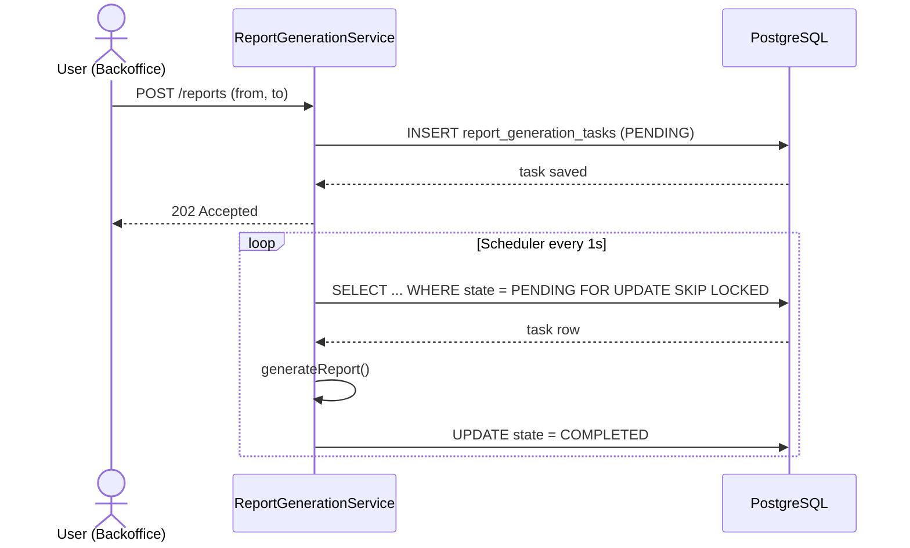
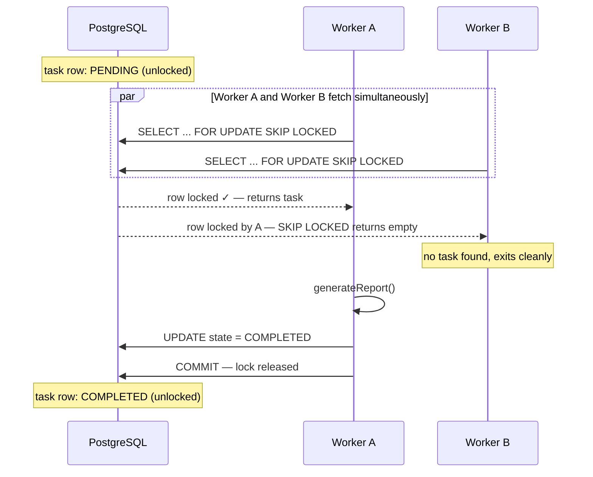
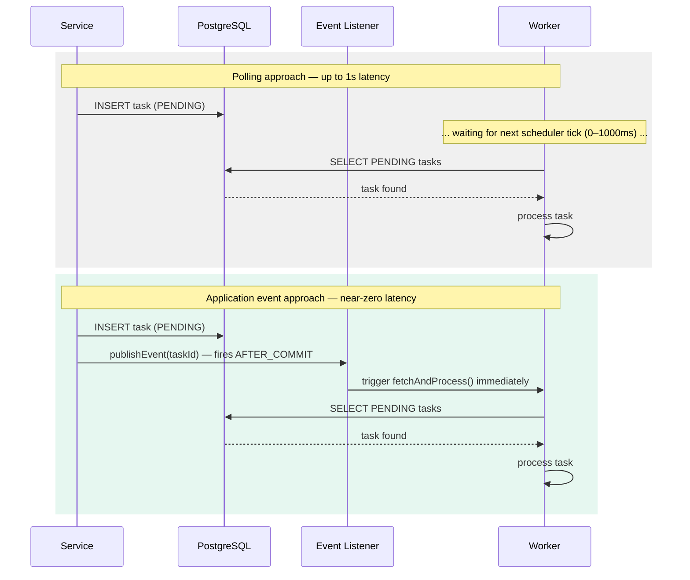
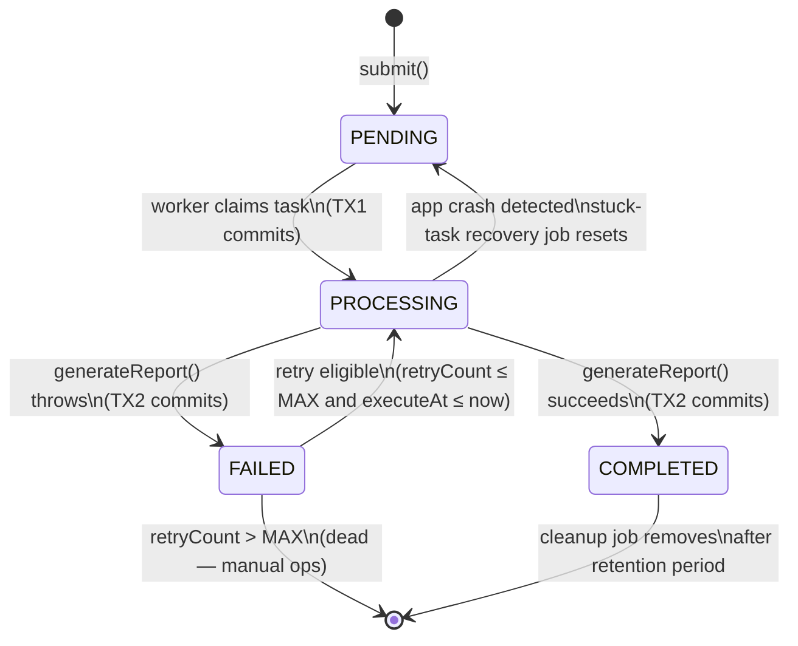
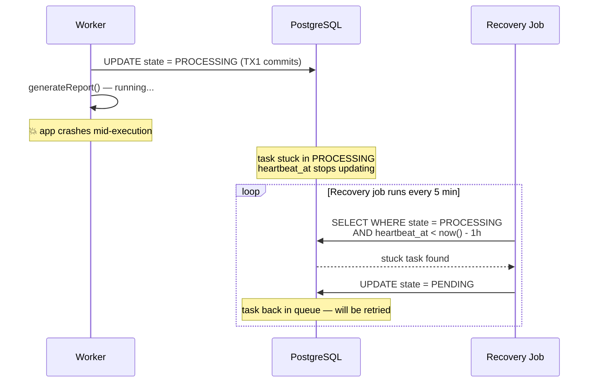
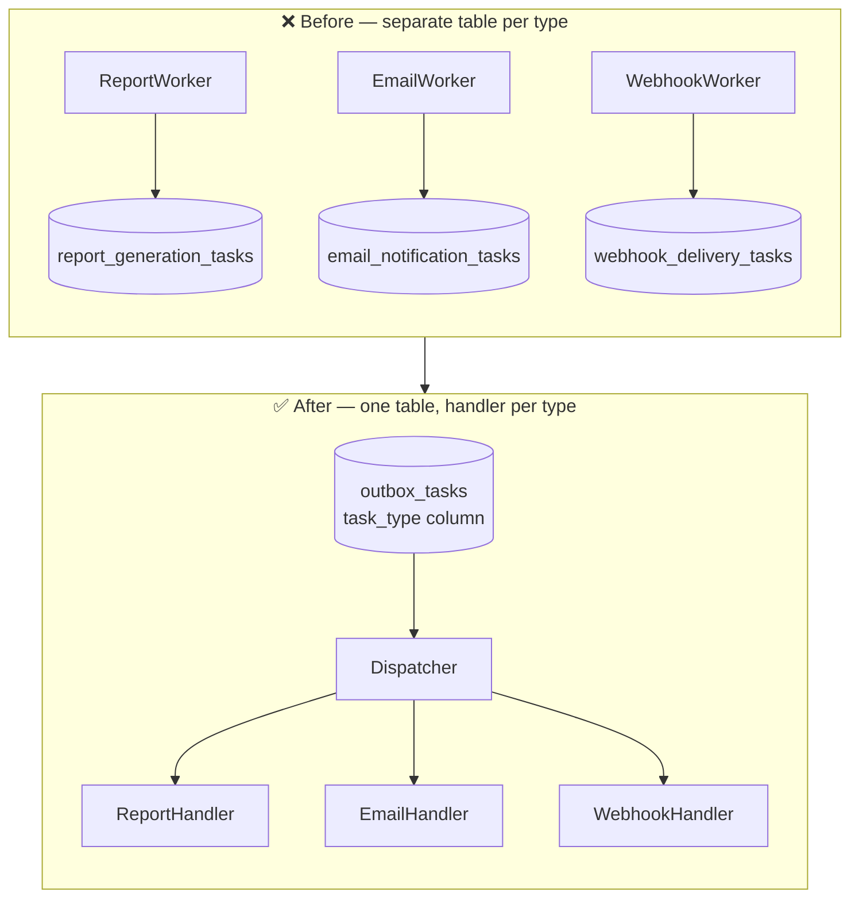

# Transactional Outbox 事务发件箱模式实战：从单个任务到生产级异步任务引擎

有一类 bug 在单元测试里永远不会出现，在预发环境里也罕见。它出现在生产环境，凌晨两点：
你的应用刚把一条记录存进数据库，接着尝试调用一个外部服务——然后其中一方失败了。
一边提交了。另一边没有。直到有用户投诉，才有人知道出了问题。

这就是**双写问题（dual-write problem）**，而事务发件箱（Transactional Outbox）模式是它的标准答案。
思路很简单：不要直接调用外部系统，而是把一个任务写进与业务变更相同的数据库事务里。
后台 worker 把它取出来执行。写入是原子的。任务不可能丢。

但基础思路之后的一切就少有人写了——任务失败怎么办？两个 worker 抢同一行怎么办？
应用在执行中途崩溃怎么办？十种不同类型的任务挤在同一张表里怎么办？当相关方问起
上周二凌晨 3 点队列深度为什么飙升时，你怎么回答？

这就是本文要覆盖的内容。

我会围绕一个具体场景——**报表生成服务**——一步一步把它从最简陋的发件箱演进到
我自己敢放进生产环境的形态。文中每一段代码都来自文末链接的真实可运行仓库。

技术栈：**Java、Spring Boot、PostgreSQL**。

<div class="post-tldr" markdown="1">
<p class="post-tldr-title">TL;DR</p>

- **Transactional Outbox 模式**通过在**同一个数据库事务**中写入任务行、再由后台 worker 执行的方式，解决双写问题。
- 用 `SELECT ... FOR UPDATE SKIP LOCKED` 轮询发件箱表，多个 worker 即可并发运行而不会重复处理。
- 生产级实现需要的不止基础思路：**状态机**、**带退避的重试**、恢复崩溃 worker 的**心跳/租约**、**顺序**保证，以及对队列深度的**监控**。
- 你不需要 Kafka——**仅靠 PostgreSQL** 就足以支撑可靠的异步执行。
</div>

---

## 业务场景



我们在做一个 CRM。用户可以在后台管理界面请求生成月度分析报表。生成一份报表意味着
聚合数千万行数据——可能耗时数分钟。显然，我们没法在一次 HTTP 请求里同步完成。

用户点击按钮。后端接受请求、保存、立即响应。后台 worker 领取任务、执行生成、
完成后更新状态。

这是发件箱能发挥作用的最简场景：天然就是异步的工作，用户本来就在等着看结果。

---

## 第一部分 — 最基础的发件箱

### 一张发件箱表需要什么

归根结底，任何发件箱表都需要三样东西：

- **状态（State）**——这个任务处于生命周期的哪个阶段？
- **载荷（Payload）**——到底要执行什么？
- **时间戳**——什么时候创建的，最后一次变更是什么时候？

```sql
CREATE TYPE task_state AS ENUM ('PENDING', 'COMPLETED');

CREATE TABLE report_generation_tasks (
                                       id         UUID       PRIMARY KEY DEFAULT gen_random_uuid(),
                                       state      task_state NOT NULL    DEFAULT 'PENDING',
                                       payload    JSONB      NOT NULL,
                                       created_at TIMESTAMP  NOT NULL    DEFAULT now(),
                                       updated_at TIMESTAMP  NOT NULL    DEFAULT now()
);
```

对我们这个场景，载荷就是一个日期区间：

```java
@Value
@Builder
@Jacksonized
public class ReportGenerationPayload {
  Instant from;
  Instant to;
}
```

JPA 实体：

```java
@Entity
@Table(name = "report_generation_tasks")
@Data
@Builder
@NoArgsConstructor
@AllArgsConstructor
public class ReportGenerationEntity {

    @Id
    @GeneratedValue(strategy = GenerationType.UUID)
    @Column(updatable = false, nullable = false)
    private UUID id;

    @Enumerated(EnumType.STRING)
    @Column(nullable = false, columnDefinition = "task_state")
    private TaskState state;

    @JdbcTypeCode(SqlTypes.JSON)
    @Column(nullable = false, updatable = false, columnDefinition = "jsonb")
    private ReportGenerationPayload payload;

    @CreationTimestamp
    @Column(nullable = false, updatable = false)
    private Instant createdAt;

    @UpdateTimestamp
    @Column(nullable = false)
    private Instant updatedAt;
}
```

提交一个任务：

```java
@Service
@RequiredArgsConstructor
public class ReportGenerationService {

    private final ReportGenerationRepository repository;

    public void submit(ReportGenerationCommand command) {
        repository.save(ReportGenerationEntity.builder()
                .state(TaskState.PENDING)
                .payload(ReportGenerationPayload.builder()
                        .from(command.getFrom())
                        .to(command.getTo())
                        .build())
                .build());
    }
}
```

### 后台 Worker

一个定时任务轮询待处理的任务并执行它们：

```java
@Component
@RequiredArgsConstructor
public class ReportGenerationScheduledJob {

    private final ReportGenerationTaskService taskService;

    @Scheduled(fixedDelay = 1000)
    public void run() {
        taskService.fetchAndProcess();
    }
}
```

```java
@Service
@RequiredArgsConstructor
public class ReportGenerationTaskService {

    private final ReportGenerationRepository repository;

    public void fetchAndProcess() {
        repository.findFirstByStateOrderByCreatedAt(TaskState.PENDING)
                .ifPresent(task -> {
                    generateReport(task);
                    task.setState(TaskState.COMPLETED);
                    repository.save(task);
                });
    }

    private void generateReport(ReportGenerationEntity task) {
        // actual report generation logic
    }
}
```

```java
public interface ReportGenerationRepository extends JpaRepository<ReportGenerationEntity, UUID> {
    Optional<ReportGenerationEntity> findFirstByStateOrderByCreatedAt(TaskState state);
}
```

在单实例、无故障的前提下，这样跑得起来。但在真实世界里它有两个问题：两个 worker
可能同时认领同一个任务，任务失败后也没有任何恢复路径。下面把这两个都修掉。

---

## 第二部分 — 并发：两个 Worker，一个任务

当两个调度线程——或两个应用实例——在同一时刻执行抓取查询时，双方都可能读到同一个
`PENDING` 行，并且都会去执行它。结果轻则是重复劳动，重则是状态被写坏。

解决办法是在抓取时就加数据库锁。PostgreSQL 的 `SELECT ... FOR UPDATE SKIP LOCKED`
正是为这种场景而生：它为当前事务锁住该行，并直接跳过已被其他事务锁定的行，而不是等待。

```java
public interface ReportGenerationRepository extends JpaRepository<ReportGenerationEntity, UUID> {

    @Lock(LockModeType.PESSIMISTIC_WRITE)
    @QueryHint(name = AvailableSettings.JAKARTA_LOCK_TIMEOUT, value = "-2") // -2 = SKIP_LOCKED
    Optional<ReportGenerationEntity> findFirstByStateOrderByCreatedAt(TaskState state);
}
```

提示值 `-2` 就是 Hibernate 翻译成 `SKIP LOCKED` 子句的来源。由于没有一等公民的注解可用，
值得把它抽成一个可复用的注解，免得这个魔法数字散落在各个 repository 里：

```java
@Retention(RetentionPolicy.RUNTIME)
@Target({ElementType.METHOD, ElementType.ANNOTATION_TYPE})
@QueryHints(@QueryHint(
    name = AvailableSettings.JAKARTA_LOCK_TIMEOUT,
    value = Timeouts.SKIP_LOCKED_MILLI + ""
))
public @interface SkipLocked {}
```

清爽多了。现在 repository 读出来的是意图，而不是管道代码：

```java
@SkipLocked
@Lock(LockModeType.PESSIMISTIC_WRITE)
Optional<ReportGenerationEntity> findFirstByStateOrderByCreatedAt(TaskState state);
```

你*可以*把整个抓取-执行-更新的循环包进一个事务、处理期间一直持有锁，但一般不应该这么做：

```java
// Technically works, but do not use this pattern for outbox processing.
@Transactional
public void fetchAndProcess() {
    repository.findFirstByStateOrderByCreatedAt(TaskState.PENDING)
            .ifPresent(task -> {
                generateReport(task);
                task.setState(TaskState.COMPLETED);
                repository.save(task);
            });
}
```



即使 `generateReport()` 足够小、技术上能跑通，在未提交的事务里执行发件箱动作也是反模式。
事务时长不应取决于发件箱执行的时长：这个动作可能随时间变慢、在 I/O 上阻塞，或者调用
下游服务，导致一条数据库连接和一把行锁被占住一段不可预测的时间。

正确的做法是：在一个短事务里把行置为 `PROCESSING` 完成认领，提交并释放锁，然后再执行
发件箱动作；之后再在另一个短事务里记录 `COMPLETED` 或 `FAILED`。下一节会实现这个状态
流转及其恢复路径。

---

## 第 2.5 部分 — 用应用事件降低抓取延迟

轮询调度器有一个天然的延迟下限。如果任务每秒触发一次，那么在 `t=0ms` 提交的任务要一直
处于 `PENDING`，直到下一个 tick——最多晚 1000ms。对大多数异步负载来说这可以接受。但如果你
想要近实时的拾取——发送事务性邮件、触发 webhook——就不行了。

这里借鉴了 Celery 的模式：先把发件箱实体存库，然后立即发布一个携带新任务 ID 的 Spring
`ApplicationEvent`。监听器接住它并马上触发处理，不必等下一个调度 tick。



调度器仍然作为兜底运行——它负责兜住事件监听器漏掉的一切（应用重启、监听器异常、
丢失的事件）。但正常路径完全绕过了轮询延迟。

### 具体实现

在 service 方法里、保存之后发布事件：

```java
@Service
@RequiredArgsConstructor
public class ReportGenerationService {

    private final ReportGenerationRepository repository;
    private final ApplicationEventPublisher eventPublisher;

    @Transactional
    public void submit(ReportGenerationCommand command) {
        var entity = repository.save(ReportGenerationEntity.builder()
                .state(TaskState.PENDING)
                .payload(ReportGenerationPayload.builder()
                        .from(command.getFrom())
                        .to(command.getTo())
                        .build())
                .build());

        eventPublisher.publishEvent(new ReportGenerationTaskSubmittedEvent(entity.getId()));
    }
}
```

```java
public record ReportGenerationTaskSubmittedEvent(UUID taskId) {}
```

监听器接收事件并立即触发处理：

```java
@Component
@RequiredArgsConstructor
public class ReportGenerationTaskEventListener {

    private final ReportGenerationTaskService taskService;

    @TransactionalEventListener(phase = TransactionPhase.AFTER_COMMIT)
    public void onTaskSubmitted(ReportGenerationTaskSubmittedEvent event) {
        taskService.fetchAndProcess();
    }
}
```

### 最经典的错误

这里最常见的错误是用 `@EventListener` 而不是
`@TransactionalEventListener(phase = TransactionPhase.AFTER_COMMIT)`。

`@EventListener` 在 `publishEvent()` 被调用的那一刻就触发——此时还处于**未提交的事务内**，
`INSERT` 尚未提交。监听器调用 `fetchAndProcess()`，按 ID 去数据库里查这个任务。行还不存在。
任务被静默跳过，事件丢失，而你还在纳闷为什么处理一直没启动——几秒之后调度器把它捞了起来，
日志里看起来一切正常。

```java
// ❌ fires inside the transaction — entity not visible to other connections yet
@EventListener
public void onTaskSubmitted(ReportGenerationTaskSubmittedEvent event) {
    taskService.fetchAndProcess();
}

// ✅ fires after COMMIT — entity is visible, fetch succeeds
@TransactionalEventListener(phase = TransactionPhase.AFTER_COMMIT)
public void onTaskSubmitted(ReportGenerationTaskSubmittedEvent event) {
    taskService.fetchAndProcess();
}
```

`AFTER_COMMIT` 保证监听器只在发布事件的事务完全提交之后运行。到那时，这行数据对所有
连接可见，抓取就能找到它。

调度器保持不变——它充当事件监听器漏掉任务的恢复机制。两种方式互补：事件负责延迟，
轮询负责可靠性。

---

## 第三部分 — 失败、重试与 PROCESSING 状态



发件箱动作不应该在未提交的数据库事务里执行。持锁事务的方式会在 `generateReport()` 的
整个执行期间占着一把数据库锁。对一份要跑两分钟的报表来说，就是两分钟的行锁——
一条连接被占死，其他数据库操作可能排在它后面。有了 `SKIP LOCKED`，worker 之间不会互相
阻塞，但长时间运行的事务仍会给连接池施压，让数据库在高负载下不好受。非常小的动作也许
技术上能不出问题，但把事务时长和发件箱执行时长绑在一起仍然是反模式。

修复办法是把「认领任务」和「执行任务」分开。先在一个短事务里把任务置为 `PROCESSING`，
释放锁，然后在任何事务之外做真正的工作。这样数据库只在开头和结尾被短暂触碰——昂贵的
部分发生在中间，不占用任何东西。

先扩展枚举：

```sql
ALTER TYPE task_state ADD VALUE 'PROCESSING';
ALTER TYPE task_state ADD VALUE 'FAILED';

ALTER TABLE report_generation_tasks
    ADD COLUMN retry_count  INTEGER NOT NULL DEFAULT 0,
    ADD COLUMN error_message VARCHAR;
```

`retry_count` 记录执行被尝试了多少次。我们把重试上限设为 10——超过这个数，说明真的出了
问题，需要人工介入。稍后会围绕它配置告警。`error_message` 存最后一次异常，这样你不用翻
日志就知道任务*为什么*卡住。

Java 枚举随之扩展：

```java
public enum TaskState {
    PENDING,
    PROCESSING,
    COMPLETED,
    FAILED
}
```

service 现在运行两个独立的短事务，真正的工作夹在中间：

```java
@RequiredArgsConstructor
public class ReportGenerationTaskService {

    private final ReportGenerationRepository repository;
    private final TransactionTemplate transactionTemplate;

    private static final int MAX_RETRY_COUNT = 10;

    public void fetchAndProcess() {
        transactionTemplate
                .execute(status ->
                        repository.findFirstEligibleTask(
                                List.of(TaskState.PENDING, TaskState.FAILED),
                                MAX_RETRY_COUNT
                        ).map(this::markProcessing))
                .ifPresentOrElse(
                        task -> {
                            try {
                                generateReport(task);
                                markCompleted(task);
                            } catch (Exception e) {
                                markFailed(task, e);
                                log.error("Task {} failed on attempt {}", task.getId(), task.getRetryCount(), e);
                            }
                        },
                        () -> log.debug("No eligible tasks to process")
                );
    }

    private ReportGenerationEntity markProcessing(ReportGenerationEntity task) {
        task.setState(TaskState.PROCESSING);
        return repository.save(task);
    }

    private void markCompleted(ReportGenerationEntity task) {
        task.setState(TaskState.COMPLETED);
        repository.save(task);
    }

    private void markFailed(ReportGenerationEntity task, Exception e) {
        task.setState(TaskState.FAILED);
        task.setRetryCount(task.getRetryCount() + 1);
        task.setErrorMessage(e.getMessage()); // don't skip this — it's the only trace of what went wrong without digging through logs
        repository.save(task);
    }
}
```

查询同时抓取 `PENDING` 和 `FAILED` 的任务——一个 `retryCount < 10` 的失败任务和新任务一样
有资格被处理。一旦重试次数触顶，任务不再被抓取，作为一条永久的 `FAILED` 记录躺在那里，
直到有人来看。这是刻意为之——超过 10 次尝试说明真的出了问题，需要人来处理，而不是再来
一次重试。

```java
@SkipLocked
@Lock(LockModeType.PESSIMISTIC_WRITE)
@Query("""
    SELECT t FROM ReportGenerationEntity t
    WHERE t.state IN :states
      AND t.retryCount <= :maxRetryCount
    ORDER BY t.createdAt ASC
    LIMIT 1
    """)
Optional<ReportGenerationEntity> findFirstEligibleTask(
    @Param("states") List<TaskState> states,
    @Param("maxRetryCount") Integer maxRetryCount
);
```

但等等——一个刚失败的任务，真的应该在下一个调度 tick、几秒之后就被再次拾取吗？如果下游
系统挂了，每秒锤它一次只会雪上加霜。这正是下一节要解决的。

## 第四部分 — 指数退避

如果重试之间没有间隔，失败的任务会在下一个调度 tick 重新入队——通常就是几秒之后。如果
下游系统挂了，你正在以全速轮询频率锤它。这对下游系统有害，对你的数据库也有害。

修复办法是加一个 `execute_at` 列：在这个时间戳过去之前，任务不具备被处理的资格。新任务
设 `execute_at = now()`，立即可以被拾取。失败的任务设 `execute_at = now() + delay`，延迟随
每次重试递增。

```sql
ALTER TABLE report_generation_tasks
    ADD COLUMN execute_at TIMESTAMP NOT NULL DEFAULT NOW();
```

延迟表决定了一切——`MAX_RETRY_COUNT` 由它推导而来，而不是单独声明。这样两者永远不会
失去同步：

```java
private static final Map<Integer, Duration> RETRY_DELAYS = Map.of(
    0, Duration.ofMinutes(1),
    1, Duration.ofMinutes(5),
    2, Duration.ofMinutes(15),
    3, Duration.ofMinutes(30),
    4, Duration.ofHours(1),
    5, Duration.ofHours(2),
    6, Duration.ofHours(4),
    7, Duration.ofHours(8),
    8, Duration.ofHours(12),
    9, Duration.ofDays(1)
);

private static final int MAX_RETRY_COUNT = RETRY_DELAYS.size();
```

往 `RETRY_DELAYS` 里加一项，重试上限就会自动更新。不需要在其他地方再维护一个魔法数字。

在 `markFailed()` 里，先取*当前*的重试次数再自增——它用来选出*下一次*尝试的延迟：

```java
private void markFailed(ReportGenerationEntity task, Exception e) {
    int currentRetry = task.getRetryCount();
    task.setState(TaskState.FAILED);
    task.setRetryCount(currentRetry + 1);
    task.setErrorMessage(e.getMessage());
    task.setExecuteAt(Instant.now().plus(
            RETRY_DELAYS.getOrDefault(currentRetry, RETRY_DELAYS.get(RETRY_DELAYS.size() - 1))));
    repository.save(task);
}
```

调度器保持原来的频率运行。它只是跳过窗口还没打开的任务。失败的任务安静地等到属于自己的
时刻，然后自然地重新入队。

---

## 第五部分 — 卡死任务与心跳



采用双事务方案后，想一想：如果应用在把任务置为 `PROCESSING` 之后、置为 `COMPLETED` 或
`FAILED` 之前崩溃了，会发生什么？数据库显示 `PROCESSING`。没有人在处理它。它永远躺在那里。

朴素的修复是一个恢复任务：找出在 `PROCESSING` 状态停留过久的任务，重置回 `PENDING`：

```java
@Transactional
public void recoverStuckTasks() {
    repository.findFirstByStateAndUpdatedAtLessThan(
                    TaskState.PROCESSING,
                    Instant.now().minus(1, ChronoUnit.HOURS))
            .ifPresent(task -> {
                log.warn("Resetting stuck task {} to PENDING", task.getId());
                task.setState(TaskState.PENDING);
                repository.save(task);
            });
}
```

大多数情况下这能工作。问题在于：只要行上*任何*内容变化，`updated_at` 都会更新——包括
无关的状态流转。一个合法地处理了 55 分钟的任务，从 `updated_at` 的角度看和一个崩溃的
任务一模一样。

更干净的方案是**心跳（heartbeat）**：一个专用列，*只在任务正被积极处理时*周期性地更新它。
恢复任务改为检查这个列，而不是 `updated_at`。一个最近一小时没有心跳的任务，才是真正
卡死的任务。

```sql
ALTER TABLE report_generation_tasks ADD COLUMN heartbeat_at TIMESTAMP;
```

心跳运行在自己的线程上、自己的事务里，独立于处理逻辑。最干净的实现是
`try-with-resources`——处理开始时启动，任何退出路径上停止：

```java
public abstract class Heartbeat implements AutoCloseable {

    private final ScheduledExecutorService executor;

    protected Heartbeat(Runnable heartbeatFn) {
        executor = Executors.newSingleThreadScheduledExecutor();
        executor.scheduleAtFixedRate(heartbeatFn, 0, 10, TimeUnit.SECONDS);
    }

    @Override
    public void close() {
        executor.shutdownNow();
    }
}
```

```java
public class ReportGenerationTaskHeartbeat extends Heartbeat {

    ReportGenerationTaskHeartbeat(UUID taskId, ReportGenerationRepository repository) {
        super(() -> repository.updateHeartbeatAt(taskId, Instant.now()));
    }
}
```

repository 方法自带 `@Transactional`——不需要手动包一层事务：

```java
@Modifying
@Transactional
@Query("UPDATE ReportGenerationTaskEntity t SET t.heartbeatAt = :now WHERE t.id = :id")
void updateHeartbeatAt(@Param("id") UUID id, @Param("now") Instant now);
```

通过工厂接入，让 service 保持干净：

```java
@Component
@RequiredArgsConstructor
public class ReportGenerationTaskHeartbeatFactory {

    private final ReportGenerationRepository repository;

    public Heartbeat start(UUID taskId) {
        return new ReportGenerationTaskHeartbeat(taskId, repository);
    }
}
```

处理代码块现在长这样：

```java
public void fetchAndProcess() {
    transactionTemplate
            .execute(status -> repository.findFirstEligibleTask(
                    List.of(TaskState.PENDING, TaskState.FAILED),
                    MAX_RETRY_COUNT
            ).map(this::markProcessing))
            .ifPresentOrElse(
                    task -> {
                        try (var heartbeat = heartbeatFactory.start(task.getId())) {
                            try {
                                generateReport(task);
                                markCompleted(task);
                            } catch (Exception e) {
                                markFailed(task, e);
                                log.error("Task {} failed", task.getId(), e);
                            }
                        }
                    },
                    () -> log.debug("No eligible tasks to process")
            );
}
```

恢复任务改用 `heartbeat_at` 而不是 `updated_at`：

```java
@Modifying
@Transactional
@Query("UPDATE ReportGenerationEntity t SET t.heartbeatAt = :now WHERE t.id = :id")
void updateHeartbeatAt(@Param("id") UUID id, @Param("now") Instant now);

Optional<ReportGenerationEntity> findFirstByStateAndHeartbeatAtLessThan(
        TaskState state, Instant threshold);
```

`updated_at` 反映任务状态最后一次变更的时间。`heartbeat_at` 反映任务此刻是否还活着。
把两者分开，意味着你可以无歧义地同时回答这两个问题。

---

## 第六部分 — 多类型发件箱



六个月后，你的服务不只处理报表生成了。你需要邮件通知。然后是数据导出。然后是
webhook 投递。

你有两个选择：每种任务类型一张独立的表，或者一张共享表加一个 `task_type` 判别列。
当任务类型众多、而你又愿意从一个地方统一处理时，共享表更优。基础设施——重试、心跳、
退避、监控——都留在同一个地方。新增一种任务类型只是多写一个 handler。

值得提前知道的取舍：

- 一种行为不端的新任务类型可能拖慢所有其他类型——一个疯狂重试的坏 handler 会在整张表上
  制造背压。
- 顺序保证变得更难——下面细说。

### 表结构

```sql
CREATE TYPE outbox_task_type AS ENUM ('REPORT_GENERATION', 'EMAIL_NOTIFICATION');

CREATE TABLE outbox_tasks (
    id            UUID             PRIMARY KEY DEFAULT gen_random_uuid(),
    task_type     outbox_task_type NOT NULL,
    state         task_state       NOT NULL    DEFAULT 'PENDING',
    payload       JSONB            NOT NULL,
    retry_count   INTEGER          NOT NULL    DEFAULT 0,
    error_message VARCHAR,
    execute_at    TIMESTAMPTZ      NOT NULL    DEFAULT NOW(),
    heartbeat_at  TIMESTAMPTZ,
    created_at    TIMESTAMPTZ      NOT NULL    DEFAULT now(),
    updated_at    TIMESTAMPTZ      NOT NULL    DEFAULT now()
);
```

### Handler 接口

关键的扩展点——每种任务类型一个实现：

```java
public interface OutboxTaskHandler<P> {
    OutboxTaskType getType();
    Class<P> payloadClass();
    void handle(UUID taskId, P payload) throws Exception;
}
```

`taskId` 被传入每个 handler。原因会在幂等性那一节揭晓。

一个具体的 handler：

```java
@Component
public class EmailNotificationHandler implements OutboxTaskHandler<EmailNotificationPayload> {

    @Override
    public OutboxTaskType getType() {
        return OutboxTaskType.EMAIL_NOTIFICATION;
    }

    @Override
    public Class<EmailNotificationPayload> payloadClass() {
        return EmailNotificationPayload.class;
    }

    @Override
    public void handle(UUID taskId, EmailNotificationPayload payload) throws Exception {
        log.info("Sending email to {} — task {}", payload.getRecipient(), taskId);
        // call email provider
    }
}
```

### 调度器（Dispatcher）

service 在启动时收集所有 handler bean，构建一张查找表，然后按 `taskType` 为每个任务路由：

```java
@Service
@RequiredArgsConstructor
public class OutboxTaskService {

    private final OutboxTaskRepository repository;
    private final ObjectMapper objectMapper;
    private final List<OutboxTaskHandler<?>> handlerList;

    private Map<OutboxTaskType, OutboxTaskHandler<?>> handlers;

    @PostConstruct
    void init() {
        handlers = handlerList.stream()
                .collect(Collectors.toMap(OutboxTaskHandler::getType, Function.identity()));
    }

    @SuppressWarnings("unchecked")
    private void dispatch(OutboxTaskEntity task) throws Exception {
        var handler = (OutboxTaskHandler<Object>) handlers.get(task.getTaskType());
        if (handler == null) {
            throw new IllegalStateException(
                    "No handler registered for task type: " + task.getTaskType());
        }
        var payload = objectMapper.readValue(task.getPayload(), handler.payloadClass());
        handler.handle(task.getId(), payload);
    }
}
```

注册一种新任务类型的步骤：加一个枚举值，加一个 handler bean，完事。调度器、定时任务、
重试逻辑——全都不用动。

---

## 第七部分 — 顺序保证

如果你的场景不在乎处理顺序——即发即忘的通知、相互独立的后台任务——可以跳过这一节。
但即便如此，先取先插入的任务也是更「老实」的行为：先提交的任务等得更久，按提交顺序
处理它们才符合用户的合理预期。

没有显式 `ORDER BY` 时，PostgreSQL 对行的返回顺序**不作任何保证**。抓取查询里永远按
`created_at ASC` 排序：

```java
@Query("""
    SELECT t FROM OutboxTaskEntity t
    WHERE t.state IN :states
      AND t.retryCount <= :maxRetryCount
      AND t.executeAt <= :now
    ORDER BY t.createdAt ASC
    LIMIT 1
    """)
Optional<OutboxTaskEntity> findFirstEligibleTask(...);
```

再用一个部分索引支撑它：

```sql
CREATE INDEX idx_outbox_fetch
    ON outbox_tasks (created_at ASC)
    WHERE state IN ('PENDING', 'FAILED');
```

### 时钟偏移的陷阱

首先要诚实地问自己：这对你的场景到底重不重要。如果任务之间相互独立——报表生成、
发邮件、webhook 投递——处理顺序通常完全无所谓。任务 A 比任务 B 先完成，无论谁先提交，
都没问题。这种情况下，整节内容都与你无关。

如果你确实需要 FIFO——同一实体的多个任务必须按提交顺序处理——那接着往下读。

问题在于 `created_at` 是在应用侧生成的。每个应用实例都有自己的系统时钟。如果实例 A 的
时钟比实例 B 快 200ms，B 在 `t=100ms` 提交的任务拿到的 `created_at` 会早于 A 在 `t=50ms`
提交的任务——尽管 A 的任务先插入。抓取查询按 `created_at` 排序，会先取到 B 的任务。
提交顺序被颠倒了。

NTP 能让时钟接近同步，但做不到完全一致。正常情况下偏差是毫秒级。高负载下、虚拟机迁移
期间、或容器重启之后，偏差可能更大。

修复办法是把排序值放到数据库侧生成——要么让 PostgreSQL 通过 `DEFAULT now()` 来赋
`created_at`，而不是让应用设置它；要么使用由数据库支撑的序列（sequence），无论哪个实例
插入，它都保证单调递增。下面是序列方案：

```sql
ALTER TABLE outbox_tasks ADD COLUMN seq BIGSERIAL;
```

```java
@Column(insertable = false, updatable = false)
private Long seq;
```

按 `seq ASC` 排序。这个值由唯一的权威来源——数据库——分配，因此它反映真实的插入顺序，
与哪个实例提交了任务、那台实例的时钟说了什么无关。

`created_at` 留着做可观测性。排序用 `seq`。

如果严格的 FIFO 在你的系统里很重要——别忘掉这一条。

---

## 第八部分 — 让表在大规模下保持高性能的索引

你的发件箱表每秒被轮询一次，甚至一秒多次。表里的每一行要么是活跃工作（`PENDING`、
`FAILED`、`PROCESSING`），要么是历史噪音（`COMPLETED`）。索引不对，每次轮询都要扫描
整张表去找那一小撮符合条件的行。

正确的工具是**部分索引（partial index）**——只包含满足谓词的行。当任务流转到
`COMPLETED`，它会自动从部分索引中掉出去。无论这张表历史上处理过多少任务，索引永远
保持很小。

### 抓取索引 — 热点路径

为抓取查询建索引：

```sql
CREATE INDEX idx_outbox_fetch
    ON outbox_tasks (created_at ASC)
    WHERE state IN ('PENDING', 'FAILED');
```

实测过程：插入 50,000 行、其中只有 7 行处于 `PENDING` 状态，开启 Hibernate 的 SQL debug
日志拿到控制台里实际生成的查询，对这段 SQL 跑 `EXPLAIN ANALYZE`：

```
Limit  (cost=0.14..27.50 rows=1 width=102) (actual time=0.082..0.084 rows=1 loops=1)
  ->  LockRows  (actual time=0.081..0.082 rows=1 loops=1)
        ->  Index Scan using idx_outbox_fetch on outbox_tasks
              (actual time=0.030..0.030 rows=1 loops=1)
Planning Time: 1.230 ms
Execution Time: 0.139 ms
```

0.03ms 找到最旧的合格任务。那 49,993 行 `COMPLETED` 从未被读取。我对这个结果很满意。

另外两个后台操作各配一个索引：

给恢复任务用：

```sql
CREATE INDEX idx_outbox_stuck
    ON outbox_tasks (heartbeat_at ASC, created_at ASC)
    WHERE state = 'PROCESSING';
```

给清理任务用：

```sql
CREATE INDEX idx_outbox_cleanup
    ON outbox_tasks (updated_at ASC)
    WHERE state = 'COMPLETED';
```

---

## 第九部分 — 数据清理

你的发件箱是一张运维性质的表。每一次抓取查询都要扫它。老行就是死重量。

规则：只删除 **`COMPLETED`** 的任务。`FAILED` 的任务是你的审计线索。别动它们。需要时
人工处理，或者交给独立的运维流程。

```java
@Modifying
@Transactional
@Query("""
    DELETE FROM OutboxTaskEntity t
    WHERE t.state IN :states
      AND t.updatedAt < :before
    """)
int deleteByStateInAndUpdatedAtBefore(
    @Param("states") List<TaskState> states,
    @Param("before") Instant before
);
```

```java
private static final int CLEANUP_RETENTION_DAYS = 30;

@Transactional
public void cleanup() {
    var cutoff = Instant.now().minus(CLEANUP_RETENTION_DAYS, ChronoUnit.DAYS);
    int deleted = repository.deleteByStateInAndUpdatedAtBefore(
            List.of(TaskState.COMPLETED), cutoff);
    log.info("Cleanup: removed {} completed tasks older than {} days", deleted, CLEANUP_RETENTION_DAYS);
}
```

保留多久：我见过从 1 天到 3 个月的各种做法。拿不准就留久一点。保留老行的代价是表稍微
大一点；过早删除的代价是，在你最需要排查的那一天丢掉了调试历史。

---

## 第十部分 — 幂等性：让重试变得安全

这套架构里的任何机制都不保证恰好一次（exactly-once）执行。任务执行和状态更新为
`COMPLETED` 是两个独立的操作。如果应用在执行之后、状态更新提交之前崩溃，任务会被重试。
它会带着相同的输入再跑一遍。

这是**至少一次（at-least-once）**投递——也是这里唯一能给出的保证。问题只在于：重复执行
会不会造成伤害。

如果任务天然幂等（同一份报表生成两次得到同样的结果），那就没事。如果它有副作用
（发邮件、扣款），重复就是事故。

修复：在 handler 内部用发件箱任务自己的 `id` 作为幂等键。任务 ID 在重试之间是稳定的——
同一行永远不变。handler 检查这个 ID 对应的工作是否已经记录过。如果是，就直接跳过。

在我们的例子里，报表生成以向 `generated_reports` 插入一行收尾——那就是「工作已完成」的
凭证。我们在 `idempotency_key` 上加 `UNIQUE` 约束，这样即使两个实例赛跑，也只有一个
INSERT 能成功，另一个收到约束冲突，并把它当作成功的 no-op：

```sql
CREATE TABLE generated_reports (
    id               UUID        PRIMARY KEY DEFAULT gen_random_uuid(),
    idempotency_key  UUID        NOT NULL,
    report_path      VARCHAR     NOT NULL,
    created_at       TIMESTAMPTZ NOT NULL    DEFAULT now(),

    CONSTRAINT uq_generated_reports_idempotency_key UNIQUE (idempotency_key)
);
```

```java
@Component
@RequiredArgsConstructor
public class ReportGenerationHandler implements OutboxTaskHandler<ReportGenerationPayload> {

    private final GeneratedReportRepository reports;

    @Override
    public void handle(UUID taskId, ReportGenerationPayload payload) {
        if (reports.existsByIdempotencyKey(taskId)) {
            log.info("Report already generated for task {} — skipping", taskId);
            return;
        }

        var reportPath = runReportGeneration(payload);

        reports.save(GeneratedReport.builder()
                .idempotencyKey(taskId)
                .reportPath(reportPath)
                .build());
    }
}
```

如果你的任务调用的是外部 API 而不是写库，先看看那个 API 是否支持幂等键——大多数支付
处理方和事务性邮件服务商都支持。按 API 要求的形式（header、body 字段、query 参数）把
发件箱任务 ID 作为幂等键传过去。远端服务会在它们那边做去重。

---

## 第十一部分 — 监控

发件箱在后台安静地运行。它正常工作时，没人注意。它坏掉时，同样没人注意——至少不会立刻
注意到。任务越积越多。下游服务收不到事件。等有人想起来看日志，已经过去两个小时了。

按照 Google SRE 模型，三个信号完整覆盖故障空间：

- **延迟（Latency）**——每个任务从被拾取到完成要多久？这里飙升意味着 handler 变慢或数据库承压。
- **吞吐（Throughput）**——单位时间内有多少任务完成？跌到零意味着调度器没在运行，或者没有任务被认领。
- **错误率（Error rate）**——多大比例的尝试以失败告终？超过约 5% 意味着某个下游依赖已劣化，重试积压正在增长。


### 埋点

往 `build.gradle.kts` 里加：

```kotlin
implementation("org.springframework.boot:spring-boot-starter-actuator")
implementation("io.micrometer:micrometer-registry-prometheus")
```

注册一次 `@Timed` 的 AOP 切面：

```java
@Bean
public TimedAspect timedAspect(MeterRegistry registry) {
    return new TimedAspect(registry);
}
```

指标名保持为常量，并从一个专门的组件递增——不要散落在各个 service 方法里：

```java
@Component
@RequiredArgsConstructor
public class OutboxMetrics {

  private static final String TASK_PROCESSED = "outbox.task.processed";
  private static final String OUTCOME_TAG    = "outcome";
  private static final String COMPLETED      = "completed";
  private static final String FAILED         = "failed";

  private final MeterRegistry meterRegistry;
  private final ReportGenerationRepository repository;

  public void recordCompleted() {
    meterRegistry.counter(TASK_PROCESSED, OUTCOME_TAG, COMPLETED).increment();
  }

  public void recordFailed() {
    meterRegistry.counter(TASK_PROCESSED, OUTCOME_TAG, FAILED).increment();
  }

  @PostConstruct
  void registerGauge() {
    Gauge.builder("outbox.tasks.pending", repository,
                    repo -> repo.countByStateIn(List.of(TaskState.PENDING, TaskState.FAILED)))
            .description("Tasks waiting to be processed")
            .register(meterRegistry);
  }
}
```

之后 service 只需要调用 `metrics.recordCompleted()` 和 `metrics.recordFailed()`——业务逻辑里
不出现裸字符串。

启动之后，`curl localhost:8080/actuator/prometheus | grep outbox` 会给你：

```
outbox_task_duration_seconds{quantile="0.5"}  0.062
outbox_task_duration_seconds{quantile="0.95"} 0.145
outbox_task_duration_seconds{quantile="0.99"} 0.312
outbox_task_processed_total{outcome="completed"} 40.0
outbox_task_processed_total{outcome="failed"}    2.0
outbox_tasks_pending 0.0
```

### 告警

大盘是给盯着屏幕的人看的。告警是给睡着的人用的。

| 告警 | 触发条件 | 持续窗口 | 含义 |
|---|---|---|---|
| `OutboxQueueBacklog` | pending > 50 | 5m | 处理速度跟不上写入速度 |
| `OutboxHighErrorRate` | 错误率 > 5% | 2m | handler 或下游已劣化 |
| `OutboxSlowProcessing` | p99 延迟 > 30s | 5m | 数据库争用或外部调用变慢 |
| `OutboxStuckTasks` | pending > 0 且 10 分钟内零完成 | 10m | 调度器崩溃或所有 worker 卡死 |

阈值要按你自己的负载来调。对高吞吐服务来说，队列深度 50 可能是常态。对一个低流量的
内部工具，哪怕只有 5 个任务滞留 5 分钟也值得看一眼。信号逻辑是一样的，只是数字不同。

---

## 生产上线检查清单

把任何发件箱推向生产之前：

```
☐ 索引高效 — PENDING/FAILED 与 PROCESSING 状态上建有部分索引
☐ EXPLAIN ANALYZE 确认抓取查询用上了索引
☐ 顺序不构成问题 — ORDER BY seq 或 created_at，且有索引支撑
☐ 已处理数据的清理任务在运行，COMPLETED 行在保留期后被删除
☐ 有副作用的 handler 内部处理了幂等
☐ 指数退避已接好 — 或确认本场景不需要
☐ 指标就位 — 队列深度、吞吐、错误率、延迟
☐ 告警已配置 — 积压、错误率、延迟、卡死任务
```

---

## 生态盘点 — 你不必事事自己造轮子

本文描述的一切你都可以自己动手实现——而且至少亲手做一次确实有价值。你会真正理解故障
模式、索引选择、顺序陷阱，因为你是围绕它们设计的。这些知识在你切换到某个库之后也不会
消失。

但在生产环境里，你往往不需要自己维护这套东西。

---

**[db-scheduler](https://github.com/kagkarlsson/db-scheduler)** — Gustav Karlsson 开发的面向
Java 的持久化、集群友好调度器。这是我会反复回用的库，也是内部实现与本文所构建的东西最
接近的一个。它使用单张数据库表、基于 `SKIP LOCKED` 的悲观锁、检测卡死任务的心跳，以及
干净的 task/handler 接口。当我设计自研发件箱时，我会把 db-scheduler 当作参考实现——它的
接口、模式、故障处理都靠得住。如果你在启动一个新项目，想要一个久经考验的地基而不是自己
造轮子，从这里开始。它的抽象足够薄，你在源码里能认出本文里的每一个概念。

---

**[Celery](https://docs.celeryq.dev/)** — Python 生态里事实标准的异步任务执行框架。Celery
支持 PostgreSQL 作为结果后端（result backend），支持 Redis 或 RabbitMQ 作为 broker。
第 2.5 节的 `AFTER_COMMIT` 模式在这里同样适用——只在事务提交之后再投递给 Celery，
不要在事务内投递。

---

**[Quartz Scheduler](https://www.quartz-scheduler.org/)** — 老牌的 Java 调度库，基于 JDBC 做
任务持久化。比发件箱更通用，带 cron 表达式、触发器和 job store。运维开销比 db-scheduler
高，API 按现代标准也偏啰嗦，但它在大规模场景久经考验，并通过 `spring-boot-starter-quartz`
与 Spring 有一等公民级的集成。

---

## 写在最后

这篇文章里的大部分内容并不是什么聪明的工程——而是积累下来的伤疤。`PROCESSING` 状态的
存在，是因为某个人的应用崩过。心跳的存在，是因为 `updated_at` 撒过谎。部分索引的存在，
是因为按轮询频率进行的全表扫描会安静地复利累积，直到某一天不再安静。`AFTER_COMMIT`
监听器的存在，是因为有人在事务里发布过事件，然后花了几个小时调试它为什么永远不触发。

每一块单独看都很无趣。合在一起，它们区分的是「在开发环境能跑的发件箱」和「凌晨 3 点你
也敢信的发件箱」。

---

## 示例代码

本文代码见 **[github.com/javaAndScriptDeveloper/outboxes-article](https://github.com/javaAndScriptDeveloper/outboxes-article)**。一条命令即可在本地跑起来。

---

## 欢迎交流

如果你踩到了我漏掉的东西，或者你在自己的系统里用别的方式解决了其中某个问题——我是真的
想听听。联系方式见页脚。
